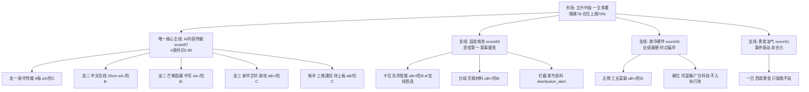

# 2026年10月12日（周一盘前）· **R5 个股画像**

> **数据源新鲜度**: ok（行情 T-1=1009 收盘，全部 MCP 实时/当日快照）
> **降级状态**: false（14/14 票六维数据齐备）
> **置信度**: 0.70

## 一句话结论
**只认 AI 内容总主线龙头/龙二（新华传媒/中文在线/芒果超媒），支线只卡先导智能一个位；紫竹高科霸榜出货三红旗拦截，液冷双票破位不接飞刀。**

## 一、候选池结构（14 只 = 5 主线 + 9 支线）

R2 leaders=5 已满足 ≥5，**未触发 top10 扩池**；9 只支线票来自 R2 secondary_lines（固态 5 / 液冷 3 / 黄金 1），按 skill v1.4 全部标 `r2_watch_pool`，D1 默认进 watch 而非 execution。

## 二、六维评分总表（按综合分排序）

| 代码 | 名称 | 角色 | 龙头判定 | 综合 | α档 | 险档 | 流通亿 | PE | 30日涨幅 | 量比5 | 主要红旗 |
|---|---|---|---|---|---|---|---|---|---|---|---|
| 600825.SH | 新华传媒 | 龙一 | 龙头 | 68.3 | A | C | 130.9 | 306.8 | 147.6% | 2.11 | extreme_height_9board,lhb_net_sell |
| 300364.SZ | 中文在线 | 龙二 | 龙头 | 67.3 | A- | B- | 161.8 | 亏 | 5.9% | 0.82 | lhb_duizhao_suspect,loss_making |
| 300413.SZ | 芒果超媒 | 龙二 | 龙头 | 66.2 | A- | B- | 235.0 | 64.7 | 50.8% | 0.85 | lhb_net_sell,inst_net_sell |
| 300450.SZ | 先导智能 | 固态设备龙头 | 龙头(支线) | 63.3 | B+ | B | 572.8 | 34.6 | 10.2% | 3.74 | secondary_line_kapwei,pullback_after_high |
| 601811.SH | 新华文轩 | 龙三 | 补涨/跟风 | 63.1 | B+ | C | 165.6 | 18.9 | 73.7% | 6.76 | seal_open_3_times,lhb_net_sell_history |
| 002709.SZ | 天赐材料 | 电解液+固态 | 龙头(支线分歧) | 56.0 | B+ | B- | 538.4 | 18.4 | -3.8% | 2.0 | secondary_line,weekly_bear |
| 601138.SH | 工业富联 | AI服务器总龙 | 龙头(左侧) | 51.7 | B+ | B- | 11126.6 | 23.7 | -9.8% | 0.72 | left_side_hardware,daily_bear |
| 002115.SZ | 三维通信 | 候补 | 孤军/待确认 | 50.8 | B | C | 71.3 | 222.3 | -8.4% | 0.76 | no_limit_confirm,downtrend |
| 300821.SZ | 东岳硅材 | 硅能源20cm边缘 | 补涨/边缘 | 49.2 | B | B- | 205.8 | 56.0 | -0.9% | 1.09 | 20cm_first_board,edge_theme_silicon |
| 603200.SH | 上海洗霸 | 固态电解质卡位 | 卡位(分歧) | 48.7 | B | C | 94.6 | 亏 | 53.1% | 2.0 | loss_making,lhb_net_sell |
| 601069.SH | 西部黄金 | 黄金首板 | 事件驱动/一日 | 47.8 | B- | C | 235.5 | 27.3 | -14.1% | 0.56 | event_driven,weekly_bear |
| 001389.SZ | 广合科技 | 算力PCB业绩 | 非候选(高位波动) | 45.7 | B | C | 235.4 | 49.4 | 1.1% | 1.4 | high_volatility,seal_open_12 |
| 301086.SZ | 鸿富瀚 | 液冷板业绩 | 非候选(破位) | 43.6 | B | C | 97.8 | 116.2 | 16.9% | 0.62 | breakdown,daily_bear_60m |
| 002058.SZ | 紫竹高科 | 电池4板高度标 | 补涨/高风险 | 41.0 | B- | C | 35.0 | 104.1 | 51.2% | 1.28 | distribution_alert,lhb_net_sell |

> 档位语义：α=进攻确定性（A+→C），险=风险度（**A 最安全**→C 最危险）。`distribution_alert` 票险档不得优于 B-。

## 三、首推票深度画像（执行池候选）

### 新华传媒（600825.SH）· 龙一(9板高度总龙) · 综合 68.3 · α A / 险 C

**9天9板全场唯一最高标·9:25一字0开板·封单14.21亿全场最大·板块宽度充分(AI内容11席)·启动日即上榜带动性最强；但30日+147.6%获利盘极端、PE306**

| 催化 | 筹码 | 板块 | 估值 | 技术 | 机构 |
|---|---|---|---|---|---|
| 催化 90 | 筹码 52 | 板块 92 | 估值 28 | 技术 80 | 机构 55 |

- **大资金意图**: 龙虎榜7次登榜(涨幅偏离)，1009龙虎榜净卖-0.63亿上诱多榜(涨停净卖出)；主力当日净流出-5.89亿/5日-9.48亿；融资余额13日可得；股东户数-4.3%微集中；无机构席位净买证据。高位筹码松动，靠情绪封单维系（主力当日 -5.89 亿 / 5日 -9.48 亿）
- **为什么走强**: R4 E005(high):字节PineDrama 9月下载破1亿/Q2激增460%+微信上线官方短剧'绿泡泡'，Sensor Tower+华福专家会+涨停三源；短剧/AI应用热度全场第一
- **逻辑够不够硬**: AI内容传媒主线score87(热度19/涨停19/叙事17/共振18)，四源共识0.90全场最高；出版国资联动+20cm弹性+容量中军梯队完整，是绝对情绪锚。风险：板块5日主力累计-73.1亿仅1009单日转强
- **估值安全垫**: 流通市值130.9亿；PE_TTM=306.8/PB=5.21极端高估；2026H1 ROE仅1.31%、净利率5.18%、净利同比+1.3%，纯情绪估值无业绩支撑；负债率33.9%健康；属高成长叙事但PEG不可算
- **技术形态（chart_vision·snapshot·偏多/0.82）**: 日K 多头排列 / 周K 震荡；新华传媒于2026年10月9日收出日K级别的涨停板，刷新20日高点，日线、60分钟、15分钟级别均线均呈多头排列，成功突破周线级别长期盘整的平台，短期上行动能充足。连续拉升后积累了较多获利盘，后续需关注盘面承接力度，警惕短期获利盘兑现的回调风险。
- **机构面**: 7次龙虎榜均为游资涨幅偏离席位，无机构专用净买；dc人气2/ths热股4双榜；国泰海通总部等游资参与。机构属性极弱，纯游资+散户情绪票
- **龙头判定（高度+封板时间+板块效应）**: 9天9板全场唯一最高标·9:25一字0开板·封单14.21亿全场最大·板块宽度充分(AI内容11席)·启动日即上榜带动性最强；但30日+147.6%获利盘极端、PE306
- **红旗清单**: extreme_height_9board, lhb_net_sell, profit_rich, valuation_extreme, pe_306

**买入理由**: R4 E005(high):字节PineDrama 9月下载破1亿/Q2激增460%+微信上线官方短剧'绿泡泡'，Sensor Tower+华福专家会+涨停三源；短剧/AI应用热度；板块 AI内容传媒(短剧/AI应用/IP) 当前定位见 R2（score 87核心主线）。
**风险点**: 30日涨幅 147.6% / 5日 77.5% / 量比5日 2.11；短期连续涨停积累大量获利盘，存在集中兑现引发大幅回调的风险；周线级别仍处于震荡趋势，未形成周线级别的多头格局，突破的持续性有待验证
**止损条件**: 跌破MA20=6.77或60分低吸线失效
**可验证假设**: 1012 竞价封单/开盘量能确认主线续航（AI应用需连续第2日主力净入，破则降级）；支线票需资金回流硬件/固态。

### 中文在线（300364.SZ）· 龙二(20cm弹性总龙) · 综合 67.3 · α A- / 险 B-

**AI短剧/IP 20cm情绪龙头·1009 20cm首板14:08尾盘封板(非早盘)·封单2.07亿·dc人气3·R4 E5标'总龙'；尾盘封板+疑似对倒，身位强但封板质量一般**

| 催化 | 筹码 | 板块 | 估值 | 技术 | 机构 |
|---|---|---|---|---|---|
| 催化 88 | 筹码 58 | 板块 86 | 估值 30 | 技术 76 | 机构 52 |

- **大资金意图**: 1009龙虎榜净买+1.43亿但被R7标'疑似对倒(中金上海席位)'，净买质量存疑；主力当日-3.38亿/5日-6.31亿(大单与游资背离)；股东户数-5.0%连续两期集中；PB=67.7倍（主力当日 -3.38 亿 / 5日 -6.31 亿）
- **为什么走强**: R4 E005(high)短剧出海最直接标的：中文在线持有大量网文/短剧IP，PineDrama下载破1亿+微信绿泡泡直接催化；R4标'短剧总龙'
- **逻辑够不够硬**: AI内容主线20cm弹性核心，与9板新华传媒构成'高度+弹性'双龙头结构；300前缀20cm同权参与龙头竞争。板块共识强但个股14:08才封板属尾盘带动而非早盘引领
- **估值安全垫**: 流通161.8亿；PB=67.67极端高、PE亏损不可算；2026H1 ROE=-15.38%、净利率-7.46%亏损中，负债率74.8%偏高；净利同比+81%系低基数，收入仅+3.85%。典型高成长叙事亏损股
- **技术形态（chart_vision·snapshot·偏多/0.7）**: 日K 多头排列 / 周K 震荡；中文在线日K级别10月9日收获20%涨停，收盘价站上MA20、MA60均线，形成短期多头排列。短周期60分钟、15分钟同步拉出放量大阳线，突破前期半个多月的整理平台。周线级别股价仍受制于MA60长期压力位26.54，上方存在较多前期套牢盘，后续突破压力仍有不确定性。
- **机构面**: 仅1次龙虎榜(1009涨幅15%)，无机构专用；游资+量化主导，中金上海席位疑似对倒被R7标记。机构认可度未建立
- **龙头判定（高度+封板时间+板块效应）**: AI短剧/IP 20cm情绪龙头·1009 20cm首板14:08尾盘封板(非早盘)·封单2.07亿·dc人气3·R4 E5标'总龙'；尾盘封板+疑似对倒，身位强但封板质量一般
- **红旗清单**: lhb_duizhao_suspect, loss_making, intraday_seal_1408, 20cm_first_board

**买入理由**: R4 E005(high)短剧出海最直接标的：中文在线持有大量网文/短剧IP，PineDrama下载破1亿+微信绿泡泡直接催化；R4标'短剧总龙'；板块 AI内容传媒(短剧/AI应用/IP) 当前定位见 R2（score 87核心主线）。
**风险点**: 30日涨幅 5.9% / 5日 0.0% / 量比5日 0.82；短期涨停积累大量获利盘，存在短期快速回调的风险；周线MA60压力位抛压较重，若无法放量突破则可能重回区间震荡
**止损条件**: 跌破MA20=24.41或60分低吸线失效
**可验证假设**: 1012 竞价封单/开盘量能确认主线续航（AI应用需连续第2日主力净入，破则降级）；支线票需资金回流硬件/固态。

### 芒果超媒（300413.SZ）· 龙二(容量中军) · 综合 66.2 · α A- / 险 B-

**235亿流通大容量20cm容量中军·1009 20cm首板14:17封/1次开板·机构能上车的中军；但龙虎榜净卖-1.11亿+机构净卖上诱多榜，封板质量三主线票最弱**

| 催化 | 筹码 | 板块 | 估值 | 技术 | 机构 |
|---|---|---|---|---|---|
| 催化 82 | 筹码 42 | 板块 84 | 估值 52 | 技术 74 | 机构 60 |

- **大资金意图**: 1009龙虎榜净卖-1805万且'机构专用净卖'被R7诱多榜标记(-1.11亿)；主力当日-1.97亿/5日+0.64亿；股东户数微增1.8%(筹码略分散)；机构涨停日净卖出是明确减分项（主力当日 -1.97 亿 / 5日 0.64 亿）
- **为什么走强**: 长视频+AI内容/短剧平台逻辑，公募改革(E006 high·权益门槛2亿→5000万)下增量机构资金可配置的大容量传媒标的；短剧催化间接受益
- **逻辑够不够硬**: 主线容量中军角色，板块放量时承接首选；dc人气9。中军看板块量能持续性，缩量则被9板高标吸血。身位为龙二而非独立龙头
- **估值安全垫**: 流通235亿/总市值430亿；PE_TTM=64.7/PB=1.86；2026H1 ROE=0.87%、净利率3.3%、净利同比-73.6%(主业承压)、收入+3.86%；负债率29.4%低。估值靠AI重估，基本面弱
- **技术形态（chart_vision·snapshot·偏多/0.75）**: 日K 多头排列 / 周K 震荡；芒果超媒近期走出强势行情，日K、60分钟级别均线维持多头排列，单日收出近20%的大阳线，股价触及20日阶段高点23.5元附近。周线级别股价突破MA60牛熊线，中期趋势有转强信号，但15分钟级别已出现滞涨，短期抛压逐步积累。
- **机构面**: 机构净卖出与'容量中军机构抱团'叙事相反——1009涨停日机构席位净卖，说明存量机构借高开出货；需后续龙虎榜验证是否有新机构承接。明星公募重仓股属性仍在
- **龙头判定（高度+封板时间+板块效应）**: 235亿流通大容量20cm容量中军·1009 20cm首板14:17封/1次开板·机构能上车的中军；但龙虎榜净卖-1.11亿+机构净卖上诱多榜，封板质量三主线票最弱
- **红旗清单**: lhb_net_sell, inst_net_sell, seal_open_once, profit_taking

**买入理由**: 长视频+AI内容/短剧平台逻辑，公募改革(E006 high·权益门槛2亿→5000万)下增量机构资金可配置的大容量传媒标的；短剧催化间接受益；板块 AI内容传媒(短剧/AI应用/IP) 当前定位见 R2（score 87核心主线）。
**风险点**: 30日涨幅 50.8% / 5日 19.0% / 量比5日 0.85；短期近20%的涨幅积累大量获利盘，前高压制下存在快速回调的风险；周线刚突破MA60，若后续成交量无法持续放大，可能出现假突破重回震荡区间
**止损条件**: 跌破MA20=19.19或60分低吸线失效
**可验证假设**: 1012 竞价封单/开盘量能确认主线续航（AI应用需连续第2日主力净入，破则降级）；支线票需资金回流硬件/固态。

### 先导智能（300450.SZ）· 固态设备龙头(支线卡位) · 综合 63.3 · α B+ / 险 B

**固态设备龙头·R7资金验证最优(主力5日+8.13亿/当日+1.13亿)·非涨停趋势票·股东户数-8.7%集中·业绩+29%；支线卡位首选，但固态叙事最浅+日K冲高回落**

| 催化 | 筹码 | 板块 | 估值 | 技术 | 机构 |
|---|---|---|---|---|---|
| 催化 58 | 筹码 80 | 板块 66 | 估值 66 | 技术 62 | 机构 64 |

- **大资金意图**: 14票中资金面最优：主力当日+1.13亿/5日+8.13亿(R7逐票核验强确认)；近5日量比3.74显著放量；股东户数-8.7%连续集中；无龙虎榜(机构趋势票特征)；两融可得。机构吸筹形态（主力当日 1.13 亿 / 5日 8.13 亿）
- **为什么走强**: 固态电池产业链设备端最确定龙头；R4无固态独立催化(短板)，驱动来自R7资金连续4日净入+产业趋势；属支线资金推动而非消息催化
- **逻辑够不够硬**: 固态电池支线score69(资金维19全场第一)，资金连续4日净入；但热榜退坡(固态rank1→4)、R4无催化、双源成色最浅，只做卡位不接力。先导是支线内资金/基本面最硬标的
- **估值安全垫**: 流通572.8亿/总614.9亿大容量；PE_TTM=34.6/PB=3.42；2026H1 ROE=6.14%、净利率11.32%、净利同比+29.2%、收入+23.9%；负债64%偏高。成长+估值匹配，PEG合理，14票中基本面最佳档
- **技术形态（chart_vision·mcp_live·震荡/0.65）**: 日K 震荡 / 周K 震荡；先导智能日K/周K均处于长期震荡，仅60分此前短期多头，触及38.99阶段高点后回落收36.73(-2.29%)，短周期回调压力；日K短期均线支撑，周K承压60周线46.97，大趋势未转强。
- **机构面**: 无游资龙虎榜、主力大资金5日连续净买+股东户数集中，符合机构/北向趋势建仓特征；锂电设备白马，机构覆盖充分
- **龙头判定（高度+封板时间+板块效应）**: 固态设备龙头·R7资金验证最优(主力5日+8.13亿/当日+1.13亿)·非涨停趋势票·股东户数-8.7%集中·业绩+29%；支线卡位首选，但固态叙事最浅+日K冲高回落
- **红旗清单**: secondary_line_kapwei, pullback_after_high, narrative_shallow

**买入理由**: 固态电池产业链设备端最确定龙头；R4无固态独立催化(短板)，驱动来自R7资金连续4日净入+产业趋势；属支线资金推动而非消息催化；板块 固态电池/锂电新能源链 当前定位见 R2（score 支线卡位）。
**风险点**: 30日涨幅 10.2% / 5日 13.3% / 量比5日 3.74；周线长期承压60周线46.97；跌破15分低点36.39触发回调
**止损条件**: 跌破MA20=32.28或60分低吸线失效
**可验证假设**: 1012 竞价封单/开盘量能确认主线续航（AI应用需连续第2日主力净入，破则降级）；支线票需资金回流硬件/固态。

## 四、其余候选六维摘要

| 代码 | 名称 | 龙头判定 | 综合/α/险 | 催化 | 筹码 | 一句话 | 处置 |
|---|---|---|---|---|---|---|---|
| 601811.SH | 新华文轩 | 补涨/跟风 | 63.1/B+/C | 72 | 46 | 出版助攻，7次上榜历史净卖为主，3次开板天量 | 总龙强势前提下补涨，封单弱即弃 |
| 002709.SZ | 天赐材料 | 支线分歧 | 56.0/B+/B- | 55 | 58 | 超大单+12.19亿但主力净额-0.46亿，股东户数+77% | 卡位观察，突破35.9确认 |
| 601138.SH | 工业富联 | 左侧龙头 | 51.7/B+/B- | 70 | 40 | 业绩+96%最硬但日K空头/5日主力-13.6亿 | 潜伏，等硬件资金回流，不当下合力 |
| 002115.SZ | 三维通信 | 孤军待确认 | 50.8/B/C | 68 | 50 | 出海投流独家催化但双空头排列未上板 | 不上板不晋级，止损8.8 |
| 300821.SZ | 东岳硅材 | 边缘补涨 | 49.2/B/B- | 50 | 52 | 硅能源边缘非固态核心，游资+1.88亿但主力-4.23亿 | 边缘观察，止损14.07 |
| 603200.SH | 上海洗霸 | 卡位分歧 | 48.7/B/C | 52 | 48 | 亏损股换手20.5%过热，1009未封板净卖 | 高风险，破54.15不追 |
| 601069.SH | 西部黄金 | 事件一日 | 47.8/B-/C | 60 | 48 | 孤军首板午后封，周K空头未破MA20 | 只分歧低吸，防高开兑现 |
| 001389.SZ | 广合科技 | 高位波动 | 45.7/B/C | 64 | 44 | PCB业绩+94%但周跌12.5%/60分空头/户数+86% | **不入执行池**，150-152小仓错位 |
| 301086.SZ | 鸿富瀚 | 破位 | 43.6/B/C | 66 | 42 | 液冷业绩利好兑现即-7.16%破位 | **不接飞刀**，等止跌 |
| 002058.SZ | 紫竹高科 | 高风险出货 | 41.0/B-/C | 50 | 28 | 龙虎榜净卖+机构净卖+疑似对倒三红旗 | **distribution_alert 拦截** |

## 五、关键证据（大资金 / 龙虎榜 / 事件时间线）

- 🚩 **紫竹高科 002058 霸榜出货三红旗**: 1009 龙虎榜涨停净卖出 -677.6 万 + 机构专用净卖 + 疑似对倒（国泰海通昆明席位），35 亿微盘 + PB48 + 换手仅 2.88% 一字锁仓 · 来源 R7 lhb_bull_trap + tushare top_list
- 🚩 **主线票集体上诱多榜**: 新华传媒（涨停净卖 -0.63 亿）、芒果超媒（净卖 -1.11 亿 + 机构净卖）、中文在线（疑似对倒，虽净买+1.43亿）、上海洗霸（换手异常净卖）· 说明 1009 高位分歧已现，追高一字风险大 · 来源 R7
- 💰 **先导智能 300450 资金最硬**: 主力当日 +1.13 亿 / 5 日 +8.13 亿，股东户数 -8.7% 连续集中，近 5 日量比 3.74，无游资龙虎榜（机构趋势建仓形态）· 来源 R7 r2_candidate_capital_check + tushare
- 💰 **天赐材料 002709 资金分歧**: 超大单 +12.19 亿（机构转强）vs 主力净额 -0.46 亿，股东户数半年 +76.7% 分散
- 📰 **事件时间线**: E005(high) PineDrama 下载破1亿+微信绿泡泡 → 短剧催化；E002(high) 鸿海+38/广达+77+鸿富瀚中报+108~145%+广合+100% → 硬件业绩；E003(high) FCC光模块限制+337调查 → 硬件利空对冲；E001(high) 霍尔木兹油轮+金破4200 → 黄金事件
- 📉 **硬件资金未回流**: 半导体概念主力 -93.8 亿，工业富联 5 日 -13.58 亿，鸿富瀚/广合破位——逻辑硬时点早

## 六、纪律落点（给 D1 的硬约束）

1. **段位**: 主升中段但 3 板层断层、二进三最危险 → 只做 9 板附近总龙的**放量换手回封**与 20cm/出版**首分**，不碰 3-5 板中位，不追缩量一字。
2. **总龙开关**: 新华传媒竞价核按钮/天地板 → 主升当日转高位震荡，所有中位接力撤销，仓位降到 50% 以下。
3. **盈亏比**: 新华传媒 30 日 +147% 止损距大但 RR 靠封单情绪，**仓位不追高**；中文在线/芒果 20cm 高开 >5% 不追；先导智能回踩 33.3（MA60）RR 最优。
4. **拦截清单**: 紫竹高科（R6 模式六重点核验）、鸿富瀚、广合科技、西部黄金（追高）、三维通信（未上板）。
5. **主线续航验证**: AI 应用 5 日主力累计仍 -73.1 亿、仅 1009 单日转强，1012 需连续第 2 日净入，否则主线降级。

## 数据源审计

| 源 | 状态 | 抓取时间 | 记录数 | 备注 |
|---|---|---|---|---|
| R2_main_sectors | 🟢 ok | 06:52 | 1主线+3支线/14票 | confidence 0.72 |
| R4_news | 🟢 ok | 06:27 | 8 events | E005/E002/E001 high |
| R7_capital_flow | 🟢 ok | 06:21 | 76龙虎榜 | 含 bull_trap 40 flagged |
| tushare daily/basic | 🟢 ok | 07:10 | 14票×34日 | K线/估值/换手 |
| tushare limit_list_d | 🟢 ok | 07:10 | 10交易日 | 高度/封板时间/开板次数 |
| tushare top_list/inst | 🟢 ok | 07:10 | 14票过滤 | 游资/机构席位 |
| tushare block_trade | 🟢 ok | 07:10 | 2笔 | 新华传媒/工业富联 |
| tushare margin_detail | 🟢 ok | 07:10 | 11票 | 两融趋势 |
| tushare fina/holder/pledge | 🟢 ok | 07:10 | 14票 | H1财务+股东户数 |
| chart_vision_snapshot | 🟢 ok | 06:57 | 5/14命中 | 主线5票 |
| canghai_charts MCP | 🟢 ok | 07:01-07:05 | 9/14实时 | 支线9票 |

## 不确定性 / 反证

- **行情隔周末（T-1=1009）**：所有量价/资金为上周五收盘，1012 竞价可能跳空，六维评分需 P1 竞价校准修正。
- **诱多榜不等于见顶**：主线总龙在情绪主升期可连续"涨停净卖出仍封板"，R7 bull_trap 是警示不是否决；但**紫竹高科三红旗 + 微盘 + 无板块效应**，出货概率显著高于总龙，已硬拦截。
- **chart_vision 为多模态识图**：形态判断由 vision LLM 产出，R5 已结合板块/资金复核；周线与日线背离的票（天赐/西部黄金/东岳硅材）按短多中空处理，不夸大趋势。
- **估值方法局限**：连板妖股（新华传媒 PE306/紫竹 PB48）估值维度低分本就不决定短线买卖点，仅供风险定级；真正决定短线的是情绪与封单，已反映在 α/险双档与 flags。
- 因子层（top IR factors）缺失，个股排序以涨停高度+主力资金+人气为主，与 R2 一致降级处理。

## 与其他 R/D/E 的关系

- **依赖**: R1（风格/情绪阶段）、R2（主线与候选池/龙头结构）、R3（热榜共振）、R4（催化事件 E001-E008）、R7（主力/龙虎榜/诱多榜/候选资金核验）、data/raw chart_vision_snapshot
- **被消费**: D1 main_decision（execution_pool/watch_pool、α/险双档过风险闸门、exit_rules）、R6 devil_advocate（fundamental_flags F/V 系列 + distribution_alert 进模式六 hard_reject 核验）、E1 复盘（评分命中率/档位校准）

## Sub-Agent 元数据

- skill: analyze_stock_profile_v1@1.5
- artifact: data/research/20261012/R5_stock_profiles.json
- chart 缓存: data/cache/r5_raw_20261012.json / r5_mcp_vision_20261012.json / r5_computed_20261012.json
- 候选池: 14（r2_leader_pool 5 + r2_watch_pool 9），未触发扩池
- chart_vision: 5 snapshot + 9 mcp_live，覆盖 14/14
- model: ark-code-latest（主控裁决）+ seed-2-0-lite（chart vision）
