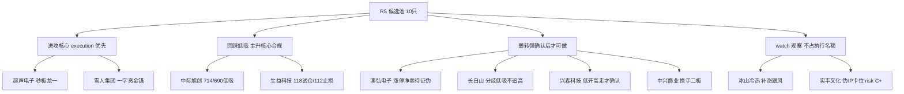

# 2026年10月14日 · **个股画像（R5）**

> **数据源新鲜度**: partial（全部 1013 收盘真实数据，无盘中实时价）
> **降级状态**: false（chart_vision 快照 10/10 全命中，MCP 直调 0 次；vibe-trading 按 v1.3 契约由 tushare 兜底）
> **置信度**: 0.60 — 六维数据真实完整，但硬件线与隔夜外盘存在开盘前不可验证的时间口径背离

## 一句话结论

🅰️ **硬件线只认超声电子（秒板龙一）+ 中际旭创（业绩中军回踩低吸）**；🅱️ 冰雪线只认雪人集团（一字资金锚）与长白山（中军），**澳弘涨停净卖、兴森PE284、实丰伪IP 三处交 R6 反证**。

## 候选池总览（10 只 · 综合分降序）

| 综合 | 名称 | 代码 | 板块 | R2身位 | α档 | 风险档 | 催化 | 筹码 | 联动 | 估值 | 技术 | 机构 | flags |
|---|---|---|---|---|---|---|---|---|---|---|---|---|---|
| 72.8 | 中际旭创 | 300308.SZ | AI算力硬件 | 龙二(中军) | A- | B+ | | 80 | 70 | 88 | 72 | 45 | 82 | `ma_bearish_pullback` `block_trade_institutional` |
| 70.8 | 超声电子 | 000823.SZ | AI算力硬件 | 龙一 | A- | B+ | | 82 | 74 | 86 | 55 | 68 | 60 | `early_lhb_distribution_history` |
| 69.3 | 生益科技 | 600183.SH | AI算力硬件 | 候补(中军) | B+ | B+ | | 76 | 64 | 84 | 70 | 48 | 74 | `ma_bearish_pullback` `insider_minor_reduction` `margin_deleveraging` |
| 66.0 | 澳弘电子 | 605058.SH | AI算力硬件 | 龙二 | B+ | B- | | 72 | 62 | 82 | 48 | 80 | 52 | `lhb_net_sell_on_limit` `high_volatility_speculative` |
| 65.7 | 长白山 | 603099.SH | 冰雪消费/IP经济 | 龙一(中军) | B+ | B- | | 74 | 62 | 80 | 42 | 78 | 58 | `theme_first_day_no_hard_catalyst` `pledged_29pct` |
| 65.3 | 雪人集团 | 002639.SZ | 冰雪消费 | 龙二 | B+ | B- | | 78 | 80 | 82 | 30 | 72 | 50 | `extreme_valuation_speculative` `height_anchor` |
| 63.2 | 兴森科技 | 002436.SZ | AI算力硬件 | 候补 | B+ | B | | 85 | 60 | 78 | 40 | 50 | 66 | `earnings_anchor_high_pe` `ma_bearish_pullback` |
| 62.3 | 中兴商业 | 000715.SZ | 冰雪消费 | 龙二 | B | B- | | 66 | 68 | 66 | 52 | 74 | 48 | `indirect_theme_link` `small_cap` |
| 58.7 | 冰山冷热 | 000530.SZ | 冰雪消费 | 候补 | B | B- | | 64 | 66 | 68 | 32 | 76 | 46 | `follower_not_leader` `high_pe_weak_fundamental` |
| 51.8 | 实丰文化 | 002862.SZ | 冰雪消费 | 候补 | B- | C+ | | 58 | 46 | 62 | 35 | 68 | 42 | `pseudo_ip_follower` `weak_seal_no_capital` `loss_maker` |

> 评分均 0-100；风险档 A 最安全。risk=C+ 的实丰文化不建议进 execution_pool。

## 主线一 · AI算力硬件（四源共识 0.92 · 但必受隔夜费半 -3% 开盘检验）

### 超声电子（000823.SZ）· 综合 70.8 · α A- / 风险 B+

> 元件系龙一:秒板+最厚封单,但9月老庄分歧史+外盘压制,只做低开弱转强

- **板型/身位**: 龙头 — 09:31:54全场最早秒板+封单3.88亿最厚+元件涨停潮9家,龙一成立
- **龙头认定**（纪律§2）: 封板 09:31:54 · 开板 0 次 · 封单 3.88 亿 · 板块涨停 9 家
- **量价位置**: 30日位置 60.5% · 5日 -8.5% · 30日 +50.2% · MA5/10/20/30 = 21.99/23.34/22.53/20.1 · 5日/20日量比 0.57
- **估值/基本面**: PE(TTM) 60.059 · 总市值 132.8亿 · Q2净利同比 10% · ROE 2.17 · 红旗: 无红旗
- **图表（快照 snapshot）**: 偏多（置信0.65）— 超声电子2026年10月13日日K收涨停板，单日涨幅10%，短期放量修复前期回调走势。周K级别长期维持均线多头排列，但上周录得8.38%的跌幅，短期仍有调整压力。小级别15分钟率先走出多头格局承接涨停动能，不过60分钟长期均线仍对股价形成压制。

**大资金意图**: 封单3.88亿全场元件最厚且0开板,筹码锁定强;但9月中旬4次登榜3次净卖(916/921/923合计约-5.5亿),属高换手老庄股,1013回流是二次启动而非无套牢盘新股;质押率13.45%中性。

**为什么走强**: 双high催化叠加(PCB三季报业绩潮+Lumentum订单能见度至2029-2030),09:31秒板=资金与叙事同向,但隔夜费半/GLW暴跌构成开盘负反馈。

**逻辑够不够硬**: 联动86/催化82。PCB+CPO双概念卡位,R7元件+32亿行业#1,板块涨停潮9家,旗帜身位明确;板块四源共识0.92。

**事件时间线**:
  - 20260914 · 涨停,龙虎榜净买+2.73亿(net_rate+10.98%),本轮元件行情首板
  - 20260916-0923 · 916/921/923三日龙虎榜净卖合计约-5.5亿,游资高换手分歧
  - 20260924 · 跌停,龙虎榜净卖-0.55亿,板块退潮
  - 20260928 · -9.40%但龙虎榜净买+3.80亿(net_rate+10.37%),恐慌盘被承接
  - 20261013 · 09:31:54秒板,封单3.88亿为元件系最厚,PCB业绩潮+Lumentum长约催化

**买入理由 / 风险点 / 止损条件 / 可验证假设**:
- 买入理由: 双high催化叠加(PCB三季报业绩潮+Lumentum订单能见度至2029-2030),09:31秒板=资金与叙事同向,但隔夜费半/GLW暴跌构成开盘负反馈。；技术面 日K涨停但仍收在MA20(22.53)下方,30日位置60.5%,5日-8.5%属超跌回流首日;快照偏多0.65:15分多头但60分长期均线压制,21.5低吸/23.4高抛。周线刚
- 风险点: 日K收盘价22.32尚未突破MA20压力位22.53，若后续量能不济可能再次回落；周线级别前期高点29.77存在大量套牢盘，短期反弹空间有限
- 止损条件: 见快照 signals 止损/高抛价位；跌破 MA20=22.53 与板块退潮双触发即走
- 可验证假设: 低开后30min放量收回均线=弱转强成立

### 澳弘电子（605058.SH）· 综合 66.0 · α B+ / 风险 B-

> 弹性龙二:动量最强图形最满,但涨停净卖+30日翻倍,追高盈亏比最差

- **板型/身位**: 龙头 — 09:31:54全场最早秒板+封单3.88亿最厚+元件涨停潮9家,龙一成立
- **龙头认定**（纪律§2）: 封板 10:20:07 · 开板 2 次 · 封单 0.85 亿 · 板块涨停 9 家
- **量价位置**: 30日位置 99.8% · 5日 +1.3% · 30日 +124.7% · MA5/10/20/30 = 54.16/55.66/47.22/40.7 · 5日/20日量比 1.12
- **估值/基本面**: PE(TTM) 62.5464 · 总市值 86.3亿 · Q2净利同比 -25% · ROE 3.67 · 红旗: V8 1013涨停但三日龙虎榜净卖-0.21亿(net_rate-0.66%),涨停资金小幅流出
- **图表（快照 snapshot）**: 偏多（置信0.85）— 澳弘电子日K、周K、15分钟级别均维持均线多头排列，大趋势向上明确。日K级别收获涨停，量能配合放大，逼近20日阶段新高，多头动能充足。仅60分钟级别前期为震荡走势，刚完成区间突破，后续需关注承接力度，整体多头格局清晰。

**大资金意图**: 1013三日榜龙虎榜净卖-0.21亿(net_rate-0.66%),涨停板资金小幅净流出;930曾跌停、9月3次涨停,典型高波动妖股,隔日兑现压力大;小盘86亿弹性双刃剑。

**为什么走强**: 受益PCB/CPO板块β,无独立硬订单/业绩;催化纯度低于超声与兴森。

**逻辑够不够硬**: 联动82/催化72。ths人气rank 56→10(delta46全场最强动量),CPO+PCB双概念,元件行业资金#1直接受益。

**事件时间线**:
  - 20260914-0930 · 9月三次涨停登榜,929涨停振幅15%,930跌停,妖性高波动
  - 20261012 · +2.91%登振幅榜,龙虎榜净买+0.44亿
  - 20261013 · 涨停,ths人气rank 56→10(delta46);10:20封板开2次;三日榜净卖-0.21亿(net_rate-0.66)

**买入理由 / 风险点 / 止损条件 / 可验证假设**:
- 买入理由: 受益PCB/CPO板块β,无独立硬订单/业绩;催化纯度低于超声与兴森。；技术面 30日位置99.8%(逼近新高)、30日+124.7%,日周15分均线全多头,快照偏多0.85最强;但60分刚突破区间需承接验证,59低吸/65压力。位置最高=追高盈亏比最差。
- 风险点: 短期连续拉升累积大量浮盈，存在日内回调杀跌的风险；60分钟级别前期震荡区间的套牢盘可能压制后续上行空间
- 止损条件: 见快照 signals 止损/高抛价位；跌破 MA20=47.22 与板块退潮双触发即走
- 可验证假设: 低开后30min放量收回均线=弱转强成立

### 中际旭创（300308.SZ）· 综合 72.8 · α A- / 风险 B+

> CPO总龙头中军:业绩228%+订单到2030,均线空头只回踩714/690低吸

- **板型/身位**: 中军/容量(非涨停打法) — 容量核心不按涨停时间排序,看资金承接与均线企稳
- **龙头认定**（纪律§2）: 封板 非涨停 · 开板 — 次 · 封单 — 亿 · 板块涨停 9 家
- **量价位置**: 30日位置 15.7% · 5日 -9.6% · 30日 -13.1% · MA5/10/20/30 = 765.24/820.03/861.8/857.21 · 5日/20日量比 1.05
- **估值/基本面**: PE(TTM) 42.3288 · 总市值 8657.6亿 · Q2净利同比 228% · ROE 39.21 · 红旗: 无红旗
- **图表（快照 snapshot）**: 偏空（置信0.75）— 中际旭创当前日K、60分钟级别均维持均线空头排列，股价持续运行于所有短中长期均线下方，中期下跌趋势尚未扭转。仅15分钟级别出现短期震荡企稳迹象，周级别MA60约714的位置形成阶段支撑，近期股价在20日低点690上方获得短暂的止跌喘息。

**大资金意图**: 融资余额15日-3.7%、融券-11%,杠杆资金撤退后抛压减轻;1013两笔机构大宗平价成交(0折价,非减持信号,多为调仓);8658亿超大盘,筹码最稳但弹性小。

**为什么走强**: Lumentum长约直接利好CPO总龙头,韩资逆势净买入=脱钩证据;订单能见度2030是板块内最硬长逻辑。

**逻辑够不够硬**: 联动88/催化80。CPO容量中军/总龙头,板块定价锚,R1/R3/R7三源点名,与北美算力链联动最紧(同时也最受外盘拖累)。

**事件时间线**:
  - 20261008 · 大宗783元机构对倒0.3万股
  - 20261009 · 大宗775.29元机构卖给华泰福建0.8万股
  - 20261013 · 735元两笔机构大宗共6.6万股(约4851万,平价0折价);股价+1.45%,韩资逆势净买入;Lumentum订单能见度至2029-2030

**买入理由 / 风险点 / 止损条件 / 可验证假设**:
- 买入理由: Lumentum长约直接利好CPO总龙头,韩资逆势净买入=脱钩证据;订单能见度2030是板块内最硬长逻辑。；技术面 快照偏空0.75:日K/60分均线空头,收盘735低于全部均线,30日位置仅15.7%、5日-9.6%;周MA60约714支撑,690为20日低点铁止损。趋势未反转,只能按主升核心
- 风险点: 日K级别空头趋势明确，上方多条均线形成强压力，股价继续下探概率较高；短期15分钟级别的反弹缺乏量能支撑，若无法突破压力位很容易再度回落
- 止损条件: 见快照 signals 止损/高抛价位；跌破 MA20=861.8 与板块退潮双触发即走
- 可验证假设: 低开后30min放量收回均线=弱转强成立

### 生益科技（600183.SH）· 综合 69.3 · α B+ / 风险 B+

> CCL定价锚:涨价+业绩+147%,图形未企稳,118试仓112止损

- **板型/身位**: 中军/容量 — 容量核心不按涨停时间排序,看资金承接与均线企稳
- **龙头认定**（纪律§2）: 封板 非涨停 · 开板 — 次 · 封单 — 亿 · 板块涨停 9 家
- **量价位置**: 30日位置 22.7% · 5日 -7.9% · 30日 -5.0% · MA5/10/20/30 = 125.7/131.78/139.73/140.39 · 5日/20日量比 0.92
- **估值/基本面**: PE(TTM) 57.3017 · 总市值 2976.5亿 · Q2净利同比 147% · ROE 18.66 · 红旗: 无红旗
- **图表（快照 snapshot）**: 偏空（置信0.65）— 生益科技当前日、周级别均处于震荡走势，价格全线承压于各周期的短期均线，未出现明确的趋势性反转信号。仅15分钟级别出现小幅企稳迹象，60分钟级别仍维持空头排列，整体多头动能薄弱。

**大资金意图**: 融资余额15日-14.2%/融券-27.4%双降=去杠杆近尾声;928大宗中信上海接中金筹码(换手非抛售);924高管减持10万股象征性;质押0。

**为什么走强**: 电子布/CCL 10月涨价落地+AI一线CCL被错杀研报点名,M6+ AI CCL产能占比40%/产值70%,顺价确定性强;属产业趋势而非单日情绪。

**逻辑够不够硬**: 联动84/催化76。CCL中军/板块定价锚,R4 E002中军,元件行业资金#1,AI硬件容量第二锚(仅次于旭创)。

**事件时间线**:
  - 20260924 · 高管陈仁喜减持10万股(占比0.0041%,象征性)
  - 20260928 · 大宗2笔共7万股@131.95,中信上海分公司接中金北京建国门外筹码
  - 20261013 · 电子布/CCL 10月涨价落地;研报指AI一线CCL 13-18x被错杀,M6+ AI CCL产能占比40%/产值70%

**买入理由 / 风险点 / 止损条件 / 可验证假设**:
- 买入理由: 电子布/CCL 10月涨价落地+AI一线CCL被错杀研报点名,M6+ AI CCL产能占比40%/产值70%,顺价确定性强;属产业趋势而非单日情绪。；技术面 快照偏空0.65:日周震荡、60分空头,30日位置22.7%、5日-7.9%,未现放量企稳;118试仓/112.3铁止损。只能分歧低吸,右侧未确认。
- 风险点: 60分钟级别空头趋势未扭转，中长期均线对价格形成持续压制；区间支撑112.3元若失守，将打开进一步下探空间，当前未出现放量企稳的多头信号
- 止损条件: 见快照 signals 止损/高抛价位；跌破 MA20=139.73 与板块退潮双触发即走
- 可验证假设: 低开后30min放量收回均线=弱转强成立

### 兴森科技（002436.SZ）· 综合 63.2 · α B+ / 风险 B

> 业绩锚候补:预增204-227%但PE284+图形最弱,低开高走才确认

- **板型/身位**: 中军/容量 — 容量核心不按涨停时间排序,看资金承接与均线企稳
- **龙头认定**（纪律§2）: 封板 非涨停 · 开板 — 次 · 封单 — 亿 · 板块涨停 9 家
- **量价位置**: 30日位置 25.8% · 5日 -14.2% · 30日 +8.6% · MA5/10/20/30 = 38.28/40.82/40.95/38.9 · 5日/20日量比 0.81
- **估值/基本面**: PE(TTM) 283.9579 · 总市值 615.1亿 · Q2净利同比 372% · ROE 2.01 · 红旗: V6 PE(TTM)=284远超盈利支撑,业绩预增消化后仍贵；F5 资产负债率65%
- **图表（快照 snapshot）**: 震荡（置信0.65）— 兴森科技当前日K、周K均处于区间震荡走势，60分钟级别维持空头排列，短中期均线对价格形成压制，仅15分钟级别出现短期止跌企稳的弱信号。整体缺乏明确的趋势性行情，上方套牢压力较重，短期难有大幅拉升。

**大资金意图**: 融资余额有数据(11日),无龙虎榜/大宗/减持;筹码面中性,预增公告后需观察承接。

**为什么走强**: 板块内最硬基本面锚:三季报预增204-227%(10-13公告),CSP基板+mSAP一线客户突破,不受外盘情绪直接证伪;但预告次日易高开兑现。

**逻辑够不够硬**: 联动78/催化85。R4 E002首推,封装基板+光模块基板双主线,但R2仅列候补,板块内身位在超声/澳弘之后。

**事件时间线**:
  - 20261013 · 公告三季报预增204.20%~227.02%;CSP封装基板量价齐升+光模块mSAP基板一线客户突破

**买入理由 / 风险点 / 止损条件 / 可验证假设**:
- 买入理由: 板块内最硬基本面锚:三季报预增204-227%(10-13公告),CSP基板+mSAP一线客户突破,不受外盘情绪直接证伪;但预告次日易高开兑现。；技术面 快照震荡0.65:32.69-48.76区间,现价36.19在MA5/MA20下方,30日位置25.8%、5日-14.2%为全场最弱;33低吸/32.69破位止损。业绩与图形背离,
- 风险点: 60分钟级别空头排列未扭转，短期反弹难以突破上方密集均线压力；若跌破区间下沿32.69，将打开新的下行空间，回撤风险较大
- 止损条件: 见快照 signals 止损/高抛价位；跌破 MA20=40.95 与板块退潮双触发即走
- 可验证假设: 低开后30min放量收回均线=弱转强成立

## 主线二 · 冰雪消费/IP经济（热度满分 · 跨源资金薄弱 cross=0.34 · 硬件失败时的切换备选）

### 长白山（603099.SH）· 综合 65.7 · α B+ / 风险 B-

> 冰雪中军:最纯正景区标的,30日新高+质押29%,分歧低吸不追一字

- **板型/身位**: 龙头 — 冰雪中军容量核心+板块效应足;但13:04午后封板开1次,时间靠后扣分
- **龙头认定**（纪律§2）: 封板 13:04:45 · 开板 1 次 · 封单 0.35 亿 · 板块涨停 9 家
- **量价位置**: 30日位置 100.0% · 5日 +15.3% · 30日 +20.4% · MA5/10/20/30 = 42.83/41.68/40.12/39.8 · 5日/20日量比 1.31
- **估值/基本面**: PE(TTM) 94.1264 · 总市值 124.9亿 · Q2净利同比 -6% · ROE 0.08 · 红旗: V6 PE(TTM)=94偏高,题材定价为主；F11 质押率28.96%偏高
- **图表（快照 snapshot）**: 偏多（置信0.75）— 长白山当前短周期（日K、60分钟、15分钟）均呈现均线多头排列，10月13日日K收获涨停，突破20日区间新高，量能配合上攻。仅周线级别仍处于震荡区间，尚未完全站稳中期压力位，短期多头动能占优，但需警惕短期快速拉升后的获利回吐风险。

**大资金意图**: 封单仅0.35亿且午后13:04才封板(开板1次),封板质量一般;质押率28.96%偏高;5日已+15.3%短线获利盘厚。

**为什么走强**: 冰雪大世界扩容+迪士尼16年再合作,题材纯正度最高的景区标的;但属事件叙事,R4无独立硬事件、无业绩锚,首日发酵历史一日游概率高。

**逻辑够不够硬**: 联动80/催化74。冰雪线容量中军,dc人气#19+ths热股,板块涨停潮9家,内需线不受外盘映射是战略价值。

**事件时间线**:
  - 20261013 · 冰雪大世界扩至125万㎡+时隔16年再牵手迪士尼冰雪奇缘;13:04涨停(开板1次),dc人气#19,5日+15.3%创30日新高

**买入理由 / 风险点 / 止损条件 / 可验证假设**:
- 买入理由: 冰雪大世界扩容+迪士尼16年再合作,题材纯正度最高的景区标的;但属事件叙事,R4无独立硬事件、无业绩锚,首日发酵历史一日游概率高。；技术面 快照偏多0.75:日K涨停创30日新高(位置100%)、日/60/15分多头,量比1.31;但周线未站稳中期压力,47元套牢区+顶背离风险,44.3低吸位。
- 风险点: 周K仍未完全突破中期均线压力，中期上升趋势未彻底确立，存在突破失败的风险；短期涨停积累大量获利盘，后续量能若无法续增将引发回调
- 止损条件: 见快照 signals 止损/高抛价位；跌破 MA20=40.12 与板块退潮双触发即走
- 可验证假设: 板块出现2板高度+消费行业资金流入=接力成立

### 雪人集团（002639.SZ）· 综合 65.3 · α B+ / 风险 B-

> 冰雪情绪高度锚:一字+净买率10%,PE718纯筹码,二板定真龙

- **板型/身位**: 龙头 — 11:18一字0开板+净买率10.28%冰雪线最强资金,情绪高度锚;与长白山争真龙看二板
- **龙头认定**（纪律§2）: 封板 11:18:06 · 开板 0 次 · 封单 1.68 亿 · 板块涨停 9 家
- **量价位置**: 30日位置 83.8% · 5日 +5.3% · 30日 +23.4% · MA5/10/20/30 = 13.9/13.97/13.85/13.47 · 5日/20日量比 0.84
- **估值/基本面**: PE(TTM) 718.5479 · 总市值 113.7亿 · Q2净利同比 -85% · ROE 0.24 · 红旗: V6 PE(TTM)=719远超盈利支撑,业绩预增消化后仍贵；F3 Q2净利同比-85%盈利下滑
- **图表（快照 snapshot）**: 偏多（置信0.7）— 雪人集团日K维持均线多头排列，2026年10月13日以涨停收盘，成功突破近期低位整理平台，带动15分钟、60分钟等短周期级别同步走强。周线级别仍承压于60周均线15.33元，尚未脱离中长期震荡趋势，短期上涨需面对日K20日高点15.25元的阻力。

**大资金意图**: 全场最强资金确认:11:18一字0开板+封单1.68亿+龙虎榜净买1.33亿(net_rate+10.28%);但高净买率=隔日兑现压力同源,质押5.66%中性。

**为什么走强**: 人工造雪设备直接对应冰雪大世界扩容,题材纯度+情绪高度双高;事件驱动无业绩锚。

**逻辑够不够硬**: 联动82/催化78。冰雪线情绪高度锚/设备核心,dc人气#3,板块扩散完整;与长白山竞争真龙身位(谁先二板)。

**事件时间线**:
  - 20261013 · 11:18一字封死(0开板),封单1.68亿;龙虎榜净买+1.33亿(net_rate+10.28%)冰雪线最强资金确认

**买入理由 / 风险点 / 止损条件 / 可验证假设**:
- 买入理由: 人工造雪设备直接对应冰雪大世界扩容,题材纯度+情绪高度双高;事件驱动无业绩锚。；技术面 快照偏多0.70:涨停突破一月平台,日15/60分同步转强,30日位置83.8%;但15.2-15.33(日20日高点+周60MA)双重压力,14元破位止损。
- 风险点: 日K20日高点与周K60MA在15.2-15.3元区间形成重叠压力，短期上涨抛压较大，涨停持续性存疑；短期快速拉涨后，若涨停板开板，获利盘集中出逃可能引发大幅回调
- 止损条件: 见快照 signals 止损/高抛价位；跌破 MA20=13.85 与板块退潮双触发即走
- 可验证假设: 板块出现2板高度+消费行业资金流入=接力成立

### 中兴商业（000715.SZ）· 综合 62.3 · α B / 风险 B-

> 零售扩散:垂直板封单硬但题材间接,只做换手二板

- **板型/身位**: 助攻/扩散 — 垂直涨停0开板但属零售扩散末端,非冰雪核心链路
- **龙头认定**（纪律§2）: 封板 10:52:24 · 开板 0 次 · 封单 0.46 亿 · 板块涨停 9 家
- **量价位置**: 30日位置 87.7% · 5日 +9.1% · 30日 +8.2% · MA5/10/20/30 = 5.44/5.38/5.44/5.51 · 5日/20日量比 1.27
- **估值/基本面**: PE(TTM) 28.0521 · 总市值 31.2亿 · Q2净利同比 -11% · ROE 2.28 · 红旗: 无红旗
- **图表（快照 snapshot）**: 偏多（置信0.75）— 中兴商业日K级别放量涨停，短周期60分钟、15分钟全部形成多头排列，短期上攻动能充足。当前股价突破周线MA60压力位，但周线整体仍处震荡格局，临近20日阶段高点5.87，上方存在一定套牢抛压。短期多头趋势明确，仅长周期维度未完全脱离震荡区间。

**大资金意图**: 10:52垂直涨停0开板,封单质量好;31亿最小盘,无两融数据(非标的);质押20.49%偏高;封单厚度与小流通盘共同造就垂直板。

**为什么走强**: 东北(沈阳)零售+冰雪外溢,上证报官媒报道19万手封单;但零售与冰雪主业关联间接,属扩散末端,叙事纯度低。

**逻辑够不够硬**: 联动66/催化66。冰雪扩散线,不在设备/景区核心链路,板块若分歧,扩散末端最先被抛弃。

**事件时间线**:
  - 20261013 · 10:52垂直涨停0开板,上证报报道超19万手封单;沈阳零售+冰雪外溢

**买入理由 / 风险点 / 止损条件 / 可验证假设**:
- 买入理由: 东北(沈阳)零售+冰雪外溢,上证报官媒报道19万手封单;但零售与冰雪主业关联间接,属扩散末端,叙事纯度低。；技术面 快照偏多0.75:放量涨停突破周MA60,日/60/15分全多头,30日位置87.7%;5.87前高套牢盘+6元压力,5.42低吸位。
- 风险点: 周线仍处于震荡格局，上方6元一线的前期套牢盘或对上涨空间形成压制；短期涨停后若后续量能无法持续放大，容易出现冲高回落的回调风险
- 止损条件: 见快照 signals 止损/高抛价位；跌破 MA20=5.44 与板块退潮双触发即走
- 可验证假设: 板块出现2板高度+消费行业资金流入=接力成立

### 实丰文化（002862.SZ）· 综合 51.8 · α B- / 风险 C+

> IP卡位候补:封单0.12亿无资金确认,观察不占执行名额

- **板型/身位**: 卡位 — 13:02午后封板封单仅0.12亿,IP卡位无资金确认
- **龙头认定**（纪律§2）: 封板 13:02:15 · 开板 0 次 · 封单 0.12 亿 · 板块涨停 9 家
- **量价位置**: 30日位置 85.5% · 5日 +5.2% · 30日 +15.9% · MA5/10/20/30 = 14.82/15.14/15.38/15.15 · 5日/20日量比 0.85
- **估值/基本面**: PE(TTM) 亏损 · 总市值 27.0亿 · Q2净利同比 -284% · ROE 1.07 · 红旗: F3 Q2净利同比-284%盈利下滑；F11 质押率25.59%偏高
- **图表（快照 snapshot）**: 偏多（置信0.65）— 实丰文化日K级别收获涨停，短期均线形成多头排列，成功突破20日均线压制，短线进攻动能充足。周线级别仍处于震荡格局，长期均线未拐头，中期上升趋势尚未确立，短期股价临近20日阶段高点，存在一定抛压。

**大资金意图**: 27亿最小盘,无两融/龙虎榜确认,封单0.12亿极易开板;质押25.59%偏高;Q2净利同比-284%基本面恶化。

**为什么走强**: 迪士尼冰雪奇缘IP授权,与主题最贴的IP弹性标的;但无独立硬公告、13:02午后才涨停、封单仅0.12亿全场最弱。

**逻辑够不够硬**: 联动62/催化58。IP潮玩单线,板块身位边缘化,依赖IP线被资金认可这一未验证假设。

**事件时间线**:
  - 20261013 · 13:02午后涨停,封单仅0.12亿;迪士尼冰雪奇缘IP授权潮玩线;无龙虎榜资金确认

**买入理由 / 风险点 / 止损条件 / 可验证假设**:
- 买入理由: 迪士尼冰雪奇缘IP授权,与主题最贴的IP弹性标的;但无独立硬公告、13:02午后才涨停、封单仅0.12亿全场最弱。；技术面 快照偏多0.65:涨停突破20日均线,日15/60分多头,但周MA60 17.38中期压制,16.42前高临近;图形尚可但资金不支持。
- 风险点: 周线级别MA60长期均线17.38元仍对股价形成中期压制，未走出中长期震荡格局；短期涨停积累大量获利盘，若后续量能不能维持，容易出现冲高回落的走势
- 止损条件: 见快照 signals 止损/高抛价位；跌破 MA20=15.38 与板块退潮双触发即走
- 可验证假设: 板块出现2板高度+消费行业资金流入=接力成立

### 冰山冷热（000530.SZ）· 综合 58.7 · α B / 风险 B-

> 设备补涨:封板尚可但基本面最弱,龙头分歧最先被砸

- **板型/身位**: 补涨/跟风 — 设备线雪人之后补涨,10:09封板,辨识度低龙一头
- **龙头认定**（纪律§2）: 封板 10:09:06 · 开板 1 次 · 封单 1.11 亿 · 板块涨停 9 家
- **量价位置**: 30日位置 100.0% · 5日 +10.0% · 30日 +10.8% · MA5/10/20/30 = 5.34/5.27/5.24/5.24 · 5日/20日量比 1.37
- **估值/基本面**: PE(TTM) 157.7017 · 总市值 48.3亿 · Q2净利同比 -47% · ROE 1.49 · 红旗: V6 PE(TTM)=158偏高,题材定价为主；F3 Q2净利同比-47%盈利下滑
- **图表（快照 snapshot）**: 偏多（置信0.75）— 冰山冷热日K级别拉出涨停，突破近20日新高，短期均线完成多头排列，短期上行动能充足。周线级别仍受60周均线压制，尚未摆脱长期震荡格局，小周期60分钟、15分钟同步进入多头趋势，单日放量封板资金介入明显。

**大资金意图**: 10:09涨停(开1次)封单1.11亿,封板质量较好;但无1013龙虎榜净买数据;48亿小盘;补涨位=龙头分歧时最先被砸。

**为什么走强**: 制冷/冰雪设备与雪人同线补涨,催化为板块联动,无独立事件。

**逻辑够不够硬**: 联动68/催化64。设备补涨标的,辨识度低于雪人,板块内排第3-4身位,龙头不走强则无独立溢价。

**事件时间线**:
  - 20261013 · 10:09涨停(开板1次)封单1.11亿,制冷设备补涨,dc人气#10

**买入理由 / 风险点 / 止损条件 / 可验证假设**:
- 买入理由: 制冷/冰雪设备与雪人同线补涨,催化为板块联动,无独立事件。；技术面 快照偏多0.75:涨停破20日新高(位置100%),日/15/60分多头量比1.37;但周60MA 6.12重压,5.24破MA20止损,图形是补涨股标准形态。
- 风险点: 周线级别仍处于长期震荡区间，上方60周均线压力较重，若后续量能不能持续放大，难以突破强压力位；短期涨停封板后若后续资金接力不足，存在开板大幅回调的风险，短期追高风险较高
- 止损条件: 见快照 signals 止损/高抛价位；跌破 MA20=5.24 与板块退潮双触发即走
- 可验证假设: 板块出现2板高度+消费行业资金流入=接力成立

## 候选池分层（供 D1）

## 关键证据

- 证据 1: 超声电子 09:31:54 秒板 + 封单 3.88 亿（元件系最厚，0 开板），元件行业主力 +32 亿全市场 #1 · 来源 tushare limit_list_d / R7
- 证据 2: 雪人集团一字封死 + 龙虎榜净买 1.33 亿（net_rate +10.28%），冰雪线唯一强资金确认 · 来源 tushare top_list
- 证据 3: 澳弘电子涨停但三日榜净卖 -0.21 亿 + 30 日 +124.7% 位置 99.8%，追高盈亏比全场最差 · 来源 tushare top_list/daily
- 证据 4: 中际旭创 Q2 净利 +228%/营收 +175%/ROE 39.2%，但日线均线全空头、30 日位置仅 15.7%，业绩与图形背离 → 只能回踩低吸 · 来源 tushare fina_indicator + chart_vision_snapshot
- 证据 5: 兴森科技预增 204-227% 但 PE(TTM) 284、Q2 净利率 -0.14%、资产负债率 64.6%，5 日 -14.2% 图形全场最弱 · 来源 R4/tushare
- 证据 6: 实丰文化 13:02 午后封板、封单仅 0.12 亿、Q2 净利 -284%、质押 25.6%，无龙虎榜确认 · 来源 tushare

## 数据源审计

| 源 | 状态 | 抓取时间 | 记录数 | 备注 |
|---|---|---|---|---|
| R2_main_sectors | 🟢 ok | 06:56 | 10 票 | 两主线 leaders 全量 |
| chart_vision_snapshot | 🟢 ok | 07:02 | 10/10 命中 | 当日快照 date=20261014，0 次 MCP 直调 |
| tushare 日线/每日指标 | 🟢 ok | 07:10 | 30日×10 | 真实 1013 收盘 |
| limit_list_d | 🟢 ok | 07:12 | 67 涨停 | 封板时间/开板/封单齐全 |
| top_list 龙虎榜 | 🟢 ok | 07:13 | 近月22条 | 9月老庄分歧史可追溯 |
| block_trade/margin/pledge/fina | 🟢 ok | 07:08 | 10 | 两融非标的(澳弘/中兴/实丰)无数据属正常 |
| vibe-trading | 🔴 error | — | 0 | MCP 未配置，v1.3 契约 tushare 主源兜底，未阻塞 |

## 不确定性 / 反证（自我批判）

1. **硬件线最大反证是时间口径**：R2/R7 的资金回流发生在 1013 白天，而隔夜费半盘中 -3%、GLW -6%、美光 -3.88%、韩国 -5.46%。若 1014 低开 30 分钟不能放量收回，整条主线（含超声、旭创）回流证伪，本文件所有硬件评分需作废重算——这不是 R5 能用静态数据裁决的，只能交给 09:25-10:00 的盘面。
2. **澳弘电子的"涨停净卖"量级（-0.21 亿）未到霸榜出货硬否决阈值**，但其 30 日 +125% + Q2 净利 -25% 的组合使其成为硬件线最脆弱一环，R6 模式六应优先审。
3. **冰雪线本质是首日事件题材**：无 R4 硬事件、无 R7 行业级资金，雪人 1.33 亿净买是孤证；首日 ths rank1 题材一日游概率不低，若无标的走出 2 板（雪人 vs 长白山谁先二板定真龙），全线降 watch。
4. 生益/兴森/实丰 R2 口径 pct_chg=null，买点与止损必须由 D1 用 09:25 竞价价重算，本文件不给入场价格（R5 职责边界）。

## 与其他 R/D/E 的关系

- 依赖: R1_style / R2_main_sectors / R3_sentiment / R4_news / R7_capital_flow / chart_vision_snapshot
- 被消费: D1（按 alpha_grade+risk_grade+leader_verdict 分流 execution/watch）、R6（hard_reject 裁决，重点见 r6_handoff_notes）
- 扩池: R2 leaders 合计 10 只 ≥ 5，v1.4 扩池规则未触发（expand_applied=false）

## Sub-Agent 元数据

- skill: analyze_stock_profile_v1@v1.5
- artifact: data/research/20261014/R5_stock_profiles.json
- 候选数: 10（硬件 5 + 冰雪 5）
- chart_vision: 快照命中 10/10，MCP 直调 0 次（v1.4 先读快照契约生效）
- model: ark-code-latest
