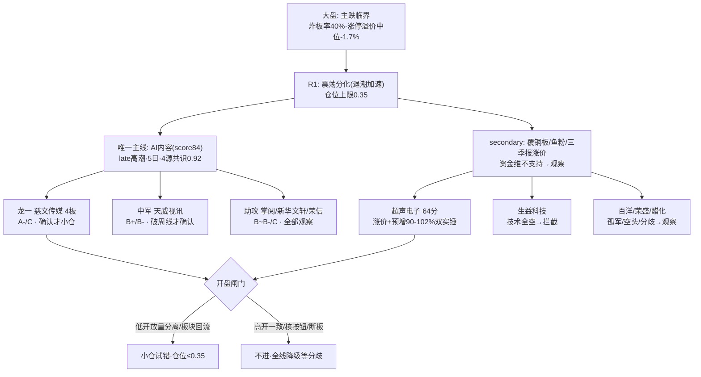

# 2026年10月15日 · **个股画像（R5）**

> **数据源新鲜度**: ok · 行情口径=2026-10-14 收盘 · vision 快照已校验当日（`snapshot.date=20261015`）
> **降级状态**: false（weflow/qmt down 与 R5 无关）
> **置信度**: 0.60 — 数据实据扎实（10 票全量 tushare+vision），但大盘处主跌临界/炸板率 40%，所有进攻结论都带开盘验证缺口

## 一句话结论

**主跌临界 + 炸板率 40% 踩中砍半线：10 票没有一只可以"无脑进"。龙一慈文只做低开放量分离走强的确认小仓；超声电子是唯一"涨价+业绩"双实锤但板块资金逆风只能等分歧；生益科技产业逻辑最正但技术全空，明确拦截左侧飞刀；其余一律观察。**

## 候选池与分层（n=10）

R2 leaders 5 只已满足扩池下限（≥5）；按用户指令 6-15 只，从 R2 secondary 的 `watch_leaders` 补 5 只双催化实锤票，标 `provenance=r2_expand_pool`，综合分已含 -3 起步，**D1 应优先入 watch_pool 而非 execution_pool**。

| # | 代码 | 名称 | 线 | 身位 | 综合 | 进攻档 | 风险档 | 态度 |
|---|---|---|---|---|:--:|:--:|:--:|---|
| 1 | 000823 | 超声电子 | 覆铜板涨价 | 分支2板龙头 | **64** | B+ | B- | 观察等分歧（板块资金逆风，不追秒板） |
| 2 | 002343 | 慈文传媒 | AI内容 | **总龙4板** | **61** | A- | C | 仅"低开放量分离"确认小仓，否则不进 |
| 3 | 603533 | 掌阅科技 | AI内容 | 首板助攻 | 57 | B+ | C | 观察，只做弱转强 |
| 4 | 002493 | 荣盛石化 | 三季报+硫磺 | 非涨停防御 | 55 | B | B- | 观察，等日K企稳（催化最硬但趋势空） |
| 5 | 002238 | 天威视讯 | AI内容 | 容量中军候选 | 55 | B+ | B- | 观察，突破周线7.59+高标不死才低吸 |
| 6 | 601811 | 新华文轩 | AI内容 | 高位趋势股 | 55 | B | C | 降级观察（开板14次），不追 |
| 7 | 603968 | 醋化股份 | 乙腈涨价 | 3板分歧 | 49 | B | C | 观察，龙虎榜已净卖-2631万 |
| 8 | 301231 | 荣信文化 | AI内容 | 20cm弹性补涨 | 47 | B- | C | 拦截高开，纯观察 |
| 9 | 600183 | 生益科技 | 覆铜板 | 下跌趋势中军 | 46 | B | C | **拦截：禁止左侧接飞刀** |
| 10 | 002696 | 百洋股份 | 鱼粉涨价 | 4板孤军 | 46 | B- | C | 不追高，断板开关 |

> 分档器 ≠ 否决器：`risk_grade=C` 不等于 `hard_reject`；最终否决权属 R6。但在炸板率 40% 的主跌临界日，C 档票 D1 应默认不进 execution_pool。

## 六维传导与决策结构

## 龙头判定（limit_list_d 实测 · v1.5）

| 代码 | 连板高 | 首次封板 | 开板 | 启动后第几天 | 板块涨停家数 | 裁决 |
|---|:--:|:--:|:--:|:--:|:--:|---|
| 002343 慈文传媒 | 4 | 09:30:03 | 0 | 5 | 9（影视/出版/游戏） | ✅ **龙头**（高度+秒板+板块效应全中，唯 late） |
| 000823 超声电子 | 2 | 09:25:00 | 1 | 2 | 4（元件） | ✅ 分支龙头（但被硬件 beta 压制） |
| 002696 百洋股份 | 4 | 09:25:00 | 0 | 5 | **2（饲料）** | ⚠️ **孤军**（breadth<3，龙头资格降级） |
| 603968 醋化股份 | 3 | 09:30:09 | **4** | 3 | 4（化学制品） | ⚠️ **分歧弱**（open_times≥4） |
| 601811 新华文轩 | 1 | 11:07:05 | **14** | — | 4（出版） | ⚠️ **分歧弱**（封板全场最差） |
| 603533 掌阅科技 | 1 | 10:05:25 | 1 | — | 4（游戏） | 助攻/低位扩散，非龙头 |
| 002238/301231/600183/002493 | 0 | — | — | — | — | 当日未涨停，无连板身位 |

## Top 票思维链

### 1）002343 慈文传媒 —— AI内容总龙 · 态度：确认才小仓，不确认不进

- **大资金意图**：大盘净流出、CPO 单日 -109 亿的背景下，主力净流入概念前 11 名内容线独占 8 席（影视 #1 +12.09 亿），这是高切低 + 硬件→应用切换的承接资金。游资 3 日龙虎榜净买 +4261 万，股东户数连 3 期集中（4.26 万→3.81 万），对手盘是"老钱群公开等断板"的先手兑现盘与追高散户——**资金在抱团避险活口，不是在做板块合力**。
- **为什么走强**：位置=4 板全场最高标（30 日累涨 58%）；催化=红果日活 1.68 亿超长视频 + 微短剧 573 亿（已明牌 3-4 日）；筹码=连续 3 日 09:30 前后秒板、0 开板、缩量锁仓。三维共振但全部"已知"，边际只在情绪。
- **逻辑够不够硬**：4 源共识 0.92 是当日最强方向，但催化强度仅 medium 且无新增超预期事件，late 高潮段抱团。证伪路径明确且很近——**今天断板 = 整条线退潮二浪信号**；隔夜纳指 -1.85% 已先给负反馈。硬在身位，不硬在赔率。

**买入理由**：① 全场 4 板最高标 + 影视/出版/游戏 9 家涨停的板块效应，龙头三要素全中；② 秒板 0 开板 + 户数集中，筹码锁定好；③ 唯一 4 源共识主线，主跌期资金抱团方向。
**风险点**：① 4 板孤高标 + 老钱公开等断板，高开一致就是先手出货点；② PE 亏损（H1 净利率 -177.6%）纯题材定价，收盘距 MA5 乖离 +20%，断板补跌空间大。
**止损条件**：买入后当日断板不回封即走；收盘跌破 60 分 MA20 ≈ 6.94 元走；低开核按钮（竞价低于 -5%）直接放弃不接。
**可验证假设**：24h 内——竞价低开 -2%~+2% 且 09:45 前放量分离走强（分时量能 > 1014 同时段）→ 假设证真，小仓；高开 >+4% 缩量秒板或竞价核按钮 → 假设证伪，全天不碰。

### 2）000823 超声电子 —— 覆铜板双实锤 · 态度：观察，等分歧不追秒板

- **大资金意图**：10/13 公司公告三季报预增 90.78-102%（覆铜板量价齐升），是硬件链里少见的"涨价传导到报表"的实锤票，龙虎榜 3 日净买 +8165 万（华鑫上海陆家嘴席位）。但要警惕：股东户数半年从 5.4 万翻倍到 9.6 万，**拉升同时筹码在向散户分散，机构/大户有派发痕迹**。
- **为什么走强**：位置=9 月已有一波翻倍后回调、2 板反包（30 日高点 27.74 在头顶）；催化=松下 CCL 涨 200% + OCP PTFE + 自有预增公告，硬度全场第一；筹码=09:25 秒板但量比 5/20 仅 0.46（缩量，流动性存疑）。
- **逻辑够不够硬**：催化比慈文硬（自有业绩 vs 行业数据），但板块维被 CPO -109 亿 + 费半 -4.3% 六连跌死死压制，交叉验证只有 0.67。硬在个股 alpha，不硬在板块 beta。

**买入理由**：① 全候选池唯一"涨价硬催化 + 业绩预告实锤 + 2 板秒板"三合一；② 全周期多头排列，周线趋势未破。
**风险点**：① 科技风格单日 -140.8 亿，费半六连跌，1015 硬件大概率二次低开；② 户数翻倍 + 质押率 13.45%，筹码结构不干净。
**止损条件**：跌破 60 分 MA60 ≈ 23.5 元走；大盘硬件低开后 30 分钟不能收回分时均线则放弃。
**可验证假设**：若硬件低开它能放量分离走强、且元件板块再有 ≥3 家涨停跟随 → 分支独立假设证真；随光模块一起低开低走 → 证伪（只是 beta 反抽）。

### 3）600183 生益科技 —— 明确拦截

CCL 产业龙头、H1 净利 +130%、ROE 18.66%，基本面是 10 票里最硬的；但日/周/60 分**全空头排列**，30 日 157.5→119.6（-24%），融资余额 -14.8% 撤退，9 月大宗接盘方（143 元）浮亏 17%，vision 偏空 0.75 明确"无止跌信号"。**周期不对就降维：好公司 ≠ 好股票，现在接它就是模式外的钱，拦截。** 观察量：站回日 MA20（≈138）之前不讨论。

## 其余各票要点

- **603533 掌阅科技**：首板助攻，融资余额 5 日 +83.5% 是追涨双刃剑；H1 净利 +68.7% 边际改善是内容线少有的盈利拐点；31-32 元前期套牢区，只做次日弱转强，高开追板拦截。
- **002493 荣盛石化**：全市场唯一 E004+E005 双事件标的（预增 777-823% × 硫磺涨 10 倍），PE 22/PB 2.49 便宜；但日 K 空头、30 日 -22%，催化硬不等于马上涨。11.7 破位下跌确认，等日线企稳信号；防 V1 周期顶陷阱。
- **002238 天威视讯**：河马短剧分账新叙事 + 融资 +23.9%，位置低于高标；但 1014 仅 +2.47% 未封板、周线 MA60≈7.59 压顶。**高标断板日不接**；放量破 7.6 且慈文不死才可低吸（6.93 附近）。
- **601811 新华文轩**：内容线唯一估值合理盈利票（PE 21），但 30 日 9 涨停 +110%，1014 涨停开板 **14 次**（封板全场最差）、龙虎榜席位两次净卖，前高 24.61 压顶。分歧弱，降级观察。
- **603968 醋化股份**：乙腈两年 +139% 四年新高，3 板但开板 4 次 + 龙虎榜一日翻转净卖 -2631 万，32 亿小盘游资盘。涨价实锤但封板质量恶化，观察。
- **301231 荣信文化**：AI 漫剧 20cm 弹性，H1 净利 -852%，1014 冲高回落仅 +3.83%、换手 21%。20cm 高潮次日高开=先手兑现，拦截高开。
- **002696 百洋股份**：鱼粉 4 板但板块涨停仅 2 家=**孤军**，3 日龙虎榜净卖 -1757 万、一字缩量（换手 1%）筹码未交换，H1 -800% + 负债率 66%。断板开关，不追。

## 红旗与反证线索（移交 R6）

- 🚩 **F5 亏损族**：慈文（净利率-177.6%）、荣信（-852%）、百洋（-800%）、天威（-66.7%）、掌阅（亏损但改善）、醋化（-332%基数低）——内容线 4/5 纯题材定价。
- 🚩 **筹码派发嫌疑**：超声电子户数翻倍（+78%）、生益科技户数翻倍 + 融资 -14.8%。
- 🚩 **霸榜/高位分歧**：新华文轩开板 14 次、醋化开板 4 次且龙虎榜净卖、百洋一字缩量 + 净卖——请 R6 重点核验模式六（霸榜出货）。
- 🚩 **系统级反证**：炸板率 40%、涨停溢价中位 -1.7%、纳指 -1.85%、全市场 4496 只下跌——抱团瓦解则 10 票无一会幸免。

## 数据源审计

| 源 | 日期 | 状态 | 备注 |
|---|---|:--:|---|
| tushare/daily | 2026-05-01~10-14 | 🟢 | 10 票 · 109 根/票（≥30 交易日 K 线满足） |
| tushare/daily_basic | 2026-10-08~10-14 | 🟢 | 10 票 · PE/PB/PS/市值/换手 |
| tushare/limit_list_d | 2026-09-25~10-14 | 🟢 | 连板/首封时间/开板次数 + 1014 全市场 71 家涨停(breadth) |
| tushare/top_list | 2026-09-14~10-14 | 🟢 | 17 个交易日逐日全市场拉取后过滤 |
| tushare/block_trade·margin_detail | 近40/20日 | 🟢 | 两融 7/10 票有数据；无两融标的字段非空标注 |
| tushare/fina_indicator·forecast | 2026Q2/预告 | 🟢 | 超声电子命中三季报预增公告(10/13) |
| tushare/stk_holdernumber·pledge_stat | 最新3期 | 🟢 | 户数趋势/质押率 |
| canghai-charts vision | 2026-10-14 | 🟢 | 5 票 snapshot（当日校验）+ 5 票 MCP live，10/10 有 pattern |
| R1/R2/R3/R4/R7 | 2026-10-15 | 🟢 | R7 行情口径 10-14 收盘 |
| weflow-analytics | 2026-10-15 | 🔴 | DOWN(404) · R5 不依赖，不降级 |
| agentqmt | 2026-10-15 | 🔴 | DOWN · R5 不依赖 |

## 不确定性 / 反证

1. vision 综述是 Python 预渲染 + 多模态产物，本卷已用 tushare 量价/涨停/资金实据做二次裁决，未直接照抄其结论。
2. 大宗交易/两融为 tushare 单源（v1.3 起 vibe-trading 未配置，不再作为必调交叉源）。
3. 全部结论基于 10-14 收盘；1015 竞价若核按钮，本文件所有"确认小仓"结论自动失效——这是设计内的条件单，不是疏漏。

## 与其他 R/D/E 的关系

- **依赖**: R2_main_sectors（候选池）、R4_news（催化）、R7_capital_flow（板块资金）、R1_style（仓位/砍半约束）、chart_vision_snapshot
- **被消费**: D1 main_decision（execution_pool ≤5 / 档位闸门）、R6 devil_advocate（fundamental_flags + 霸榜分歧线索，模式六对慈文/新华文轩/醋化/百洋重点核验）、E1 observation_tracking（T+1/T+5 回填思维链假设）

## Sub-Agent 元数据

- skill: analyze_stock_profile_v1@1.5
- artifact: data/research/20261015/R5_stock_profiles.json（10 profiles, 69KB）
- 中间件: `_r5_fetch.py`（tushare 批量）/ `_r5_raw.json` / `_r5_build.py`
- model: ark-code-latest（主控 LLM 分档）+ seed-2-0-lite（vision）
