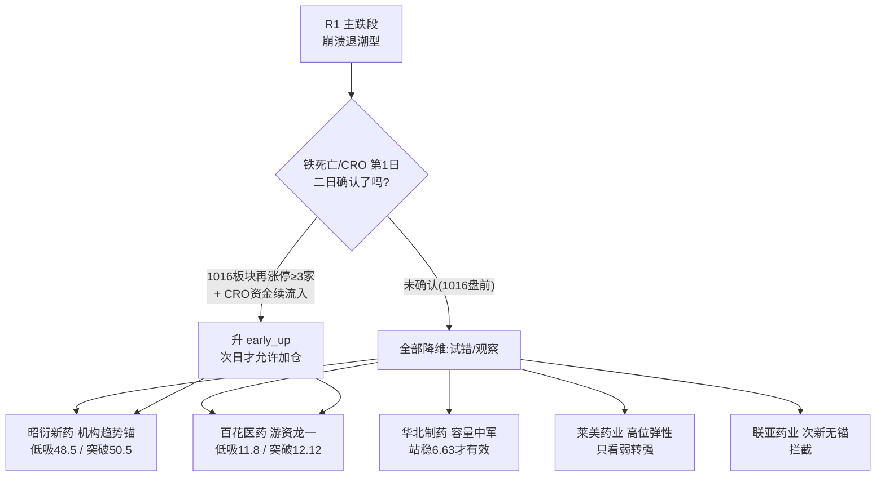

# 2026年10月16日（周五）· 个股画像

> **数据源新鲜度**: ok（1015收盘口径 + 1016盘前快照）
> **降级状态**: false（1项字段异常已隔离,不影响主结论）
> **置信度**: 0.70
> **大盘段位**: R1定性「崩溃退潮型」主跌段 · 唯一主线「创新药/铁死亡/CRO」处 formation（主跌日逆势新题材·第1日）

## 一句话结论

主跌段内的首日新题材,五只候选**只给试错/观察,不给追高**;综合排序 昭衍新药(65) > 百花医药(62) > 华北制药(58) > 莱美药业(57) >> 联亚药业(38,建议直接拦截出执行池)。

## 候选池总览

| 排名 | 代码 | 名称 | 角色 | 收盘 | 30日涨跌 | 总市值 | PE_TTM | 综合 | alpha | risk | 态度 |
|---|---|---|---|---:|---:|---:|---:|---:|---|---|---|
| 1 | 603127 | 昭衍新药 | CRO趋势中军 | 50.65 | -5.3% | 379.5亿 | 38.6 | **65** | B+ | **B+** | 进·试错档首选 |
| 2 | 600721 | 百花医药 | 龙一(高度) | 12.05 | -14.1% | 46.3亿 | 154.6 | **62** | B+ | B- | 进·仅低吸/回封 |
| 3 | 600812 | 华北制药 | 容量中军 | 6.57 | +30.1% | 112.7亿 | 91.3 | **58** | B | B- | 观察·确认后分歧低吸 |
| 4 | 300006 | 莱美药业 | 20cm弹性 | 8.13 | +54.3% | 85.8亿 | 亏损 | **57** | B | C+ | 观察·弱转强才考虑 |
| 5 | 301569 | 联亚药业 | 次新异常个案 | 35.12 | 首日 | 313.1亿 | 117.8 | **38** | C | C | **拦截**·只入观察池 |

## 龙头判定（v1.5 高度 × 上榜时间 × 板块效应）

| 代码 | 连板高度 | 首封时间 | 开板次数 | 启动后第几日 | 板块涨停家数 | 裁决 |
|---|---:|---|---:|---:|---:|---|
| 600721 百花医药 | 1 | **09:40:46** | **0** | **第1日** | 3 | **龙头**（形式要件齐全,待二日确认） |
| 600812 华北制药 | 1 | 10:22:58 | 3 | 第6日(反包) | 3 | 分歧弱/高波动中军,非高度龙 |
| 300006 莱美药业 | 2(15日断板) | 09:39:24 | 0 | 第4日 | 3 | 弹性线龙头但已高位断板 |
| 603127 昭衍新药 | 0(+3.81%) | — | — | — | 3 | 趋势中军（非打板序列) |
| 301569 联亚药业 | 上市首日 | — | — | — | 3 | 孤军/异常个案,不计高度 |

板块广度口径说明:1015按 tushare 涨停行业口径,医药板块涨停仅 **3家**(百花医药、华北制药、向日葵),刚好达到龙头认定最低门槛——这是「萌芽」而非「主升」的量化证据。

## 首推票思维链

### 1. 昭衍新药（603127）— 机构趋势锚 · composite 65

**买入理由**:CRO概念单日主力净流入+10.85亿全市场rank1,公司是板块内最大市值(379.5亿)承接标的;E006 AI制药商业化双锚(吉利德18.8亿$、阿斯利康15亿$)打开订单预期;日K放量+3.81%站上MA5/MA60脱离横盘,30日仅-5.3%无获利堰塞湖;融资余额15日-18.2%杠杆出清充分后首日放量回流。

**大资金意图**:游资去百花/莱美打高度,机构资金在CRO白马里做行业beta的右侧第一笔——两类资金分工明确,昭衍是唯一机构能定价的票。

**为什么走强**:不是铁死亡纯度票,而是「主跌日避险 + AI制药产业催化 + CRO资金5日连流出后首日翻转」三因素共振,走的是估值修复而非情绪连板。

**逻辑够不够硬**:中等偏硬。PE_TTM 38.6为五票最低、基本面有锚;但CRO板块5日cum仍-23.39亿,首日翻转定性下,1016不续流入即为假翻转。

**风险点**:①板块二日确认失败则全线回落;②tushare limit_list 显示1001-1007连续7条涨停(first_time均10:49)与日线严重矛盾,已隔离不采信,需人工复核数据源;③大市值弹性弱。

**止损条件**:低吸档48.5(MA60),跌破46.1(0929前低)即逻辑证伪,回撤约-5~-8%;突破档50.5,失败回落48.5下方离场。

**可验证假设**:1016 CRO概念资金续净流入 + 昭衍放量站稳50.5 → 机构右侧确认;反之缩量回落48.5 → 首日翻转证伪。

### 2. 百花医药（600721）— 游资龙一 · composite 62

**买入理由**:铁死亡题材0日卡位,09:40封板+0开板=硬封;龙虎榜净买1.91亿、净率28.27%全市场领先;46亿小市值+游资合力,题材若升主线它是绕不开的总龙候选。

**大资金意图**:主跌日拿先手卡位次日溢价,净率28%说明买入席位集中度高、不是散户板;R7同时有一席位净卖=已有资金埋伏兑现,接力属性强。

**为什么走强**:E004铁死亡全球首个抗癌药临床数据(high)事件0日 + 科技踩踏日高切低,纯情绪卡位。

**逻辑够不够硬**:题材硬、身位硬,但**位置差**——股价仍在20日线(12.12)、30日线(12.46)下方,距30日高点-27.8%,是下跌趋势中的首板而非主升浪启动板,PE 154倍无基本面锚。

**风险点**:主跌段新题材二日确认历来九死一生;一字高开不给买点即为兑现日;30日下降趋势未扭转。

**止损条件**:只接受分歧低吸11.8(5日线)或放量突破12.12回踩不破;跌破10.95(1014收盘)止损(-7~-9%);不接一字高开。

**可验证假设**:1016板块再涨停≥3家 + 百花高开3%内换手上板 → 龙一延续;低开超-3%或封单快速消失 → 卡位失败,隔日走。

### 3. 华北制药（600812）& 莱美药业（300006）— 观察为主

**华北制药**:1013天地板(-10%)后1014平盘放出274万手、1015再涨停封板却开板3次、封板时间10:22偏晚——筹码剧烈分歧,6.63的20日高点不过就是双顶。PE 91倍传统药企纯题材重估。**态度:观察,放量站稳6.63且板块确认后再分歧低吸6.4。**

**莱美药业**:题材纯度最高(公司已发异动公告,但口径仅II期),周涨近50%、1015天量280万手断板、换手26.6%,亏损Biotech 86亿市值。高位+公告+断板三重风险,1016不能弱转强(高开秒板)就是高切低的资金来源。**态度:观察,不低吸、不追价。**

### 4. 联亚药业（301569）— 拦截

上市首日 +401.71% 盘中临停,全天27.0→42.15→35.12,换手79.79%;龙虎榜净买1.37亿但净率仅4.61%(对倒激烈);**仅一根K线,无均线、无止损锚、无研报、PE 117倍**。触发禁止清单「无价格历史的情绪票」,建议R6/D1将其拦出 execution_pool,待5-10个交易日筹码沉淀出首根平台后重评。

## 关键证据

- 证据1: CRO概念1015单日主力净流入+10.85亿全市场rank1,肝炎/肝素/基因测序/精准诊断4个医药子项同列top15 · 来源 R7
- 证据2: 但CRO 5日cum_net=-23.39亿、positive_days=1,定性「首日翻转」而非持续流入 · 来源 R2 lifecycle
- 证据3: 百花医药龙虎榜净买1.91亿/净率28.27% · 来源 R7 lhb_top10_netbuy
- 证据4: 昭衍新药融资余额15日-18.2%(6.11→5.00亿) · 来源 tushare margin_detail
- 证据5: 五票近30日大宗交易均为0笔,无 distribution_alert 触发依据 · 来源 tushare block_trade
- 证据6: 医药口径1015涨停仅3家,板块广度处龙头认定最低门槛 · 来源 tushare limit_list_d
- 证据7: 联亚药业 pre_close=7.0(发行价)→收盘35.12,确认上市首日 · 来源 tushare daily

## 数据源审计

| 源 | 状态 | 记录 | 备注 |
|---|---|---|---|
| tushare daily/basic | 🟢 ok | 5票×38日 | 1015收盘 |
| tushare block_trade | 🟢 ok | 0笔 | 窗口0915-1015 |
| tushare margin_detail | 🟢 ok | 3票 | 百花/联亚非两融标的属正常 |
| tushare limit_list_d | 🟡 partial | 5票 | 昭衍7条异常记录已隔离 |
| chart_vision_snapshot | 🟢 ok | 5/5命中 | 1016当日,0次MCP直调 |
| vibe-trading | ⚪ n/a | — | 未配置,v1.3 tushare主源兜底 |

## 不确定性 / 反证（自检）

1. **最大反证**:全部结论建立在「第1日 → 二日确认」的预期上,而R1同时段定性主跌段——主跌段首日新题材的历史存活率低,若1016竞价医药无溢价,本批alpha_grade应整体下调一档。
2. 图表快照是Python预渲染+vision产物,本画像的形态裁决已结合K线数据复核;昭衍的30日K与limit_list字段冲突以日线为准。
3. 估值维度未跑DCF/PEG横切skill:五票均为题材/趋势定价,且盘前时间窗约束,以PE+市值+融资+龙虎榜代理,R6模式七如需深挖应补财报。
4. 扩池规则:R2当日 all_scored_boards_top10 为空(schema降级),leaders恰为5只满足下限,未扩池;若D1需要更多候选须等R2修复。

## 与其他 R/D/E 的关系

- 依赖: R2_main_sectors（候选+主线阶段）、R3_sentiment（热榜/共振）、R4_news（E004/E006催化）、R7_capital_flow（CRO资金+龙虎榜）、chart_vision_snapshot
- 被消费: D1（execution_pool/watch_pool分档、alpha/risk双档闸门）、R6（fundamental_flags + 联亚拦截建议 + 昭衍数据异常待核）、E1（档位/裁决复盘）

## Sub-Agent 元数据

- skill: analyze_stock_profile_v1@v1.5
- artifact: data/research/20261016/R5_stock_profiles.json
- 候选池: 5只（r2_leader_pool 5 / 扩池 0）
- 生成耗时: 约360秒
- model: ark-code-latest
