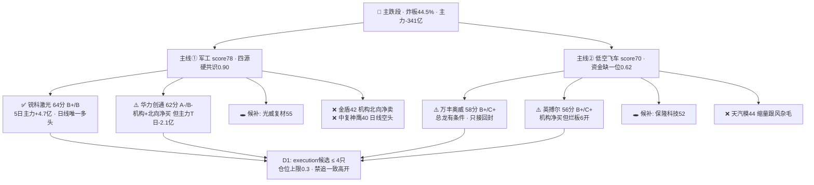

# 2026年10月19日（周一） · 个股画像 R5

> **数据源新鲜度**: partial（全部交易数据为 10/16 收盘口径）
> **降级状态**: false（9 票六维齐备，无单票 partial）
> **置信度**: 0.52
> **市场段位**: 🔴 **主跌段** — 炸板率 44.55%（≥35% 砍半线）· 主力净流出 341 亿 · 沪深股通休市纯内资 · 昨日涨停溢价 −1.64%

## 一句话结论

**只做两条主线的分歧确认：军工低位补涨认「锐科激光（趋势最健康）+ 华力创通（机构合力但主力出货背离）」；低空飞车总龙「万丰奥威」只接分歧回封、烂板「英搏尔」等弱转强；金盾/中复神鹰/天汽模明确剔除，光威/保隆候补。**

## 一、候选池构建

| 项 | 值 |
|---|---|
| 来源 | R2 两条主线 leaders 合计 **9 只**（≥5，未触发 v1.4 扩池） |
| 板块分布 | 军工 5 只 · 低空飞车 4 只 |
| R2 给 execution 资格 | 4 只：华力创通、锐科激光、万丰奥威、英搏尔（万丰为有条件） |
| 扩池 | 无（top10 其余板块被 C2 科技拦截/C4 高股息无涨停基因，且无 top_stock 字段） |
| 数据覆盖 | 36 个交易日日线（08/20–10/16）+ 图视快照 241 日 K / 周 / 60 分 / 15 分 |

## 二、六维评分总表

| 排名 | 票 | 板块 | 催化 | 筹码 | 联动 | 估值 | 技术 | 机构 | 综合 | α档 | 风险档 | 龙头裁决 |
|---|---|---|---|---|---|---|---|---|---|---|---|---|
| 1 | **锐科激光** 300747 | 军工/激光 | 55 | **78** | 72 | 30 | **78** | 45 | **64** | B+ | **B** | 补涨/助攻（趋势核心） |
| 2 | **华力创通** 300045 | 军工/大飞机 | 68 | 62 | **80** | 35 | 66 | 66 | **62** | **A-** | B- | ✅ 龙头（背离） |
| 3 | 万丰奥威 002085 | 低空飞车 | **75** | 42 | 72 | 58 | 62 | 48 | 58 | B+ | C+ | 板块总龙（有条件） |
| 4 | 英搏尔 300681 | 低空/电驱 | 65 | 62 | 66 | 52 | 52 | 66 | 56 | B+ | C+ | 龙二（分歧） |
| 5 | 光威复材 300699 | 军工/碳纤维 | 52 | 68 | 66 | 48 | 55 | 50 | 55 | B | B | 补涨 · 候补 |
| 6 | 保隆科技 603197 | 低空/汽零 | 55 | 42 | 58 | **62** | 66 | 40 | 52 | B | B- | 补涨首板 · 候补 |
| 7 | 天汽模 002510 | 低空/模具 | 45 | 40 | 52 | 35 | 60 | 30 | 44 | B- | C | ❌ 跟风杂毛 |
| 8 | 金盾股份 300411 | 军工/情绪 | 50 | 48 | 60 | 15 | 70 | 25 | 42 | B- | C | ❌ 情绪助攻 |
| 9 | 中复神鹰 688295 | 碳纤维/中字头 | 48 | 52 | 58 | 32 | 35 | 48 | 40 | C+ | C+ | ❌ 联动非龙头 |

## 三、首推票思维链

### 1. 锐科激光 300747 · 综合 64 · α B+ / 风险 B · 【进：分歧低吸】

- **大资金意图**：5 日主力净流入 **+4.71 亿（板块第一）**，10/14（+2.00 亿）与 10/16（+3.16 亿）两根放量真金；股东户数 60081→55944（−6.9%）筹码集中。但 T 日超大单 −1718 万、融资余额 15 日 **−12.3%**（杠杆资金离场）——主力吸筹与融资客撤退并存。
- **为什么走强**：军工板块 +18 亿（行业第一）的高低切外溢，它是板块内**唯一日线多头排列**（40.13 > MA5 36.92 > MA20 38.38，且站上 MA60 36.56），5 日 +16.4% 温和放量（量比 1.30）。
- **逻辑够不够硬**：中等。间接受益军演/航展，非事件最前排、无机构龙虎榜、PE 91 倍；上方 42.22 阶段高点是试金石。
- **买入理由**：趋势 + 资金双确认的低位补涨，符合主跌段「只接低位」。**风险点**：超大单翻负 + 融资去杠杆若延续，流入可能是单日脉冲。**止损条件**：跌破 60 分/日线 MA20 区域 38.4（图视低吸位）即证伪。**可验证假设**：竞价/早盘主力资金继续净流入且不破 38.4。

### 2. 华力创通 300045 · 综合 62 · α A- / 风险 B- · 【进：只接分歧，不追高开】

- **大资金意图**：10/16 龙虎榜净买 **+1.07 亿**，机构三笔合计约 +0.44 亿（3558 万为首）、深股通 +1696 万，游资新闸路 3704 万 / 鲁迅中路 3011 万接力；**但主力资金 T 日 −2.14 亿、5 日 −4.43 亿**（R7 已标 20cm 涨停分歧）。解读：老钱借 20cm 板派发给做板块切换的游资+机构，合力真实但承接未经次日检验。
- **为什么走强**：大飞机概念 R7 资金领涨 + 10/16 单日 20% 放量突破 MA5/20/60，龙虎榜是板块内最强机构确认；股东户数 9/30→10/9 由 76371 升至 86142（+12.8%），涨停前筹码已快速分散。
- **逻辑够不够硬**：事件端是明牌（军演 10/19 开幕），差在资金高低切而非新信息；周线空头、PE 亏损（PB 5.64，84 亿市值）无基本面锚。
- **买入理由**：板块唯一四源共识（0.90）的低位接棒核心，α 确定性最高。**风险点**：主力出货与 LHB 净买背离 + 一致性高开兑现。**止损条件**：低开后不能收回 11.5（60 分 MA20 低吸位）；高开 >5% 直接放弃。**可验证假设**：开盘分歧换手后回封且主力资金转正。**周线压力 14.09 高抛**。

### 3. 万丰奥威 002085 · 综合 58 · α B+ / 风险 C+ · 【有条件：分歧回封才进】

- **大资金意图**：板块致命伤未解除——人气龙一江淮 −6.6 亿（全市场第一），**全板块无行业级主力净流入**，呈游资封板/老钱派发背离；万丰自身无龙虎榜数据，19.48 万散户户。封板本身（09:44，0 开板）是真的，资金确认是缺的。
- **为什么走强**：Roadster 霸榜 + 33.2 万意向金 + 卖方齐吹「复制 22 年机器人」，飞车情绪总龙辨识度第一，飞机制造占收入 14.84%，PE 23 倍有主业底。
- **逻辑够不够硬**：一致性明牌、无预期差；10/21 特斯拉财报是证伪/加强节点；收盘 9.91 压在 MA60（9.99）下，周线 MA20=10.5 强压。
- **买入理由**：龙头身位 + 首板群板块效应。**风险点**：缩量纯内资日高开低走、封不住即退潮。**止损条件**：只接开盘分歧换手后的回封，封不住立刻弃；禁止追高开。**可验证假设**：竞价放量承接 + 回封封单稳定。

### 4. 英搏尔 300681 · 综合 56 · α B+ / 风险 C+ · 【降级观察：弱转强才进】

- **大资金意图**：板块内**唯一机构净买的弹性票**（机构三席 +0.37 亿、北向 +233 万，开源西安 2733 万、麦高成都 2267 万游资共振）。但 **13:01 才封板、开板 6 次**（9 票封板质量最差，换手 12.91%），机构买在烂板上说明承接有、合力散。
- **为什么走强 / 逻辑硬度**：高功率电驱映射 Roadster，63.8 亿小票 PE 24 倍在主题票中相对克制；但纯主题 2028 前零贡献，收盘 20.84 压 MA60（20.88）。
- **止损条件**：不追 20cm 高开；只有弱转强（高开后 30 分钟内换手回封、开板≤1）才可参与，破 15 分 MA20（约 19.0 区域）证伪。

## 四、候补与剔除（明确态度，不用"关注/留意"）

| 票 | 处置 | 理由 |
|---|---|---|
| 光威复材 300699 | **候补（观察）** | T 日主力 +2.89 亿/超大单 +0.5 亿，但流入仅一日、收盘 24.32 < MA60 24.39；竞价放量站回 MA60 才升级 |
| 保隆科技 603197 | **候补（观察）** | 09:30 秒板 0 开板 + PE 18 最便宜，但无主力/龙虎榜确认、20 日位置 83% 偏高；资金+回封双确认才议 |
| 金盾股份 300411 | **❌ 剔除** | 封板最早最硬（10:56，0 开板）但龙虎榜机构 −305 万、北向 −1376 万净卖，PE 22801 倍、39 亿微盘纯游资情绪票，主跌段不接力 |
| 中复神鹰 688295 | **❌ 剔除** | 9 票唯一日线空头排列（35.92<MA20<MA60），融资 15 日 −10.3%，户数上市后翻倍分散，38–42 元套牢盘压顶 |
| 天汽模 002510 | **❌ 剔除（杂毛）** | 低空第 3 梯队跟风，量比 0.89 唯一缩量封板、无两融/无机构/无主力确认、PE 113 |

## 五、30 日量价与筹码关键证据

| 票 | 收盘 | 20日位置 | 5日涨幅 | 5日/20日量比 | PE_TTM | PB | 市值(亿) | 融资15日 | 大宗30日 | 龙虎榜(10/16) |
|---|---|---|---|---|---|---|---|---|---|---|
| 锐科激光 | 40.13 | 79% | +16.4% | 1.30 | 91.0 | 6.37 | 225 | **−12.3%** | 0 | 无 |
| 华力创通 | 12.70 | 79% | −0.3% | 1.77 | 亏损 | 5.64 | 84 | +5.6% | 0 | 净买+1.07亿(机构+) |
| 万丰奥威 | 9.91 | 59% | +6.8% | 1.54 | 23.3 | 3.06 | 210 | −3.1% | 0 | 无 |
| 英搏尔 | 20.84 | 57% | +5.4% | 1.10 | 24.0 | 2.04 | 64 | +0.8% | 0 | 净买+0.73亿(机构+)·烂板6开 |
| 光威复材 | 24.32 | 67% | +5.1% | 1.77 | 37.9 | 3.70 | 202 | −1.7% | 0 | 无 |
| 保隆科技 | 29.39 | 84% | +3.1% | 1.58 | 18.4 | 1.90 | 63 | −2.9% | 0 | 无 |
| 天汽模 | 5.96 | 81% | +6.8% | **0.89** | 113.0 | 2.39 | 61 | 非标的 | 0 | 无 |
| 金盾股份 | 9.60 | **100%** | +14.7% | 1.13 | 22801 | 4.04 | 39 | 非标的 | 0 | 净买+0.52亿(机构/北向净卖) |
| 中复神鹰 | 35.92 | 55% | +2.6% | 1.21 | 209.4 | 6.79 | 323 | **−10.3%** | 0 | 无 |

**封板时间结构（10/16，limit_list_d）**：保隆 09:30:21 → 万丰 09:44:03 → 华力创通 11:13:27（开1）→ 天汽模 11:15:27 → 金盾 10:56:39 → 英搏尔 13:01:18（**开6**）。锐科激光/光威复材/中复神鹰当日未涨停。

## 六、事件时间线

- **10/16 收盘**：军工全线爆发（板块 +3%，20cm 成建制涨停）；低空首板群启动；总龙长城军工一字板被主力出货 −3.7 亿（R7，不接）。
- **10/17 17:22 · E005(high)**：日美「利剑27」军演 10/19–29（八国 6 万人）；珠海 10/20 南海实弹射击公告；伊朗油轮霍尔木兹触雷。
- **10/18 全天 · E004(high)**：特斯拉 Roadster 周末霸榜；华创/长城专家会「复制 22 年机器人」；中国官网 33.2 万意向金开放。
- **10/19 05:30 · E007(high)**：霍尔木兹冲突升级 + 法国骚乱，黄金 4180 美元、欧气 +2%（利好油气黄金，对候选池仅情绪外溢）。
- **10/19（今日）**：军演开幕（明牌兑现日，先手易砸盘）。
- **10/20**：珠海南海实弹。**10/21**：特斯拉财报（低空主线证伪/加强节点）。**11 月**：珠海航展。

## 七、数据源审计

| 源 | 状态 | 口径时间 | 记录 | 备注 |
|---|---|---|---|---|
| R2_main_sectors | 🟢 ok | 10/19 07:52 | 9 候选 | conf 0.49 |
| R4_news | 🟢 ok | 10/19 06:36 | 8 事件 | E004/E005/E007 直接相关 |
| R7_capital_flow | 🟡 stale | 10/16 收盘 | 6 板块/9 flag | 沪深股通休市，无盘前增量 |
| tushare daily/basic | 🟢 ok | 10/16 收盘 | 9×36 行 | ≥30 日量价满足 |
| tushare limit_list_d | 🟢 ok | 10/16 | 6 票封板 | 含封板时间/开板次数 |
| tushare top_list/inst | 🟢 ok | 10/16 | 3 票 | 华力创通/英搏尔/金盾 |
| tushare margin_detail | 🟢 ok | 10/16 | 7 票 13–14 日 | 金盾/天汽模非两融标的 |
| tushare block_trade | 🟢 ok | 近30日 | 全 0 笔 | 无分销减持信号 |
| chart_vision 快照 | 🟢 ok | 10/19 07:05 | 9/9 命中 | 未调 MCP 直连，source=snapshot |

## 八、不确定性 / 反证（交 R6 硬否决）

1. **华力创通多空同源风险**：主力 5 日 −4.43 亿 vs 龙虎榜净买 +1.07 亿。若 10/19 竞价主力资金继续净流出且低开无承接，则「机构游资合力」证伪，降为纯情绪反弹——这是本池最大分歧点，请 R6 重点审。
2. **低空主线资金缺一位**（r7_capital_match=false，共识仅 0.62）：万丰/英搏尔的全部买点都建立在「分歧回封」假设上；若竞价无放量承接，两只整体降级 watch，不进 execution。
3. **口径滞后**：全部交易证据停在 10/16，军演开幕日（10/19）的一致高开/兑现无法在盘前证伪，须竞价校准（P1）。
4. 锐科激光融资 −12.3%、中复神鹰 −10.3% 的杠杆撤离，与主力流入/板块叙事方向相反，前者可解释为洗盘、后者与技术弱势互证。
5. 本批无大宗交易、无 F12 审计非标/S 轴 ST 信号；红旗仅 V2（高估值：锐科/中复神鹰/天汽模）与 V6（华力创通亏损无 PE），均不构成 hard_reject 级别。

## 九、与其他 R/D/E 的关系

- **依赖**: R1（风格/段位）· R2（候选池+主线打分）· R3（热度共振）· R4（E004/E005/E007 事件）· R7（资金/龙虎榜/出货 flag）· chart_vision_snapshot
- **被消费**: D1（execution_pool 分档：锐科 B+/B、华力 A-/B- 优先；万丰/英搏尔有条件；候补 2 只入 watch；剔除 3 只）· R6（重点反证华力背离 + 低空资金缺位）· P1 竞价校准

## Sub-Agent 元数据

- skill: analyze_stock_profile_v1（v1.5）
- artifact: data/research/20261019/R5_stock_profiles.json
- 候选: 9 只（六维全量，partial=0）
- model: ark-code-latest
- 备注: 未触发扩池；tushare pro 为 v1.3 契约主源（vibe-trading 未配置）；估值横切 skill 未调用（主题情绪票，改用 PE/PB+V2/V6 陷阱标注）
