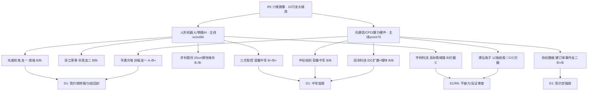

# 2026年10月20日 · **个股画像(R5)**

> **数据源新鲜度**: partial(R7/vibe 降级,tushare 主源全绿)
> **降级状态**: false(六维无 null 缺口;机构维为代理分)
> **置信度**: 0.66 · **段位**: high_chop 主跌恐慌后**止跌试盘段** · 仓位上限 50%

## 一句话结论
**机器人线资金连续2日确认、光通信线3.99亿封单破局,但全部候选除澳弘外日K均处空头排列——这是超跌反抽不是主升:首板只做竞价弱转强,中军只低吸,高位妖股澳弘电子(21日12板)拦截不接力,宇树只当情绪温度计。**

## 候选池与分档总表(10只·按综合分排序)

| 排名 | 代码 | 名称 | 主线/身位 | 收盘价 | 总市值(亿) | PE-TTM | 综合分 | 进攻档 | 风险档 | 关键旗标 |
|:--:|:--|:--|:--|--:|--:|--:|--:|:--:|:--:|:--|
| 1 | `600487.SH` | 亨通光电 | 光通信/CPO/算力硬件/龙头 | 50.25 | 1239 | 29.6 | **73.2** | 🟢A- | 🟡B+ | 定增摊薄 |
| 2 | `002050.SZ` | 三花智控 | 人形机器人/物理AI/中军 | 32.65 | 1374 | 34.4 | **70.8** | 🟡B+ | 🟡B+ | 回购 |
| 3 | `300857.SZ` | 协创数据 | 光通信/CPO/算力硬件/事件驱动 | 216.77 | 1061 | 41.3 | **69.0** | 🟡B+ | 🟡B | 硬订单、高负债 |
| 4 | `003021.SZ` | 兆威机电 | 人形机器人/物理AI/龙头 | 67.22 | 180 | 83.5 | **64.5** | 🟡B | 🟠B- | — |
| 5 | `300308.SZ` | 中际旭创 | 光通信/CPO/算力硬件/中军 | 660.7 | 7782 | 38.0 | **63.5** | 🟡B | 🟡B | 杠杆撤退、下降通道 |
| 6 | `603119.SH` | 浙江荣泰 | 人形机器人/物理AI/跟风/补涨 | 45.87 | 217 | 71.1 | **62.0** | 🟡B | 🟠B- | 大宗已核 |
| 7 | `300442.SZ` | 润泽科技 | 光通信/CPO/算力硬件/扩散候补 | 56.16 | 922 | 17.2 | **60.1** | 🟡B | 🟡B | 股东增持 |
| 8 | `688836.SH` | 宇树科技 | 人形机器人/物理AI/情绪锚 | 495.92 | 2006 | 343.3 | **59.3** | 🟡B | 🔴C | 高标锚、small_float、known_catalyst_window |
| 9 | `688160.SH` | 步科股份 | 人形机器人/物理AI/弹性候补 | 82.66 | 76 | 91.3 | **54.8** | 🟠B- | 🟠B- | — |
| 10 | `605058.SH` | 澳弘电子 | 光通信/CPO/算力硬件/高位妖股/非龙头 | 72.41 | 104 | 75.0 | **42.5** | 🔴C | 🔴C | 🚨霸榜出货、监管异动、弱封板 |

> 档位硬约束已满足:两档每票必填;澳弘含 `distribution_alert` → 风险档顶格 🔴C。**R5 是分档器,是否决在 R6**(已向 R6 推送 3 条 hard_reject 提示)。

## 六维画像结构

## 逐票思维链(六维三问 + 买入/风险/止损/验证)

### 亨通光电 `600487.SH` · 3.99亿封单容量破局龙一,业绩+产业双支撑,只做分歧回封/低吸不追高

六维: 催化 **82** / 筹码 **66** / 板块联动 **78** / 估值安全 **74** / 技术 **62** / 机构 **70** → 综合 **73.2**(进攻 A- / 风险 B+)

基本面快照(2026H1): 营收同比 31.13% / 净利同比 90.67% / 毛利率 16.77% / ROE 9.53% / 资产负债率 52.39% · PE 29.6 / PB 3.68 / 流通市值 1233亿

- **大资金意图**: 3.99亿封单/60万手是全场最大量级,大资金选1239亿容量票破局而非小票,是在炸板率31%环境里用流动性确定性建仓光通信β;对手盘是9/28跌停(13.2亿封单)以来的套牢盘和解禁/定增预期盘。
- **为什么走强**: 位置超跌(30日-34%、45.1见底)+硬催化(光纤现货数倍涨价、短缺至2028、Q1-Q3净利+91%)+筹码反转(前4日连续流出后1019转为净流入1.73亿),三维共振。
- **逻辑够不够硬**: 硬业绩+产业涨价双锚,估值PE29.6为算力线最低一档;但板块涨停潮不足、PCB/存储资金不跟、E008高盛十年最快砍科技股为同级反证——硬但不是反转型,是反抽型。
- **买入理由**: ①10:47早盘封板+开板仅1次,身位为光通信线最正封板龙;②PE29.6/H1扣非+101%,1.6T+海缆+光纤涨价多逻辑。
- **风险点**: ①距MA20(58.93)仍有-17%,下降通道未破,反抽埋人前科(1015-16两次);②定增预案摊薄+9/28跌停套牢盘沉重。
- **止损条件**: 低开跌破开盘价且不能收回昨收45.68→证伪离场;中线跌破45.1(20日低点)无条件走。
- **可验证假设**: 10/20竞价高开≤5%且竞价额>3亿、10:00前不翻绿→弱转强成立;高开>8%缩量=兑现点不追。
- **事件时间线**: 1017 2026前三季度业绩自愿性披露(正·Q1-Q3高增)、0925 定增预案+2026员工持股计划(摊薄但绑定利益)、1001 控股股东部分股权解除质押(正)

### 三花智控 `002050.SZ` · 1374亿中军,资金连续3日回流+回购,炸板率环境下的稳健承接位,只低吸

六维: 催化 **72** / 筹码 **70** / 板块联动 **80** / 估值安全 **68** / 技术 **58** / 机构 **72** → 综合 **70.8**(进攻 B+ / 风险 B+)

基本面快照(2026H1): 营收同比 3.92% / 净利同比 -7.47% / 毛利率 28.06% / ROE 6.36% / 资产负债率 36.22% · PE 34.37 / PB 4.23 / 流通市值 1205亿

- **大资金意图**: 连续3日主力净流入(0.83/1.42/2.15亿),机构在反抽日先回补确定性中军,赚板块β的趋势钱而非连板钱;对手盘是8月以来37→30的趋势做空盘。
- **为什么走强**: 位置回撤浅(20日低点30.12)+双催化(E003执行器+E005引望/宁德换电)+公司持续回购托底,1374亿市值在炸板率环境给资金提供承接位。
- **逻辑够不够硬**: 回购+分红+全球热管理龙头是硬底,但H1净利-7.5%、机器人执行器收入尚未放量,叙事>业绩,只能当中军不能当弹性。
- **买入理由**: ①板块唯一大市值中军,炸板率31%环境回撤最浅;②资金连续3日回流+回购进行中。
- **风险点**: ①日K仍空头排列,MA20(34.04)压制;②H1净利下滑,中军弹性不足。
- **止损条件**: 跌破30.12(20日低点)走;板块龙头兆威/宇树双双深水低开则放弃低吸计划。
- **可验证假设**: 回踩5日线31.66或分时均线放量承接→可低吸;机器人板块10/20涨停家数≥10→中军β确认。
- **事件时间线**: 1016 回购A股进展(持续回购·正)、0922 中期权益分派+调整回购价格上限(正)

### 协创数据 `300857.SZ` · 盘后硬订单+当日未抢跑=全场预期差最大,竞价高开5-9%放量可半路,低开低走放弃

六维: 催化 **90** / 筹码 **64** / 板块联动 **70** / 估值安全 **66** / 技术 **48** / 机构 **62** → 综合 **69.0**(进攻 B+ / 风险 B)

基本面快照(2026H1): 营收同比 153.29% / 净利同比 313.96% / 毛利率 25.15% / ROE 35.18% / 资产负债率 86.79% · PE 41.26 / PB 17.5 / 流通市值 1051亿

🚩 红旗: F4(medium):资产负债率86.8%,374.9亿算力云协议履约/资金能力待验证

- **大资金意图**: 盘后硬订单是隔夜增量信息,1019仅+1.22%未抢跑意味着资金尚未定价;次日竞价是真金白银的态度公投,对手盘是质疑客户身份/履约能力的机构。
- **为什么走强**: 预期差最大(374.9亿/60个月=年化62.5亿,远超当前营收)+5日主力已净流入3.31亿(聪明钱提前)+H1净利+314%。
- **逻辑够不够硬**: 真订单公告+律所意见书=硬事件,比板块传闻高一个量级;但资产负债率86.8%(F4红旗)、客户与付款条款未披露,微软退出英国Nscale是行业级反证——硬alpha带着履约问号。
- **买入理由**: ①全场唯一盘后落地的硬订单且当日未抢跑;②H1营收+153%/ROE35%,业绩消化估值。
- **风险点**: ①负债率86.8%,合同履约/资金链风险;②日K空头排列(低于MA20 11%),低开低走=公告被当出货。
- **止损条件**: 竞价低开且开盘15分钟不能翻红→放弃;买入后跌破203(20日低点)止损。
- **可验证假设**: 高开5-9%且竞价成交额≥5亿(较日常放大2倍+)→资金认可可半路;平开或低开=市场质疑,不进场。
- **事件时间线**: 1019 全资子公司签署日常经营重大合同公告(374.9亿/60个月算力云协议)、1019 信达律所重大合同法律意见书

### 兆威机电 `003021.SZ` · 灵巧手微型驱动产业票,首板顶在MA20压力位,只做弱转强不追高

六维: 催化 **78** / 筹码 **58** / 板块联动 **82** / 估值安全 **42** / 技术 **55** / 机构 **55** → 综合 **64.5**(进攻 B / 风险 B-)

基本面快照(2026H1): 营收同比 3.8% / 净利同比 -42.46% / 毛利率 30.76% / ROE 1.75% / 资产负债率 14.19% · PE 83.51 / PB 3.55 / 流通市值 140亿

🚩 红旗: V2(medium):PE-TTM 83.5且H1扣非净利-44%,PEG失效,估值全靠人形机器人放量预期

- **大资金意图**: 尾盘14:08封板说明资金日内观望、借板块情绪做首板卡位,封单仅0.59亿且板上净流出0.23亿——更像游资借势而非机构建仓,次日要靠板块合力续命。
- **为什么走强**: 产业硬度(灵巧手微型驱动送样多家人形厂商)+板块效应(19家涨停)+超跌位置,但封板时间晚、催化是明牌(英伟达消息1019白天已发酵)。
- **逻辑够不够硬**: 产业逻辑真但H1扣非-44%/PE83,股价全靠叙事;10/21黄仁勋演讲+10/22宇树大会是明牌节点,兑现风险集中在两个时点——逻辑真但赔率已被明牌压缩。
- **买入理由**: ①机器人线辨识度+产业硬度最佳首板;②收盘67.22恰好顶住MA20压力,放量2.6倍。
- **风险点**: ①涨停顶在MA20(67.35)下沿,上方72.3为20日高点套牢区;②板上资金净流出,尾盘首板次日分歧大。
- **止损条件**: 跌破59.52(20日低点/涨停启动位)无条件走;高开>8%缩量一字不排。
- **可验证假设**: 竞价高开3-6%放量承接+宇树不大幅低开→弱转强可半路/打板;黄仁勋演讲无超预期→前排高开即兑现。
- **事件时间线**: 0908 限制性股票回购注销完成(中性)、0903 激励计划第二个行权期自主行权提示(中性)

### 中际旭创 `300308.SZ` · 基本面最强中军但处于下降通道+杠杆撤退,板块β确认后的低吸位,不追高

六维: 催化 **68** / 筹码 **48** / 板块联动 **75** / 估值安全 **72** / 技术 **40** / 机构 **78** → 综合 **63.5**(进攻 B / 风险 B)

基本面快照(2026H1): 营收同比 182.49% / 净利同比 228.19% / 毛利率 46.25% / ROE 39.21% / 资产负债率 36.08% · PE 38.05 / PB 19.52 / 流通市值 7333亿

🚩 红旗: V6(medium):高位科技中军,机构/杠杆资金撤退中(融资-20%),业绩高增但杀估值未结束

- **大资金意图**: 5日主力净流入34.9亿为全场个股之最,但股价30日-32%——这是下跌途中的被动承接与机构分歧,不是主动进攻;融资余额15日-20%显示杠杆资金在撤。
- **为什么走强(为什么弱)**: 基本面全场最硬(H1净利+228%/ROE39%/Meta 1.6T主供),但位置仍在下降通道、1019板块反抽日收绿-1.39%,资金在'2028开支可见性'争议下撤离。
- **逻辑够不够硬**: 产业订单硬到2027,但E008机构砍科技+融资撤退+V6杀估值三重压制,硬资产遇上紧流动性;只适合β确认后低吸,不适合左侧猜底。
- **买入理由**: ①全球光模块龙头、1.6T主供,PE38相对增速不贵;②贴近20日低点644,下行空间相对收敛。
- **风险点**: ①融资余额15日-20%(接近short_pressure线);②1019不跟板块=相对弱势,机构仍在卖。
- **止损条件**: 跌破644.23(20日低点)走;板块龙一亨通封死跌停或高开低走则同步放弃。
- **可验证假设**: 美光10/21技术会超预期+次日放量站上MA5(683)→低吸成立;否则继续等MA20修复,不追。
- **事件时间线**: 1001 协议受让中石伟业部分股权完成过户(并购扩张)、0928 半年度权益分派+控股股东解除质押(正)、0925 股份回购结果暨变动(回购完成·正)

### 浙江荣泰 `603119.SH` · 减持落地+业绩高增的补涨龙二,看龙一脸色,不抢先手

六维: 催化 **70** / 筹码 **62** / 板块联动 **72** / 估值安全 **48** / 技术 **52** / 机构 **58** → 综合 **62.0**(进攻 B / 风险 B-)

基本面快照(2026H1): 营收同比 56.93% / 净利同比 22.64% / 毛利率 36.57% / ROE 7.26% / 资产负债率 36.09% · PE 71.09 / PB 10.34 / 流通市值 217亿

- **大资金意图**: 控股股东9月减持落地、10/14提前终止,利空出尽后资金借机器人板块做补涨;9/24的1.84亿平价大宗多机构接盘更像减持过户的尾声,不是新建仓信号。
- **为什么走强**: H1营收+57%/净利+23%是板块内少有的业绩兑现票+减持出清+超跌(距MA20 -10%),但封板13:52+开板2次=跟风身位。
- **逻辑够不够硬**: 业绩硬但个股无独立催化,纯板块联动;能不能走下去取决于兆威脸色,独立逻辑不支持抢跑。
- **买入理由**: ①减持提前终止+高增长,基本面在机器人首板梯队里最干净;②封单0.88亿大于龙一兆威。
- **风险点**: ①跟风票无独立预期差,龙一走弱它先死;②周K空头排列,MA20/MA60(50.6)双压。
- **止损条件**: 跌破40.70(20日低点)走;龙一兆威竞价走弱则不进场。
- **可验证假设**: 兆威竞价强确认后,荣泰回封放量可做跟风;竞价弱于兆威3个百分点以上=放弃。
- **事件时间线**: 1014 控股股东及一致行动人提前终止减持计划暨减持结果(利空出尽·偏正)、0929 权益变动触及1%刻度(减持过程)、0903 减持计划公告(已落地)

### 润泽科技 `300442.SZ` · 低估值IDC+股东增持,协创强势时做扩散低吸,协创走弱则不做

六维: 催化 **62** / 筹码 **60** / 板块联动 **58** / 估值安全 **72** / 技术 **50** / 机构 **55** → 综合 **60.1**(进攻 B / 风险 B)

基本面快照(2026H1): 营收同比 50.05% / 净利同比 37.45% / 毛利率 46.58% / ROE 8.55% / 资产负债率 64.91% · PE 17.16 / PB 6.36 / 流通市值 919亿

- **大资金意图**: 控股股东5-10亿增持进行中(已增持149万股)给出价格底,资金把它当算力线低估值防守型扩散位,1019净流入1.19亿是回流信号但量级温和。
- **为什么走强**: PE17.1为算力线最低+净利率33%+营收+50%的IDC批发龙头,增持托底;但换手仅0.93%、无合力,属proxy扩散。
- **逻辑够不够硬**: 增持是硬承诺、业绩是真高增,但AIDC批发模式重资产(负债率65%)、融资余额-10%,且它不是E001合同的直接受益方,逻辑隔一层。
- **买入理由**: ①股东真金白银增持+PE17低估值;②E001算力大单的IDC扩散方向。
- **风险点**: ①换手0.93%流动性弱;②融资15日-10.3%,杠杆仍在撤。
- **止损条件**: 跌破53.46(20日低点)走;协创数据竞价低开低走则扩散逻辑不做。
- **可验证假设**: 协创高开5%+且IDC板块有第二只涨停→润泽低吸成立;协创走弱,本票不动。
- **事件时间线**: 1019 控股股东增持计划实施进展(5-10亿增持进行中,19日已增持149万股·正)

### 宇树科技 `688836.SH` · 板块情绪温度计非执行位,明牌大会前抢跑,盈亏比恶化只观察/极小仓

六维: 催化 **80** / 筹码 **42** / 板块联动 **85** / 估值安全 **18** / 技术 **58** / 机构 **55** → 综合 **59.3**(进攻 B / 风险 C)

基本面快照(2026H1): 营收同比 48.54% / 净利同比 275.5% / 毛利率 56.01% / ROE 9.99% / 资产负债率 25.11% · PE 343.32 / PB 69.65 / 流通市值 149亿

🚩 红旗: V2(strong):PE-TTM 343/PB69.6,扣非H1 -19.3%,估值完全依赖整机量产叙事

- **大资金意图**: 1019净流入4.97亿+龙虎榜净买1.82亿,游资在自家大会前抢跑情绪最高斜率;但流通市值仅149亿、换手21.9%,对手盘是8月845高点套牢盘和大会兑现盘。
- **为什么走强**: 人形整机总龙头的稀缺性+10/22大会明牌+超跌(较高点-41%);放量站上MA5/MA20是技术面唯一的偏多候选。
- **逻辑够不够硬**: PE343/PB69.6/H1扣非-19%,估值无锚;大会是'利好落地'的典型兑现结构(8月以来每次事件后都跌)——情绪逻辑硬,价值逻辑不存在。
- **买入理由**(仅限极小仓): 板块情绪温度计,深水区换手企稳且板块共振时可极小仓低吸。
- **风险点**: ①10/22大会明牌兑现,买它=赌最高斜率;②149亿小流通+21.9%换手,双向20cm。
- **止损条件**: 跌破404.03(20日低点)立即走;大会前高开>10%不追。
- **可验证假设**: 大会给出超预期量产/订单数据→情绪延续;只讲愿景→高开兑现,验证R2/R3'情绪锚不接力'定性。
- **事件时间线**: 0930 新增2026年度日常关联交易预计额度、0903 变更注册资本/公司类型/章程(次新)

### 步科股份 `688160.SH` · 20cm运控弹性候补,未封板=未一致,仅板块延续时半路/首板试错

六维: 催化 **62** / 筹码 **52** / 板块联动 **66** / 估值安全 **44** / 技术 **46** / 机构 **48** → 综合 **54.8**(进攻 B- / 风险 B-)

基本面快照(2026H1): 营收同比 44.0% / 净利同比 53.6% / 毛利率 33.18% / ROE 2.76% / 资产负债率 19.17% · PE 91.29 / PB 5.65 / 流通市值 76亿

- **大资金意图**: dc飙升榜#1但未封板,资金认可运控弹性却不愿给一致预期,1019净流入仅0.14亿,属于反抽日的弹性映射而非主动配置。
- **为什么走强**: H1营收+44%/净利+54%+董事减持届满+20cm弹性,位置距高点回撤深;但日K空头排列、距MA20 -9.5%。
- **逻辑够不够硬**: 业绩高增是真的,但无个股催化、无封板、无资金量级,纯β弹性,反抽失败时20cm回撤同样剧烈。
- **买入理由**(仅试错仓): ①基本面增速高+减持出清;②板块继续走强时20cm弹性最大。
- **风险点**: ①未封板=未一致,次日低开概率不低;②75亿小盘无两融数据,资金信号弱。
- **止损条件**: 跌破73.59(20日低点)走;不低吸,只做半路/首板确认。
- **可验证假设**: 板块10/20延续且个股竞价放量高开→首板可打;低开或冲高回落=试错仓不启用。
- **事件时间线**: 1012 董事减持计划时间届满暨减持结果(利空出尽)、1014 注销募集资金专户(中性)

### 澳弘电子 `605058.SH` · 21日12板高位妖股+弱封板+异动监管+业绩下滑,只看弱转强一进二极小仓,不低吸

六维: 催化 **48** / 筹码 **30** / 板块联动 **42** / 估值安全 **30** / 技术 **72** / 机构 **30** → 综合 **42.5**(进攻 C / 风险 C)

基本面快照(2026H1): 营收同比 14.74% / 净利同比 -24.75% / 毛利率 24.69% / ROE 3.67% / 资产负债率 51.63% · PE 75.0 / PB 5.83 / 流通市值 104亿

🚩 红旗: V2(strong):PE75且H1扣非-38.7%,12/21板纯情绪定价；F1(strong):2026-10-14/09-24两次股票交易异常波动+10-16转债异动,监管风险

- **大资金意图**: 21日内12板,1019涨停日主力净流入仅0.05亿、5日净流出3.93亿,1013龙虎榜净卖0.21亿——典型**借CPO/PCB板块热度高位派发**,大资金在出货而非建仓。
- **为什么走强**: 纯情绪。up_stat 12/21、9/11自30元炒至72元(+141%),蹭CPO+PCB双概念,转债不提前赎回维持转股套利;基本面H1扣非-38.7%完全不支持。
- **逻辑够不够硬**: 极不硬且监管信号密集:30日内两次股票异动公告+一次转债异动公告+控股股东转债减持触及1%刻度;已推送R6模式六(霸榜出货)重点审查。
- **买入理由**: 无执行级理由。R2候补已降级,唯一观察价值是弱转强一进二的情绪指标意义。
- **风险点**: ①弱封板(开板4次/封单0.15亿)+16.6%换手;②两次异动监管+转债转股抛压+业绩下滑。
- **止损条件**: 本票不进 execution_pool;若情绪试错,跌破10/16巨阴低点63.46立即走。
- **可验证假设**: 竞价超预期+快速回封一进二=情绪仍亢奋(只作板块温度计);低开=埋人验证派发判断。
- **事件时间线**: 1016 可转债交易异常波动公告(监管风险)、1014 股票交易异常波动暨风险提示(监管风险)、1015 不提前赎回澳弘转债(转股抛压悬顶)、1010 控股股东可转债持有比例变动10%/权益变动1%(减持)

## 关键证据
- 证据1: 机器人概念1019涨停19家/人形12家,主力净流入连续2日(+24.7亿/+19.9亿),为全市场唯一连续2日净流入主题簇 · 来源 R2/_r7_data
- 证据2: 亨通光电10:47封板、封单3.99亿/60万手为全场最大量级,但光通信线内部分化(PCB -26.8亿/存储 +0.5亿) · 来源 tushare limit_list_d/_r7_data
- 证据3: 协创数据1019 18:00公告374.9亿/60个月算力云协议,当日仅+1.22%未抢跑,资产负债率86.8%为履约问号 · 来源 tushare anns_d/R4 E001
- 证据4: 澳弘电子21日内12板、两次异动公告、龙虎榜净卖、涨停日资金净流入仅0.05亿=派发结构 · 来源 tushare limit_list_d/top_list/anns_d
- 证据5: 中际旭创5日主力净流入34.9亿但融资余额15日-20%、股价30日-32%=机构分歧/杠杆撤退 · 来源 _r7_data/tushare margin_detail
- 证据6: 10只候选除澳弘外日K全部空头排列,反抽性质由chart_vision快照22票四周期结构确认 · 来源 chart_vision_snapshot(20261020当日)

## 数据源审计

| 源 | 日期 | 状态 | 备注 |
|---|---|:--:|---|
| tushare daily(40日日K) | 2026-08-20~10-19 | 🟢 | 10/10票,37个交易日 |
| tushare daily_basic | 2026-10-19 | 🟢 | 10/10票 PE/PB/市值/换手 |
| tushare fina_indicator | 2026Q1+H1 | 🟢 | 10/10票 ROE/毛利率/增速/负债率 |
| tushare limit_list_d | 2026-09-28~10-19 | 🟢 | 封板时间/开板/up_stat,澳弘扩展至30日 |
| tushare block_trade | 近30日 | 🟢 | 荣泰9-24平价1.84亿/协创2笔/旭创14笔,余无 |
| tushare margin_detail | 近15日 | 🟡 | 7票有数据;步科/宇树/澳弘非两融标的,非null缺口 |
| tushare anns_d | 2026-09-01~10-19 | 🟢 | 10票事件时间线;协创/润泽当日公告 |
| _r7_data moneyflow/top_list | 2026-10-13~10-19 | 🟡 | 东财5日实算;R7正式artifact未落盘,缺北向(休市)/游资协同 |
| chart_vision_snapshot | 2026-10-20 | 🟢 | 22票四周期快照,候选10票全命中,零MCP直调 |
| vibe-trading MCP | — | 🔴 | 未配置;tushare已覆盖大宗/两融,不触发null扣分 |
| @report-search/@hithink横切 | — | ⚪ | 盘前时限未调,机构维以大宗机构席位/回购/增持代理 |

## 不确定性 / 反证

1. **段位风险是总开关**: R1定性 high_chop 止跌试盘而非主升,1015-1016 AI硬件两次反抽次日均埋人。若10/20指数无放量长阳,全部首板候选高开即兑现点,仓位上限50%不可突破。
2. **E008 是与所有算力候选同级的反证**: 高盛主经纪商数据显示对冲基金以2016年来最快速度砍科技股,中际旭创融资-20%正是该过程的A股映射;R6应重点反证'机构借反抽继续撤'这一假设。
3. **协创374.9亿合同未验证客户与付款条款**,负债率86.8%,若后续公告/问询揭示履约风险,F4将从medium升级,本票评分需重算。
4. **澳弘电子已构成R5可见的最强派发证据链**,但hard_reject权在R6模式六;R5只定档C并提示,不代替否决。
5. chart_vision为Python预渲染+vision LLM产品,形态最终裁决已由R5结合K线/封单/资金复核;快照置信度0.55-0.85不等,宇树/澳弘0.65/0.85,兆威/步科/亨通仅0.55。

## 与其他 R/D/E 的关系
- 依赖: R1_style(仓位/段位)、R2_main_sectors(候选池)、R4_news(催化E001/E003/E005/E008)、_r7_data(资金/连板)、chart_vision_snapshot
- 被消费: D1 main_decision(execution_pool≤5 按 alpha/risk 双档取池)、R6 devil_advocate(fundamental_flags + hard_reject_hints + 澳弘派发证据)、E1 复盘(T+N回填思维链)

## Sub-Agent 元数据
- skill: analyze_stock_profile_v1(v1.5 龙头判定 + v1.3 tushare主源 + v1.4 快照优先)
- artifact: data/research/20261020/R5_stock_profiles.json
- 生成脚本: data/research/20261020/_r5_build.py
- model: ark-code-latest · 生成耗时: 约8分钟(含40+次MCP实调)
