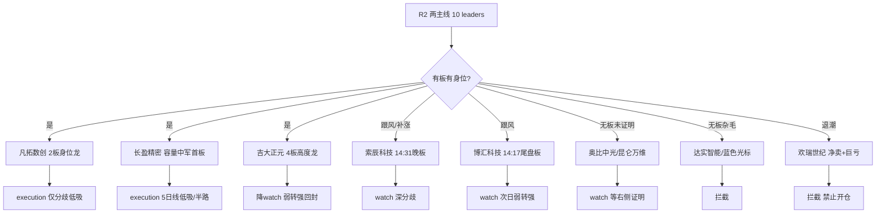

# 2026年10月21日(周三) · **个股画像（R5 六维）**

> **数据源新鲜度**: ok（T-1 收盘 + 盘前）
> **降级状态**: false（R7 全局 degraded，但 R5 个股六维全部用 tushare 实拉兜底，block_trades/margin 无 null）
> **置信度**: 0.72 ｜ 候选 10 只 = R2 两主线 leaders 全量（≥5，无需扩池）

## 一句话结论

物理AI线身位龙**凡拓数创**（机构净买但中报亏损+户数暴增，只接分歧）与容量中军**长盈精密**（唯一大容量出口，等5日线低吸）并列首选；AI应用线高度龙**吉大正元**4板进入接力末段只接弱转强。**欢瑞世纪/蓝色光标/达实智能三只拦截**：退潮净卖、空头无身位、无板杂毛——中位和杂毛直接划掉。

## 情绪段位（先认市场，再认个股）

- 炸板率 **34.9%** 贴着 35% 砍半线；R7 定性 **high_chop（高位震荡中的科技反抽第二日）**
- 机器人概念 T-1 +66亿，但 5 日轨迹 -135→-107→-54→+86→+66，**5日仍 -144亿**：这是反抽不是主升确认
- 母体"人形机器人"霸榜第1连续2日（R3 红线4出货警报），新名词"物理AI"发酵第2-3日
- **段位动作**：只做身位龙头的分歧低吸/低位首板证明，严禁追中位扩散；高位4板（吉大正元）不打缩量加速

## 候选总表

| 代码 | 名称 | R2角色 | 龙头判定 | 综合 | α/风险 | 流通市值 | PE(TTM) | 5日 | 裁决 |
|---|---|---|---|---|---|---|---|---|---|
| 300115.SZ | 长盈精密 | 龙二 | 龙头(容量中军) | 70 | **A-**/B | 335.8亿 | 108.5526 | 18.7% | execution |
| 301313.SZ | 凡拓数创 | 龙一 | 龙头 | 68 | **A**/B- | 47.9亿 | 亏损 | 41.8% | execution |
| 003029.SZ | 吉大正元 | 龙一 | 龙头(高度) | 64 | **A-**/B- | 51.5亿 | 亏损 | 40.1% | execution降级watch |
| 688507.SH | 索辰科技 | 龙二 | 补涨/跟风 | 60 | **B+**/B- | 144.4亿 | nan | 29.0% | watch |
| 688004.SH | 博汇科技 | 龙二 | 补涨/跟风 | 58 | **B+**/B- | 29.8亿 | 亏损 | -13.0% | watch偏execution |
| 688322.SH | 奥比中光-W | 龙三 | 孤军/未证明 | 50 | **B**/C | 374.3亿 | 342.2775 | 16.9% | watch |
| 002421.SZ | 达实智能 | 候补 | 未证明 | 50 | **B-**/B- | 71.0亿 | 亏损 | 0.6% | 拦截 |
| 300418.SZ | 昆仑万维 | 龙三 | 未证明(趋势中军) | 50 | **B-**/B | 508.5亿 | 144.9412 | -4.4% | watch |
| 300058.SZ | 蓝色光标 | 候补 | 未证明 | 44 | **C**/B- | 438.0亿 | 128.9366 | -6.4% | 拦截 |
| 000892.SZ | 欢瑞世纪 | 龙二 | 退潮杂毛 | 38 | **C**/C | 46.4亿 | 亏损 | -8.0% | 拦截 |

## 分票思维链（每票四段：买入理由 / 风险点 / 止损条件 / 可验证假设）

### 长盈精密（300115.SZ）⭐首推 · 综合 70 · α **A-** / 风险 B

> **一句话**：板块唯一容量中军(流通335亿)，机器人+消费电子双料资金锚，首板龙虎榜净买2.41亿，但PE108、H1净利-94%、60日线压力临近

**🏷️ 龙头判定（v1.5）**：`龙头(容量中军)` — 高度 1 板 ｜ 首封 10:18 ｜ 开板 1 次 ｜ 启动后第 1 天上榜 ｜ 板块涨停 27 家
依据：板块大容量出口+双概念lead_stock+首板净买2.41亿，中军龙头成立(非高度龙)

**六维评分**

| 维度 | 分 | 核心证据 |
|---|---|---|
| 🎯 催化 | 78 | R4 E003(黄仁勋GTC柏林10/21 Physical AI+南京世界模型大会60亿签约+宇树22日生态大会)直接覆盖 |
| 🧩 筹码 | 72 | 股东户数(v['holder_end']): 160524，较上期-3.7%；龙虎榜近1月1条: 20261020净2.41亿；大宗0笔; 两融余额15日-8.5% |
| 🔗 板块联动 | 85 | R2 主线『物理AI/人形机器人』score=80/78，stage=early_up；R7: 机器人概念+66亿/人形机器人+40亿/机器视觉+37亿(T-1)，但5日仍-144亿=反抽第二日；炸板率34.9% |
| 💰 估值安全 | 42 | PE(TTM)=108.5526, PB=4.039, PS(TTM)=1.6063; 总市值335.8亿/流通334.9亿; H1 ROE=0.2133, 毛利率=16.8776, 营收yoy=24.1828, 净利yoy=-94.1953, 负债率=67.8883; 质押=1.25% |
| 📊 技术形态 | 68 | 收盘24.67｜5日18.7%/20日5.5%｜MA5/10/20/30=20.81/21.15/22.39/22.89｜30日区间位置75%｜5日量/20日量=1.32｜换手6.8659%。图表: 长盈精密短期15分钟、60分钟级别出现放量涨停的急速拉涨行情，日K突破前期持续两个多月的低位震荡区间。但周K级别仍维持均线空头排列的长期下跌趋势，大趋势未发生扭转。当前股价已经临近日K线MA60压力位与20日阶段高点，短期上行抛压快速累积。 |
| 🏛️ 机构 | 75 | 龙虎榜席位+两融+研报催化综合: R7/R2证据 inst_seat_net_buy: {"net_yi": 0.78}; 两融15日-8.5%；打板封单/上榜见技术维 |

- 图表多模态（source=snapshot，偏置 偏多，置信 0.65）：长盈精密短期15分钟、60分钟级别出现放量涨停的急速拉涨行情，日K突破前期持续两个多月的低位震荡区间。但周K级别仍维持均线空头排列的长期下跌趋势，大趋势未发生扭转。当前股价已经临近日K线MA60压力位与20日阶段高点，短期上行抛压快速累积。
- 打板时间线：1020 1板(封单1.21亿,开板1次,10:18)
- 龙虎榜时间线：1020净+2.41亿
- R7 资金证据：inst_seat_net_buy: {"net_yi": 0.78}
- 基本面/估值红旗：
  - `F6` 2026H1 营收+24.2%但净利-94.2%、单季-165%，净利率0.27%、负债率67.9%（tushare fina_indicator·medium）
  - `V2` PE(TTM)108.6，按盈利给估值无安全边际，只能按机器人结构件放量预期定价（tushare daily_basic·medium）
- flags：`ma60_overhead`, `earnings_collapse_h1`

**推理深度三问**
- **大资金意图**：机器人+消费电子双叙事，隔夜美股半导体回落对其消费电子侧有低开传导，但机构容量票承接力强于纯情绪小票
- **为什么走强**：容量中军/弹性龙二：20cm首板成交21.8亿、封单1.21亿，人形机器人概念R7 lead_stock(+40亿)、消费电子行业lead_stock(+27亿)双料资金锚，流通335亿为板块唯一大容量出口，具身智能丝杠/结构件
- **逻辑够不够硬**：催化=78分 + 板块资金"反抽第二日、5日仍-144亿" + 身位=`龙头(容量中军)` → 硬，身位+资金+催化三共振

**📌 交易裁决**：**execution-低吸/半路，中军不打板；平开高走确认资金回流可半路**
- 盈亏比：止损5日线20.8(-15.7%)偏宽；盘中纪律线可用-8%，目标前高26.5+，RR约1.5→需等回落缩量买点
- T+1 预期差：中军首板后次日若平开高走=资金回流科技容量的确认信号；低开不破5日线则是板块β低吸点
- 买点：低吸/半路，不打板(中军不靠连板)
- 结构标签：容量中军+联动

### 凡拓数创（301313.SZ）⭐首推 · 综合 68 · α **A** / 风险 B-

> **一句话**：物理AI/机器人大脑身位龙，20cm二连板0开板+机构席位真金净买，但中报亏损扩大、Q2股东户数+180%筹码已大幅分散

**🏷️ 龙头判定（v1.5）**：`龙头` — 高度 2 板 ｜ 首封 09:51 ｜ 开板 0 次 ｜ 启动后第 2 天上榜 ｜ 板块涨停 27 家
依据：height≥2+一字不开板+板块涨停27家，身位龙成立

**六维评分**

| 维度 | 分 | 核心证据 |
|---|---|---|
| 🎯 催化 | 85 | R4 E003(黄仁勋GTC柏林10/21 Physical AI+南京世界模型大会60亿签约+宇树22日生态大会)直接覆盖 |
| 🧩 筹码 | 55 | 股东户数(v['holder_end']): 26574，较上期180.4%；龙虎榜近1月5条: 20261020净0.75亿; 20261020净1.33亿; 20261020净0.75亿; 20261019净0.6亿；大宗0笔; 两融余额15日61.9% |
| 🔗 板块联动 | 88 | R2 主线『物理AI/人形机器人』score=80/78，stage=early_up；R7: 机器人概念+66亿/人形机器人+40亿/机器视觉+37亿(T-1)，但5日仍-144亿=反抽第二日；炸板率34.9% |
| 💰 估值安全 | 25 | PE(TTM)=None, PB=8.0342, PS(TTM)=8.8363; 总市值47.9亿/流通36.8亿; H1 ROE=-12.2265, 毛利率=31.4877, 营收yoy=-27.7985, 净利yoy=-64.8579, 负债率=54.0553; 质押=10.04% |
| 📊 技术形态 | 72 | 收盘46.8｜5日41.8%/20日54.4%｜MA5/10/20/30=36.78/33.16/31.79/32.06｜30日区间位置100%｜5日量/20日量=2.52｜换手31.5493%。图表: 凡拓数创日K级别收获20%涨停，突破前期长期震荡区间，创20日新高，短期60分钟、15分钟级别均呈现多头排列，短线动能充足。但周K级别仍处于震荡格局，未突破中长期压力位，需警惕短期获利回吐风险。 |
| 🏛️ 机构 | 80 | 龙虎榜席位+两融+研报催化综合: R7/R2证据 synergy_flags: {"days_on_list": 2, "dates": ["20261019", "20261020"], "lhb_t0_net_yi": 2.84}; inst_seat_net_buy: {"net_yi": 4.59}; 两融15日61.9%；打板封单/上榜见技术维 |

- 图表多模态（source=snapshot，偏置 偏多，置信 0.65）：凡拓数创日K级别收获20%涨停，突破前期长期震荡区间，创20日新高，短期60分钟、15分钟级别均呈现多头排列，短线动能充足。但周K级别仍处于震荡格局，未突破中长期压力位，需警惕短期获利回吐风险。
- 打板时间线：1020 2板(封单1.45亿,开板0次,95:10)；1019 1板(封单1.06亿,开板0次,13:51)；1013 炸板(封单None亿,开板1次,13:18)
- 龙虎榜时间线：1020净+0.75亿；1020净+1.33亿；1020净+0.75亿；1019净+0.60亿
- R7 资金证据：synergy_flags: {"days_on_list": 2, "dates": ["20261019", "20261020"], "lhb_t0_net_yi": 2.84}；inst_seat_net_buy: {"net_yi": 4.59}
- 基本面/估值红旗：
  - `F6` 2026H1 营收-27.8%、扣非续亏，净利率-36.7%、ROE-12.2%、单季利润同比-133.6%（tushare fina_indicator·strong）
  - `V6` 亏损股无PE，PS 高企，纯叙事定价；Q2股东户数9476→26574(+180%)为早期拉升中已派发迹象（tushare stk_holdernumber·medium）
- flags：`small_circ_mv_caution`, `chip_dispersion_q2`, `loss_making`, `high_turnover_31pct`

**推理深度三问**
- **大资金意图**：GTC柏林演讲+世界模型大会为明牌催化，利好易在竞价被先手兑现成高开低走；但机构真金净买4.59亿与游资散户盘结构不同
- **为什么走强**：物理AI/机器人大脑身位龙：20cm二连板一字不开板(open_times=0,封单1.45亿)，R3跨平台人气#10、卖方'大脑最值钱'共识；R7机构席位净买+4.59亿(全市场机构买第一)；流通36.8亿小盘高弹性
- **逻辑够不够硬**：催化=85分 + 板块资金"反抽第二日、5日仍-144亿" + 身位=`龙头` → 硬，身位+资金+催化三共振

**📌 交易裁决**：**execution-仅分歧低吸/回封确认，不追一字；高开>8%一致兑现放弃**
- 盈亏比：止损参考10日线33.2(-29%)过宽 → 实际以炸板/5日线36.8(-21%)为纪律线，RR需分歧回落后重算，一字板不给买点
- T+1 预期差：若高开<5%且竞价金额放大=预期未打满，存在弱转强超预期；若一字/高开>8%则一致兑现风险，盈亏比差
- 买点：只接受分歧低吸/回封确认，不追一字高开；炸板率盘中破40%放弃
- 结构标签：卡位+身位龙

### 吉大正元（003029.SZ）⭐首推 · 综合 64 · α **A-** / 风险 B-

> **一句话**：AI应用线高度龙4连板(9:25竞价一字梯队)+数据要素E004国家队催化，但10/20开板4次分歧放大、10/16龙虎榜净卖1.15亿、中报续亏、4板高度=接力末段

**🏷️ 龙头判定（v1.5）**：`龙头(高度)` — 高度 4 板 ｜ 首封 09:25 ｜ 开板 4 次 ｜ 启动后第 4 天上榜 ｜ 板块涨停 — 家
依据：4连板为AI应用线最高板+连续两日竞价一字，但开板4次显示分歧加剧，龙头地位与高位风险并存

**六维评分**

| 维度 | 分 | 核心证据 |
|---|---|---|
| 🎯 催化 | 72 | R4 E004(国家数据集团成立)与AI应用线相关，数据安全/数据要素催化 |
| 🧩 筹码 | 62 | 股东户数(v['holder_end']): 27590，较上期0.0%；龙虎榜近1月4条: 20261020净0.18亿; 20261020净0.17亿; 20261016净-1.15亿; 20261016净-0.32亿；大宗4笔; 两融余额15日None% |
| 🔗 板块联动 | 78 | R2 主线『AI应用/AI内容』score=80/78，stage=early_up；R7: 机器人概念+66亿/人形机器人+40亿/机器视觉+37亿(T-1)，但5日仍-144亿=反抽第二日；炸板率34.9% |
| 💰 估值安全 | 26 | PE(TTM)=None, PB=5.1386, PS(TTM)=13.8404; 总市值51.5亿/流通46.7亿; H1 ROE=-3.4408, 毛利率=53.4577, 营收yoy=-19.4071, 净利yoy=18.6147, 负债率=36.1683; 质押=19.65% |
| 📊 技术形态 | 78 | 收盘26.61｜5日40.1%/20日45.5%｜MA5/10/20/30=22.19/20.06/18.91/18.49｜30日区间位置100%｜5日量/20日量=1.96｜换手24.1637%。图表: 吉大正元各短周期均线呈多头排列，日K于10月20日收获涨停，突破近20日新高，短期上攻动能强劲。仅周线级别仍处于震荡趋势，中期行情的持续性需进一步验证，60分钟、15分钟级别走势同步多头，支撑短期上涨逻辑。 |
| 🏛️ 机构 | 68 | 龙虎榜席位+两融+研报催化综合: R7/R2证据 synergy_flags: {"days_on_list": 2, "dates": ["20261016", "20261020"], "lhb_t0_net_yi": 0.35}; active_seats: {"seat_count": 11}; 两融15日None%；打板封单/上榜见技术维 |

- 图表多模态（source=snapshot，偏置 偏多，置信 0.85）：吉大正元各短周期均线呈多头排列，日K于10月20日收获涨停，突破近20日新高，短期上攻动能强劲。仅周线级别仍处于震荡趋势，中期行情的持续性需进一步验证，60分钟、15分钟级别走势同步多头，支撑短期上涨逻辑。
- 打板时间线：1020 4板(封单1.12亿,开板4次,92:50)；1019 3板(封单2.01亿,开板0次,92:50)；1016 2板(封单0.44亿,开板2次,93:00)；1015 1板(封单0.26亿,开板1次,94:92)
- 龙虎榜时间线：1020净+0.18亿；1020净+0.17亿；1016净-1.15亿；1016净-0.32亿
- R7 资金证据：synergy_flags: {"days_on_list": 2, "dates": ["20261016", "20261020"], "lhb_t0_net_yi": 0.35}；active_seats: {"seat_count": 11}
- 基本面/估值红旗：
  - `F6` 2026H1 营收-19.4%、净利率-19.9%、ROE-3.4%、单季利润-98%（tushare fina_indicator·strong）
  - `V6` 亏损纯情绪定价；9月大宗折价-10.5%~-11%(虽金额<500万)（tushare block_trade·light）
  - `F11` 质押比例19.65%，需持续跟踪（tushare pledge_stat·light）
- flags：`high_position_4board`, `board_divergence_open4`, `lhb_net_sell_history`, `loss_making`, `pledge_19pct`

**推理深度三问**
- **大资金意图**：美机构禁用DeepSeek是情绪催化，但涨停当日主力-7.59亿=典型高位分歧，利好对高标是兑现不是增量
- **为什么走强**：全市场最高标4板(9:25竞价封单1.12亿)，AI安全+DeepSeek国产替代身位龙；但open_times=4反复炸板、R7涨停主力净流出-7.59亿(陷阱榜第一)，11家席位高换手博弈
- **逻辑够不够硬**：催化=72分 + 板块资金"反抽第二日、5日仍-144亿" + 身位=`龙头(高度)` → 硬，身位+资金+催化三共振

**📌 交易裁决**：**execution降级watch-高位4板只接弱转强回封，不打缩量加速；炸板率34.9%环境下高位股候选砍半**
- 盈亏比：4板后盈亏比天然差：止损=翻绿/破分时均线约-6%，目标5板溢价+5~10%，RR≈1，只允许回封确认小仓
- T+1 预期差：竞价弱转强(高开秒板/封单加厚)才有5板预期；低开或翻绿=高标断板，全场情绪受拖累
- 买点：只做竞价弱转强确认，绝不低吸核按钮；炸板率破40%直接放弃
- 结构标签：总龙开关+弱转强

### 索辰科技（688507.SH） · 综合 60 · α **B+** / 风险 B-

> **一句话**：物理AI科学计算大脑，10/19首板后10/20分歧未续板(凡拓低位映射替补)，162元高价+换手26.9%+Q2户数+161%，弹性与分歧并存

**🏷️ 龙头判定（v1.5）**：`补涨/跟风` — 高度 1 板 ｜ 首封 14:31 ｜ 开板 0 次 ｜ 启动后第 3 天上榜 ｜ 板块涨停 27 家
依据：封板时间14:31偏晚+物理AI新名词发酵第3天才上榜，属身位分支补涨而非启动龙

**六维评分**

| 维度 | 分 | 核心证据 |
|---|---|---|
| 🎯 催化 | 80 | R4 E003(黄仁勋GTC柏林10/21 Physical AI+南京世界模型大会60亿签约+宇树22日生态大会)直接覆盖 |
| 🧩 筹码 | 52 | 股东户数(v['holder_end']): 25997，较上期161.0%；龙虎榜近1月2条: 20261020净0.85亿; 20261019净0.4亿；大宗0笔; 两融余额15日-9.9% |
| 🔗 板块联动 | 72 | R2 主线『物理AI/人形机器人』score=80/78，stage=early_up；R7: 机器人概念+66亿/人形机器人+40亿/机器视觉+37亿(T-1)，但5日仍-144亿=反抽第二日；炸板率34.9% |
| 💰 估值安全 | 28 | PE(TTM)=nan, PB=5.3245, PS(TTM)=30.0123; 总市值144.4亿/流通79.8亿; H1 ROE=-2.8253, 毛利率=60.2494, 营收yoy=26.8333, 净利yoy=-72.1188, 负债率=15.7215; 质押=0.48% |
| 📊 技术形态 | 66 | 收盘162.07｜5日29.0%/20日17.5%｜MA5/10/20/30=134.52/130.59/135.68/139.01｜30日区间位置89%｜5日量/20日量=1.78｜换手26.8691%。图表: 索辰科技短周期60分钟、15分钟级别均线呈多头排列，短期上行动能充足。日K级别单日大涨13.1%，放量突破60日均线压力，打破此前数月的横盘震荡走势。周线级别仍受20周均线压制，中期尚未脱离长期震荡区间。 |
| 🏛️ 机构 | 62 | 龙虎榜席位+两融+研报催化综合: R7/R2证据 synergy_flags: {"days_on_list": 2, "dates": ["20261019", "20261020"], "lhb_t0_net_yi": 0.85}; inst_seat_net_buy: {"net_yi": 0.81}; 两融15日-9.9%；打板封单/上榜见技术维 |

- 图表多模态（source=snapshot，偏置 偏多，置信 0.65）：索辰科技短周期60分钟、15分钟级别均线呈多头排列，短期上行动能充足。日K级别单日大涨13.1%，放量突破60日均线压力，打破此前数月的横盘震荡走势。周线级别仍受20周均线压制，中期尚未脱离长期震荡区间。
- 打板时间线：1019 1板(封单0.69亿,开板0次,14:31)
- 龙虎榜时间线：1020净+0.85亿；1019净+0.40亿
- R7 资金证据：synergy_flags: {"days_on_list": 2, "dates": ["20261019", "20261020"], "lhb_t0_net_yi": 0.85}；inst_seat_net_buy: {"net_yi": 0.81}
- 基本面/估值红旗：
  - `F6` 2026H1 营收+26.8%但净亏扩大(净利-72%)、净利率-131.9%、ROE-2.8%（tushare fina_indicator·strong）
  - `V6` 亏损无PE，PS高；毛利率60%是唯一质量亮点（tushare·medium）
- flags：`high_price_share`, `chip_dispersion_q2`, `loss_making`, `late_board`

**推理深度三问**
- **大资金意图**：GTC催化与凡拓同源，但已先分歧一日，T+1 是凡拓的低位映射替补
- **为什么走强**：物理AI三杰+科学计算大脑：10/19 20cm首板(143.3元)，东吴王紫敬'此前跟踪正被盘面追认'，R3 suggested_stocks；10/20未续板、属分歧换手位；软件开发行业R7 +9亿 lead_stock
- **逻辑够不够硬**：催化=80分 + 板块资金"反抽第二日、5日仍-144亿" + 身位=`补涨/跟风` → 中等，需盘口二次证明

**📌 交易裁决**：**watch-仅分歧低吸；与凡拓同源不重复下注，凡拓被核时才有分离补涨价值**
- 盈亏比：止损MA10(-19%)过宽，156元下方(-3.7%~现价)无有效支撑，当前位置RR不足，等深分歧
- T+1 预期差：若凡拓被核按钮，索辰作为同分支未连板票反而有分离补涨预期；若凡拓继续一字，索辰跟随高开概率大
- 买点：分歧低吸，不追高；与凡拓二选一不重复下注
- 结构标签：分离+补涨

### 博汇科技（688004.SH） · 综合 58 · α **B+** / 风险 B-

> **一句话**：AI视听20cm首板14:17尾盘板(弱于早盘)，全周期均线多头+流通仅29.8亿高弹性，但10/20龙虎榜净卖28万、中报续亏、前高44.7抛压

**🏷️ 龙头判定（v1.5）**：`补涨/跟风` — 高度 1 板 ｜ 首封 14:17 ｜ 开板 0 次 ｜ 启动后第 2 天上榜 ｜ 板块涨停 — 家
依据：10/12已打过1板后沉寂，10/20为二波首板且封板14:17偏晚，非AI应用线启动龙(高度龙是吉大正元)

**六维评分**

| 维度 | 分 | 核心证据 |
|---|---|---|
| 🎯 催化 | 70 | AI应用线情绪外溢，无独立硬催化，R4 stocks_catalyzed 未直接命中 |
| 🧩 筹码 | 55 | 股东户数(v['holder_end']): 5465，较上期-9.1%；龙虎榜近1月3条: 20261020净-0.03亿; 20261012净0.54亿; 20261012净0.79亿；大宗0笔; 两融余额15日11.6% |
| 🔗 板块联动 | 70 | R2 主线『AI应用/AI内容』score=80/78，stage=early_up；R7: 机器人概念+66亿/人形机器人+40亿/机器视觉+37亿(T-1)，但5日仍-144亿=反抽第二日；炸板率34.9% |
| 💰 估值安全 | 25 | PE(TTM)=None, PB=5.3081, PS(TTM)=18.6234; 总市值29.8亿/流通29.8亿; H1 ROE=-3.6289, 毛利率=52.8287, 营收yoy=-21.6284, 净利yoy=-22.6987, 负债率=16.6183; 质押=None% |
| 📊 技术形态 | 74 | 收盘37.19｜5日-13.0%/20日63.0%｜MA5/10/20/30=34.45/34.25/33.61/29.58｜30日区间位置71%｜5日量/20日量=0.85｜换手12.8343%。图表: 博汇科技日K线今日收获20%涨停，所有短中长均线呈多头排列，60分钟、15分钟短周期同步维持多头趋势，量能配合放大。周线级别仍处于前期震荡区间上沿，上方距阶段高点44.7仍有空间，同时也面临前高抛压。 |
| 🏛️ 机构 | 55 | 龙虎榜席位+两融+研报催化综合: R7/R2证据 active_seats: {"seat_count": 9}; 两融15日11.6%；打板封单/上榜见技术维 |

- 图表多模态（source=snapshot，偏置 偏多，置信 0.75）：博汇科技日K线今日收获20%涨停，所有短中长均线呈多头排列，60分钟、15分钟短周期同步维持多头趋势，量能配合放大。周线级别仍处于前期震荡区间上沿，上方距阶段高点44.7仍有空间，同时也面临前高抛压。
- 打板时间线：1020 1板(封单0.81亿,开板0次,14:17)；1013 炸板(封单None亿,开板1次,13:10)；1012 1板(封单0.28亿,开板0次,10:31)
- 龙虎榜时间线：1020净-0.03亿；1012净+0.54亿；1012净+0.79亿
- R7 资金证据：active_seats: {"seat_count": 9}
- 基本面/估值红旗：
  - `F6` 2026H1 营收-21.6%、净利-22.7%、净利率-51.7%、ROE-3.6%（tushare fina_indicator·strong）
  - `V6` 亏损无PE；户数5465(Q2-9%)筹码尚集中是唯一亮点（tushare·medium）
- flags：`late_board`, `small_circ_mv_caution`, `loss_making`, `prior_high_overhead_44_7`

**推理深度三问**
- **大资金意图**：尾盘首板=当日踏空资金的选择，次日存在高开兑现压力；但三概念资金锚辨识度强
- **为什么走强**：人工智能概念R7 lead_stock(+71亿全概念第一)+华为概念lead(+51亿)+IT服务lead(+11亿)三料资金锚；20cm首板14:17尾盘上板(跟随大资金入市时点)
- **逻辑够不够硬**：催化=70分 + 板块资金"反抽第二日、5日仍-144亿" + 身位=`补涨/跟风` → 中等，需盘口二次证明

**📌 交易裁决**：**watch偏execution-尾盘板只接次日弱转强(高开3%内+竞价放量)或回踩5日线低吸，不追高**
- 盈亏比：止损5日线-7.4%，目标前高44.7(+20%)，RR≈2.7，买点出现可入
- T+1 预期差：若AI应用继续加速，小盘20cm(29.8亿)最容易获二板溢价；尾盘板次日溢价历史波动大
- 买点：竞价不超过+6%可半路，分歧回封可打；高开过多等回落
- 结构标签：分离+板块资金锚

### 奥比中光-W（688322.SH） · 综合 50 · α **B** / 风险 C

> **一句话**：3D视觉传感器逻辑硬但无身位：未涨停+龙虎榜净卖0.54亿+PE342+MA60(93.7)强压，纯低位补涨观察票

**🏷️ 龙头判定（v1.5）**：`孤军/未证明` — 高度 0 板 ｜ 首封 — ｜ 开板 None 次 ｜ 启动后第 — 天上榜 ｜ 板块涨停 27 家
依据：T-1未上板、3日累计偏离刚触发龙虎榜且净卖，无盘口证明

**六维评分**

| 维度 | 分 | 核心证据 |
|---|---|---|
| 🎯 催化 | 68 | R4 E003(黄仁勋GTC柏林10/21 Physical AI+南京世界模型大会60亿签约+宇树22日生态大会)直接覆盖 |
| 🧩 筹码 | 45 | 股东户数(v['holder_end']): 48628，较上期83.8%；龙虎榜近1月1条: 20261020净-0.54亿；大宗0笔; 两融余额15日-3.4% |
| 🔗 板块联动 | 66 | R2 主线『物理AI/人形机器人』score=80/78，stage=early_up；R7: 机器人概念+66亿/人形机器人+40亿/机器视觉+37亿(T-1)，但5日仍-144亿=反抽第二日；炸板率34.9% |
| 💰 估值安全 | 22 | PE(TTM)=342.2775, PB=9.3728, PS(TTM)=39.6993; 总市值374.3亿/流通290.4亿; H1 ROE=1.1948, 毛利率=48.5492, 营收yoy=0.4906, 净利yoy=-30.8178, 负债率=9.4988; 质押=0.48% |
| 📊 技术形态 | 58 | 收盘90.67｜5日16.9%/20日1.5%｜MA5/10/20/30=76.73/78.43/84.03/87.18｜30日区间位置63%｜5日量/20日量=1.64｜换手7.9204%。图表: 奥比中光-W近期短周期迎来快速放量拉升，日K级别10月20日收出15.86%的大阳线站上MA20，15分钟周期形成明确的均线多头排列，短期上行动力充足。但中长期周K仍处于震荡回落走势，日K尚未突破93.7元附近的MA60强压力位，前期20日 |
| 🏛️ 机构 | 40 | 龙虎榜席位+两融+研报催化综合: R7/R2证据 lhb_top_net_sell: {"net_yi": -0.54, "reason": "有价格涨跌幅限制的连续3个交易日内收盘价格涨幅偏离值累计达到30%的证券"}; 两融15日-3.4%；打板封单/上榜见技术维 |

- 图表多模态（source=snapshot，偏置 偏多，置信 0.65）：奥比中光-W近期短周期迎来快速放量拉升，日K级别10月20日收出15.86%的大阳线站上MA20，15分钟周期形成明确的均线多头排列，短期上行动力充足。但中长期周K仍处于震荡回落走势，日K尚未突破93.7元附近的MA60强压力位，前期20日高点93.95元的套牢盘也会制约上行空间，上涨持续性有待验证。
- 打板时间线：近月无涨停记录
- 龙虎榜时间线：1020净-0.54亿
- R7 资金证据：lhb_top_net_sell: {"net_yi": -0.54, "reason": "有价格涨跌幅限制的连续3个交易日内收盘价格涨幅偏离值累计达到30%的证券"}
- 基本面/估值红旗：
  - `F6` 2026H1 营收仅+0.5%、单季利润-70.5%、净利-30.8%，扭盈后再度失速（tushare fina_indicator·medium）
  - `V2` PE(TTM)342，估值透支；Q2户数26463→48628(+84%)筹码分散（tushare·strong）
- flags：`lhb_net_sell`, `ma60_overhead`, `no_board_proof`, `loss_making_q`, `chip_dispersion_q2`

**推理深度三问**
- **大资金意图**：传感器为数据采集硬件入口，逻辑硬但无身位、无当日涨停，属低位补涨不是龙头
- **为什么走强**：物理AI三杰·3D视觉传感器：R3 suggested_stocks，招商机械推思看科技同源的3D感知线，联创电子RGB-D定点佐证传感器分支；T-1未涨停(未在limit_list_d U榜)，低位首板观察
- **逻辑够不够硬**：催化=68分 + 板块资金"反抽第二日、5日仍-144亿" + 身位=`孤军/未证明` → 中等，需盘口二次证明

**📌 交易裁决**：**watch-只做低位首板半路/打板，不低吸未动票**
- 盈亏比：止损MA20 84(-7.4%)，目标93.7约+3.3%，RR<1，拒绝现价介入
- T+1 预期差：需今日盘口证明(竞价量能/分时上板)，无证明则仅是概念股
- 买点：仅低位首板半路/打板，不低吸未动票
- 结构标签：B计划补涨

### 达实智能（002421.SZ） · 综合 50 · α **B-** / 风险 B-

> **一句话**：3.35元低价建筑智能化+机器人边缘概念，无涨停无龙虎榜，3.5元阶段压力+长期均线粘合，趋势延续性不足的候补杂毛

**🏷️ 龙头判定（v1.5）**：`未证明` — 高度 0 板 ｜ 首封 — ｜ 开板 None 次 ｜ 启动后第 — 天上榜 ｜ 板块涨停 27 家
依据：T-1无板无榜，仅15分钟级别多头，不具龙头资格

**六维评分**

| 维度 | 分 | 核心证据 |
|---|---|---|
| 🎯 催化 | 55 | AI应用线情绪外溢，无独立硬催化，R4 stocks_catalyzed 未直接命中 |
| 🧩 筹码 | 58 | 股东户数(v['holder_end']): 210846，较上期79.2%；龙虎榜近1月0条: 无；大宗1笔; 两融余额15日14.9% |
| 🔗 板块联动 | 52 | R2 主线『物理AI/人形机器人』score=80/78，stage=early_up；R7: 机器人概念+66亿/人形机器人+40亿/机器视觉+37亿(T-1)，但5日仍-144亿=反抽第二日；炸板率34.9% |
| 💰 估值安全 | 35 | PE(TTM)=None, PB=2.6179, PS(TTM)=3.3413; 总市值71.0亿/流通68.2亿; H1 ROE=-0.6684, 毛利率=25.6152, 营收yoy=10.2427, 净利yoy=79.4979, 负债率=62.5999; 质押=4.02% |
| 📊 技术形态 | 55 | 收盘3.35｜5日0.6%/20日3.7%｜MA5/10/20/30=3.19/3.22/3.2/3.25｜30日区间位置56%｜5日量/20日量=1.67｜换手20.5645%。图表: 达实智能当前多数周期维持震荡格局，仅15分钟级别走出短期多头排列。日前交易日收涨5.02%，站上日K、60分钟级别粘合的ma5/ma20/ma60均线，短期上行动能有所释放。但上方临近3.5元的近期阶段压力位，周K级别仍未脱离长期震荡区间，趋势延续性不 |
| 🏛️ 机构 | 42 | 龙虎榜席位+两融+研报催化综合: R7/R2证据 无R7个股级证据; 两融15日14.9%；打板封单/上榜见技术维 |

- 图表多模态（source=snapshot，偏置 偏多，置信 0.6）：达实智能当前多数周期维持震荡格局，仅15分钟级别走出短期多头排列。日前交易日收涨5.02%，站上日K、60分钟级别粘合的ma5/ma20/ma60均线，短期上行动能有所释放。但上方临近3.5元的近期阶段压力位，周K级别仍未脱离长期震荡区间，趋势延续性不足。
- 打板时间线：近月无涨停记录
- 龙虎榜时间线：近月未上龙虎榜
- R7 资金证据：R7 无个股级证据
- 基本面/估值红旗：
  - `F6` 2026H1 ROE-0.67%、净利率-1.76%、负债率62.6%(虽单季减亏+95%)（tushare fina_indicator·medium）
  - `V9` 亏损+低价股，无PE锚；Q2户数11.8万→21.1万(+79%)持续分散（tushare·medium）
- flags：`no_board_proof`, `low_price_speculation`, `overhead_resistance_3_5`, `loss_making_h1`

**推理深度三问**
- **大资金意图**：心智锚默认入候选(v1.3规则)，但当日无身位无资金排名，不可占执行池主位
- **为什么走强**：题材心智锚: 物理AI概念 anchor_score 79.0 全概念TOP1(14次涨停/max4板/近期极佳，均额18.7亿)；T-1未涨停，纯辨识度候补
- **逻辑够不够硬**：催化=55分 + 板块资金"反抽第二日、5日仍-144亿" + 身位=`未证明` → 中等，需盘口二次证明

**📌 交易裁决**：**拦截-中位/杂毛边缘，无身位无板型；除非今日放量首板上板否则不进任何池**
- 盈亏比：3.5压力-+4.5%，止损3.2(-4.5%)，RR≈1，无开仓资格
- T+1 预期差：若物理AI板块继续发酵，高辨识度老妖有资金回流记忆；若龙头断板则同步回避
- 买点：观察，仅盘中弱转强上板才激活
- 结构标签：心智锚补涨

### 昆仑万维（300418.SZ） · 综合 50 · α **B-** / 风险 B

> **一句话**：AI应用权重中军(508亿)基本面本池最硬(H1营收+44%/净利+227%/毛利65.6%)，但日周线空头排列、价在全部均线下方、无涨停无龙虎榜，左侧未反转

**🏷️ 龙头判定（v1.5）**：`未证明(趋势中军)` — 高度 0 板 ｜ 首封 — ｜ 开板 None 次 ｜ 启动后第 — 天上榜 ｜ 板块涨停 — 家
依据：无板无榜，30日区间位置23%低位，不具短线龙头属性，只能等右侧

**六维评分**

| 维度 | 分 | 核心证据 |
|---|---|---|
| 🎯 催化 | 58 | AI应用线情绪外溢，无独立硬催化，R4 stocks_catalyzed 未直接命中 |
| 🧩 筹码 | 60 | 股东户数(v['holder_end']): 166380，较上期-4.7%；龙虎榜近1月0条: 无；大宗0笔; 两融余额15日-7.3% |
| 🔗 板块联动 | 60 | R2 主线『AI应用/AI内容』score=80/78，stage=early_up；R7: 机器人概念+66亿/人形机器人+40亿/机器视觉+37亿(T-1)，但5日仍-144亿=反抽第二日；炸板率34.9% |
| 💰 估值安全 | 40 | PE(TTM)=144.9412, PB=3.4355, PS(TTM)=5.176; 总市值508.5亿/流通464.7亿; H1 ROE=7.7753, 毛利率=65.5754, 营收yoy=43.5498, 净利yoy=227.171, 负债率=23.6297; 质押=0.02% |
| 📊 技术形态 | 30 | 收盘39.57｜5日-4.4%/20日-7.8%｜MA5/10/20/30=40.59/40.57/41.66/42.75｜30日区间位置23%｜5日量/20日量=1.27｜换手3.7357%。图表: 昆仑万维当前日K、周K、60分钟三个核心周期均维持均线空头排列，仅15分钟超小周期走出区间震荡格局。最新收盘价39.57元仍低于各级MA20、MA60等关键均线，中长期下跌趋势未发生扭转，仅短期超小级别出现止跌迹象。 |
| 🏛️ 机构 | 50 | 龙虎榜席位+两融+研报催化综合: R7/R2证据 无R7个股级证据; 两融15日-7.3%；打板封单/上榜见技术维 |

- 图表多模态（source=snapshot，偏置 偏空，置信 0.85）：昆仑万维当前日K、周K、60分钟三个核心周期均维持均线空头排列，仅15分钟超小周期走出区间震荡格局。最新收盘价39.57元仍低于各级MA20、MA60等关键均线，中长期下跌趋势未发生扭转，仅短期超小级别出现止跌迹象。
- 打板时间线：近月无涨停记录
- 龙虎榜时间线：近月未上龙虎榜
- R7 资金证据：R7 无个股级证据
- 基本面/估值红旗：
  - `V2` PE(TTM)145，按高成长PEG口径需业绩持续兑现；H1单季净利+904%是真实增长（tushare fina_indicator·light）
- flags：`downtrend_all_tf`, `no_board_proof`, `left_side`

**推理深度三问**
- **大资金意图**：大容量票在缩量市不被游资偏好(KOL明示不买大市值)，但机构回流时是容量出口
- **为什么走强**：R3 suggested_stocks，乐多点名'AI短剧到物理AI重视AI应用 昆仑万维、蓝色光标'；AI应用容量中军候选，KOL 5-10倍股叙事载体
- **逻辑够不够硬**：催化=58分 + 板块资金"反抽第二日、5日仍-144亿" + 身位=`未证明(趋势中军)` → 中等，需盘口二次证明

**📌 交易裁决**：**watch-右侧交易者：放量站回MA20(41.7)前不介入；站回=AI应用中军低吸/半路信号**
- 盈亏比：现价39.57距MA20 +5.3%，突破确认后止损MA20(-2~3%)，目标前高48+，买点未到
- T+1 预期差：趋势未涨停，跟随板块β；需放量突破确认
- 买点：低吸均线，不追
- 结构标签：容量中军

### 蓝色光标（300058.SZ） · 综合 44 · α **C** / 风险 B-

> **一句话**：AI营销老龙头流通438亿，但30日区间位置16%、日/60分空头、量能萎缩无板无榜，H1净利率0.6%毛利2.9%基本面空心，无资金关注

**🏷️ 龙头判定（v1.5）**：`未证明` — 高度 0 板 ｜ 首封 — ｜ 开板 None 次 ｜ 启动后第 — 天上榜 ｜ 板块涨停 — 家
依据：无板无榜+空头排列+缩量，连中军都不算，是AI应用线的掉队杂毛

**六维评分**

| 维度 | 分 | 核心证据 |
|---|---|---|
| 🎯 催化 | 55 | AI应用线情绪外溢，无独立硬催化，R4 stocks_catalyzed 未直接命中 |
| 🧩 筹码 | 48 | 股东户数(v['holder_end']): 469759，较上期-3.0%；龙虎榜近1月0条: 无；大宗0笔; 两融余额15日-9.9% |
| 🔗 板块联动 | 58 | R2 主线『AI应用/AI内容』score=80/78，stage=early_up；R7: 机器人概念+66亿/人形机器人+40亿/机器视觉+37亿(T-1)，但5日仍-144亿=反抽第二日；炸板率34.9% |
| 💰 估值安全 | 30 | PE(TTM)=128.9366, PB=5.5004, PS(TTM)=0.6178; 总市值438.0亿/流通424.3亿; H1 ROE=2.6676, 毛利率=2.929, 营收yoy=6.8029, 净利yoy=119.2847, 负债率=72.9599; 质押=1.4% |
| 📊 技术形态 | 28 | 收盘12.2｜5日-6.4%/20日-5.3%｜MA5/10/20/30=12.24/12.41/12.77/13.05｜30日区间位置16%｜5日量/20日量=0.92｜换手4.0629%。图表: 蓝色光标当前日K、60分钟级别均维持均线空头排列，中长期下行趋势尚未出现明确扭转信号，仅15分钟级别出现短期震荡企稳的走势，近期股价徘徊在20日阶段低点附近，量能未出现支撑趋势反转的有效放量。 |
| 🏛️ 机构 | 42 | 龙虎榜席位+两融+研报催化综合: R7/R2证据 无R7个股级证据; 两融15日-9.9%；打板封单/上榜见技术维 |

- 图表多模态（source=snapshot，偏置 偏空，置信 0.75）：蓝色光标当前日K、60分钟级别均维持均线空头排列，中长期下行趋势尚未出现明确扭转信号，仅15分钟级别出现短期震荡企稳的走势，近期股价徘徊在20日阶段低点附近，量能未出现支撑趋势反转的有效放量。
- 打板时间线：近月无涨停记录
- 龙虎榜时间线：近月未上龙虎榜
- R7 资金证据：R7 无个股级证据
- 基本面/估值红旗：
  - `F1` 2026H1 毛利率2.93%、净利率0.61%、负债率73%，盈利质量极差(净利+119%靠低基数)（tushare fina_indicator·strong）
  - `V2` PE(TTM)129对应空心利润，无安全边际（tushare·medium）
- flags：`downtrend`, `no_board_proof`, `thin_margin`, `volume_shrink`

**推理深度三问**
- **大资金意图**：同上，缩量市大容量弹性弱
- **为什么走强**：R3 suggested_stocks，AI营销/视频应用，与昆仑万维同被乐多点名；容量型，T-1未涨停
- **逻辑够不够硬**：催化=55分 + 板块资金"反抽第二日、5日仍-144亿" + 身位=`未证明` → 偏软，资金/身位至少缺一

**📌 交易裁决**：**拦截-空头+无催化+无身位，不进execution；仅AI应用全面回流放量时重新评估**
- 盈亏比：无买点；MA20 12.77压制(-4.7%上方)，反弹空间被封
- T+1 预期差：板块持续性的β补充，非身位票
- 买点：观察
- 结构标签：容量补涨

### 欢瑞世纪（000892.SZ） · 综合 38 · α **C** / 风险 C

> **一句话**：影视+AI边缘老题材，10月初二波3板后已退潮(5日-8%)，龙虎榜多日净卖(10/16净卖1.0亿)、H1巨亏毛利率为负、质押30.6%，典型高位退潮股

**🏷️ 龙头判定（v1.5）**：`退潮杂毛` — 高度 2 板 ｜ 首封 09:38 ｜ 开板 8 次 ｜ 启动后第 8 天上榜 ｜ 板块涨停 — 家
依据：最近板10/15开板8次未能回封，距今3个交易日无板，龙头周期已结束

**六维评分**

| 维度 | 分 | 核心证据 |
|---|---|---|
| 🎯 催化 | 52 | AI应用线情绪外溢，无独立硬催化，R4 stocks_catalyzed 未直接命中 |
| 🧩 筹码 | 35 | 股东户数(v['holder_end']): 53591，较上期-15.1%；龙虎榜近1月7条: 20261016净-1.02亿; 20261015净1.08亿; 20261014净-0.69亿; 20261013净0.27亿；大宗0笔; 两融余额15日None% |
| 🔗 板块联动 | 55 | R2 主线『AI应用/AI内容』score=80/78，stage=early_up；R7: 机器人概念+66亿/人形机器人+40亿/机器视觉+37亿(T-1)，但5日仍-144亿=反抽第二日；炸板率34.9% |
| 💰 估值安全 | 15 | PE(TTM)=None, PB=9.1766, PS(TTM)=8.0465; 总市值46.4亿/流通33.6亿; H1 ROE=-25.1979, 毛利率=-8.1432, 营收yoy=25.2352, 净利yoy=-2147.6159, 负债率=56.0093; 质押=30.64% |
| 📊 技术形态 | 40 | 收盘4.73｜5日-8.0%/20日4.4%｜MA5/10/20/30=4.99/4.92/4.72/4.85｜30日区间位置45%｜5日量/20日量=1.37｜换手16.103%。图表: 欢瑞世纪日K级别维持均线多头排列，当前收盘价4.73元刚好站稳日MA20支撑位。短周期60分钟、15分钟级别处于区间震荡，未形成明确的短期突破方向。周K级别仍受MA60长期均线压制，尚未走出周度级别上升趋势。 |
| 🏛️ 机构 | 30 | 龙虎榜席位+两融+研报催化综合: R7/R2证据 无R7个股级证据; 两融15日None%；打板封单/上榜见技术维 |

- 图表多模态（source=snapshot，偏置 偏多，置信 0.65）：欢瑞世纪日K级别维持均线多头排列，当前收盘价4.73元刚好站稳日MA20支撑位。短周期60分钟、15分钟级别处于区间震荡，未形成明确的短期突破方向。周K级别仍受MA60长期均线压制，尚未走出周度级别上升趋势。
- 打板时间线：1015 炸板(封单None亿,开板8次,93:83)；1012 2板(封单0.51亿,开板3次,93:15)；1011 1板(封单0.54亿,开板0次,14:03)；1010 1板(封单0.54亿,开板0次,14:03)；1009 1板(封单0.54亿,开板0次,14:03)
- 龙虎榜时间线：1016净-1.02亿；1015净+1.08亿；1014净-0.69亿；1013净+0.27亿
- R7 资金证据：R7 无个股级证据
- 基本面/估值红旗：
  - `F6` 2026H1 ROE-25.2%、毛利率-8.1%(卖一块亏一块)、净利同比-2148%、负债率56%（tushare fina_indicator·strong）
  - `F11` 质押比例30.64%为全池最高（tushare pledge_stat·strong）
  - `V6` 亏损+叙事退潮，无估值锚（tushare·strong）
- flags：`distribution_after_3board`, `lhb_net_sell`, `open8_times`, `pledge_30pct`, `severe_loss`, `ma60_downtrend`

**推理深度三问**
- **大资金意图**：抖音征集旧闻周末发酵，先手资金可能在竞价直接顶；无身位需盘口证真
- **为什么走强**：互动影游/AI短剧直接映射: R3 suggested_stocks，题材群反复转发；AI应用 anchor_score 71.4(21次涨停/max3板/近期极佳，妖性型)；T-1未涨停=低位
- **逻辑够不够硬**：催化=52分 + 板块资金"反抽第二日、5日仍-144亿" + 身位=`退潮杂毛` → 偏软，资金/身位至少缺一

**📌 交易裁决**：**拦截-退潮高位+净卖出+基本面崩坏，禁止开新仓；模式外的钱不赚**
- 盈亏比：无买点：上方MA5 4.99套牢盘，盈亏比无计算意义
- T+1 预期差：低位+高股性是本主线预期差最大的票，但必须等首板确认，禁止无板低吸
- 买点：低位首板打板/半路
- 结构标签：B计划补涨

## 资金与事件时间线（30 日关键节点）

- **09/21-09/29**：吉大正元 4 笔大宗折价 -10.5%~-11%（金额均 <500 万，早期小额分销，非今日主矛盾）
- **10/09-10/15**：欢瑞世纪 3 板周期，10/15 开板 8 次见顶；10/14 净卖 0.69 亿、10/16 净卖 1.0 亿 → 霸榜出货实锤，列入拦截
- **10/15-10/20**：吉大正元 1→4 板，10/16 2 板日龙虎榜净卖 1.15 亿（分歧），10/19-20 竞价一字，10/20 开板 4 次再回封（高度龙分歧加大）
- **10/19**：凡拓数创 20cm 首板（13:51，封单 1.06 亿，0 开板）；索辰科技 14:31 首板
- **10/20**：长盈精密 10:18 容量首板（成交 21.8 亿，龙虎榜净买 **2.41 亿**，买 4.65/卖 2.24）；凡拓一字二板（封单 1.45 亿，换手 31.5%）；博汇科技 14:17 尾盘 20cm 板（龙虎榜净卖 28 万，中性偏弱）；奥比中光 +15.9% 未封板且 3 日榜净卖 0.54 亿
- **10/21（今日）**：黄仁勋 GTC 柏林 Physical AI 演讲（明牌，易被先手兑现）；南京世界模型大会；索辰被 R4 E003 直接点名为催化股
- **10/22**：宇树生态大会 → 宇树映射股见光死风险窗口

## 关键证据

- 证据 1: 长盈精密首板龙虎榜净买 +2.41 亿（买 4.65 亿），为全池最强单日资金承接 · 来源 tushare top_list
- 证据 2: 凡拓数创两日 0 开板一字 + R7 机构席位净买 4.59 亿，但 Q2 股东户数 9476→26574（+180%）、H1 营收-27.8% · 来源 tushare/R7
- 证据 3: 机器人板块 5 日资金仍 -144 亿，母体霸榜连续 2 日 = 反抽第二日而非主升 · 来源 R7/R3
- 证据 4: 欢瑞世纪 H1 毛利率 -8.1%、质押 30.6%、退潮期龙虎榜连续净卖 · 来源 tushare fina_indicator/pledge_stat/top_list
- 证据 5: 昆仑万维基本面全池最硬（H1 营收+43.5%、净利+227%、毛利 65.6%）但全周期空头排列、30 日区间位置仅 23% · 来源 tushare daily/fina_indicator

## 数据源审计

| 源 | 状态 | 抓取时间 | 记录数 | 备注 |
|---|---|---|---|---|
| R2/R4/R7 artifact | 🟢 ok | 07:05 前 | 3 份 | 盘前链路完整 |
| tushare daily(44日) | 🟢 ok | 盘前 | 10×44 | ≥30 交易日 K 线满足 |
| tushare daily_basic | 🟢 ok | 盘前 | 10×44 | PE/PB/市值/换手 |
| tushare limit_list_d | 🟢 ok | 盘前 | 7 票有记录 | 奥比/达实/昆仑/蓝标无板 |
| tushare top_list | 🟢 ok | 盘前 | 7 票有记录 | 逐交易日扫 9/22-10/20 |
| tushare block_trade | 🟢 ok | 盘前 | 2 票有记录 | 无记录≠null，字段兜底完成 |
| tushare margin_detail | 🟡 partial | 盘前 | 8 票 | 吉大正元/欢瑞（两融标的外或无数据） |
| tushare holder/fina/pledge | 🟢 ok | 盘前 | 10 票 | 最新 H1 报告期 |
| chart_vision_snapshot | 🟢 ok | 盘前 | 10/10 命中 | 零 MCP 直调，source=snapshot |

## 不确定性 / 反证（自我批判）

1. **反抽第二日风险**：板块 5 日资金仍净流出 144 亿，若今日 GTC 利好高开低走，凡拓一字兑现+长盈冲高回落会同时发生；两只 execution 票都依赖"分歧后承接"，不依赖催化本身。
2. **凡拓筹码矛盾**：机构净买是 T-1 单日数据，而 Q2 户数 +180% 是 6/30 口径（三个月前），两者时间尺度不同——不能用旧分散否定新机构，但也必须防机构一日游。
3. **索辰/博汇的"晚板"定性**可能被超预期高开证伪：若凡拓断板，晚板补涨股反而可能成为分离龙，watch 而非拦截正是为此留口子。
4. **奥比中光-W 带 W（未盈利特殊标记）口径**：fina_indicator 显示 H1 微利但 PE 342，传感器逻辑需要今日盘口（竞价量能/上板）证明，R5 不替盘面做决定。
5. 估值方法局限：本池 6/10 为亏损股无 PE，DCF/PEG 均不适用，已改用"叙事定价+筹码+身位"框架，V/F 红旗透传给 R6 模式七做硬否决，R5 自身不越权下 hard_reject。

## 与其他 R/D/E 的关系

- 依赖: R2_main_sectors（候选+身位+t1_game）、R4_news（E003/E004 催化）、R7_capital_flow（板块资金/游资协同）、chart_vision_snapshot
- 被消费: D1 main_decision（execution_pool ≤5 + α/risk 档位闸门）、R6 devil_advocate（fundamental_flags/leader_verdict/净卖出证据，尤其欢瑞模式六霸榜出货）
- 给 D1 的 execution 建议序: 长盈精密（低吸）＞凡拓数创（分歧回封）＞吉大正元（仅弱转强小仓）；炸板率破 40% 全部放弃

## Sub-Agent 元数据

- skill: analyze_stock_profile_v1@1.5
- artifact: data/research/20261021/R5_stock_profiles.json
- 生成耗时: 约 180 秒（含 tushare 9 接口实拉 + 快照零直调）
- model: ark-code-latest
