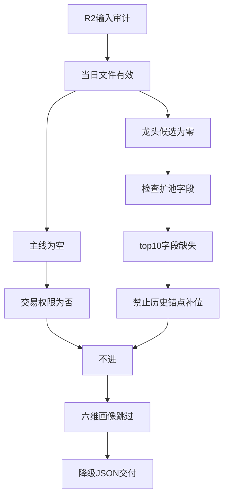

补交声明
实际交付时间：2026-10-22 11:28:16 CST(+0800)
声明修正时间：2026-10-22 11:30:17 CST(+0800)
原始研究生成时间：2026-10-22T06:40:31+08:00（读取自 data/research/20261022/R5_stock_profiles.json.generated_at；与来源渲染稿原始 YAML 前言 generated_at 一致）。
早晨因目标路径写入权限缺失未交付；本次仅补交既有内容，不重新研究、不新增任何授权（包括交易授权）。正文内“未写入”等表述是原始生成时的审计状态，按来源原样保留；本次补交状态以本声明为准。

# 2026年10月22日 · 个股画像空池报告

## 一句话结论
不进：R2无主线、无龙头候选，六维画像跳过，不凑票。

## 详细分析
市场前提继承R2：情绪=震荡，阶段=高位震荡，trading_permission=false。单一主模板为分歧接力，但未激活；R5不重判风格。

主线=未认定；持续性=未知；封板率=未知；明日预期=未知。上述缺口不能用主题热榜或历史辨识度替代。

R2的main_lines为空，两个secondary_lines的leaders均为空。all_scored_boards_top10缺失，扩池分支按skill跳过。历史锚点明确标记market_measurement=false，不能晋升为当日候选。

无合法候选，因此未执行30交易日K线、量价、事件时间线和六维评分。没有编造板型、龙头地位、盈亏比、禁止清单结果或alpha/risk档位。

## 关键证据
- R2已执行leader_filter，main_lines_count=0，交易权限为false。
- R2最高板块评分60；数据要素与AI应用仅作次级观察，leaders均为空。
- 扩池字段缺失，历史锚点不是当日行情测量。

## 数据源审计
| 源 | 日期 | 状态 | 备注 |
|---|---|:--:|---|
| R2 | 2026-10-22 | 🟡 | 已读；partial；0只合法候选 |
| R4 / R7 | 2026-10-22 | 🟡 | 空池提前退出，未读取；不引用为逐票证据 |
| Tushare / Charts | 2026-10-22 | 🟡 | 无合法候选，未调用；非接口失败 |

## 不确定性 / 反证
空池不是对所有股票的否定，也不是R6的hard_reject。它仅说明当前R2不能提供合规研究名单。上游补齐合格候选后方可重跑；本次未满足用户要求的6-15只画像验收。

## 与其他 R/D/E 的关系
- 依赖：当日R2。
- 被消费：D1、R6、E1。D1不得把空池报告当成已完成逐票评估。

## Sub-Agent 元数据
- skill: analyze_stock_profile_v1
- artifact: data/research/20261022/R5_stock_profiles.json
- model: gpt-6.1-sol
- Markdown交付：目标路径超出当前开发者写白名单；正文保存在本JSON内，未落独立md。
