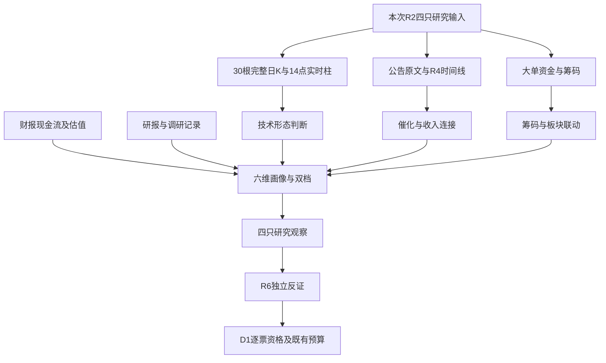

# 2026年10月23日 · **个股画像：intraday_recovery**

> ⚠️ **盘中生产恢复补跑，不是盘前预测重建。** 研究从13:35开始；落盘前报价刷新至14:00，实际生成时间见frontmatter。不得用这份研究回证早晨预测。
> **情绪=震荡/主跌风险未解除。** 分析已完成全部4只真实输入，数据覆盖仍为partial；不是skipped，也不是六维数据全部齐全。
> **研究=观察，交易=不进。** R1零新仓预算不变；未调用账户、持仓、下单、撤单或外发工具。独立模拟执行须由下游处理，本文件没有模拟成交。

## 🧭 一句话结论
**观察：弱市在奖励局部首板与身位辨识度，4只真实候选均已画像，但尚无独立交易资格。**

## 🔎 详细分析

### 市场在为什么付钱，处在哪一段
继承本次R1/R2：科技整板没有被确认成可交易主线，局部AI应用、芯片分销、工业机器人首板/2板却有价格辨识度。R7同时记录白酒、保险等权重承接，不能把研究池限定科技的事实偷换成“市场只买科技”。本次只画像R2给出的股票，不替R1判断风格、不替R2重排板块。

R1在13:02的炸板口径为29.41%，昨日完整日为41.07%，12:59盘中曾为38.71%；观察点与样本有差异，不能混成单一终盘比例。R2已保留4位聚焦上限，本次不重复砍半，更不因盘中降至35%以下擅自恢复预算。阶段定温度，不消灭研究。

| R2研究方向 | 研究分 | 板块盘中涨跌 | 涨停家数 | 持续性 | 封板率 | 下一交易日期待 | 交易主线 |
|---|---:|---:|---:|---|---|---|---|
| AI应用 | 70 | -3.65% | 8 | 未知 | 未知 | 分歧（条件推演） | 未确认 |
| 芯片概念 | 66 | -4.29% | 8 | 未知 | 未知 | 分歧（条件推演） | 未确认 |
| 人形机器人 | 48 | -3.39% | 11 | 未知 | 未知 | 分歧（条件推演） | 未确认 |

板块资金与涨跌来自R2本次问财当日列，精确源内时刻缺失，不冒充14:00同步行情。持续性和封板率没有可信分母/连续日期，不强填1/3/5日或百分数。

### 谁有地位，今天做什么、不做什么
睿能科技在R2芯片10只在线样本内为并列2板高度、首封09:25，属于**临时样本龙头信号**；不是全市场总龙。其他三只为有产业/人气/量价证据的首板研究对象，不凭研究排序给龙二、龙三名号。天奇不替代R2记录的6板高度锚大业股份。

主模板仍是**首板隔日**。睿能2板仅作身位与事件对照，不把接力模板焊进首板打法。做：六维、30日K、量价、事件与反证。不开新仓，不产生entry/exit价格，不访问实盘账户，不抬预算。

### 候选池挖掘与数量边界
R2消费位置为`main_lines[].leaders[]`，4只全部保留并画像。用户所述6–15只是期望范围，实际输入不是6只。技能“少于3只才扩池”未触发；R2也没有`all_scored_boards_top10`。因此不是停止研究，而是不绕R2筛选、不为配额补票。

R2覆盖18只聚焦证券、保留4只：华阳智能15.3387亿元低于20亿硬线，仍被拦截；正裕工业保留20–50亿风险观察但未占本次4位；大业是高位高度锚，不用补入池凑数；华天科技属于资金对照与拥挤警报覆盖。未认定的股票不伪称“杂毛”。睿能43.4598亿元属于20–50亿谨慎区，不以50亿硬剔除。

## 📊 画像总表

| 股票             | 研究方向  | 板型/地位     |   参考价 | 流通市值（亿元） | Alpha | 风险档 | 综合研究分 | 分层结论  |
| -------------- | ----- | --------- | ----: | -------: | ----- | --- | ----: | ----- |
| 天娱数科 002354.SZ | AI应用  | 首板/龙头未认定  |  8.03 | 130.6476 | B     | B-  | 43.40 | 观察；不进 |
| 睿能科技 603933.SH | 芯片概念  | 2板/样本临时龙头 | 20.94 |  43.4598 | B+    | B-  | 56.50 | 观察；不进 |
| 好上好 001298.SZ  | 芯片概念  | 首板/龙头未认定  | 17.36 |  70.7280 | B+    | C   | 54.95 | 观察；不进 |
| 天奇股份 002009.SZ | 人形机器人 | 首板/龙头未认定  | 17.30 |  61.2820 | B     | C   | 50.45 | 观察；不进 |

报价为本次Tushare实时日柱14:00观察，并非最终收盘。流通市值继承R2当日问财，源内逐笔时刻缺；仅通过20亿数值线，不等于通过全部交易门禁。风险档A最安全，C最弱；分数是研究证据与风险判断，不是收益或胜率。

## 🧩 六维证据如何汇合

## 🧪 逐票六维画像与可验证研究假设

### 天娱数科 002354.SZ｜**观察；交易不进**｜Alpha B / 风险 B-

观察：首板与人气修复成立，昨日破位及当日主力净卖矛盾未解；不是已确认AI应用龙头。

| 维度 | 研究分 | 事实、解释与缺口 |
|---|---:|---|
| 催化背景 | 42 | AI营销/应用是R2研究映射；R4未核同题公司级增量订单。近30日公告检索为空，扩窗可见中报及8月异动公告，不能把旧异动当今天催化。 |
| 筹码结构 | 35 | 单期29.0211万户无法证明集中；近5日大单+特大单合计为负，当日问财主力亦负。融资15观察值小幅下降而融券上升，未同时满足融资下降超过10%的short_pressure条件。 |
| 板块联动 | 60 | AI应用研究分70、板块盘中下跌但8只涨停，个股涨停为局部独立强势，不是整板趋势确认。ETF相关与商品联动未核。 |
| 财务与估值 | 28 | TTM PE为空，不能称低估；PS/PB仅T-1静态参考。中报正EPS与TTM亏损口径不矛盾但需全年度核对。公告摘要ROE3.12%与Tushare2.7951不同，保留冲突；不计算无预测CAGR和TAM支撑的PEG。 |
| 技术形态 | 48 | 昨日破位后的涨停修复；尚未越过30日样本高点 |
| 研报与机构 | 30 | 30日report_rc与stk_surv均返回空；仅说明接口未检出，不能等同机构冷落。中报股东出现ETF为期末持仓，不是今日净申购或主动机构增持。 |

- **大资金意图**: 可观察的是高人气首板与主力净卖相背；大资金可能借应用叙事换手，亦可能先手兑现，无法从涨停断定机构吸筹。
- **为什么走强**: 昨日大跌收在短均线下，今日从低开拉回涨停，属于强修复；仍未越过30日高点，不能称已进入主升。
- **逻辑够不够硬**: 硬数据是报价、量价和中报，AI购物到公司收入的订单链缺失；人气与问财同源信号不能重复计算独立共识。

**买入理由**（仅解释研究机会，不是订单）: ①AI应用/营销具备研究业务映射，非新增订单结论；②今日首板及R2人气第3形成可验证的局部辨识度。身份为本次研究观察计划内试错，尚非D1批准的交易试错。

**风险点**: ①盘中净卖与首板背离，次日有兑现风险；②TTM PE缺、ROE双源不一致，业务弹性与现金兑现仍需核验。完整14项禁止清单尚未核完，已确认命中项为无，不能表述成“全部未命中”。

**止损条件**（研究逻辑证伪，非价格交易指令）: 若下一交易日收盘低于本次30日样本MA20且AI应用涨停家数少于3，撤销强修复研究假设；这是观察证伪，不是自动卖单。

**可验证假设**: 未来1-3个交易日核：收盘站上本次30日高点且AI应用涨停不少于3；否则维持观察或降级。

#### ≥30日K与量价证据

完整日K窗口为2026-09-03至2026-10-22，保留30根OHLCV。原始价未复权；本窗口复权因子恒定，未发现除权跳变。当日实时柱另列，不混入完整日均线。

| 指标 | 数值 | 解释 |
|---|---:|---|
| MA5 | 7.5040 | 截至10月22日完整日线 |
| MA10 | 7.5150 | 截至10月22日完整日线 |
| MA20 | 7.4975 | 截至10月22日完整日线 |
| MA30 | 7.6217 | 截至10月22日完整日线 |
| 20日高/低 | 8.27 / 6.81 | 样本结构位，非买卖目标 |
| 30日高/低 | 8.62 / 6.81 | 样本结构位，非买卖目标 |
| 昨量/此前5日均量 | 0.9690 | 完整日量比较 |
| 盘中量/此前5完整日均量 | 1.1338 | 股转手单位已换算；非时间校正量比 |
| 盘中涨幅/振幅 | 10.0000% / 12.3288% | 相对昨日收盘；非终盘 |
| 近5日大单净额 | -899.03万元 | 大单+特大单买减卖；非net_mf_amount |

板型：首板（在线连续涨停1天；非封单持续承接证明）。龙头认定：未认定；低位首板研究；纪律硬条件已证未知项，不把未知当零风险。今日Tushare封板统计尚未发布，开板次数与板块启动后的首次上榜日未知。

筹码补充：大宗近30日查询为空，折溢价未知，不能填0%；两融15观察值状态为`ok_15_observations`。融资余额首末变化-0.6346%，融券余额变化26.0965%；15观察值仅14个区间，未同时满足short_pressure的双阈值。30日龙虎榜/席位未完整覆盖，不能说无游资或无机构卖出。

财务红旗编号数组为空，但完整排雷为false；尚未核验的商誉、质押、审计、应收/存货等不能当作已安全。

#### 事件时间线（事实与映射分层）

| 日期 | 事件 | 证据/边界 |
|---|---|---|
| 2026-08-22 | 半年报披露 | H1收入同比10.7654%、净利同比72.4058%；历史，不是远期预测 |
| 2026-08-22 | 本次原文核验 | [公司原文](https://static.cninfo.com.cn/finalpage/2026-08-22/1225492701.PDF)：加权平均净资产收益率 3.12%；报告期末普通股股东总数 290,211；非标准审计意见提示 不适用。摘要提取部分表格省略；仅用于明确出现的字段，ROE与Tushare不一致。 |
| 2026-10-22 | 最近完整日K | 收盘7.30；真实OHLCV在证据JSON |
| 2026-10-23 | 盘中价格与累计量刷新 | 14:00参考价8.03，涨停只是观察，不是成交 |

**盈亏比逐票记录**：取价8.03（Tushare rt_k，2026-10-23 14:00）；允许止损价=未知，目标价=未知，预期赚幅=未知，允许亏幅=未知，原始RR=未知。公式为预期赚幅/允许亏幅，即`(目标-取价)/(取价-止损)`。保留SOUL第57行既有RR与止损距约束，未选择新门槛；R5不以区间高低点自动生成交易止损或目标。因此该票保持研究观察，不能进execution。

**禁止清单**：确认命中项=无；核验状态=partial_not_all_clear。14项逐项保留unknown，尤其身位、趋势/板块效应、计划身份和操作记录缺口不能靠函数默认值抹平。零预算与R6未完成是独立门禁，不由RR未知反推出别的票也失败。

### 睿能科技 603933.SH｜**观察；交易不进**｜Alpha B+ / 风险 B-

观察：2板身位与早封成立，但盘中一字无换手检验，重组尚待审批、20–50亿风险保留。

| 维度 | 研究分 | 事实、解释与缺口 |
|---|---:|---|
| 催化背景 | 64 | 10月13日公告全文确认拟收购博泰智能装备75%股权，治理条款调整不是新订单；仍需上交所审核及证监会等批准，不能写成重组完成。芯片分销映射与纯存储受益有别。 |
| 筹码结构 | 53 | 昨日放量首板且近5日大单+特大单为正，今天R2主力却为负；这不是同口径连续净买确认。2.4387万户仅一个截面；大宗为空、两融为空，不能证明无减持或非两融标的。 |
| 板块联动 | 62 | 芯片研究分66、8只涨停，样本并列高度2板。R2首封09:25可作临时身位证据；整板跌幅仍大，板块资金正不等于个股正。 |
| 财务与估值 | 40 | IC分销/工控与并购混合，采用分部现金流/PS及PE交叉，不对整公司套芯片高成长PEG。H1利润增长但经营现金流每股为负，估值需要回款支撑；Q1现金流为正，未达到连续两期负CFO。 |
| 技术形态 | 60 | 昨日放量首板，今日盘中一字2板并越过30日样本高点 |
| 研报与机构 | 30 | 30日研报、机构调研接口均空，未见机构一致追捧证据；重组公告不是券商盈利预测。 |

- **大资金意图**: 昨日大单承接与今日一字形态可解释为抢身位；但R2主力负流向和小流通盘提高封单撤退风险，不把低成交当惜售锁仓铁证。
- **为什么走强**: 昨日从均线下方向上首板，今日一字2板，已经越过本次30日样本最高价；价格强度最明确但没有可成交性证明。
- **逻辑够不够硬**: 有公司原公告硬事件与真实价格锚；审批未完成且买入后次日接力未知，不能把重组预期等同盈利增量。

**买入理由**（仅解释研究机会，不是订单）: ①收购博泰75%及产业分部重估是已披露的研究催化；②2板与早封为R2样本内强身位，非全市场总龙证明。身份为本次研究观察计划内试错，尚非D1批准的交易试错。

**风险点**: ①流通市值20–50亿元，盘中一字缺少换手承接检验；②重组待审批且H1经营现金流为负，题材收入兑现有不确定性。完整14项禁止清单尚未核完，已确认命中项为无，不能表述成“全部未命中”。

**止损条件**（研究逻辑证伪，非价格交易指令）: 若重组审核被否、终止，立即撤销重估假设；下一交易日收盘跌回本次30日样本最高价下方且芯片涨停少于3，降级研究。

**可验证假设**: 未来1-3个交易日核：收盘保持在本次30日样本高点上方、芯片涨停不少于3且原公告无否认；需另核换手和封单，均不自动授权买入。

#### ≥30日K与量价证据

完整日K窗口为2026-09-03至2026-10-22，保留30根OHLCV。原始价未复权；本窗口复权因子恒定，未发现除权跳变。当日实时柱另列，不混入完整日均线。

| 指标           |                数值 | 解释                       |
| ------------ | ----------------: | ------------------------ |
| MA5          |           17.5200 | 截至10月22日完整日线             |
| MA10         |           17.5620 | 截至10月22日完整日线             |
| MA20         |           18.2910 | 截至10月22日完整日线             |
| MA30         |           18.5197 | 截至10月22日完整日线             |
| 20日高/低       |     19.85 / 16.38 | 样本结构位，非买卖目标              |
| 30日高/低       |     19.85 / 16.38 | 样本结构位，非买卖目标              |
| 昨量/此前5日均量    |            2.1513 | 完整日量比较                   |
| 盘中量/此前5完整日均量 |            1.2525 | 股转手单位已换算；非时间校正量比         |
| 盘中涨幅/振幅      | 9.9790% / 0.0000% | 相对昨日收盘；非终盘               |
| 近5日大单净额      |         3045.15万元 | 大单+特大单买减卖；非net_mf_amount |
|              |                   |                          |

板型：2连板（在线连续涨停字段）。龙头认定：龙头（样本临时）；纪律硬条件已证1项，不把未知当零风险。今日Tushare封板统计尚未发布，开板次数与板块启动后的首次上榜日未知。

筹码补充：大宗近30日查询为空，折溢价未知，不能填0%；两融15观察值状态为`no_records_returned`。没有记录不等于两融余额0，亦未据此声称非两融标的。30日龙虎榜/席位未完整覆盖，不能说无游资或无机构卖出。

财务红旗编号数组为空，但完整排雷为false；尚未核验的商誉、质押、审计、应收/存货等不能当作已安全。

#### 事件时间线（事实与映射分层）

| 日期 | 事件 | 证据/边界 |
|---|---|---|
| 2026-08-20 | 半年报披露 | H1收入同比38.0057%、净利同比84.6614%；历史，不是远期预测 |
| 2026-10-16 | 2026年第二次临时股东会决议公告 | [公告索引](http://static.cninfo.com.cn/finalpage/2026-10-16/1225606175.PDF)，非全部正文均已读取 |
| 2026-10-16 | 股东会法律意见书 | [公告索引](http://static.cninfo.com.cn/finalpage/2026-10-16/1225606178.PDF)，非全部正文均已读取 |
| 2026-10-13 | 关于发行股份及支付现金购买资产并募集配套资金签订补充协议的公告 | [公告索引](http://static.cninfo.com.cn/finalpage/2026-10-13/1225601562.PDF)，非全部正文均已读取 |
| 2026-09-30 | 2026年第二次临时股东会会议材料 | [公告索引](http://static.cninfo.com.cn/finalpage/2026-09-30/1225586541.PDF)，非全部正文均已读取 |
| 2026-10-13 | 本次原文核验 | [公司原文](https://static.cninfo.com.cn/finalpage/2026-10-13/1225601562.PDF)：购买博泰智能装备（广东）有限公司75%股权；配套资金总额不超过22,500万元；本次交易尚需上交所审核通过、中国证监会及其他有权监管机构的批准、核准或同意注册后方可正式实施。董事治理条款补充；未证明交易完成或新增收入 |
| 2026-10-23 | 海外半导体抛售 | R4行业风险；不能推导公司订单取消，亦不能证明国产分销直接受益 |
| 2026-10-22 | 最近完整日K | 收盘19.04；真实OHLCV在证据JSON |
| 2026-10-23 | 盘中价格与累计量刷新 | 14:00参考价20.94，涨停只是观察，不是成交 |

**盈亏比逐票记录**：取价20.94（Tushare rt_k，2026-10-23 14:00）；允许止损价=未知，目标价=未知，预期赚幅=未知，允许亏幅=未知，原始RR=未知。公式为预期赚幅/允许亏幅，即`(目标-取价)/(取价-止损)`。保留SOUL第57行既有RR与止损距约束，未选择新门槛；R5不以区间高低点自动生成交易止损或目标。因此该票保持研究观察，不能进execution。

**禁止清单**：确认命中项=无；核验状态=partial_not_all_clear。14项逐项保留unknown，尤其身位、趋势/板块效应、计划身份和操作记录缺口不能靠函数默认值抹平。零预算与R6未完成是独立门禁，不由RR未知反推出别的票也失败。

### 好上好 001298.SZ｜**观察；交易不进**｜Alpha B+ / 风险 C

观察：端侧AI分销有官方业务证据，首板与放量修复；负现金流和高负债压低风险档。

| 维度 | 研究分 | 事实、解释与缺口 |
|---|---:|---|
| 催化背景 | 65 | 10月14日调研原文确认BoB AI HUB、AI SoC/存储/模组与星宸科技、摩尔线程等合作及端侧推广；没有新增订单金额。10月13日宝汇芯19%股权收购进展为另一公司事件，不与FCC叙事混成确定受益。 |
| 筹码结构 | 55 | 最近股东户数较上期小幅下降并非加速集中。近5日大单+特大单为正，今日问财亦正，但两者跨日期跨供应商仅方向对照；大宗、两融空，不能认定无杠杆或无减持。 |
| 板块联动 | 58 | 芯片研究分66，属于首板研究前排、不是已认证龙一。整板下跌与8股涨停并存，应按局部承接而非普涨理解；ETF映射未验证。 |
| 财务与估值 | 25 | H1收入和净利高增，但Q1/H1每股经营现金流连续报告期为负、EPS为正，F8预警透传；负债率较高。不得把332%历史同比当未来2-3年CAGR算出廉价PEG。PS较低也不能忽略分销低利润率与营运资金。 |
| 技术形态 | 55 | 首板放量修复并越过20日高点，仍未越过30日样本高点 |
| 研报与机构 | 52 | 10月14日一场调研返回7条参与方记录，与公告为同一场活动，不算7次独立调研；30日盈利预测接口为空，不推导机构评级一致性。 |

- **大资金意图**: 放量首板及小幅户数下降支持资金重新定价分销环节的假设；公司扩张消耗营运资本，承接者可能赌国产替代，也可能只是题材短钱。
- **为什么走强**: 从前期下行区间拉出首板，盘中量超过近期完整日均量并站上20日高点；仍低于30日样本最高价，反转尚待多日验证。
- **逻辑够不够硬**: 官方调研证明业务而非订单，增长数据证明历史而非远期；现金流反证很强，R6需独立评估F8，R5不代行硬否决。

**买入理由**（仅解释研究机会，不是订单）: ①公司调研原文给出端侧AI产品和原厂合作证据；②盘中首板、放量及近5日大单正流向形成研究锚。身份为本次研究观察计划内试错，尚非D1批准的交易试错。

**风险点**: ①首板次日兑现与芯片整板弱势仍可打断接力；②连续报告期负经营现金流及70%以上资产负债率，成长不等于现金收益。完整14项禁止清单尚未核完，已确认命中项为无，不能表述成“全部未命中”。

**止损条件**（研究逻辑证伪，非价格交易指令）: 若公司否认原厂合作/业务映射，撤销事件研究；下一交易日收盘跌回本次20日高点下且芯片涨停少于3，降级首板假设。

**可验证假设**: 未来1-3个交易日核收盘能否守住本次20日高点、芯片涨停不少于3及无业务否认；现金流修复须等后续财报，不能要求72小时兑现。

#### ≥30日K与量价证据

完整日K窗口为2026-09-03至2026-10-22，保留30根OHLCV。原始价未复权；本窗口复权因子恒定，未发现除权跳变。当日实时柱另列，不混入完整日均线。

| 指标 | 数值 | 解释 |
|---|---:|---|
| MA5 | 15.5460 | 截至10月22日完整日线 |
| MA10 | 15.5600 | 截至10月22日完整日线 |
| MA20 | 16.1400 | 截至10月22日完整日线 |
| MA30 | 16.6017 | 截至10月22日完整日线 |
| 20日高/低 | 17.26 / 14.78 | 样本结构位，非买卖目标 |
| 30日高/低 | 18.74 / 14.78 | 样本结构位，非买卖目标 |
| 昨量/此前5日均量 | 1.9667 | 完整日量比较 |
| 盘中量/此前5完整日均量 | 3.1066 | 股转手单位已换算；非时间校正量比 |
| 盘中涨幅/振幅 | 10.0127% / 12.9278% | 相对昨日收盘；非终盘 |
| 近5日大单净额 | 1197.57万元 | 大单+特大单买减卖；非net_mf_amount |

板型：首板（在线连续涨停1天；非封单持续承接证明）。龙头认定：未认定；低位首板研究；纪律硬条件已证未知项，不把未知当零风险。今日Tushare封板统计尚未发布，开板次数与板块启动后的首次上榜日未知。

筹码补充：大宗近30日查询为空，折溢价未知，不能填0%；两融15观察值状态为`no_records_returned`。没有记录不等于两融余额0，亦未据此声称非两融标的。30日龙虎榜/席位未完整覆盖，不能说无游资或无机构卖出。

财务红旗：**F8 strong**，Q1/H1披露每股经营现金流-3.2504/-3.4451，EPS均正；连续两报告期利润现金错配。累计口径非两个独立季度CFO，确切单季金额及股本变动仍缺。 该条交R6独立评价，不是R5的hard_reject。

#### 事件时间线（事实与映射分层）

| 日期 | 事件 | 证据/边界 |
|---|---|---|
| 2026-08-28 | 半年报披露 | H1收入同比90.1799%、净利同比332.3223%；历史，不是远期预测 |
| 2026-10-21 | 提前归还部分暂时补充流动资金的募集资金 | [公告索引](http://static.cninfo.com.cn/finalpage/2026-10-21/1225611662.PDF)，非全部正文均已读取 |
| 2026-10-15 | 公司为子公司担保的进展 | [公告索引](http://static.cninfo.com.cn/finalpage/2026-10-15/1225605295.PDF)，非全部正文均已读取 |
| 2026-10-14 | 2026年10月14日投资者活动记录表 | [公告索引](http://static.cninfo.com.cn/finalpage/2026-10-14/1225605649.PDF)，非全部正文均已读取 |
| 2026-10-13 | 收购深圳市宝汇芯微电子有限公司19%股权进展 | [公告索引](http://static.cninfo.com.cn/finalpage/2026-10-13/1225600964.PDF)，非全部正文均已读取 |
| 2026-10-09 | 持股5%以上股东及特定股东减持计划届满暨实施完成 | [公告索引](http://static.cninfo.com.cn/finalpage/2026-10-09/1225598250.PDF)，非全部正文均已读取 |
| 2026-10-14 | 本次原文核验 | [公司原文](https://static.cninfo.com.cn/finalpage/2026-10-14/1225605649.PDF)：BoB AI HUB；AI SoC、AI协处理器、存储、智能模组及周边元器件；星宸科技、摩尔线程、后摩、爱芯元智；授权型分销商。业务推广/合作不等于新增订单金额；7条参与方记录是一场活动 |
| 2026-10-23 | 海外半导体抛售 | R4行业风险；不能推导公司订单取消，亦不能证明国产分销直接受益 |
| 2026-10-22 | 最近完整日K | 收盘15.78；真实OHLCV在证据JSON |
| 2026-10-23 | 盘中价格与累计量刷新 | 14:00参考价17.36，涨停只是观察，不是成交 |

**盈亏比逐票记录**：取价17.36（Tushare rt_k，2026-10-23 14:00）；允许止损价=未知，目标价=未知，预期赚幅=未知，允许亏幅=未知，原始RR=未知。公式为预期赚幅/允许亏幅，即`(目标-取价)/(取价-止损)`。保留SOUL第57行既有RR与止损距约束，未选择新门槛；R5不以区间高低点自动生成交易止损或目标。因此该票保持研究观察，不能进execution。

**禁止清单**：确认命中项=无；核验状态=partial_not_all_clear。14项逐项保留unknown，尤其身位、趋势/板块效应、计划身份和操作记录缺口不能靠函数默认值抹平。零预算与R6未完成是独立门禁，不由RR未知反推出别的票也失败。

### 天奇股份 002009.SZ｜**观察；交易不进**｜Alpha B / 风险 C

观察：机器人首板放量、量价修复成立；非高度总龙，利润下滑与高估值限制研究评级。

| 维度 | 研究分 | 事实、解释与缺口 |
|---|---:|---|
| 催化背景 | 55 | Isaac平台升级来自R4，是行业催化；天奇工业场景/物流自动化是业务映射，不证明英伟达供应商或新增订单。最新担保全文确认对子公司1900万元最高债权连带担保，实际担保余额占净资产50.09%，不是机器人订单。 |
| 筹码结构 | 62 | 近5日大单+特大单持续正流向，今日问财亦正；融资15观察值增幅有限，不称杠杆暴增。股东9.5182万户只有一季，集中趋势未知。 |
| 板块联动 | 45 | 机器人仅48分警报观察载体；板块11只涨停但整板跌，双日热度top1拥挤预警保留。6板大业为R2高度锚，天奇首板不继承总龙身份。 |
| 财务与估值 | 22 | 自动化与循环产业混合，宜用分部/正常化利润交叉，而非统一机器人PEG。TTM PE较高且H1净利同比下降，无法算有意义的正增长PEG；正CFO缓和但不能抵消盈利估值背离与担保风险。 |
| 技术形态 | 58 | 首板放量并越过20/30日样本高点；长周期反转未确认 |
| 研报与机构 | 30 | 30日盈利预测、机构调研接口均空；工业合作讨论不当作机构路演或一致买入评级。 |

- **大资金意图**: 五日大单承接和今日放量首板支持资金在工业应用端试错；没有订单和全板上涨证明，不能推论长期机构配置已完成。
- **为什么走强**: 前几日反弹后今日放量首板，盘中越过20/30日样本高点；旧周线仍弱，局部价格修复不等于机器人周期主升。
- **逻辑够不够硬**: 行情与担保原公告可核；机器人订单弹性未核，利润反而下降。两源事实不能替代订单端缺失的关键一环。

**买入理由**（仅解释研究机会，不是订单）: ①工业场景/物流自动化给出具身数据落地的研究连接；②连续大单正流向、放量首板和区间突破提供可证伪市场锚。身份为本次研究观察计划内试错，尚非D1批准的交易试错。

**风险点**: ①首板不是6板总龙，双日热度拥挤带来兑现；②H1利润下滑、TTM高估值及集团内部担保约束中期逻辑。完整14项禁止清单尚未核完，已确认命中项为无，不能表述成“全部未命中”。

**止损条件**（研究逻辑证伪，非价格交易指令）: 若公司公告否认机器人业务映射，撤销事件假设；下一交易日收盘跌回本次20日高点下且机器人涨停少于3，降级。

**可验证假设**: 未来1-3个交易日核收盘能否守住本次20日高点、机器人涨停不少于3；公司级新增订单仍须独立公告，不用量价替代。

#### ≥30日K与量价证据

完整日K窗口为2026-09-03至2026-10-22，保留30根OHLCV。原始价未复权；本窗口复权因子恒定，未发现除权跳变。当日实时柱另列，不混入完整日均线。

| 指标 | 数值 | 解释 |
|---|---:|---|
| MA5 | 15.3380 | 截至10月22日完整日线 |
| MA10 | 15.2200 | 截至10月22日完整日线 |
| MA20 | 15.3715 | 截至10月22日完整日线 |
| MA30 | 15.5413 | 截至10月22日完整日线 |
| 20日高/低 | 16.59 / 14.32 | 样本结构位，非买卖目标 |
| 30日高/低 | 16.96 / 14.32 | 样本结构位，非买卖目标 |
| 昨量/此前5日均量 | 2.0924 | 完整日量比较 |
| 盘中量/此前5完整日均量 | 3.2833 | 股转手单位已换算；非时间校正量比 |
| 盘中涨幅/振幅 | 9.9809% / 11.8881% | 相对昨日收盘；非终盘 |
| 近5日大单净额 | 6129.44万元 | 大单+特大单买减卖；非net_mf_amount |

板型：首板（在线连续涨停1天；非封单持续承接证明）。龙头认定：未认定；低位首板研究；纪律硬条件已证未知项，不把未知当零风险。今日Tushare封板统计尚未发布，开板次数与板块启动后的首次上榜日未知。

筹码补充：大宗近30日查询为空，折溢价未知，不能填0%；两融15观察值状态为`ok_15_observations`。融资余额首末变化3.0510%，融券余额变化16.4433%；15观察值仅14个区间，未同时满足short_pressure的双阈值。30日龙虎榜/席位未完整覆盖，不能说无游资或无机构卖出。

财务红旗编号数组为空，但完整排雷为false；尚未核验的商誉、质押、审计、应收/存货等不能当作已安全。

#### 事件时间线（事实与映射分层）

| 日期 | 事件 | 证据/边界 |
|---|---|---|
| 2026-08-26 | 半年报披露 | H1收入同比17.1728%、净利同比-19.3172%；历史，不是远期预测 |
| 2026-10-23 | 公司为全资子公司提供担保的进展 | [公告索引](http://static.cninfo.com.cn/finalpage/2026-10-23/1225615089.PDF)，非全部正文均已读取 |
| 2026-09-29 | 募集说明书（注册稿） | [公告索引](http://static.cninfo.com.cn/finalpage/2026-09-29/1225586456.PDF)，非全部正文均已读取 |
| 2026-09-28 | 部分募集资金专用账户销户完成 | [公告索引](http://static.cninfo.com.cn/finalpage/2026-09-28/1225581024.PDF)，非全部正文均已读取 |
| 2026-09-28 | 向特定对象发行股票获证监会同意注册 | [公告索引](http://static.cninfo.com.cn/finalpage/2026-09-28/1225581025.PDF)，非全部正文均已读取 |
| 2026-09-28 | 公司为控股子公司提供担保的进展 | [公告索引](http://static.cninfo.com.cn/finalpage/2026-09-28/1225583876.PDF)，非全部正文均已读取 |
| 2026-10-23 | 本次原文核验 | [公司原文](https://static.cninfo.com.cn/finalpage/2026-10-23/1225615089.PDF)：为全资子公司铜陵蓝天提供人民币1,900万元最高债权额连带责任保证；实际担保余额101,618.58万元，占2025年经审计净资产50.09%；公司及子公司无逾期对外担保。集团内融资担保，不是英伟达或机器人新订单；公告索引日与签署日不同均保留 |
| 2026-10-22 | Isaac平台扩展背景 | R4行业催化，date标22日但原time为21日；日期不一致保留，不偷换公司订单 |
| 2026-10-22 | 最近完整日K | 收盘15.73；真实OHLCV在证据JSON |
| 2026-10-23 | 盘中价格与累计量刷新 | 14:00参考价17.30，涨停只是观察，不是成交 |

**盈亏比逐票记录**：取价17.30（Tushare rt_k，2026-10-23 14:00）；允许止损价=未知，目标价=未知，预期赚幅=未知，允许亏幅=未知，原始RR=未知。公式为预期赚幅/允许亏幅，即`(目标-取价)/(取价-止损)`。保留SOUL第57行既有RR与止损距约束，未选择新门槛；R5不以区间高低点自动生成交易止损或目标。因此该票保持研究观察，不能进execution。

**禁止清单**：确认命中项=无；核验状态=partial_not_all_clear。14项逐项保留unknown，尤其身位、趋势/板块效应、计划身份和操作记录缺口不能靠函数默认值抹平。零预算与R6未完成是独立门禁，不由RR未知反推出别的票也失败。

## 📌 技术输入审计：不把data_only说成看过图
四票均真实调用canghai-charts的`data_only=true`。工具给的是结构化日/周上下文加生成文字，没有图像输入。本次以30根完整日线、盘中实时柱和板块证据独立裁决；`chart_vision=null`、`chart_degraded=true`、`strength=medium`明确保留。

工具日K截至10月22日，周K日期标10月23日但价格仍为22日收盘。因此工具所谓“未突破”的部分总结已经被本次14:00盘中价改变；工具给出的买卖动作和价格提示一概不消费，周线日期标签也不当作当日终盘。没有修改工具模型配置，没有把工具置信度当作R5总置信度。

本次没有首推交易票，也不在白名单外生成PNG；没有实际视觉形态或缠论同向确认，视觉附加契约尚未全部满足，所以主产物保持partial，而不是伪称全域DOWN或完整通过。

## 数据源审计
| 源 | 日期 | 状态 | 记录/窗口 | 备注 |
|---|---|:--:|---|---|
| R2 | 2026-10-23 | 🟡 | 4 | 本次上游已消费；status ok仅指读取/血缘，原研究质量不升级 |
| R4 | 2026-10-23 | 🟡 | 1 | 本次上游已消费；status ok仅指读取/血缘，原研究质量不升级 |
| R7 | 2026-10-23 | 🟡 | 1 | 本次上游已消费；status ok仅指读取/血缘，原研究质量不升级 |
| R1 | 2026-10-23 | 🟡 | 1 | 本次上游已消费；status ok仅指读取/血缘，原研究质量不升级 |
| tushare.daily | 2026-10-22 | 🟢 | 120 | 4票各保留30根完整OHLCV，20260903–20261022 |
| tushare.rt_k | 2026-10-23 | 🟢 | 4 | 源内14:00:35–14:00:36报价；另存13:39历史观察，均非收盘 |
| tushare.daily_basic | 2026-10-22 | 🟢 | 4 | 20261022估值/市值；不当作当日即时倍数 |
| tushare.fina_indicator | 2026-10-23 | 🟢 | 6 | 4票H1与两票Q1，重复行去重 |
| tushare.block_trade | 2026-10-22 | 🟢 | 0 | 4票近30日均为空，仅未检出 |
| tushare.margin_detail | 2026-10-22 | 🟡 | 30 | 2票各15条，另外2票返回空而非0 |
| tushare.moneyflow | 2026-10-22 | 🟢 | 20 | 4票各5日大单/特大单口径，金额万元 |
| tushare.stk_holdernumber | 2026-10-23 | 🟢 | 9 | 用于画像保留单期3条+好上好6条；原好上好另有1条同日重复值未用于趋势 |
| tushare.anns_d | 2026-10-23 | 🟡 | 按窗口/见证据 | 4票均查；天娱30日空后扩窗到8月 |
| tushare.report_rc | 2026-10-23 | 🟡 | 0 | 4票30日空；不是全市场研报数为0 |
| tushare.stk_surv | 2026-10-23 | 🟡 | 7 | 好上好同一场活动7条记录，其余空 |
| tushare.limit_list_d | 2026-10-23 | 🟡 | 2 | 仅22日睿能涨停/13日天娱炸板，当日未发布 |
| tushare.adj_factor | 2026-10-22 | 🟢 | 120 | 4票30根因子恒定，保留窗口无复权跳变 |
| cninfo primary PDF | 2026-10-23 | 🟢 | 4 | 实际在线读取4份原文/摘要，事实与主题映射分层 |
| canghai-charts data_only | 2026-10-23 | 🟡 | 4 | 仅结构化上下文及工具生成文字，不是看图；日线截至22日，周线日期标签非23日行情 |
| tushare.top_list | 2026-10-22 | 🟡 | 0 | 本次仅核睿能22日为空，30日完整席位覆盖未完成 |
| visual_image/PNG/chanlun | 2026-10-23 | 🔴 | 0 | 仅调用data_only以避免生成白名单外PNG；未实际看图/缠论。不伪称全域DOWN。 |
| northbound_optional | 2026-10-23 | 🔴 | 0 | 当日及5/10/20日同口径净买缺，置null，不使其他维度归零 |

“日期”是最新归属或本次读取日期；具体财报期/公告日/资金窗口在各票与JSON逐项保留。源内报价时刻与工具接收/整理时间分开；未记录逐次接收时刻的，不补造captured_at。北向仅为可选参考，净买缺失为null，不以额度、总成交或0替代，不使主力/游资/ETF其他证据归零。

## ⚠️ 不确定性 / 反证
1. 分析完成≠数据完整。已完成4只真实输入的六维分析、30根完整K、量价与事件时间线；30日龙虎榜、两票两融、全套财务排雷、ETF联动、估值前瞻与真实图像仍有缺口。研报接口空不等于机构没人研究。
2. 好上好F8是两次累计报告期现金错配预警，不能伪装成已拿到两个独立季度的完整CFO。天娱ROE存在公司摘要与供应商差异；未强行消歧。睿能并购待审批、天奇担保也不能转写为订单兑现。
3. 价格强与公司逻辑硬度分开。睿能一字存在无法成交风险；其他首板的14:00报价不是首次封板时间，不能误判成14:00后点火板。次日接力、封单承接与R6结果均未知。
4. 4只均为观察，不存在已经满足全部独立交易条件的标的。R1预算为0、可交易主线为0的约束未更改；也没有用某一票现金流/RR问题否定全部研究方向。
5. R6是唯一hard_reject来源，尚须读取本次R5后独立评价。这里不生成硬否决、不宣称空hard_rejects代表全票通过，不读取或改写任何实盘持仓。

## 🔗 与其他 R/D/E 的关系
- 依赖：本次R2_main_sectors、R4_news、R7_capital_flow_20261023、R1_style；SHA与实际generated_at在JSON meta.upstream_lineage。
- 被消费：R6独立反证；D1仅在既有预算、逐票完整门禁及用户实盘关闭条件下作计划；E1追踪本次盘中研究，不回证盘前预测。
- 研究与执行严格分层：本文件仅授权路径内研究产物；不写raw、plans、execution、runtime或模拟账户，不发推送。

## Sub-Agent 元数据
- skill：analyze_stock_profile_v1；主分析模型gpt-6.1-sol，未修改代码/配置/技能/SOUL/cron。
- 主产物：data/research/20261023/R5_stock_profiles.json
- 证据产物：data/research/20261023/R5_recovery_evidence.json
- CHZL_RESEARCH_RUN_ID：环境未设置，显式null，不伪造。
- 状态：analysis_status=completed；status=partial；data_coverage_complete=false。
- 置信度：0.55 × 0.7 × 0.5 = 0.1925，按弱关键论点及部分覆盖计，不是投资胜率。
- 校验：Pydantic执行内完整R5结构模型通过；仓库候选降级检查器通过。这不表示仓库存在生产R5完整模型，也不表示视觉契约或交易资格通过。
- 原件：用户已保存在生产恢复前backup目录；本次不另写白名单外备份。
- 生成耗时：1744秒（真实会话核时起至最终整理）；generated_at保留实际时区。
