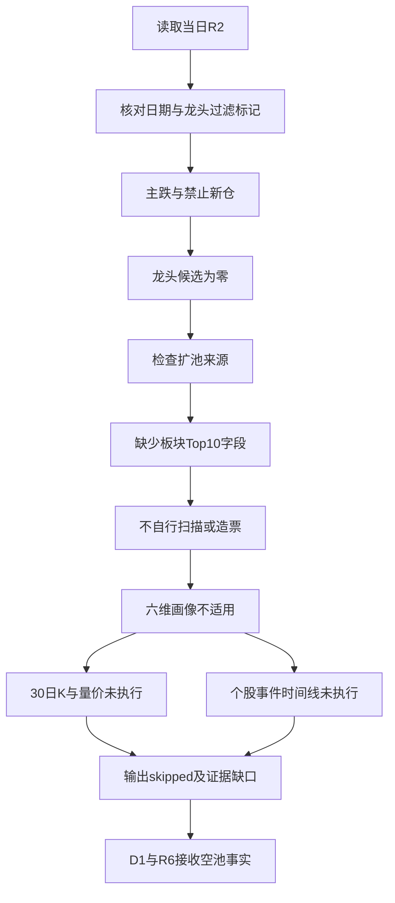

# 2026年10月23日 · **个股画像**

> **数据源新鲜度**: partial
> **降级状态**: true · **任务状态**: skipped
> **置信度**: null（无股票画像，不生成投资置信度）

## 🧭 一句话结论
**观察：R2龙头候选为0，主跌门禁生效；跳过逐票画像，不扩池造票。**

## 🔍 详细分析

### 先认市场，再认个股
R1、R2均把当前阶段标记为**主跌**，且明确禁止新仓。R2引用的上一交易日数据为涨停33家、跌停48家、炸板率41.07%。这些是上游证据，不是本次独立在线复核。阶段约束优先于候选数量要求，因此不为凑足6–15只而启动全市场扫描。

### 候选池核验与扩池结果
R2唯一板块观察对象为人形机器人，评分72，但其龙头、候选数组及顶层股票池均为空。`leader_filter_applied=true`表示空池适用性检查通过，不表示存在已核验龙头。R2也没有`all_scored_boards_top10`扩池字段；已记录字段缺失与数量缺口。**不进股票池**，且不把历史辨识度锚、R4受益映射或热榜直接冒充R2龙头。

### 六维画像与技术证据覆盖
六维分别为催化、筹码、板块联动、财务估值、技术形态、研报机构。当前无适用股票，全部**未执行**，并非完成零风险核验。≥30日K、量价、个股事件时间线、大宗交易、15日两融与图像识别也均未执行；没有证券代码就不能生成可信价格、评级、形态或事件归属。

### 板块观察不等于股票机会
以下仅解释R2的门禁，不重新进行板块排序或选股。
- **大资金意图**: 上游显示机器人整板净流出、减速器及执行器子方向净流入，不能从局部承接推断整板机构加仓，更不能归因到某只股票。
- **为什么走强**: R2记录机器人热度第一、板块涨停9家及平台升级催化，但整板价格和净资金并不支持一致走强；热度不能替代逐票量价确认。
- **逻辑够不够硬**: 只有板块叙事观察共识，没有可交易主线及个股龙头认证。持续性、封板率、次日预期均未知，保留空值，不强填结论。

## 🧩 处理路径

## 📌 关键证据
| 核验项 | 结果 | 来源 | 含义 |
|---|---|---|---|
| 股票龙头候选 | 0只 | R2主线leaders | 没有六维画像输入 |
| 市场阶段 | 主跌 | R1、R2 | 仅板块观察，不建立股票候选 |
| 炸板率 | 41.07% | R2引用上一交易日口径 | 达到候选减半阈值，空池约束更严格 |
| 龙头过滤 | 已应用，空池模式 | R2过滤结果 | 不等于逐票通过 |
| 扩池字段 | 缺失 | R2顶层 | 不从其他未授权股票池补齐 |
| 画像数 / 30日K覆盖数 | 0 / 0 | 本次执行 | 不宣称用户要求的完整画像已完成 |

## 数据源审计
| 源 | 日期 | 状态 | 记录数 | 备注 |
|---|---|:--:|---|---|
| R2主线 | 2026-10-23 | 🟡 | 股票0只 | 已读取；提前降级版，行情截至2026-10-22 |
| R1风格 | 2026-10-23 | 🟡 | artifact 1份 | 已读取阶段门禁，非本次在线复核 |
| R4消息 | 2026-10-23 | 🟡 | artifact 1份 | 已读取元数据；无候选，不映射个股事件 |
| R7资金 | 2026-10-23 | 🟡 | artifact 1份 | 已读取元数据；资金总体降级，不生成逐票资金结论 |
| fetch manifest | 2026-10-23 | 🟡 | artifact 1份 | 读取抓取元数据；severity=2继承R1/R2 |
| 个股日K、估值、龙虎榜、大宗、两融、公告及研报 | — | — | 未调用 | 空池不适用；不是API失败或全域DOWN |
| chart vision及图表PNG | — | — | 未调用 | 无候选或首推票；不构造图表 |

## ⚠️ 不确定性 / 反证
本产物只完成空池降级交付，**没有完成6–15只候选的逐票六维画像**。如果R2后续在新证据下重建合规龙头池，须重跑R5，逐票取得至少30日K、量价和事件时间线；不能沿用本次空池状态充当股票核验。主线=人形机器人（仅观察），持续性=未知，封板率=未知，明日预期=未知。上述门禁不是R6的`hard_reject`，本次不生成或覆盖硬否决结论，也不发出存量持仓清仓指令。

无首推票，因此每票板型、龙头认定、盈亏比、禁止清单及四段论证均不适用；不伪造个股评级或买卖价格。

## 🔗 与其他 R/D/E 的关系
- 依赖: R2_main_sectors.json、R1_style.json、R4_news.json、R7_capital_flow_20261023.json。
- 被消费: D1、R6、E1；空池是研究输入事实，不是交易指令。
- 下游约束: D1不得将本产物视为已完成逐票研究；R6独占hard_reject权。

## Sub-Agent 元数据
- skill: analyze_stock_profile_v1
- artifact: data/research/20261023/R5_stock_profiles.json
- model: gpt-6.1-sol
- 执行方式: 空候选降级；未调用市场MCP，未运行交易流水线。
- Pydantic: 2.13.4，显式空池模型落盘前通过；未找到仓库生产R5模型，不冒称全量模型校验。
