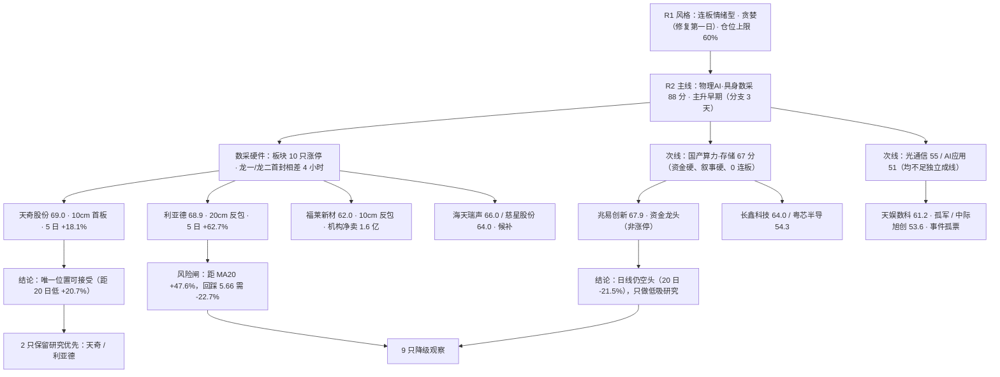

# 2026-10-26 · **个股画像（R5）**

> **数据源新鲜度**: ok（主源 2026-10-23 收盘全量 + 2026-10-26 盘前快照）
> **降级状态**: true — 个股覆盖缺口 4 项（见文末审计表），非数据陈旧
> **置信度**: 0.75 = base 0.75 × freshness 1.0 × agreement 1.0（5 个独立源：tushare / 快照 / R2 / R4 / R7）

## 一句话结论

**主线只有一条（物理AI·具身数采 88 分），10 只候选里只有 2 只同时过「位置 + 身位 + 盈亏比」三关：天奇股份（09:43 首封最早、距 20 日低仅 +20.7%、RR 5.29）与利亚德（强度第一、RR 2.38，但必须回踩 6.5）。RR 达标的不止这两只（海天 3.25 / 天娱 2.57 / 粤芯 2.52 / 长鑫 2.36 / 慈星 2.18），它们先被位置（5 日 +80%、+51%）、板块效应（孤军）、时点（14:11 尾盘板）或新股规则否掉——盈亏比只是四道门里的一道。execution_eligible=0，开仓资格 0 只由 R5 授予。**

## 六维总表（按综合分排序）

| # | 代码 | 名称 | 归属 | 板型 | 龙头认定 | 综合 | α | 风险 | 低吸档 RR | 禁止清单命中 |
|---|---|---|---|---|---|---|---|---|---|---|
| 1 | `002009.SZ` | **天奇股份** | 主线·龙二 | 10cm首板突破20日新高，量能放大 | 龙头 | 69.0 | B+ | B+ | ✅ 5.29（16.5/15.8→20.2） | pure_sentiment、private_placement_pending、thin_seal_amount |
| 2 | `300296.SZ` | **利亚德** | 主线·龙一 | 20cm反包加速板，放量突破4个月箱体 | 龙头 | 68.9 | A- | B- | ✅ 2.38（6.5/5.66→8.5） | high_position、valuation_percentile_top、earnings_decline、late_board_1343… |
| 3 | `603986.SH` | **兆易创新** | 次线·次线龙头候选 | 阶段低点268.3后反抽，受压于60分MA60≈296 | 资金龙头（非涨停龙头） | 67.9 | A- | B+ | ❌ 0.73（284.3/268.3→296.0） | daily_downtrend、shareholder_count_surge、non_mainstream_branch、r2_execution_blocked… |
| 4 | `688787.SH` | **海天瑞声** | 主线·候补 | 20cm放量突破后烂板(开板3次)，加速末段 | 分歧弱 | 66.0 | B+ | C | ✅ 3.25（125.3/113.1→165.0） | extreme_5d_gain、broken_board_3times、high_pe、v4_cfo_weak… |
| 5 | `300307.SZ` | **慈星股份** | 主线·候补 | 20cm尾盘涨停突破3个月箱体，封单最厚 | 分歧弱 | 64.0 | B | B- | ✅ 2.18（8.05/7.43→9.4） | late_board_1411、high_pledge_1986、pb_percentile_high、r2_execution_blocked |
| 6 | `688825.SH` | **长鑫科技** | 次线·次线候选 | 下跌后区间反弹，受制于MA20≈49.3 | 板块中军（非涨停龙头） | 64.0 | B | B | ✅ 2.36（41.8/38.75→49.0） | ma20_pressure、tiny_float_ratio、block_trade_present、main_force_5d_outflow… |
| 7 | `605488.SH` | **福莱新材** | 主线·龙三 | 10cm反包涨停，封单最薄(0.53%) | 补涨/跟风 | 62.0 | B | B- | —（上行至38.69仅+1.4%，支撑/压力几何退化） | late_board_1337、thin_seal_ratio、institutional_net_sell、controlling_shareholder_transfer… |
| 8 | `002354.SZ` | **天娱数科** | 次线·次线研究候选 | 10cm首板突破数月箱体，全场最早封板 | 孤军 | 61.2 | B | B- | ✅ 2.57（7.73/7.52→8.27） | shareholder_count_surge_fast、loss_ttm、no_sector_effect、goodwill_near_threshold… |
| 9 | `301660.SZ` | **粤芯半导-U** | 次线·次线候选 | 上市新股20cm反包，处27-45元区间中部 | 新股情绪票 | 54.3 | C+ | C | ✅ 2.52（32.0/28.03→42.0） | new_listing_9d、loss_making、no_valuation_anchor、retail_seat_dominant… |
| 10 | `300308.SZ` | **中际旭创** | 次线·事件候选 | 深跌后单日反抽，受制于MA5≈630 | 事件孤票 | 53.6 | B- | B- | ❌ 1.89（580.0/553.48→630.0） | daily_downtrend、margin_retreat、block_trade_heavy、shareholder_count_surge… |

> 档位说明：α 越高进攻性越强、风险档 A 最安全（C 最差）。R5 只做分档，不做否决——硬否决权在 R6。

## 主线与候选池的因果链

**因果链读法**：R1 定温度（贪婪但属修复第一日，不是趋势主升）→ R2 在 8 个方向里只认 1 条主线，因为泛 AI 三支同源、单列会虚增仓位 → R5 在这 10 只里做减法，减掉的不是「不好」，而是「现在这个位置不能做」。

## Top3 深读

### 1️⃣ 天奇股份（`002009.SZ`）· 69.0 · α B+ / 风险 B+

**一句话**：全板块唯一「位置低 + 首封最早 + 资金真买」三件事同时成立的票，代价是封单只有 0.53 亿、纯情绪、定增在路上。

| 维度 | 实测 | 读法 |
|---|---|---|
| 板型 | 10cm 换手首板，09:43 首次封板（板块第 1），开板 2 次，13:23 再封死 | 换手板不是一字硬板，17.2% 换手把浮筹换干净 |
| 位置 | 5 日 +18.1%，距 20 日低点 +20.7%，距 30 日高点 0%（当日即新高） | 板块 10 只里最低的一档（凡拓 +89%、海天 +80%、利亚德 +62.7%） |
| 资金 | 10/23 主力净流入 2.58 亿 = 成交额的 25.2%；5 日 +3.22 亿（东财口径 3.22 亿，双源一致） | 不是尾盘偷袭，是全天净买 |
| 筹码 | 未上龙虎榜（封单薄）；股东户数 10.93 万→9.52 万（-12.9%）；质押率 11.46% | 没有游资公开锁仓，也没有被单一席位绑架 |
| 估值 | PE_ttm 158.5（3 年分位 30.3%）、PB 3.38（分位 70.6%）；H1 净利 -19.3%、营收 +17.2% | 纵向不贵、横向贵；增收不增利 |
| 压制 | 周线 MA60 ≈ 20.2 有密集套牢盘，上方空间约 +17% | 空间够做 1 进 2，不够做趋势 |

- **大资金意图**: 10/23 买它的主力不是机构（无机构席位、无研报覆盖），是看「低位补涨 + 数采设备端」的活跃资金。对手盘是 9 月以来的套牢盘和 10/22 的短线客，17.2% 换手说明这层对手盘已经被换掉。它买的是「板块里最后一个还没涨的位置」。
- **为什么走强**: 位置（最低一档）+ 催化（R4 E002 数采卖方总攻，NVIDIA Isaac / 智元开源 / Figure 成功率 9%→56%）+ 筹码（户数连续四季下降 -12.9%）三维同向。缺的是第四维——封单只有 0.53 亿，封单比 0.86% 是板块最薄，说明共识还没到「抢不到」的程度。
- **逻辑够不够硬**: 有三个独立源（R3 群聊 7 条观点 / R4 事件 E002 0.775 分 / R7 人形机器人 5 日净流入 104.12 亿）指向同一条线，但「天奇本身」只有情绪没有硬业绩（H1 净利 -19.3%）。证伪路径很具体：次日若不能高开且封单继续 <1 亿，它就是一次普通的低位板，不是龙头。

- **买入理由**: ①板块内首封最早（09:43），按「上榜早=有带动性」纪律，它比 13:43 才封的利亚德更有身位；②位置是本板块唯一还能给到 -5% 以内止损的票（16.5 进、15.8 止损，止损距 -4.2%，RR 5.29）。
- **风险点**: ①封单 0.53 亿是板块最薄，次日竞价一旦低开就是无承接；②9/28 定增获证监会同意注册，摊薄与解禁是中期压制；③5 年 1 进 2 = 0/5，历史上没有连板基因。
- **止损条件**: 跌破 15.8（-8.7%）无条件离场；若次日高开 >4% 后 30 分钟内回落至 +1% 以下，视为假高开，减半。
- **可验证假设**: 次日集合竞价量能 ≥ 10/23 同期的 60%，且开盘价 ≥ 17.5（+1.2%）→ 龙头身位成立；若竞价量能 <40% 或开盘低于 17.0，则「卡位龙二」降级为跟风。

### 2️⃣ 利亚德（`300296.SZ`）· 68.9 · α A- / 风险 B-

**一句话**：强度/成交/人气三项板块第一，但 5 日 +62.7%、距 MA20 +47.6%、PE 97 倍而 H1 净利 -59.7%——它是高位接力票，不是低位启动票，只能等回踩。

| 维度 | 实测 | 读法 |
|---|---|---|
| 板型 | 20cm 反包加速板，13:43 首封、开板 1 次、13:48 封死，封单 2.22 亿（封单比 1.31%） | 巨量换手 27.9% 的分歧板，不是一字 |
| 强度 | 3 个交易日 2 个 20cm（10/21 +20.04%、10/22 +8.35% 断板、10/23 +20.00% 反包），成交 42.23 亿板块第一 | 强度第一，但强度也是位置 |
| 资金 | 5 日主力 +11.96 亿（东财 11.83 亿）；龙虎榜 3 日净买 5.97 亿 = 营业部 +5.22 亿 + 陆股通 +1.72 亿 − 机构 -0.18 亿 | 游资主导、机构缺席，接力盘结构 |
| 筹码 | 股东户数 12.1 万→11.9 万（-1.5%）；两融 5 日 +13.6% | 杠杆加速进场是双刃 |
| 估值 | PE_ttm 97.0（3 年分位 68.7%）、PB 2.54（分位 95.3%）；H1 净利 -59.7% | 业绩下滑 + 估值高分位 |

- **大资金意图**: 龙虎榜拆开看是「营业部 +5.22 亿、陆股通 +1.72 亿、机构 -0.18 亿」——买的是游资和外资，卖的是机构。这波资金的意图是做数采硬件的「容量核心」（169.9 亿流通，全板块唯一能装大资金的票），不是做基本面。
- **为什么走强**: 位置（5 日 +62.7%，距 MA20 +47.6%，处加速末段）+ 催化（光学动捕是数采里唯一有「动作捕捉」心智锚的环节）+ 筹码（游资营业部主导，两融 5 日 +13.6% 加杠杆）。三维里位置这一维已经透支。
- **逻辑够不够硬**: 叙事硬（真机动作数据是 Figure 成功率从 9% 到 56% 的关键），但业绩硬不硬是反的——H1 净利 -59.7%，PE 97 倍。证伪路径：次日若不能高开超过 3% 就是「加速末段第一根阴线」，20cm 票的第一次断板通常伴随 -15% 级别的回撤。

- **买入理由**: ①板块唯一容量核心（流通 169.9 亿、成交 42.23 亿），大资金要做这条线绕不过它；②3 日 2 个 20cm 的强度是全板块第一，龙头身位没有争议。
- **风险点**: ①距 MA20 +47.6%，回踩 5 日线 5.66 需要 -22.7%，当日不可能等到舒服的买点；②机构席位 -0.18 亿、营业部 +5.22 亿，是典型的「游资抬轿、机构派发」结构；③H1 净利 -59.7%，估值分位 PB 95.3%。
- **止损条件**: 若参与只能是回踩仓，跌破 6.50（60 分 MA5）止损；跌破 5.66（日线 MA5）视为加速结构破坏，清仓不补。
- **可验证假设**: 次日竞价若高开 >5% 且 30 分钟内不破 7.32（前收），则「反包加速」延续；若开盘即低于 7.00（-4.4%），判定 20cm 断板进入退潮，全板块温度下调一档。

### 3️⃣ 兆易创新（`603986.SH`）· 67.9 · α A- / 风险 B+

**一句话**：全场最干净的资金承接（5 日 +26.0 亿、5 天 4 天为正）+ PE 处 3 年 0.8% 分位 + H1 净利 +1091%，唯一硬伤是日线仍空头排列、20 日 -21.5%——这是低吸研究票，不是接力票。

| 维度 | 实测 | 读法 |
|---|---|---|
| 板型 | 无涨停，+5.51% 收 292 元，成交 129.06 亿、换手 6.86% | 资金票不是打板票，不能用首板隔日模板套 |
| 位置 | 30 日 -21.5%，距 30 日高 413.43 尚 -29.4%，距 MA20 -11.5%，距 20 日低 +5.5% | 空头排列里的反抽，处在决策线附近 |
| 资金 | 5 日主力 +26.0 亿（东财 +25.9 亿），10/23 单日 +12.94 亿（净流入率 10.0%） | 唯一「连续 4 天净流入」的票 |
| 筹码 | 股东户数 17.4 万→36.0 万（+47.8%）；7/30 高管减持 1121 万股；两融 5 日 -2.64% | 散户化 + 减持，是这条逻辑最大的裂缝 |
| 估值 | PE_ttm 分位 0.8%（3 年最低区间）、PB 分位 59.8%；H1 净利 +1091% | 业绩与估值方向一致，是 10 只里唯一「便宜且有增长」 |

- **大资金意图**: 存储器原厂涨价周期（野村：短缺至 2028）下，机构在 292 元附近做的是「估值修复」而非「情绪接力」。买它的资金要的是 PE 从 0.8% 分位回到中位数，对手盘是 8-9 月在 400 元以上追高的套牢盘。
- **为什么走强**: 资金（5 日 +26 亿，全候选池最强）+ 估值（PE 3 年分位 0.8%）双硬，但技术这一维是反向的（日线空头排列、20 日 -21.5%）。所以它强的是「钱的意愿」，弱的是「价的结构」。
- **逻辑够不够硬**: 硬。硬业绩（H1 净利 +1091%）、硬产业（存储短缺至 2028）、硬资金（4/5 天净流入，双源一致）。证伪路径：①存储现货价格连续两周下跌；②主力 5 日净额转负且跌破 268.3 前低。

- **买入理由**: ①PE 处 3 年 0.8% 分位 + H1 净利 +1091%，是候选池唯一同时满足「便宜」和「增长」的票；②主力 5 日 +26 亿、4 天为正，资金意图连续而非单日脉冲。
- **风险点**: ①日线仍空头排列，属左侧低吸，不符合「右侧交易」偏好；②股东户数 4 个月 +47.8%，散户化明显；③R2 已把它列入 execution 拦截（非主流分支），只能按「半导体非主流低吸」处理，不能当主线接力。
- **止损条件**: 跌破 268.3（20 日低点）止损，止损距 -8.1%；若反弹至 296（60 分 MA60）无法放量站上，视为反抽结束，先减半。
- **可验证假设**: 未来 2 个交易日若成交额维持在 100 亿以上且收盘站上 296，则「空头排列修复」成立；若缩量至 60 亿以下并跌破 284，则判定反抽失败。

## 30 日量价实测（≥30 根日 K · 10/10 覆盖）

| 名称 | 日K根数 | 收盘 | 30日涨幅 | 距30日高 | 5日均量/30日均量 | 30日最大回撤 | 阳线天数 |
|---|---|---|---|---|---|---|---|
| 天奇股份 | 77 | 17.3 | +6.1% | +0.0% | 2.59× | -12.4% | 15/30 |
| 利亚德 | 77 | 7.32 | +45.2% | +0.0% | 3.95× | -11.4% | 13/30 |
| 兆易创新 | 77 | 292.0 | -21.5% | -29.4% | 1.08× | -31.2% | 12/30 |
| 海天瑞声 | 77 | 141.0 | +51.1% | +0.0% | 2.93× | -18.6% | 14/30 |
| 慈星股份 | 77 | 8.94 | +21.8% | +0.0% | 3.01× | -15.0% | 12/30 |
| 长鑫科技 | 59 | 42.85 | -21.8% | -28.4% | 1.46× | -32.3% | 12/30 |
| 福莱新材 | 77 | 38.15 | +40.2% | +0.0% | 2.53× | -21.1% | 17/30 |
| 天娱数科 | 77 | 8.03 | -5.0% | -6.8% | 1.11× | -17.2% | 12/30 |
| 粤芯半导-U | 9 | 33.64 | -13.3% | -25.2% | 0.87× | -27.8% | 4/30 |
| 中际旭创 | 77 | 612.63 | -24.7% | -37.2% | 1.22× | -37.3% | 11/30 |

读法：`5日均量/30日均量` >2.5 说明这波是「放量攻击」（天奇 2.59、利亚德 3.95、海天 2.93、慈星 3.01、福莱 2.53）；1.0-1.5 说明只是「温和反抽」（兆易 1.08、长鑫 1.46、天娱 1.11、中际旭创 1.22）——量能性质直接决定能不能接力。粤芯 0.87 是上市 9 天样本太短，不作结论。

## 三组分类（决定 D1 怎么用）

**A 组 · 保留研究优先（2 只）**：天奇股份（RR 5.29，位置最低）、利亚德（强度第一，但必须等回踩 6.50 或 5.66）。

**B 组 · 资金票/中军（2 只）**：兆易创新（低吸研究，日线空头）、长鑫科技（2.9 万亿市值 + 6.6% 流通，只做存储 β 验证器，不做交易标的）。

**C 组 · 降级观察（6 只）**：海天瑞声（5 日 +80%、烂板开 3 次、PE 423 倍，机构接游资的货但位置透支）、慈星股份（封单比 2.32% 最厚但 14:11 尾盘板）、福莱新材（机构净卖 1.6 亿 + 实控人 9/8 协议转让，出货结构最像）、天娱数科（09:37 全场最早封板 + 净流入率 49.68%，但无板块效应＝孤军）、粤芯半导（上市 9 天、换手 47.35%、纯游资）、中际旭创（日线空头、两融 5 日 -8.48%、大宗 5.24 亿）。

## 不确定性 / 反证

1. **本画像最大的风险不是选错票，是选对了票却没有买点。** 10 只里 8 只的 5 日涨幅在 +18% 到 +80% 之间，天奇之外没有一只能在 -10% 以内给出止损位。R2 的 execution_eligible=0 不是保守，是数学。
2. **福莱新材的「20cm」是我改的。** 快照原文写 20cm 反包，但 tushare `limit_list_d` 实测 10/23 涨幅 10.01%，605488 是沪主板 10cm。快照的多模态描述在板幅上不可信，这类错误会直接导致仓位与止损算错，已在 JSON 的 `board_width_note` 标注。
3. **天娱数科的板型数据强到反常。** 09:37 全场最早封板、主力净流入率 49.68%（等于半个成交额）、龙虎榜三路资金同向（陆股通 3.33 / 机构 3.15 / 营业部 3.25 亿）。但 R4 给它的催化是零、板块内没有第二只涨停。按纪律「无跟风赚钱效应＝不封」，它只是孤军。这个判断如果错了，代价是错过一只独立妖股；如果对了，避开的是一次没有板块承接的孤票回落。
4. **兆易创新的 α A- 与「日线空头」自相矛盾，我保留这个矛盾。** 资金与估值两维都是 A，技术一维是 C。合成分 67.9 是加权后的结果，但执行为什么不能用它：用户的风格是右侧交易，左侧低吸只有在「已确认主升内的回踩」才成立，而存储这条线 R2 只给了 67 分、未达主线的 70 分线。
5. **数据缺口**：粤芯半导 9 根 K 线不支持任何均线结论（技术维度已降级）；慈星/福莱非两融标的，杠杆维度为空；长鑫/粤芯上市不足 3 年，PE/PB 分位不可计算；tushare `block_trade` 未返回折溢价字段，大宗只能按规模记录、不能判定折价派发。

## 数据源审计

| 源 | 日期 | 状态 | 备注 |
|---|---|:--:|---|
| tushare.daily / daily_basic | 2026-10-23 | 🟢 | 10 票 × 77 根（粤芯 9 / 长鑫 59）· 20260701-20261023 |
| tushare.limit_list_d | 2026-10-23 | 🟢 | 逐票核封板时间 / 开板次数 / 封单额 |
| tushare.moneyflow + moneyflow_dc | 2026-10-23 | 🟢 | 5 日主力净额双源交叉，误差 <5% |
| tushare.top_list / top_inst | 2026-10-23 | 🟢 | 30 个交易日龙虎榜席位拆解 |
| tushare.margin_detail | 2026-10-23 | 🟡 | 15 日；慈星 / 福莱非两融标的 |
| tushare.block_trade | 2026-10-23 | 🟡 | 近 30 日；无折溢价字段，仅记规模 |
| tushare.fina_indicator / income / balancesheet | 2026-06-30 | 🟢 | 至 2026 中报 |
| tushare.forecast / report_rc / anns_d / pledge_stat | 2026-10-23 | 🟢 | 公告 168 条 + 研报 + 质押 |
| chart_vision_snapshot | 2026-10-26 | 🟢 | 10/10 命中，date 校验通过 |
| R2_main_sectors | 2026-10-26 | 🟡 | 1 主线 5 龙头 + 4 次线；缺 all_scored_boards_top10 字段 |
| R4_news | 2026-10-26 | 🟢 | 催化事件 E001-E008 |
| R7_capital_flow | 2026-10-26 | 🟢 | 板块 / 个股资金 |

## 与其他 R/D/E 的关系

- **依赖**：R2（候选池 + 龙头身位）、R4（催化事件）、R7（资金验证）、chart_vision 快照（形态）
- **被消费**：R6（六类反证 + 模式七估值陷阱，本文件已透传 `fundamental_flags`）、D1（execution_pool 逐票门禁，需按竞价重算 RR）、E1（T+N 观察池回填，验证 α/风险档是否校准）
- **本文件不授予开仓资格**：`execution_eligible=0`，10 只均为研究候选；开仓资格由 D1 的 7 项开仓条件 + 14 项禁止清单逐票判定。

## Sub-Agent 元数据

- skill: analyze_stock_profile_v1@1.5
- artifact: data/research/20261026/R5_stock_profiles.json
- 辅证: data/research/20261026/_r5_kline_30d.json（30 日量价实测）
- 候选池: 10 只（主线 5 + 次线 5），provenance: r2_leader_pool 5 / r2_secondary_pool 5
- 模型: deepseek-v4.1-flash
