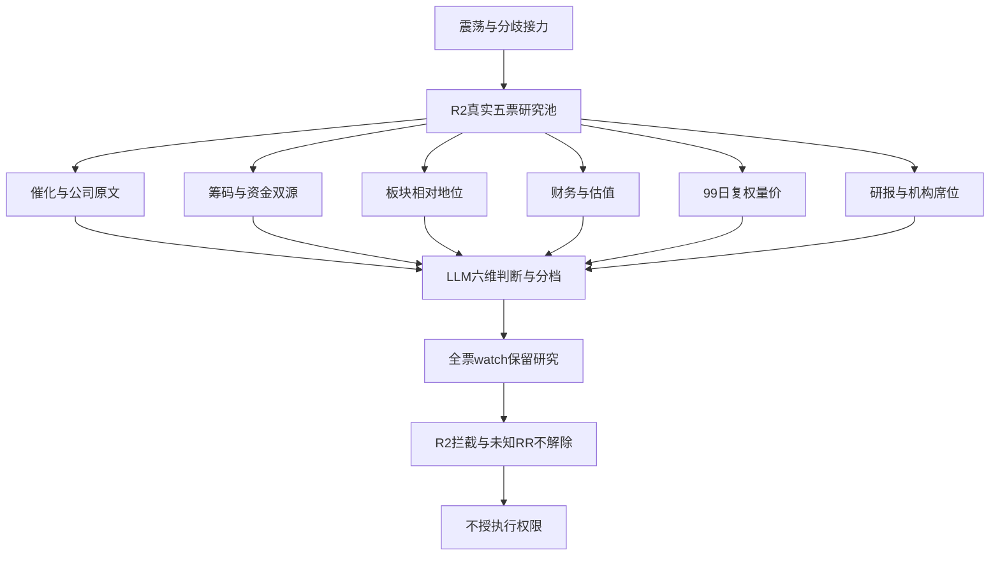

# 2026年10月27日 · 个股画像

> ⚠️ **数据源时间错位**
> 文件归属：2026-10-27盘前研究；最新完整行情：2026-10-26。两融截至2026-10-23。
> 这是任务日与观测日的显式区分，不是把旧缓存当实时，也不宣称2026-10-27已经收盘。
> 降级：true · 置信度：0.1925 · 执行授权：无

## 🧭 一句话结论
五票画像保留，前排也仅观察；公告约束机器人叙事，图表与资金冲突使执行门禁继续关闭。

## 🔎 详细分析
情绪显式继承R1/R3为**震荡**，阶段为高位震荡；R2唯一研究模板是**分歧接力**。主线研究对象是人形机器人，不等于已确认可交易主线。R1风险预算不是开仓命令，R7整体不可用不是停止候选画像的理由。

R2真实main_lines提供5票，secondary_lines的leaders为空，all_scored_boards_top10缺失。5/5均完成六维解释；扩池0票、研究剔除0票、距离覆盖下限6票缺1票。不从全市场找票补数，不把已拦截后排自动升级。

分歧接力先看阶段之王与承接，再看形态：本次权重为筹码30%、板块地位25%、技术25%、催化10%、财务5%、机构5%。这是LLM研究启发式，不是回测胜率；绝非将五套策略拼接。多伦与赛福天的一字一致尚未经过本日真实分歧换手，福莱是助攻，另外两只只是历史主题锚对照。

资金主源为本次live Tushare MCP，日K每票99根、复权因子逐日对齐，估值历史每票725行。所有大宗查询近30日均返回0；三票两融零行且资格未知，不能填0，更不能据此说无杠杆风险。两票取得15观测但最后日为10月23日，盘前尚不能补造10月26日余额。

公司原文比热点标签约束更强：多伦不涉及人形机器人核心本体，福莱柔性传感收入极低，赛福天亏损PE不具可比性。即使有早封与大单流入，也只支持情绪辨识度，不支持产业利润已经兑现。全票R2 execution_blocked逐票透传，RR未知与禁止清单未知均不是通过。

## 🧩 六维证据关系

## 📊 综合研究排序
| 股票 | R2角色 | 催化 | 筹码 | 联动 | 估值 | 技术 | 机构 | 加权分 | Alpha / 风险 | 本章态度 |
|---|---|---:|---:|---:|---:|---:|---:|---:|---|---|
| 多伦科技 603528.SH | 龙一 | 25 | 52 | 70 | 24 | 58 | 20 | 52.30 | B / B- | 观察；R2执行拦截 |
| 福莱新材 605488.SH | 候补 | 35 | 46 | 48 | 28 | 55 | 45 | 46.70 | B / C | 观察；R2执行拦截 |
| 赛福天 603028.SH | 龙二 | 20 | 38 | 62 | 12 | 52 | 18 | 43.40 | B- / C | 观察；R2执行拦截 |
| 旭光电子 600353.SH | 候补 | 18 | 25 | 20 | 28 | 15 | 15 | 20.20 | C / C | 观察；R2执行拦截 |
| 中京电子 002579.SZ | 候补 | 20 | 22 | 18 | 18 | 12 | 15 | 17.75 | C / C | 观察；R2执行拦截 |

风险档A最安全、C最高风险；研究排序不是可交易顺序，既不写hard_reject也不替代R6。

## 🧾 关键证据
- 价格：五票每票99根真实日K，2026-06-01至2026-10-26；前复权计算为close × 当日因子 / 最新因子。
- 资金：主力仅由大单+超大单自算；与东财同日比对，所有票窗口内均有大于5%的偏差，逐日双值在JSON保留。
- 公告：已直接读取多伦、赛福天、福莱最新风险提示PDF原文；公告目录日期不是已知的首次公开时刻，不倒灌解释前日盘中。
- 研究分层：五票全保留研究，五票全透传R2执行拦截；没有一个因画像完成而获得可交易资格。

## 🔬 多伦科技 · 603528.SH · 龙一
**本章态度：观察（研究保留、执行拦截）**。三板前排辨识度成立，但机器人利润贡献极小且价格远离均线，只保留分歧接力研究观察。

- **大资金意图**: 可验证事实是大单资金与早封前排集中，推断资金在争夺辨识度而非依据机器人利润重估；对手盘是前期获利与风险公告后兑现筹码，真实持仓意图不可直接观察。
- **为什么走强**: 三板高度、人气前移和五日净流入共同支持相对强势；但一字缩量将分歧后移，主营不变的公告使业绩解释不成立。
- **逻辑够不够硬**: 价格和席位证据可复核，产业利润锚不硬；公司原文反而限制人形机器人叙事。未来48小时若板块扩散与换手不能维持，前排溢价假设就弱化。

| 量化复核项 | 实际值 / 口径 |
|---|---|
| 数据日 / 样本 | 2026-10-26 / 99根 |
| 5日 / 20日涨跌幅 | +34.59% / +39.84% |
| MA5 / MA10 / MA30 | 7.5960 / 7.1190 / 6.6697；仅分析值，非买卖价 |
| 量比 / 振幅 | 0.322倍（此前5日均量） / 0.00% |
| 5日大单+超大单净额 | +3.087108亿元；不用net_mf_amount |
| 流通市值 | 63.18亿元（万元除10000） |
| 龙虎榜 / 大宗 | 1个上榜日 / 0笔；大宗折溢价不可判 |
| 财报截止 / 公告 | 20260630 / 20260826 |

### 一、催化背景
实时公告原文证实：机器人业务是交通管理场景应用、咖啡机器人定制，不涉及人形机器人核心本体研发生产，收入利润占比极小，预计2026年不构成重大业绩影响。R3东财人气由30升至6只能解释注意力，不能推翻原文。R4宇树/上纬负面为板块风险背景，不是本票新订单。

### 二、筹码结构
五日大单与超大单自算净流入3.087108亿元，最后一日约0.879534亿元；同期股东户数由50773降至44978，说明截至半年末筹码趋于集中，不能外推当前锁仓。10月23日三日异动榜以营业部和陆股通净买为主，未见机构专用席位。窗口内双源多日偏差超过5%，降低资金结论置信度。零大宗记录不等于不存在减持，两融零行且资格未认证。

### 三、板块联动
继承人形机器人R2得分72及供应商14家涨停；与赛福天并列3板且竞价早封，R2研究龙一有相对辨识度，但不是全市场唯一总龙。精准人形净流入与广义机器人净流出方向分离，R7没有精确主题确认；板块指数下跌且涨停收缩，不能把前排一字板当全板块合力。R2执行拦截保持。

### 四、财务与估值
半年营收增长11.87%但归母净亏3626.03万元，PE_TTM为空而非便宜；PB约3.39倍、三年82.62%分位，PS_TTM约14.91倍。2024年EPS为正0.009元，2025及2026半年亏损不能误判为连续两个完整年度亏损，不触发该项S1；半年应收/半年收入超过100%，期中口径有季节性但回款压力不能忽略。GF-DMA仅作偏离诊断，缺下一季指引和一致预期上修，无法给完整健康分。

### 五、技术形态
99根日K与复权因子对齐。MA5>MA10>MA30，20日涨39.84%，但价格高于MA20约31.32%、Z20约5.47；最后一日一字板，成交量仅前一日16.43%、相对前5日均量0.322倍，是供给收缩而非放量突破。高位一致后的换手质量未检验，不能标为健康回踩。无合法视觉输入，技术强度最多medium。

### 六、研报与机构
近30日report_rc零覆盖，stk_surv零行，不能写成机构一致看好或机构没有关注。已有龙虎榜并非机构专用买入证据；更多是人气和短线席位驱动，研报维度不给中性高分。

### 事实时间线
| 日期 | 事实 | 来源 / 解释边界 |
|---|---|---|
| 2026-10-12 | 涨停 | tushare.limit_list_d · 价格事实，不等于产业事件 |
| 2026-10-13 | 触板未封 | tushare.limit_list_d · 价格事实，不等于产业事件 |
| 2026-10-22 | 涨停 | tushare.limit_list_d · 价格事实，不等于产业事件 |
| 2026-10-23 | 涨停 | tushare.limit_list_d · 价格事实，不等于产业事件 |
| 2026-10-23 | 龙虎榜上榜（同日多原因合为事件） | tushare.top_list · 结构待核，不自动正向 |
| 2026-10-24 | 多伦科技股票交易异常波动公告 | tushare.anns_d · 风险提示 |
| 2026-10-26 | 涨停 | tushare.limit_list_d · 价格事实，不等于产业事件 |
| 2026-10-27 | 多伦科技股票交易风险提示公告 | tushare.anns_d · 风险提示 |

### 财务红旗与图表缺口
- F9：20260630应收/同期累计营收=105.12%>40%；期中分母有季节性，不冒充全年比率（medium；live MCP balancesheet + income）
- 五票均缺合法视觉输入，chart_vision=null；本票图像/缠论均未核，不写chart确认。主线首推多伦的PNG同样未生成；拒绝通过写cache/raw或审计旁路绕过白名单。
- R2拦截原文：保留研究龙1；跨源0.33<0.34降级watch；负面公告、RR及逐票门禁未核；RR未知，只能watch；未核禁止项不算通过。

**买入理由**：仅为研究假设而非买入建议：一是R2龙一及3板早封具有辨识度；二是五日大单净流入和R3人气前移构成注意力证据。产业上只承认交通机器人应用，不把它改写成人形机器人核心供应商。

**风险点**：短期：高于MA20逾30%、一字板未充分换手，风险提示后可能出现流动性冲击。中期：机器人收入利润占比极小且主营亏损，资金溢价没有新增盈利锚；两融资格与完整禁止清单仍未知。

**止损条件**：研究失效条件而非卖出指令：未来两个交易日失去板块高度前排且收盘不能维持MA5上方，或风险公告后板块涨停家数连续低于3家，分歧接力观察假设失效；不提供价格。

**可验证假设**：24—72小时核验：人形板块至少3家涨停、个股仍在相对高度前二且资金双源同日方向一致。任一不满足不升级研究层；即使满足也不解除R2门禁。

## 🔬 赛福天 · 603028.SH · 龙二
**本章态度：观察（研究保留、执行拦截）**。并列三板但小流通盘、亏损与高杠杆并存，连板辨识度不能替代产业硬逻辑及换手确认。

- **大资金意图**: 推断短线资金在小流通盘争夺并列高度，并非财报改善驱动。机构净卖与营业部净买方向相反，应警惕接力资金接出筹码；席位身份不等同最终持有人。
- **为什么走强**: 高度、早封和低流通盘解释价格弹性，五日净流入支持短线聚集；但收入下滑、亏损与高杠杆不支持基本面走强，不能用股东户数下降把两者混成价值重估。
- **逻辑够不够硬**: 硬的是三板和交易所风险提示，非机器人业绩兑现；缺订单、利润增量与板块带动因果证据。与多伦同身位不代表能在龙一失效后自动补位。

| 量化复核项 | 实际值 / 口径 |
|---|---|
| 数据日 / 样本 | 2026-10-26 / 99根 |
| 5日 / 20日涨跌幅 | +37.68% / +39.11% |
| MA5 / MA10 / MA30 | 7.9480 / 7.3520 / 7.1213；仅分析值，非买卖价 |
| 量比 / 振幅 | 0.735倍（此前5日均量） / 0.00% |
| 5日大单+超大单净额 | +0.835655亿元；不用net_mf_amount |
| 流通市值 | 26.63亿元（万元除10000） |
| 龙虎榜 / 大宗 | 2个上榜日 / 0笔；大宗折溢价不可判 |
| 财报截止 / 公告 | 20260630 / 20260825 |

### 一、催化背景
最新风险提示公告确认主营经营无重大变化、无应披露未披露重大信息，并明确亏损导致PE不可比；不能从人形机器人标签推断实质订单。10月10日有累计诉讼仲裁公告，标题仅能提示治理/经营风险，未读取正文不推断金额。R4板块负面不转成正向催化。

### 二、筹码结构
五日大单自算净流入0.835655亿元、最后一日约0.252882亿元，半年股东户数环比减少约4.76%。龙虎榜营业部净买而机构专用净卖，属于短线资金接机构筹码的风险结构，不等于机构吸筹。单日榜与三日榜重叠，不把净额机械合为新增持仓。窗口内双源冲突、两融无行且资格未证，不能补零。

### 三、板块联动
R2研究龙二，与多伦同为3板、09:25早封；地位是相对排序，不是已验证资金第二。流通盘26.63亿元落20—50亿元谨慎区，低流通盘放大涨停并非带动全产业的证据。人形主题R2分72但跨源确认只有1/3，R2执行blocked原样保留。

### 四、财务与估值
半年归母亏3243.77万元、营收同比下降43.89%，负债率87.21%；PB约6.09倍且三年99.86%分位，不能用低PS约2.14倍掩盖净资产与盈利弱。半年短借加长借已超过归母净资产，构成F10下限证据；最近两个完整年度亏损触发财务轴观察，不等同已ST。

### 五、技术形态
99日样本中均线短期上拐，五日涨37.68%，高于MA20约29.84%、Z20约5.23。连续两个一字板令成交量小，最后一日虽较前日增加26.02%，仅为此前5日均量0.735倍；不能写成已经充分换手后的分歧转强。缺合规图像输入，技术强度不高于medium。

### 六、研报与机构
近30日report_rc及stk_surv均零行，不把0篇覆盖视作机构认可。现有席位结构反而出现机构专用净卖，需要与营业部接力区分；没有上修预期证据。

### 事实时间线
| 日期 | 事实 | 来源 / 解释边界 |
|---|---|---|
| 2026-10-10 | 关于回购注销2023年员工持股计划未解锁股份的实施公告 | tushare.anns_d · 事实待解读 |
| 2026-10-10 | 关于公司及子公司累计诉讼、仲裁情况的公告 | tushare.anns_d · 风险提示 |
| 2026-10-22 | 涨停 | tushare.limit_list_d · 价格事实，不等于产业事件 |
| 2026-10-22 | 龙虎榜上榜（同日多原因合为事件） | tushare.top_list · 结构待核，不自动正向 |
| 2026-10-23 | 涨停 | tushare.limit_list_d · 价格事实，不等于产业事件 |
| 2026-10-23 | 龙虎榜上榜（同日多原因合为事件） | tushare.top_list · 结构待核，不自动正向 |
| 2026-10-24 | 股票交易异常波动公告 | tushare.anns_d · 风险提示 |
| 2026-10-26 | 涨停 | tushare.limit_list_d · 价格事实，不等于产业事件 |
| 2026-10-27 | 股票交易风险提示性公告 | tushare.anns_d · 风险提示 |

### 财务红旗与图表缺口
- F9：20260630应收/同期累计营收=63.25%>40%；期中分母有季节性，不冒充全年比率（medium；live MCP balancesheet + income）
- F10：20260630短借+长借/归母净资产=189.38%>80%；仅两类借款即越阈值，是有息负债率下限而非全部债务（medium；live MCP balancesheet）
- S1：2024及2025完整年度EPS均负，命中财务轴风险观察；不是已被ST，不推断合规轴或临近轴通过（strong；live MCP fina_indicator annual EPS）
- 五票均缺合法视觉输入，chart_vision=null；本票图像/缠论均未核，不写chart确认。主线首推多伦的PNG同样未生成；拒绝通过写cache/raw或审计旁路绕过白名单。
- R2拦截原文：保留研究龙2；跨源0.33<0.34降级watch；负面公告、RR及逐票门禁未核；RR未知，只能watch；未核禁止项不算通过。

**买入理由**：仅研究理由：一是与R2龙一并列三板早封；二是五日大单净流入。产业相关性仍只是R2概念映射，未有新增业绩锚，不能形成正式开仓理由。

**风险点**：短期：26.63亿元小流通盘及一字未充分换手，退出拥挤风险较大。中期：收入下滑、亏损、87.21%负债率与机构净卖并存，财务抗风险能力弱；完整禁止清单和RR未核。

**止损条件**：研究失效条件：未来两个交易日跌出板块高度前二且不能维持MA5，或机构持续净卖而营业部接力衰减，观察假设不再成立；不输出买卖价或下单动作。

**可验证假设**：未来24—72小时检验其是否在真实分歧后保住高度前二，并观察下一次龙虎榜机构专用净额能否非负；没有新榜时后者保持未知，不能判通过。

## 🔬 福莱新材 · 605488.SH · 候补
**本章态度：观察（研究保留、执行拦截）**。触觉叙事有关注、换手二板有价格证据，但公告否认重大业绩贡献且机构净卖，仍是研究助攻。

- **大资金意图**: 资金可能围绕触觉采集稀缺标签和人气跃升做短线重估，但机构专用在卖，说明对手盘包含机构兑现；不能因一篇行业报告就推断长线机构抢筹。
- **为什么走强**: 二板回封、五日净流入及R3热榜42升15支持注意力与交易强度；同时五日近49%的涨幅已经先行，官方明确收入占比极低，所以强的是预期而非已兑现利润。
- **逻辑够不够硬**: 确有公司公告与一份机构报告，但它们未证明机器人项目对利润构成重大贡献，且方向不全一致。若后续仅有转载而无订单/收入新证据，叙事不能继续提硬度。

| 量化复核项 | 实际值 / 口径 |
|---|---|
| 数据日 / 样本 | 2026-10-26 / 99根 |
| 5日 / 20日涨跌幅 | +48.99% / +39.44% |
| MA5 / MA10 / MA30 | 35.7400 / 31.1930 / 30.0027；仅分析值，非买卖价 |
| 量比 / 振幅 | 0.624倍（此前5日均量） / 4.93% |
| 5日大单+超大单净额 | +3.629281亿元；不用net_mf_amount |
| 流通市值 | 125.27亿元（万元除10000） |
| 龙虎榜 / 大宗 | 2个上榜日 / 0笔；大宗折溢价不可判 |
| 财报截止 / 公告 | 20260630 / 20260826 |

### 一、催化背景
柔性传感器/触觉数采是R3可追踪的产业叙事，但最新官方风险提示明确该项目收入占比极低、对主营无重大影响。公告同时提示月内涨幅和估值风险，因此给出的只是题材注意力，不是新订单事实。10月10日子公司优先认购权及工商变更有公告，未把资本动作等同量产。

### 二、筹码结构
五日大单自算净流入3.629281亿元，但席位归并显示营业部净买、机构专用净卖约1.60亿元，不能把总净买解释为机构锁仓。股东户数半年末较一季度增4.87%，更接近扩散而非集中。窗口内多日双源偏差超过5%；零大宗与零两融记录不构成安全证明。

### 三、板块联动
R2角色候补、综合三及以下研究层；虽然T-1两板早封满足简化龙头信号的部分条件，但低于并列3板高度，不能绕过R2相对地位改成阶段之王。14家涨停是板块效应的供应商统计，不是已证实由本票带动。触觉是同一机器人母题，不另开第二策略。

### 四、财务与估值
半年营收增长28.50%、归母净利增长仅2.04%，PE_TTM约160.76倍、三年94.76%分位，增长未证明足以支撑题材估值。官方引用的148.09倍是10月23日静态口径，不与10月26日TTM硬比为数据错误。半年经营现金流为正，未凭空命中财务红旗；未通过的估值检查保持未知。

### 五、技术形态
99日复权样本，五日上涨48.99%，高于MA20约38.20%、Z20约5.22；最后一日早封后开板2次再回封，换手约6.02%，量比0.624倍，相比一字票有成交检验但不是放量突破。处于急拉后的高偏离区，不能标为低风险回踩。缺合规图像输入，技术强度最多medium。

### 六、研报与机构
近30日report_rc共3行实为同一10月24日国泰海通报告的三年度预测，只计1份，评级为空而不是买入评级；2026Q4 EPS预测0.38元。机构专用席位净卖，与产业研报提及并不构成机构资金共振。stk_surv零行。

### 事实时间线
| 日期 | 事实 | 来源 / 解释边界 |
|---|---|---|
| 2026-10-09 | 福莱新材关于可转债转股结果暨股份变动的公告 | tushare.anns_d · 事实待解读 |
| 2026-10-10 | 福莱新材关于放弃全资子公司浙江福莱芯感科技股份有限公司优先认购权进展暨完成工商变更登记的公告 | tushare.anns_d · 事实待解读 |
| 2026-10-15 | 福莱新材关于部分闲置募集资金购买理财产品到期赎回并继续购买理财产品的公告 | tushare.anns_d · 事实待解读 |
| 2026-10-19 | 涨停 | tushare.limit_list_d · 价格事实，不等于产业事件 |
| 2026-10-20 | 涨停 | tushare.limit_list_d · 价格事实，不等于产业事件 |
| 2026-10-20 | 龙虎榜上榜（同日多原因合为事件） | tushare.top_list · 结构待核，不自动正向 |
| 2026-10-21 | 福莱新材可转换公司债券交易异常波动的公告 | tushare.anns_d · 风险提示 |
| 2026-10-21 | 一致行动人嘉兴市进取企业管理合伙企业（有限合伙）关于《浙江福莱新材料股份有限公司可转换公司债券交易异常波动问询函》的回函 | tushare.anns_d · 风险提示 |
| 2026-10-21 | 福莱新材关于股票交易异常波动的公告 | tushare.anns_d · 风险提示 |
| 2026-10-21 | 一致行动人嘉兴市进取企业管理合伙企业（有限合伙）关于《浙江福莱新材料股份有限公司股票交易异常波动问询函》的回函 | tushare.anns_d · 风险提示 |
| 2026-10-21 | 控股股东及实际控制人关于《浙江福莱新材料股份有限公司可转换公司债券交易异常波动问询函》的回函 | tushare.anns_d · 风险提示 |
| 2026-10-21 | 控股股东及实际控制人关于《浙江福莱新材料股份有限公司股票交易异常波动问询函》的回函 | tushare.anns_d · 风险提示 |
| 2026-10-21 | 触板未封 | tushare.limit_list_d · 价格事实，不等于产业事件 |
| 2026-10-23 | 涨停 | tushare.limit_list_d · 价格事实，不等于产业事件 |
| 2026-10-23 | 龙虎榜上榜（同日多原因合为事件） | tushare.top_list · 结构待核，不自动正向 |
| 2026-10-24 | 福莱新材关于股票交易异常波动的公告 | tushare.anns_d · 风险提示 |
| 2026-10-24 | 一致行动人嘉兴市进取企业管理合伙企业（有限合伙）关于《浙江福莱新材料股份有限公司股票交易异常波动问询函》的回函 | tushare.anns_d · 风险提示 |
| 2026-10-24 | 控股股东及实际控制人关于《浙江福莱新材料股份有限公司股票交易异常波动问询函》的回函 | tushare.anns_d · 风险提示 |
| 2026-10-24 | 福莱新材关于“福新转债”预计满足赎回条件的提示性公告 | tushare.anns_d · 事实待解读 |
| 2026-10-26 | 涨停 | tushare.limit_list_d · 价格事实，不等于产业事件 |
| 2026-10-27 | 福莱新材可转换公司债券交易异常波动的公告 | tushare.anns_d · 风险提示 |
| 2026-10-27 | 控股股东及实际控制人关于《浙江福莱新材料股份有限公司可转换公司债券交易异常波动问询函》的回函 | tushare.anns_d · 风险提示 |
| 2026-10-27 | 一致行动人嘉兴市进取企业管理合伙企业（有限合伙）关于《浙江福莱新材料股份有限公司可转换公司债券交易异常波动问询函》的回函 | tushare.anns_d · 风险提示 |
| 2026-10-27 | 福莱新材股票交易风险提示公告 | tushare.anns_d · 风险提示 |

### 财务红旗与图表缺口
- fundamental_flags为空数组：当前已核项目没有充分命中，绝不等于F1—F12/V1—V10/S1—S3全部排除。
- 五票均缺合法视觉输入，chart_vision=null；本票图像/缠论均未核，不写chart确认。主线首推多伦的PNG同样未生成；拒绝通过写cache/raw或审计旁路绕过白名单。
- R2拦截原文：龙三及以下/地位未核，仅研究，不进execution；龙一被否不自动替补；RR未知，只能watch；未核禁止项不算通过。

**买入理由**：仅研究理由：一是触觉传感/数采主题有R3文本与人气证据；二是二板回封及五日大单净流入可跟踪。它仍是R2候补，产业收入锚尚弱，不形成交易授权。

**风险点**：短期：五日约49%涨幅、高均线偏离和机构净卖可能触发一致后兑现。中期：柔性传感器收入极低、TTM估值高；可转债异动和预计满足赎回条件只提示跨品种事件风险，不能当正股盈利承诺。

**止损条件**：研究失效条件：未来两日回封稳定性消失、收盘跌破MA5且人气回落，或公司继续否认实质收入贡献而无新订单证据，题材向业绩转化假设失效；不提供价格。

**可验证假设**：24—72小时观察板块涨停是否至少3家、个股是否保持相对强势且下一次机构席位不再净卖；产业硬度必须等待新增原文证据，无消息不等于证伪也不算通过。

## 🔬 旭光电子 · 600353.SH · 候补
**本章态度：观察（研究保留、执行拦截）**。历史锚不等于当前核心：价格弱于机器人前排，半年股东扩散与融资去化，不把下跌当主升低吸。

- **大资金意图**: 融资余额去化和最新日大单流出更像风险收缩；五日轻微净流入不足以证明主力护盘。半年股东扩散提示持有人结构曾经变散，但不能定位谁在此时卖出。
- **为什么走强**: 当前没有走强：T-1收跌、20日明显下行且不在板块高度前排。题材热度与个股价格相背离，是不能把板块标签自动映射成个股核心的反例。
- **逻辑够不够硬**: 硬证据支持盈利增长，但不能支持本轮人形机器人新增收益，也不能抵消应收、现金流和趋势损伤。历史锚没有当日地位，故逻辑不够支持分歧接力。

| 量化复核项 | 实际值 / 口径 |
|---|---|
| 数据日 / 样本 | 2026-10-26 / 99根 |
| 5日 / 20日涨跌幅 | -3.39% / -35.59% |
| MA5 / MA10 / MA30 | 23.2940 / 23.5650 / 28.7753；仅分析值，非买卖价 |
| 量比 / 振幅 | 0.779倍（此前5日均量） / 4.12% |
| 5日大单+超大单净额 | +0.423638亿元；不用net_mf_amount |
| 流通市值 | 184.33亿元（万元除10000） |
| 龙虎榜 / 大宗 | 1个上榜日 / 0笔；大宗折溢价不可判 |
| 财报截止 / 公告 | 20260630 / 20260827 |

### 一、催化背景
本次近30日anns_d零行，R4未提供本票独立正向硬催化；R2来自既有主题锚，并非新合同或量产证据。不得根据零公告推断公司没有任何业务进展，也不借宇树物理AI叙事替本票补催化。

### 二、筹码结构
五日大单自算小幅净流入0.423638亿元，但最近一日为净流出；半年末户数较一季度大增37.45%，不支持集中筹码。15个两融观测截至10月23日，融资余额下降17.20%、融券余额也下降14.92%，不满足融资下降且融券上升的short_pressure双条件。9月28日是跌停榜，不能误作强势上榜。

### 三、板块联动
仅继承R2候补来源与人形机器人研究板块72分，不据此给个股核心身份。T-1下跌3.60%、连板为0，与3板前排分离；R2已命中高度落后超过2板/无前排地位，保留研究但执行拦截不变。ETF与商品无经验证映射，联动不填假相关系数。

### 四、财务与估值
半年营收增长16.80%、归母净利增长11.62%，但PE_TTM约109.08倍、PB约9.65倍，跌后也未体现便宜。半年应收高于半年营收，现金回款需要验证。Q1与H1累计经营现金流为负，但Q2单季已转正，不把累计负值冒充连续两个单季恶化；不强贴F8。

### 五、技术形态
99日样本显示收盘低于MA5/10/20/30/60，20日跌35.59%，高于或贴近长期均线的主升回踩前提不存在。MA20偏离-16.81%不是估值折扣证明；缩量下跌只说明参与降低，不等于洗盘结束。EscapeRatio在均线斜率为负时不能按正值解释为向上加速。

### 六、研报与机构
近30日盈利预测与机构调研均零行，9月28日席位没有机构专用净买证据。不能把老主题锚当当前机构关注，亦不从零数据推断完全无人研究。

### 事实时间线
| 日期 | 事实 | 来源 / 解释边界 |
|---|---|---|
| 2026-09-28 | 跌停 | tushare.limit_list_d · 价格事实，不等于产业事件 |
| 2026-09-28 | 龙虎榜上榜（同日多原因合为事件） | tushare.top_list · 结构待核，不自动正向 |

### 财务红旗与图表缺口
- F9：20260630应收/同期累计营收=130.43%>40%；期中分母有季节性，不冒充全年比率（medium；live MCP balancesheet + income）
- 五票均缺合法视觉输入，chart_vision=null；本票图像/缠论均未核，不写chart确认。主线首推多伦的PNG同样未生成；拒绝通过写cache/raw或审计旁路绕过白名单。
- R2拦截原文：龙三及以下/地位未核，仅研究，不进execution；龙一被否不自动替补；RR未知，只能watch；未核禁止项不算通过。

**买入理由**：仅保留研究的两个理由：一是R2明列的真实主题锚而非全市场新造票；二是半年盈利增长可作为基本面对照。缺产业新增催化与前排身份，所以没有已成立的买入理由。

**风险点**：短期：均线空头与融资去化使反弹容易失去承接。中期：应收/期中收入偏高且经营现金流累计为负，盈利的回款质量需验证；已有R2禁止项命中不因研究得分解除。

**止损条件**：当前分歧接力资格本就未成立。若未来两个交易日仍不能恢复MA5上方并进入板块高度前二，继续作为反证对照；新增催化被公司否认则相关观察假设失效，不给交易指令。

**可验证假设**：24—72小时只观察能否连续两个交易日收在MA5之上且板块广度至少3家涨停；满足仅表示短线企稳，远不足以把后排改称阶段之王。

## 🔬 中京电子 · 002579.SZ · 候补
**本章态度：观察（研究保留、执行拦截）**。三季报亏损、融资与价格同步去化，股东户数下降不能逆转资金出逃和非前排身份。

- **大资金意图**: 价格、主动大单净流出与融资下降同向，推断资金在压缩敞口而非确认主升。户数下降仅是报告期截面，不足以证明最近两天主力吸筹；机构卖与散户数量变化也不是同一个口径。
- **为什么走强**: 本票实际走弱，T-1跌6.03%、五日跌16.35%，财报亏损和减值公告比机器人标签更能约束利润预期；它不具备本轮前排的价格证明。
- **逻辑够不够硬**: 三季报和融资去化有硬数据，但支持的是风险识别而非做多。行业/概念映射无法替代新增订单、机构资金与龙头地位，逻辑不够硬。

| 量化复核项 | 实际值 / 口径 |
|---|---|
| 数据日 / 样本 | 2026-10-26 / 99根 |
| 5日 / 20日涨跌幅 | -16.35% / -34.94% |
| MA5 / MA10 / MA30 | 14.4340 / 15.2090 / 16.9327；仅分析值，非买卖价 |
| 量比 / 振幅 | 0.859倍（此前5日均量） / 4.28% |
| 5日大单+超大单净额 | -2.152843亿元；不用net_mf_amount |
| 流通市值 | 75.50亿元（万元除10000） |
| 龙虎榜 / 大宗 | 1个上榜日 / 0笔；大宗折溢价不可判 |
| 财报截止 / 公告 | 20260930 / 20261023 |

### 一、催化背景
10月23日三季报和资产减值准备公告是可核验事件，财务指标显示前三季度归母亏损，不能把营收增长包装成利润兑现。定增上市及权益变动有公告但不等于当日主动资金进场；R4未给本票新订单硬催化。

### 二、筹码结构
五日大单自算净流出2.152843亿元、最后一日约流出0.752561亿元；15个融资观测截至10月23日余额下降29.10%，融券余额亦下降20.61%，未触发short_pressure双条件。三季度股东户数下降20.39%虽有集中迹象，却不能盖过最近主动资金离场。10月13日同额两种榜因去重后只算一次事件，机构专用净卖。

### 三、板块联动
R2仅列主题锚候补，T-1跌6.03%、连板0，与机器人3板前排明显背离；PCB母题和人形机器人不能相互借资金认证。R2已有非前排/高度落后禁止项，研究保留不等于交易候选，不能作为龙一被否后的替代。

### 四、财务与估值
前三季度营收增长1.83%、归母亏损1.1742亿元，PE_TTM为空。PB约2.89倍不构成价值底，三年PS分位约85.10%；最新三季末短借加长借已超过归母净资产80%，触发F10下限证据，应收/前三季度收入超过40%触发F9观察。定增后净资产增加不代表盈利质量改善。

### 五、技术形态
99日样本，五日跌16.35%、20日跌34.94%，收盘低于MA5/10/20/30/60，MA20偏离约-20.95%。最后一日量比0.859倍、换手10.22%，缩量并没有止住下跌；不把负偏离写成低吸机会，更不拼接其他打法。

### 六、研报与机构
近30日report_rc与stk_surv零行；现有龙虎榜机构专用净卖，而营业部买入不等于机构认可。财报同比为负且无一致预期上修数据，研报机构维度不给支持分。

### 事实时间线
| 日期 | 事实 | 来源 / 解释边界 |
|---|---|---|
| 2026-09-28 | 跌停 | tushare.limit_list_d · 价格事实，不等于产业事件 |
| 2026-09-30 | 关于向特定对象发行股票发行情况报告书披露的提示性公告 | tushare.anns_d · 事实待解读 |
| 2026-09-30 | 惠州中京电子科技股份有限公司2025年度向特定对象发行A股股票发行情况报告书 | tushare.anns_d · 事实待解读 |
| 2026-09-30 | 申万宏源证券承销保荐有限责任公司关于惠州中京电子科技股份有限公司向特定对象发行股票发行过程和认购对象合规性报告 | tushare.anns_d · 事实待解读 |
| 2026-09-30 | 惠州中京电子科技股份有限公司2025年度向特定对象发行股票发行过程和认购对象合规性的法律意见书 | tushare.anns_d · 事实待解读 |
| 2026-09-30 | 关于签订募集资金三方监管协议的公告 | tushare.anns_d · 事实待解读 |
| 2026-10-13 | 涨停 | tushare.limit_list_d · 价格事实，不等于产业事件 |
| 2026-10-13 | 龙虎榜上榜（同日多原因合为事件） | tushare.top_list · 结构待核，不自动正向 |
| 2026-10-19 | 惠州中京电子科技股份有限公司2025年度向特定对象发行A股股票之上市公告书 | tushare.anns_d · 事实待解读 |
| 2026-10-19 | 上市保荐书 | tushare.anns_d · 事实待解读 |
| 2026-10-19 | 董事和高级管理人员持股情况变动的报告 | tushare.anns_d · 事实待解读 |
| 2026-10-19 | 关于向特定对象发行股票导致控股股东、实际控制人及其一致行动人权益变动触及1%及5%刻度的提示性公告 | tushare.anns_d · 事实待解读 |
| 2026-10-23 | 2026年三季度报告 | tushare.anns_d · 事实待解读 |
| 2026-10-23 | 第六届董事会第十五次会议决议公告 | tushare.anns_d · 事实待解读 |
| 2026-10-23 | 关于对子公司提供担保进展情况的公告 | tushare.anns_d · 事实待解读 |
| 2026-10-23 | 关于使用部分闲置募集资金进行现金管理的公告 | tushare.anns_d · 事实待解读 |
| 2026-10-23 | 关于使用募集资金置换预先投入募投项目及已支付发行费用的自筹资金的公告 | tushare.anns_d · 事实待解读 |
| 2026-10-23 | 关于调整募集资金投资项目拟投入募集资金金额的公告 | tushare.anns_d · 事实待解读 |
| 2026-10-23 | 关于使用自有资金、承兑汇票等方式支付募投项目部分款项并以募集资金等额置换的公告 | tushare.anns_d · 事实待解读 |
| 2026-10-23 | 申万宏源证券承销保荐有限责任公司关于惠州中京电子科技股份有限公司使用募集资金置换预先投入募投项目及已支付发行费用的自筹资金的核查意见 | tushare.anns_d · 事实待解读 |
| 2026-10-23 | 申万宏源证券承销保荐有限责任公司关于惠州中京电子科技股份有限公司使用部分暂时闲置募集资金进行现金管理的核查意见 | tushare.anns_d · 事实待解读 |
| 2026-10-23 | 申万宏源证券承销保荐有限责任公司关于惠州中京电子科技股份有限公司调整募集资金投资项目拟投入募集资金金额的核查意见 | tushare.anns_d · 事实待解读 |
| 2026-10-23 | 申万宏源证券承销保荐有限责任公司关于惠州中京电子科技股份有限公司使用自有资金、承兑汇票等方式支付募投项目部分款项并以募集资金等额置换的核查意见 | tushare.anns_d · 事实待解读 |
| 2026-10-23 | 中京电子以自筹资金预先投入募投项目及支付发行费用的鉴证报告-天健审〔2026〕2-460号 | tushare.anns_d · 事实待解读 |
| 2026-10-23 | 关于聘任公司高级管理人员的公告 | tushare.anns_d · 事实待解读 |
| 2026-10-23 | 关于计提资产减值准备的公告 | tushare.anns_d · 风险提示 |

### 财务红旗与图表缺口
- F9：20260930应收/同期累计营收=44.69%>40%；期中分母有季节性，不冒充全年比率（medium；live MCP balancesheet + income）
- F10：20260930短借+长借/归母净资产=92.48%>80%；仅两类借款即越阈值，是有息负债率下限而非全部债务（medium；live MCP balancesheet）
- 五票均缺合法视觉输入，chart_vision=null；本票图像/缠论均未核，不写chart确认。主线首推多伦的PNG同样未生成；拒绝通过写cache/raw或审计旁路绕过白名单。
- R2拦截原文：龙三及以下/地位未核，仅研究，不进execution；龙一被否不自动替补；RR未知，只能watch；未核禁止项不算通过。

**买入理由**：仅研究理由：一是R2给出的真实主题锚可检验标签与价格背离；二是三季报及户数变化提供可跟踪的财务截面。没有形成产业催化加价格确认的开仓理由。

**风险点**：短期：资金净流出、融资去化与均线破坏同步，承接未证。中期：亏损、高借款/净资产和资产减值提示利润修复不稳；定增不能自动解决盈利与回款问题。

**止损条件**：当前分歧接力资格未成立。未来两日若继续弱于板块前排、收盘仍低于MA5且大单累计为负，任何短线修复假设失效；研究不发卖出命令。

**可验证假设**：24—72小时要求先观察连续两日大单净额转正并与东财方向一致、收盘恢复MA5上方；这些只是修复观察量，未证明前二地位前不升级，R2拦截仍有效。

## 数据源审计
| 源 | 日期 | 状态 | 记录数 / 备注 |
|---|---|:--:|---|
| R1_style.json | 2026-10-27 | 🟡 | — · 文件读取与任务日期核验成功；上游自身为降级/不全，不冒称stale或完整确认 |
| R2_main_sectors.json | 2026-10-27 | 🟡 | 1 · 文件读取与任务日期核验成功；上游自身为降级/不全，不冒称stale或完整确认 |
| R3_sentiment.json | 2026-10-27 | 🟡 | — · 文件读取与任务日期核验成功；上游自身为降级/不全，不冒称stale或完整确认 |
| R4_news.json | 2026-10-27 | 🟡 | 8 · 文件读取与任务日期核验成功；上游自身为降级/不全，不冒称stale或完整确认 |
| R7_capital_flow_20261027.json | 2026-10-27 | 🟡 | — · 文件读取与任务日期核验成功；上游自身为降级/不全，不冒称stale或完整确认 |
| tushareMcp.daily | 2026-10-27 | 🟢 | 495 · 零行也为真实查询结果 |
| tushareMcp.adj_factor | 2026-10-27 | 🟢 | 495 · 零行也为真实查询结果 |
| tushareMcp.daily_basic | 2026-10-27 | 🟢 | 3625 · 零行也为真实查询结果 |
| tushareMcp.moneyflow | 2026-10-27 | 🟢 | 55 · 资金源冲突见逐票 |
| tushareMcp.moneyflow_dc | 2026-10-27 | 🟢 | 55 · 资金源冲突见逐票 |
| tushareMcp.block_trade | 2026-10-27 | 🟢 | 0 · 零行也为真实查询结果 |
| tushareMcp.margin_detail | 2026-10-27 | 🟢 | 30 · 空值与返回0行区分处理；截止20261023 |
| tushareMcp.report_rc | 2026-10-27 | 🟢 | 3 · 零行也为真实查询结果 |
| tushareMcp.stk_holdernumber | 2026-10-27 | 🟢 | 38 · 零行也为真实查询结果 |
| tushareMcp.fina_indicator | 2026-10-27 | 🟢 | 40 · 零行也为真实查询结果 |
| tushareMcp.anns_d | 2026-10-27 | 🟢 | 46 · 零行也为真实查询结果 |
| tushareMcp.limit_list_d | 2026-10-27 | 🟢 | 16 · 零行也为真实查询结果 |
| tushareMcp.top_list | 2026-10-27 | 🟢 | 1241 · 零行也为真实查询结果 |
| tushareMcp.top_inst | 2026-10-27 | 🟢 | 3920 · 零行也为真实查询结果 |
| tushareMcp.stk_surv | 2026-10-27 | 🟢 | 0 · 零行也为真实查询结果 |
| tushareMcp.cashflow | 2026-10-27 | 🟢 | 60 · balancesheet中京最新三季末另见R5_latest_statements.json；合并/重复报表不重复当独立报告 |
| tushareMcp.fina_audit | 2026-10-27 | 🟢 | 10 · balancesheet中京最新三季末另见R5_latest_statements.json；合并/重复报表不重复当独立报告 |
| tushareMcp.balancesheet | 2026-10-27 | 🟢 | 10 · balancesheet中京最新三季末另见R5_latest_statements.json；合并/重复报表不重复当独立报告 |
| tushareMcp.forecast | 2026-10-27 | 🟢 | 0 · balancesheet中京最新三季末另见R5_latest_statements.json；合并/重复报表不重复当独立报告 |
| tushareMcp.stock_basic | 2026-10-27 | 🟢 | 5 · balancesheet中京最新三季末另见R5_latest_statements.json；合并/重复报表不重复当独立报告 |
| tushareMcp.income | 2026-10-27 | 🟢 | 10 · balancesheet中京最新三季末另见R5_latest_statements.json；合并/重复报表不重复当独立报告 |
| official_original_PDF | 2026-10-27 | 🟢 | 3 · 多伦/赛福天/福莱风险提示原文；首次公开时刻未知 |
| chart_vision_snapshot | 2026-10-27 | 🔴 | 0 · 日期正确但本池0/5命中；charts工具存在越权写盘副作用，未调用 |
| manifest | 2026-10-27 | 🟢 | 1 · global_severity=2；未写raw |
| user_preferences | 2026-10-27 | 🟢 | 1 · 只读；不放松非前排与风控限制 |
| active_human_thesis | 2026-10-27 | 🟢 | 0 · 已核验无普通文件；不使用旧锚替代本日证据 |
| tushareMcp.fina_indicator_2024_annual | 2026-10-27 | 🟢 | 2 · 归母EPS核验：多伦2024盈利，不误判连续两年亏损；赛福天财务轴另核 |

备注：工具返回0行与失败分开；龙虎榜每个交易日拉全市场仅为了对五票过滤，不新增候选。榜因、单日/三日区间重叠，席位归并仅描述结构，不把榜单叠加当真实新增持仓。上游文件读取为ok与上游研究degraded分开记录；黄色只提示证据不全，行情时效按最新完成交易日判断。

## ⚠️ 不确定性 / 反证
1. 图表：快照日期正确但覆盖的是其他12票，本池命中0/5。工具没有output_dir且会写默认PNG与工具审计；本次未调用越权接口，未运行写raw/cache预渲染脚本。未出现图像不是已完成视觉判断，技术强度上限medium。
2. 双源：偏差按abs(TS-DC)/max(abs(TS),abs(DC),1e-9)计算，临近零值相对偏差会放大；同时保留金额，不挑顺眼的一源。净额数量级回代逐日不超过成交额，尚不代表分类口径一致。
3. 两融：多伦/赛福天/福莱无行，是否非两融资格未独立确认；旭光/中京截至10月23日，不能称当日余额。融资下降与融券余额上升的双条件未同时满足，因此不伪造short_pressure。
4. 财务：应收/期中累计营收有季节性；F10用短借加长借是下限；现金流季度与累计口径不混。三季报中京最新，其他财务以半年报为最新已得，不把未知业绩预告填成中性。
5. 能力：ETF映射、完整GF-DMA、100/200DMA、F11及合规全历史未核；机构研报0行不是无机构关注，评级null不是买入。完整禁止清单/RR未知，全部watch。
6. Schema：仓库检索未发现R5专用Pydantic模型，本次按已读取skill契约构建真实Pydantic v2嵌套schema并在主JSON写盘前运行；结构导出到研究目录供复验，不冒称交易计划schema或调用Python规则fallback。

## 🔗 与其他 R/D/E 的关系
- 依赖：同日R1_style、R2_main_sectors、R3_sentiment、R4_news、R7_capital_flow_20261027，以及manifest与只读偏好。active human thesis目录无普通文件。
- 下游：可供R6反证及D1读研究上下文；本次不运行R6/D1、不写research_summary、不写执行计划、不交易。
- 权限：R5只有分档与画像权；仅R6有hard_reject权。R2执行拦截、RR未知和禁止清单未完成不能被本报告解除。

## Sub-Agent 元数据
- skill：analyze_stock_profile_v1@1.6
- artifact：data/research/20261027/R5_stock_profiles.json
- method：llm_v1；Python仅用于live MCP传输、数据清洗、指标计算、真实Pydantic校验和Markdown渲染
- model：gpt-6.1-sol
- 置信度：base_confidence: 0.55；freshness_factor: 0.7；source_agreement_factor: 0.5；公式三因子相乘并clamp至[0.05,0.95]。
- 状态：画像分析已执行；产物partial，数据质量degraded；执行授权始终为false。
