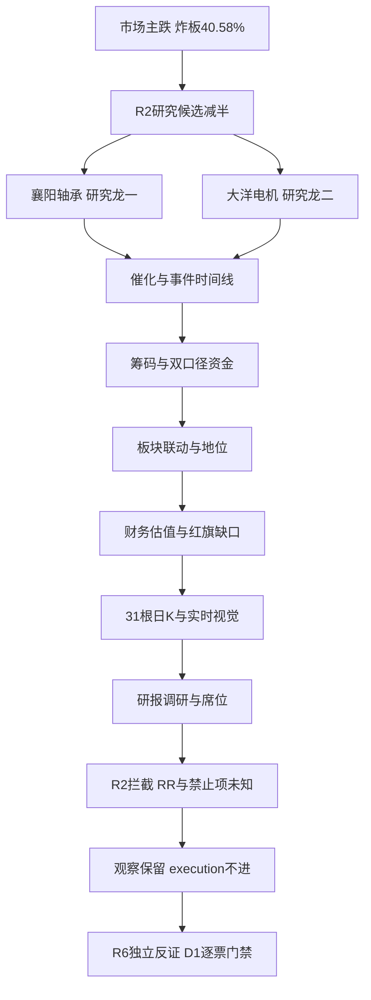

# 2026年10月28日 · 个股画像

> **数据源新鲜度**: partial · 盘前最新完整行情观察日为2026-10-27，两融至2026-10-26。
> **降级状态**: true · 完整数据契约未通过；以下结构/写作检查通过不等于研究完成。
> **置信度**: 0.1925，表示证据完整性，不是上涨概率。

## 一句话结论
**观察两只真实候选，execution均不进；大洋资金强于襄阳，但未取得交易权限。**

## 🧭 详细分析

情绪=主跌，炸板率40.58%。本次不重做R1风格与R2主线排序。继承R2：研究主线=人形机器人/物理AI数采，持续性=1日研究复核窗，封板率=未知，下一交易时段预期=分歧；这不是已确认可交易主线。原候选预算已减半，不能再为达到六只绕开预算或造票。

先核市场，再核地位：两票虽然在弱市封板，但R2 `execution_eligible=false`、`leader_rank=filtered_out`，所以均拦截execution。原始 `execution_blocked=false` 只是上游矛盾字段，不覆盖更严格的否决；本次归一为 `r2_execution_blocked=true`，保留原字段与原因，研究继续。龙一/龙二是研究顺序，纪律龙头已验证通过仍为0/4，不代表这四条实际全部不满足。

主模板仅首板隔日，不混入总龙锁仓等打法。六维权重为催化25%、筹码20%、板块20%、估值10%、技术15%、机构10%。襄阳四连板适合作为高位负反馈研究样本，不能因为已有高度改授高位接力权限；大洋最新首板也不是本轮第一次涨停，不能把老题材反包改称全新启动。

两票分档只给研究排序：大洋49.25分、alpha B、risk B-，襄阳39.00分、alpha C、risk C。大洋alpha B明确采用无法完整判断时的默认档并附grade_defaulted，不把缺完整地位/订单证据升为B+；两票均无entry/exit价格，无可执行RR，研究保留不改变任何既有持仓或T计划。

## 🧮 候选覆盖与剔除

| 核验入口 | 真实覆盖 | 结果 |
|---|---:|---|
| R2主线leaders | 2只去重对象 | 襄阳轴承、大洋电机，均完整生成六维章节 |
| secondary_lines | 1条 | 商贸零售leaders为空，未新增票 |
| all_scored_boards_top10 | 10条 | 无新增top_stock；主线leaders重复计入不扩池 |
| 历史theme_anchor审阅 | 机器人/人形两组静态锚 | 8日前生成，不是当日研究候选，全部排除扩池 |
| 距六只覆盖目标 | 缺4只 | 缺的是合规票源，不是扫描后判断四只不合格 |
| 可交易候选 | 0只 | 不进execution；仅两只研究观察对象 |

银行、光学元件等方向并非因“老登”标签剔除，而是R2未提供当日真实候选和门禁证据；零售虽54分，但无leaders/top_stock，不能自行引入上海九百。达实智能、艾华集团、中京电子、旭光电子、北自科技仅静态锚，不能用旧热度解除当日证据缺口；本次不擅自认定它们为杂毛。

## 🔬 襄阳轴承 000678.SZ · 观察 / execution不进

| 项目 | 实查结果与边界 |
|---|---|
| 研究排序 | 龙一；不是全板块合格龙头认定 |
| 板型 | 未知，涨停高度不能代替板型分类 |
| 龙头认定 | 纪律四条已验证0/4；高度4、首次封板09:34、开板1次 |
| 盈亏比RR / 止损距离 | 未知 / 未知；没有D1计划价格，不生成交易点位 |
| 禁止清单 | 未知/未完成；空forbidden_hits不表示零命中 |
| 计划归属 | 今日核心/主线补涨/计划内试错均未获D1授权 |
| 评级 | 综合39.00，alpha C，risk C |
| 执行门禁 | r2_execution_blocked=true；execution_eligible=false；filtered_out保持 |

### 六维证据

| 维度 | 分数 | 判断与因果 |
|---|---:|---|
| 催化背景 | 45 | 观察：上海智能制造方案为盘后政策增量，非此前涨停原因；没有公司人形机器人订单证据。异常波动公告多次出现，不能当产业兑现。 |
| 筹码结构 | 25 | 降级：最新大单与超大单合计净流出，日榜净卖，股东户数明显增加；机构席位净买不抵消营业部兑现。与XTick主动成交代理方向冲突；不能把热榜第一解释成新资金持续流入。 |
| 板块联动 | 40 | 观察：R2仅研究龙一，74分；人形涨停9家与机器人13家口径重叠。机器人行业昨日净流出，电机流入不能替代整个人形概念；全板块地位仍未验证。 |
| 财务与估值 | 20 | 降级：半年报亏损、ROE为负，PB和PS在三年高分位；不用亏损PE或虚构PEG支撑安全垫。 |
| 技术形态 | 65 | 观察：日线短均线多头、四连板创新高；最新成交量仅略高于前日而非持续放量。前一轮四板后曾大幅回撤，当前高位接力不匹配低位首板隔日模板。 |
| 研报与机构 | 30 | 观察：近30日report_rc与stk_surv均成功返回空；这只证明供应商窗口内无记录，不证明全市场无覆盖。最新日榜机构净买、营业部净卖，是分歧而非机构一致进攻。 |

财务观察：披露日 `20260827`，报告期 `20260630`，EPS `-0.04`、ROE `-2.6343%`、归母净利同比 `-32.7238%`、扣非净利同比 `3.01%`、营收同比 `-11.657%`、资产负债率 `66.8075%`、每股经营现金流 `-0.031`。市值 `73.58亿元`，流通市值 `73.58亿元`。PB `9.465`，PS_TTM `5.0873`，PE_TTM `不可用（亏损）`。

三年分位窗口 `20231030` 至 `20261027`，各返回725个交易观察值。PB分位 `93.66%`、PS_TTM分位 `94.48%`；PE正值样本为0，PE分位=null，不把亏损当低估。

股东户数：最新 `94985` 户（20261020），上一可比披露 `67940` 户（20260918），变化 `+39.81%`。相对2025年9月末锚变化 `+4.84%`，不是严格等间隔同比。最近一期筹码没有加速集中证据。

大宗交易：`20260928—20261027` 真实接口成功返回0条，金额/总量为0，价格区间为空；**折溢价不可判**，不能因此触发折价出货警报。两融取得15个已披露交易值（20260929—20261026），融资余额 `2.0453亿元`，相对窗口首值 `+109.50%`；融资融券规则short_pressure未命中仅限现有窗口，27日尚未返回，不填零。

### 五日主力与席位核验

主力严格按 `(buy_lg+buy_elg-sell_lg-sell_elg)/1e4` 从万元换算亿元，不用net_mf_amount。偏差分母为两源绝对值较大者；所有日值已回代不超过同日成交额。

| 观察日 | 分档自算（亿元） | 东财（亿元） | 相对偏差 | 是否>5% |
|---|---:|---:|---:|---|
| 2026-10-21 | -0.258911 | -0.268892 | 3.712% | 否 |
| 2026-10-22 | +2.686966 | +2.682969 | 0.149% | 否 |
| 2026-10-23 | +1.780759 | +1.774840 | 0.332% | 否 |
| 2026-10-26 | +0.679963 | +0.654121 | 3.801% | 否 |
| 2026-10-27 | -0.985357 | -1.007698 | 2.217% | 否 |

自算五日累计 `+3.903420亿元`；27日日榜净额 `-1.304624亿元`。日榜席位去重后：机构专用 `+0.301545亿元`，股通席位 `+0.287505亿元`，营业部 `-1.893674亿元`。按reason隔离三日榜，同席位买卖重复side只计一次；股通席位不是全市场北向流量。

27日三日榜净额为-1.106764亿元，与日榜重叠，不合计。历史补查已真实取得9月28日三日榜、9月30日日/三日榜、10月8/9/12日日榜，9月29日和10月13日空返回；10月14日查询因父会话超时中断，之后日期未执行。故30日完整上榜次数和历史机构/游资次数仍未知，不能把部分历史值包装成完整统计。R7中XTick主动大额成交代理为正，与订单桶净流出冲突；不可平均或挑顺眼者。

### 量价与图像独立裁决

最新完整日K为2026-10-27；留存 `20260907—20261027` 的31根OHLCV，形成30个间隔收益。30间隔涨幅 `+70.86%`，20间隔 `+77.49%`，5间隔 `+42.82%`。MA5/10/20/30=`13.3520/12.0350/11.5135/10.6727`；MA60=`9.8025` 来自实时图像服务242根日线上下文，未冒充本地31根可重算MA60。窗口复权因子恒定，末日锚定前复权与原价一致。

27日成交 `14.9187亿元`，换手 `20.5714%`，振幅 `9.14%`；成交量/前日=`1.0669`，成交量/前5日均值=`1.0458`。襄阳仅较前日增量约6.69%，不能描述成持续巨量突破；四板创新高并未消除高位先手兑现。

当日chart快照date=20261028已核，但两票均未命中，故各直调一次。仅采纳趋势、形态、周期数据，不复制服务的买卖价格与action；缠论未运行，不标确认。

### 三问与研究条件

- **大资金意图**: 假设是围绕辨识度做高位换手而非已确认产业配置；日榜机构净买0.301545亿元，但营业部净卖1.893674亿元、订单桶为负，先手兑现不能被忽略。

- **为什么走强**: 四板身位和注意力集中提供短线价格强度；没有已验证公司订单，且最新股东数增39.81%，强价格不等于筹码加速集中。

- **逻辑够不够硬**: 交易身位数据硬，产业兑现软；政策在27日收盘后公开，不能倒推为此前上涨原因。亏损与PB/PS高分位构成反证，不授予龙头资格。

- **买入理由**: 不进。本项仅存研究保留理由：①四连板早封是市场注意力样本；②真实人形政策提供后续订单核验方向，不等于本公司受益已兑现。

- **风险点**: ①市场主跌与高位筹码兑现；②亏损、估值高分位与股东户数上升；③XTick代理和订单桶冲突；④本票不是低位首板隔日。

- **止损条件**: 不产生交易卖点。研究撤销条件为公司公告否认相关业务/订单，或后续连续两个交易日题材非ST涨停家数低于3且个股主力订单桶持续为负；触发后撤销地位假设，持仓退出交D1。

- **可验证假设**: 未来1至3交易日逐日核实人形同口径涨停家数至少3、个股订单桶连续两日净流入且两源偏差不超过5%；未同时满足则维持观察，满足也仍需D1逐票门禁。

### 事件时间线

| 日期 | 事件 | 来源/核验边界 |
|---|---|---|
| 2026-09-28 | U：连板高度2，开板1次 | tushare.limit_list_d；价格行为，不等于产业催化 |
| 2026-09-29 | 股票交易异常波动公告 | [tushare.anns_d](http://static.cninfo.com.cn/finalpage/2026-09-29/1225585325.PDF)；风险提示 |
| 2026-09-29 | U：连板高度3，开板0次 | tushare.limit_list_d；价格行为，不等于产业催化 |
| 2026-09-30 | U：连板高度4，开板0次 | tushare.limit_list_d；价格行为，不等于产业催化 |
| 2026-10-08 | 股票交易异常波动暨风险提示公告 | [tushare.anns_d](http://static.cninfo.com.cn/finalpage/2026-10-08/1225590781.PDF)；风险提示 |
| 2026-10-12 | D：连板高度1，开板1次 | tushare.limit_list_d；价格行为，不等于产业催化 |
| 2026-10-13 | 关于独立董事取得独立董事资格证书的公告 | [tushare.anns_d](http://static.cninfo.com.cn/finalpage/2026-10-13/1225600617.PDF)；中性/仅标题核验 |
| 2026-10-16 | Z：连板高度None，开板2次 | tushare.limit_list_d；价格行为，不等于产业催化 |
| 2026-10-22 | U：连板高度1，开板1次 | tushare.limit_list_d；价格行为，不等于产业催化 |
| 2026-10-23 | U：连板高度2，开板10次 | tushare.limit_list_d；价格行为，不等于产业催化 |
| 2026-10-24 | 关于董事会换届选举的公告 | [tushare.anns_d](http://static.cninfo.com.cn/finalpage/2026-10-24/1225619299.PDF)；中性/仅标题核验 |
| 2026-10-24 | 股票交易异常波动公告 | [tushare.anns_d](http://static.cninfo.com.cn/finalpage/2026-10-24/1225619725.PDF)；风险提示 |
| 2026-10-26 | U：连板高度3，开板5次 | tushare.limit_list_d；价格行为，不等于产业催化 |
| 2026-10-27 | U：连板高度4，开板1次 | tushare.limit_list_d；价格行为，不等于产业催化 |
| 2026-10-27 | 日龙虎榜净买卖及席位分化 | tushare.top_list/top_inst；分歧 |
| 2026-10-27 | 上海新一代智能制造方案盘后公开 | [R4 E20261028_001](https://www.sheitc.sh.gov.cn/cyfz/20261027/b04b3f2de4c44304ae05dcf3d7e1f6f8.html)；板块政策正面；未确认公司订单 |
| 2026-10-28 | 股票交易异常波动公告 | [tushare.anns_d](http://static.cninfo.com.cn/finalpage/2026-10-28/1225632038.PDF)；风险提示 |

窗口内forecast、report_rc、stk_surv成功返回空，既不补造预告/机构事件，也不把空返回解释为全市场不存在事件。公告以标题和元数据为准，正文未核；28日公告只有日期，不虚构精确公开时间。

### 31根日K量价证据

单位：价格元、成交量手、成交额亿元。此处全为历史观察值，不是委托或退出价格。

| 日期 | 开 | 高 | 低 | 收 | 量（手） | 额（亿元） |
|---|---:|---:|---:|---:|---:|---:|
| 2026-09-07 | 9.25 | 9.42 | 9.17 | 9.37 | 89453.00 | 0.8346 |
| 2026-09-08 | 9.40 | 9.48 | 9.28 | 9.47 | 89446.80 | 0.8415 |
| 2026-09-09 | 9.45 | 9.46 | 9.25 | 9.31 | 71331.26 | 0.6657 |
| 2026-09-10 | 9.21 | 9.25 | 9.08 | 9.10 | 60509.86 | 0.5525 |
| 2026-09-11 | 9.01 | 9.10 | 8.85 | 8.95 | 69277.00 | 0.6202 |
| 2026-09-14 | 8.91 | 9.00 | 8.81 | 8.83 | 54686.72 | 0.4860 |
| 2026-09-15 | 8.89 | 8.89 | 8.62 | 8.62 | 59515.00 | 0.5186 |
| 2026-09-16 | 8.60 | 8.70 | 8.50 | 8.63 | 55711.00 | 0.4804 |
| 2026-09-17 | 8.59 | 9.27 | 8.56 | 9.02 | 149312.36 | 1.3323 |
| 2026-09-18 | 9.00 | 9.10 | 8.87 | 8.96 | 102385.00 | 0.9182 |
| 2026-09-21 | 8.95 | 9.16 | 8.91 | 9.02 | 73659.90 | 0.6651 |
| 2026-09-22 | 9.05 | 9.07 | 8.85 | 8.89 | 70677.93 | 0.6313 |
| 2026-09-23 | 8.89 | 8.93 | 8.77 | 8.80 | 48312.00 | 0.4269 |
| 2026-09-24 | 8.77 | 9.68 | 8.73 | 9.68 | 266750.53 | 2.5664 |
| 2026-09-28 | 10.45 | 10.65 | 10.18 | 10.65 | 349856.70 | 3.6943 |
| 2026-09-29 | 11.72 | 11.72 | 11.72 | 11.72 | 94502.05 | 1.1076 |
| 2026-09-30 | 10.69 | 12.89 | 10.69 | 12.89 | 903178.36 | 10.7499 |
| 2026-10-08 | 13.00 | 13.90 | 12.05 | 12.24 | 1297358.46 | 16.8452 |
| 2026-10-09 | 12.00 | 13.27 | 11.10 | 12.62 | 1220670.23 | 14.5417 |
| 2026-10-12 | 11.66 | 11.97 | 11.36 | 11.36 | 653808.77 | 7.5711 |
| 2026-10-13 | 10.54 | 11.27 | 10.43 | 11.07 | 725456.67 | 7.9070 |
| 2026-10-14 | 10.84 | 11.00 | 10.20 | 10.48 | 593911.42 | 6.2296 |
| 2026-10-15 | 10.10 | 10.42 | 9.90 | 9.94 | 400048.02 | 4.0434 |
| 2026-10-16 | 10.02 | 10.93 | 9.95 | 10.93 | 604890.06 | 6.3835 |
| 2026-10-19 | 10.40 | 11.40 | 10.27 | 11.03 | 909771.00 | 9.8560 |
| 2026-10-20 | 10.94 | 11.58 | 10.65 | 11.21 | 929488.49 | 10.3391 |
| 2026-10-21 | 11.04 | 11.42 | 10.81 | 10.94 | 718209.91 | 7.9499 |
| 2026-10-22 | 11.02 | 12.03 | 10.99 | 12.03 | 732904.56 | 8.5728 |
| 2026-10-23 | 11.68 | 13.23 | 11.25 | 13.23 | 1253521.48 | 15.8953 |
| 2026-10-26 | 14.19 | 14.55 | 13.91 | 14.55 | 886211.22 | 12.7502 |
| 2026-10-27 | 15.24 | 16.01 | 14.68 | 16.01 | 945486.67 | 14.9187 |

## 🔬 大洋电机 002249.SZ · 观察 / execution不进

| 项目 | 实查结果与边界 |
|---|---|
| 研究排序 | 龙二；不是全板块合格龙头认定 |
| 板型 | 未知，涨停高度不能代替板型分类 |
| 龙头认定 | 纪律四条已验证0/4；高度1、首次封板09:56、开板1次 |
| 盈亏比RR / 止损距离 | 未知 / 未知；没有D1计划价格，不生成交易点位 |
| 禁止清单 | 未知/未完成；空forbidden_hits不表示零命中 |
| 计划归属 | 今日核心/主线补涨/计划内试错均未获D1授权 |
| 评级 | 综合49.25，alpha B，risk B- |
| 执行门禁 | r2_execution_blocked=true；execution_eligible=false；filtered_out保持 |

### 六维证据

| 维度 | 分数 | 判断与因果 |
|---|---:|---|
| 催化背景 | 45 | 观察：电机具备题材映射但人形业务收入与订单未核实；上海方案为盘后增量。三季报已披露，净利下滑不是业绩加速催化。 |
| 筹码结构 | 65 | 观察：最新分档主力净流入与东财同向、龙虎榜净买；前两交易日资金曾流出，最新封板成交量缩于前日，持续性仍需新交易日确认。股东数最近一期增加，不能称加速集中。 |
| 板块联动 | 40 | 观察：R2仅研究龙二，74分；电机行业资金为正而机器人行业为负，属于子环节相对强，不等于可交易主线已成立。首板不是本轮首次出现，不能默认启动日龙头。 |
| 财务与估值 | 45 | 降级：三季报营收微增、归母与扣非净利明显下滑；PE_TTM在三年高分位，PB×ROE结合盈利质量只作相对估值，不给无增长支撑的PEG。 |
| 技术形态 | 60 | 观察：首板反包前日跌幅、站上短均线，但未越20日最高价；日周级仍震荡、分钟级偏多。服务泛化的突破及放量表述不直接采纳。 |
| 研报与机构 | 35 | 观察：近30日研报和调研接口均成功返回空；最新日榜营业部主导净买、深股通净买，不把深股通席位等同北向总流，也不冒充机构专用买入。 |

财务观察：披露日 `20261024`，报告期 `20260930`，EPS `0.2`、ROE `4.9821%`、归母净利同比 `-42.037%`、扣非净利同比 `-40.82%`、营收同比 `3.4706%`、资产负债率 `49.7578%`、每股经营现金流 `0.4546`。市值 `190.62亿元`，流通市值 `144.18亿元`。PB `1.9479`，PS_TTM `1.5201`，PE_TTM `26.1963`。

三年分位窗口 `20231030` 至 `20261027`，各返回725个交易观察值。PB分位 `69.24%`、PS_TTM分位 `68.14%`；PE_TTM分位 `96.41%`。利润同比下降时不能用正增长PEG讲便宜。

股东户数：最新 `181068` 户（20260930），上一可比披露 `179164` 户（20260831），变化 `+1.06%`。相对2025年9月末锚变化 `-9.16%`，不是严格等间隔同比。最近一期筹码没有加速集中证据。

大宗交易：`20260928—20261027` 真实接口成功返回0条，金额/总量为0，价格区间为空；**折溢价不可判**，不能因此触发折价出货警报。两融取得15个已披露交易值（20260929—20261026），融资余额 `7.7727亿元`，相对窗口首值 `-3.00%`；融资融券规则short_pressure未命中仅限现有窗口，27日尚未返回，不填零。

### 五日主力与席位核验

主力严格按 `(buy_lg+buy_elg-sell_lg-sell_elg)/1e4` 从万元换算亿元，不用net_mf_amount。偏差分母为两源绝对值较大者；所有日值已回代不超过同日成交额。

| 观察日 | 分档自算（亿元） | 东财（亿元） | 相对偏差 | 是否>5% |
|---|---:|---:|---:|---|
| 2026-10-21 | +0.075350 | +0.069341 | 7.975% | 是，降置信度 |
| 2026-10-22 | +3.080108 | +3.076153 | 0.128% | 否 |
| 2026-10-23 | -1.802986 | -1.820920 | 0.985% | 否 |
| 2026-10-26 | -1.097431 | -1.115537 | 1.623% | 否 |
| 2026-10-27 | +5.056083 | +5.047935 | 0.161% | 否 |

自算五日累计 `+5.311124亿元`；27日日榜净额 `+3.010436亿元`。日榜席位去重后：机构专用 `+0.000000亿元`，股通席位 `+0.275810亿元`，营业部 `+2.734626亿元`。按reason隔离三日榜，同席位买卖重复side只计一次；股通席位不是全市场北向流量。

10月21日分档自算与东财偏差7.975%，已置fund_source_conflict=true并下调筹码置信度；27日两口径一致不能抹掉此前冲突。仅独立拉取27日日榜，30日历史次数/席位统计未完成。

### 量价与图像独立裁决

最新完整日K为2026-10-27；留存 `20260907—20261027` 的31根OHLCV，形成30个间隔收益。30间隔涨幅 `+14.75%`，20间隔 `+17.56%`，5间隔 `+21.07%`。MA5/10/20/30=`7.1520/6.6810/6.5440/6.5240`；MA60=`6.8185` 来自实时图像服务242根日线上下文，未冒充本地31根可重算MA60。窗口复权因子恒定，末日锚定前复权与原价一致。

27日成交 `14.1899亿元`，换手 `10.1618%`，振幅 `12.29%`；成交量/前日=`0.9021`，成交量/前5日均值=`1.4736`。大洋较前日缩量约9.79%，但仍高于前5日均量，二者不矛盾；收盘7.70仍低于20日盘中高点7.75，不能称已突破该高点。

当日chart快照date=20261028已核，但两票均未命中，故各直调一次。仅采纳趋势、形态、周期数据，不复制服务的买卖价格与action；缠论未运行，不标确认。

### 三问与研究条件

- **大资金意图**: 更符合低位助攻/反包资金假设：27日订单桶自算净流入5.056083亿元、营业部主导日榜净买。但前两交易日为负，不外推机构长线建仓。

- **为什么走强**: 首板反包26日下跌、分钟结构偏多；电机行业流入提供子环节映射。成交量较前日减少，三季报净利下降，不能解释成业绩加速驱动。

- **逻辑够不够硬**: 最新资金与价格证据较襄阳强，但缺公司人形订单、全板块带动和独立机构研报；PE_TTM高分位与净利下降牵制安全垫，不能升级为已确认主线核心。

- **买入理由**: 不进。研究保留理由：①首板与订单桶正流入构成较低身位的资金样本；②电机子环节和智能制造政策存在可核验产业映射，但公司收入纯度尚未知。

- **风险点**: ①反包后次日接力可能被前高套牢盘压制；②三季报归母净利同比-42.037%、扣非-40.82%；③21日资金口径冲突；④题材与公司合同未闭环。

- **止损条件**: 不产生交易卖点。若公告证伪人形业务映射，或连续两个交易日个股主力订单桶为负且同口径题材涨停家数低于3，撤销助攻研究假设；不以更便宜为由恢复资格。

- **可验证假设**: 未来1至3交易日个股两源订单桶连续两日同向净流入、偏差均不超过5%，且题材非ST涨停家数至少3；缺任一维持观察。仅满足价格反包而无资金/订单，不能自动入execution。

### 事件时间线

| 日期 | 事件 | 来源/核验边界 |
|---|---|---|
| 2026-10-10 | 关于回购公司股份的进展公告 | [tushare.anns_d](http://static.cninfo.com.cn/finalpage/2026-10-10/1225599008.PDF)；中性/仅标题核验 |
| 2026-10-22 | U：连板高度1，开板0次 | tushare.limit_list_d；价格行为，不等于产业催化 |
| 2026-10-23 | 2026年半年度权益分派实施公告 | [tushare.anns_d](http://static.cninfo.com.cn/finalpage/2026-10-23/1225616277.PDF)；中性/仅标题核验 |
| 2026-10-24 | 2026年三季度报告 | [tushare.anns_d](http://static.cninfo.com.cn/finalpage/2026-10-24/1225621272.PDF)；中性/仅标题核验 |
| 2026-10-24 | 第七届董事会第十六次会议决议公告 | [tushare.anns_d](http://static.cninfo.com.cn/finalpage/2026-10-24/1225621274.PDF)；中性/仅标题核验 |
| 2026-10-24 | 股票交易异常波动公告 | [tushare.anns_d](http://static.cninfo.com.cn/finalpage/2026-10-24/1225621282.PDF)；风险提示 |
| 2026-10-27 | U：连板高度1，开板1次 | tushare.limit_list_d；价格行为，不等于产业催化 |
| 2026-10-27 | 日龙虎榜净买卖及席位分化 | tushare.top_list/top_inst；资金正向 |
| 2026-10-27 | 上海新一代智能制造方案盘后公开 | [R4 E20261028_001](https://www.sheitc.sh.gov.cn/cyfz/20261027/b04b3f2de4c44304ae05dcf3d7e1f6f8.html)；板块政策正面；未确认公司订单 |

窗口内forecast、report_rc、stk_surv成功返回空，既不补造预告/机构事件，也不把空返回解释为全市场不存在事件。公告以标题和元数据为准，正文未核；28日公告只有日期，不虚构精确公开时间。

### 31根日K量价证据

单位：价格元、成交量手、成交额亿元。此处全为历史观察值，不是委托或退出价格。

| 日期 | 开 | 高 | 低 | 收 | 量（手） | 额（亿元） |
|---|---:|---:|---:|---:|---:|---:|
| 2026-09-07 | 6.66 | 6.81 | 6.61 | 6.71 | 375596.38 | 2.5215 |
| 2026-09-08 | 6.72 | 6.77 | 6.67 | 6.72 | 290767.85 | 1.9558 |
| 2026-09-09 | 6.73 | 6.84 | 6.71 | 6.76 | 289457.27 | 1.9589 |
| 2026-09-10 | 6.71 | 6.72 | 6.61 | 6.63 | 266891.45 | 1.7733 |
| 2026-09-11 | 6.59 | 6.59 | 6.39 | 6.45 | 340415.49 | 2.1980 |
| 2026-09-14 | 6.42 | 6.48 | 6.40 | 6.43 | 180383.88 | 1.1598 |
| 2026-09-15 | 6.42 | 6.42 | 6.30 | 6.31 | 235903.05 | 1.4983 |
| 2026-09-16 | 6.30 | 6.35 | 6.23 | 6.31 | 202001.70 | 1.2713 |
| 2026-09-17 | 6.30 | 6.35 | 6.26 | 6.31 | 174904.60 | 1.1033 |
| 2026-09-18 | 6.35 | 6.42 | 6.34 | 6.37 | 222198.51 | 1.4175 |
| 2026-09-21 | 6.41 | 6.75 | 6.37 | 6.55 | 529427.07 | 3.4755 |
| 2026-09-22 | 6.55 | 6.58 | 6.48 | 6.50 | 277035.81 | 1.8077 |
| 2026-09-23 | 6.50 | 6.51 | 6.42 | 6.44 | 213945.18 | 1.3793 |
| 2026-09-24 | 6.42 | 6.56 | 6.39 | 6.45 | 272555.09 | 1.7687 |
| 2026-09-28 | 6.42 | 6.48 | 6.38 | 6.41 | 228256.09 | 1.4660 |
| 2026-09-29 | 6.42 | 6.46 | 6.33 | 6.40 | 197468.81 | 1.2665 |
| 2026-09-30 | 6.43 | 6.51 | 6.39 | 6.41 | 206614.65 | 1.3308 |
| 2026-10-08 | 6.41 | 6.47 | 6.29 | 6.30 | 215304.24 | 1.3689 |
| 2026-10-09 | 6.31 | 6.40 | 6.20 | 6.38 | 265537.19 | 1.6732 |
| 2026-10-12 | 6.38 | 6.44 | 6.36 | 6.40 | 145801.00 | 0.9326 |
| 2026-10-13 | 6.36 | 6.41 | 6.25 | 6.38 | 205514.62 | 1.3019 |
| 2026-10-14 | 6.37 | 6.37 | 6.21 | 6.22 | 196231.06 | 1.2309 |
| 2026-10-15 | 6.13 | 6.16 | 6.04 | 6.04 | 233889.32 | 1.4258 |
| 2026-10-16 | 6.10 | 6.21 | 6.07 | 6.12 | 225814.15 | 1.3851 |
| 2026-10-19 | 6.09 | 6.32 | 6.08 | 6.31 | 273162.56 | 1.6997 |
| 2026-10-20 | 6.28 | 6.39 | 6.25 | 6.36 | 254660.06 | 1.6145 |
| 2026-10-21 | 6.33 | 6.46 | 6.32 | 6.42 | 269053.80 | 1.7278 |
| 2026-10-22 | 6.45 | 7.06 | 6.43 | 7.06 | 870103.50 | 6.0618 |
| 2026-10-23 | 7.06 | 7.75 | 6.92 | 7.58 | 2952940.27 | 21.7702 |
| 2026-10-26 | 7.15 | 7.53 | 6.85 | 7.00 | 2109266.32 | 14.9781 |
| 2026-10-27 | 6.84 | 7.70 | 6.84 | 7.70 | 1902730.29 | 14.1899 |

## 📌 关键证据

- 同日R1/R2确认情绪主跌、炸板率40.58%，R2两票execution_eligible均false；门禁必须透传，不能被原execution_blocked=false重开。
- 两票各31根真实日K、两次实时图像结果、三年各725行估值序列已核；大洋最新日缩量反包而非笼统放量突破。
- 大小单自算与东财五日逐日交叉已执行并做成交额单位回代；大洋21日差异超过5%，不能用27日一致掩盖。
- 襄阳最新主力净流出、股东数大增与四连板价格强势并存；大洋资金正向但三季报盈利下降。R6消费矛盾，不由R5输出hard_reject。

## 数据源审计

| 源 | 日期 | 状态 | 记录/范围与缺口 |
|---|---|:--:|---|
| R1 | 2026-10-28 | 🟡 | 1条/留存值；当日artifact可读但上游自身降级；市场观察截至27日 |
| R2 | 2026-10-28 | 🟡 | 1条/留存值；当日artifact可读但上游自身降级；市场观察截至27日 |
| R4 | 2026-10-28 | 🟡 | 1条/留存值；当日artifact可读但上游自身降级；市场观察截至27日 |
| R7 | 2026-10-28 | 🟡 | 1条/留存值；当日artifact可读但上游自身降级；市场观察截至27日 |
| daily | 2026-10-28 | 🟢 | 62条/留存值；本轮真实查询；daily与margin计留存样本数，不冒充服务全历史样本数 |
| adj_factor | 2026-10-28 | 🟢 | 70条/留存值；本轮真实查询；daily与margin计留存样本数，不冒充服务全历史样本数 |
| daily_basic_latest | 2026-10-28 | 🟢 | 2条/留存值；本轮真实查询；daily与margin计留存样本数，不冒充服务全历史样本数 |
| daily_basic_3y | 2026-10-28 | 🟢 | 1450条/留存值；本轮真实查询；daily与margin计留存样本数，不冒充服务全历史样本数 |
| fina_indicator | 2026-10-28 | 🟢 | 未作总量断言条/留存值；本轮真实查询；daily与margin计留存样本数，不冒充服务全历史样本数 |
| moneyflow | 2026-10-28 | 🟢 | 10条/留存值；本轮真实查询；daily与margin计留存样本数，不冒充服务全历史样本数 |
| moneyflow_dc | 2026-10-28 | 🟢 | 10条/留存值；本轮真实查询；daily与margin计留存样本数，不冒充服务全历史样本数 |
| block_trade | 2026-10-28 | 🟢 | 0条/留存值；成功空返回，不推断无风险 |
| margin_detail | 2026-10-28 | 🟡 | 30条/留存值；本轮真实查询；daily与margin计留存样本数，不冒充服务全历史样本数 |
| anns_d | 2026-10-28 | 🟢 | 19条/留存值；本轮真实查询；daily与margin计留存样本数，不冒充服务全历史样本数 |
| stk_holdernumber | 2026-10-28 | 🟢 | 未作总量断言条/留存值；本轮真实查询；daily与margin计留存样本数，不冒充服务全历史样本数 |
| top_list_T1 | 2026-10-28 | 🟢 | 3条/留存值；本轮真实查询；daily与margin计留存样本数，不冒充服务全历史样本数 |
| top_inst_T1 | 2026-10-28 | 🟢 | 30条/留存值；本轮真实查询；daily与margin计留存样本数，不冒充服务全历史样本数 |
| limit_list_d | 2026-10-28 | 🟢 | 11条/留存值；本轮真实查询；daily与margin计留存样本数，不冒充服务全历史样本数 |
| report_rc | 2026-10-28 | 🟢 | 0条/留存值；成功空返回，不推断无风险 |
| stk_surv | 2026-10-28 | 🟢 | 0条/留存值；成功空返回，不推断无风险 |
| forecast | 2026-10-28 | 🟢 | 0条/留存值；成功空返回，不推断无风险 |
| pledge_stat_20261023 | 2026-10-28 | 🟢 | 0条/留存值；成功空返回，不推断无风险 |
| chart_vision_analyze | 2026-10-28 | 🟢 | 2条/留存值；本轮真实查询；daily与margin计留存样本数，不冒充服务全历史样本数 |
| chart_snapshot | 2026-10-28 | 🟡 | 0条/留存值；date=20261028已核验；两候选均未命中，故改直调 |
| LHB_30d | 2026-10-28 | 🔴 | 未作总量断言条/留存值；历史补查部分成功，父会话420秒超时中断；30日全量与席位仍未完成 |
| fundamental_full_checklist | 2026-10-28 | 🔴 | 未作总量断言条/留存值；资产负债/审计/商誉等未完整核验 |
| ETF_linkage | 2026-10-28 | 🔴 | 未作总量断言条/留存值；R7净申赎缺失，不以报价替代 |
| chanlun | 2026-10-28 | 🔴 | 未作总量断言条/留存值；未运行结构确认 |

图表服务副作用审计：两次chart MCP自动在output/charts生成PNG，工具返回前未提供指定输出目录参数。文件已实际存在；这超出本次写白名单，不能称完全合规。未再调用出图、未运行raw快照脚本，也未擅自移动或删除白名单外文件；正式交付仍仅指定JSON和本MD。

## ⚠️ 不确定性 / 反证

fundamental_flags均显式为空数组，但标记partial_screen，不是“无风险”。财务指标没有覆盖商誉、审计意见、关联交易、全部资产负债与控股股东质押；23日质押统计空返回不证明无质押。亏损或盈利下降不硬套不满足定义的F8/V6，R6保留唯一hard_reject权。

主力分档/东财不必然是完全独立资金来源，同源价格衍生的图像均线也不是新增独立证据。置信度按 `0.55×0.70×0.50=0.1925`，截断区间[0.05,0.95]；完整性不足不靠提高定性分弥补。

30日龙虎榜补查被父会话420秒等待超时中断，已有成功日期保留，未查日期不当作空；最新日榜不能替代全窗口统计。两融缺27日、ETF联动与缠论未确认，完整skill数据验收失败，整体诚实partial。技术视觉和五日资金并非缺失，但它们不能解除板型、龙头四条、RR、禁止清单、计划归属等交易门禁。

## 🔗 与其他 R/D/E 的关系

- 依赖：data/research/20261028/R1_style.json、R2_main_sectors.json、R4_news.json、R7_capital_flow_20261028.json；chart快照只校验日期和未命中事实，不复用旧画像。
- 被消费：R6完整性/反证、D1逐票研究与执行分层、E1观察池追踪。R6的hard_reject不受R5评级过滤。
- 本次不改持仓、不执行T、不生成交易价格、不写计划，不把研究分档作为开仓许可。

## 🧪 实际验收范围

写盘前使用本次scratch内联Pydantic v2严格模型：顶层、两票、六维基础、档位、门禁、日K样本、评分和置信度公式均实跑；扩展evidence仅JSON类型验证。未发现仓库R5/ResearchUnit生产模型，不声称生产schema集成通过。

另实跑仓库check_r5_candidate_pool、check_md_namespace及verify_writing_contract.py；补充逐票三问四件套、31根OHLCV、Mermaid至少8节点、frontmatter字段、禁止交易价格字段和文件存在性检查。结构/写作验收与完整数据契约分开报告，后者因上述缺口未通过。

## Sub-Agent 元数据

- skill: analyze_stock_profile_v1@1.6
- artifact: data/research/20261028/R5_stock_profiles.json
- model: gpt-6.1-sol；图像服务seed-2-0-lite-260228
- 运行方式: 本次独立受委派R5，直接真实MCP查询；父会话超时后复用本轮已成功证据，不重新抓取、不重新委派。
