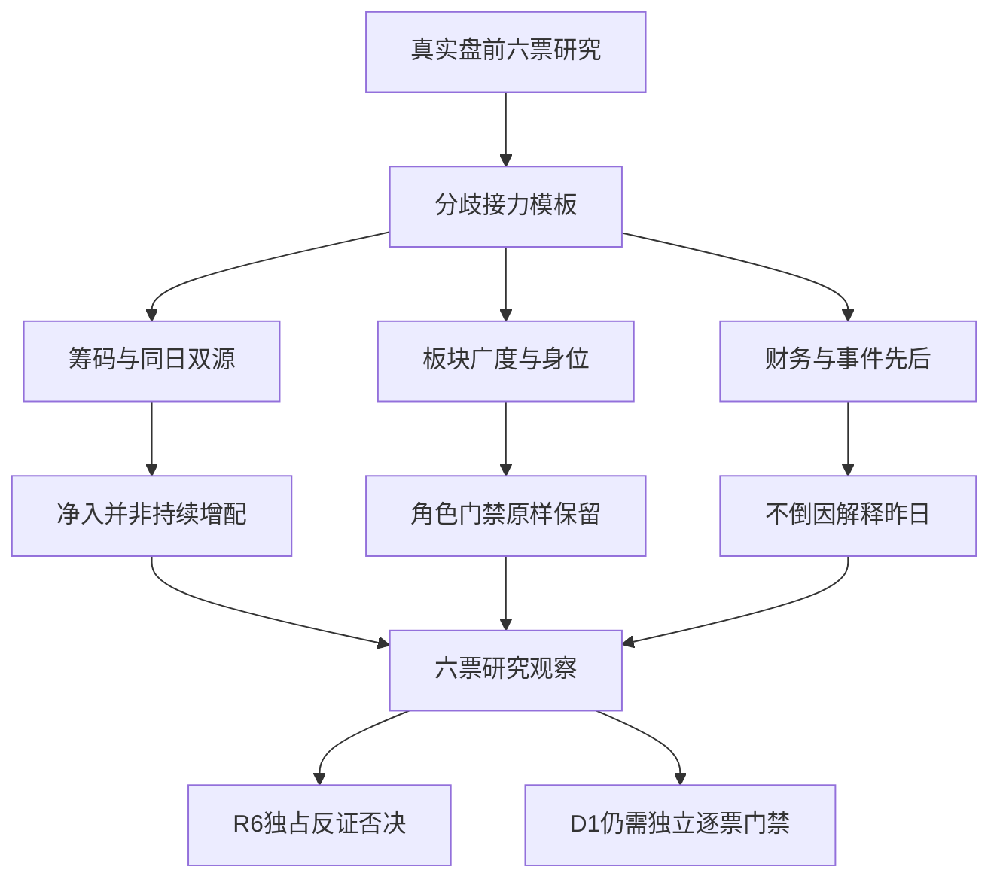

# 2026年10月29日 · 个股画像

> ⚠️ **数据源时间错位**：业务日2026-10-29；行情为2026-10-28最新收盘，两融为2026-10-27最新披露。正常盘前，不是冻结回放；事件截至前言真实生成时刻。
> **数据源新鲜度**：partial · **降级状态**：true · **置信度**：0.2625。
> **所有六只均为研究观察，不授予交易资格；零预算与既有保护保持，R6独占hard_reject。**

## 🧭 一句话结论
六票均保留观察：三板身位与业绩修复各有反证，不把回流直接视为主升重启。

## 🧩 详细分析

本次只消费R2当前减半后的六票，不扩回十二票。三条研究主线共属AI硬件风险簇；R1情绪为高位震荡，上一收盘炸板率48.94%，故观察分歧中的真实合力而非仅看单票大涨。预算和交易保护独立于研究工作，本报告不清池、不下单、不写计划。

主模板为**分歧接力**。筹码30%、板块联动25%、技术15%、催化15%、财务10%、机构5%。这些是证据约束下的研究序数评分，不是客观市场测量；缺维度不补零、不补中位数，综合分不重归一。alpha与risk为研究分档而非开仓闸门；候补身份不因高分自动改成龙二。

强度最突出的光洋股份有三板身位，却伴随末日净出、机构卖方和盈利质量红旗；金安国纪与方正科技的三季报提供比群聊更硬的公司锚，但日线仍在中期均线下。中际旭创是容量修复，创业板上涨10.28%绝不是涨停；盈方微虽有资金弹性，商誉、薄归母净资产与亏损需要R6集中审视。兆易创新五至十日回流有持续性，但同日资金双源偏差与存储周期警报不容抹平。

事件时间线严格区分公告日期与真实first-known。微软和谷歌29日盘前新披露，以及奥士康28日收盘后扩产，不能拿来解释28日已发生的A股涨幅；同行扩产、海力士长单与海外云需求也不能冒充六票自己的订单。

## 📊 综合对照（研究分，不是执行排序）

| 个股 | R2角色 | alpha / risk | 综合分 | 近5日主力自算 / DC（亿） | 30日日K覆盖 | 本章态度 |
|---|---|---|---:|---:|---:|---|
| 光洋股份 002708.SZ | 龙一 | B / C | 52.15 | 1.7791 / 1.7583 | 80根 | 观察；门禁未核、不进执行 |
| 金安国纪 002636.SZ | 龙二 | B / B- | 52.9 | -0.5539 / -0.6183 | 80根 | 观察；门禁未核、不进执行 |
| 方正科技 600601.SH | 龙一 | B / B- | 不可计算（缺维度） | 1.8515 / 2.0654 | 80根 | 观察；门禁未核、不进执行 |
| 中际旭创 300308.SZ | 候补 | B+ / B- | 55.1 | 30.1246 / 29.7215 | 80根 | 观察；门禁未核、不进执行 |
| 盈方微 000670.SZ | 龙一 | B- / C | 不可计算（缺维度） | 2.6989 / 2.6909 | 80根 | 观察；门禁未核、不进执行 |
| 兆易创新 603986.SH | 候补 | B / B- | 52.75 | 18.4058 / 19.4299 | 80根 | 观察；门禁未核、不进执行 |

## 🔎 光洋股份 · 002708.SZ

**本章态度**：研究观察；继承R2 龙一，资格未核，禁止清单未运行，RR未知。不是hard_reject，也不是已获交易资格。

三板身位最强，但末日主力转负、机构卖出与盈利含金量弱形成反证。

| 六维 | 权重 | 研究序数分 | 证据判断 |
|---|---:|---:|---|
| 催化 | 15% | 45 | 研报确认汽车轴承、机器人与PCB布局叙事；PCB主营收入纯度未核。R4机器人进口谈判为新增负向风险，奥士康扩产并非本公司订单。 |
| 筹码 | 30% | 42 | 连续封板后量能收缩；五日两源净入但28日两源均净出，不能把缩量封板自动解释为锁筹。27日机构净卖与营业部净买结构表明接力盘承接机构筹码。 |
| 板块 | 25% | 68 | 继承PCB高度龙一，不等于PCB业务纯正总龙；跨机器人属性使贸易风险不可忽略。 |
| 财务估值 | 10% | 18 | TTM PE约101倍，PB/PS处三年高位；扣非占比仅4.379%，盈利与现金流脱节，不适合用高EPS增长线性外推。 |
| 技术 | 15% | 75 | 三板且站上短中期均线；量比不足1，符合封板压量事实而非放量突破。开板承接、分时与四周期视觉缺失，技术强不等于可交易。 |
| 研报机构 | 5% | 55 | 最新研报评级和同报告EPS可读，不能当成机构当前持仓确认。 |

量价锚：2026-10-28收盘 `18.94`，涨幅 `9.9884%`，成交 `3.5832亿元`，相对前五日均量 `0.559倍`。MA20 `15.7745`、MA60 `13.9978` 均为结构统计而非买卖价；全部80根日K已保存在JSON，复权因子实查，未用未来行情。

- **大资金意图**: 营业部更可能交易三板身位和多题材弹性，27日机构是已观测到的部分对手盘；这不是机构增配的结论。
- **为什么走强**: 3连板、首封09:30与PCB九家涨停提供身位和板块效应；近五日上涨30.53%而28日主力转负，强势中已经出现筹码反证。
- **逻辑够不够硬**: 价格身位硬，机器人/PCB利润兑现不够硬。半年报扣非占比低、现金流为负，研究保留但不能升为确定性业绩龙头。

**买入理由**: 这里仅表示研究保留理由，不是开仓建议。PCB与机器人交叉叙事使其有接力辨识度，但主营纯度仍是前提；已核三板和板块九家涨停，可作为分歧接力研究样本，不是买入授权。

**风险点**: 三板加速后缩量，次日接力可能面对集中兑现；盈利含金量与现金流弱，机器人贸易敞口未核。

**止损条件**: 若后续收盘跌回MA20下方且当日两源大单净额均负，或公告否认相关业务实质进展，接力研究假设失效；仅记录研究证伪，不是卖单。

**可验证假设**: 未来两个交易日内，至少一个交易日两源主力净额均转正，且PCB涨停广度保持至少3家；否则不确认身位带动性。

筹码细项：股东户数最近两次已披露观测变化 `-8.78%`；30自然日大宗 `0笔`、`0.0000亿元`，**折溢价不可判**。两融与当日标的资格查询均无行，按非两融标的证据记录不适用，余额与趋势留null，未填0。 龙虎榜窗口内 `1条`（按实际日期查询），买卖两侧重复席位已去重。

资金双源审计（各日单位亿元，偏差分母为两源绝对值较大者）：

| 日期 | 分档自算 | DC | 相对偏差 | 冲突 |
|---|---:|---:|---:|---|
| 2026-10-22 | -0.39288 | -0.39288 | 0.00% | 🟢 |
| 2026-10-23 | 0.09092 | 0.08892 | 2.20% | 🟢 |
| 2026-10-26 | 1.76417 | 1.76019 | 0.23% | 🟢 |
| 2026-10-27 | 0.82152 | 0.81500 | 0.79% | 🟢 |
| 2026-10-28 | -0.50462 | -0.51298 | 1.63% | 🟢 |

财务红旗：F1：货币资金/资产=21.1742%；短借/资产=24.3912%；F9：期末应收/本期累计收入=53.1281%；半年与全年不可无调整横比；F10：已知有息负债/归母净资产下限=100.4694%；空字段未补0，完整比例未知；F6：1-扣非净利/净利=95.621%；F8：最近两个可计算单季经营现金流均负，而最近累计归母净利为正；单季由累计差分，不混同重复披露。完整审计意见、关联交易、控股股东质押等未核，不能用空列表伪装全绿。

估值方法：tam-adj-peg；未获取可验证TAM渗透率/增长期限/质量因子；不按行业标签预设，不将单个高同比直接代替未来CAGR。PE/PB/PS三年正样本分位与样本数均列JSON；亏损股PE分位置null。

研报：最新日期 20261027，最新同报告各年度rating/EPS见JSON；4份唯一报告而非按预测年度重复计数。 tp是营业利润预测，不是目标价。

事件时间线：公告午夜时间按日级未知时点处理，不虚构盘中首发。

| 日期 | 事件 | 来源/极性 |
|---|---|---|
| 2026-10-22 | 关于公司提供担保的进展公告 | tushare.anns_d / risk_disclosure |
| 2026-10-26 | 涨跌停/炸板记录 U；高度1 | tushare.limit_list_d / price_fact |
| 2026-10-27 | 涨跌停/炸板记录 U；高度2 | tushare.limit_list_d / price_fact |
| 2026-10-27 | 龙虎榜：连续三个交易日内，涨幅偏离值累计达到20%的证券 | tushare.top_list / positioning_fact |
| 2026-10-28 | 股票交易异常波动公告 | tushare.anns_d / risk_disclosure |
| 2026-10-28 | 涨跌停/炸板记录 U；高度3 | tushare.limit_list_d / price_fact |
| 2026-10-28 | 奥士康规划南通高端PCB基地 | R4:E20261029_006 / 正面 |
| 2026-10-28 | 奥士康投资融资及履约约束 | R4:E20261029_007 / 负面 |
| 2026-10-29 | 美国机器人进口谈判增加贸易不确定性 | R4:E20261029_005 / 负面 |

图表审计：当日快照未命中；已调用live charts data_only，只有结构化上下文而非图像识别，未冒充多模态通过。scratch日K图生成但视觉环境密钥未配置，识图失败。持久首推PNG不在写入白名单，本报告不写越权路径、不伪造图片引用；缠论未核，不标双重确认。

## 🔎 金安国纪 · 002636.SZ

**本章态度**：研究观察；继承R2 龙二，资格未核，禁止清单未运行，RR未知。不是hard_reject，也不是已获交易资格。

三季报增长已核，但属于深跌后的首板修复，筹码扩散和融资收缩未消失。

| 六维 | 权重 | 研究序数分 | 证据判断 |
|---|---:|---:|---|
| 催化 | 15% | 72 | 10月28日三季报为本公司硬事件；R4奥士康扩产仅为同行资本开支信号，同时存在供给和融资压力。不能将其视作本票新增订单。 |
| 筹码 | 30% | 40 | 28日主力明显回流且上榜净买，但五日两源仍净流出，股东户数较上期大增；融资余额15个已披露交易日明显下降，尚未恢复持续增配。 |
| 板块 | 25% | 68 | 继承PCB龙二；首封09:25但一次开板至10:47终封，不把早封当全天一致。R3双平台人气支持辨识度，不等于机构资金确认。 |
| 财务估值 | 10% | 45 | 三季报收入与扣非增长硬；PE低分位与PB/PS较高分位背离，且现金利润转化偏低，不能把低PE分位直接称便宜。 |
| 技术 | 15% | 38 | 首板涨停仍在MA20/MA60下，量比不足1，20日大跌后修复；不能归为已确认主升回踩。 |
| 研报机构 | 5% | 58 | 90日report_rc无研报记录；近30日配对龙虎榜有机构席位，58分仅为席位关注的研究序数分，不代表最新机构净买或研报覆盖。 |

量价锚：2026-10-28收盘 `58.59`，涨幅 `10.0075%`，成交 `15.9878亿元`，相对前五日均量 `0.728倍`。MA20 `68.7915`、MA60 `68.2997` 均为结构统计而非买卖价；全部80根日K已保存在JSON，复权因子实查，未用未来行情。

- **大资金意图**: 活跃营业部可能重估三季报兑现，但股东数大增和五日净流出显示老筹码仍在分歧；不能只看当日龙虎榜净买。
- **为什么走强**: 三季报累计净利润与收入增长构成个股硬锚，28日首板与主力回流同步；20日仍大幅回撤，属于低位修复而非中期趋势反转。
- **逻辑够不够硬**: 财报比社群订单观点硬，但现金利润转化低、三季报已发生定价；是否形成下一轮接力必须用新的资金与板块广度验证。

**买入理由**: 这里仅表示研究保留理由，不是开仓建议。覆铜板/PCB景气与本公司三季报增长相互印证；09:25首封、PCB龙二及双平台前十提供可追踪辨识度。

**风险点**: 曾多次跌停且20日跌幅大，上方套牢盘厚；融资收缩、股东数大增和现金转化偏低不支持简单机构锁仓叙事。

**止损条件**: 若后续收盘重回MA5下方且PCB封板率低于50%，或后续公告对三季报现金流/盈利作重大更正，财报接力假设证伪；仅为研究条件。

**可验证假设**: 未来两个交易日中两源主力同日均净入至少一次，PCB涨停至少3家且封板率不低于50%；未满足则维持修复观察。

筹码细项：股东户数最近两次已披露观测变化 `89.58%`；30自然日大宗 `0笔`、`0.0000亿元`，**折溢价不可判**。两融最新15个已披露交易日为2026-09-30至2026-10-27，融资余额变化 `-27.24%`、融券余额变化 `-31.46%`；不冒充28日已经披露。 龙虎榜窗口内 `5条`（按实际日期查询），买卖两侧重复席位已去重。

资金双源审计（各日单位亿元，偏差分母为两源绝对值较大者）：

| 日期 | 分档自算 | DC | 相对偏差 | 冲突 |
|---|---:|---:|---:|---|
| 2026-10-22 | -3.67694 | -3.69692 | 0.54% | 🟢 |
| 2026-10-23 | -0.69792 | -0.70386 | 0.84% | 🟢 |
| 2026-10-26 | -2.47595 | -2.48206 | 0.25% | 🟢 |
| 2026-10-27 | 0.45676 | 0.42674 | 6.57% | 🟡 >5%，筹码置信度降级 |
| 2026-10-28 | 5.84017 | 5.83782 | 0.04% | 🟢 |

财务红旗：V4：ROE=42.4807%；CFO/合并净利润=0.4672。完整审计意见、关联交易、控股股东质押等未核，不能用空列表伪装全绿。

估值方法：PB_ROE_cycle_cross_check；周期制造以PB/ROE、现金转化与三年分位对照；缺十年规范化盈利，不算席勒PE，不把低PE自动定廉价。PE/PB/PS三年正样本分位与样本数均列JSON；亏损股PE分位置null。

研报：近90日report_rc无命中；机构兴趣58分仅来自实查龙虎榜席位，不是研报评级或当前机构增配确认。 tp是营业利润预测，不是目标价。

事件时间线：公告午夜时间按日级未知时点处理，不虚构盘中首发。

| 日期 | 事件 | 来源/极性 |
|---|---|---|
| 2026-10-09 | 涨跌停/炸板记录 D；高度1 | tushare.limit_list_d / price_fact |
| 2026-10-09 | 龙虎榜：日跌幅偏离值达到7%的前5只证券 | tushare.top_list / positioning_fact |
| 2026-10-12 | 涨跌停/炸板记录 D；高度2 | tushare.limit_list_d / price_fact |
| 2026-10-12 | 龙虎榜：日跌幅偏离值达到7%的前5只证券 | tushare.top_list / positioning_fact |
| 2026-10-13 | 龙虎榜：日振幅值达到15%的前5只证券 | tushare.top_list / positioning_fact |
| 2026-10-26 | 涨跌停/炸板记录 D；高度1 | tushare.limit_list_d / price_fact |
| 2026-10-26 | 龙虎榜：日跌幅偏离值达到7%的前5只证券 | tushare.top_list / positioning_fact |
| 2026-10-28 | 2026年三季度报告 | tushare.anns_d / undetermined_title_only |
| 2026-10-28 | 第六届董事会第十九次会议决议公告 | tushare.anns_d / undetermined_title_only |
| 2026-10-28 | 涨跌停/炸板记录 U；高度1 | tushare.limit_list_d / price_fact |
| 2026-10-28 | 龙虎榜：日涨幅偏离值达到7%的前5只证券 | tushare.top_list / positioning_fact |
| 2026-10-28 | 奥士康规划南通高端PCB基地 | R4:E20261029_006 / 正面 |
| 2026-10-28 | 奥士康投资融资及履约约束 | R4:E20261029_007 / 负面 |

图表审计：当日快照未命中；已调用live charts data_only，只有结构化上下文而非图像识别，未冒充多模态通过。scratch日K图生成但视觉环境密钥未配置，识图失败。持久首推PNG不在写入白名单，本报告不写越权路径、不伪造图片引用；缠论未核，不标双重确认。

## 🔎 方正科技 · 600601.SH

**本章态度**：研究观察；继承R2 龙一，资格未核，禁止清单未运行，RR未知。不是hard_reject，也不是已获交易资格。

三季报与放量首板提供修复证据，尚不能确认CPO纯度或主升恢复。

| 六维 | 权重 | 研究序数分 | 证据判断 |
|---|---:|---:|---|
| 催化 | 15% | 68 | 10月28日三季报与募集资金相关公告可核；微软/谷歌盘前新财报正负并存，不得倒用于解释28日涨停。PCB主业与CPO概念映射并非相同产品。 |
| 筹码 | 30% | 55 | 放量首板、五日资金转正与股东数下降支持筹码收敛假设；同日资金两源尚有差异，融券余额增加但融资未满足同步下跌阈值，不能乱贴short_pressure。 |
| 板块 | 25% | 62 | 继承CPO龙一是当前成分高度规则，不是CPO营收认证；CPO仅4涨停4炸板、封板率50%，板块助攻尚脆弱。 |
| 财务估值 | 10% | 62 | 三季报收入和利润增长、现金利润转化相对较好；经营现金流扣资本开支仍负，募资扩产落地与回报不能省略。 |
| 技术 | 15% | 45 | 日线空头均线中放量首板，收复MA5而未收复MA20；日内一次开板、终封较晚，分歧接力需要新日承接，而非按已确认趋势买点解释。 |
| 研报机构 | 5% | 未知 | 90日report_rc检索无记录；没有研报不等于机构不关注，评分为null，不以0伪造低兴趣。 |

量价锚：2026-10-28收盘 `10.32`，涨幅 `10.0213%`，成交 `31.0036亿元`，相对前五日均量 `1.760倍`。MA20 `11.7655`、MA60 `12.3922` 均为结构统计而非买卖价；全部80根日K已保存在JSON，复权因子实查，未用未来行情。

- **大资金意图**: 资金可能交易三季报验证的PCB盈利修复，量能扩张比单纯缩量板更有真实换手，但无龙虎榜不能声称某机构主导。
- **为什么走强**: 本公司三季报增长和1.76倍前五日均量提供事实支撑；中期仍在空头均线下，强势是修复脉冲，不是现成主升。
- **逻辑够不够硬**: 公司利润和现金流可算，CPO业务纯度仍待证；海外财报对今日需求情绪有增量，不能替代本公司的订单验证。

**买入理由**: 这里仅表示研究保留理由，不是开仓建议。PCB主业盈利改善有三季报而非只有概念标签；放量首板和五日净入提供可继续核验的资金锚。

**风险点**: CPO标签与PCB盈利来源可能被混同，板块封板率只有50%；中期空头趋势、资本开支和新募资金使用使估值修复并非无成本。

**止损条件**: 若收盘再次低于MA5且两源主力同时净流出，或本公司披露相关产品/客户映射不成立，则修复假设失效；不输出卖出价格或指令。

**可验证假设**: 未来两个交易日CPO同主题涨停至少3家且封板率达到60%以上，个股两源至少同日净入一次；否则不确认板块带动。

筹码细项：股东户数最近两次已披露观测变化 `-28.25%`；30自然日大宗 `0笔`、`0.0000亿元`，**折溢价不可判**。两融最新15个已披露交易日为2026-09-30至2026-10-27，融资余额变化 `3.07%`、融券余额变化 `145.01%`；不冒充28日已经披露。 龙虎榜窗口内 `0条`（按实际日期查询），买卖两侧重复席位已去重。

资金双源审计（各日单位亿元，偏差分母为两源绝对值较大者）：

| 日期 | 分档自算 | DC | 相对偏差 | 冲突 |
|---|---:|---:|---:|---|
| 2026-10-22 | -3.59865 | -3.63755 | 1.07% | 🟢 |
| 2026-10-23 | 0.45692 | 0.42905 | 6.10% | 🟡 >5%，筹码置信度降级 |
| 2026-10-26 | -0.61914 | -0.62363 | 0.72% | 🟢 |
| 2026-10-27 | -0.42113 | -0.43255 | 2.64% | 🟢 |
| 2026-10-28 | 6.03351 | 6.33009 | 4.69% | 🟢 |

财务红旗：F9：期末应收/本期累计收入=41.5691%；半年与全年不可无调整横比。完整审计意见、关联交易、控股股东质押等未核，不能用空列表伪装全绿。

估值方法：tam-adj-peg；未获取可验证TAM渗透率/增长期限/质量因子；不按行业标签预设，不将单个高同比直接代替未来CAGR。PE/PB/PS三年正样本分位与样本数均列JSON；亏损股PE分位置null。

研报：近90日report_rc无命中，机构兴趣评分留null。 tp是营业利润预测，不是目标价。

事件时间线：公告午夜时间按日级未知时点处理，不虚构盘中首发。

| 日期 | 事件 | 来源/极性 |
|---|---|---|
| 2026-10-20 | 方正科技关于公司独立董事辞职的公告 | tushare.anns_d / undetermined_title_only |
| 2026-10-24 | 北京市中伦（深圳）律师事务所关于方正科技集团股份有限公司2025年限制性股票激励计划调整及回购注销部分限制性股票相关事项的法律意见书 | tushare.anns_d / undetermined_title_only |
| 2026-10-24 | 方正科技关于修订公司2025年限制性股票激励计划的公告 | tushare.anns_d / undetermined_title_only |
| 2026-10-24 | 方正科技关于回购注销部分限制性股票通知债权人的公告 | tushare.anns_d / undetermined_title_only |
| 2026-10-24 | 方正科技关于回购注销部分限制性股票的公告 | tushare.anns_d / undetermined_title_only |
| 2026-10-24 | 方正科技董事会薪酬与考核委员会关于公司2025年限制性股票激励计划相关事项的核查意见 | tushare.anns_d / undetermined_title_only |
| 2026-10-24 | 方正科技第十三届董事会2026年第九次会议决议公告 | tushare.anns_d / undetermined_title_only |
| 2026-10-27 | 方正科技关于变更保荐代表人的公告 | tushare.anns_d / undetermined_title_only |
| 2026-10-28 | 关于方正科技集团股份有限公司使用募集资金置换预先投入募投项目及已支付发行费用的自筹资金情况报告的鉴证报告 | tushare.anns_d / undetermined_title_only |
| 2026-10-28 | 方正科技2026年第三季度报告 | tushare.anns_d / undetermined_title_only |
| 2026-10-28 | 方正科技第十三届董事会2026年第十次会议决议公告 | tushare.anns_d / undetermined_title_only |
| 2026-10-28 | 方正科技关于使用自有资金支付募投项目部分款项并以募集资金等额置换的公告 | tushare.anns_d / undetermined_title_only |
| 2026-10-28 | 国金证券股份有限公司、华金证券股份有限公司关于方正科技集团股份有限公司使用募集资金置换预先投入募投项目及已支付发行费用的自筹资金、以募集资金等额置换后续募投项目部分支出的核查意见 | tushare.anns_d / undetermined_title_only |
| 2026-10-28 | 方正科技关于使用募集资金置换预先投入募投项目及已支付发行费用的自筹资金的公告 | tushare.anns_d / undetermined_title_only |
| 2026-10-28 | 涨跌停/炸板记录 U；高度1 | tushare.limit_list_d / price_fact |
| 2026-10-29 | 微软Azure增长及盈利兑现 | R4:E20261029_001 / 正面 |
| 2026-10-29 | 谷歌利润及现金回报承压 | R4:E20261029_003 / 负面 |
| 2026-10-29 | 谷歌云及TPU销售增长 | R4:E20261029_004 / 正面 |

图表审计：当日快照未命中；已调用live charts data_only，只有结构化上下文而非图像识别，未冒充多模态通过。scratch日K图生成但视觉环境密钥未配置，识图失败。持久首推PNG不在写入白名单，本报告不写越权路径、不伪造图片引用；缠论未核，不标双重确认。

## 🔎 中际旭创 · 300308.SZ

**本章态度**：研究观察；继承R2 候补，资格未核，禁止清单未运行，RR未知。不是hard_reject，也不是已获交易资格。

容量资金回流最显著，但不是涨停龙头；融资收缩、现金转化弱与大宗转移需反证。

| 六维 | 权重 | 研究序数分 | 证据判断 |
|---|---:|---:|---|
| 催化 | 15% | 65 | R4微软云需求正向与谷歌资本回报负向共同映射，主营光模块相关性较清晰；10月23日经营公告只核标题，不擅自认定新增大单。 |
| 筹码 | 30% | 56 | 五日资金两源均净入但20日R7仍大幅净出；15个披露日融资余额下降明显，大宗多日机构卖方且价格区间下移，不等于折价率可算。 |
| 板块 | 25% | 54 | 严格保留R2候补/龙三降级身份；不能凭单日资金第一改写龙二。CPO与光模块技术路线非一一对应。 |
| 财务估值 | 10% | 50 | 增长较快但上半年现金利润转化低，PB仍高；以同一最新研报的年度EPS构造传统PEG仅可作情景，TAM期限与质量因子不足，不出完整TAM-Adj-PEG。 |
| 技术 | 15% | 42 | 创业板+10.2773%不是20cm涨停；无涨停记录，charts数据模式称涨停是语义错误，已剔除。站回MA5/10但低于MA20/60仍属修复。 |
| 研报机构 | 5% | 75 | 最新研报评级和同报告EPS可读，不能当成机构当前持仓确认。 |

量价锚：2026-10-28收盘 `636.3`，涨幅 `10.2773%`，成交 `235.7261亿元`，相对前五日均量 `1.160倍`。MA20 `712.4678`、MA60 `837.3394` 均为结构统计而非买卖价；全部80根日K已保存在JSON，复权因子实查，未用未来行情。

- **大资金意图**: 大成交和五日净入可能是容量资金再平衡，不是加速板接力；机构大宗卖方与融资去杠杆是与买方并存的真实对手盘。
- **为什么走强**: 28日上涨10.2773%、235.73亿元成交与主力回流相互印证；相对20日仍有明显回撤，海外新披露只能解释29日待验预期。
- **逻辑够不够硬**: 光模块业务与海外云需求逻辑有支撑，但公司现金转化与客户订单增量仍需核；单日强反弹不足以扭转R2候补身份。

**买入理由**: 这里仅表示研究保留理由，不是开仓建议。光模块主营与云需求相关，R4有独立海外财报事件供观察；五日资金由负转正且容量成交充足，适合观察容量核心是否带动板块。

**风险点**: 融资去杠杆和机构卖出大宗持续，多空并存；空头均线、上半年经营现金流弱，云资本回报争议可能压缩估值。

**止损条件**: 若未来两日CPO封板率持续低于50%且本票两源主力均连续两日净出，或公司订单/盈利指引转弱，则容量回流假设证伪；仍不构成交易操作。

**可验证假设**: 未来两个交易日中至少一个交易日，两源净入均为正且CPO涨停至少3家；未满足则只保留容量观察，不更改候补身份。

筹码细项：股东户数最近两次已披露观测变化 `33.20%`；30自然日大宗 `27笔`、`5.4604亿元`，**折溢价不可判**。两融最新15个已披露交易日为2026-09-30至2026-10-27，融资余额变化 `-35.30%`、融券余额变化 `-14.56%`；不冒充28日已经披露。 龙虎榜窗口内 `0条`（按实际日期查询），买卖两侧重复席位已去重。

资金双源审计（各日单位亿元，偏差分母为两源绝对值较大者）：

| 日期 | 分档自算 | DC | 相对偏差 | 冲突 |
|---|---:|---:|---:|---|
| 2026-10-22 | -22.87945 | -22.94422 | 0.28% | 🟢 |
| 2026-10-23 | 16.55565 | 16.42996 | 0.76% | 🟢 |
| 2026-10-26 | -0.92496 | -0.99096 | 6.66% | 🟡 >5%，筹码置信度降级 |
| 2026-10-27 | 5.31200 | 5.25608 | 1.05% | 🟢 |
| 2026-10-28 | 32.06138 | 31.97068 | 0.28% | 🟢 |

财务红旗：V4：ROE=39.2137%；CFO/合并净利润=0.1221。完整审计意见、关联交易、控股股东质押等未核，不能用空列表伪装全绿。

估值方法：tam-adj-peg；未获取可验证TAM渗透率/增长期限/质量因子；不按行业标签预设，不将单个高同比直接代替未来CAGR。PE/PB/PS三年正样本分位与样本数均列JSON；亏损股PE分位置null。

研报：最新日期 20261021，最新同报告各年度rating/EPS见JSON；20份唯一报告而非按预测年度重复计数。 tp是营业利润预测，不是目标价。

事件时间线：公告午夜时间按日级未知时点处理，不虚构盘中首发。

| 日期 | 事件 | 来源/极性 |
|---|---|---|
| 2026-10-01 | 关于协议受让北京中石伟业科技股份有限公司部分股权完成过户登记的公告 | tushare.anns_d / undetermined_title_only |
| 2026-10-08 | H股公告（截至2026年9月30日止股份发行人的证券变动月报表） | tushare.anns_d / undetermined_title_only |
| 2026-10-15 | H股公告（董事会会议日期） | tushare.anns_d / undetermined_title_only |
| 2026-10-23 | 关于公司近期生产经营情况的公告 | tushare.anns_d / undetermined_title_only |
| 2026-10-29 | 微软Azure增长及盈利兑现 | R4:E20261029_001 / 正面 |
| 2026-10-29 | 谷歌利润及现金回报承压 | R4:E20261029_003 / 负面 |
| 2026-10-29 | 谷歌云及TPU销售增长 | R4:E20261029_004 / 正面 |

图表审计：当日快照未命中；已调用live charts data_only，只有结构化上下文而非图像识别，未冒充多模态通过。scratch日K图生成但视觉环境密钥未配置，识图失败。持久首推PNG不在写入白名单，本报告不写越权路径、不伪造图片引用；缠论未核，不标双重确认。

## 🔎 盈方微 · 000670.SZ

**本章态度**：研究观察；继承R2 龙一，资格未核，禁止清单未运行，RR未知。不是hard_reject，也不是已获交易资格。

首板弹性和资金回流已见，但亏损、极薄归母净资产及商誉构成显著风险。

| 六维 | 权重 | 研究序数分 | 证据判断 |
|---|---:|---:|---|
| 催化 | 15% | 40 | 10月27日三季报、28日首板为已知事实；海力士长单与需求是行业映射，不是盈方微获得同类订单。亏损收窄不等于已经盈利。 |
| 筹码 | 30% | 55 | 五日两源净入且股东户数下降，但缺近月龙虎榜，无法证明机构或知名游资协同；两融接口与资格接口均无行，不伪造融资余额0。 |
| 板块 | 25% | 35 | 虽继承存储龙一，板块只有2家涨停、2家炸板，未达到研究技能龙头成立至少3家涨停的广度条件；R2角色保留但独立leader_verdict降级。 |
| 财务估值 | 10% | 15 | 归母仍亏，PE不适用；PB高且归母净资产薄，商誉相对净资产比例过高，现金流流出和负债压力必须透传R6，R5不自行hard_reject。 |
| 技术 | 15% | 50 | 涨停放量收复短均线与MA60，但周线仍弱，三次开板；日线修复不能替代中期反转或板块广度。 |
| 研报机构 | 5% | 未知 | 90日report_rc检索无记录；没有研报不等于机构不关注，评分为null，不以0伪造低兴趣。 |

量价锚：2026-10-28收盘 `7.08`，涨幅 `9.9379%`，成交 `5.3364亿元`，相对前五日均量 `1.742倍`。MA20 `6.7145`、MA60 `7.0210` 均为结构统计而非买卖价；全部80根日K已保存在JSON，复权因子实查，未用未来行情。

- **大资金意图**: 资金更可能交易小市值和存储弹性；在没有席位记录及主营份额验证前，不声称机构看中长期价值。
- **为什么走强**: 28日首板、1.74倍量能与当日大单净入共振；财报仍亏且存储广度不足，走强是风险偏好修复假设而非基本面反转确认。
- **逻辑够不够硬**: 价格和净入是硬事实，盈利兑现不够硬。商誉/归母净资产过高、现金流大幅负值，完整ST合规轴和审计意见未核，不能伪造通过或直接否决。

**买入理由**: 这里仅表示研究保留理由，不是开仓建议。存储需求映射与首板弹性使其有研究价值；两源资金同向、股东数下降可作短线承接待验锚。

**风险点**: 归母亏损、PB极高及商誉对薄净资产压力大；存储只有2家涨停，分歧接力的全市场合力不足。

**止损条件**: 若后续披露ST风险预警/审计非标，应立即提交R6独占审核；若两源同时净出且收盘跌回MA20下方，首板承接研究假设证伪。

**可验证假设**: 未来两个交易日存储同主题涨停至少3家且两源主力同日仍净入一次；否则不确认龙头带动性，即便单票继续冲高也不视为门禁通过。

筹码细项：股东户数最近两次已披露观测变化 `-4.43%`；30自然日大宗 `0笔`、`0.0000亿元`，**折溢价不可判**。两融与当日标的资格查询均无行，按非两融标的证据记录不适用，余额与趋势留null，未填0。 龙虎榜窗口内 `0条`（按实际日期查询），买卖两侧重复席位已去重。

资金双源审计（各日单位亿元，偏差分母为两源绝对值较大者）：

| 日期 | 分档自算 | DC | 相对偏差 | 冲突 |
|---|---:|---:|---:|---|
| 2026-10-22 | 0.09024 | 0.08824 | 2.22% | 🟢 |
| 2026-10-23 | 0.38143 | 0.37943 | 0.53% | 🟢 |
| 2026-10-26 | -0.51089 | -0.51089 | 0.00% | 🟢 |
| 2026-10-27 | 0.11119 | 0.10924 | 1.75% | 🟢 |
| 2026-10-28 | 2.62689 | 2.62490 | 0.08% | 🟢 |

财务红旗：F2：商誉/归母净资产=858.8700%；合并商誉与归母分母口径需附注，不等于审计否决；F9：期末应收/本期累计收入=40.0300%；半年与全年不可无调整横比；F10：已知有息负债/归母净资产下限=3591.8481%；空字段未补0，完整比例未知。完整审计意见、关联交易、控股股东质押等未核，不能用空列表伪装全绿。

估值方法：loss_making_PS_PB_milestone；归母亏损，PE/PEG不适用；低PS不能掩盖薄净资产和商誉压力。PE/PB/PS三年正样本分位与样本数均列JSON；亏损股PE分位置null。

研报：近90日report_rc无命中，机构兴趣评分留null。 tp是营业利润预测，不是目标价。

事件时间线：公告午夜时间按日级未知时点处理，不虚构盘中首发。

| 日期 | 事件 | 来源/极性 |
|---|---|---|
| 2026-09-30 | 第十三届董事会第十四次会议决议公告 | tushare.anns_d / undetermined_title_only |
| 2026-09-30 | 关于召开2026年第五次临时股东会的通知 | tushare.anns_d / undetermined_title_only |
| 2026-09-30 | 关于为子公司提供担保的公告 | tushare.anns_d / risk_disclosure |
| 2026-09-30 | 关于为子公司新增担保额度预计的公告 | tushare.anns_d / risk_disclosure |
| 2026-09-30 | 拟续聘会计师事务所的公告 | tushare.anns_d / undetermined_title_only |
| 2026-10-09 | 关于因需更新申请文件财务资料收到深圳证券交易所中止审核通知的公告 | tushare.anns_d / undetermined_title_only |
| 2026-10-13 | 关于为控股子公司提供担保的公告 | tushare.anns_d / risk_disclosure |
| 2026-10-16 | 2026年第五次临时股东会决议公告 | tushare.anns_d / undetermined_title_only |
| 2026-10-16 | 北京市天元律师事务所关于盈方微电子股份有限公司2026年第五次临时股东会的法律意见 | tushare.anns_d / undetermined_title_only |
| 2026-10-16 | 关于为控股子公司提供担保的公告 | tushare.anns_d / risk_disclosure |
| 2026-10-22 | 关于部分限制性股票回购注销完成的公告 | tushare.anns_d / undetermined_title_only |
| 2026-10-24 | 关于为控股子公司提供担保的公告 | tushare.anns_d / risk_disclosure |
| 2026-10-27 | 2026年三季度报告 | tushare.anns_d / undetermined_title_only |
| 2026-10-27 | 第十三届董事会第十五次会议决议公告 | tushare.anns_d / undetermined_title_only |
| 2026-10-27 | 关于注销2023年限制性股票与股票期权激励计划部分股票期权的公告 | tushare.anns_d / undetermined_title_only |
| 2026-10-27 | 董事会薪酬与考核委员会关于注销2023年限制性股票与股票期权激励计划部分股票期权的核查意见 | tushare.anns_d / undetermined_title_only |
| 2026-10-27 | 北京市天元律师事务所关于盈方微电子股份有限公司2023年限制性股票与股票期权激励计划注销部分股票期权的法律意见 | tushare.anns_d / undetermined_title_only |
| 2026-10-28 | 涨跌停/炸板记录 U；高度1 | tushare.limit_list_d / price_fact |
| 2026-10-28 | 海力士服务器内存需求及长期合约 | R4:E20261029_010 / 正面 |
| 2026-10-28 | 海力士净利润环比下降与周期警报 | R4:E20261029_009 / 负面 |

图表审计：当日快照未命中；已调用live charts data_only，只有结构化上下文而非图像识别，未冒充多模态通过。scratch日K图生成但视觉环境密钥未配置，识图失败。持久首推PNG不在写入白名单，本报告不写越权路径、不伪造图片引用；缠论未核，不标双重确认。

## 🔎 兆易创新 · 603986.SH

**本章态度**：研究观察；继承R2 候补，资格未核，禁止清单未运行，RR未知。不是hard_reject，也不是已获交易资格。

五至十日资金修复优于单日脉冲，但双源偏差、周期兑现和候补身份均需保留。

| 六维 | 权重 | 研究序数分 | 证据判断 |
|---|---:|---:|---|
| 催化 | 15% | 63 | 海力士长单需求与净利环比回落为正负双轴；本公司28日回购进展公告可核标题，但回购规模和执行率未核，不夸大成新增业绩。 |
| 筹码 | 30% | 52 | 五日两源净入、R7十日也为正；28日两源偏差超过5%，不得择一美化。股东数扩散、融资下降说明筹码尚非稳定锁定。 |
| 板块 | 25% | 50 | 保留存储候补/龙三身份，不能用资金净入将其替换成龙二；存储广度2家涨停仍不足确认强接力。 |
| 财务估值 | 10% | 58 | TTM PE历史低位伴随利润高增，PB/PS分位没有同幅降低；周期与一次性收益要区分，不能用同比千倍增长计算超低PEG。 |
| 技术 | 15% | 40 | 同日快照有效、日线技术为反弹；收复短均线仍低于MA20/60，不是确认主升。缠论结构未计算，不标双向确认。 |
| 研报机构 | 5% | 68 | 最新研报评级和同报告EPS可读，不能当成机构当前持仓确认。 |

量价锚：2026-10-28收盘 `289.88`，涨幅 `7.7701%`，成交 `122.7819亿元`，相对前五日均量 `1.356倍`。MA20 `312.4990`、MA60 `364.2717` 均为结构统计而非买卖价；全部80根日K已保存在JSON，复权因子实查，未用未来行情。

- **大资金意图**: 资金可能向有业绩的容量芯片股回补，但股东数上升与融资去杠杆说明更像分歧中的再配置，不是无条件新一轮主升。
- **为什么走强**: 7.77%上涨、1.36倍量能和五日净入支持修复；涨价与长单是行业证据，公司实际ASP、订单和毛利持续性仍未核。
- **逻辑够不够硬**: 上半年盈利和回购公告是公司层硬锚，海力士不能直接替代本公司。三年低PE分位受盈利暴增与周期影响，需要PB/PS与现金流一起看。

**买入理由**: 这里仅表示研究保留理由，不是开仓建议。存储景气与公司上半年盈利增长提供产业锚；五日和R7十日资金为正，是比单日净入更可持续的观察依据。

**风险点**: 同日资金双源偏差超过阈值，筹码判断需降置信；周期盈利外推、股东数上升与中期空头均线仍是反证。

**止损条件**: 若本公司后续订单/ASP或扣非盈利指引下修，或两源主力连续两日均净出，则修复假设证伪；仅研究记录，不给价格与交易指令。

**可验证假设**: 未来两个交易日中资金两源同日偏差降到5%以内且均净入至少一次，同时存储涨停至少3家；否则不升级容量核心确认。

筹码细项：股东户数最近两次已披露观测变化 `47.81%`；30自然日大宗 `0笔`、`0.0000亿元`，**折溢价不可判**。两融最新15个已披露交易日为2026-09-30至2026-10-27，融资余额变化 `-11.98%`、融券余额变化 `-5.12%`；不冒充28日已经披露。 龙虎榜窗口内 `0条`（按实际日期查询），买卖两侧重复席位已去重。

资金双源审计（各日单位亿元，偏差分母为两源绝对值较大者）：

| 日期 | 分档自算 | DC | 相对偏差 | 冲突 |
|---|---:|---:|---:|---|
| 2026-10-22 | -1.41426 | -1.25839 | 11.02% | 🟡 >5%，筹码置信度降级 |
| 2026-10-23 | 12.80409 | 12.93829 | 1.04% | 🟢 |
| 2026-10-26 | -8.55146 | -8.56039 | 0.10% | 🟢 |
| 2026-10-27 | -1.12404 | -1.32539 | 15.19% | 🟡 >5%，筹码置信度降级 |
| 2026-10-28 | 16.69151 | 17.63580 | 5.35% | 🟡 >5%，筹码置信度降级 |

财务红旗：本次可计算项目未检出；不代表全部F/V/S已通过。完整审计意见、关联交易、控股股东质押等未核，不能用空列表伪装全绿。

估值方法：tam-adj-peg；未获取可验证TAM渗透率/增长期限/质量因子；不按行业标签预设，不将单个高同比直接代替未来CAGR。PE/PB/PS三年正样本分位与样本数均列JSON；亏损股PE分位置null。

研报：最新日期 20260929，最新同报告各年度rating/EPS见JSON；11份唯一报告而非按预测年度重复计数。 tp是营业利润预测，不是目标价。

事件时间线：公告午夜时间按日级未知时点处理，不虚构盘中首发。

| 日期 | 事件 | 来源/极性 |
|---|---|---|
| 2026-09-29 | 兆易创新公司章程（2026年10月） | tushare.anns_d / undetermined_title_only |
| 2026-09-29 | 兆易创新2026年第四次临时股东会会议资料 | tushare.anns_d / undetermined_title_only |
| 2026-09-29 | 兆易创新关于购买董事及高级管理人员责任险的公告 | tushare.anns_d / undetermined_title_only |
| 2026-09-29 | 兆易创新关于增加2026年度日常关联交易预计额度及预计2027年1-4月日常关联交易额度的公告 | tushare.anns_d / undetermined_title_only |
| 2026-09-29 | 兆易创新关于召开2026年第四次临时股东会的通知 | tushare.anns_d / undetermined_title_only |
| 2026-09-29 | 兆易创新关于变更公司注册资本暨修改《公司章程》的公告 | tushare.anns_d / undetermined_title_only |
| 2026-09-29 | 兆易创新第五届董事会第十六次会议决议公告 | tushare.anns_d / undetermined_title_only |
| 2026-09-29 | 根据2026年H股股份奖励计划授予奖励股份 | tushare.anns_d / undetermined_title_only |
| 2026-09-30 | H股公告-翌日披露报表 | tushare.anns_d / undetermined_title_only |
| 2026-10-09 | 兆易创新关于以集中竞价交易方式回购A股股份的进展公告 | tushare.anns_d / undetermined_title_only |
| 2026-10-09 | H股公告-翌日披露报表 | tushare.anns_d / undetermined_title_only |
| 2026-10-13 | 兆易创新关于以集中竞价交易方式回购A股股份的进展公告 | tushare.anns_d / undetermined_title_only |
| 2026-10-13 | H股公告-翌日披露报表 | tushare.anns_d / undetermined_title_only |
| 2026-10-16 | H股公告-翌日披露报表 | tushare.anns_d / undetermined_title_only |
| 2026-10-21 | 兆易创新公司章程（2026年10月） | tushare.anns_d / undetermined_title_only |
| 2026-10-21 | 北京中银律师事务所关于兆易创新科技集团股份有限公司2026年第四次临时股东会的法律意见书 | tushare.anns_d / undetermined_title_only |
| 2026-10-21 | 关于回购注销限制性股票减资通知债权人的公告 | tushare.anns_d / undetermined_title_only |
| 2026-10-21 | 兆易创新2026年第四次临时股东会决议公告 | tushare.anns_d / undetermined_title_only |
| 2026-10-23 | H股公告-翌日披露报表 | tushare.anns_d / undetermined_title_only |
| 2026-10-27 | H股公告-翌日披露报表 | tushare.anns_d / undetermined_title_only |
| 2026-10-28 | 兆易创新关于以集中竞价交易方式回购A股股份的进展公告 | tushare.anns_d / undetermined_title_only |
| 2026-10-28 | 海力士服务器内存需求及长期合约 | R4:E20261029_010 / 正面 |
| 2026-10-28 | 海力士净利润环比下降与周期警报 | R4:E20261029_009 / 负面 |

图表审计：已命中date一致的当日真实多模态快照，最终技术裁决见本章，未复制工具操作建议。持久首推PNG不在写入白名单，本报告不写越权路径、不伪造图片引用；缠论未核，不标双重确认。

## 🔑 关键证据
- 每票真实80个交易日日K，末根均为2026-10-28；量比按最新日原始量/前五日均量自算，日线与复权因子可回算。
- 资金主力净额只用大单+超大单买卖分档自算，未采用net_mf_amount；逐日与DC同日期交叉，四票出现至少一次超过5%差异并降筹码置信度。
- 六票大宗30自然日与两融接口均实查；四只两融标的最新15个已披露交易日、两只空行由资格接口交叉证实，不把空行当0。
- 日K成交额千元转亿除100000，资金分档万元转亿除10000，龙虎榜元转亿除100000000。每票净额均回代不超过当天成交额，结果见JSON验证。

## 数据源审计

| 源 | 日期 | 状态 | 记录/覆盖与备注 |
|---|---|:--:|---|
| R1 当前artifact | 2026-10-29 | 🟡 | 当前版本已消费；源自身degraded，不将解析成功说成完整 |
| R2 当前artifact | 2026-10-29 | 🟡 | 当前版本已消费；源自身partial，不将解析成功说成完整 |
| R3 当前artifact | 2026-10-29 | 🟡 | 当前版本已消费；源自身degraded，不将解析成功说成完整 |
| R4 当前artifact | 2026-10-29 | 🟡 | 当前版本已消费；源自身partial，不将解析成功说成完整 |
| R7 当前artifact | 2026-10-29 | 🟡 | 当前版本已消费；源自身partial，不将解析成功说成完整 |
| live Tushare/daily | 2026-10-29 | 🟢 | 480行，六票实查；SDK同MCP上游，非读取本地行情缓存 |
| live Tushare/adj_factor | 2026-10-29 | 🟢 | 480行，六票实查；SDK同MCP上游，非读取本地行情缓存 |
| live Tushare/daily_basic | 2026-10-29 | 🟢 | 4327行，六票实查；SDK同MCP上游，非读取本地行情缓存 |
| live Tushare/block_trade | 2026-10-29 | 🟢 | 27行，六票实查；SDK同MCP上游，非读取本地行情缓存 |
| live Tushare/margin_detail | 2026-10-29 | 🟢 | 100行，六票实查；SDK同MCP上游，非读取本地行情缓存 |
| live Tushare/moneyflow | 2026-10-29 | 🟢 | 60行，六票实查；SDK同MCP上游，非读取本地行情缓存 |
| live Tushare/moneyflow_dc | 2026-10-29 | 🟢 | 60行，六票实查；SDK同MCP上游，非读取本地行情缓存 |
| live Tushare/fina_indicator | 2026-10-29 | 🟢 | 28行，六票实查；SDK同MCP上游，非读取本地行情缓存 |
| live Tushare/report_rc | 2026-10-29 | 🟢 | 104行，六票实查；SDK同MCP上游，非读取本地行情缓存 |
| live Tushare/anns_d | 2026-10-29 | 🟢 | 60行，六票实查；SDK同MCP上游，非读取本地行情缓存 |
| live Tushare/forecast | 2026-10-29 | 🟢 | 0行，六票实查；SDK同MCP上游，非读取本地行情缓存 |
| live Tushare/stk_surv | 2026-10-29 | 🟢 | 0行，六票实查；SDK同MCP上游，非读取本地行情缓存 |
| live Tushare/stk_holdernumber | 2026-10-29 | 🟢 | 27行，六票实查；SDK同MCP上游，非读取本地行情缓存 |
| live Tushare/pledge_stat | 2026-10-29 | 🟢 | 0行，六票实查；SDK同MCP上游，非读取本地行情缓存 |
| top_list / top_inst | 2026-10-29 | 🟢 | 区间初调失败后按17个实际行情日配对重试成功；席位买卖两侧去重 |
| cashflow / income / balancesheet | 2026-10-29 | 🟢 | 六票已拉；兆易现金流SDK失败后MCP按报告期恢复，不掩盖首次错误 |
| margin_secs + block/margin MCP | 2026-10-29 | 🟢 | 六票资格和必查接口实调，非两融空行与披露延时分开 |
| manifest | 2026-10-29 | 🟡 | global_severity=2，海外/部分社媒降级不停止研究 |
| user_preferences / human_thesis | 2026-10-29 | 🟢 | 只读；active无论点文件，未虚构用户论点 |
| 当日chart_vision_snapshot | 2026-10-29 | 🟡 | date一致；六票只命中兆易，其余旧票池对象未扩回 |
| live charts data_only | 2026-10-29 | 🟢 | 五票实调成功；是文本量价模式，不等同图像视觉；剔除中际“涨停”错误措辞 |
| scratch multimodal / 持久PNG | 2026-10-29 | 🔴 | 视觉环境密钥未配置；full render默认越权写output/charts，未执行；3主线首推无持久PNG |
| 缠论/四色四量/逐票ETF期货 | 2026-10-29 | 🔴 | 未核，不标同向确认，不捏造联动系数 |
| TAM-Adj-PEG完整输入 | 2026-10-29 | 🟡 | 最新报告EPS情景和相对分位可算；TAM/期限/质量因子不足，调整PEG留null |

## ⚠️ 不确定性 / 反证

R2禁止清单和RR未知原样透传，研究扩张不创造买权。三主线不是三份独立风险分散。没有龙虎榜不等于机构不关注；有研报买入评级不等于当前机构在买。公告标题与日期不能替代订单规模、正文细节和精确首次披露时点。F/V/S只核本次可算子集，审计、关联交易、控股股东质押不能默认安全，hard_reject由R6独占裁决。

当前JSON/Markdown结构与写作验证可以通过，但五票缺真正多模态、首推持久PNG缺失、缠论和完整估值/财务合规检查未完成，因此整体只能是**partial**。不把格式成功等同完整技能通过，不因08:30交付目标或usage未知清池、强杀或改变保护。

置信度严格为 min(0.95,max(0.05,0.75×0.70×0.50)) = 0.2625。同源多接口不重复计独立确认，资金分歧与主源缺口已压低一致度和新鲜度。

## 🔗 与其他 R/D/E 的关系
- 依赖：R1风格、R2当前六票、R3共振、R4双轴事件、R7资金、当日manifest；user_preferences与human_thesis只读。
- 被消费：R6逐票反证、D1独立门禁、E1后验跟踪。R5不取代R6否决器，不输出entry/exit价格，不操作或改写交易计划。

## Sub-Agent 元数据
- skill: analyze_stock_profile_v1@1.6
- artifact: data/research/20261029/R5_stock_profiles.json
- model: gpt-6.1-sol；快照与charts文本模式模型按原始来源记载
- role: 独立R5；未再委派Hermes
- 资源：hard_token_limit=null；token_effort_target=50000000；observe_only，连续任务无每日新额度；usage_unknown不当0。
