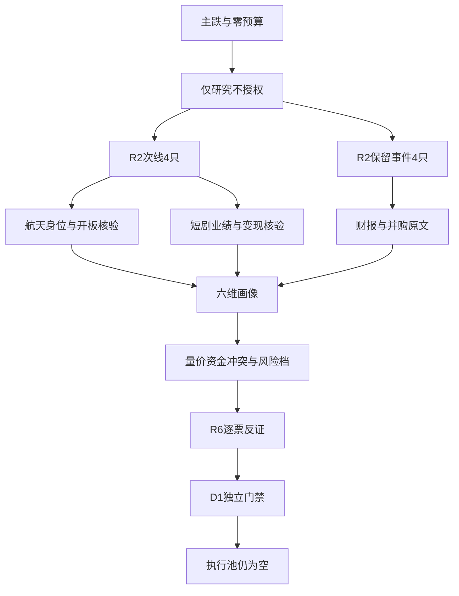

# 2026年10月30日 · 个股画像

> ⚠️ **数据源时间错位**：盘前服务日为2026-10-30，最新已收盘行情为2026-10-29；博盈停牌前价为2026-10-16。不是10月30日盘中行情，也不是事后回放预测。
> **数据源新鲜度**：partial；**降级状态**：true；**置信度**：0.2625。

## 一句话结论
8只研究保留，执行全部拦截；财报修复不等于主线确认，零交易预算不变。

## 📌 详细分析
市场在为局部航天身位与题材首板付注意力，不是在为全市场主升付钱。继承R1/R2的**情绪=主跌**；全市场炸板率39.0625%，正式提名已经从每线5只减半至2只。研究覆盖8只不再砍半，也不转成8只可交易票。
主线 = 无已确认可交易主线；持续性 = 未核，不伪填1/3/5日；封板率 = 未核，不以11家或4家涨停数冒充分母；明日预期 = 分歧（继承R2对下一交易时段的条件判断，未把主跌解释成已修复）。
唯一主模板为**首板隔日**：催化20%、筹码25%、联动20%、估值10%、技术20%、机构5%。二板只检验身位延续，不接成固定打法；事件对象保留完整画像，但不自动获得龙一/龙二地位。
先认市场再认个股：无已确认主线、有效交易预算为0，今日做研究核验、不做开仓。R5不提供entry/exit价格；RR和止损距离没有D1真实锚点一律未核，不能为达到RR≥2造目标价。只有R6可发hard_reject，本报告只分档和透传阻断。

## 🧭 综合研究排序（不是执行排序）
| 对象 | 来源/角色 | 板型 | 综合序数分 | α / 风险 | 研究态度 / 执行态度 |
|---|---|---|---:|---|---|
| 传智教育 003032.SZ | 龙二 | 首板 | 55.65 | B+ / B- | 观察 / 拦截 |
| 中国卫星 600118.SH | 龙二 | 首板 | 53.75 | B+ / B- | 观察 / 拦截 |
| 上海沪工 603131.SH | 龙一 | 2连板 | 52.10 | B / B- | 观察 / 拦截 |
| 三花智控 002050.SZ | 事件研究观察对象 | 非当日涨停/事件观察，未认定低位前排 | 51.25 | B / B- | 观察 / 拦截 |
| 普冉股份 688766.SH | 事件研究观察对象 | 非当日涨停/事件观察，未认定低位前排 | 45.80 | B+ / B- | 观察 / 拦截 |
| 博盈特焊 301468.SZ | 事件研究观察对象 | 非当日涨停/事件观察，未认定低位前排 | 37.35 | B / C | 降级 / 拦截 |
| 文投控股 600715.SH | 龙一 | 3连板 | 37.25 | B- / C | 降级 / 拦截 |
| 上海洗霸 603200.SH | 事件研究观察对象 | 非当日涨停/事件观察，未认定低位前排 | 33.50 | B- / C | 降级 / 拦截 |

来源覆盖：4只次线龙头 + 4只R2显式保留的R4事件对象 = 8只；不把R2未采纳的“杂毛”或旧快照常客扩成候选。all_scored_boards_top10缺失已披露；现有选池函数输出空是字段读取缺陷，不是真实空池。本次读取结构化原始对象，无代码修改。
正式提名已减半：商业航天2只、短剧游戏2只。事件对象不是增加正式名额，不给补位权。横店影视因减半未获正式提名；襄阳轴承、小崧股份按R2剔除理由保留在JSON覆盖审计。

## 🔍 逐票六维画像

### 传智教育 · 003032.SZ：观察（execution拦截）
**本章态度**：首板早封加业绩修复可研究，股东扩散及教育到短剧映射缺证不放行。
板型：首板；R2角色：龙二；严格龙头裁决：龙二观察，首次带动未核；纪律已证0条（继承R2，不等于全闸门通过）。
盈亏比：未核；止损距离：未核；禁止清单：有效零交易预算；无确认可交易主线；RR/禁止清单未完整核验。机会归类：计划内试错，仅研究标签，未获得D1授权。

| 维度 | 分值 | 事实与判读 |
|---|---:|---|
| 催化背景 | 65 | 三季报收入与扣非修复可核；问财概念归属与教育主业并不证明短剧收入，研报标题的AI课程属于另一条业绩解释。 |
| 筹码结构 | 58 | 近5个有效交易日大单+超大单自算1.159056亿元；最新股东户数变化75.0311%；资金同日跨源冲突=True。首封早、零开板和大单方向偏正支持短线资金试探，但最新股东户数显著增加，不能简单推断机构集中。 |
| 板块联动 | 45 | 2026中报主体是短期培训、学历教育，非短剧制作；须把教育基本面修复与短剧标签分开。 |
| 财务与估值 | 60 | 截至20260930营收同比61.3988%，归母同比1012.6706%；PEttm=None、PB=2.9257，不以低PE分位证明低估。 |
| 技术形态 | 52 | 缩量首板收复MA20，尚未收复MA60；属于超跌修复而不是已确认主升浪回踩。 前复权MA5/20/60=8.180/8.464/9.818，有效日K=81。 |
| 研报与机构 | 55 | 近30日去重研报1篇，调研记录0条；不把投资者业绩会当机构调研。 |

量价证据：81根日K，区间20260701—20261029，前复权；5日/20日收益+16.62%/-2.27%；当日量/含当日5日均量0.87倍。成交额2.12亿元，振幅9.60%。该量比与daily_basic供应商volume_ratio不同，不混用。
资金证据：5个有效交易日自算大单净额1.159056亿元、东财1.153032亿元；存在任一同日偏差>5%：True。博盈停牌零记录已剔除，None不等于0。
估值口径：PB=2.9257，PEttm=None；PB/PE分位=66.7586/None%，正有效样本725/120。不把亏损PE填0，不把report_rc.tp写目标价。
基本面红旗：已核子集未命中，绝不代表完整12项清白。
两融：实时逐票查询成功但为空，资格未独立证实，降级；不宣称已证非两融。
大宗：窗口逐票接口均未命中；折溢价不可判；不以无记录推定没有减持。
图像：复用同日真实多模态快照。最终裁决见技术维度，不机械复制快照。“末端封板”不等于全天一字；开板次数优先实证。周K周末标签不代表读到了未来行情。

- **大资金意图**: 首封早、零开板和大单方向偏正支持短线资金试探，但最新股东户数显著增加，不能简单推断机构集中。
- **为什么走强**: 缩量首板收复MA20，尚未收复MA60；属于超跌修复而不是已确认主升浪回踩。 三季报收入与扣非修复可核；问财概念归属与教育主业并不证明短剧收入，研报标题的AI课程属于另一条业绩解释。
- **逻辑够不够硬**: 业绩比短剧叙事硬，业务映射比业绩弱；单篇研报先于名义季报日期出现，发布时间口径存疑，不作为独立领先消息。

- **买入理由**: 研究理由一：低位首板且早封零开板符合模板的验证对象。理由二：收入、扣非、现金流修复，不靠短剧口号；未认定合规龙头。
- **风险点**: 股东户数增加约75%，筹码扩散而非锁仓；短剧收入未确认，MA60未收复且首板缩量。
- **止损条件**: 若后续收盘再度跌回MA20下方，或公司证伪短剧关联，撤销题材升级假设；不临时切换为教育长线故事。 这里是研究失效条件，不是价格止损指令。
- **可验证假设**: 未来1—3个交易日维持MA20以上且短剧板块至少2只首二板封住，若概念资金不转正仍只观察；公司短剧收入须有原始披露。

事件时间线（按名义公告日列示，JSON保留已核首知时刻；标题不是正文结论）：
| 日期 | 事件 | 来源 |
|---|---|---|
| 2026-10-29 | 2026年三季度报告 | live_tushare.anns_d |
| 2026-10-29 | U类型，连板高度1，开板0次 | live_tushare.limit_list_d |

### 中国卫星 · 600118.SH：观察（execution拦截）
**本章态度**：容量助攻不是封板龙头：八次开板、低ROE高PB和现金流压力同时保留。
板型：首板；R2角色：龙二；严格龙头裁决：分歧弱；纪律已证0条（继承R2，不等于全闸门通过）。
盈亏比：未核；止损距离：未核；禁止清单：有效零交易预算；无确认可交易主线；RR/禁止清单未完整核验。机会归类：计划内试错，仅研究标签，未获得D1授权。

| 维度 | 分值 | 事实与判读 |
|---|---:|---|
| 催化背景 | 65 | 10月29日三季报收入和扣非改善可核；不能用盘后财报反向证明当天盘中涨停是由报告驱动。 |
| 筹码结构 | 60 | 近5个有效交易日大单+超大单自算6.208868亿元；最新股东户数变化-14.0631%；资金同日跨源冲突=True。放量和大单净额方向偏正说明容量承接，但5日仅2天东财净流入、两融融资余额下降，不能称持续机构建仓。 |
| 板块联动 | 60 | 2026中报宇航制造及卫星应用为主体，业务关联比泛航天标签硬；产业相关不等于当日交易龙头。 |
| 财务与估值 | 25 | 截至20260930营收同比27.5178%，归母同比473.4035%；PEttm=625.5171、PB=10.2585，不以低PE分位证明低估。 |
| 技术形态 | 50 | 涨停收复MA20但仍在MA60下方；日线放量反弹、周线空头，不裁决为趋势反转。 前复权MA5/20/60=51.548/52.745/58.295，有效日K=81。 |
| 研报与机构 | 25 | 近30日去重研报0篇，调研记录0条；不把投资者业绩会当机构调研。 |

量价证据：81根日K，区间20260701—20261029，前复权；5日/20日收益+11.40%/-3.15%；当日量/含当日5日均量2.25倍。成交额31.13亿元，振幅10.53%。该量比与daily_basic供应商volume_ratio不同，不混用。
资金证据：5个有效交易日自算大单净额6.208868亿元、东财6.403682亿元；存在任一同日偏差>5%：True。博盈停牌零记录已剔除，None不等于0。
估值口径：PB=10.2585，PEttm=625.5171；PB/PE分位=73.7276/37.3473%，正有效样本727/573。不把亏损PE填0，不把report_rc.tp写目标价。
基本面红旗：F9 期末应收/前三季收入=83.85%；跨存量/累计流量比，非周转天数；F8 最近半年度及前三季度累计经营现金流均负、最新累计归母正；累计期重叠，不代表连续单季负
两融：15个余额点，截至20261028，融资变动-11.08%，融券变动-41.1076%；不是10月29日完整值。
大宗：窗口逐票接口均未命中；折溢价不可判；不以无记录推定没有减持。
图像：复用同日真实多模态快照。最终裁决见技术维度，不机械复制快照。“末端封板”不等于全天一字；开板次数优先实证。周K周末标签不代表读到了未来行情。

- **大资金意图**: 放量和大单净额方向偏正说明容量承接，但5日仅2天东财净流入、两融融资余额下降，不能称持续机构建仓。
- **为什么走强**: 涨停收复MA20但仍在MA60下方；日线放量反弹、周线空头，不裁决为趋势反转。 10月29日三季报收入和扣非改善可核；不能用盘后财报反向证明当天盘中涨停是由报告驱动。
- **逻辑够不够硬**: 业务和业绩证据较硬，但高PB低ROE、应收占收入偏高以及连续累计期现金流为负削弱资金配置论。

- **买入理由**: 研究理由一：卫星业务直接且容量辨识度较高。理由二：单日大单/超大单净流入与放量首板一致；8次开板仅保留观察。
- **风险点**: 八次开板，先手筹码兑现显著；PE高、ROE低，经营现金流和应收压力不能被同比增速掩盖。
- **止损条件**: 若后续收盘失守日线MA20且宽概念净额仍负，撤销修复升级假设；财报应收和回款未改善则不升估值档。 这里是研究失效条件，不是价格止损指令。
- **可验证假设**: 未来1—3个交易日宽概念资金至少一日转正，本票收盘维持MA20上方且开板次数较8次下降到不超过2次，才重审承接。

事件时间线（按名义公告日列示，JSON保留已核首知时刻；标题不是正文结论）：
| 日期 | 事件 | 来源 |
|---|---|---|
| 2026-10-29 | 中国卫星2026年第三季度报告 | live_tushare.anns_d |
| 2026-10-29 | U类型，连板高度1，开板8次 | live_tushare.limit_list_d |

### 上海沪工 · 603131.SH：观察（execution拦截）
**本章态度**：二板身位保留研究；焊接主业、扣非亏损与宽概念流出拦住执行。
板型：2连板；R2角色：龙一；严格龙头裁决：研究组身位领先，严格早封龙头未确认；纪律已证1条（继承R2，不等于全闸门通过）。
盈亏比：未核；止损距离：未核；禁止清单：有效零交易预算；无确认可交易主线；RR/禁止清单未完整核验。机会归类：计划内试错，仅研究标签，未获得D1授权。

| 维度 | 分值 | 事实与判读 |
|---|---:|---|
| 催化背景 | 45 | 10月28日三季报与两连板同处窗口，但扣非亏损；蓝箭/中科宇航中标候选新闻不能变成沪工卫星订单。 |
| 筹码结构 | 55 | 近5个有效交易日大单+超大单自算1.698344亿元；最新股东户数变化-0.8698%；资金同日跨源冲突=True。超大单驱动的局部题材试探较可信，但大概念净流出，三日异动榜的营业部与股通对手盘不能说成机构一致吸筹。 |
| 板块联动 | 58 | 2026中报焊接与切割设备为收入主体，高端装备配套只占小部分且分部毛利为负；不得把整个收入映射商业航天。 |
| 财务与估值 | 25 | 截至20260930营收同比16.4072%，归母同比687.4258%；PEttm=None、PB=3.2551，不以低PE分位证明低估。 |
| 技术形态 | 70 | 日线两板突破短期箱体并收复MA60，但周线仍在长期回撤修复；不是已确认主升低吸标的。 前复权MA5/20/60=14.106/13.570/14.278，有效日K=81。 |
| 研报与机构 | 25 | 近30日去重研报0篇，调研记录0条；不把投资者业绩会当机构调研。 |

量价证据：81根日K，区间20260701—20261029，前复权；5日/20日收益+21.94%/+14.34%；当日量/含当日5日均量1.99倍。成交额5.75亿元，振幅8.76%。该量比与daily_basic供应商volume_ratio不同，不混用。
资金证据：5个有效交易日自算大单净额1.698344亿元、东财1.630002亿元；存在任一同日偏差>5%：True。博盈停牌零记录已剔除，None不等于0。
估值口径：PB=3.2551，PEttm=None；PB/PE分位=13.7552/None%，正有效样本727/83。不把亏损PE填0，不把report_rc.tp写目标价。
基本面红旗：F6 累计归母0.1159亿元，扣非-0.1584亿元，非经常占归母236.62%；F8 最近半年度及前三季度累计经营现金流均负、最新累计归母正；累计期重叠，不代表连续单季负
两融：实时逐票查询成功但为空，资格未独立证实，降级；不宣称已证非两融。
大宗：窗口逐票接口均未命中；折溢价不可判；不以无记录推定没有减持。
图像：复用同日真实多模态快照。最终裁决见技术维度，不机械复制快照。“末端封板”不等于全天一字；开板次数优先实证。周K周末标签不代表读到了未来行情。

- **大资金意图**: 超大单驱动的局部题材试探较可信，但大概念净流出，三日异动榜的营业部与股通对手盘不能说成机构一致吸筹。
- **为什么走强**: 日线两板突破短期箱体并收复MA60，但周线仍在长期回撤修复；不是已确认主升低吸标的。 10月28日三季报与两连板同处窗口，但扣非亏损；蓝箭/中科宇航中标候选新闻不能变成沪工卫星订单。
- **逻辑够不够硬**: 身位和量价可核，航天业务兑现与订单缺证；一次性收益占比、扣非亏损对利润叙事形成实质反证。

- **买入理由**: 研究理由一：2板且零开板，组内高度领先。理由二：概念11只涨停给局部联动样本；产业纯度仍不足，不是买入许可。
- **风险点**: 二进三在主跌环境有中位接力风险；正归母与负扣非背离，航天敞口不能以主题标签替代。
- **止损条件**: 若后续收盘重新跌回本轮突破前箱体且同口径概念资金仍负，撤销突破研究假设；不是卖出委托。 这里是研究失效条件，不是价格止损指令。
- **可验证假设**: 未来1—3个交易日商业航天同口径主力净额转正且至少2只首二板封住，并保持本票身位；任一不满足不升级。

事件时间线（按名义公告日列示，JSON保留已核首知时刻；标题不是正文结论）：
| 日期 | 事件 | 来源 |
|---|---|---|
| 2026-10-28 | 上海沪工焊接集团股份有限公司2026年第三季度报告 | live_tushare.anns_d |
| 2026-10-28 | 关于2026年第三季度计提资产减值准备的公告 | live_tushare.anns_d |
| 2026-10-28 | 关于召开2026年第三季度业绩说明会的公告 | live_tushare.anns_d |
| 2026-10-28 | U类型，连板高度1，开板1次 | live_tushare.limit_list_d |
| 2026-10-29 | U类型，连板高度2，开板0次 | live_tushare.limit_list_d |
| 2026-10-29 | 龙虎榜净额+0.1228亿元；非S证券连续三个交易日内收盘价格涨幅偏离值累计达到20%的证券 | live_tushare.top_list |

### 三花智控 · 002050.SZ：观察（execution拦截）
**本章态度**：产业供货有依据但武汉项目归属未核，利润与价格均未给趋势加速证据。
板型：非当日涨停/事件观察，未认定低位前排；R2角色：事件研究观察对象；严格龙头裁决：未认定；纪律已证0条（继承R2，不等于全闸门通过）。
盈亏比：未核；止损距离：未核；禁止清单：具体项目供应商归属未核；R7资金确认缺失；主线资格未确认；有效零交易预算；无确认可交易主线；RR/禁止清单未完整核验。机会归类：主线补涨，仅研究标签，未获得D1授权。

| 维度 | 分值 | 事实与判读 |
|---|---:|---|
| 催化背景 | 65 | R4原始IR确认一次侧/CDU零部件批量供货，但没有确认武汉项目客户；国产超节点上线不能直接变为三花定点收入。 |
| 筹码结构 | 58 | 近5个有效交易日大单+超大单自算2.69963亿元；最新股东户数变化-6.7758%；资金同日跨源冲突=False。近5日净额偏正但昨日大单净流出，融资回落而融券余额上升；未同时满足short_pressure的两条件，不滥打硬标签。 |
| 板块联动 | 30 | 2026中报制冷空调零部件和汽车零部件为主体；制冷收入占比不是液冷占比，更不是人形机器人占比。 |
| 财务与估值 | 60 | 截至20260930营收同比5.1778%，归母同比-5.3992%；PEttm=37.3413、PB=4.4293，不以低PE分位证明低估。 |
| 技术形态 | 45 | 短均线修复但收盘低于MA5和MA60，仍未建立持续主升结构；昨日回落不能被称强势低吸机会。 前复权MA5/20/60=34.738/33.686/35.646，有效日K=81。 |
| 研报与机构 | 55 | 近30日去重研报3篇，调研记录0条；不把投资者业绩会当机构调研。 |

量价证据：81根日K，区间20260701—20261029，前复权；5日/20日收益+4.90%/-3.82%；当日量/含当日5日均量0.87倍。成交额22.63亿元，振幅3.25%。该量比与daily_basic供应商volume_ratio不同，不混用。
资金证据：5个有效交易日自算大单净额2.69963亿元、东财2.667299亿元；存在任一同日偏差>5%：False。博盈停牌零记录已剔除，None不等于0。
估值口径：PB=4.4293，PEttm=37.3413；PB/PE分位=19.1197/61.8982%，正有效样本727/727。不把亏损PE填0，不把report_rc.tp写目标价。
基本面红旗：已核子集未命中，绝不代表完整12项清白。
两融：15个余额点，截至20261028，融资变动-6.25%，融券变动27.5774%；不是10月29日完整值。
大宗：窗口逐票接口均未命中；折溢价不可判；不以无记录推定没有减持。
图像：缺失，chart_vision=null。无可用的白名单内批量补图写入路径，未越权写raw或图像目录，不伪报服务故障。技术仅量价裁决，未声称完成缠论同向确认。

- **大资金意图**: 近5日净额偏正但昨日大单净流出，融资回落而融券余额上升；未同时满足short_pressure的两条件，不滥打硬标签。
- **为什么走强**: 短均线修复但收盘低于MA5和MA60，仍未建立持续主升结构；昨日回落不能被称强势低吸机会。 R4原始IR确认一次侧/CDU零部件批量供货，但没有确认武汉项目客户；国产超节点上线不能直接变为三花定点收入。
- **逻辑够不够硬**: 利润和经营现金流真实，主题泛映射仍弱；Q3累计归母同比负、扣非微正，不能宣称AI带动业绩爆发。

- **买入理由**: 研究理由一：CDU零部件供货经IR核验。理由二：传统主业和现金流提供产业底座；项目归属与主线地位未核，不进。
- **风险点**: 武汉具体项目供应商归属没有证据；昨日资金出、融资下降，液冷叙事可能被过度外推。
- **止损条件**: 若公司明确否认相关供货或股价收盘再失MA20，撤销右侧修复假设；不以机器人故事自动替换液冷逻辑。 这里是研究失效条件，不是价格止损指令。
- **可验证假设**: 未来1—3个交易日需公司或项目方确认具体供应商归属、且收盘重回MA5以上与净额转正，才重新评估本项目映射。

事件时间线（按名义公告日列示，JSON保留已核首知时刻；标题不是正文结论）：
| 日期 | 事件 | 来源 |
|---|---|---|
| 2026-10-29 | 2026年三季度报告 | live_tushare.anns_d |
| 2026-10-29 | 武汉950DT液冷超节点上线验证国产算力工程落地 | R4.primary_verified |

### 普冉股份 · 688766.SH：观察（execution拦截）
**本章态度**：利润环比与扣非兑现最硬，但跌破均线、并表基数和筹码扩散阻止右侧升级。
板型：非当日涨停/事件观察，未认定低位前排；R2角色：事件研究观察对象；严格龙头裁决：未认定；纪律已证0条（继承R2，不等于全闸门通过）。
盈亏比：未核；止损距离：未核；禁止清单：产品现货独立核验缺失；一致预期缺失；板型及龙头门禁未审；有效零交易预算；无确认可交易主线；RR/禁止清单未完整核验。机会归类：计划内试错，仅研究标签，未获得D1授权。

| 维度 | 分值 | 事实与判读 |
|---|---:|---|
| 催化背景 | 80 | R4原始季报已核Q3归母7.2816亿元、扣非7.2004亿元，环比约26.50%；SHM并表贡献不可当全内生增长。 |
| 筹码结构 | 48 | 近5个有效交易日大单+超大单自算4.728731亿元；最新股东户数变化70.4521%；资金同日跨源冲突=False。5日净额可正而最新一日为负，融资余额下降、股东户数增加；资金未把强财报兑现为右侧趋势。 |
| 板块联动 | 30 | 2026中报芯片收入占主体；R4公告确认Q3 SHM收入20.39亿元，强增长中必须拆出收购贡献。 |
| 财务与估值 | 58 | 截至20260930营收同比389.0545%，归母同比2533.2326%；PEttm=40.4861、PB=12.0339，不以低PE分位证明低估。 |
| 技术形态 | 25 | 收盘在MA5/20/60下方，20日回撤大，昨日冲高回落；没有止跌右侧确认，不做左侧抄底。 前复权MA5/20/60=278.938/308.393/369.819，有效日K=81。 |
| 研报与机构 | 20 | 近30日去重研报0篇，调研记录0条；不把投资者业绩会当机构调研。 |

量价证据：81根日K，区间20260701—20261029，前复权；5日/20日收益+0.19%/-37.24%；当日量/含当日5日均量0.97倍。成交额28.27亿元，振幅8.82%。该量比与daily_basic供应商volume_ratio不同，不混用。
资金证据：5个有效交易日自算大单净额4.728731亿元、东财4.766902亿元；存在任一同日偏差>5%：False。博盈停牌零记录已剔除，None不等于0。
估值口径：PB=12.0339，PEttm=40.4861；PB/PE分位=73.9191/27.349%，正有效样本717/596。不把亏损PE填0，不把report_rc.tp写目标价。
基本面红旗：已核子集未命中，绝不代表完整12项清白。
两融：15个余额点，截至20261028，融资变动-10.95%，融券变动3.6076%；不是10月29日完整值。
大宗：窗口逐票接口均未命中；折溢价不可判；不以无记录推定没有减持。
图像：缺失，chart_vision=null。无可用的白名单内批量补图写入路径，未越权写raw或图像目录，不伪报服务故障。技术仅量价裁决，未声称完成缠论同向确认。

- **大资金意图**: 5日净额可正而最新一日为负，融资余额下降、股东户数增加；资金未把强财报兑现为右侧趋势。
- **为什么走强**: 收盘在MA5/20/60下方，20日回撤大，昨日冲高回落；没有止跌右侧确认，不做左侧抄底。 R4原始季报已核Q3归母7.2816亿元、扣非7.2004亿元，环比约26.50%；SHM并表贡献不可当全内生增长。
- **逻辑够不够硬**: 扣非与归母接近、现金流支持利润，催化硬；但内生增速、一致预期、独立现货价未核，不能给PEG伪精确低估。

- **买入理由**: 研究理由一：Q3扣非利润真实而非一次性收益。理由二：价格周期和产品组合改善有公告依据；只有右侧确认后才重审，当前不进。
- **风险点**: 并表及周期高利润不可线性外推；均线空头、股东扩散，利好不等于资金接力。
- **止损条件**: 后续1—3个交易日不能收复MA5且净额仍负则维持降级；后续产品价/扣非回落证伪基本面改善。 这里是研究失效条件，不是价格止损指令。
- **可验证假设**: 未来1—3个交易日收盘收复MA5且日线量能不低于此前5日均量、同口径资金转正，才把事件观察升级为右侧复核；不是买点。

事件时间线（按名义公告日列示，JSON保留已核首知时刻；标题不是正文结论）：
| 日期 | 事件 | 来源 |
|---|---|---|
| 2026-10-29 | 普冉Q3环比改善且扣非验证但并表基数需剥离 | R4.primary_verified |
| 2026-10-30 | 普冉半导体（上海）股份有限公司关于计提2026年第三季度资产减值准备的公告 | live_tushare.anns_d |
| 2026-10-30 | 普冉半导体（上海）股份有限公司2026年第三季度报告 | live_tushare.anns_d |

### 博盈特焊 · 301468.SZ：降级（execution拦截）
**本章态度**：复牌并购事件保留，停牌前价格与停牌期零资金都不能证明当日承接。
板型：非当日涨停/事件观察，未认定低位前排；R2角色：事件研究观察对象；严格龙头裁决：未认定；纪律已证0条（继承R2，不等于全闸门通过）。
盈亏比：未核；止损距离：未核；禁止清单：停牌前价过旧；复牌跳空风险；审批与摊薄风险；RR未验证；有效零交易预算；无确认可交易主线；RR/禁止清单未完整核验。机会归类：计划内试错，仅研究标签，未获得D1授权。

| 维度 | 分值 | 事实与判读 |
|---|---:|---|
| 催化背景 | 78 | R4原文核验拟购罗克莱55%股权、暂估4.95亿元并于今日开市复牌；审计评估、审批、摊薄仍有不确定性。 |
| 筹码结构 | 25 | 近5个有效交易日大单+超大单自算0.270687亿元；最新股东户数变化-2.2332%；资金同日跨源冲突=True。停牌期间资金接口连续为0只是无交易占位；融资余额继续下降只说明偿还，不能冒充新买盘或无抛压。 |
| 板块联动 | 25 | 2026中报防腐防磨堆焊占比可核，技术同源支持海工扩展；不能把拟收购标的提前并表。 |
| 财务与估值 | 35 | 截至20260930营收同比-15.8534%，归母同比-61.8736%；PEttm=193.0158、PB=2.0953，不以低PE分位证明低估。 |
| 技术形态 | 20 | 72根历史K足够描述停牌前下降结构，但最后成交为10月16日；复牌跳空会改变结构，旧均线不得直接作今日买点。 前复权MA5/20/60=27.634/30.198/31.293，有效日K=72。 |
| 研报与机构 | 60 | 近30日去重研报1篇，调研记录0条；不把投资者业绩会当机构调研。 |

量价证据：72根日K，区间20260701—20261016，前复权；5日/20日收益-0.35%/-12.88%；当日量/含当日5日均量1.43倍。成交额1.42亿元，振幅7.88%。该量比与daily_basic供应商volume_ratio不同，不混用。
资金证据：5个有效交易日自算大单净额0.270687亿元、东财0.259971亿元；存在任一同日偏差>5%：True。博盈停牌零记录已剔除，None不等于0。
估值口径：PB=2.0953，PEttm=193.0158；PB/PE分位=69.2201/93.0362%，正有效样本718/718。不把亏损PE填0，不把report_rc.tp写目标价。
基本面红旗：F6 累计归母0.1587亿元，扣非0.0208亿元，非经常占归母86.91%
两融：15个余额点，截至20261028，融资变动-6.53%，融券变动None%；不是10月29日完整值。
大宗：窗口逐票接口均未命中；折溢价不可判；不以无记录推定没有减持。
图像：缺失，chart_vision=null。无可用的白名单内批量补图写入路径，未越权写raw或图像目录，不伪报服务故障。技术仅量价裁决，未声称完成缠论同向确认。

- **大资金意图**: 停牌期间资金接口连续为0只是无交易占位；融资余额继续下降只说明偿还，不能冒充新买盘或无抛压。
- **为什么走强**: 72根历史K足够描述停牌前下降结构，但最后成交为10月16日；复牌跳空会改变结构，旧均线不得直接作今日买点。 R4原文核验拟购罗克莱55%股权、暂估4.95亿元并于今日开市复牌；审计评估、审批、摊薄仍有不确定性。
- **逻辑够不够硬**: 预案与复牌有硬时点，估值重估缺实际复牌成交和标的审计，且现主业扣非增速差；仅事件观察。

- **买入理由**: 研究理由一：同源技术并购有原始预案，不是群聊造题材。理由二：复牌时间确定，适合事后验证事件溢价；当前没有可交易承接证据。
- **风险点**: 停牌前价格过旧，复牌跳空不可测；审批、未经审计标的及新增股本摊薄风险。
- **止损条件**: 预案取消、审计结果显著低于预案或审批未获通过即撤销协同假设；价格条件须由复牌真实数据重新推导。 这里是研究失效条件，不是价格止损指令。
- **可验证假设**: 今日复牌后只记录实际成交、换手和公告进展；若无真实成交或存在一字无法换手，不升级；未来1—3日审批细节须复核。

事件时间线（按名义公告日列示，JSON保留已核首知时刻；标题不是正文结论）：
| 日期 | 事件 | 来源 |
|---|---|---|
| 2026-10-26 | 2026年三季度报告 | live_tushare.anns_d |
| 2026-10-29 | 博盈特焊披露海工收购预案并于今日复牌 | R4.primary_verified |
| 2026-10-30 | 关于发行股份及支付现金购买资产并募集配套资金暨关联交易事项暨公司股票复牌的一般风险提示公告 | live_tushare.anns_d |

### 文投控股 · 600715.SH：降级（execution拦截）
**本章态度**：三连板不是安全：六次开板、龙虎榜净卖与扣非亏损构成共振反证。
板型：3连板；R2角色：龙一；严格龙头裁决：分歧弱；纪律已证1条（继承R2，不等于全闸门通过）。
盈亏比：未核；止损距离：未核；禁止清单：有效零交易预算；无确认可交易主线；RR/禁止清单未完整核验。机会归类：计划内试错，仅研究标签，未获得D1授权。

| 维度 | 分值 | 事实与判读 |
|---|---:|---|
| 催化背景 | 30 | 10月30日风险提示和三季报在本轮实时数据中可见；即梦工作室10月26日上线是旧传播背景，内测不能等同文投新增收入。 |
| 筹码结构 | 25 | 近5个有效交易日大单+超大单自算1.540358亿元；最新股东户数变化4.4711%；资金同日跨源冲突=True。当日龙虎榜净卖约1.05亿元、东财大单净额负；这是封板下的兑现疑点，不因前一日净买反向洗白。 |
| 板块联动 | 45 | 2026中报电影放映及影视投资收入高于游戏分部，游戏业务关联可见但短剧独立收入未披露。 |
| 财务与估值 | 20 | 截至20260930营收同比-29.5095%，归母同比-1120.9024%；PEttm=None、PB=8.6318，不以低PE分位证明低估。 |
| 技术形态 | 65 | 日线三板加速且高于各均线，离MA20显著偏离；强K线不抵消分歧弱和主跌中位风险。 前复权MA5/20/60=1.926/1.781/1.695，有效日K=81。 |
| 研报与机构 | 20 | 近30日去重研报0篇，调研记录1条；不把投资者业绩会当机构调研。 |

量价证据：81根日K，区间20260701—20261029，前复权；5日/20日收益+28.98%/+37.58%；当日量/含当日5日均量2.02倍。成交额11.55亿元，振幅7.28%。该量比与daily_basic供应商volume_ratio不同，不混用。
资金证据：5个有效交易日自算大单净额1.540358亿元、东财1.227055亿元；存在任一同日偏差>5%：True。博盈停牌零记录已剔除，None不等于0。
估值口径：PB=8.6318，PEttm=None；PB/PE分位=81.8548/None%，正有效样本496/0。不把亏损PE填0，不把report_rc.tp写目标价。
基本面红旗：已核子集未命中，绝不代表完整12项清白。
两融：实时逐票查询成功但为空，资格未独立证实，降级；不宣称已证非两融。
大宗：窗口逐票接口均未命中；折溢价不可判；不以无记录推定没有减持。
图像：复用同日真实多模态快照。最终裁决见技术维度，不机械复制快照。“末端封板”不等于全天一字；开板次数优先实证。周K周末标签不代表读到了未来行情。

- **大资金意图**: 当日龙虎榜净卖约1.05亿元、东财大单净额负；这是封板下的兑现疑点，不因前一日净买反向洗白。
- **为什么走强**: 日线三板加速且高于各均线，离MA20显著偏离；强K线不抵消分歧弱和主跌中位风险。 10月30日风险提示和三季报在本轮实时数据中可见；即梦工作室10月26日上线是旧传播背景，内测不能等同文投新增收入。
- **逻辑够不够硬**: 高度有地位但财务和兑现逻辑不硬：归母/扣非亏损且收入下滑，风险提示需R6逐条反证，R5不宣布hard_reject。

- **买入理由**: 研究理由一：短剧组3板最高，必须解释而不是因禁新仓删掉。理由二：游戏业务真实存在；没有新增变现证据，不进执行。
- **风险点**: 主跌环境三进四中位加速、开板6次；亏损且PS偏高；榜单净卖与股东增多削弱筹码稳定性。
- **止损条件**: 短剧变现若未出现公司正式证据且开板后不能维持前排，取消题材核心研究资格；禁止把低价当安全。 这里是研究失效条件，不是价格止损指令。
- **可验证假设**: 未来1—3个交易日若同口径题材资金仍负，或本票再次开板不少于4次，维持降级；需正式业务披露才能升级催化。

事件时间线（按名义公告日列示，JSON保留已核首知时刻；标题不是正文结论）：
| 日期 | 事件 | 来源 |
|---|---|---|
| 2026-10-28 | U类型，连板高度2.0，开板0次 | live_tushare.limit_list_d |
| 2026-10-28 | 龙虎榜净额+0.8681亿元；有价格涨跌幅限制的日收盘价格涨幅偏离值达到7%的前五只证券 | live_tushare.top_list |
| 2026-10-28 | 龙虎榜净额+0.8088亿元；非S证券连续三个交易日内收盘价格涨幅偏离值累计达到20%的证券 | live_tushare.top_list |
| 2026-10-29 | U类型，连板高度3.0，开板6次 | live_tushare.limit_list_d |
| 2026-10-29 | 龙虎榜净额-1.0487亿元；有价格涨跌幅限制的日收盘价格涨幅偏离值达到7%的前五只证券 | live_tushare.top_list |
| 2026-10-30 | 文投控股股份有限公司2026年第三季度报告 | live_tushare.anns_d |
| 2026-10-30 | 文投控股股份有限公司股票交易风险提示公告 | live_tushare.anns_d |
| 2026-10-30 | 文投控股股份有限公司关于2026年前三季度主要经营数据的公告 | live_tushare.anns_d |

### 上海洗霸 · 603200.SH：降级（execution拦截）
**本章态度**：规划与项目计划不能覆盖亏损、现金流负和前期高波动风险。
板型：非当日涨停/事件观察，未认定低位前排；R2角色：事件研究观察对象；严格龙头裁决：未认定；纪律已证0条（继承R2，不等于全闸门通过）。
盈亏比：未核；止损距离：未核；禁止清单：Q3扣非亏损；经营现金流为负；低业务敞口；龙头与RR门禁未审；有效零交易预算；无确认可交易主线；RR/禁止清单未完整核验。机会归类：计划内试错，仅研究标签，未获得D1授权。

| 维度 | 分值 | 事实与判读 |
|---|---:|---|
| 催化背景 | 40 | 北京能源规划为研发方向支持而非公司订单；R4原文项目0.5GWh与500吨是规划产能，尚不是收入兑现。 |
| 筹码结构 | 38 | 近5个有效交易日大单+超大单自算0.624049亿元；最新股东户数变化33.879%；资金同日跨源冲突=True。5日微正净额掩盖每日反复，股东增加及历史跌停榜净卖说明筹码分歧；不能把政策热度当机构锁仓。 |
| 板块联动 | 25 | 2026中报新能源先进材料收入1337万元，分部毛利为负；其余以化学品及水处理服务等为主，固态映射纯度低。 |
| 财务与估值 | 20 | 截至20260930营收同比2.1383%，归母同比-116.9098%；PEttm=None、PB=7.6969，不以低PE分位证明低估。 |
| 技术形态 | 40 | 短线回落低于MA5/20但中期均线未完全破坏，属于高波动回撤而非确认低吸；10月21日跌停是重要反证。 前复权MA5/20/60=48.356/48.212/42.072，有效日K=81。 |
| 研报与机构 | 20 | 近30日去重研报0篇，调研记录0条；不把投资者业绩会当机构调研。 |

量价证据：81根日K，区间20260701—20261029，前复权；5日/20日收益+5.69%/+18.80%；当日量/含当日5日均量0.74倍。成交额6.29亿元，振幅5.86%。该量比与daily_basic供应商volume_ratio不同，不混用。
资金证据：5个有效交易日自算大单净额0.624049亿元、东财0.576328亿元；存在任一同日偏差>5%：True。博盈停牌零记录已剔除，None不等于0。
估值口径：PB=7.6969，PEttm=None；PB/PE分位=66.2999/None%，正有效样本727/688。不把亏损PE填0，不把report_rc.tp写目标价。
基本面红旗：F9 期末应收/前三季收入=91.97%；跨存量/累计流量比，非周转天数
两融：实时逐票查询成功但为空，资格未独立证实，降级；不宣称已证非两融。
大宗：窗口逐票接口均未命中；折溢价不可判；不以无记录推定没有减持。
图像：缺失，chart_vision=null。无可用的白名单内批量补图写入路径，未越权写raw或图像目录，不伪报服务故障。技术仅量价裁决，未声称完成缠论同向确认。

- **大资金意图**: 5日微正净额掩盖每日反复，股东增加及历史跌停榜净卖说明筹码分歧；不能把政策热度当机构锁仓。
- **为什么走强**: 短线回落低于MA5/20但中期均线未完全破坏，属于高波动回撤而非确认低吸；10月21日跌停是重要反证。 北京能源规划为研发方向支持而非公司订单；R4原文项目0.5GWh与500吨是规划产能，尚不是收入兑现。
- **逻辑够不够硬**: 政策有事实、项目有计划，但亏损与负现金流是公司层面的硬反证；未证实订单不应以行业远景补洞。

- **买入理由**: 研究理由一：新材料与储能项目真实存在可持续核验。理由二：前期有板块注意力；本次不满足低位前排和业绩兑现，不进。
- **风险点**: 归母/扣非亏损与经营现金流为负；股东扩散、应收高及项目投产风险，政策不是合同。
- **止损条件**: 项目取消、延期或后续无公司订单/回款证据即降级事件映射；股价失守中期均线仅作为研究结构失效，不输出卖价。 这里是研究失效条件，不是价格止损指令。
- **可验证假设**: 未来1—3个交易日若仍无公司订单或投产原始披露且收盘不能回MA20以上，保持降级；未来财报需扣非和经营现金流转正。

事件时间线（按名义公告日列示，JSON保留已核首知时刻；标题不是正文结论）：
| 日期 | 事件 | 来源 |
|---|---|---|
| 2026-10-09 | 龙虎榜净额-0.3130亿元；非S证券连续三个交易日内收盘价格涨幅偏离值累计达到20%的证券 | live_tushare.top_list |
| 2026-10-12 | 龙虎榜净额+1.0157亿元；有价格涨跌幅限制的日价格振幅达到15%的前五只证券 | live_tushare.top_list |
| 2026-10-15 | U类型，连板高度1，开板1次 | live_tushare.limit_list_d |
| 2026-10-21 | D类型，连板高度1，开板2次 | live_tushare.limit_list_d |
| 2026-10-21 | 龙虎榜净额-0.4289亿元；有价格涨跌幅限制的日收盘价格跌幅偏离值达到7%的前五只证券 | live_tushare.top_list |
| 2026-10-26 | U类型，连板高度1，开板1次 | live_tushare.limit_list_d |
| 2026-10-28 | 北京新型能源规划支持储能与电网技术研发 | R4.primary_verified |
| 2026-10-29 | 上海洗霸科技股份有限公司2026年第三季度报告 | live_tushare.anns_d |

## 🧾 关键证据
- 沪工中报产品分部、最新扣非和经营现金流支持“主题纯度不够”的反证，而非把归母同比+687%写成主业爆发。来源：实时fina_mainbz/fina_indicator/income/cashflow。
- 中国卫星开板8次、文投6次由limit_list_d直接证实；图像末端缩量不能否定全日开板。来源：实时涨停明细与同日快照。
- 文投10月29日龙虎榜净卖1.0487亿元；10月28日单日与三日榜分别存储，禁止相加成连续净买。来源：逐交易日top_list/top_inst。
- 普冉Q3扣非接近归母及环比改善来自R4原始季报；并表和期末股东扩散削弱简单PEG外推。来源：R4 E003 + 实时财务/股东接口。

## 数据源审计
| 源 | 日期 | 状态 | 记录数 / 窗口 / 备注 |
|---|---|:--:|---|
| Tushare MCP daily / adj_factor | 2026-10-29 | 🟢 | 639根K、648因子；本会话在线取回 |
| Tushare SDK daily_basic | 2026-10-29 | 🟢 | 5792行，逐票近三年；多代码MCP空后实时重查 |
| Tushare moneyflow / moneyflow_dc | 2026-10-29 | 🟡 | 各128行；按分档自算、同日对齐，停牌占位剔除、冲突逐票披露 |
| Tushare block_trade / margin_detail | 2026-10-28 | 🟡 | 大宗8票均空、两融60行；4票两融资格未核，最新日滞后一日 |
| Tushare top_list / top_inst | 2026-10-29 | 🟢 | 8榜、80席位行；17个开市日全量拉后筛8票；重叠区间不相加 |
| Tushare 财务三表/指标/审计/主营/质押/股东 | 2026-10-30 | 🟡 | 季报截至09月30日；公司2025年审计全为标准无保留；完整合规仍待R6 |
| Tushare anns_d / forecast | 2026-10-30 | 🟢 | 73公告，预告窗口0条；无预告不等于无季报 |
| Tushare report_rc / stk_surv | 2026-10-30 | 🟡 | 14预测行去重非14篇；1条投资者业绩说明会非机构扎堆 |
| R2 / R4 / R7 | 2026-10-30 | 🟡 | 三者partial，逐字段用，不重复计独立源 |
| 同日多模态图像 | 2026-10-30 | 🟡 | 仅4/8覆盖；成功图复用，另4未获准补图输出通道 |
| canghai-sise MCP | 2026-10-29 | 🟢 | 近7日事件只筛8票；未命中不等于四绿 |
| 独立现货价格 / ETF期货精确映射 / 缠论结构 | 2026-10-30 | 🔴 | 未完成；不以文字图像结果伪装结构确认 |

## ⚠️ 不确定性 / 反证
本轮状态是partial，而不是“全技能验收成功”：4只事件对象没有有效图像；ETF/期货映射、完整财务合规及禁止清单缺口均保留。未执行补图是写入权限缺口，不是MCP全域DOWN。上游提供的4只真实事件研究对象不因缺图被换票或删除。
财务数据按本轮实时返回处理，公告名义日期与实际首知时刻不同；盘后披露不能解释此前股价。历史PE序列含当时可用口径，未经逐点原始快照重构，不宣称严格point-in-time估值回测。
F8采用累计半年度与前三季度，重叠期现金流负并不等于两个独立单季为负；不据此自动硬否决。空大宗、空两融、空研报、无龙虎榜都是覆盖结果，不是清白证明。股权质押最后日期过旧不能当最新0。
置信度公式：0.75×0.70×0.50=0.2625；多接口同一数据或同一公告转载不算独立验证。风险档保守，研究序数分与交易授权完全分开。

## 🔗 与其他 R/D/E 的关系
- 依赖：R2_main_sectors.json、R4_news.json、R7_capital_flow.json、同日图像快照；R1市场温度通过R2透传。
- 被消费：R6逐票反证、D1独立门禁、E1跟踪可验证假设。
- R6的hard_reject具有唯一硬否决地位；本报告不修改、替代或提前宣告其结论。
- D1不得因本报告画像、α档或研究排序解除R2拦截与零交易预算；没有通过逐票门禁的执行池始终为空。

## Sub-Agent 元数据
- skill: analyze_stock_profile_v1@1.6
- artifact: data/research/20261030/R5_stock_profiles.json
- model: gpt-6.1-sol（本会话唯一研究裁决者）；既有多模态快照仅作图像证据。
- 取证开始日期: 2026-10-30；真实生成时间见frontmatter。
- 状态: partial；未计量token为usage_unknown，不是0；5000万努力目标与08:30交付目标均不改变授权。
