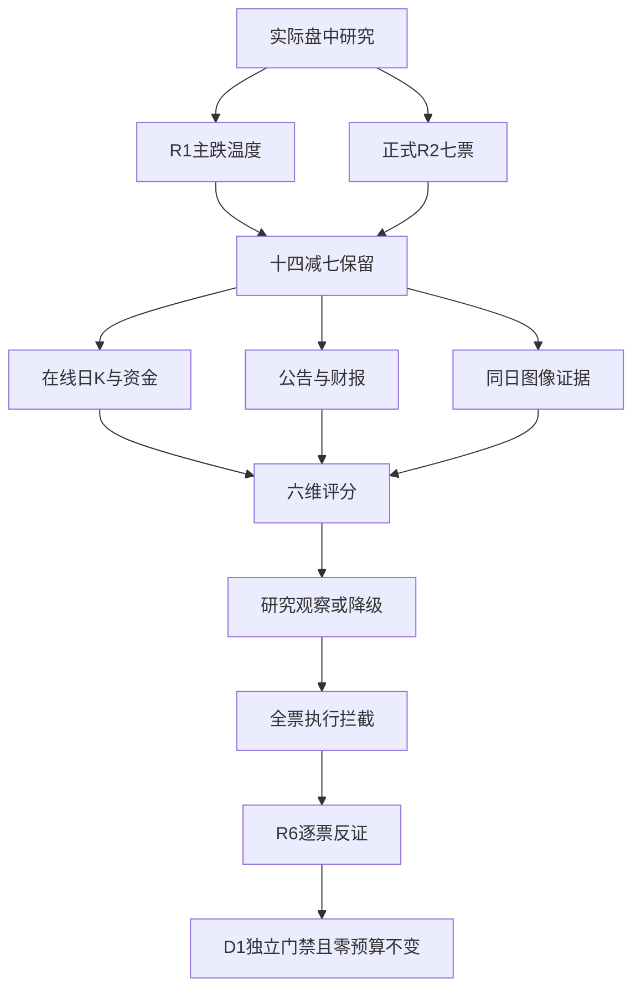

# 2026年11月2日 · 个股画像

> ⚠️ 本文为实际生成时点的盘中研究，不是08:30前预测，也不是冻结输入回放。完整日K主要截止10月30日；高争民爆截止10月23日，今日报价另列。
> **数据源新鲜度**: partial　**降级状态**: true　**置信度**: 0.420（非胜率）

## 一句话结论
7只正式候选均完成研究；白酒前排观察，事件与旧高度降级，全部执行拦截，零预算不变。

## 🔭 详细分析
市场在为局部白酒前排和证券新首板付钱，而非所有消息概念。主线 = 白酒概念，持续性 = 1日，封板率 = 100%（仅10月30日已完成样本），明日预期 = 分歧；今日完整封板率未知，不能由两只盘中封板外推100%。

**情绪=主跌**，继承T-1完成日炸板率39.74%的温度，并非宣称今日实时炸板率39.74%。R2把14个真实提名减至7只；本轮完整画像7只，不重复腰斩审计覆盖，也不把研究对象变成执行对象。

正式R2已在本会话前交付partial版：主线2只、次线4只、事件研究1只。现有本地选池函数只返回主线2只，本文按技能从正式R2次线及事件池补齐；旧10票名单和旧取证不参与本轮画像。角色、禁止清单及零预算原样透传。

只使用首板隔日主模板，六维权重依次为催化20%、筹码25%、联动20%、估值10%、技术20%、机构5%。评分为本会话研究判断，不是训练得出的胜率；两融成功空返回者另扣10分，其资格未知而非余额零。

每票均只有研究态度与风险分档。未输出入场价、止盈价或卖单；RR与止损距缺真实执行几何，一律未知，不满足执行确认。R6保留唯一硬否决权，本报告不代审放行。

## 📊 综合研究排序
| 对象 | R2角色/来源 | 研究分 | Alpha / Risk | 研究态度 | 执行态度 |
|---|---|---:|---|---|---|
| 国金证券 `600109.SH` | 龙一 / r2_secondary_pool | 55.30 | B / B- | 观察 | 拦截 |
| 水井坊 `600779.SH` | 龙二 / r2_leader_pool | 52.25 | B / B- | 观察 | 拦截 |
| 皇台酒业 `000995.SZ` | 龙一 / r2_leader_pool | 43.15 | B+ / C | 观察 | 拦截 |
| 益方生物 `688382.SH` | 候补 / r2_secondary_pool | 41.25 | B- / C | 降级 | 拦截 |
| 高争民爆 `002827.SZ` | 候补 / r2_event_research_pool | 31.55 | B- / C | 降级 | 拦截 |
| 东方海洋 `002086.SZ` | 龙一 / r2_secondary_pool | 28.60 | B- / C | 降级 | 拦截 |
| 上海沪工 `603131.SH` | 龙一 / r2_secondary_pool | 26.10 | B- / C | 降级 | 拦截 |

## 🧮 六维评分与量价证据
| 对象 | 催化 | 筹码 | 联动 | 估值 | 技术 | 机构 | K线根数/截止 | 5日/20日涨跌 | 末日量/前5日均量 |
|---|---:|---:|---:|---:|---:|---:|---|---|---:|
| 皇台酒业 | 45 | 54 | 70 | 20 | 67 | 25 | 103 / 20261030 | 16.71% / 23.95% | 1.15 |
| 水井坊 | 50 | 42 | 65 | 46 | 55 | 63 | 103 / 20261030 | 1.51% / -2.48% | 2.44 |
| 益方生物 | 82 | 30 | 40 | 22 | 22 | 55 | 103 / 20261030 | -18.11% / -33.92% | 2.13 |
| 东方海洋 | 35 | 40 | 34 | 20 | 59 | 20 | 103 / 20261030 | 35.41% / 38.73% | 1.29 |
| 上海沪工 | 35 | 42 | 33 | 30 | 40 | 20 | 103 / 20261030 | 30.19% / 25.45% | 0.57 |
| 国金证券 | 65 | 38 | 60 | 72 | 58 | 40 | 103 / 20261030 | -3.15% / -5.19% | 1.10 |
| 高争民爆 | 85 | 30 | 24 | 25 | 35 | 55 | 98 / 20261023 | -6.83% / -23.69% | 1.21 |

以上收益与量比只计算已完成交易日，量比不含当日；与图像“含当日5日均量”不是同一分母。盘中报价只在逐票正文展示，不能拼入已完成日均量或冒充收盘。

## 🔎 逐票六维画像

### 皇台酒业 · 000995.SZ · 观察（execution 拦截）

白酒高度与早封占优，但亏损、高换手及筹码分散使其只能研究观察。

板型：换手二板（盘中）。R2角色：龙一；纪律§2已过2/4条，未过3条，不升为完整交易龙头。机会归类：计划内试错仅研究，今日计划未批准。
盈亏比：RR=未知，止损距=未知；缺真实入场、失效位、净目标和T+1跳空测试，不能写合格。禁止清单命中：plan_outside_scan；其余3类仍未核。
盘中价格 `15.6`，较昨收 `+10.01%`，离日内高点 `0.00%`（11月2日10:16批次，未收盘）。这些是研究观察值，不是入场/退出价格。

| 维度 | 核心判断及证据 |
|---|---|
| 催化背景 / 45 | 没有已核个股新增订单或盈利催化；白酒防御轮动是资金假设。三季报营收下降17.76%、归母亏损，不支持把二板解释为经营反转。 |
| 筹码结构 / 54 | 5日大单资金正向，但股东户数增加；最新10月30日榜机构净买与部分更早榜机构净卖并存，重叠榜单不跨日简单求和，不能断言机构锁仓。10月30日首板6次开板，今日二板早封尚须收盘及次日承接。 |
| 板块联动 / 70 | 继承R2白酒研究龙一而非已认证总龙；板块T-1五只涨停、今日已核两前排，板块广度是跨时点信息，今日全池广度未知。 |
| 财务与估值 / 20 | 九个月归母亏损，TTM PE虽为正且约749倍也不能当稳态盈利估值；不适用PEG，白酒现金流DCF缺可核预测，改用PE/PB历史定位并降低安全分。 |
| 技术形态 / 67 | 已完成日线多头排列，但10月剧烈往返并非无阻力新主升；今日近涨停高开二板延续局部强度，历史压力附近的换手和T+1接力未验证。图像所说派发只能算量价假设。 |
| 研报与机构 / 25 | 窗口无研报和调研返回，不能解释为无机构持仓。 |

量价：MA5/10/20/30/50 = `13.666/13.36/12.6895/12.1863/11.7634`；完整日K `103` 根。
资金：5个有效交易日分档主力净额 `3.080` 亿，东财 `3.050` 亿；同日偏差超过5% = `True`。各日原值与单位回代在JSON，不挑有利源。
筹码：最近户数变动 `5.47%`；30交易日龙虎榜 `5` 个独立上榜日。多原因及跨三日榜单不简单求和；大宗 `0` 笔，折溢价不可判。
两融：接口成功空返回，资格未核，趋势=null；不填0，不宣称已确认非两融。
估值方法：DCF输入不足→PE/PB相对定位；PE TTM/PB/PS TTM=`748.90/16.40/16.30`；市值锚日期 `20261030`，总/流通 `25.157/25.157` 亿，不冒称盘中市值。
三年正样本严格小于分位：PE `91.17%`、PB `55.37%`、PS `71.76%`。分位不是内在价值，也不是前瞻收益。
财报期 `20260930` / 公告日 `20261029`：营收同比 `-17.76%`、归母净利同比 `-150.81%`；最新可得年审 `标准无保留意见`，不能用年度审计结论覆盖三季报风险。
红旗：已查项目未检出编号红旗，但完整筛查未完成，不等于无风险。
技术交叉：CZSC已完成 `7` 笔，三笔信号 `向上无背_任意_任意_0`；图像同向确认 `True`，没有有效信号不强填。四色四量为历史扫描，未命中不等于阴性；返回500条有截断可能。

- **大资金意图**: 假设资金从科技风险中切向小盘白酒身位，交易的是次日接力而非季度盈利；最新榜机构净买为正向旁证，而更早榜净卖与持有人增加是反证，需分时点看待。
- **为什么走强**: 同板块两前排与盘中二板同向，但股价走强与财务走弱背离；小盘筹码和短线合力可能主导，非已证实因果。
- **逻辑够不够硬**: 价格、资金、公告三个证据面可核，却没有盈利拐点；完整龙头四条仅过2条，不能拿早封重复计数。

**买入理由**：此处仅解释研究入池，非下单授权。①当前白酒已返回封板样本最高2板、09:30首封早于水井09:38；不沿用周五迎驾首封名次；②没有已核个股新增订单或盈利催化；白酒防御轮动是资金假设。三季报营收下降17.76%、归母亏损，不支持把二板解释为经营反转。

**风险点**：①盘中高开接近涨停，隔夜跳空风险不能由盘中止损覆盖；②三季报亏损、户数增加与高估值，题材退潮时缺基本面托底

**止损条件**：以下为研究失效条件，不是R5卖单或数值退出价。收盘跌回上一完成日MA5且白酒前排同时失去正反馈，撤销强势接力研究；公告出现经营/合规证伪立即送R6，不生成卖单。

**可验证假设**：下一交易日核验皇台保持白酒前排且至少新增1只独立首板；若核心开板并板块净额转负，延续假设减弱。

**事件时间线**
| 日期 | 事实 | 来源与时间边界 |
|---|---|---|
| 2026-09-23 | 关于核销部分长期挂账应付账款的公告 | live tushare.anns_d；日精度/已完成或明确盘中记录 |
| 2026-09-23 | 第九届董事会第二十五次会议决议公告 | live tushare.anns_d；日精度/已完成或明确盘中记录 |
| 2026-10-13 | 历史板型U·连板1.0·开板1 | live tushare.limit_list_d；日精度/已完成或明确盘中记录 |
| 2026-10-15 | 历史板型U·连板1.0·开板1 | live tushare.limit_list_d；日精度/已完成或明确盘中记录 |
| 2026-10-15 | 龙虎榜1原因记录·不将重叠榜单净额简单相加 | live tushare.top_list；日精度/已完成或明确盘中记录 |
| 2026-10-16 | 关于股票交易异常波动的公告 | live tushare.anns_d；日精度/已完成或明确盘中记录 |
| 2026-10-16 | 历史板型Z·连板None·开板3 | live tushare.limit_list_d；日精度/已完成或明确盘中记录 |
| 2026-10-16 | 龙虎榜1原因记录·不将重叠榜单净额简单相加 | live tushare.top_list；日精度/已完成或明确盘中记录 |
| 2026-10-19 | 龙虎榜1原因记录·不将重叠榜单净额简单相加 | live tushare.top_list；日精度/已完成或明确盘中记录 |
| 2026-10-22 | 历史板型D·连板1.0·开板10 | live tushare.limit_list_d；日精度/已完成或明确盘中记录 |
| 2026-10-23 | 关于召开公司2026年第二次临时股东会的通知 | live tushare.anns_d；日精度/已完成或明确盘中记录 |
| 2026-10-23 | 关于董事会换届选举的公告 | live tushare.anns_d；日精度/已完成或明确盘中记录 |
| 2026-10-23 | 独立董事候选人声明与承诺（杨强） | live tushare.anns_d；日精度/已完成或明确盘中记录 |
| 2026-10-23 | 独立董事候选人声明与承诺（贾明琪） | live tushare.anns_d；日精度/已完成或明确盘中记录 |
| 2026-10-23 | 独立董事候选人声明与承诺（高玉洁） | live tushare.anns_d；日精度/已完成或明确盘中记录 |
| 2026-10-23 | 独立董事提名人声明与承诺（杨强） | live tushare.anns_d；日精度/已完成或明确盘中记录 |
| 2026-10-23 | 独立董事提名人声明与承诺（贾明琪） | live tushare.anns_d；日精度/已完成或明确盘中记录 |
| 2026-10-23 | 独立董事提名人声明与承诺（高玉洁） | live tushare.anns_d；日精度/已完成或明确盘中记录 |
| 2026-10-23 | 第九届董事会第二十六次会议决议公告 | live tushare.anns_d；日精度/已完成或明确盘中记录 |
| 2026-10-23 | 董事会提名委员会关于董事会换届选举候选人任职资格的审查意见 | live tushare.anns_d；日精度/已完成或明确盘中记录 |
| 2026-10-26 | 历史板型U·连板1.0·开板2 | live tushare.limit_list_d；日精度/已完成或明确盘中记录 |
| 2026-10-27 | 龙虎榜2原因记录·不将重叠榜单净额简单相加 | live tushare.top_list；日精度/已完成或明确盘中记录 |
| 2026-10-28 | 关于股票交易异常波动的公告 | live tushare.anns_d；日精度/已完成或明确盘中记录 |
| 2026-10-29 | 2026年三季度报告 | live tushare.anns_d；日精度/已完成或明确盘中记录 |
| 2026-10-30 | 历史板型U·连板1.0·开板6 | live tushare.limit_list_d；日精度/已完成或明确盘中记录 |
| 2026-10-30 | 龙虎榜1原因记录·不将重叠榜单净额简单相加 | live tushare.top_list；日精度/已完成或明确盘中记录 |
| 2026-11-01 | 金融管理部门拟召开资本市场工具座谈会 | R4_news.json#E20261102_005；indirect_policy_not_company_order |
| 2026-11-02 | 本轮盘中价15.6，较昨收+10.01%，未收盘 | MCP tushare.rt_k；日精度/已完成或明确盘中记录 |

图像来源 `snapshot`；行情截至 `2026-10-30`，不代表今日盘中图。图像结论由本会话结合新报价重新裁决，不直接抄作今日结论。

### 水井坊 · 600779.SH · 观察（execution 拦截）

白酒低位首板助攻成立于盘中，长期下降与五日资金偏弱仍构成反证。

板型：换手首板（盘中）。R2角色：龙二；纪律§2已过2/4条，未过3条，不升为完整交易龙头。机会归类：计划内试错仅研究，今日计划未批准。
盈亏比：RR=未知，止损距=未知；缺真实入场、失效位、净目标和T+1跳空测试，不能写合格。禁止清单命中：plan_outside_scan；其余3类仍未核。
盘中价格 `28.12`，较昨收 `+10.02%`，离日内高点 `0.00%`（11月2日10:16批次，未收盘）。这些是研究观察值，不是入场/退出价格。

| 维度 | 核心判断及证据 |
|---|---|
| 催化背景 / 50 | 白酒轮动而非独立硬订单。三季报与三季度经营公告在10月31日发布，利润同比下降34.30%但经营现金流回正，改善与下滑须同时列。 |
| 筹码结构 / 42 | 股东户数较上期减少，但此前五日主力净额仍为负；最新一日流入不足以称连续吸筹。两资金源有超过5%的相对偏差，方向与金额分开判断。 |
| 板块联动 / 65 | 白酒龙二来自今日首板与早封时序，不能从皇台的高度借出自己的龙头认证；T0只有两个已核封板样本，不足以证明完整广度≥3。 |
| 财务与估值 / 46 | 稳现金流行业优先DCF，但缺渠道、利润率与资本成本预测，不制造内在价；用PE/PB双锚，低PB历史分位与高PE分位相反，主要是盈利收缩，不能直接称低估。 |
| 技术形态 / 55 | 完成日线仍低于MA20/MA60，今日涨停已越过历史均线但不是新收盘趋势确认；图像的下降反弹结论仅适用上一完成日，不能覆盖今日首板。 |
| 研报与机构 / 63 | 多家券商在三季报后有增持评级，预测跨年度去重；评级不是机构买入，报告tp不是目标价。 |

量价：MA5/10/20/30/50 = `25.16/25.381/25.9705/26.0193/26.493`；完整日K `103` 根。
资金：5个有效交易日分档主力净额 `-0.047` 亿，东财 `-0.055` 亿；同日偏差超过5% = `True`。各日原值与单位回代在JSON，不挑有利源。
筹码：最近户数变动 `-3.84%`；30交易日龙虎榜 `0` 个独立上榜日。多原因及跨三日榜单不简单求和；大宗 `0` 笔，折溢价不可判。
两融：15交易日融资余额变动 -4.64%，融券余额变动 -1.66%
估值方法：DCF输入不足→PE/PB相对定位；PE TTM/PB/PS TTM=`42.33/2.50/4.75`；市值锚日期 `20261030`，总/流通 `124.573/124.573` 亿，不冒称盘中市值。
三年正样本严格小于分位：PE `95.04%`、PB `2.34%`、PS `54.13%`。分位不是内在价值，也不是前瞻收益。
财报期 `20260930` / 公告日 `20261031`：营收同比 `-16.75%`、归母净利同比 `-34.30%`；最新可得年审 `标准无保留意见`，不能用年度审计结论覆盖三季报风险。
红旗：已查项目未检出编号红旗，但完整筛查未完成，不等于无风险。
技术交叉：CZSC已完成 `8` 笔，三笔信号 `向下扩张_任意_任意_0`；图像同向确认 `False`，没有有效信号不强填。四色四量为历史扫描，未命中不等于阴性；返回500条有截断可能。

- **大资金意图**: 可能是白酒低位容量修复及对高度票的助攻；五日资金负值使连续配置解释尚弱。
- **为什么走强**: 低位位置叠加板块联动形成盘中首板，近期回款改善提供解释线索；不能忽略收入和利润同比下降。
- **逻辑够不够硬**: 公告业绩和首板报价真实，但消费需求转强没有独立证明；2/4纪律条款只够研究。

**买入理由**：此处仅解释研究入池，非下单授权。①白酒返回涨停样本另一首板，09:38首封；高度低于皇台，暂列研究龙二不替代龙一；②白酒轮动而非独立硬订单。三季报与三季度经营公告在10月31日发布，利润同比下降34.30%但经营现金流回正，改善与下滑须同时列。

**风险点**：①周线/日线原下降趋势可能只反抽一天；②TTM PE高分位但盈利下滑，估值修复依赖后续经营兑现

**止损条件**：以下为研究失效条件，不是R5卖单或数值退出价。首板失败且白酒资金转负，或后续经营公告否定回款改善，撤销低位助攻假设。

**可验证假设**：下一交易日核首板正溢价与白酒净额同时为正；若只有皇台独涨且水井失去承接，助攻假设失效。

**事件时间线**
| 日期 | 事实 | 来源与时间边界 |
|---|---|---|
| 2026-09-05 | 水井坊2026年第一次临时股东会会议资料 | live tushare.anns_d；日精度/已完成或明确盘中记录 |
| 2026-09-09 | 水井坊关于2021年员工持股计划部分股份回购注销实施公告 | live tushare.anns_d；日精度/已完成或明确盘中记录 |
| 2026-09-15 | 四川君合律师事务所关于四川水井坊股份有限公司2026年第一次临时股东会的法律意见书 | live tushare.anns_d；日精度/已完成或明确盘中记录 |
| 2026-09-15 | 水井坊2026年第一次临时股东会决议公告 | live tushare.anns_d；日精度/已完成或明确盘中记录 |
| 2026-09-15 | 水井坊关于部分董事辞职暨补选董事的公告 | live tushare.anns_d；日精度/已完成或明确盘中记录 |
| 2026-09-16 | 水井坊十一届董事会2026年第四次会议决议公告 | live tushare.anns_d；日精度/已完成或明确盘中记录 |
| 2026-10-23 | 水井坊关于召开2026年第三季度业绩说明会的公告 | live tushare.anns_d；日精度/已完成或明确盘中记录 |
| 2026-10-31 | 水井坊2026年三季度经营数据公告 | live tushare.anns_d；日精度/已完成或明确盘中记录 |
| 2026-10-31 | 水井坊2026年第三季度报告 | live tushare.anns_d；日精度/已完成或明确盘中记录 |
| 2026-11-01 | 金融管理部门拟召开资本市场工具座谈会 | R4_news.json#E20261102_005；indirect_policy_not_company_order |
| 2026-11-02 | 本轮盘中价28.12，较昨收+10.02%，未收盘 | MCP tushare.rt_k；日精度/已完成或明确盘中记录 |

### 益方生物 · 688382.SH · 降级（execution 拦截）

三期临床是硬事件，但亏损和下降趋势未扭转，事件观察不等于右侧买权。

板型：非涨停；临床事件冲高回落。R2角色：候补；纪律§2已过0/4条，未过3条，不升为完整交易龙头。机会归类：计划内试错仅研究，今日计划未批准。
盈亏比：RR=未知，止损距=未知；缺真实入场、失效位、净目标和T+1跳空测试，不能写合格。禁止清单命中：plan_outside_scan；其余3类仍未核。
盘中价格 `12.8`，较昨收 `+3.31%`，离日内高点 `-3.90%`（11月2日10:16批次，未收盘）。这些是研究观察值，不是入场/退出价格。

| 维度 | 核心判断及证据 |
|---|---|
| 催化背景 / 82 | D-2570注册性三期391例、PASI90均超70%、PGA0/1均超80%，R4已核公司原公告；公司明示结果不会对业绩产生重大影响，不能把终点成功写成销售落地。 |
| 筹码结构 / 30 | 5日大单净额持续为负，融资余额增加未能扭转价格下降；股东户数小幅下降不抵消抛压。 |
| 板块联动 / 40 | R2候补仅为创新药事件观察，不是行业龙头；CRO只有弱间接映射，不能把研发成功外推为全行业订单。 |
| 财务与估值 / 22 | 亏损生物科技使用管线里程碑/PS而非PE或PEG；缺市场规模、申报成功率、定价和授权现金流，TAM-Adj-PEG不适用，不估计虚构管线价值。 |
| 技术形态 / 22 | 完成日线MA5<MA20<MA60，20日跌幅显著；盘中从高点回落后较R2报价回升，但仍低于开盘与高点，不是右侧突破。CZSC最后完成笔方向不等于当前未完成段。 |
| 研报与机构 / 55 | 有行业组合与公司相关研报返回，最新部分为无评级的行业组合，不能当公司买入评级；去重后统计。 |

量价：MA5/10/20/30/50 = `13.396/14.24/15.5625/16.6583/17.9906`；完整日K `103` 根。
资金：5个有效交易日分档主力净额 `-0.832` 亿，东财 `-0.825` 亿；同日偏差超过5% = `True`。各日原值与单位回代在JSON，不挑有利源。
筹码：最近户数变动 `-1.37%`；30交易日龙虎榜 `0` 个独立上榜日。多原因及跨三日榜单不简单求和；大宗 `0` 笔，折溢价不可判。
两融：15交易日融资余额变动 9.12%，融券余额变动 -21.68%
估值方法：管线里程碑/PS; PEG不适用；PE TTM/PB/PS TTM=`未知/5.46/101.06`；市值锚日期 `20261030`，总/流通 `71.811/71.811` 亿，不冒称盘中市值。
三年正样本严格小于分位：PE `未知`、PB `45.18%`、PS `58.97%`。分位不是内在价值，也不是前瞻收益。
财报期 `20260930` / 公告日 `20261030`：营收同比 `109.30%`、归母净利同比 `-34.39%`；最新可得年审 `标准无保留意见`，不能用年度审计结论覆盖三季报风险。
红旗：F9 应收/九个月营收=125.92%；非年化；S1 已披露年度亏损/低营收财务轴风险；不是ST认定，科创未盈利须适用其板块规则。
技术交叉：CZSC已完成 `5` 笔，三笔信号 `其他_任意_任意_0`；图像同向确认 `False`，没有有效信号不强填。四色四量为历史扫描，未命中不等于阴性；返回500条有截断可能。

- **大资金意图**: 假设事件资金交易研发成功率重估，但长线抛压与短线冲高回落并存；没有资金持续买入证明。
- **为什么走强**: 临床终点达标解释高开，随后回落说明利好未形成一致右侧；公告与价格不是同一层证据。
- **逻辑够不够硬**: 研发里程碑够硬，收入增量不够硬；申报、获批、定价和商业化均未兑现，不能缩成一个利好标签。

**买入理由**：此处仅解释研究入池，非下单授权。①R4三期主要终点原公告支持真实事件研究，当前12.25低于昨收12.39，不授予行业龙头名号；②D-2570注册性三期391例、PASI90均超70%、PGA0/1均超80%，R4已核公司原公告；公司明示结果不会对业绩产生重大影响，不能把终点成功写成销售落地。

**风险点**：①临床成功不等于获批或收入，同靶点竞争仍在；②持续亏损和现金流消耗叠加下降通道，抄底容易变隔夜接盘

**止损条件**：以下为研究失效条件，不是R5卖单或数值退出价。原公告主要终点被更正或价格再创新低且资金继续负向，撤销短线修复假设；临床逻辑与短线逻辑分别复核。

**可验证假设**：未来24-72小时核有无冲突/更正公告，且价格重新站回完成日MA5并出现至少2只同方向前排助攻；缺一只保留事件观察。

**事件时间线**
| 日期 | 事实 | 来源与时间边界 |
|---|---|---|
| 2026-10-28 | 益方生物2022年限制性股票激励计划预留授予部分第三个归属期归属结果暨股票上市公告 | live tushare.anns_d；日精度/已完成或明确盘中记录 |
| 2026-10-30 | 益方生物2026年第三季度报告 | live tushare.anns_d；日精度/已完成或明确盘中记录 |
| 2026-11-01 | 益方生物D-2570银屑病三期达到主要终点 | R4_news.json#E20261102_004；direct |
| 2026-11-02 | 本轮盘中价12.8，较昨收+3.31%，未收盘 | MCP tushare.rt_k；日精度/已完成或明确盘中记录 |
| 2026-11-02 | 益方生物关于Nomelcitinib (D-2570) 治疗中重度斑块状银屑病III期临床研究达到主要终点的公告 | live tushare.anns_d；日精度/已完成或明确盘中记录 |

图像来源 `snapshot`；行情截至 `2026-10-30`，不代表今日盘中图。图像结论由本会话结合新报价重新裁决，不直接抄作今日结论。

### 东方海洋 · 002086.SZ · 降级（execution 拦截）

连板强度不能消除CRO纯度与高位拥挤风险，保留事件观察不授龙头买权。

板型：T-1二板，今日触板（未确认三板）。R2角色：龙一；纪律§2已过1/4条，未过3条，不升为完整交易龙头。机会归类：计划内试错仅研究，今日计划未批准。
盈亏比：RR=未知，止损距=未知；缺真实入场、失效位、净目标和T+1跳空测试，不能写合格。禁止清单命中：plan_outside_scan；其余3类仍未核。
盘中价格 `3.11`，较昨收 `+9.89%`，离日内高点 `0.00%`（11月2日10:16批次，未收盘）。这些是研究观察值，不是入场/退出价格。

| 维度 | 核心判断及证据 |
|---|---|
| 催化背景 / 35 | 10月子公司医疗器械注册证是已公开旧事件，R4临床消息主体是益方而非东方。10月30日股东提议换届与异常波动公告是治理/交易风险背景，不是已证实订单增长。 |
| 筹码结构 / 40 | 五日资金总体正、户数减少，但10月30日封板仍出现大单净流出及机构席位净卖；周末热榜拥挤不独立证明派发，须与席位及次日承接合看。 |
| 板块联动 / 34 | 半年报主要是加工贸易和海参，检测费及试剂盒不等于CRO服务；R2概念映射不抹去主营纯度问题。CRO今日负资金与单票触板是分离，不是板块合力。 |
| 财务与估值 / 20 | 归母亏损、PB三年高分位、PS较高，PE/PEG不适用；用PB及PS相对位置与亏损质量，不把低股价当低估。 |
| 技术形态 / 59 | 完成日线多头与阶段突破成立，但相对MA20明显过热；盘中触板延续，不足以解决昨日封板资金流出和次线负反馈。 |
| 研报与机构 / 20 | 窗口无研报/调研返回；龙虎榜可见机构卖出不能由无研报推翻。 |

量价：MA5/10/20/30/50 = `2.486/2.344/2.203/2.1513/2.144`；完整日K `103` 根。
资金：5个有效交易日分档主力净额 `2.264` 亿，东财 `2.199` 亿；同日偏差超过5% = `True`。各日原值与单位回代在JSON，不挑有利源。
筹码：最近户数变动 `-8.71%`；30交易日龙虎榜 `1` 个独立上榜日。多原因及跨三日榜单不简单求和；大宗 `0` 笔，折溢价不可判。
两融：接口成功空返回，资格未核，趋势=null；不填0，不宣称已确认非两融。
估值方法：PS/PB与盈利质量; PEG不适用；PE TTM/PB/PS TTM=`未知/4.53/15.53`；市值锚日期 `20261030`，总/流通 `55.438/44.742` 亿，不冒称盘中市值。
三年正样本严格小于分位：PE `未知`、PB `98.02%`、PS `82.18%`。分位不是内在价值，也不是前瞻收益。
财报期 `20260930` / 公告日 `20261029`：营收同比 `0.37%`、归母净利同比 `35.55%`；最新可得年审 `标准无保留意见`，不能用年度审计结论覆盖三季报风险。
红旗：S1 已披露年度亏损/低营收财务轴风险；不是ST认定，科创未盈利须适用其板块规则。
技术交叉：CZSC已完成 `6` 笔，三笔信号 `其他_任意_任意_0`；图像同向确认 `False`，没有有效信号不强填。四色四量为历史扫描，未命中不等于阴性；返回500条有截断可能。

- **大资金意图**: 可能为低价身位和多题材交易而非纯CRO配置；次线资金走弱时单票分离更依赖短线接力。
- **为什么走强**: 前期箱体突破叠加连板带来热度，但真主营与市场标签错配；没有独立数据支持CRO订单暴增。
- **逻辑够不够硬**: 高度与价格可核，产业传导偏软；仅过1条龙头纪律，不能因三板潜力补齐其余条款。

**买入理由**：此处仅解释研究入池，非下单授权。①当前成分表映射CRO且T-1该样本最高2板；业务主业归农产品，R5须复核题材纯度；R3周末霸榜警报仅作风险；②10月子公司医疗器械注册证是已公开旧事件，R4临床消息主体是益方而非东方。10月30日股东提议换届与异常波动公告是治理/交易风险背景，不是已证实订单增长。

**风险点**：①PB高分位与亏损并存，低绝对价不代表安全；②CRO行业负资金、机构席位净卖和热榜拥挤可能放大兑现

**止损条件**：以下为研究失效条件，不是R5卖单或数值退出价。高位开板且同方向没有扩散，或业务公告否定题材映射，撤销板块龙头假设。

**可验证假设**：下一交易日核CRO净额转正且至少2只独立相关前排跟随；若仅本票触板，不升级板块合力结论。

**事件时间线**
| 日期 | 事实 | 来源与时间边界 |
|---|---|---|
| 2026-09-01 | 关于独立董事取得独立董事资格证书的公告 | live tushare.anns_d；日精度/已完成或明确盘中记录 |
| 2026-09-02 | 关于全资子公司取得医疗器械注册证的公告 | live tushare.anns_d；日精度/已完成或明确盘中记录 |
| 2026-10-09 | 关于子公司取得医疗器械注册证的公告 | live tushare.anns_d；日精度/已完成或明确盘中记录 |
| 2026-10-13 | 历史板型Z·连板None·开板1 | live tushare.limit_list_d；日精度/已完成或明确盘中记录 |
| 2026-10-21 | 历史板型U·连板1.0·开板3 | live tushare.limit_list_d；日精度/已完成或明确盘中记录 |
| 2026-10-26 | 历史板型U·连板1.0·开板1 | live tushare.limit_list_d；日精度/已完成或明确盘中记录 |
| 2026-10-27 | 历史板型Z·连板None·开板2 | live tushare.limit_list_d；日精度/已完成或明确盘中记录 |
| 2026-10-29 | 2026年三季度报告 | live tushare.anns_d；日精度/已完成或明确盘中记录 |
| 2026-10-29 | 历史板型U·连板1.0·开板0 | live tushare.limit_list_d；日精度/已完成或明确盘中记录 |
| 2026-10-30 | 关于收到股东要求召开临时股东会审议董事会换届选举事项的函的公告 | live tushare.anns_d；日精度/已完成或明确盘中记录 |
| 2026-10-30 | 历史板型U·连板2.0·开板1 | live tushare.limit_list_d；日精度/已完成或明确盘中记录 |
| 2026-10-30 | 龙虎榜2原因记录·不将重叠榜单净额简单相加 | live tushare.top_list；日精度/已完成或明确盘中记录 |
| 2026-10-31 | 股票交易异常波动公告 | live tushare.anns_d；日精度/已完成或明确盘中记录 |
| 2026-11-02 | 本轮盘中价3.11，较昨收+9.89%，未收盘 | MCP tushare.rt_k；日精度/已完成或明确盘中记录 |

### 上海沪工 · 603131.SH · 降级（execution 拦截）

昨日三板不等于今日强，开板放量回落叠加机器人收入极低，按兑现风险降级。

板型：T-1三板；T0冲板回落。R2角色：龙一；纪律§2已过1/4条，未过3条，不升为完整交易龙头。机会归类：计划内试错仅研究，今日计划未批准。
盈亏比：RR=未知，止损距=未知；缺真实入场、失效位、净目标和T+1跳空测试，不能写合格。禁止清单命中：plan_outside_scan；其余3类仍未核。
盘中价格 `17.87`，较昨收 `+1.82%`，离日内高点 `-7.46%`（11月2日10:16批次，未收盘）。这些是研究观察值，不是入场/退出价格。

| 维度 | 核心判断及证据 |
|---|---|
| 催化背景 / 35 | 未取得已核机器人增量订单，三季报净利同比高增主要不能代表扣非质量；机器人集成半年收入仅64.49万元，与叙事规模不匹配。 |
| 筹码结构 / 42 | 五日主力资金正，但最新日两源差异较大；昨日一字缩量并未完成充分换手，今日成交放大且从高点下落，不能当健康承接。 |
| 板块联动 / 33 | R2机器人研究龙一只有旧高度1条纪律；板块T-1七涨停、十二炸板且概念大幅净流出，个股强度不等于行业修复。 |
| 财务与估值 / 30 | 成长制造应看PEG/PS，但扣非为负、增长低基数且主题业务极小，正常EPS CAGR缺失，TAM-PEG不适用；一次性损益影响需要R6复核。 |
| 技术形态 / 40 | 上一完成日三板短周期强、周线仍有压制；今日开板后回撤且成交大，量价已经否定把昨日缩量当锁仓的简单解释。 |
| 研报与机构 / 20 | 无研报和调研返回，榜上主要为营业部与股通互换，不构成机构一致追捧。 |

量价：MA5/10/20/30/50 = `14.92/14.132/13.7485/13.7723/14.1254`；完整日K `103` 根。
资金：5个有效交易日分档主力净额 `2.191` 亿，东财 `2.235` 亿；同日偏差超过5% = `True`。各日原值与单位回代在JSON，不挑有利源。
筹码：最近户数变动 `-0.87%`；30交易日龙虎榜 `2` 个独立上榜日。多原因及跨三日榜单不简单求和；大宗 `0` 笔，折溢价不可判。
两融：接口成功空返回，资格未核，趋势=null；不填0，不宣称已确认非两融。
估值方法：PS/PB与盈利质量; PEG不适用；PE TTM/PB/PS TTM=`未知/3.58/5.75`；市值锚日期 `20261030`，总/流通 `59.127/59.127` 亿，不冒称盘中市值。
三年正样本严格小于分位：PE `未知`、PB `24.93%`、PS `65.43%`。分位不是内在价值，也不是前瞻收益。
财报期 `20260930` / 公告日 `20261028`：营收同比 `16.41%`、归母净利同比 `687.43%`；最新可得年审 `标准无保留意见`，不能用年度审计结论覆盖三季报风险。
红旗：F6 非经常损益估计占归母净利236.62%，由归母-扣非推算，非逐项审计。
技术交叉：CZSC已完成 `4` 笔，三笔信号 `其他_任意_任意_0`；图像同向确认 `False`，没有有效信号不强填。四色四量为历史扫描，未命中不等于阴性；返回500条有截断可能。

- **大资金意图**: 假设短线资金兑现前期一字利润，盘中高点回落支持兑现风险但不直接证明特定席位出货。
- **为什么走强**: 先前三板来自题材/身位，今日弱来自开板供给释放；产业端机器人收入太小，难用经营增长为估值背书。
- **逻辑够不够硬**: 连续板和财报可核，但机器人需求传导没有硬订单；归母为正而扣非亏损是明确质量反证。

**买入理由**：此处仅解释研究入池，非下单授权。①T-1机器人候选最高3板且09:25封板；当前18元已低于19.31盘中高点，旧高度不转换成今日买权；②未取得已核机器人增量订单，三季报净利同比高增主要不能代表扣非质量；机器人集成半年收入仅64.49万元，与叙事规模不匹配。

**风险点**：①连续一字后集中换手，T+1接力可能承受较大回撤；②非经常损益支撑归母利润，主题业务收入极小

**止损条件**：以下为研究失效条件，不是R5卖单或数值退出价。收盘不能恢复封板且板块资金继续负向，撤销三板延续假设；扣非进一步恶化则维持估值降档。

**可验证假设**：下一交易日核能否重新回封且机器人封板率较36.84%改善、板块资金转正；三项缺任一则不升级。

**事件时间线**
| 日期 | 事实 | 来源与时间边界 |
|---|---|---|
| 2026-10-15 | 关于使用闲置募集资金进行现金管理到期赎回并继续进行现金管理的公告 | live tushare.anns_d；日精度/已完成或明确盘中记录 |
| 2026-10-28 | 上海沪工焊接集团股份有限公司2026年第三季度报告 | live tushare.anns_d；日精度/已完成或明确盘中记录 |
| 2026-10-28 | 关于2026年第三季度计提资产减值准备的公告 | live tushare.anns_d；日精度/已完成或明确盘中记录 |
| 2026-10-28 | 关于召开2026年第三季度业绩说明会的公告 | live tushare.anns_d；日精度/已完成或明确盘中记录 |
| 2026-10-28 | 历史板型U·连板1·开板1 | live tushare.limit_list_d；日精度/已完成或明确盘中记录 |
| 2026-10-28 | 第五届董事会第十九次会议决议公告 | live tushare.anns_d；日精度/已完成或明确盘中记录 |
| 2026-10-29 | 历史板型U·连板2·开板0 | live tushare.limit_list_d；日精度/已完成或明确盘中记录 |
| 2026-10-29 | 龙虎榜1原因记录·不将重叠榜单净额简单相加 | live tushare.top_list；日精度/已完成或明确盘中记录 |
| 2026-10-30 | 历史板型U·连板3·开板0 | live tushare.limit_list_d；日精度/已完成或明确盘中记录 |
| 2026-10-30 | 股票交易异常波动公告 | live tushare.anns_d；日精度/已完成或明确盘中记录 |
| 2026-10-30 | 龙虎榜1原因记录·不将重叠榜单净额简单相加 | live tushare.top_list；日精度/已完成或明确盘中记录 |
| 2026-10-31 | 股票交易风险提示公告 | live tushare.anns_d；日精度/已完成或明确盘中记录 |
| 2026-11-02 | 本轮盘中价17.87，较昨收+1.82%，未收盘 | MCP tushare.rt_k；日精度/已完成或明确盘中记录 |

图像来源 `snapshot`；行情截至 `2026-10-30`，不代表今日盘中图。图像结论由本会话结合新报价重新裁决，不直接抄作今日结论。

### 国金证券 · 600109.SH · 观察（execution 拦截）

证券低位首板与盈利正增长相对匹配，但五日资金负、完整龙头资格未齐。

板型：换手首板（盘中）。R2角色：龙一；纪律§2已过2/4条，未过3条，不升为完整交易龙头。机会归类：计划内试错仅研究，今日计划未批准。
盈亏比：RR=未知，止损距=未知；缺真实入场、失效位、净目标和T+1跳空测试，不能写合格。禁止清单命中：plan_outside_scan；其余3类仍未核。
盘中价格 `8.45`，较昨收 `+10.03%`，离日内高点 `0.00%`（11月2日10:16批次，未收盘）。这些是研究观察值，不是入场/退出价格。

| 维度 | 核心判断及证据 |
|---|---|
| 催化背景 / 65 | 拟召开资本市场支持工具座谈会与意向额度是政策预期，不是资金已实投。三季报收入、利润同比正增长，基本面独立于政策传闻。 |
| 筹码结构 / 38 | 五日大单资金负向，户数下降；今日首板与R2证券新流入属于盘中新证据，不能倒写成此前五日机构吸筹。 |
| 板块联动 / 60 | R2次线龙一按首封早于太平洋确认研究顺位，当前只核两封板助攻；广度3只及次日溢价未核，仍不是完整行业龙头认证。 |
| 财务与估值 / 72 | 金融采用PB×ROE与PE交叉，TTM PE及PB均处三年低分位、三季报ROE为累计口径不机械年化；低PB是相对定位，不是贴现价值或必涨依据。 |
| 技术形态 / 58 | 完成日线为空头，今日首板价格已越过主要历史均线但尚非收盘确认；需区分突然修复与稳定趋势，拒绝复制图像上一日偏空为今日结论。 |
| 研报与机构 / 40 | 有非银行业政策报告，但最新无公司评级，不据此写机构买入；空调研窗口不代表无机构参与。 |

量价：MA5/10/20/30/50 = `7.84/7.907/8.0195/8.0997/8.31`；完整日K `103` 根。
资金：5个有效交易日分档主力净额 `-0.707` 亿，东财 `-0.713` 亿；同日偏差超过5% = `True`。各日原值与单位回代在JSON，不挑有利源。
筹码：最近户数变动 `-2.78%`；30交易日龙虎榜 `0` 个独立上榜日。多原因及跨三日榜单不简单求和；大宗 `0` 笔，折溢价不可判。
两融：15交易日融资余额变动 -1.87%，融券余额变动 -31.65%
估值方法：PB×ROE + PE；PE TTM/PB/PS TTM=`11.41/0.78/2.98`；市值锚日期 `20261030`，总/流通 `282.875/282.875` 亿，不冒称盘中市值。
三年正样本严格小于分位：PE `0.00%`、PB `0.00%`、PS `0.00%`。分位不是内在价值，也不是前瞻收益。
财报期 `20260930` / 公告日 `20261031`：营收同比 `21.59%`、归母净利同比 `18.01%`；最新可得年审 `标准无保留意见`，不能用年度审计结论覆盖三季报风险。
红旗：已查项目未检出编号红旗，但完整筛查未完成，不等于无风险。
技术交叉：CZSC已完成 `8` 笔，三笔信号 `其他_任意_任意_0`；图像同向确认 `False`，没有有效信号不强填。四色四量为历史扫描，未命中不等于阴性；返回500条有截断可能。

- **大资金意图**: 可能为风险偏好转移时的金融工具预期和低估值修复，五日负资金说明新生方向尚待持续性确认。
- **为什么走强**: 政策预期、低位估值与盘中两首板同向；与其他题材不同，利润为正且增长，但不意味着政策增量已到账。
- **逻辑够不够硬**: 财报正增长与真实价格硬，政策效果和新方向持续性软；只有2/4纪律通过，不给执行资格。

**买入理由**：此处仅解释研究入池，非下单授权。①证券两个返回封板样本同为首板，国金09:34早于太平洋09:50；不是以盘中净流入大小取代首封；②拟召开资本市场支持工具座谈会与意向额度是政策预期，不是资金已实投。三季报收入、利润同比正增长，基本面独立于政策传闻。

**风险点**：①会议预期若不及预期可能兑现，额度不等于实投；②原下降趋势及五日净流出未完全逆转，孤立首板易回落

**止损条件**：以下为研究失效条件，不是R5卖单或数值退出价。政策原文弱于预期且证券资金转负，或首板跌回原均线带且无助攻，撤销新生方向假设。

**可验证假设**：下一交易日核国金/太平洋首板产生正溢价且证券净额维持正；如两票同时开板且行业转负，启动假设失效。

**事件时间线**
| 日期 | 事实 | 来源与时间边界 |
|---|---|---|
| 2026-09-03 | 国金证券股份有限公司关于召开2026年半年度业绩说明会的公告 | live tushare.anns_d；日精度/已完成或明确盘中记录 |
| 2026-09-15 | 国金证券股份有限公司二〇二六年第一次临时股东会会议资料 | live tushare.anns_d；日精度/已完成或明确盘中记录 |
| 2026-09-15 | 国金证券股份有限公司关于修订《公司章程》的公告 | live tushare.anns_d；日精度/已完成或明确盘中记录 |
| 2026-09-15 | 国金证券股份有限公司关于变更回购股份用途并注销的公告 | live tushare.anns_d；日精度/已完成或明确盘中记录 |
| 2026-09-15 | 国金证券股份有限公司关于召开2026年第一次临时股东会的通知 | live tushare.anns_d；日精度/已完成或明确盘中记录 |
| 2026-09-15 | 国金证券股份有限公司章程 | live tushare.anns_d；日精度/已完成或明确盘中记录 |
| 2026-09-15 | 国金证券股份有限公司第十三届董事会第九次会议决议公告 | live tushare.anns_d；日精度/已完成或明确盘中记录 |
| 2026-10-01 | 北京金杜（成都）律师事务所关于国金证券股份有限公司2026年第一次临时股东会之法律意见书 | live tushare.anns_d；日精度/已完成或明确盘中记录 |
| 2026-10-01 | 国金证券股份有限公司2026年第一次临时股东会决议公告 | live tushare.anns_d；日精度/已完成或明确盘中记录 |
| 2026-10-09 | 国金证券股份有限公司关于注销公司已回购股份通知债权人的公告 | live tushare.anns_d；日精度/已完成或明确盘中记录 |
| 2026-10-31 | 国金证券股份有限公司2026年半年度“提质增效重回报”行动方案落实情况报告 | live tushare.anns_d；日精度/已完成或明确盘中记录 |
| 2026-10-31 | 国金证券股份有限公司2026年第三季度报告 | live tushare.anns_d；日精度/已完成或明确盘中记录 |
| 2026-10-31 | 国金证券股份有限公司第十三届董事会第十次会议决议公告 | live tushare.anns_d；日精度/已完成或明确盘中记录 |
| 2026-11-01 | 国有大行拟向国新诚通各增千亿级回购贷款额度 | R4_news.json#E20261102_006；indirect_policy_not_company_order |
| 2026-11-01 | 金融管理部门拟召开资本市场工具座谈会 | R4_news.json#E20261102_005；indirect_policy_not_company_order |
| 2026-11-02 | 本轮盘中价8.45，较昨收+10.03%，未收盘 | MCP tushare.rt_k；日精度/已完成或明确盘中记录 |

图像来源 `snapshot`；行情截至 `2026-10-30`，不代表今日盘中图。图像结论由本会话结合新报价重新裁决，不直接抄作今日结论。

### 高争民爆 · 002827.SZ · 降级（execution 拦截）

资产注入预案确实存在，但复牌一字不可成交，旧估值高且应收与负债风险突出。

板型：复牌一字首板（盘中）。R2角色：候补；纪律§2已过0/4条，未过3条，不升为完整交易龙头。机会归类：计划内试错仅研究，今日计划未批准。
盈亏比：RR=未知，止损距=未知；缺真实入场、失效位、净目标和T+1跳空测试，不能写合格。禁止清单命中：plan_outside_scan, one_word_unreachable；其余3类仍未核。
盘中价格 `56.98`，较昨收 `+10.00%`，离日内高点 `0.00%`（11月2日10:16批次，未收盘）。这些是研究观察值，不是入场/退出价格。

| 维度 | 核心判断及证据 |
|---|---|
| 催化背景 / 85 | 拟购紫源铜业51%、晟源矿业100%并配套融资，审计评估与作价未定。11月2日复牌是明确时间锚，不把拟注入矿业当现有收入。 |
| 筹码结构 / 30 | 10月26日至30日停牌资金零行被剔除，近五个有效交易日从19日至23日另算；持有人减少不抵消前期榜单营业部净卖。非两融资格未核，空两融窗口不填零。 |
| 板块联动 / 24 | R2事件候补而非民爆行业龙头；盘中板块仅一只已核封板，孤军事件不等于主线扩散；预期铜矿资产不据此造铜价收益系数。 |
| 财务与估值 / 25 | 现有民爆周期业务采用PB×ROE，拟注入资产用SOTP但因交易定价、净债和稀释未知只做边界，不加总估值；应收/收入与有息负债/净资产较高。 |
| 技术形态 / 35 | 日线只到停牌前10月23日且走弱，今日一字重估不等于充分换手。工具分钟平铺停牌数据不用于承接；CZSC已完成笔一卖提供历史风险而非今日卖令。 |
| 研报与机构 / 55 | 有东方财富证券等研报增持，预测年度去重；均在正式资产交易定价前，不应当成交易价值验证。 |

量价：MA5/10/20/30/50 = `52.406/54.974/61.229/62.313/60.3908`；完整日K `98` 根。
资金：5个有效交易日分档主力净额 `-0.712` 亿，东财 `-0.722` 亿；同日偏差超过5% = `True`。各日原值与单位回代在JSON，不挑有利源。
筹码：最近户数变动 `-13.79%`；30交易日龙虎榜 `2` 个独立上榜日。多原因及跨三日榜单不简单求和；大宗 `0` 笔，折溢价不可判。
两融：接口成功空返回，资格未核，趋势=null；不填0，不宣称已确认非两融。
估值方法：PB×ROE + SOTP边界；PE TTM/PB/PS TTM=`93.59/14.83/8.17`；市值锚日期 `20261023`，总/流通 `143.510/142.967` 亿，不冒称盘中市值。
三年正样本严格小于分位：PE `93.90%`、PB `94.17%`、PS `92.65%`。分位不是内在价值，也不是前瞻收益。
财报期 `20260930` / 公告日 `20261020`：营收同比 `-5.71%`、归母净利同比 `-35.45%`；最新可得年审 `标准无保留意见`，不能用年度审计结论覆盖三季报风险。
红旗：F9 应收/九个月营收=104.27%；非年化；F10 可核借款/债券/一年到期部分合计/归母净资产下界=160.80%；null未补零，成分口径需R6复核。
技术交叉：CZSC已完成 `9` 笔，三笔信号 `其他_任意_任意_0`；图像同向确认 `False`，没有有效信号不强填。四色四量为历史扫描，未命中不等于阴性；返回500条有截断可能。

- **大资金意图**: 假设资金交易矿业注入期权，极低成交和一字封板说明未完成市场化换手，真实可买性仍缺。
- **为什么走强**: 从筹划停牌到具体预案、复牌时间给出新增事实，涨停解释是资产结构预期而非已增厚利润。
- **逻辑够不够硬**: 预案与复牌够硬，作价、审批、利润贡献及稀释不够硬；0/4龙头纪律与一字不可达同时保留。

**买入理由**：此处仅解释研究入池，非下单授权。①R4重组公告已核；rt_k O=H=L=C=56.98一字，无成交买点分支；非板块龙头已确认；②拟购紫源铜业51%、晟源矿业100%并配套融资，审计评估与作价未定。11月2日复牌是明确时间锚，不把拟注入矿业当现有收入。

**风险点**：①重组审计、交易作价、监管审批和股本摊薄均未知；②旧估值高、应收占收入较高且有息负债较重，一字开板后可能集中兑现

**止损条件**：以下为研究失效条件，不是R5卖单或数值退出价。核心标的比例/作价恶化、审批失败，或开板后无承接且无板块扩散，撤销资产注入短线假设。

**可验证假设**：未来24-72小时核是否有重组问询或方案更正，且至少2只独立民爆助攻出现；交易定价未明前不升级内在价值。

**事件时间线**
| 日期 | 事实 | 来源与时间边界 |
|---|---|---|
| 2026-09-02 | 关于回购公司股份进展的公告 | live tushare.anns_d；日精度/已完成或明确盘中记录 |
| 2026-09-05 | 第四届董事会第二十二次会议决议公告 | live tushare.anns_d；日精度/已完成或明确盘中记录 |
| 2026-09-05 | 西藏高争民爆股份有限公司向西藏日喀则市慈善总会捐赠资金的公告 | live tushare.anns_d；日精度/已完成或明确盘中记录 |
| 2026-09-08 | 关于控股股东国有股权无偿划转完成过户登记暨控股股东发生变更的公告 | live tushare.anns_d；日精度/已完成或明确盘中记录 |
| 2026-09-29 | 龙虎榜1原因记录·不将重叠榜单净额简单相加 | live tushare.top_list；日精度/已完成或明确盘中记录 |
| 2026-09-30 | 龙虎榜1原因记录·不将重叠榜单净额简单相加 | live tushare.top_list；日精度/已完成或明确盘中记录 |
| 2026-10-08 | 股票交易异常波动公告 | live tushare.anns_d；日精度/已完成或明确盘中记录 |
| 2026-10-09 | 关于回购公司股份进展的公告 | live tushare.anns_d；日精度/已完成或明确盘中记录 |
| 2026-10-20 | 2026年三季度报告 | live tushare.anns_d；日精度/已完成或明确盘中记录 |
| 2026-10-20 | 关于增加2026年度日常关联交易预计额度的公告 | live tushare.anns_d；日精度/已完成或明确盘中记录 |
| 2026-10-20 | 第四届董事会第二十三次会议决议公告 | live tushare.anns_d；日精度/已完成或明确盘中记录 |
| 2026-10-22 | 历史板型D·连板1·开板6 | live tushare.limit_list_d；日精度/已完成或明确盘中记录 |
| 2026-10-26 | 关于筹划发行股份购买资产并募集配套资金暨关联交易事项的停牌公告 | live tushare.anns_d；日精度/已完成或明确盘中记录 |
| 2026-11-01 | 高争民爆披露矿业资产注入预案并复牌 | R4_news.json#E20261102_003；direct |
| 2026-11-02 | 关于披露发行股份购买资产并募集配套资金暨关联交易事项预案的一般风险提示暨公司股票复牌的提示性公告 | live tushare.anns_d；日精度/已完成或明确盘中记录 |
| 2026-11-02 | 关于暂不召开股东会审议本次交易相关事项的公告 | live tushare.anns_d；日精度/已完成或明确盘中记录 |
| 2026-11-02 | 关于本次交易不存在《上市公司证券发行注册管理办法》第十一条规定的不得向特定对象发行股票的情形的说明 | live tushare.anns_d；日精度/已完成或明确盘中记录 |
| 2026-11-02 | 关于本次交易履行法定程序的完备性、合规性及提交法律文件有效性的说明 | live tushare.anns_d；日精度/已完成或明确盘中记录 |
| 2026-11-02 | 关于本次交易相关主体不存在《上市公司监管指引第7号—上市公司重大资产重组相关股票异常交易监管》第十二条及《深圳证券交易所上市公司自律监管指引第8号—重大资产重组》第三十条情形的说明 | live tushare.anns_d；日精度/已完成或明确盘中记录 |
| 2026-11-02 | 关于本次交易符合《上市公司监管指引第9号—上市公司筹划和实施重大资产重组的监管要求》第四条规定的说明 | live tushare.anns_d；日精度/已完成或明确盘中记录 |
| 2026-11-02 | 关于本次交易符合《上市公司重大资产重组管理办法》第十一条、第四十三条和第四十四条规定的说明 | live tushare.anns_d；日精度/已完成或明确盘中记录 |
| 2026-11-02 | 关于本次交易预计构成重大资产重组、关联交易、不构成重组上市的说明 | live tushare.anns_d；日精度/已完成或明确盘中记录 |
| 2026-11-02 | 关于本次重大资产重组采取的保密措施及保密制度的说明 | live tushare.anns_d；日精度/已完成或明确盘中记录 |
| 2026-11-02 | 关于本次重组信息公布前公司股票价格波动情况的说明 | live tushare.anns_d；日精度/已完成或明确盘中记录 |
| 2026-11-02 | 关于本次重组前12个月内购买、出售资产情况的说明 | live tushare.anns_d；日精度/已完成或明确盘中记录 |
| 2026-11-02 | 关于筹划重大资产重组停牌前一个交易日前十大股东和前十大流通股股东持股情况的公告 | live tushare.anns_d；日精度/已完成或明确盘中记录 |
| 2026-11-02 | 本轮盘中价56.98，较昨收+10.00%，未收盘 | MCP tushare.rt_k；日精度/已完成或明确盘中记录 |
| 2026-11-02 | 第四届董事会独立董事专门会议第十一次会议决议 | live tushare.anns_d；日精度/已完成或明确盘中记录 |
| 2026-11-02 | 第四届董事会第二十四次会议决议公告 | live tushare.anns_d；日精度/已完成或明确盘中记录 |
| 2026-11-02 | 西藏高争民爆股份有限公司发行股份购买资产并募集配套资金暨关联交易预案 | live tushare.anns_d；日精度/已完成或明确盘中记录 |
| 2026-11-02 | 西藏高争民爆股份有限公司发行股份购买资产并募集配套资金暨关联交易预案（摘要） | live tushare.anns_d；日精度/已完成或明确盘中记录 |

图像来源 `mcp_live`；行情截至 `2026-10-23`，不代表今日盘中图。历史图像只有停牌前10月23日；原接口pattern/volume_signal未给，不继承工具交易动作

## 🧾 关键证据
- 正式R2研究名单恰为7票，全部execution_blocked；旧10票与当前版本不一致，已拒绝沿用。
- 在线历史日线每票超过30根；高争停牌5天的零资金被剔除，有效日另算，事件与交易时点分别记录。
- 上海沪工归母利润为正而扣非亏损，机器人系统集成收入仅64.49万元；不能用行业标签替代主业纯度。
- 益方三期临床与高争资产预案已由R4核原公告，前者尚未商业化，后者作价/审计/审批未定。

## 数据源审计
| 源 | 日期 | 状态 | 记录数 | 备注 |
|---|---|:--:|---:|---|
| R2 | 2026-11-02 | 🟡 | 1 | partial |
| R4 | 2026-11-02 | 🟡 | 1 | partial |
| R7 | 2026-11-02 | 🟡 | 1 | partial |
| R1 | 2026-11-02 | 🟡 | 1 | degraded |
| tushare_live_sdk | 2026-11-02 | 🟢 | 166 | 166次真实查询，0异常；同一接口空行另标未知，不用旧10票证据 |
| tushare_financial_supplement | 2026-11-02 | 🟢 | 14 | data/research/20261102/R5_financial_supplement.json |
| tushare.rt_k | 2026-11-02 | 🟢 | 7 | data/research/20261102/R5_live_auxiliary.json#quotes |
| chart_vision_snapshot | 2026-11-02 | 🟢 | 6 | 同日有效图像6票复用；行情截至10月30日，不等于当日盘中图 |
| chart_vision_fallback | 2026-11-02 | 🟡 | 1 | 真实MCP图像，日线截止10月23日；缺pattern字段已标摘要归一化，动作不继承 |
| canghai-sise | 时点未知 | 🟢 | 3 | 返回500条可能截断，未命中不代表看空 |
| czsc | 时点未知 | 🟢 | 7 | live_tushare_kline_computed_in_this_session |
| thematic_ETF_futures_mapping | 时点未知 | 🔴 | 未知 | 宽基代理可读，逐票精确ETF/期货同步关联未核 |
| governance_compliance_complete_screen | 时点未知 | 🔴 | 未知 | 已读取公告、年审与资产负债表，但控股股东逐人质押及完整监管清单缺口，送R6不视为排雷通过 |

## ⚠️ 不确定性 / 反证
资金分档与东财同日存在相对偏差，尤其小净额时相对差容易放大；JSON逐日保留两值，不二选一。龙虎榜多个原因、三日榜和席位交集会重复，不按记录行数增加独立资金证据。

图像确为同日可读记录，但内容以历史完整K为主。高争直调图像含停牌分钟平铺且缺原pattern/volume_signal字段，已降级；图像模型附带交易动作全部不继承。R5没有因为没有新盘中图就编造当日图形。

年审均为已披露年度的标准无保留，但完整治理风险、关联交易、资本化和控股股东逐人质押仍缺。红旗清单为空不等于完整排雷通过；S1财务轴是研究风险，并非已经实施ST，不跨板块机械套用。

模板仍为首板隔日。板块ETF/期货精确映射与商品利润弹性没有可核数据；R7宽基份额代理不能写成候选真实ETF净申购或因果相关。所有研究结论在24至72小时可核，但当前无交易授权。

## 🔗 与其他 R/D/E 的关系
- 依赖：同日正式R2_main_sectors.json、R4_news.json、R7_capital_flow.json；R1仅继承市场温度。
- R6：消费逐票风险、fundamental_flags与未核项；只有R6可作hard_reject。
- D1：消费画像/分档/透传门禁；本轮execution_pool为空、零预算和禁止新仓不改变。
- E1：按本轮真实生成时间及输入版本做观察验证，不能回填为08:30事前预测。

## Sub-Agent 元数据
- skill: analyze_stock_profile_v1@1.6
- artifact: data/research/20261102/R5_stock_profiles.json
- model: gpt-6.1-sol；图像沿用各记录的实际model，本会话无二次R5模型包装
- 置信度公式: 0.75 × 0.7 × 0.8 = 0.420；两源底层独立性有限，非胜率
- usage: 本阶段未完整计量，不当0；不保证低于连续任务努力目标
- 实际生成时间见frontmatter；迟交observe-only，不清池、不扩大预算、不改变授权
