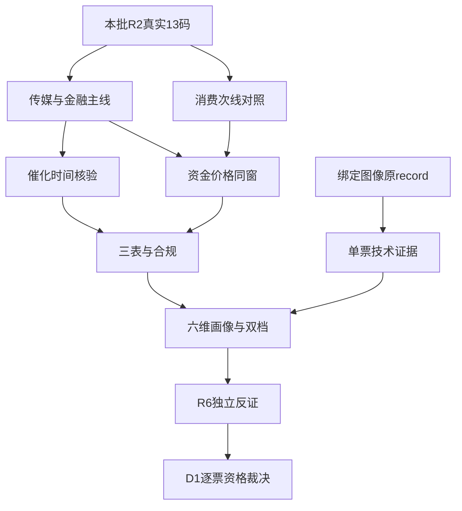

# 2026年11月3日 · 个股画像

> 数据源新鲜度：partial；降级状态：true；置信度：0.72。事实行情为11月2日收盘，不是今日盘中。

## 一句话结论
传媒、证券核心保留研究；欢瑞合规拦截候R6，旧锚和次线不因历史股性自动晋级。

## 🧭 市场与方法
R1本轮定位为高位震荡中的广谱修复。市场奖励传媒内容与证券金融的前排，而不是所有反抽。R2主线＝传媒/AI内容、证券/金融科技；持续性＝未知，封板率＝未知，下一交易时段预期＝分歧。无法证实的1/3/5日持续期与板块封板率不造数。全市场炸板率18.3%仅是市场口径，未触及35%减半条件。

主模板只用“首板隔日”。13只全部来自本批R2：主线10只、次线3只，没有池外扩票；候补仍完整画像。研究档位不是订单或交易许可，R2角色不因本版分数自动重排。真实账户预算未知，保留任何有效零预算、停买和逐票保护。

六维分数沿用前版R5的既有权重，仅作研究比较，不新增专题权重或门禁。图像记录是独立技术证据：本轮只读取原模型记录及周期上下文，没有声称本会话直接看图；全文嵌入JSON后由D1同版消费，不让后刷新的指针污染证据。

## 🧩 证据链

## 📋 六维总表
|代码/对象|R2身份|催化|筹码|联动|财务估值|技术|机构|综合|α/险|态度|
|---|---|---:|---:|---:|---:|---:|---:|---:|---|---|
|300413.SZ 芒果超媒|龙一/龙头|76|64|88|43|77|72|72.1|A-/B-|观察|
|605577.SH 龙版传媒|龙二/龙二|65|52|79|58|34|25|55.65|B/B-|降级|
|300182.SZ 捷成股份|候补/龙三|67|71|72|24|63|28|61.95|B/C|降级|
|000892.SZ 欢瑞世纪|候补/龙三|55|48|57|18|30|20|43.2|C/C|拦截|
|600825.SH 新华传媒|候补/龙三|30|20|35|36|25|25|27.85|C/C|不进|
|600109.SH 国金证券|龙一/龙头|89|70|85|77|70|63|77.15|A-/B|观察|
|300085.SZ 银之杰|龙二/龙二|82|65|76|25|44|25|60.4|B+/C|降级|
|601099.SH 太平洋|候补/龙三|78|63|65|45|62|20|62.25|B/B-|观察|
|300059.SZ 东方财富|候补/龙三|82|61|70|68|54|83|67.4|B+/B|观察|
|600570.SH 恒生电子|候补/龙三|78|49|59|63|52|65|59.6|B/B|观察|
|000995.SZ 皇台酒业|龙一/龙头|43|55|61|23|69|20|51.65|B/C|降级|
|600779.SH 水井坊|龙二/龙二|45|54|57|44|63|63|54.05|B/B-|观察|
|600189.SH 泉阳泉|候补/龙三|42|37|49|36|65|48|46.45|B-/C|降级|

## 🔍 逐票六维裁决

### 芒果超媒 300413.SZ · 观察

传媒人气容量核心保留；涨停未越前高，估值与回款约束不能忽略。

- **大资金意图**: 大单超大单5日净入1.5271亿，末日+3.0942亿；但当日龙虎榜净卖0.5306亿，不能宣称全席位一致吸筹。 意图只是基于成交结构的假设，不将净流量等同机构主观计划。
- **为什么走强**: 板块扩散与20cm封板形成容量辨识度，不等于销量新闻给芒果带来分成；日线已收复主要均线但未越10月前高。
- **逻辑够不够硬**: 市场地位和价格是硬事实，AI降本增利尚为假设；Q3利润同比-79.01%、PE三年99.86%分位构成真实反证。

**买入理由**：仅作为D1待审核的研究正证，不是下单指令。板块扩散与20cm封板形成容量辨识度，不等于销量新闻给芒果带来分成；日线已收复主要均线但未越10月前高。 机会归类为今日核心，其中计划内试错只是研究假设、不是已入今日计划。

**风险点**：Q3归母同比下降79.01%，应收/营收42.74%；股东户数扩散、榜单净卖与交易性估值压力。命中财务旗标：F7、F9。

**止损条件**：仅为研究逻辑证伪条件，不给离场价。若核心身位消失、涨停修复无法保持且跌回本版日MA5下，或公告出现合规风险升级，则停止原理由并交D1/R6重评；已有持仓仍受T+1、原保护与授权约束。

**可验证假设**：未来1—3个交易日传媒前排继续出现正溢价且芒果保持主要均线上方；若冲高回落并丢失MA5，修复延续假设被否证。

|量价与财务证据|本版实际值|
|---|---|
|日K覆盖|83根，7月起至11月2日；daily与adj_factor复算前复权|
|收盘 / MA5 / MA20 / MA60|26.760 / 24.112 / 23.201 / 19.167|
|5日/20日涨跌|10.76% / 42.64%|
|近5日主力净额|+1.5271亿元；同窗双源冲突=False|
|主力与成交额数量级|逐日已回代，绝对净额不超过当日成交额；不使用net_mf_amount|
|财务检查|15项逐项有公式、输入、期间及来源；S3当前临近风险仍待完整原文|
|估值与机构|PE/PS相对估值 + 盈利质量；未假造DCF/PEG模型输出；近30日研报去重5篇（按日期/机构/标题），调研接口0行；席位与观点不等于买入意愿。|
|板型/龙头/盈亏比/禁止清单|低位首板观察（仅当日板数，绝对位置未判）；保留R2 龙头，纪律条数不足则未知；RR未知待D1；原禁止清单未核项保真，不据空hits认全过|

技术最终裁决：强修复接近前高而非已确认突破；日量/此前5日均量0.92，拒绝快照summary中的“放量”措辞。 图像原文不替代该数值判断；周线和分钟实际复权未知，不能凭顶层fq=2确认可比。

原抓取入口已生成的绑定图像路径；本报告没有为补图新增模型调用。

### 龙版传媒 605577.SH · 降级

早封与历史股性不能覆盖下降通道，降级反抽研究，不认主升低吸。

- **大资金意图**: 5日主力+0.6099亿，但部分同日双源偏差超过5%，且R2问财11月2日方向另有冲突；不挑正值定合力。 意图只是基于成交结构的假设，不将净流量等同机构主观计划。
- **为什么走强**: 早封首板与传媒联动支持当日反抽，不足推翻20日-12.58%、30日-30.37%的弱趋势。
- **逻辑够不够硬**: 出版业务现金和盈利存在；H1研发资本化81.46%触发F5，但金额仅281.71万元，应与绝对体量共同披露，非硬否决。

**买入理由**：仅作为D1待审核的研究正证，不是下单指令。早封首板与传媒联动支持当日反抽，不足推翻20日-12.58%、30日-30.37%的弱趋势。 机会归类为今日核心，其中计划内试错只是研究假设、不是已入今日计划。

**风险点**：下降结构中的反抽，不自动授予右侧主升资格；H1资本化率高及资金口径分歧。命中财务旗标：F5。

**止损条件**：仅为研究逻辑证伪条件，不给离场价。若核心身位消失、涨停修复无法保持且跌回本版日MA5下，或公告出现合规风险升级，则停止原理由并交D1/R6重评；已有持仓仍受T+1、原保护与授权约束。

**可验证假设**：后续收复并守住MA60后仍需检验MA20与板块共振；若很快回吐首板实体，反抽延续假设不成立。

|量价与财务证据|本版实际值|
|---|---|
|日K覆盖|80根，7月起至11月2日；daily与adj_factor复算前复权|
|收盘 / MA5 / MA20 / MA60|13.000 / 12.864 / 15.257 / 13.143|
|5日/20日涨跌|2.85% / -12.58%|
|近5日主力净额|+0.6099亿元；同窗双源冲突=True|
|主力与成交额数量级|逐日已回代，绝对净额不超过当日成交额；不使用net_mf_amount|
|财务检查|15项逐项有公式、输入、期间及来源；S3当前临近风险仍待完整原文|
|估值与机构|PE/PS相对估值 + 盈利质量；未假造DCF/PEG模型输出；近30日研报去重0篇（按日期/机构/标题），调研接口0行；席位与观点不等于买入意愿。|
|板型/龙头/盈亏比/禁止清单|低位首板观察（仅当日板数，绝对位置未判）；保留R2 龙二，纪律条数不足则未知；RR未知待D1；原禁止清单未核项保真，不据空hits认全过|

技术最终裁决：13元收盘低于MA20约15.257及MA60约13.143；不是强趋势内低吸。 图像原文不替代该数值判断；周线和分钟实际复权未知，不能凭顶层fq=2确认可比。

### 捷成股份 300182.SZ · 降级

资金与20cm有力度，但高商誉、高质押和会计整改使其不能替代核心。

- **大资金意图**: 末日主力+4.2783亿、5日+1.5105亿，榜单净买3.3079亿；真实买盘不能消除控制人81.57%质押。 意图只是基于成交结构的假设，不将净流量等同机构主观计划。
- **为什么走强**: 放量收复日均线并承接内容主题，但首封偏晚且3次开板，不能仅因净买较大将候补升龙一。
- **逻辑够不够硬**: 商誉/净资产34.77%、应收/收入110.94%；H1原文披露收入确认/债务重组核算被责令改正，重大性及后续状态须R6独立审查。

**买入理由**：仅作为D1待审核的研究正证，不是下单指令。放量收复日均线并承接内容主题，但首封偏晚且3次开板，不能仅因净买较大将候补升龙一。 机会归类为主线补涨，其中计划内试错只是研究假设、不是已入今日计划。

**风险点**：F2与F11为strong_suggest，F9显著；会计监管措施不是已认定财务造假，但不可静默抹掉。命中财务旗标：F2、F3、F9、F11。

**止损条件**：仅为研究逻辑证伪条件，不给离场价。若核心身位消失、涨停修复无法保持且跌回本版日MA5下，或公告出现合规风险升级，则停止原理由并交D1/R6重评；已有持仓仍受T+1、原保护与授权约束。

**可验证假设**：后续有放量承接仍须见会计整改与高质押无恶化；任何资金转弱不能用AI叙事或历史榜单托底。

|量价与财务证据|本版实际值|
|---|---|
|日K覆盖|83根，7月起至11月2日；daily与adj_factor复算前复权|
|收盘 / MA5 / MA20 / MA60|5.640 / 5.304 / 5.452 / 5.236|
|5日/20日涨跌|1.99% / 12.80%|
|近5日主力净额|+1.5105亿元；同窗双源冲突=False|
|主力与成交额数量级|逐日已回代，绝对净额不超过当日成交额；不使用net_mf_amount|
|财务检查|15项逐项有公式、输入、期间及来源；S3当前临近风险仍待完整原文|
|估值与机构|PE/PS相对估值 + 盈利质量；未假造DCF/PEG模型输出；近30日研报去重0篇（按日期/机构/标题），调研接口0行；席位与观点不等于买入意愿。|
|板型/龙头/盈亏比/禁止清单|低位首板观察（仅当日板数，绝对位置未判）；保留R2 龙三，纪律条数不足则未知；RR未知待D1；原禁止清单未核项保真，不据空hits认全过|

技术最终裁决：量比此前5日1.90，收复主要日均线；60日趋势与连续性仍需再验，不把单根长阳当主升确认。 图像原文不替代该数值判断；周线和分钟实际复权未知，不能凭顶层fq=2确认可比。

### 欢瑞世纪 000892.SZ · 拦截

公司被立案在三季报仍未结案；历史妖性和首板均不抵消合规反证。

- **大资金意图**: 5日主力+0.9902亿为交易买盘；股东户数由53591增至81407，不能据资金正值宣布筹码加速集中。 意图只是基于成交结构的假设，不将净流量等同机构主观计划。
- **为什么走强**: 跟随内容板块反抽、4次开板，仍低于MA20/MA60；历史股性66.2不是本轮市场龙头认证。
- **逻辑够不够硬**: Q3原文明确公司涉嫌信披违法违规被立案且未收到结论，S2命中；交R6独立hard_reject，不由R5生成正式hard_reject。

**买入理由**：仅作为D1待审核的研究正证，不是下单指令。跟随内容板块反抽、4次开板，仍低于MA20/MA60；历史股性66.2不是本轮市场龙头认证。 机会归类为主线补涨，其中计划内试错只是研究假设、不是已入今日计划。

**风险点**：公司立案未结案与历史财务差错；控制主体之一欢瑞联合质押率约98.92%，连续年度亏损。命中财务旗标：F3、F9、F11、S1、S2。

**止损条件**：仅为研究逻辑证伪条件，不给离场价。若核心身位消失、涨停修复无法保持且跌回本版日MA5下，或公告出现合规风险升级，则停止原理由并交D1/R6重评；已有持仓仍受T+1、原保护与授权约束。

**可验证假设**：只有真实合规结论与关键风险解除才有重评基础；价格上涨、首板或其他票被否决都不构成自动升位。

|量价与财务证据|本版实际值|
|---|---|
|日K覆盖|83根，7月起至11月2日；daily与adj_factor复算前复权|
|收盘 / MA5 / MA20 / MA60|4.410 / 4.304 / 4.665 / 4.473|
|5日/20日涨跌|2.80% / 1.85%|
|近5日主力净额|+0.9902亿元；同窗双源冲突=False|
|主力与成交额数量级|逐日已回代，绝对净额不超过当日成交额；不使用net_mf_amount|
|财务检查|15项逐项有公式、输入、期间及来源；S3当前临近风险仍待完整原文|
|估值与机构|PE/PS与盈利质量交叉，亏损票不用PEG；近30日研报去重0篇（按日期/机构/标题），调研接口0行；席位与观点不等于买入意愿。|
|板型/龙头/盈亏比/禁止清单|低位首板观察（仅当日板数，绝对位置未判）；保留R2 龙三，纪律条数不足则未知；RR未知待D1；原禁止清单未核项保真，不据空hits认全过|

技术最终裁决：日线4.41低于MA20约4.665与MA60约4.473；首板只是反抽。 图像原文不替代该数值判断；周线和分钟实际复权未知，不能凭顶层fq=2确认可比。

### 新华传媒 600825.SH · 不进

旧锚高股性不抵资金撤退与破位，作为新旧载体分离对照，不接老龙。

- **大资金意图**: 5日主力-4.4839亿，末日Tushare分档仍负而东财为正，保留冲突，不用单日正源遮蔽5日抛压。 意图只是基于成交结构的假设，不将净流量等同机构主观计划。
- **为什么走强**: 本票没有随传媒普涨走强，11月2日-6.66%；20日累计仍+94.24%是高位余温，不是当日相对强势。
- **逻辑够不够硬**: F3、F6触发；旧锚72.8历史股性和11板最高纪录并非当前11连板。

**买入理由**：仅作为D1待审核的研究正证，不是下单指令。本票没有随传媒普涨走强，11月2日-6.66%；20日累计仍+94.24%是高位余温，不是当日相对强势。 机会归类为主线补涨，其中计划内试错只是研究假设、不是已入今日计划。

**风险点**：高位破位与连续主力净流出；PE约278倍，扣非差异占净利32.46%。命中财务旗标：F3、F6。

**止损条件**：仅为研究逻辑证伪条件，不给离场价。若核心身位消失、涨停修复无法保持且跌回本版日MA5下，或公告出现合规风险升级，则停止原理由并交D1/R6重评；已有持仓仍受T+1、原保护与授权约束。

**可验证假设**：仅在后续重新建立均线承接且可比资金止流出时重评，不因板块指数继续涨自动恢复核心。

|量价与财务证据|本版实际值|
|---|---|
|日K覆盖|70根，7月起至11月2日；daily与adj_factor复算前复权|
|收盘 / MA5 / MA20 / MA60|12.470 / 14.012 / 12.912 / 7.662|
|5日/20日涨跌|-19.60% / 94.24%|
|近5日主力净额|-4.4839亿元；同窗双源冲突=True|
|主力与成交额数量级|逐日已回代，绝对净额不超过当日成交额；不使用net_mf_amount|
|财务检查|15项逐项有公式、输入、期间及来源；S3当前临近风险仍待完整原文|
|估值与机构|PE/PS相对估值 + 盈利质量；未假造DCF/PEG模型输出；近30日研报去重0篇（按日期/机构/标题），调研接口0行；席位与观点不等于买入意愿。|
|板型/龙头/盈亏比/禁止清单|未涨停/旧锚分离对照；保留R2 龙三，纪律条数不足则未知；RR未知待D1；原禁止清单未核项保真，不据空hits认全过|

技术最终裁决：12.47已低于MA5/MA20，5日-19.60%；不把高位下跌当低吸机会。 图像原文不替代该数值判断；周线和分钟实际复权未知，不能凭顶层fq=2确认可比。

### 国金证券 600109.SH · 观察

早封证券核心与低PB支持研究优先，政策额度仍不是实买。

- **大资金意图**: 末日主力+1.6483亿、5日+1.1732亿；早封并未开板，双源微弱日存在>5%偏差，置信度按窗口披露。 意图只是基于成交结构的假设，不将净流量等同机构主观计划。
- **为什么走强**: 09:34早封体现证券先手，末日量为此前5日3.41倍；当前资金认可金融进攻，不按“老登”静态排除。
- **逻辑够不够硬**: 政策会后利率与制度安排是硬催化，Q3归母+18.01%、PB0.8427；H1保荐业务监管警示是反证，不冒充公司立案或重大违法认定。

**买入理由**：仅作为D1待审核的研究正证，不是下单指令。09:34早封体现证券先手，末日量为此前5日3.41倍；当前资金认可金融进攻，不按“老登”静态排除。 机会归类为今日核心，其中计划内试错只是研究假设、不是已入今日计划。

**风险点**：政策申请额度不等于已投放、已买入；保荐监管警示与证券经营现金流波动需分开看。命中财务旗标：本次适用计算未命中；不是全项无风险。

**止损条件**：仅为研究逻辑证伪条件，不给离场价。若核心身位消失、涨停修复无法保持且跌回本版日MA5下，或公告出现合规风险升级，则停止原理由并交D1/R6重评；已有持仓仍受T+1、原保护与授权约束。

**可验证假设**：后续1—3日证券早封核心有正溢价、行业可比净额延续且本票守住已收复均线；若只是消息高开兑现则政策交易延续失败。

|量价与财务证据|本版实际值|
|---|---|
|日K覆盖|83根，7月起至11月2日；daily与adj_factor复算前复权|
|收盘 / MA5 / MA20 / MA60|8.450 / 7.930 / 8.042 / 8.379|
|5日/20日涨跌|5.62% / 5.62%|
|近5日主力净额|+1.1732亿元；同窗双源冲突=True|
|主力与成交额数量级|逐日已回代，绝对净额不超过当日成交额；不使用net_mf_amount|
|财务检查|15项逐项有公式、输入、期间及来源；S3当前临近风险仍待完整原文|
|估值与机构|PB×ROE（金融；东财集团辅以PE，拒用分部收入PS）；近30日研报去重3篇（按日期/机构/标题），调研接口0行；席位与观点不等于买入意愿。|
|板型/龙头/盈亏比/禁止清单|低位首板观察（仅当日板数，绝对位置未判）；保留R2 龙头，纪律条数不足则未知；RR未知待D1；原禁止清单未核项保真，不据空hits认全过|

技术最终裁决：8.45收复MA20/MA60，但MA5仍低于MA20，属于反转试探而非长期多头已完成。 图像原文不替代该数值判断；周线和分钟实际复权未知，不能凭顶层fq=2确认可比。

原抓取入口已生成的绑定图像路径；本报告没有为补图新增模型调用。

### 银之杰 300085.SZ · 降级

金融科技弹性核心保留，但亏损、高PB和弱中期结构使其仅作观察。

- **大资金意图**: 末日主力+4.4523亿、5日+2.5978亿，龙虎榜净买2.4537亿，与股东户数近两次上升并列，不虚称筹码集中。 意图只是基于成交结构的假设，不将净流量等同机构主观计划。
- **为什么走强**: 20cm金融科技弹性与政策联动是真实交易反馈；股价仍低于MA20/MA60，非确定性主升。
- **逻辑够不够硬**: 连续年度亏损触发S1，Q3仍亏0.492亿、PB46.14；公司H1明确无控股股东及实控人，F11不适用而非未知或0质押。

**买入理由**：仅作为D1待审核的研究正证，不是下单指令。20cm金融科技弹性与政策联动是真实交易反馈；股价仍低于MA20/MA60，非确定性主升。 机会归类为今日核心，其中计划内试错只是研究假设、不是已入今日计划。

**风险点**：S1与F4；估值须看PS/PB而非盈利PE；板块热度向未来盈利传导未闭环。命中财务旗标：F4、S1。

**止损条件**：仅为研究逻辑证伪条件，不给离场价。若核心身位消失、涨停修复无法保持且跌回本版日MA5下，或公告出现合规风险升级，则停止原理由并交D1/R6重评；已有持仓仍受T+1、原保护与授权约束。

**可验证假设**：后续能否收复MA20并维持主题内前排地位可证伪；若反包次日失去承接，不因20cm标签追后排。

|量价与财务证据|本版实际值|
|---|---|
|日K覆盖|83根，7月起至11月2日；daily与adj_factor复算前复权|
|收盘 / MA5 / MA20 / MA60|26.680 / 24.626 / 27.020 / 29.460|
|5日/20日涨跌|0.95% / -9.41%|
|近5日主力净额|+2.5978亿元；同窗双源冲突=False|
|主力与成交额数量级|逐日已回代，绝对净额不超过当日成交额；不使用net_mf_amount|
|财务检查|15项逐项有公式、输入、期间及来源；S3当前临近风险仍待完整原文|
|估值与机构|PE/PS与盈利质量交叉，亏损票不用PEG；近30日研报去重0篇（按日期/机构/标题），调研接口0行；席位与观点不等于买入意愿。|
|板型/龙头/盈亏比/禁止清单|低位首板观察（仅当日板数，绝对位置未判）；保留R2 龙二，纪律条数不足则未知；RR未知待D1；原禁止清单未核项保真，不据空hits认全过|

技术最终裁决：26.68仍在MA20约27.02下；反包可研究，不能套强趋势低吸模板。 图像原文不替代该数值判断；周线和分钟实际复权未知，不能凭顶层fq=2确认可比。

### 太平洋 601099.SH · 观察

券商助攻不取代早封国金；第一大股东高质押冻结风险单列。

- **大资金意图**: 5日主力+3.4486亿、末日+3.8288亿，但当日两源偏差>5%；未上榜不代表没有机构。 意图只是基于成交结构的假设，不将净流量等同机构主观计划。
- **为什么走强**: 首板与券商扩散支持修复，但R2候补身份不因净买规模变成龙一。
- **逻辑够不够硬**: Q3净利同比-35.54%、PE约196；北京嘉裕78.06%质押及全持股冻结是第一大股东事实，尚未核其控股身份，不能伪造F11控股结论。

**买入理由**：仅作为D1待审核的研究正证，不是下单指令。首板与券商扩散支持修复，但R2候补身份不因净买规模变成龙一。 机会归类为主线补涨，其中计划内试错只是研究假设、不是已入今日计划。

**风险点**：第一大股东高质押及冻结，控制身份待核；利润下滑与资金口径差异。命中财务旗标：本次适用计算未命中；不是全项无风险。

**止损条件**：仅为研究逻辑证伪条件，不给离场价。若核心身位消失、涨停修复无法保持且跌回本版日MA5下，或公告出现合规风险升级，则停止原理由并交D1/R6重评；已有持仓仍受T+1、原保护与授权约束。

**可验证假设**：国金先手继续带队并出现同行正反馈才保留助攻；若证券仅独股脉冲，不因本票低价晋级。

|量价与财务证据|本版实际值|
|---|---|
|日K覆盖|83根，7月起至11月2日；daily与adj_factor复算前复权|
|收盘 / MA5 / MA20 / MA60|3.540 / 3.312 / 3.388 / 3.451|
|5日/20日涨跌|5.67% / 3.21%|
|近5日主力净额|+3.4486亿元；同窗双源冲突=True|
|主力与成交额数量级|逐日已回代，绝对净额不超过当日成交额；不使用net_mf_amount|
|财务检查|15项逐项有公式、输入、期间及来源；S3当前临近风险仍待完整原文|
|估值与机构|PB×ROE（金融；东财集团辅以PE，拒用分部收入PS）；近30日研报去重0篇（按日期/机构/标题），调研接口0行；席位与观点不等于买入意愿。|
|板型/龙头/盈亏比/禁止清单|低位首板观察（仅当日板数，绝对位置未判）；保留R2 龙三，纪律条数不足则未知；RR未知待D1；原禁止清单未核项保真，不据空hits认全过|

技术最终裁决：3.54收复日均线，近期前高附近仍待确认；周线不自动与今日日线相比较。 图像原文不替代该数值判断；周线和分钟实际复权未知，不能凭顶层fq=2确认可比。

### 东方财富 300059.SZ · 观察

金融容量与盈利较硬，但未板且MA60未收复，不用容量替代接力身位。

- **大资金意图**: 当日主力+12.3216亿，但前四日负流几乎抵消，5日仅+0.0651亿；不能把单日大流入写成持续吸筹。 意图只是基于成交结构的假设，不将净流量等同机构主观计划。
- **为什么走强**: 政策与证券风险偏好修复支撑+6.31%，3年PE低分位和Q3利润增长有基本面；本模板仍不取代国金首封地位。
- **逻辑够不够硬**: Q3归母+30.89%、营业总收入155.60亿；工业PS所用revenue仅金融电商分部，不能按67倍直接判集团PS。F8的单季信号触发，但金融客户资金等扰动尚未拆完。

**买入理由**：仅作为D1待审核的研究正证，不是下单指令。政策与证券风险偏好修复支撑+6.31%，3年PE低分位和Q3利润增长有基本面；本模板仍不取代国金首封地位。 机会归类为主线补涨，其中计划内试错只是研究假设、不是已入今日计划。

**风险点**：F8单季Q2/Q3为负须披露，金融经营现金流不能机械解释成回款恶化；子公司74万元反洗钱罚款及投资咨询整改不是发行人立案。命中财务旗标：F8。

**止损条件**：仅为研究逻辑证伪条件，不给离场价。若核心身位消失、涨停修复无法保持且跌回本版日MA5下，或公告出现合规风险升级，则停止原理由并交D1/R6重评；已有持仓仍受T+1、原保护与授权约束。

**可验证假设**：后续证券成交与风险偏好连续性若不成立，容量流入即可能回吐；不以低PE单独获得交易资格。

|量价与财务证据|本版实际值|
|---|---|
|日K覆盖|83根，7月起至11月2日；daily与adj_factor复算前复权|
|收盘 / MA5 / MA20 / MA60|18.710 / 18.078 / 18.015 / 18.742|
|5日/20日涨跌|0.86% / 4.70%|
|近5日主力净额|+0.0651亿元；同窗双源冲突=False|
|主力与成交额数量级|逐日已回代，绝对净额不超过当日成交额；不使用net_mf_amount|
|财务检查|15项逐项有公式、输入、期间及来源；S3当前临近风险仍待完整原文|
|估值与机构|PB×ROE（金融；东财集团辅以PE，拒用分部收入PS）；近30日研报去重17篇（按日期/机构/标题），调研接口0行；席位与观点不等于买入意愿。|
|板型/龙头/盈亏比/禁止清单|未涨停/旧锚分离对照；保留R2 龙三，纪律条数不足则未知；RR未知待D1；原禁止清单未核项保真，不据空hits认全过|

技术最终裁决：18.71仍略低MA60约18.742，长均线压力未解除。 图像原文不替代该数值判断；周线和分钟实际复权未知，不能凭顶层fq=2确认可比。

### 恒生电子 600570.SH · 观察

金融IT政策映射成立但非前排，五日资金仍负，不因低估值挤占核心。

- **大资金意图**: 末日主力+1.7821亿，5日仍-0.5419亿；资金回流一天不是持续共识。 意图只是基于成交结构的假设，不将净流量等同机构主观计划。
- **为什么走强**: 首板收复MA5/MA20，尚在MA60下；金融IT与政策相关，但公司收入兑现不直接等于再贷款资金流入。
- **逻辑够不够硬**: Q3净利+26.49%但营收-5.66%，F4存货/周转背离；累计CFO三期负不满足连续两单季负，F8已实际转单季判未命中。

**买入理由**：仅作为D1待审核的研究正证，不是下单指令。首板收复MA5/MA20，尚在MA60下；金融IT与政策相关，但公司收入兑现不直接等于再贷款资金流入。 机会归类为主线补涨，其中计划内试错只是研究假设、不是已入今日计划。

**风险点**：收入增长与利润增长分化；累计负CFO有季节性，不能把未命中F8当现金全面健康。命中财务旗标：F4。

**止损条件**：仅为研究逻辑证伪条件，不给离场价。若核心身位消失、涨停修复无法保持且跌回本版日MA5下，或公告出现合规风险升级，则停止原理由并交D1/R6重评；已有持仓仍受T+1、原保护与授权约束。

**可验证假设**：后续资金净额持续改善、主营收入兑现和核心股承接同时成立才重评，单日金融共振不足。

|量价与财务证据|本版实际值|
|---|---|
|日K覆盖|83根，7月起至11月2日；daily与adj_factor复算前复权|
|收盘 / MA5 / MA20 / MA60|20.760 / 19.796 / 19.797 / 20.908|
|5日/20日涨跌|-0.38% / 7.17%|
|近5日主力净额|-0.5419亿元；同窗双源冲突=False|
|主力与成交额数量级|逐日已回代，绝对净额不超过当日成交额；不使用net_mf_amount|
|财务检查|15项逐项有公式、输入、期间及来源；S3当前临近风险仍待完整原文|
|估值与机构|PE/PS相对估值 + 盈利质量；未假造DCF/PEG模型输出；近30日研报去重3篇（按日期/机构/标题），调研接口0行；席位与观点不等于买入意愿。|
|板型/龙头/盈亏比/禁止清单|低位首板观察（仅当日板数，绝对位置未判）；保留R2 龙三，纪律条数不足则未知；RR未知待D1；原禁止清单未核项保真，不据空hits认全过|

技术最终裁决：20.76低于MA60约20.908与近期箱体上沿；不称已突破全部压力。 图像原文不替代该数值判断；周线和分钟实际复权未知，不能凭顶层fq=2确认可比。

### 皇台酒业 000995.SZ · 降级

消费二板高度保留研究，弱财务和控制人调查背景限制风险档。

- **大资金意图**: 5日主力+2.2323亿，但末日量为此前5日0.27倍，锁筹/缩量不等于真实可成交承接。 意图只是基于成交结构的假设，不将净流量等同机构主观计划。
- **为什么走强**: 2板且早封显示消费局部先手，白酒行业净流仍负，不扩写成全行业主升。
- **逻辑够不够硬**: 前三季收入0.7162亿且亏损；控制人立案原文明确非公司事项，不能硬套公司立案。控股及一致行动组质押与冻结分别披露。

**买入理由**：仅作为D1待审核的研究正证，不是下单指令。2板且早封显示消费局部先手，白酒行业净流仍负，不扩写成全行业主升。 机会归类为计划内试错，其中计划内试错只是研究假设、不是已入今日计划。

**风险点**：财务轴S1、F3/F4以及高估值；控制人调查与一致行动组部分高比例质押冻结。命中财务旗标：F3、F4、S1。

**止损条件**：仅为研究逻辑证伪条件，不给离场价。若核心身位消失、涨停修复无法保持且跌回本版日MA5下，或公告出现合规风险升级，则停止原理由并交D1/R6重评；已有持仓仍受T+1、原保护与授权约束。

**可验证假设**：只有白酒板块新增助攻且控制人事项无新增公司风险时重评；若二板独强而行业仍流出，不追高度。

|量价与财务证据|本版实际值|
|---|---|
|日K覆盖|83根，7月起至11月2日；daily与adj_factor复算前复权|
|收盘 / MA5 / MA20 / MA60|15.600 / 14.112 / 12.903 / 11.697|
|5日/20日涨跌|16.68% / 37.69%|
|近5日主力净额|+2.2323亿元；同窗双源冲突=True|
|主力与成交额数量级|逐日已回代，绝对净额不超过当日成交额；不使用net_mf_amount|
|财务检查|15项逐项有公式、输入、期间及来源；S3当前临近风险仍待完整原文|
|估值与机构|PE/PS与盈利质量交叉，亏损票不用PEG；近30日研报去重0篇（按日期/机构/标题），调研接口0行；席位与观点不等于买入意愿。|
|板型/龙头/盈亏比/禁止清单|2连板观察；保留R2 龙头，纪律条数不足则未知；RR未知待D1；原禁止清单未核项保真，不据空hits认全过|

技术最终裁决：日均线多头但接近前高，不能把缩量一字当放量突破。 图像原文不替代该数值判断；周线和分钟实际复权未知，不能凭顶层fq=2确认可比。

原抓取入口已生成的绑定图像路径；本报告没有为补图新增模型调用。

### 水井坊 600779.SH · 观察

放量首板好于历史弱股性，但利润/库存反证使其仍是次线对照。

- **大资金意图**: 末日主力+1.0477亿、5日+1.0034亿，早期小额日双源冲突保留；不能上升为白酒全板块净买。 意图只是基于成交结构的假设，不将净流量等同机构主观计划。
- **为什么走强**: 末日量为此前5日3.68倍、收复日均线，说明弱历史股性可被当前资金重估。
- **逻辑够不够硬**: Q3净利同比-34.30%、收入-16.75%，存货增且周转降触F4；PE三年99.72%分位，不是盈利确定性恢复。

**买入理由**：仅作为D1待审核的研究正证，不是下单指令。末日量为此前5日3.68倍、收复日均线，说明弱历史股性可被当前资金重估。 机会归类为计划内试错，其中计划内试错只是研究假设、不是已入今日计划。

**风险点**：库存与需求修复尚未验证；次线、非主线核心，不能因涨停获计划内资格。命中财务旗标：F4。

**止损条件**：仅为研究逻辑证伪条件，不给离场价。若核心身位消失、涨停修复无法保持且跌回本版日MA5下，或公告出现合规风险升级，则停止原理由并交D1/R6重评；已有持仓仍受T+1、原保护与授权约束。

**可验证假设**：后续存货/终端动销及板块资金若未改善，涨停只按估值修复处理，不把成本降幅当行业复苏。

|量价与财务证据|本版实际值|
|---|---|
|日K覆盖|83根，7月起至11月2日；daily与adj_factor复算前复权|
|收盘 / MA5 / MA20 / MA60|28.120 / 25.688 / 26.077 / 26.830|
|5日/20日涨跌|10.36% / 8.24%|
|近5日主力净额|+1.0034亿元；同窗双源冲突=True|
|主力与成交额数量级|逐日已回代，绝对净额不超过当日成交额；不使用net_mf_amount|
|财务检查|15项逐项有公式、输入、期间及来源；S3当前临近风险仍待完整原文|
|估值与机构|PE/PS相对估值 + 盈利质量；未假造DCF/PEG模型输出；近30日研报去重3篇（按日期/机构/标题），调研接口0行；席位与观点不等于买入意愿。|
|板型/龙头/盈亏比/禁止清单|低位首板观察（仅当日板数，绝对位置未判）；保留R2 龙二，纪律条数不足则未知；RR未知待D1；原禁止清单未核项保真，不据空hits认全过|

技术最终裁决：28.12已过日均线，仍需对照行业资金与上方历史压力，非中期趋势保证。 图像原文不替代该数值判断；周线和分钟实际复权未知，不能凭顶层fq=2确认可比。

### 泉阳泉 600189.SH · 降级

二板不能覆盖股价涨与资金净卖背离、杠杆及减持窗口，只作消费联动对照。

- **大资金意图**: 末日主力-0.3795亿，东财亦负且偏差>5%；龙虎榜多日区间净卖不可当单日流入，5日+0.4460亿不掩盖末日背离。 意图只是基于成交结构的假设，不将净流量等同机构主观计划。
- **为什么走强**: 2板与饮料消费联动，但4次开板、首封晚于皇台；泉阳泉不是主营白酒，不移植白酒经营逻辑。
- **逻辑够不够硬**: Q3利润增长有依据，但有息债务/净资产115.94%；5%以上股东减持计划处于10月26日至次年1月24日窗口，不把计划当已成交。

**买入理由**：仅作为D1待审核的研究正证，不是下单指令。2板与饮料消费联动，但4次开板、首封晚于皇台；泉阳泉不是主营白酒，不移植白酒经营逻辑。 机会归类为计划内试错，其中计划内试错只是研究假设、不是已入今日计划。

**风险点**：F10高杠杆与有效减持窗口；开板4次、涨价资金背离；控股股东解除质押不是战略增持成交。命中财务旗标：F10。

**止损条件**：仅为研究逻辑证伪条件，不给离场价。若核心身位消失、涨停修复无法保持且跌回本版日MA5下，或公告出现合规风险升级，则停止原理由并交D1/R6重评；已有持仓仍受T+1、原保护与授权约束。

**可验证假设**：后续若继续涨价却主力持续负流，背离假设强化；只在可比资金/价格重新同向时重评消费联动。

|量价与财务证据|本版实际值|
|---|---|
|日K覆盖|83根，7月起至11月2日；daily与adj_factor复算前复权|
|收盘 / MA5 / MA20 / MA60|9.720 / 8.490 / 8.491 / 7.997|
|5日/20日涨跌|14.76% / 18.68%|
|近5日主力净额|+0.4460亿元；同窗双源冲突=True|
|主力与成交额数量级|逐日已回代，绝对净额不超过当日成交额；不使用net_mf_amount|
|财务检查|15项逐项有公式、输入、期间及来源；S3当前临近风险仍待完整原文|
|估值与机构|PE/PS相对估值 + 盈利质量；未假造DCF/PEG模型输出；近30日研报去重5篇（按日期/机构/标题），调研接口1行；席位与观点不等于买入意愿。|
|板型/龙头/盈亏比/禁止清单|2连板观察；保留R2 龙三，纪律条数不足则未知；RR未知待D1；原禁止清单未核项保真，不据空hits认全过|

技术最终裁决：站上日均线且突破近期平台，仍需开板承接；不能由技术标签排除资金反证。 图像原文不替代该数值判断；周线和分钟实际复权未知，不能凭顶层fq=2确认可比。

## ⚖️ 为什么不选对照对象
历史股性最优的新华传媒不是当前最强：旧锚72.8分与当日下跌、5日资金净流出并存，不能替代芒果的人气容量核心。龙版的早封和69.5分保留研究，但日线仍在MA20/MA60之下；欢瑞66.2分更不能越过公司立案。

东财历史股性64高于国金43.7、单日资金也大，但5日几乎零净入且未封板，首板隔日模板不按容量绝对额改龙头。白酒次线的高度继续研究，但皇台财务/控制人事件、水井库存和泉阳泉减持/资金背离均未消失。

成长专题唯一精确本池匹配为欢瑞“未入观察”；附录字母语义未完整运输，不冒充已核财务检查。红利、董监高增持和一字预测的本池精确投影均无命中，不引入榜单旁边的股票。上游旧版成长/日历只在索引中保留其已读范围；反馈空段保持unknown，同源转载和投影不重复加权。

## 🧾 关键证据
- 欢瑞三季报仍披露立案未有结论，原文SHA与摘录嵌入S2；交R6独立否决，不把涉嫌写成已认定造假。
- 捷成Q3商誉/净资产34.77%，控股股东质押81.57%；正资金与财务强反证同时成立。
- 芒果日量不及此前五日均量；拒绝原模型summary中与自身volume_signal冲突的“放量”说法。
- 东财Q2/Q3单季CFO均负但均盈利，F8照原阈值透传；金融客户资金/证券投资性质未拆，不直接宣布回款崩坏。
- 恒生三期累计CFO为负，但Q2/Q3单季为正，F8未命中；不能用累计代替单季。

## 数据源审计
|源|日期|状态|记录及边界|
|---|---|:--:|---|
|R2真实候选|2026-11-03|🟡|13只；原状态partial、角色/窗口/必要缺证保留|
|R1市场阶段|2026-11-03|🟡|本轮高位震荡与修复定位，不另造风格|
|R4消息|2026-11-03|🟡|本轮内嵌政策及原证据；发行人无事件命中不等于无风险|
|Tushare MCP逐票取证|2026-11-03|🟢|221次实际调用；13票三表、价格、资金、指标和公告|
|Tushare龙虎榜/涨停补证|2026-11-03|🟢|46个日期接口条目，末5日复用同源；只保留本池13码|
|发行人公告PDF|2026-11-03|🟢|44份实际取得并抽取正文；仅定向选段阅读，不宣称全篇理解|
|两融|2026-10-30|🟡|有记录票仅14个观测；空接口不假定非标的，不冒充11月2日值|
|图像绑定副本|2026-11-03|🟡|13个原record完整嵌入；本会话未直接看图，周线/分钟复权未核|
|四色四量|2026-11-02|🟢|本轮7日事件查询，数据库截至11月2日；无命中不是空头判定|
|专题知识|2026-11-03|🟡|5个直接索引及全部上游嵌套索引保留，内容可明确精简，非全文阅读|
|DCF/缠论引擎|2026-11-03|🟡|未运行，不造模型或缠论同向认证|

## 不确定性 / 反证
必要风险尚未全闭环，状态保持partial而非complete。S3当前临近风险不能凭未见标题、盈利为正或非ST名称判阴性；若D1/R6判定相关项为本票必要前提，只限制本票，交R5/R4补证，不能让禁MCP的R6抓数。部分S2存在具体监管/控制人事实，但主体和重大性未闭环，不把轻微监管警示机械升级成公司立案。

辅助缺数没有造成市场级停买；但研究也不自动恢复买权。资金冲突、窗口差异和图像文字自相矛盾全部保留；三年历史分位是相对估值，不是T+1收益预测。R6是唯一hard_reject正式来源。

## 与其他 R/D/E 的关系
- 依赖：本轮R1、R2、R3、R4、R7已绑定证据及本阶段实时补证。
- R6：只消费本版JSON内嵌事实、计算、原文与knowledge_context，不读专题MD，不联网补证。
- D1：从同版R5嵌入chart_vision/chart_evidence消费，逐票审核必要风险、RR和真实授权；首次成案前in_today_plan保持未知。
- E1：按可验证假设回填后续效果，不能从research-only态度推断实际买入。

## Sub-Agent 元数据
- skill: analyze_stock_profile_v1
- artifact: data/research/20261103/R5_stock_profiles.json
- model: gpt-6.1-sol（本会话）；图像原模型身份逐票嵌入
- 状态: partial，结构交付校验通过不代表风险/交易资格审核通过
- 生成耗时: 实际开始于本轮06:58，精确耗时见交付验证；不将观察预算当硬限
