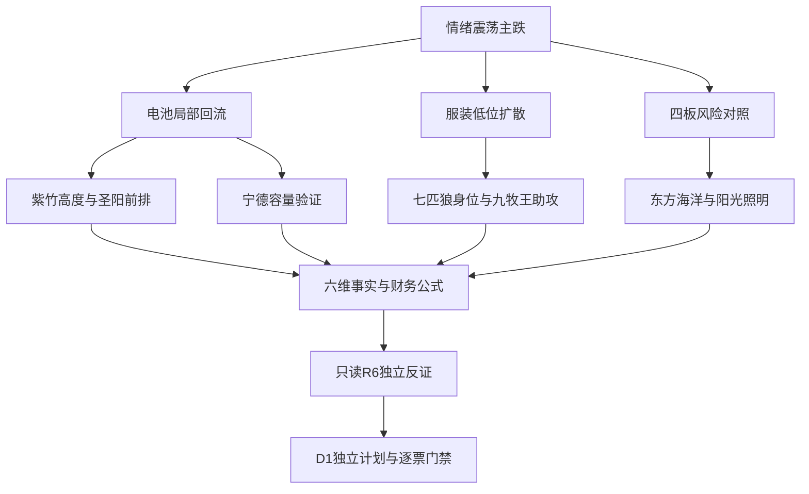

# 2026年11月4日 · 个股画像

> 数据源新鲜度：partial；降级状态：true；研究置信度：0.72。不是买入或调仓清单。

## 🧭 一句话结论
低位核心继续画像，两只四板降级对照；财务与真实换手优先，不把看图偏多当买权。

## 🔎 详细分析
情绪=震荡/主跌。市场奖励电池局部资金修复与服装低位接力，非全市场主升；沿用R2三格单模板、7只减半后真实候选，保留5只主线研究与2只高标风险对照。不授开仓资格、不从市场意见推账户预算。

主线 = 电池局部回流，持续性 = 3日（已观测资金），封板率 = 87.5%，明日预期 = 分歧；主线 = 服装低位扩散，持续性 = 1日（板块净入），封板率 = 100%，明日预期 = 分歧。这是T-1事实与研究预期，不是今日已发生确认。

两条研究方向不等于可交易主线已确认。本批七票已是上游15只正常容量减半后最多7只，R5完整覆盖，不为凑数扩池，也不再机械减半删去风险对照。三格是唯一主模板，角色不因单项分数倒置。

本阶段105次基础SDK请求、财报与公告补证均保留实际结果；直接SDK不是MCP、同一公告镜像也不新增独立信源。每票84根日K及原始资金、价格、三表与原文内嵌，R6只读本版即可反证。

必要排雷不等于所有辅助资料齐全。东方海洋历史证券诉讼当前合规适用范围尚未闭环，回送R5/R4；其他票不因研报、图像或ETF缺数全局停买。空flags不会被称为全面安全。

## 📊 候选总览
|代码/名称|角色|态度|Alpha / Risk|板型|RR / 禁止清单|
|---|---|---|---|---|---|
|002058.SZ 紫竹高科|龙一|观察|B+ / B-|盘中上板|unknown / 未全审；不授执行资格|
|002580.SZ 圣阳股份|龙二|观察|B+ / B-|盘中上板|unknown / 未全审；不授执行资格|
|300750.SZ 宁德时代|候补|观察|B / B|非涨停，容量趋势观察|unknown / 未全审；不授执行资格|
|002029.SZ 七匹狼|龙一|观察|B+ / B-|盘中上板|unknown / 未全审；不授执行资格|
|601566.SH 九牧王|龙二|观察|B / B-|盘中上板|unknown / 未全审；不授执行资格|
|002086.SZ 东方海洋|候补|降级|B- / C|开盘涨停后开板回封|unknown / 未全审；不授执行资格|
|600261.SH 阳光照明|候补|降级|B- / C|开盘涨停后开板回封|unknown / 未全审；不授执行资格|

## 🟡 紫竹高科 002058.SZ

保留电池高度研究，净资产薄与债务下界过线削弱风险质量；不是确认总龙。

- **大资金意图**: 高度资金在电池局部回流中寻求小容量辨识度，现有净入可以解释身位，但薄净资产让对手盘估值分歧更尖锐；不是已证明机构长期配置。
- **为什么走强**: 二板身位、两日净入和7只行业封板共同支持价格修复；公司公告未提供经营突变，因此本轮更像情绪重估而非订单驱动。
- **逻辑够不够硬**: 价格和资金事实硬，产业增量弱。原公告与行情是不同证据面，两个资金接口仍是同一聚合商渠道，不能报多源全确认。

### 六维画像
|维度|研究分|事实与裁决|
|---|---:|---|
|催化背景|42|11月4日异动公告原文确认经营环境无重大变化、无未披露重大事项；不能把连板或更名当新订单。6月撤销退市风险警示公告已取原文，6月15日起撤销，旧*ST不得延续到本轮。电池/铝塑膜是既有业务关联，本轮未核新增产能兑现。|
|筹码结构|65|5日自算大单净额与东财口径同向温和净入，最新两日支持修复，但10月28/29日两源相对差异超过5%，筹码维度置信度局部降级。最近龙虎榜是连续三日窗口，机构双边交易与营业部买入并存，不能重复加买卖榜相同席位，也不能称单日全机构锁仓。|
|板块联动|75|继承R2电池行业高度龙一，不将资金第8冒充第1；行业7封板1炸板构成局部扩散。自身二板首封09:48:48，未满足09:45前的早封组合；板块本轮起点未知，所以days_since_first_board保留null，不用10日窗口首现造龙头确认。|
|财务估值|32|Q3归母净利2052.08万元、同比-89.46%，但扣非1999.51万元，表观大降含上期非经常性比较基数。货币资金不足以覆盖已知债务，F9应收/累计收入41.68%、F10已知有息债务下界/并表净资产226.15%均命中。PB39.69倍与薄归母净资产匹配，不能只看PS较低分位当便宜；正PE样本仅282，分位非完整无偏估值。|
|技术形态|65|84根前复权日线显示两连板收复MA20、30日仍上涨30.51%，但此前高点回落后的修复不等于已确认主升再起；5日均量口径1.16倍并非爆量突破。用日线数值认定反弹修复，今日分时承接未知；图像只作历史结构的一票证据，不升级为跨周期反转。|
|研报机构|50|近30自然日report_rc查询0行，stk_surv有2次；无研报记录不等于没有机构交易，已有最近三日龙虎榜机构专用席位双向参与。调研与资金仍同源接口，不能按Agent个数扩大独立支持。|

### 必要核验与边界
|检查|状态|本版结果|
|---|---|---|
|F1|checked_negative|AND条件有一项为假即可排除；短借null保留，不填0。|
|F2|checked_negative|比率 0.0000；并表资产配并表含少数权益净资产；归母口径另存，不能混用。|
|F3|checked_negative|同累计季度同比；收入负增速时仍沿原阈值，另提示负增长基准会放大相对判据。|
|F4|checked_negative|周转率用同年内累计期间比较，不把Q3与H1直接比较。|
|F5|checked_negative|比率 0.0000；只证明FY2025研发资本化率，不冒充2026Q3流量；最新Q3未披露分拆保留辅助缺口。|
|F6|checked_negative|比率 0.0256；亏损期原正利润依赖度比例不适用，保留非经常损益绝对额；不能把非经常损失说成一次性收益撑利润。|
|F7|unknown|已读关联交易原表，租赁/资产交易/金融服务与购销口径需分拆汇总，未用预计额度或财务公司存款余额充当当期交易流量。|
|F8|checked_negative|所有可得独立单季序列另存；不将连续两个累计负值算作连续单季。|
|F9|flagged|比率 0.4168；沿原YTD收入规则，不擅自改年化阈值。|
|F10|flagged|已知借款下界过线即检出；全部负债上界不过线即可阴性；其余情况因债券/票据/其他计息性质不全为unknown，null未补0。|
|F11|checked_negative|比率 0.0000；控股身份按年报/中报确认，Q3原表有明确无/0或实际质押数；状态仅截至20260930，后续标题另审。|
|F12|checked_negative|仅最新已披露FY2025年审，不以Q3未经审计“不适用”替代审计意见。|
|S1|checked_negative|原财务轴，仅研究strong_suggest，不把短期亏损单独创造新hard_reject。|
|S2|checked_negative|报告期原文明确无相关重大处罚/整改，并交叉截至取证时已入库公告索引及现有风险原文；阴性限本次披露窗口，不保证全网/全天或未公开监管状态。|
|S3|checked_negative|最新审计及原文/披露目录未检出当前*ST临近预警；002058历史*ST已由20260612公告明确20260615撤销，不能沿用旧硬禁。当前完整法律排雷仍非保证。|

本票必要范围：F1, F2, F3, F4, F6, F8, F9, F12, S1, S2, S3。完整性：True；这不是全清单完成或买权。辅助项unknown另列，实际检出红旗照常交R6。

- **买入理由**: 仅研究：电池局部回流下唯一二板，具有高度对照价值。；已算5日双口径净入与真实换手，不因旧ST名称误杀；不是开仓理由完整通过。
- **风险点**: F9/F10已检出，PB高且归母权益薄。；首封晚于09:45，当前带动性、RR与今日承接未核。
- **止损条件**: 研究假设撤销：后续收盘失守本版已算MA20且电池跟随封板收缩，或新增实质合规公告；持仓价位和执行止损交D1，R5不出价格。
- **可验证假设**: 未来1—3交易日验证电池封板扩散是否保持至少3家、其相对高度是否保持领先，及可比资金是否转为连续两日双口径净卖；失去领先或持续净卖即撤销当前修复假设。

### 图像证据与独立量价裁决
保留原记录V形修复/周线压力描述为历史参考。原记录的价格提示不当入场价；周线截至10月30日，分钟复权未核，不能据顶层fq=2证明周/分全部可比。

原record已在JSON完整嵌入；本会话阅读其模型文本，未宣称亲读PNG。snapshot可归属不等于确认突破，周/分钟复权未核，D1只消费本版副本。

## 🟡 圣阳股份 002580.SZ

首板资金与热度前排保留，但存货、应收和盈利质量不支持无条件主升叙事。

- **大资金意图**: 资金可能在电池回流中选择容量适中、早封且热度提升的首板；净买集中单日提示是切换试探，不是已证明持续吸筹。
- **为什么走强**: 行业局部回流、09:35无开板封住和同日大单净入同向；但Q3利润下滑及存货增长让产业兑现解释不够硬。
- **逻辑够不够硬**: 价格/资金同日互证较硬，新增订单未知；F4/F9不能因主线强势删除。

### 六维画像
|维度|研究分|事实与裁决|
|---|---:|---|
|催化背景|45|本轮R4没有精确圣阳新增硬催化，已读Q3原文显示收入增长同时并表深圳达人高科影响资产结构；不能把全部同比增长认定纯内生。储能产业映射是研究背景，不是本批新订单。|
|筹码结构|73|昨日双口径主力净入接近3.97亿元，但前日净卖约0.70亿元，净买高度集中于单日，持续性不足。历史小额日源差超过5%单列，不抹掉最新同向信号；最近龙虎榜为10月8日旧窗口，不拿来冒充11月3日机构接力。|
|板块联动|74|继承R2龙二、09:35首板与资金第2，和紫竹高度角色不同。7只行业封板支持局部联动，但首板不满足二板早封组合，真实板块启动日未知，仍不能硬认证总龙。宁德容量修复与本票身位同时观察，不把宽固态概念净出隐藏。|
|财务估值|45|Q3累计营收增长23.77%、归母利润下降13.61%；存货同比增51.51%超过收入增速1.5倍且周转率3.7445降至3.3118，F4命中；应收/收入49.62%，F9命中。Q1现金流负但Q2/Q3单季均正，F8阴性，不能把H1累计负值当两季负。PE51.63倍、正PE三年分位约89.81%，增长兑现与营运资金比情绪更慢。|
|技术形态|60|84根日线：涨停收复MA20但仍低于MA50/60；20日、30日收益仍接近平盘而非持续主升。成交量仅含当日5均量0.73倍，封板缩量不能替代开板承接；今日是否弱转强未知。|
|研报机构|38|近30日研报与调研接口各0行。旧10月8日榜确有机构/股通/营业部分层，只证明旧交易窗口，不用新热榜反推当日机构认可。|

### 必要核验与边界
|检查|状态|本版结果|
|---|---|---|
|F1|checked_negative|AND条件有一项为假即可排除；短借null保留，不填0。|
|F2|checked_negative|比率 0.0072；并表资产配并表含少数权益净资产；归母口径另存，不能混用。|
|F3|checked_negative|同累计季度同比；收入负增速时仍沿原阈值，另提示负增长基准会放大相对判据。|
|F4|flagged|周转率用同年内累计期间比较，不把Q3与H1直接比较。|
|F5|checked_negative|比率 0.0000；只证明FY2025研发资本化率，不冒充2026Q3流量；最新Q3未披露分拆保留辅助缺口。|
|F6|checked_negative|比率 0.0390；亏损期原正利润依赖度比例不适用，保留非经常损益绝对额；不能把非经常损失说成一次性收益撑利润。|
|F7|unknown|已读关联交易原表，租赁/资产交易/金融服务与购销口径需分拆汇总，未用预计额度或财务公司存款余额充当当期交易流量。|
|F8|checked_negative|所有可得独立单季序列另存；不将连续两个累计负值算作连续单季。|
|F9|flagged|比率 0.4962；沿原YTD收入规则，不擅自改年化阈值。|
|F10|unknown|已知借款下界过线即检出；全部负债上界不过线即可阴性；其余情况因债券/票据/其他计息性质不全为unknown，null未补0。|
|F11|checked_negative|比率 0.0000；控股身份按年报/中报确认，Q3原表有明确无/0或实际质押数；状态仅截至20260930，后续标题另审。|
|F12|checked_negative|仅最新已披露FY2025年审，不以Q3未经审计“不适用”替代审计意见。|
|S1|checked_negative|原财务轴，仅研究strong_suggest，不把短期亏损单独创造新hard_reject。|
|S2|checked_negative|报告期原文明确无相关重大处罚/整改，并交叉截至取证时已入库公告索引及现有风险原文；阴性限本次披露窗口，不保证全网/全天或未公开监管状态。|
|S3|checked_negative|最新审计及原文/披露目录未检出当前*ST临近预警；002058历史*ST已由20260612公告明确20260615撤销，不能沿用旧硬禁。当前完整法律排雷仍非保证。|

本票必要范围：F1, F2, F3, F4, F6, F8, F9, F12, S1, S2, S3。完整性：True；这不是全清单完成或买权。辅助项unknown另列，实际检出红旗照常交R6。

- **买入理由**: 仅研究：主线首板前排，首封早于行业高度票。；昨日资金规模与热度相互吻合，但热度不独立认证买权。
- **风险点**: F4/F9，PE高分位，收入扩张含并表变化。；前日净卖、昨日净买，不能称稳定连续流入；中期均线仍压制。
- **止损条件**: 研究假设撤销：后续日收盘重新失守本版MA20且电池广度走弱，或营运资金红旗继续扩大；不输出委托或止损价。
- **可验证假设**: 未来1—3日核是否从首板进入低位前排、行业封板是否至少3家、双口径资金是否维持同向；若净入不能延续且板块扩散消失，则不再视为切换前排。

### 图像证据与独立量价裁决
原图像文字有日线转强与周线滞后矛盾，作为历史提醒保留；日线量比0.73及MA60上方压力由数值独立确认，评级不依附图像标签。

原record已在JSON完整嵌入；本会话阅读其模型文本，未宣称亲读PNG。snapshot可归属不等于确认突破，周/分钟复权未核，D1只消费本版副本。

## 🟡 宁德时代 300750.SZ

业绩与容量资金最硬，但仍是弱趋势修复的容量锚，不替补10cm接力龙头。

- **大资金意图**: 容量资金在前期深跌后修复配置，业绩和低估值分位能解释净入，但价格仍显示中期套牢盘；不必借小票连板身份解释。
- **为什么走强**: 同日3.80%上涨与双口径大额净入一致，且Q3收入利润增长有报表依据；强度是容量修复，不是高度接力。
- **逻辑够不够硬**: 7票中经营事实与机构覆盖较硬，但低估值样本不抵消单季现金转化下降和下降趋势。

### 六维画像
|维度|研究分|事实与裁决|
|---|---:|---|
|催化背景|65|Q3原文有实际经营利润和股份回购历史进展；截至9月30日回购33.03亿元不等于11月4日新增流入。11月2日回购进展、11月3日员工持股预留份额只按标题列新事件，本轮未将标题金额猜成实买。凝聚态等产品披露是既有进度，不等于本批固态量产突破。|
|筹码结构|76|5日自算净入18.86亿元，东财18.07亿元；最近3日同向大额净入，容量认可强于小票，但10月29日小净额偏差超过5%必须保留。融资数据截至11月2日滞后，不能填11月3日。35笔大宗按笔数金额价格区间记录，接口无premium，不判折价。|
|板块联动|65|R2候补/龙三为容量验证，108只电池成分中5日流入第一，不等于连板第一。行业回流与本票修复同向，ETF/期货精确映射未核，不捏造相关系数或把旧R7池覆盖当本票准入。|
|财务估值|74|Q3累计归母645.30亿元、同比31.60%，收入同比56.19%，PE13.16与PB2.98均处三年正值样本约1.24%分位，基本面和估值对照强。但Q3单季经营现金净额仅14.09亿元而并表净利224.68亿元，现金转化边际下降，不能因累计现金为正忽视；F8严格两季负条件不命中。有息负债完整性质与控制人质押列仍局部unknown，不以低PE直接声明全项安全。|
|技术形态|45|84根日线显示30日-26.04%、收盘仍低于MA20与MA60，最近放量修复是右侧止跌证据，不是已重建主升。5日修复与中期下降可以同时成立，不能因便宜就左侧抄底。|
|研报机构|84|report_rc共71条预测年度行，须按日期/机构/标题去重，不能称71份独立研报。仅最新10月30日报告的rating/eps作机构观点，tp是营业利润预测而非目标价。1次调研/说明会记录不能等同1800家机构。|

### 必要核验与边界
|检查|状态|本版结果|
|---|---|---|
|F1|checked_negative|AND条件有一项为假即可排除；短借null保留，不填0。|
|F2|checked_negative|比率 0.0019；并表资产配并表含少数权益净资产；归母口径另存，不能混用。|
|F3|checked_negative|同累计季度同比；收入负增速时仍沿原阈值，另提示负增长基准会放大相对判据。|
|F4|checked_negative|周转率用同年内累计期间比较，不把Q3与H1直接比较。|
|F5|checked_negative|比率 0.0000；只证明FY2025研发资本化率，不冒充2026Q3流量；最新Q3未披露分拆保留辅助缺口。|
|F6|checked_negative|比率 0.1031；亏损期原正利润依赖度比例不适用，保留非经常损益绝对额；不能把非经常损失说成一次性收益撑利润。|
|F7|unknown|已读关联交易原表，租赁/资产交易/金融服务与购销口径需分拆汇总，未用预计额度或财务公司存款余额充当当期交易流量。|
|F8|checked_negative|所有可得独立单季序列另存；不将连续两个累计负值算作连续单季。|
|F9|checked_negative|比率 0.2554；沿原YTD收入规则，不擅自改年化阈值。|
|F10|unknown|已知借款下界过线即检出；全部负债上界不过线即可阴性；其余情况因债券/票据/其他计息性质不全为unknown，null未补0。|
|F11|unknown|原表控制人质押列留白，不能因未列数字或旧pledge_detail为空推出0；需R5补当期明确质押公告。|
|F12|checked_negative|仅最新已披露FY2025年审，不以Q3未经审计“不适用”替代审计意见。|
|S1|checked_negative|原财务轴，仅研究strong_suggest，不把短期亏损单独创造新hard_reject。|
|S2|checked_negative|报告期原文明确无相关重大处罚/整改，并交叉截至取证时已入库公告索引及现有风险原文；阴性限本次披露窗口，不保证全网/全天或未公开监管状态。|
|S3|checked_negative|最新审计及原文/披露目录未检出当前*ST临近预警；002058历史*ST已由20260612公告明确20260615撤销，不能沿用旧硬禁。当前完整法律排雷仍非保证。|

本票必要范围：F1, F2, F3, F4, F6, F8, F9, F12, S1, S2, S3。完整性：True；这不是全清单完成或买权。辅助项unknown另列，实际检出红旗照常交R6。

- **买入理由**: 仅研究：电池资金容量第一，提供行业回流真假验证。；Q3经营增长与估值低分位有量化依据，但不等于右侧开仓门禁完成。
- **风险点**: 收盘仍在MA20/MA60下，主升未重建。；Q3单季现金转化骤降，关联及质押完整性仍有辅助缺口。
- **止损条件**: 研究假设撤销：容量股继续失去相对行业强度且双口径净额连续转负，或新报表/公告证伪经营增长；不设置R5入场/止损价。
- **可验证假设**: 未来1—3日核行业资金是否继续回流、收盘能否收复本版MA20并站稳；若未能收复且净额转负，仍按容量修复失败而非主升低吸解释。

### 图像证据与独立量价裁决
保留原图像超跌反弹而非反转的历史分析；周线只有10月30日、分钟未核前复权，不能把短周期偏强上升为跨周期主升确认。

原record已在JSON完整嵌入；本会话阅读其模型文本，未宣称亲读PNG。snapshot可归属不等于确认突破，周/分钟复权未核，D1只消费本版副本。

## 🟡 七匹狼 002029.SZ

服装当前高度和资金领先，历史低股性不否定地位；亏损与缩量二板仍须承接验证。

- **大资金意图**: 资金在高位风险加大时偏向低位身位、名称辨识度和行业小范围扩散，当前实买净额有连续性；这是情绪与筹码假设，不是已证实狼羊产业逻辑。
- **为什么走强**: 09:32二板、行业3封板与连续5日双口径净入互相支持；表观亏损则要求避免将上涨包装为业绩翻转。
- **逻辑够不够硬**: 交易结构事实硬于叙事，产业新催化不足。七匹狼当前领先九牧王，理由是身位/封板时间与本轮资金，不是历史低分被忽略。

### 六维画像
|维度|研究分|事实与裁决|
|---|---:|---|
|催化背景|38|11月3日异动公告原文称经营和内外环境无重大变化，无未披露重大事项。所谓狼羊关系只保留用户线索，不当独立传播或新业务催化；当前上涨只能先按价格传播解释。|
|筹码结构|73|5日两口径逐日均为正，净额约1.30/1.27亿元，资金持续性好于只靠单日点火。10月30日微小净额两源差异较大，故不美化为精确一致。11月2日榜为三日窗口，营业部较活跃、机构专用净卖，不能把营业部买入叫机构一致。|
|板块联动|78|R2服装龙一、二板且首封09:32，行业3只封板，满足二板早封及至少3家板块效应的历史组合；这只证明昨日局部领涨。九牧王历史股性更好也不能抹掉今日身位领先，今日跟随赚钱效应仍未开盘。|
|财务估值|48|Q3累计归母-5055.33万元、扣非8193.40万元，累计扣非为正不等于Q3单季扣非为正；Q3原文单季扣非-6130.86万元。公允价值波动等非经常损失拖累表观，F6原正利润依赖度比例不适用而不是阴性。控制人质押13125万/25913.67万=约50.65%，未达70%但不称无质押；PB1.10三年分位89.26%，低绝对PB也非自动便宜。|
|技术形态|69|84根日线，两连板收复MA20/60，30日上涨26.44%，但MA5与MA20未形成标准顺序多排；含当日5均量0.67倍，承接仍受封板影响。保留低位切换研究，不凭尾段分钟横线认今日一字板。|
|研报机构|35|近30日报告和调研查询均0行；龙虎榜见机构专用小净卖与活跃营业部，不用缺报告宣称机构完全退出，也不借股通专用名字说外资长期增配。|

### 必要核验与边界
|检查|状态|本版结果|
|---|---|---|
|F1|checked_negative|AND条件有一项为假即可排除；短借null保留，不填0。|
|F2|checked_negative|比率 0.0000；并表资产配并表含少数权益净资产；归母口径另存，不能混用。|
|F3|checked_negative|同累计季度同比；收入负增速时仍沿原阈值，另提示负增长基准会放大相对判据。|
|F4|checked_negative|周转率用同年内累计期间比较，不把Q3与H1直接比较。|
|F5|checked_negative|比率 0.0000；只证明FY2025研发资本化率，不冒充2026Q3流量；最新Q3未披露分拆保留辅助缺口。|
|F6|not_applicable|亏损期原正利润依赖度比例不适用，保留非经常损益绝对额；不能把非经常损失说成一次性收益撑利润。|
|F7|unknown|已读关联交易原表，租赁/资产交易/金融服务与购销口径需分拆汇总，未用预计额度或财务公司存款余额充当当期交易流量。|
|F8|checked_negative|所有可得独立单季序列另存；不将连续两个累计负值算作连续单季。|
|F9|checked_negative|比率 0.1692；沿原YTD收入规则，不擅自改年化阈值。|
|F10|checked_negative|已知借款下界过线即检出；全部负债上界不过线即可阴性；其余情况因债券/票据/其他计息性质不全为unknown，null未补0。|
|F11|checked_negative|比率 0.5065；控股身份按年报/中报确认，Q3原表有明确无/0或实际质押数；状态仅截至20260930，后续标题另审。|
|F12|checked_negative|仅最新已披露FY2025年审，不以Q3未经审计“不适用”替代审计意见。|
|S1|checked_negative|原财务轴，仅研究strong_suggest，不把短期亏损单独创造新hard_reject。|
|S2|checked_negative|报告期原文明确无相关重大处罚/整改，并交叉截至取证时已入库公告索引及现有风险原文；阴性限本次披露窗口，不保证全网/全天或未公开监管状态。|
|S3|checked_negative|最新审计及原文/披露目录未检出当前*ST临近预警；002058历史*ST已由20260612公告明确20260615撤销，不能沿用旧硬禁。当前完整法律排雷仍非保证。|

本票必要范围：F1, F2, F3, F4, F6, F8, F9, F12, S1, S2, S3。完整性：True；这不是全清单完成或买权。辅助项unknown另列，实际检出红旗照常交R6。

- **买入理由**: 仅研究：本批服装唯一二板且早封，局部龙头事实组合较完整。；5日连续双口径净入支持研究假设，不因旧历史评分46.4一票否决。
- **风险点**: Q3单季扣非亏损，累计扣非正数不能掩盖边际经营转弱。；缩量二板、控制人约50.65%质押与PB高分位增加风险，今日承接和RR未知。
- **止损条件**: 研究假设撤销：同组失去高度/封板时间领先，且后续收盘失守本版MA20或同组赚钱效应消失；任何持仓执行价由D1决定。
- **可验证假设**: 未来1—3日核是否继续在服装前排、板块封板至少3家、连续净入是否转为连续两日双口径净卖。若前排地位丢失且扩散收缩，撤销低位切换假设，不用九牧王历史股性救故事。

### 图像证据与独立量价裁决
原记录V形修复只作历史参考；拒绝把收复均线等同全周期多头，分钟封板状态不说明11月4日承接。评级和排序均不因图像附加而改变。

原record已在JSON完整嵌入；本会话阅读其模型文本，未宣称亲读PNG。snapshot可归属不等于确认突破，周/分钟复权未核，D1只消费本版副本。

## 🟡 九牧王 601566.SH

保留服装补涨，日线较顺但当前身位落后；历史极佳股性不产生龙一资格。

- **大资金意图**: 可能是服装龙一带动下的低位助攻，投资损益冲击之外的主营扣非提供对照价值；但不能凭历史7板记忆将后封首板上抬为本轮龙头。
- **为什么走强**: 服装3封板扩散、当前净入与均线修复同向；实际封板时间落后限制其带动性评价。
- **逻辑够不够硬**: 主营渠道数据有原文，交易上只是补涨，估值并非便宜。首推资格不能由日线漂亮或历史股性自动取得。

### 六维画像
|维度|研究分|事实与裁决|
|---|---:|---|
|催化背景|40|已读Q3主营品牌和渠道原文：九牧王品牌收入增长、FUN线下关闭转线上；这属于经营结构验证，不是今日新催化。R4未覆盖本票硬事件，不能将没有事件命中写为无经营变化。|
|筹码结构|64|5日自算净入0.887亿元、东财0.909亿元，最新涨停日同向支持，但历史多日差异超过5%，不能称精确同源一致。近30日仅1个龙虎榜日且在10月22日，旧席位不证明11月3日新机构承接；昨日实际换手10.14%明显，不把封板分钟线当全天无量。|
|板块联动|65|继承R2龙二、首板11:01，晚于七匹狼二板09:32。历史股性77.3/最高7板只作弹性参照，不能倒置当前高度；有服装3板扩散但本票是助攻补涨，非独立总龙。|
|财务估值|50|Q3累计归母-3514.40万元、扣非1.308459亿元；投资公允价值损失与主营改善分开，Q3单季扣非仍亏2610.25万元，不能只挑累计数。F6对负利润原比例不适用；净负债上界安全、控制人原表无质押，但PB1.8101分位93.80%、PS分位87.05%，不能因历史股性和股息标签称低估安全。|
|技术形态|75|84根日线，MA5/10/20/30/60多头顺序、30日上涨25.27%，数值结构比本批多数修复票顺。昨日含当日5均量约1.04倍并非极端放量，首板位置突破仍需回踩与行业承接验证；不因此超越七匹狼身位。|
|研报机构|52|2条report_rc实为同一最新中金报告的预测年度行，不计2个独立机构；仅用最新rating/eps，tp不当目标价。报告标题提出电商增长和投资拖累，与原Q3可分拆事实一致，但不是独立审计，也不是当前资金确认。|

### 必要核验与边界
|检查|状态|本版结果|
|---|---|---|
|F1|checked_negative|AND条件有一项为假即可排除；短借null保留，不填0。|
|F2|checked_negative|比率 0.0000；并表资产配并表含少数权益净资产；归母口径另存，不能混用。|
|F3|checked_negative|同累计季度同比；收入负增速时仍沿原阈值，另提示负增长基准会放大相对判据。|
|F4|checked_negative|周转率用同年内累计期间比较，不把Q3与H1直接比较。|
|F5|checked_negative|比率 0.0000；只证明FY2025研发资本化率，不冒充2026Q3流量；最新Q3未披露分拆保留辅助缺口。|
|F6|not_applicable|亏损期原正利润依赖度比例不适用，保留非经常损益绝对额；不能把非经常损失说成一次性收益撑利润。|
|F7|unknown|已算实际购销/顾问费，房屋租赁及其他形式尚未完整汇总，不将低经营性比例升级全关联口径通过。|
|F8|checked_negative|所有可得独立单季序列另存；不将连续两个累计负值算作连续单季。|
|F9|checked_negative|比率 0.0514；沿原YTD收入规则，不擅自改年化阈值。|
|F10|checked_negative|已知借款下界过线即检出；全部负债上界不过线即可阴性；其余情况因债券/票据/其他计息性质不全为unknown，null未补0。|
|F11|checked_negative|比率 0.0000；控股身份按年报/中报确认，Q3原表有明确无/0或实际质押数；状态仅截至20260930，后续标题另审。|
|F12|checked_negative|仅最新已披露FY2025年审，不以Q3未经审计“不适用”替代审计意见。|
|S1|checked_negative|原财务轴，仅研究strong_suggest，不把短期亏损单独创造新hard_reject。|
|S2|checked_negative|报告期原文明确无相关重大处罚/整改，并交叉截至取证时已入库公告索引及现有风险原文；阴性限本次披露窗口，不保证全网/全天或未公开监管状态。|
|S3|checked_negative|最新审计及原文/披露目录未检出当前*ST临近预警；002058历史*ST已由20260612公告明确20260615撤销，不能沿用旧硬禁。当前完整法律排雷仍非保证。|

本票必要范围：F1, F2, F3, F4, F6, F8, F9, F12, S1, S2, S3。完整性：True；这不是全清单完成或买权。辅助项unknown另列，实际检出红旗照常交R6。

- **买入理由**: 仅研究：服装龙二低位首板，和七匹狼构成同组真实比较。；日线中短均线较顺且主营扣非与投资损益可拆分，但执行条件未齐。
- **风险点**: 本轮身位与封板时间落后，不因龙一受限自动递补。；Q3单季扣非亏损、当前PB高分位，原相关交易全口径汇总仍有辅助缺口。
- **止损条件**: 研究假设撤销：服装龙一与跟随均转弱，本票收盘失守本版MA20且资金转双口径净卖；真实委托价和执行止损不在R5给出。
- **可验证假设**: 未来1—3日比较其与七匹狼的相对强度及首封次序；只有相对地位实际改变才重评角色，若继续后排或跟随扩散消失，维持补涨观察而非晋级。

### 图像证据与独立量价裁决
保留原图像历史突破描述但不以其认证周线突破；周K滞后且复权未逐周期核实，首板后的分钟无波动不等于全日缺乏换手。

原record已在JSON完整嵌入；本会话阅读其模型文本，未宣称亲读PNG。snapshot可归属不等于确认突破，周/分钟复权未核，D1只消费本版副本。

## 🔴 东方海洋 002086.SZ

四板只保留风险对照；连续亏损、近三日净卖和历史诉讼不被一字预测抵消。

- **大资金意图**: 先手可能利用最高板辨识度向情绪接力资金兑现；连续净卖与价格连板相反是证据，不直接断言所有营业部协同出货。
- **为什么走强**: 低价、最高四板与名称情绪传播可解释投机需求，但公司原文否定基本面突变，行业合力不足，不能以宏观口号替代。
- **逻辑够不够硬**: 高度是真的，经营向上新催化不硬，风险公告和连续净卖更硬。旧一字预测不是新的独立资金支持。

### 六维画像
|维度|研究分|事实与裁决|
|---|---:|---|
|催化背景|25|11月4日原公告明确海洋和大健康两板块均亏损、加工盈利不足以覆盖全板块亏损；10月21日起累计上涨57.60%而基本面无重大变化。宏观海洋经济规模不能映射成养殖/检测企业已经受益订单。治理换届进程保留原事实，不臆测控制权确定变化。|
|筹码结构|27|四板价强，但最近三交易日两口径主力均净卖，5日小净入来自更早10月29日，不能用5日合计掩盖最近出货压力。龙虎榜日榜与三日榜分别存在，二者席位窗口重叠不能合计净流入；无机构专用不等于无任何机构持有。|
|板块联动|42|R2次线候补/高标风险对照，不归入已确认电池或服装主线。四板与09:25首封是高度事实，3次开板说明并非全程一字；同情绪字线不等于可量化行业扩散，sector_breadth精确值未知，不能认证总龙。|
|财务估值|25|2024、2025归母连续亏损命中S1；Q3仍亏6793.11万元，PB5.48、PS18.77与薄收入规模不相称。2026中报原文显示仍有历史证券虚假陈述责任纠纷和已确认预计损失，当前处罚适用窗口未闭环，S2保留unknown及必要回送，不写全项排雷通过。无控股股东已由最新风险公告明示，旧控股方质押记录不可代当前控制人比率。|
|技术形态|58|84根日线，20日涨71%，多头排列和四板高度不等于可低吸；离MA20甚远、含当日5均量0.75倍，后续开板承接未知。图像偏多不抵消数值加速、连续净卖和实质风险。|
|研报机构|25|近30日研报、调研接口均0行。已查席位以营业部交易为主，信息只到最近榜窗，不将零研报或无机构席位自动推成资金一致撤退，也不虚构机构认可。|

### 必要核验与边界
|检查|状态|本版结果|
|---|---|---|
|F1|checked_negative|AND条件有一项为假即可排除；短借null保留，不填0。|
|F2|checked_negative|比率 0.0032；并表资产配并表含少数权益净资产；归母口径另存，不能混用。|
|F3|checked_negative|同累计季度同比；收入负增速时仍沿原阈值，另提示负增长基准会放大相对判据。|
|F4|checked_negative|周转率用同年内累计期间比较，不把Q3与H1直接比较。|
|F5|checked_negative|比率 0.0000；只证明FY2025研发资本化率，不冒充2026Q3流量；最新Q3未披露分拆保留辅助缺口。|
|F6|not_applicable|亏损期原正利润依赖度比例不适用，保留非经常损益绝对额；不能把非经常损失说成一次性收益撑利润。|
|F7|checked_negative|比率 0.0009；仅H1已披露经营性关联交易口径阴性；资金往来及Q3新增交易完整性未认证。|
|F8|checked_negative|所有可得独立单季序列另存；不将连续两个累计负值算作连续单季。|
|F9|checked_negative|比率 0.2333；沿原YTD收入规则，不擅自改年化阈值。|
|F10|checked_negative|已知借款下界过线即检出；全部负债上界不过线即可阴性；其余情况因债券/票据/其他计息性质不全为unknown，null未补0。|
|F11|not_applicable|无控股主体，不将已退出旧控股股东的历史质押当当前控制人比例；第一大股东18.26%不自动等于控股。 002086当前无控股/无实控同时由11月4日异动公告再次明示；其他票仅原表时点结论不代表后续全时段。|
|F12|checked_negative|仅最新已披露FY2025年审，不以Q3未经审计“不适用”替代审计意见。|
|S1|flagged|原财务轴，仅研究strong_suggest，不把短期亏损单独创造新hard_reject。|
|S2|unknown|确有历史合规后果，不能写无违规；本轮未取得历史处罚决定和当前适用期限，不推定2026新立案，也不替R6裁硬否决。必要回送R5/R4。|
|S3|checked_negative|最新审计及原文/披露目录未检出当前*ST临近预警；002058历史*ST已由20260612公告明确20260615撤销，不能沿用旧硬禁。当前完整法律排雷仍非保证。|

本票必要范围：F1, F2, F3, F4, F6, F8, F9, F12, S1, S2, S3。完整性：False；这不是全清单完成或买权。辅助项unknown另列，实际检出红旗照常交R6。

- **买入理由**: 仅研究：保留最高标对情绪反馈的验证价值。；纳入次线研究是覆盖风险而非追加买权，没有本版优先低位开仓逻辑。
- **风险点**: S1连续年度亏损与S2历史诉讼当前效力待核，必要风险未闭环。；20日涨71%、最近三日双口径净卖，高标补跌风险突出。
- **止损条件**: 研究假设撤销：高标失去高度且开板后承接失败，或新增有效处罚/退市预警；本票必要合规缺口先交R5/R4，不让只读R6抓数据。
- **可验证假设**: 未来1—3日记录四板后的真实封板/开板和双口径净额，若继续净卖且跟随扩散不足，则高标分离假设证伪；预测目标日的一字与否必须用当日实际盘口复核。

### 图像证据与独立量价裁决
原偏多/突破观察只是历史价格状态，不采用其作为开仓确认。原周线截至10月30日，分钟锁价段无法证明当日抛压，今日所有盘口事实仍unknown。

原record已在JSON完整嵌入；本会话阅读其模型文本，未宣称亲读PNG。snapshot可归属不等于确认突破，周/分钟复权未核，D1只消费本版副本。

## 🔴 阳光照明 600261.SH

放量四板与巨额净卖冲突，只作高标风险对照；驳回快照“全天一字、低换手”叙述。

- **大资金意图**: 高位放量接力中先手兑现的概率性解释强于无量锁仓，现有大单净卖与营业部榜方向值得反证；不将推断写成操纵事实。
- **为什么走强**: 最高四板与热度提升解释价格强势，但资金和经营未同步；越强的外观不等于更好的次日风险收益。
- **逻辑够不够硬**: 高换手/多次开板/两口径净卖与利润下滑是实证；字线与一字预测是弱素材，不能盖过这些实证。

### 六维画像
|维度|研究分|事实与裁决|
|---|---:|---|
|催化背景|25|11月4日原公告确认前三季利润同比下降77.07%，材料成本、汇率及金融资产公允价值影响并存，生产经营无重大变化；一字预测与阳字情绪不构成新增产业催化。异动公告不是停牌决定，不任意制造停买硬禁。|
|筹码结构|20|昨日自算主力净卖4.7682亿元、东财净卖5.94369亿元，双口径方向一致但量级差19.78%须保留冲突，不能二选一。换手25.5208%、日量5均量3.24倍与5次开板支持高位分歧换手，最近三日榜营业部净卖方向另列，不称主力锁仓。|
|板块联动|40|R2次线候补，仅最高四板风险对照；5次开板已触发技能分歧弱条件，不能因09:25首封就忽略。照明行业扩散未逐票认证，字线热度不当行业板块效应。未确认其具备低位试错或主线补涨资格。|
|财务估值|30|Q3累计归母2952.24万元、同比-77.07%，单季归母已亏；F3应收同比31.22%而收入-1.05%，F9应收/收入44.42%命中。存货虽涨7.95%，周转率同比提升，所以F4 AND条件不命中。PE73.98与PB/PS均接近三年最高分位，不能用PB不足2就称低估。|
|技术形态|55|84根日线，20日涨51.38%，日线多头是事实；但昨日高低有价差且25.52%换手、5次开板，必须驳回图像综述“连续四个一字、换手极低”的全日推断。日量5均量3.24倍与尾段分钟锁价可同时存在，不能用尾段无量覆盖全日放量换手。|
|研报机构|25|近30日报告与调研查询0行。最新连续三日榜可见营业部大卖而非机构专用抱团，本次只说明披露席位结构，不能认证完整受益所有人或协同意图。|

### 必要核验与边界
|检查|状态|本版结果|
|---|---|---|
|F1|checked_negative|AND条件有一项为假即可排除；短借null保留，不填0。|
|F2|checked_negative|比率 0.0257；并表资产配并表含少数权益净资产；归母口径另存，不能混用。|
|F3|flagged|同累计季度同比；收入负增速时仍沿原阈值，另提示负增长基准会放大相对判据。|
|F4|checked_negative|周转率用同年内累计期间比较，不把Q3与H1直接比较。|
|F5|checked_negative|比率 0.0000；只证明FY2025研发资本化率，不冒充2026Q3流量；最新Q3未披露分拆保留辅助缺口。|
|F6|checked_negative|比率 -0.1349；亏损期原正利润依赖度比例不适用，保留非经常损益绝对额；不能把非经常损失说成一次性收益撑利润。|
|F7|unknown|已读关联交易原表，租赁/资产交易/金融服务与购销口径需分拆汇总，未用预计额度或财务公司存款余额充当当期交易流量。|
|F8|checked_negative|所有可得独立单季序列另存；不将连续两个累计负值算作连续单季。|
|F9|flagged|比率 0.4442；沿原YTD收入规则，不擅自改年化阈值。|
|F10|checked_negative|已知借款下界过线即检出；全部负债上界不过线即可阴性；其余情况因债券/票据/其他计息性质不全为unknown，null未补0。|
|F11|checked_negative|比率 0.0000；控股身份按年报/中报确认，Q3原表有明确无/0或实际质押数；状态仅截至20260930，后续标题另审。|
|F12|checked_negative|仅最新已披露FY2025年审，不以Q3未经审计“不适用”替代审计意见。|
|S1|checked_negative|原财务轴，仅研究strong_suggest，不把短期亏损单独创造新hard_reject。|
|S2|checked_negative|报告期原文明确无相关重大处罚/整改，并交叉截至取证时已入库公告索引及现有风险原文；阴性限本次披露窗口，不保证全网/全天或未公开监管状态。|
|S3|checked_negative|最新审计及原文/披露目录未检出当前*ST临近预警；002058历史*ST已由20260612公告明确20260615撤销，不能沿用旧硬禁。当前完整法律排雷仍非保证。|

本票必要范围：F1, F2, F3, F4, F6, F8, F9, F12, S1, S2, S3。完整性：True；这不是全清单完成或买权。辅助项unknown另列，实际检出红旗照常交R6。

- **买入理由**: 仅研究：最高标风险反馈必须覆盖。；本票无本版优先低位开仓理由，保留其与东方海洋的风险比较，而非为了七只配额选票。
- **风险点**: 昨日巨额双口径净卖且差异19.78%，价格资金背离。；利润下降与F3/F9、高估值分位，5次开板。
- **止损条件**: 研究假设撤销：后续失去最高标/回封承接失败且继续双口径净卖，或新增有效重大风险公告；不输出买卖价位。
- **可验证假设**: 未来1—3日核换手放大后能否真实稳定承接、双口径资金是否扭转为同向净入；未扭转则不采用锁仓解释。今日一字预测须与实际盘口比较而不是提前计命中。

### 图像证据与独立量价裁决
明确rejected局部原文：'连续四个一字涨停、换手极低'不符11月3日25.5208%换手和5次开板；保留完整record不修改原文。日线数值多头可保留为历史结构，周/分复权unknown，无图像独立交易确认。

原record已在JSON完整嵌入；本会话阅读其模型文本，未宣称亲读PNG。snapshot可归属不等于确认突破，周/分钟复权未核，D1只消费本版副本。

## ⚖️ 为什么不选对照对象

- 紫竹保留高度角色，圣阳保留低位资金/热度角色，宁德只保留容量验证；不因宁德估值低或资金容量大把它换成接力龙一，也不因紫竹PB高直接抹除研究对象。 紫竹二板但首封晚于09:45、经营利润和净资产基础薄；圣阳首板更早、净入集中却有存货与应收红旗；宁德有业绩和资金规模，但日价仍低于MA20/MA60且未封板，不符合本次10cm接力角色。

- 七匹狼保留当前身位领先，九牧王保留补涨对照，不按历史股性77.3对46.4倒置今日龙一。 七匹狼二板、09:32首封、5日资金领先；九牧王首板11:01、数值均线更顺但缺身位优势。两者Q3归母都亏损而累计扣非仍正，不能把情绪上涨讲成盈利全面反转。九牧王当前PB历史分位更高，旧股性不是便宜或胜率。

- 两只四板高标均降级风险对照，不选为本版优先低位接力对象。 东方海洋最近三日两套大单口径均净流出、连续年度亏损且旧证券诉讼当前责任待核；阳光照明昨日放量5次开板、双口径净卖且利润下降77.07%。一字概率28.8%/26.2%不是今日命中，更不抵消当前反证。

- 本次不新增小盘成长、红利、股东增持周报中的对照股票。 三类当前运输来源与本批7个R2精确代码交集均为空；资料内研究候选、严格通过0或partial不等于R2资格。R5没有权力另开选池，故不据其基础质量优劣裁本池外公司；也不把未选说成基本面已证伪。

## 🧩 专题证据裁决
|来源|裁决|具体用途与限制|
|---|---|---|
|stock_character|adopted|仅精确代码采用历史股性作弹性/习性比较；002058旧名威尔泰与当前紫竹高科已核同代码更名。九牧王77.3分不颠倒七匹狼当前二板领先；600261历史平均封单不证明昨日锁仓。300750没有投影行，历史股性unknown。未读4508全表、不新增评分权重，不重复计算R2转述为独立源。|
|growth_pool|not_applicable|可见投影与本轮7个已核R2精确代码没有交集；不跨范围新增研究票，也不以资料目录/提及代码冒充候选资格。仅比较适用性，不宣称全文阅读、完整排雷或来源公司不合格；原partial、历史回填、事实截止和未核对象全部保留。|
|dividend_pool|not_applicable|可见投影与本轮7个已核R2精确代码没有交集；不跨范围新增研究票，也不以资料目录/提及代码冒充候选资格。仅比较适用性，不宣称全文阅读、完整排雷或来源公司不合格；原partial、历史回填、事实截止和未核对象全部保留。|
|holder_trade|not_applicable|可见投影与本轮7个已核R2精确代码没有交集；不跨范围新增研究票，也不以资料目录/提及代码冒充候选资格。仅比较适用性，不宣称全文阅读、完整排雷或来源公司不合格；原partial、历史回填、事实截止和未核对象全部保留。|
|yizi_prediction|adopted|目标日20261104精确匹配，仅用于风险比较与待验证一字假设；东方28.8%/阳光26.2%保留原预测，不认证概率校准或今日命中，不采纳隔夜排单措辞。两票昨日开板3/5次及实际净卖优先，不授买权。|
|catalyst_calendar|deferred|上游可见锚/旧日历没有为本轮7票提供精确直接经营催化；R5不重做R2全市场比较，不将宽题材首锚、会期或已发生宏观流动性直接升级逐票买权。只保留原文索引与截取，不称全文或底层原站已重核；同源不加独立性。|
|theme_anchors|deferred|上游可见锚/旧日历没有为本轮7票提供精确直接经营催化；R5不重做R2全市场比较，不将宽题材首锚、会期或已发生宏观流动性直接升级逐票买权。只保留原文索引与截取，不称全文或底层原站已重核；同源不加独立性。|
|growth_pool|not_applicable|可见投影与本轮7个已核R2精确代码没有交集；不跨范围新增研究票，也不以资料目录/提及代码冒充候选资格。仅比较适用性，不宣称全文阅读、完整排雷或来源公司不合格；原partial、历史回填、事实截止和未核对象全部保留。|
|review_feedback|unknown|上游内嵌显式专题反馈为空，未见可采纳原文或效果样本；路径或R2已运输不等于本阶段已读复盘全文或采纳经验。|

## 🔑 关键证据
- 昨日炸板34 /（封板48 + 炸板34），情绪=震荡/主跌；上游R2已将容量减半。
- 阳光照明实际换手25.5208%、开板5次，两口径主力净卖；驳回“全天一字、换手极低”的快照叙述。
- 紫竹已知债务下界/并表权益226.15%；圣阳存货同比51.51%且周转变慢，不能因涨停删除红旗。
- 七匹狼/九牧王累计扣非为正而Q3单季扣非均亏损，原报表支持，不选择只讲有利累计数字。
- 东方海洋2024/2025连亏、最新原公告经营承压；历史证券虚假陈述诉讼当前效力待核，仅限制其必要审核，不污染其他票。

## 数据源审计
|源|日期|状态|记录数/覆盖|
|---|---|:--:|---|
|R2_main_sectors.json|2026-11-04|🟡|7；本版绑定，不重读latest|
|R4_news.json|2026-11-04|🟡|16；本版绑定，不重读latest|
|R3_sentiment.json|2026-11-04|🟢|见JSON版本索引；本版绑定，不重读latest|
|R5_current_evidence.json|2026-11-04|🟢|105；本版绑定，不重读latest|
|R5_financial_supplement.json|2026-11-04|🟢|21；本版绑定，不重读latest|
|R5_original_pdf_evidence.json|2026-11-04|🟢|9；本版绑定，不重读latest|
|R5_financial_calculations.json|2026-11-04|🟢|见JSON版本索引；本版绑定，不重读latest|
|R5_leader_chip_evidence.json|2026-11-04|🟢|13；本版绑定，不重读latest|
|R5_model_adjudication.json|2026-11-04|🟢|见JSON版本索引；本版绑定，不重读latest|
|R2_supplement_evidence.json|2026-11-04|🟢|见JSON版本索引；本版绑定，不重读latest|
|R2_live_evidence.json|2026-11-04|🟢|见JSON版本索引；本版绑定，不重读latest|
|图像逐票原record|2026-11-04|🟡|7只完整副本；真实行情为前日，周线更旧且复权限制保留|
|逐票ETF/期货、缠论、四色证据|2026-11-04|🟡|未取得本批完整核验证据；未知不等于provider DOWN|
|辅助关联全口径汇总/部分质押|2026-11-04|🟡|已读关键页仍未闭环处逐票列unknown，不补0|

## 不确定性 / 反证
判断最可能错在把局部修复当延续：电池行业回流与固态概念净出并存，服装只有局部3板扩散。缺今日竞价/开盘，不能从昨日预测今日买得到。所有RR未知，禁止清单未全审，本版没有execution池。

两个资金接口有逐日偏差，特别阳光照明最新大额差异；保留双方且降筹码置信度，不择优。专题与上游转述不得重复加权；原PDF抽取完整与模型逐页全文审计不同，旧月报partial和旧周报历史补档身份不升级。

原始时点和文件版本已在JSON内嵌。历史*ST和旧市场停买意见不能无限继承；真实用户/账户硬限未取得即unknown，不能抬升正预算。R6唯一硬否决权不受画像档位干预。

## 与其他 R/D/E 的关系
- 依赖：本版R2候选、R4事件、R3参考与同版R2资金原证据。
- 被消费：R6仅本研究JSON内嵌；D1独立逐票审核；E1记录未来验证结果。
- 必要缺口生产者：R5/R4，不要求禁MCP的R6补抓。

## Sub-Agent 元数据
- skill: analyze_stock_profile_v1
- artifact: data/research/20261104/R5_stock_profiles.json
- model: gpt-6.1-sol
- 生成耗时: 以JSON真实开始/结束时点为准，不伪造模型内部耗时。
- 状态: partial；七票六维交付完成，但辅助核验与东方海洋必要合规项未全闭环。
