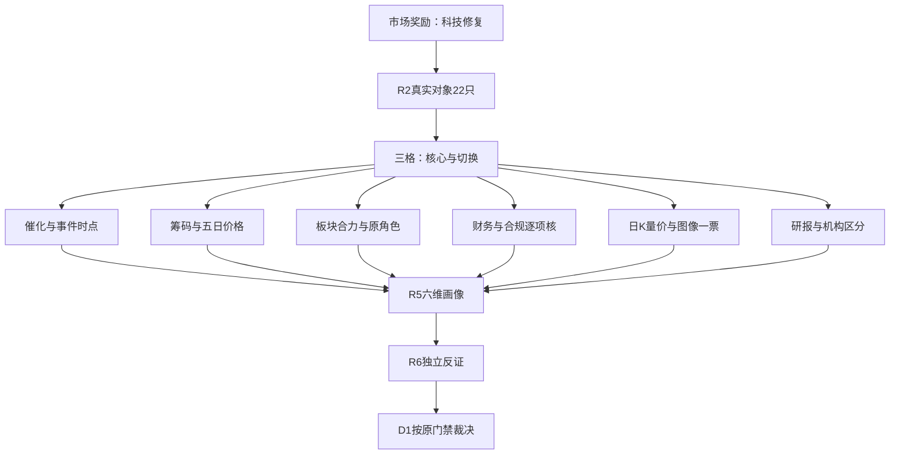

# 2026年11月5日 · **个股画像**

> **数据源新鲜度**：partial　 **降级状态**：true　 **置信度**：0.64

## 🧭 一句话结论
**先研究通富与云南的修复接力，不接名字旧核；连板强度不能覆盖现金、质押及治理反证。**

## 🔎 详细分析

市场在为科技容量和低位修复付钱，但温度仍是**震荡**。上一交易日炸板率21.85%，未触发35%的候选减半条件；不能拿前一日的高炸板率冒充当前。11月5日尚无竞价和开盘资金，所有结论以11月4日收盘事实为基础。持续性只是一日研究假设，不宣称新主升已经成立。

本批R2明确列出12只主线、10只次线，共22只真实研究对象。常见6—15只不是强行截断配额，因此全部逐票画像，既不凑数，也不删除候补对照。主模板维持“三格”，先看切换与前排，再看补涨；R5不重排板块、不设交易入场退出价。

通富优于长电的是封板时序与五日资金符号，不是估值绝对便宜；云南优于光模块容量对照的是直接合同主体，不是利润已经兑现。闽发与永臻的身位强，但财务现金证据远弱于板型外观。七匹狼、九牧王的历史股性高，与当日兑现事实并存，不能用旧标签抵消最新负反馈。

三表原接口的日期参数按公告日过滤，第一轮截至季度末漏掉后披露Q3；本轮已重新查询并按公告日、合并口径、报告期去重。所有候选保留可比五日资金、价格原值与复权日K，R6可在同版JSON内复核，不需要联网或另读MD。未知的商誉、临近预警及附注不是零，也不是全市场禁买结论。

## 📊 六维总表

|对象|R2角色|催化|筹码|板块|财务|技术|机构|综合研究刻度|α/险|态度|
|---|---|---:|---:|---:|---:|---:|---:|---:|---|---|
|通富微电 002156.SZ|龙一|65|70|86|48|43|65|66|B+/B-|观察|
|长电科技 600584.SH|龙二|60|58|82|58|41|68|61|B+/B-|观察|
|北方华创 002371.SZ|候补|62|73|76|65|50|75|65|B+/B|观察|
|博杰股份 002975.SZ|候补|43|47|62|48|39|50|47|B/B-|降级|
|沃格光电 603773.SH|候补|35|39|50|25|34|35|35|B-/C|降级|
|云南锗业 002428.SZ|龙一|82|78|84|48|49|55|72|A-/B-|观察|
|新易盛 300502.SZ|龙二|60|52|69|55|27|70|52|B/B-|降级|
|中际旭创 300308.SZ|候补|60|42|66|62|31|72|53|B/B-|降级|
|华盛昌 002980.SZ|候补|38|39|48|42|30|35|38|B-/C|降级|
|闽发铝业 002578.SZ|龙一|50|66|75|35|69|30|58|B+/C|观察|
|永臻股份 603381.SH|龙二|49|54|64|35|72|35|52|B/C|降级|
|阳光电源 300274.SZ|候补|57|71|67|48|62|75|61|B+/B-|观察|
|龙版传媒 605577.SH|候补|43|55|52|40|66|25|47|B/C|降级|
|浙文影业 601599.SH|候补|42|53|53|49|73|25|49|B/C|降级|
|福莱新材 605488.SH|候补|40|35|59|40|65|50|46|B/C|降级|
|兆威机电 003021.SZ|候补|53|45|65|45|72|62|56|B+/B-|观察|
|武汉天源 301127.SZ|候补|76|40|47|48|40|45|49|B/B-|观察|
|翰宇药业 300199.SZ|候补|72|39|46|43|43|30|47|B/B-|观察|
|四川黄金 001337.SZ|候补|57|57|51|60|42|30|53|B+/B|观察|
|七匹狼 002029.SZ|候补|28|22|30|42|39|25|29|B-/C|不进|
|九牧王 601566.SH|候补|28|27|31|42|48|30|31|B-/C|不进|
|深中华A 000017.SZ|候补|28|43|30|35|43|25|35|B-/C|降级|

这些是研究刻度，不是胜率、买权或新评分门禁。图像和专题素材不单独改档、排序或任何权限。

## 🧩 逐票六维裁决与对照

### 通富微电 002156.SZ · 观察 · αB+/险B-

- **大资金意图**: 直接封测先封且5日两口径均正，修复资金愿意为低位前排付钱；但收盘仍低于MA20/30，不能把首板当主升低吸。Q3归母利润中54.98%为非经常收益、有息负债超过归母净资产，利润高增不能直接等同封装主业爆发。 这是量价/事件推断，不是识别账户真实意图。
- **为什么走强**: R2板型为首板收封；开板0次，日换手6.76%；无分钟横盘证据，不认证经典换手板；近5日分档自算+1.0532亿，东财同窗+1.0089亿；同日偏差未超声明5%口径，不计为完全独立第三来源。 龙头认定：待核，原角色龙一保真。
- **逻辑够不够硬**: 相较长电封板更早且不开板、5日净额由负正分化，保留封测研究第一位；北方华创是设备而非同业务封测，不能凭金额抢位。 无本票R4匹配不等于无催化；一般政策背景不当公司订单。

**买入理由**（仅研究假设，不是买入指令）：直接封测先封且5日两口径均正，修复资金愿意为低位前排付钱；但收盘仍低于MA20/30，不能把首板当主升低吸。Q3归母利润中54.98%为非经常收益、有息负债超过归母净资产，利润高增不能直接等同封装主业爆发。 原始角色与板块合力由R2提供，当前计划身份未知；只有D1按原门禁成案才可能形成交易。

**风险点**：截至2026Q3，归母净利30.606亿元，经营现金流55.466亿元；已核红旗：F4,F6,F10。3项未知逐项列示。 当前PE_TTM=19.7335，PB=3.0245。板型强弱不覆盖会计或合规事实。相较长电封板更早且不开板、5日净额由负正分化，保留封测研究第一位；北方华创是设备而非同业务封测，不能凭金额抢位。

**止损条件**（逻辑证伪，不设置R5交易价格）：对应公司合同/主营假设被正式公告否定，或同线核心持续失去合力，则撤销相应研究假设；交易卖点与价格由D1独立定义。当前RR=unknown、止损距=unknown，禁止清单完整命中项=unknown，不能进execution。

**可验证假设**：未来1—3交易日检验五日/当日净额符号是否转正或延续、能否保持相对MA20的修复及同线封板扩散。量化基线：收盘42.33，MA20=47.28、MA60=56.60，近30交易日-26.14%；这些是已观察结构，不是入场价。收盘低于MA20和MA60：中期下降结构中的修复，尚非已确认主升。

- 财务核验：`F4,F6,F10`；必要待核：声明范围内无unknown，但命中红旗不算通过。
- 机构维度：查询窗内研报去重1份，预测年度行3条；调研接口0条。评级/预测不等于机构已买入，0记录仅限查询窗。
- 图像限定：完整原record随JSON绑定；日K截至2026-11-04，周K截至2026-10-30，分钟为历史结构，非今日承接。只读上游识图文本和元数据，非R5独立打开图像。跨周期复权及每条level可用性单列，不以available认证突破。

### 长电科技 600584.SH · 观察 · αB+/险B-

- **大资金意图**: 封测容量核心的单日修复真实，但近5日两源仍净流出，14点后首封且开板4次。收入同比仅约8%，存货增速与周转反证提示备货压力，尚不足确认资金从游资接力转为机构持续加仓。 这是量价/事件推断，不是识别账户真实意图。
- **为什么走强**: R2板型为首板收封；开板4次，日换手5.79%；无分钟横盘证据，不认证经典换手板；近5日分档自算-1.4498亿，东财同窗-1.2344亿；同日偏差未超声明5%口径，不计为完全独立第三来源。 龙头认定：分歧弱，原角色龙二保真。
- **逻辑够不够硬**: 不选为封测首位，因为通富在封板时序与5日续航上占先；不是因历史股性弱否认当日合力。 无本票R4匹配不等于无催化；一般政策背景不当公司订单。

**买入理由**（仅研究假设，不是买入指令）：封测容量核心的单日修复真实，但近5日两源仍净流出，14点后首封且开板4次。收入同比仅约8%，存货增速与周转反证提示备货压力，尚不足确认资金从游资接力转为机构持续加仓。 原始角色与板块合力由R2提供，当前计划身份未知；只有D1按原门禁成案才可能形成交易。

**风险点**：截至2026Q3，归母净利16.173亿元，经营现金流42.999亿元；已核红旗：F4。3项未知逐项列示。 当前PE_TTM=41.5395，PB=3.1347。板型强弱不覆盖会计或合规事实。不选为封测首位，因为通富在封板时序与5日续航上占先；不是因历史股性弱否认当日合力。

**止损条件**（逻辑证伪，不设置R5交易价格）：对应公司合同/主营假设被正式公告否定，或同线核心持续失去合力，则撤销相应研究假设；交易卖点与价格由D1独立定义。当前RR=unknown、止损距=unknown，禁止清单完整命中项=unknown，不能进execution。

**可验证假设**：未来1—3交易日检验五日/当日净额符号是否转正或延续、能否保持相对MA20的修复及同线封板扩散。量化基线：收盘51.74，MA20=56.10、MA60=67.31，近30交易日-22.56%；这些是已观察结构，不是入场价。收盘低于MA20和MA60：中期下降结构中的修复，尚非已确认主升。

- 财务核验：`F4`；必要待核：S3。
- 机构维度：查询窗内研报去重9份，预测年度行27条；调研接口1条。评级/预测不等于机构已买入，0记录仅限查询窗。
- 图像限定：完整原record随JSON绑定；日K截至2026-11-04，周K截至2026-10-30，分钟为历史结构，非今日承接。只读上游识图文本和元数据，非R5独立打开图像。跨周期复权及每条level可用性单列，不以available认证突破。

### 北方华创 002371.SZ · 观察 · αB+/险B

- **大资金意图**: 设备容量核心近5日净入更连续，Q3经营现金流和利润均为正，具备独立经营质量；单日涨停仍未收复MA20和MA60，不能以大市值净入推断总龙。 这是量价/事件推断，不是识别账户真实意图。
- **为什么走强**: R2板型为首板收封；开板0次，日换手1.68%；无分钟横盘证据，不认证经典换手板；近5日分档自算+16.6229亿，东财同窗+16.2729亿；存在单日偏差>5%，并列保存，筹码证据置信度降级，不择优掩盖。 龙头认定：待核，原角色候补保真。
- **逻辑够不够硬**: 保留设备对照，不替换封测龙一；与通富并非同业务的金额排名赛。股性差只解释历史连板习惯，不作硬排除。 无本票R4匹配不等于无催化；一般政策背景不当公司订单。

**买入理由**（仅研究假设，不是买入指令）：设备容量核心近5日净入更连续，Q3经营现金流和利润均为正，具备独立经营质量；单日涨停仍未收复MA20和MA60，不能以大市值净入推断总龙。 原始角色与板块合力由R2提供，当前计划身份未知；只有D1按原门禁成案才可能形成交易。

**风险点**：截至2026Q3，归母净利53.920亿元，经营现金流55.908亿元；已核红旗：本轮适用计算未检出，但不代表全项阴性。2项未知逐项列示。 当前PE_TTM=67.4007，PB=9.1094。板型强弱不覆盖会计或合规事实。保留设备对照，不替换封测龙一；与通富并非同业务的金额排名赛。股性差只解释历史连板习惯，不作硬排除。

**止损条件**（逻辑证伪，不设置R5交易价格）：对应公司合同/主营假设被正式公告否定，或同线核心持续失去合力，则撤销相应研究假设；交易卖点与价格由D1独立定义。当前RR=unknown、止损距=unknown，禁止清单完整命中项=unknown，不能进execution。

**可验证假设**：未来1—3交易日检验五日/当日净额符号是否转正或延续、能否保持相对MA20的修复及同线封板扩散。量化基线：收盘535.50，MA20=548.17、MA60=642.13，近30交易日-16.09%；这些是已观察结构，不是入场价。收盘低于MA20和MA60：中期下降结构中的修复，尚非已确认主升。

- 财务核验：`本轮未检出已核红旗（非全项通过）`；必要待核：声明范围内无unknown，但命中红旗不算通过。
- 机构维度：查询窗内研报去重6份，预测年度行17条；调研接口0条。评级/预测不等于机构已买入，0记录仅限查询窗。
- 图像限定：完整原record随JSON绑定；日K截至2026-11-04，周K截至2026-10-30，分钟为历史结构，非今日承接。只读上游识图文本和元数据，非R5独立打开图像。跨周期复权及每条level可用性单列，不以available认证突破。

### 博杰股份 002975.SZ · 降级 · αB/险B-

- **大资金意图**: 首板与历史锚有研究价值，但半导体、InP、机器人等热词的利润贡献被公司风险公告明确限制：2025划片机子公司收入占比2.78%，参股InP企业连续亏损，光模块耦合设备尚未实现收入。不能拿主题映射代替主营兑现。 这是量价/事件推断，不是识别账户真实意图。
- **为什么走强**: R2板型为首板收封；开板0次，日换手9.29%；无分钟横盘证据，不认证经典换手板；近5日分档自算-0.0698亿，东财同窗-0.0920亿；存在单日偏差>5%，并列保存，筹码证据置信度降级，不择优掩盖。 龙头认定：待核，原角色候补保真。
- **逻辑够不够硬**: 不取代通富或云南锗业：前者有直接封测身位，后者有具名AOI合同，博杰当前受益份额与五日资金均更弱。旧8月公告只作仍待新披露更新的业务反证。 无本票R4匹配不等于无催化；一般政策背景不当公司订单。

**买入理由**（仅研究假设，不是买入指令）：首板与历史锚有研究价值，但半导体、InP、机器人等热词的利润贡献被公司风险公告明确限制：2025划片机子公司收入占比2.78%，参股InP企业连续亏损，光模块耦合设备尚未实现收入。不能拿主题映射代替主营兑现。 原始角色与板块合力由R2提供，当前计划身份未知；只有D1按原门禁成案才可能形成交易。

**风险点**：截至2026Q3，归母净利3.489亿元，经营现金流1.358亿元；已核红旗：F9。4项未知逐项列示。 当前PE_TTM=41.3102，PB=6.024。板型强弱不覆盖会计或合规事实。不取代通富或云南锗业：前者有直接封测身位，后者有具名AOI合同，博杰当前受益份额与五日资金均更弱。旧8月公告只作仍待新披露更新的业务反证。

**止损条件**（逻辑证伪，不设置R5交易价格）：对应公司合同/主营假设被正式公告否定，或同线核心持续失去合力，则撤销相应研究假设；交易卖点与价格由D1独立定义。当前RR=unknown、止损距=unknown，禁止清单完整命中项=unknown，不能进execution。

**可验证假设**：未来1—3交易日检验五日/当日净额符号是否转正或延续、能否保持相对MA20的修复及同线封板扩散。量化基线：收盘77.33，MA20=84.92、MA60=95.98，近30交易日-21.97%；这些是已观察结构，不是入场价。收盘低于MA20和MA60：中期下降结构中的修复，尚非已确认主升。

- 财务核验：`F9`；必要待核：S3。
- 机构维度：查询窗内研报去重1份，预测年度行3条；调研接口0条。评级/预测不等于机构已买入，0记录仅限查询窗。
- 图像限定：完整原record随JSON绑定；日K截至2026-11-04，周K截至2026-10-30，分钟为历史结构，非今日承接。只读上游识图文本和元数据，非R5独立打开图像。跨周期复权及每条level可用性单列，不以available认证突破。

### 沃格光电 603773.SH · 降级 · αB-/险C

- **大资金意图**: 首板反包不抵消财务和治理：Q3仍亏损、有息负债/净资产高，应收及存货与收入背离；控股股东个人信披案已于8月行政处罚并办结，不能冒充当前公司财务造假或未结案。原始处罚事实完整交R6判断有效范围。 这是量价/事件推断，不是识别账户真实意图。
- **为什么走强**: R2板型为首板收封；开板2次，日换手8.25%；无分钟横盘证据，不认证经典换手板；近5日分档自算-1.0003亿，东财同窗-1.0203亿；存在单日偏差>5%，并列保存，筹码证据置信度降级，不择优掩盖。 龙头认定：待核，原角色候补保真。
- **逻辑够不够硬**: 不选为封测核心：业务收入兑现、5日资金和趋势均不及通富，另有真实治理反证；不是因图像缺口或历史锚排序封禁。 无本票R4匹配不等于无催化；一般政策背景不当公司订单。

**买入理由**（仅研究假设，不是买入指令）：首板反包不抵消财务和治理：Q3仍亏损、有息负债/净资产高，应收及存货与收入背离；控股股东个人信披案已于8月行政处罚并办结，不能冒充当前公司财务造假或未结案。原始处罚事实完整交R6判断有效范围。 原始角色与板块合力由R2提供，当前计划身份未知；只有D1按原门禁成案才可能形成交易。

**风险点**：截至2026Q3，归母净利-1.872亿元，经营现金流0.338亿元；已核红旗：F3,F4,F9,F10,S1,S2。5项未知逐项列示。 当前PE_TTM=unknown/亏损口径无有效值，PB=13.3339。板型强弱不覆盖会计或合规事实。不选为封测核心：业务收入兑现、5日资金和趋势均不及通富，另有真实治理反证；不是因图像缺口或历史锚排序封禁。

**止损条件**（逻辑证伪，不设置R5交易价格）：对应公司合同/主营假设被正式公告否定，或同线核心持续失去合力，则撤销相应研究假设；交易卖点与价格由D1独立定义。当前RR=unknown、止损距=unknown，禁止清单完整命中项=unknown，不能进execution。

**可验证假设**：未来1—3交易日检验五日/当日净额符号是否转正或延续、能否保持相对MA20的修复及同线封板扩散。量化基线：收盘57.15，MA20=66.65、MA60=84.78，近30交易日-36.77%；这些是已观察结构，不是入场价。收盘低于MA20和MA60：中期下降结构中的修复，尚非已确认主升。

- 财务核验：`F3,F4,F9,F10,S1,S2`；必要待核：S3。
- 机构维度：查询窗内研报去重0份，预测年度行0条；调研接口0条。评级/预测不等于机构已买入，0记录仅限查询窗。
- 图像限定：完整原record随JSON绑定；日K截至2026-11-04，周K截至2026-10-30，分钟为历史结构，非今日承接。只读上游识图文本和元数据，非R5独立打开图像。跨周期复权及每条level可用性单列，不以available认证突破。

### 云南锗业 002428.SZ · 观察 · αA-/险B-

- **大资金意图**: 年度InP合同提供本批最清晰的公司级事件锚，首板、双平台辨识度和5日正资金共振；但出口许可、采购执行及取消条款未兑现，PE约277倍且仍在MA20下方。做事件兑现研究，不把合同总额当净利润或即时现金。 这是量价/事件推断，不是识别账户真实意图。
- **为什么走强**: R2板型为首板收封；开板3次，日换手13.15%；无分钟横盘证据，不认证经典换手板；近5日分档自算+10.9985亿，东财同窗+10.9274亿；同日偏差未超声明5%口径，不计为完全独立第三来源。 龙头认定：待核，原角色龙一保真。
- **逻辑够不够硬**: 优于新易盛/中际作为本批事件链第一研究对象：有直接合同主体与早盘封板；后两者虽业绩强，当前价格仍深跌，不能把容量反弹称为右侧主升。 无本票R4匹配不等于无催化；一般政策背景不当公司订单。

**买入理由**（仅研究假设，不是买入指令）：年度InP合同提供本批最清晰的公司级事件锚，首板、双平台辨识度和5日正资金共振；但出口许可、采购执行及取消条款未兑现，PE约277倍且仍在MA20下方。做事件兑现研究，不把合同总额当净利润或即时现金。 原始角色与板块合力由R2提供，当前计划身份未知；只有D1按原门禁成案才可能形成交易。

**风险点**：截至2026Q3，归母净利1.760亿元，经营现金流1.837亿元；已核红旗：F9。2项未知逐项列示。 当前PE_TTM=276.5907，PB=30.1976。板型强弱不覆盖会计或合规事实。优于新易盛/中际作为本批事件链第一研究对象：有直接合同主体与早盘封板；后两者虽业绩强，当前价格仍深跌，不能把容量反弹称为右侧主升。

**止损条件**（逻辑证伪，不设置R5交易价格）：对应公司合同/主营假设被正式公告否定，或同线核心持续失去合力，则撤销相应研究假设；交易卖点与价格由D1独立定义。当前RR=unknown、止损距=unknown，禁止清单完整命中项=unknown，不能进execution。

**可验证假设**：未来1—3交易日检验五日/当日净额符号是否转正或延续、能否保持相对MA20的修复及同线封板扩散。量化基线：收盘75.38，MA20=78.25、MA60=89.61，近30交易日-16.49%；这些是已观察结构，不是入场价。收盘低于MA20和MA60：中期下降结构中的修复，尚非已确认主升。

- 财务核验：`F9`；必要待核：F2。
- 机构维度：查询窗内研报去重0份，预测年度行0条；调研接口0条。评级/预测不等于机构已买入，0记录仅限查询窗。
- 图像限定：完整原record随JSON绑定；日K截至2026-11-04，周K截至2026-10-30，分钟为历史结构，非今日承接。只读上游识图文本和元数据，非R5独立打开图像。跨周期复权及每条level可用性单列，不以available认证突破。

### 新易盛 300502.SZ · 降级 · αB/险B-

- **大资金意图**: 收入与净利增长是真经营证据，但5日净额跨源有偏差，CFO/归母净利很低、存货快速增加；30交易日价格跌幅约一半且未站稳MA5。强业绩不等于当前强趋势，单日大阳不足证明抛压已清。 这是量价/事件推断，不是识别账户真实意图。
- **为什么走强**: R2板型为非涨停修复大阳；不认证主升趋势；近5日分档自算+5.2285亿，东财同窗+4.4780亿；存在单日偏差>5%，并列保存，筹码证据置信度降级，不择优掩盖。 龙头认定：待核，原角色龙二保真。
- **逻辑够不够硬**: 与云南锗业相比缺本轮新增的直接合同催化与封板身位；与中际相比5日资金稍强但跌势更深。不因历史股性低一票否决。 无本票R4匹配不等于无催化；一般政策背景不当公司订单。

**买入理由**（仅研究假设，不是买入指令）：收入与净利增长是真经营证据，但5日净额跨源有偏差，CFO/归母净利很低、存货快速增加；30交易日价格跌幅约一半且未站稳MA5。强业绩不等于当前强趋势，单日大阳不足证明抛压已清。 原始角色与板块合力由R2提供，当前计划身份未知；只有D1按原门禁成案才可能形成交易。

**风险点**：截至2026Q3，归母净利113.723亿元，经营现金流14.644亿元；已核红旗：F4,V4。3项未知逐项列示。 当前PE_TTM=18.801，PB=9.8029。板型强弱不覆盖会计或合规事实。与云南锗业相比缺本轮新增的直接合同催化与封板身位；与中际相比5日资金稍强但跌势更深。不因历史股性低一票否决。

**止损条件**（逻辑证伪，不设置R5交易价格）：对应公司合同/主营假设被正式公告否定，或同线核心持续失去合力，则撤销相应研究假设；交易卖点与价格由D1独立定义。当前RR=unknown、止损距=unknown，禁止清单完整命中项=unknown，不能进execution。

**可验证假设**：未来1—3交易日检验五日/当日净额符号是否转正或延续、能否保持相对MA20的修复及同线封板扩散。量化基线：收盘196.50，MA20=277.12、MA60=370.88，近30交易日-50.51%；这些是已观察结构，不是入场价。收盘低于MA20和MA60：中期下降结构中的修复，尚非已确认主升。

- 财务核验：`F4,V4`；必要待核：声明范围内无unknown，但命中红旗不算通过。
- 机构维度：查询窗内研报去重9份，预测年度行25条；调研接口289条。评级/预测不等于机构已买入，0记录仅限查询窗。
- 图像限定：完整原record随JSON绑定；日K截至2026-11-04，周K截至2026-10-30，分钟为历史结构，非今日承接。只读上游识图文本和元数据，非R5独立打开图像。跨周期复权及每条level可用性单列，不以available认证突破。

### 中际旭创 300308.SZ · 降级 · αB/险B-

- **大资金意图**: 高收入高利润与价格、资金构成显著背离：前三季利润兑现较强，近5日净额仍大幅为负，股价远在MA20和MA60下。CFO/净利偏低需核备货与回款，不由低PE宣告估值底。 这是量价/事件推断，不是识别账户真实意图。
- **为什么走强**: R2板型为非涨停修复大阳；不认证主升趋势；近5日分档自算-17.6963亿，东财同窗-18.1442亿；同日偏差未超声明5%口径，不计为完全独立第三来源。 龙头认定：待核，原角色候补保真。
- **逻辑够不够硬**: 不选为本轮事件链首位，因为云南是直接材料合同主体，且当前资金方向相反；中际保留容量对照，不能自动继承昔日龙头买权。 无本票R4匹配不等于无催化；一般政策背景不当公司订单。

**买入理由**（仅研究假设，不是买入指令）：高收入高利润与价格、资金构成显著背离：前三季利润兑现较强，近5日净额仍大幅为负，股价远在MA20和MA60下。CFO/净利偏低需核备货与回款，不由低PE宣告估值底。 原始角色与板块合力由R2提供，当前计划身份未知；只有D1按原门禁成案才可能形成交易。

**风险点**：截至2026Q3，归母净利222.379亿元，经营现金流80.084亿元；已核红旗：V4。4项未知逐项列示。 当前PE_TTM=24.2546，PB=6.658。板型强弱不覆盖会计或合规事实。不选为本轮事件链首位，因为云南是直接材料合同主体，且当前资金方向相反；中际保留容量对照，不能自动继承昔日龙头买权。

**止损条件**（逻辑证伪，不设置R5交易价格）：对应公司合同/主营假设被正式公告否定，或同线核心持续失去合力，则撤销相应研究假设；交易卖点与价格由D1独立定义。当前RR=unknown、止损距=unknown，禁止清单完整命中项=unknown，不能进execution。

**可验证假设**：未来1—3交易日检验五日/当日净额符号是否转正或延续、能否保持相对MA20的修复及同线封板扩散。量化基线：收盘533.38，MA20=634.99、MA60=805.08，近30交易日-38.17%；这些是已观察结构，不是入场价。收盘低于MA20和MA60：中期下降结构中的修复，尚非已确认主升。

- 财务核验：`V4`；必要待核：S3。
- 机构维度：查询窗内研报去重12份，预测年度行35条；调研接口335条。评级/预测不等于机构已买入，0记录仅限查询窗。
- 图像限定：完整原record随JSON绑定；日K截至2026-11-04，周K截至2026-10-30，分钟为历史结构，非今日承接。只读上游识图文本和元数据，非R5独立打开图像。跨周期复权及每条level可用性单列，不以available认证突破。

### 华盛昌 002980.SZ · 降级 · αB-/险C

- **大资金意图**: 首板不能解决并购口径与现金质量问题：应收同比远快于收入，应收/收入高，前三季CFO为负。市场给了反抽，但主营与事件链受益份额、核心带动性均未证实。 这是量价/事件推断，不是识别账户真实意图。
- **为什么走强**: R2板型为首板收封；开板0次，日换手11.70%；无分钟横盘证据，不认证经典换手板；近5日分档自算-0.6560亿，东财同窗-0.6736亿；同日偏差未超声明5%口径，不计为完全独立第三来源。 龙头认定：待核，原角色候补保真。
- **逻辑够不够硬**: 不选为云南锗业替代：历史锚和涨停次数不是订单主体证明；同样首板，云南有早盘辨识度与正向五日合力。 无本票R4匹配不等于无催化；一般政策背景不当公司订单。

**买入理由**（仅研究假设，不是买入指令）：首板不能解决并购口径与现金质量问题：应收同比远快于收入，应收/收入高，前三季CFO为负。市场给了反抽，但主营与事件链受益份额、核心带动性均未证实。 原始角色与板块合力由R2提供，当前计划身份未知；只有D1按原门禁成案才可能形成交易。

**风险点**：截至2026Q3，归母净利2.354亿元，经营现金流-0.250亿元；已核红旗：F3,F9。4项未知逐项列示。 当前PE_TTM=51.7272，PB=9.9748。板型强弱不覆盖会计或合规事实。不选为云南锗业替代：历史锚和涨停次数不是订单主体证明；同样首板，云南有早盘辨识度与正向五日合力。

**止损条件**（逻辑证伪，不设置R5交易价格）：对应公司合同/主营假设被正式公告否定，或同线核心持续失去合力，则撤销相应研究假设；交易卖点与价格由D1独立定义。当前RR=unknown、止损距=unknown，禁止清单完整命中项=unknown，不能进execution。

**可验证假设**：未来1—3交易日检验五日/当日净额符号是否转正或延续、能否保持相对MA20的修复及同线封板扩散。量化基线：收盘71.27，MA20=93.59、MA60=100.99，近30交易日-39.55%；这些是已观察结构，不是入场价。收盘低于MA20和MA60：中期下降结构中的修复，尚非已确认主升。

- 财务核验：`F3,F9`；必要待核：S3。
- 机构维度：查询窗内研报去重2份，预测年度行6条；调研接口244条。评级/预测不等于机构已买入，0记录仅限查询窗。
- 图像限定：完整原record随JSON绑定；日K截至2026-11-04，周K截至2026-10-30，分钟为历史结构，非今日承接。只读上游识图文本和元数据，非R5独立打开图像。跨周期复权及每条level可用性单列，不以available认证突破。

### 闽发铝业 002578.SZ · 观察 · αB+/险C

- **大资金意图**: 三板高度、零开板和正五日资金是当日身位证据；但下午首封、从低位三日连续加速，产业与利润锚偏弱。前三季微利主要由非经常项目覆盖，CFO为负，不能把铝加工情绪代理写成光伏行业盈利反转。 这是量价/事件推断，不是识别账户真实意图。
- **为什么走强**: R2板型为3连板收封；开板0次，日换手12.50%；无分钟横盘证据，不认证经典换手板；近5日分档自算+1.1850亿，东财同窗+1.1791亿；同日偏差未超声明5%口径，不计为完全独立第三来源。 龙头认定：待核，原角色龙一保真。
- **逻辑够不够硬**: 保留相对永臻的高度前排；不以三板取代通富/云南的直接业务核心。与永臻相比筹码身位占先，但不是风险更小。 无本票R4匹配不等于无催化；一般政策背景不当公司订单。

**买入理由**（仅研究假设，不是买入指令）：三板高度、零开板和正五日资金是当日身位证据；但下午首封、从低位三日连续加速，产业与利润锚偏弱。前三季微利主要由非经常项目覆盖，CFO为负，不能把铝加工情绪代理写成光伏行业盈利反转。 原始角色与板块合力由R2提供，当前计划身份未知；只有D1按原门禁成案才可能形成交易。

**风险点**：截至2026Q3，归母净利0.027亿元，经营现金流-0.955亿元；已核红旗：F6。4项未知逐项列示。 当前PE_TTM=unknown/亏损口径无有效值，PB=2.59。板型强弱不覆盖会计或合规事实。保留相对永臻的高度前排；不以三板取代通富/云南的直接业务核心。与永臻相比筹码身位占先，但不是风险更小。

**止损条件**（逻辑证伪，不设置R5交易价格）：对应公司合同/主营假设被正式公告否定，或同线核心持续失去合力，则撤销相应研究假设；交易卖点与价格由D1独立定义。当前RR=unknown、止损距=unknown，禁止清单完整命中项=unknown，不能进execution。

**可验证假设**：未来1—3交易日检验五日/当日净额符号是否转正或延续、能否保持相对MA20的修复及同线封板扩散。量化基线：收盘4.14，MA20=3.71、MA60=3.85，近30交易日+5.34%；这些是已观察结构，不是入场价。收盘高于MA20/60，短线相对强；仍须检查高位兑现和本线合力，不因均线翻多授予买权。

- 财务核验：`F6`；必要待核：F2。
- 机构维度：查询窗内研报去重0份，预测年度行0条；调研接口0条。评级/预测不等于机构已买入，0记录仅限查询窗。
- 图像限定：完整原record随JSON绑定；日K截至2026-11-04，周K截至2026-10-30，分钟为历史结构，非今日承接。只读上游识图文本和元数据，非R5独立打开图像。跨周期复权及每条level可用性单列，不以available认证突破。

### 永臻股份 603381.SH · 降级 · αB/险C

- **大资金意图**: 二板突破与近30日上涨较强，市场愿为光伏修复的低位连板付钱；但Q3累计CFO大幅负且连续两个单季负、归母净利为正，有息负债/净资产高，利润近乎由非经常项目解释。量价强不能消除现金风险。 这是量价/事件推断，不是识别账户真实意图。
- **为什么走强**: R2板型为2连板收封；开板0次，日换手13.11%；无分钟横盘证据，不认证经典换手板；近5日分档自算+0.6464亿，东财同窗+0.6417亿；存在单日偏差>5%，并列保存，筹码证据置信度降级，不择优掩盖。 龙头认定：待核，原角色龙二保真。
- **逻辑够不够硬**: 不提为本线首位：闽发身位更高且五日资金更强；与阳光电源相比财务现金与负债压力更大。保留真实低位研究，不因缺额清池。 无本票R4匹配不等于无催化；一般政策背景不当公司订单。

**买入理由**（仅研究假设，不是买入指令）：二板突破与近30日上涨较强，市场愿为光伏修复的低位连板付钱；但Q3累计CFO大幅负且连续两个单季负、归母净利为正，有息负债/净资产高，利润近乎由非经常项目解释。量价强不能消除现金风险。 原始角色与板块合力由R2提供，当前计划身份未知；只有D1按原门禁成案才可能形成交易。

**风险点**：截至2026Q3，归母净利0.529亿元，经营现金流-11.942亿元；已核红旗：F3,F6,F8,F9,F10。4项未知逐项列示。 当前PE_TTM=unknown/亏损口径无有效值，PB=1.2298。板型强弱不覆盖会计或合规事实。不提为本线首位：闽发身位更高且五日资金更强；与阳光电源相比财务现金与负债压力更大。保留真实低位研究，不因缺额清池。

**止损条件**（逻辑证伪，不设置R5交易价格）：对应公司合同/主营假设被正式公告否定，或同线核心持续失去合力，则撤销相应研究假设；交易卖点与价格由D1独立定义。当前RR=unknown、止损距=unknown，禁止清单完整命中项=unknown，不能进execution。

**可验证假设**：未来1—3交易日检验五日/当日净额符号是否转正或延续、能否保持相对MA20的修复及同线封板扩散。量化基线：收盘17.14，MA20=14.41、MA60=14.78，近30交易日+21.22%；这些是已观察结构，不是入场价。收盘高于MA20/60，短线相对强；仍须检查高位兑现和本线合力，不因均线翻多授予买权。

- 财务核验：`F3,F6,F8,F9,F10`；必要待核：S3。
- 机构维度：查询窗内研报去重0份，预测年度行0条；调研接口1条。评级/预测不等于机构已买入，0记录仅限查询窗。
- 图像限定：完整原record随JSON绑定；日K截至2026-11-04，周K截至2026-10-30，分钟为历史结构，非今日承接。只读上游识图文本和元数据，非R5独立打开图像。跨周期复权及每条level可用性单列，不以available认证突破。

### 阳光电源 300274.SZ · 观察 · αB+/险B-

- **大资金意图**: 储能逆变器容量修复近5日资金为正，已收复MA20，强于多数超跌容量票；但MA60仍在上方，前三季收入、利润同比均下滑，存货和应收反证仍需解释，不提前认证新主升。 这是量价/事件推断，不是识别账户真实意图。
- **为什么走强**: R2板型为非涨停修复大阳；不认证主升趋势；近5日分档自算+12.8145亿，东财同窗+12.6809亿；同日偏差未超声明5%口径，不计为完全独立第三来源。 龙头认定：待核，原角色候补保真。
- **逻辑够不够硬**: 不以资金最大替代闽发连板身位；相比永臻现金与容量证据较强，作为本线经营/容量对照，不自动递补执行。 无本票R4匹配不等于无催化；一般政策背景不当公司订单。

**买入理由**（仅研究假设，不是买入指令）：储能逆变器容量修复近5日资金为正，已收复MA20，强于多数超跌容量票；但MA60仍在上方，前三季收入、利润同比均下滑，存货和应收反证仍需解释，不提前认证新主升。 原始角色与板块合力由R2提供，当前计划身份未知；只有D1按原门禁成案才可能形成交易。

**风险点**：截至2026Q3，归母净利65.990亿元，经营现金流36.476亿元；已核红旗：F3,F4,F9。3项未知逐项列示。 当前PE_TTM=20.5747，PB=3.4035。板型强弱不覆盖会计或合规事实。不以资金最大替代闽发连板身位；相比永臻现金与容量证据较强，作为本线经营/容量对照，不自动递补执行。

**止损条件**（逻辑证伪，不设置R5交易价格）：对应公司合同/主营假设被正式公告否定，或同线核心持续失去合力，则撤销相应研究假设；交易卖点与价格由D1独立定义。当前RR=unknown、止损距=unknown，禁止清单完整命中项=unknown，不能进execution。

**可验证假设**：未来1—3交易日检验五日/当日净额符号是否转正或延续、能否保持相对MA20的修复及同线封板扩散。量化基线：收盘81.17，MA20=74.54、MA60=89.70，近30交易日-3.10%；这些是已观察结构，不是入场价。收复MA20但尚未收复MA60，短线修复与中期结构分层。

- 财务核验：`F3,F4,F9`；必要待核：声明范围内无unknown，但命中红旗不算通过。
- 机构维度：查询窗内研报去重5份，预测年度行14条；调研接口4条。评级/预测不等于机构已买入，0记录仅限查询窗。
- 图像限定：完整原record随JSON绑定；日K截至2026-11-04，周K截至2026-10-30，分钟为历史结构，非今日承接。只读上游识图文本和元数据，非R5独立打开图像。跨周期复权及每条level可用性单列，不以available认证突破。

### 龙版传媒 605577.SH · 降级 · αB/险C

- **大资金意图**: 三板早封有情绪辨识度，但开板4次，最新公告提示主营未变、前三季利润下降。H1研发资本化率超过50%触发F5，但绝对金额较小，应防止把会计红旗夸大成造假结论。 这是量价/事件推断，不是识别账户真实意图。
- **为什么走强**: R2板型为连板收封，见limit_times；近5日分档自算+0.9528亿，东财同窗+0.8461亿；存在单日偏差>5%，并列保存，筹码证据置信度降级，不择优掩盖。 龙头认定：分歧弱，原角色候补保真。
- **逻辑够不够硬**: 与浙文相比开板反复、板块合力和新业务收入仍弱；不因近期股性极佳或一字预测而主推，更不把AI视频概念当新增营收。 无本票R4匹配不等于无催化；一般政策背景不当公司订单。

**买入理由**（仅研究假设，不是买入指令）：三板早封有情绪辨识度，但开板4次，最新公告提示主营未变、前三季利润下降。H1研发资本化率超过50%触发F5，但绝对金额较小，应防止把会计红旗夸大成造假结论。 原始角色与板块合力由R2提供，当前计划身份未知；只有D1按原门禁成案才可能形成交易。

**风险点**：截至2026Q3，归母净利2.654亿元，经营现金流1.891亿元；已核红旗：F5。5项未知逐项列示。 当前PE_TTM=35.8114，PB=1.7055。板型强弱不覆盖会计或合规事实。与浙文相比开板反复、板块合力和新业务收入仍弱；不因近期股性极佳或一字预测而主推，更不把AI视频概念当新增营收。

**止损条件**（逻辑证伪，不设置R5交易价格）：对应公司合同/主营假设被正式公告否定，或同线核心持续失去合力，则撤销相应研究假设；交易卖点与价格由D1独立定义。当前RR=unknown、止损距=unknown，禁止清单完整命中项=unknown，不能进execution。

**可验证假设**：未来1—3交易日检验五日/当日净额符号是否转正或延续、能否保持相对MA20的修复及同线封板扩散。量化基线：收盘15.73，MA20=15.20、MA60=13.33，近30交易日+4.03%；这些是已观察结构，不是入场价。收盘高于MA20/60，短线相对强；仍须检查高位兑现和本线合力，不因均线翻多授予买权。

- 财务核验：`F5`；必要待核：F1,F2,S3。
- 机构维度：查询窗内研报去重0份，预测年度行0条；调研接口0条。评级/预测不等于机构已买入，0记录仅限查询窗。
- 图像限定：完整原record随JSON绑定；日K截至2026-11-04，周K截至2026-10-30，分钟为历史结构，非今日承接。只读上游识图文本和元数据，非R5独立打开图像。跨周期复权及每条level可用性单列，不以available认证突破。

### 浙文影业 601599.SH · 降级 · αB/险C

- **大资金意图**: 三板早盘封板和突破箱体表明情绪资金参与，主营未重大变化与高乖离同时提示兑现风险；前三季CFO仍负。不是有影视名称就有短剧订单，更不是一字概率提供胜率。 这是量价/事件推断，不是识别账户真实意图。
- **为什么走强**: R2板型为连板收封，见limit_times；近5日分档自算+0.5625亿，东财同窗+0.4184亿；存在单日偏差>5%，并列保存，筹码证据置信度降级，不择优掩盖。 龙头认定：待核，原角色候补保真。
- **逻辑够不够硬**: 相较龙版开板少但没有新增业务兑现，仍属次线情绪对照；不为凑执行池从次线自动升位。 无本票R4匹配不等于无催化；一般政策背景不当公司订单。

**买入理由**（仅研究假设，不是买入指令）：三板早盘封板和突破箱体表明情绪资金参与，主营未重大变化与高乖离同时提示兑现风险；前三季CFO仍负。不是有影视名称就有短剧订单，更不是一字概率提供胜率。 原始角色与板块合力由R2提供，当前计划身份未知；只有D1按原门禁成案才可能形成交易。

**风险点**：截至2026Q3，归母净利1.426亿元，经营现金流-1.357亿元；已核红旗：本轮适用计算未检出，但不代表全项阴性。6项未知逐项列示。 当前PE_TTM=35.1993，PB=2.9466。板型强弱不覆盖会计或合规事实。相较龙版开板少但没有新增业务兑现，仍属次线情绪对照；不为凑执行池从次线自动升位。

**止损条件**（逻辑证伪，不设置R5交易价格）：对应公司合同/主营假设被正式公告否定，或同线核心持续失去合力，则撤销相应研究假设；交易卖点与价格由D1独立定义。当前RR=unknown、止损距=unknown，禁止清单完整命中项=unknown，不能进execution。

**可验证假设**：未来1—3交易日检验五日/当日净额符号是否转正或延续、能否保持相对MA20的修复及同线封板扩散。量化基线：收盘4.20，MA20=3.37、MA60=3.24，近30交易日+34.62%；这些是已观察结构，不是入场价。收盘高于MA20/60，短线相对强；仍须检查高位兑现和本线合力，不因均线翻多授予买权。

- 财务核验：`本轮未检出已核红旗（非全项通过）`；必要待核：F2,S3。
- 机构维度：查询窗内研报去重0份，预测年度行0条；调研接口0条。评级/预测不等于机构已买入，0记录仅限查询窗。
- 图像限定：完整原record随JSON绑定；日K截至2026-11-04，周K截至2026-10-30，分钟为历史结构，非今日承接。只读上游识图文本和元数据，非R5独立打开图像。跨周期复权及每条level可用性单列，不以available认证突破。

### 福莱新材 605488.SH · 降级 · αB/险C

- **大资金意图**: 日线相对强但近30日涨幅大、五日资金净流出，前日跌停后再涨停说明高位波动而非低位确认。公司明确柔性传感器收入占比极低，PE接近200倍，不能把机器人热度当利润锚。 这是量价/事件推断，不是识别账户真实意图。
- **为什么走强**: R2板型为连板收封，见limit_times；近5日分档自算-2.5606亿，东财同窗-2.6839亿；存在单日偏差>5%，并列保存，筹码证据置信度降级，不择优掩盖。 龙头认定：待核，原角色候补保真。
- **逻辑够不够硬**: 与兆威相比题材收入贡献更难确认且当前资金更弱，不凭高历史股性升级为本轮机器人龙头；保留趋势波动对照。 无本票R4匹配不等于无催化；一般政策背景不当公司订单。

**买入理由**（仅研究假设，不是买入指令）：日线相对强但近30日涨幅大、五日资金净流出，前日跌停后再涨停说明高位波动而非低位确认。公司明确柔性传感器收入占比极低，PE接近200倍，不能把机器人热度当利润锚。 原始角色与板块合力由R2提供，当前计划身份未知；只有D1按原门禁成案才可能形成交易。

**风险点**：截至2026Q3，归母净利0.561亿元，经营现金流0.695亿元；已核红旗：本轮适用计算未检出，但不代表全项阴性。4项未知逐项列示。 当前PE_TTM=195.3849，PB=5.9441。板型强弱不覆盖会计或合规事实。与兆威相比题材收入贡献更难确认且当前资金更弱，不凭高历史股性升级为本轮机器人龙头；保留趋势波动对照。

**止损条件**（逻辑证伪，不设置R5交易价格）：对应公司合同/主营假设被正式公告否定，或同线核心持续失去合力，则撤销相应研究假设；交易卖点与价格由D1独立定义。当前RR=unknown、止损距=unknown，禁止清单完整命中项=unknown，不能进execution。

**可验证假设**：未来1—3交易日检验五日/当日净额符号是否转正或延续、能否保持相对MA20的修复及同线封板扩散。量化基线：收盘44.79，MA20=35.64、MA60=31.48，近30交易日+59.96%；这些是已观察结构，不是入场价。收盘高于MA20/60，短线相对强；仍须检查高位兑现和本线合力，不因均线翻多授予买权。

- 财务核验：`本轮未检出已核红旗（非全项通过）`；必要待核：F2,S3。
- 机构维度：查询窗内研报去重2份，预测年度行6条；调研接口35条。评级/预测不等于机构已买入，0记录仅限查询窗。
- 图像限定：完整原record随JSON绑定；日K截至2026-11-04，周K截至2026-10-30，分钟为历史结构，非今日承接。只读上游识图文本和元数据，非R5独立打开图像。跨周期复权及每条level可用性单列，不以available认证突破。

### 兆威机电 003021.SZ · 观察 · αB+/险B-

- **大资金意图**: 微型传动具业务基础，日线MA20/30/60上方反包提供结构证据；但5日净流出、利润同比下降和高PE削弱兑现能力，缩量涨停也不是新增资金充分承接。 这是量价/事件推断，不是识别账户真实意图。
- **为什么走强**: R2板型为连板收封，见limit_times；近5日分档自算-2.1428亿，东财同窗-2.1686亿；同日偏差未超声明5%口径，不计为完全独立第三来源。 龙头认定：待核，原角色候补保真。
- **逻辑够不够硬**: 相对福莱主营映射更直接，但同处次线且暂无本轮资金回流确认；不越过R2角色门禁或借图像自动提级。 无本票R4匹配不等于无催化；一般政策背景不当公司订单。

**买入理由**（仅研究假设，不是买入指令）：微型传动具业务基础，日线MA20/30/60上方反包提供结构证据；但5日净流出、利润同比下降和高PE削弱兑现能力，缩量涨停也不是新增资金充分承接。 原始角色与板块合力由R2提供，当前计划身份未知；只有D1按原门禁成案才可能形成交易。

**风险点**：截至2026Q3，归母净利1.226亿元，经营现金流1.581亿元；已核红旗：F3,F4,F9。3项未知逐项列示。 当前PE_TTM=127.2207，PB=4.8765。板型强弱不覆盖会计或合规事实。相对福莱主营映射更直接，但同处次线且暂无本轮资金回流确认；不越过R2角色门禁或借图像自动提级。

**止损条件**（逻辑证伪，不设置R5交易价格）：对应公司合同/主营假设被正式公告否定，或同线核心持续失去合力，则撤销相应研究假设；交易卖点与价格由D1独立定义。当前RR=unknown、止损距=unknown，禁止清单完整命中项=unknown，不能进execution。

**可验证假设**：未来1—3交易日检验五日/当日净额符号是否转正或延续、能否保持相对MA20的修复及同线封板扩散。量化基线：收盘92.90，MA20=78.92、MA60=75.04，近30交易日+38.93%；这些是已观察结构，不是入场价。收盘高于MA20/60，短线相对强；仍须检查高位兑现和本线合力，不因均线翻多授予买权。

- 财务核验：`F3,F4,F9`；必要待核：F2。
- 机构维度：查询窗内研报去重3份，预测年度行9条；调研接口0条。评级/预测不等于机构已买入，0记录仅限查询窗。
- 图像限定：完整原record随JSON绑定；日K截至2026-11-04，周K截至2026-10-30，分钟为历史结构，非今日承接。只读上游识图文本和元数据，非R5独立打开图像。跨周期复权及每条level可用性单列，不以available认证突破。

### 武汉天源 301127.SZ · 观察 · αB/险B-

- **大资金意图**: 储能工程从中标进入正式合同是硬进展，但工程合同金额不是当期收入，更不是即时回款。五日资金仍负、价格低于MA20，杠杆和应收占比高，需核合同履约、建设节奏与回款。 这是量价/事件推断，不是识别账户真实意图。
- **为什么走强**: R2板型为非涨停，未核具体分钟板型；近5日分档自算-0.5252亿，东财同窗-0.5252亿；同日偏差未超声明5%口径，不计为完全独立第三来源。 龙头认定：待核，原角色候补保真。
- **逻辑够不够硬**: 不选为主线首推：虽比纯概念更有事件硬度，但板块扩散、股价及资金承接未形成相同强度；对照阳光电源经营现金与容量后继续研究。 无本票R4匹配不等于无催化；一般政策背景不当公司订单。

**买入理由**（仅研究假设，不是买入指令）：储能工程从中标进入正式合同是硬进展，但工程合同金额不是当期收入，更不是即时回款。五日资金仍负、价格低于MA20，杠杆和应收占比高，需核合同履约、建设节奏与回款。 原始角色与板块合力由R2提供，当前计划身份未知；只有D1按原门禁成案才可能形成交易。

**风险点**：截至2026Q3，归母净利1.512亿元，经营现金流1.267亿元；已核红旗：F9,F10。4项未知逐项列示。 当前PE_TTM=39.3351，PB=2.616。板型强弱不覆盖会计或合规事实。不选为主线首推：虽比纯概念更有事件硬度，但板块扩散、股价及资金承接未形成相同强度；对照阳光电源经营现金与容量后继续研究。

**止损条件**（逻辑证伪，不设置R5交易价格）：对应公司合同/主营假设被正式公告否定，或同线核心持续失去合力，则撤销相应研究假设；交易卖点与价格由D1独立定义。当前RR=unknown、止损距=unknown，禁止清单完整命中项=unknown，不能进execution。

**可验证假设**：未来1—3交易日检验五日/当日净额符号是否转正或延续、能否保持相对MA20的修复及同线封板扩散。量化基线：收盘13.61，MA20=13.88、MA60=16.05，近30交易日-18.36%；这些是已观察结构，不是入场价。收盘低于MA20和MA60：中期下降结构中的修复，尚非已确认主升。

- 财务核验：`F9,F10`；必要待核：S3。
- 机构维度：查询窗内研报去重1份，预测年度行3条；调研接口0条。评级/预测不等于机构已买入，0记录仅限查询窗。
- 图像限定：完整原record随JSON绑定；日K截至2026-11-04，周K截至2026-10-30，分钟为历史结构，非今日承接。只读上游识图文本和元数据，非R5独立打开图像。跨周期复权及每条level可用性单列，不以available认证突破。

### 翰宇药业 300199.SZ · 观察 · αB/险B-

- **大资金意图**: FDA许可是临床准入，不是药品获批上市或收入确认；前三季增长与CFO改善保留，但应收加速、有息负债较高，控制人曾少贵单体质押超过70%不能用一致行动人合计比例掩盖。 这是量价/事件推断，不是识别账户真实意图。
- **为什么走强**: R2板型为非涨停，未核具体分钟板型；近5日分档自算-1.1323亿，东财同窗-1.1503亿；存在单日偏差>5%，并列保存，筹码证据置信度降级，不择优掩盖。 龙头认定：待核，原角色候补保真。
- **逻辑够不够硬**: 与四川黄金的经营增长对照，两者都不是本轮科技核心；不因成长池总市值出界判业绩恶化，也不因临床许可临时跨线追涨。 无本票R4匹配不等于无催化；一般政策背景不当公司订单。

**买入理由**（仅研究假设，不是买入指令）：FDA许可是临床准入，不是药品获批上市或收入确认；前三季增长与CFO改善保留，但应收加速、有息负债较高，控制人曾少贵单体质押超过70%不能用一致行动人合计比例掩盖。 原始角色与板块合力由R2提供，当前计划身份未知；只有D1按原门禁成案才可能形成交易。

**风险点**：截至2026Q3，归母净利4.366亿元，经营现金流3.784亿元；已核红旗：F3,F10,F11。4项未知逐项列示。 当前PE_TTM=49.914，PB=18.7242。板型强弱不覆盖会计或合规事实。与四川黄金的经营增长对照，两者都不是本轮科技核心；不因成长池总市值出界判业绩恶化，也不因临床许可临时跨线追涨。

**止损条件**（逻辑证伪，不设置R5交易价格）：对应公司合同/主营假设被正式公告否定，或同线核心持续失去合力，则撤销相应研究假设；交易卖点与价格由D1独立定义。当前RR=unknown、止损距=unknown，禁止清单完整命中项=unknown，不能进execution。

**可验证假设**：未来1—3交易日检验五日/当日净额符号是否转正或延续、能否保持相对MA20的修复及同线封板扩散。量化基线：收盘22.71，MA20=24.16、MA60=23.86，近30交易日-3.73%；这些是已观察结构，不是入场价。收盘低于MA20和MA60：中期下降结构中的修复，尚非已确认主升。

- 财务核验：`F3,F10,F11`；必要待核：F2,S3。
- 机构维度：查询窗内研报去重0份，预测年度行0条；调研接口0条。评级/预测不等于机构已买入，0记录仅限查询窗。
- 图像限定：完整原record随JSON绑定；日K截至2026-11-04，周K截至2026-10-30，分钟为历史结构，非今日承接。只读上游识图文本和元数据，非R5独立打开图像。跨周期复权及每条level可用性单列，不以available认证突破。

### 四川黄金 001337.SZ · 观察 · αB+/险B

- **大资金意图**: 金价与采选利润共同作用下盈利和现金较好，股性是历史弹性属性；但存货同比与周转恶化、日线仍空头，单日涨停不能证明稳定内生成长。黄金是市场动态资金对照，不是永久防守标签。 这是量价/事件推断，不是识别账户真实意图。
- **为什么走强**: R2板型为连板收封，见limit_times；近5日分档自算+0.3548亿，东财同窗+0.3471亿；同日偏差未超声明5%口径，不计为完全独立第三来源。 龙头认定：待核，原角色候补保真。
- **逻辑够不够硬**: 不取代科技主线的直接前排：本轮黄金板块合力与接力位置证据尚不足；比深中华有更直接金矿经营映射，但仍无本轮开仓许可。 无本票R4匹配不等于无催化；一般政策背景不当公司订单。

**买入理由**（仅研究假设，不是买入指令）：金价与采选利润共同作用下盈利和现金较好，股性是历史弹性属性；但存货同比与周转恶化、日线仍空头，单日涨停不能证明稳定内生成长。黄金是市场动态资金对照，不是永久防守标签。 原始角色与板块合力由R2提供，当前计划身份未知；只有D1按原门禁成案才可能形成交易。

**风险点**：截至2026Q3，归母净利5.533亿元，经营现金流6.905亿元；已核红旗：F4,F7。2项未知逐项列示。 当前PE_TTM=24.0222，PB=7.1524。板型强弱不覆盖会计或合规事实。不取代科技主线的直接前排：本轮黄金板块合力与接力位置证据尚不足；比深中华有更直接金矿经营映射，但仍无本轮开仓许可。

**止损条件**（逻辑证伪，不设置R5交易价格）：对应公司合同/主营假设被正式公告否定，或同线核心持续失去合力，则撤销相应研究假设；交易卖点与价格由D1独立定义。当前RR=unknown、止损距=unknown，禁止清单完整命中项=unknown，不能进execution。

**可验证假设**：未来1—3交易日检验五日/当日净额符号是否转正或延续、能否保持相对MA20的修复及同线封板扩散。量化基线：收盘37.18，MA20=40.24、MA60=46.64，近30交易日-24.60%；这些是已观察结构，不是入场价。收盘低于MA20和MA60：中期下降结构中的修复，尚非已确认主升。

- 财务核验：`F4,F7`；必要待核：F1。
- 机构维度：查询窗内研报去重0份，预测年度行0条；调研接口0条。评级/预测不等于机构已买入，0记录仅限查询窗。
- 图像限定：完整原record随JSON绑定；日K截至2026-11-04，周K截至2026-10-30，分钟为历史结构，非今日承接。只读上游识图文本和元数据，非R5独立打开图像。跨周期复权及每条level可用性单列，不以available认证突破。

### 七匹狼 002029.SZ · 不进 · αB-/险C

- **大资金意图**: 名字梗传播不等于产业合力；当日接近跌停、主力资金和龙虎榜席位兑现，前三季亏损。历史股性近期极佳不能消除当前亏钱效应。 这是量价/事件推断，不是识别账户真实意图。
- **为什么走强**: R2板型为非涨停，未核具体分钟板型；近5日分档自算-2.9266亿，东财同窗-2.9697亿；存在单日偏差>5%，并列保存，筹码证据置信度降级，不择优掩盖。 龙头认定：待核，原角色候补保真。
- **逻辑够不够硬**: 不因羊/狼联想选择七匹狼，也不把监管后资金切名当已发生事实；与九牧王一起保留反例，与深中华非同轮次不互相递补。 无本票R4匹配不等于无催化；一般政策背景不当公司订单。

**买入理由**（仅研究假设，不是买入指令）：名字梗传播不等于产业合力；当日接近跌停、主力资金和龙虎榜席位兑现，前三季亏损。历史股性近期极佳不能消除当前亏钱效应。 原始角色与板块合力由R2提供，当前计划身份未知；只有D1按原门禁成案才可能形成交易。

**风险点**：截至2026Q3，归母净利-0.506亿元，经营现金流0.873亿元；已核红旗：本轮适用计算未检出，但不代表全项阴性。5项未知逐项列示。 当前PE_TTM=unknown/亏损口径无有效值，PB=0.9904。板型强弱不覆盖会计或合规事实。不因羊/狼联想选择七匹狼，也不把监管后资金切名当已发生事实；与九牧王一起保留反例，与深中华非同轮次不互相递补。

**止损条件**（逻辑证伪，不设置R5交易价格）：对应公司合同/主营假设被正式公告否定，或同线核心持续失去合力，则撤销相应研究假设；交易卖点与价格由D1独立定义。当前RR=unknown、止损距=unknown，禁止清单完整命中项=unknown，不能进execution。

**可验证假设**：未来1—3交易日检验五日/当日净额符号是否转正或延续、能否保持相对MA20的修复及同线封板扩散。量化基线：收盘9.30，MA20=8.96、MA60=8.85，近30交易日+16.69%；这些是已观察结构，不是入场价。均线上方仍有旧筹码，但当日冲高回落、负资金与大幅下跌构成当前兑现反证，不据均线抄底。

- 财务核验：`本轮未检出已核红旗（非全项通过）`；必要待核：F2。
- 机构维度：查询窗内研报去重0份，预测年度行0条；调研接口0条。评级/预测不等于机构已买入，0记录仅限查询窗。
- 图像限定：完整原record随JSON绑定；日K截至2026-11-04，周K截至2026-10-30，分钟为历史结构，非今日承接。只读上游识图文本和元数据，非R5独立打开图像。跨周期复权及每条level可用性单列，不以available认证突破。

### 九牧王 601566.SH · 不进 · αB-/险C

- **大资金意图**: 盘中冲高大幅回落与净流出说明先手兑现，前三季亏损；价格仍在部分均线上方不等于还可接力。历史股性第一只证明往日活跃，不证明今天地位。 这是量价/事件推断，不是识别账户真实意图。
- **为什么走强**: R2板型为非涨停，未核具体分钟板型；近5日分档自算-0.4026亿，东财同窗-0.5531亿；存在单日偏差>5%，并列保存，筹码证据置信度降级，不择优掩盖。 龙头认定：待核，原角色候补保真。
- **逻辑够不够硬**: 不因77.3股性分优于科技而选它；与七匹狼相同，缺独立的新催化、板块赚钱效应与当下承接，不拿低价当低位。 无本票R4匹配不等于无催化；一般政策背景不当公司订单。

**买入理由**（仅研究假设，不是买入指令）：盘中冲高大幅回落与净流出说明先手兑现，前三季亏损；价格仍在部分均线上方不等于还可接力。历史股性第一只证明往日活跃，不证明今天地位。 原始角色与板块合力由R2提供，当前计划身份未知；只有D1按原门禁成案才可能形成交易。

**风险点**：截至2026Q3，归母净利-0.351亿元，经营现金流1.700亿元；已核红旗：本轮适用计算未检出，但不代表全项阴性。6项未知逐项列示。 当前PE_TTM=unknown/亏损口径无有效值，PB=1.7161。板型强弱不覆盖会计或合规事实。不因77.3股性分优于科技而选它；与七匹狼相同，缺独立的新催化、板块赚钱效应与当下承接，不拿低价当低位。

**止损条件**（逻辑证伪，不设置R5交易价格）：对应公司合同/主营假设被正式公告否定，或同线核心持续失去合力，则撤销相应研究假设；交易卖点与价格由D1独立定义。当前RR=unknown、止损距=unknown，禁止清单完整命中项=unknown，不能进execution。

**可验证假设**：未来1—3交易日检验五日/当日净额符号是否转正或延续、能否保持相对MA20的修复及同线封板扩散。量化基线：收盘10.95，MA20=9.91、MA60=9.34，近30交易日+25.00%；这些是已观察结构，不是入场价。均线上方仍有旧筹码，但当日冲高回落、负资金与大幅下跌构成当前兑现反证，不据均线抄底。

- 财务核验：`本轮未检出已核红旗（非全项通过）`；必要待核：F2,S3。
- 机构维度：查询窗内研报去重1份，预测年度行2条；调研接口0条。评级/预测不等于机构已买入，0记录仅限查询窗。
- 图像限定：完整原record随JSON绑定；日K截至2026-11-04，周K截至2026-10-30，分钟为历史结构，非今日承接。只读上游识图文本和元数据，非R5独立打开图像。跨周期复权及每条level可用性单列，不以available认证突破。

### 深中华A 000017.SZ · 降级 · αB-/险C

- **大资金意图**: 首板和历史股性强是真线索，但不存在已核羊狼同轮次归属；公司此前澄清智数公司未开展实质业务，金银设计加工也不等于金矿利润弹性。前三季收入、利润下降，不能用AI经营范围造新故事。 这是量价/事件推断，不是识别账户真实意图。
- **为什么走强**: R2板型为连板收封，见limit_times；近5日分档自算+0.3267亿，东财同窗+0.3227亿；存在单日偏差>5%，并列保存，筹码证据置信度降级，不择优掩盖。 龙头认定：待核，原角色候补保真。
- **逻辑够不够硬**: 不替代旧名字核心，也不替代四川黄金的金矿经营映射；100%质押的是非控股股东国晟，控制股东万胜自身质押应独立计算。 无本票R4匹配不等于无催化；一般政策背景不当公司订单。

**买入理由**（仅研究假设，不是买入指令）：首板和历史股性强是真线索，但不存在已核羊狼同轮次归属；公司此前澄清智数公司未开展实质业务，金银设计加工也不等于金矿利润弹性。前三季收入、利润下降，不能用AI经营范围造新故事。 原始角色与板块合力由R2提供，当前计划身份未知；只有D1按原门禁成案才可能形成交易。

**风险点**：截至2026Q3，归母净利0.110亿元，经营现金流-0.080亿元；已核红旗：F3,F4,F9。3项未知逐项列示。 当前PE_TTM=207.1676，PB=11.1514。板型强弱不覆盖会计或合规事实。不替代旧名字核心，也不替代四川黄金的金矿经营映射；100%质押的是非控股股东国晟，控制股东万胜自身质押应独立计算。

**止损条件**（逻辑证伪，不设置R5交易价格）：对应公司合同/主营假设被正式公告否定，或同线核心持续失去合力，则撤销相应研究假设；交易卖点与价格由D1独立定义。当前RR=unknown、止损距=unknown，禁止清单完整命中项=unknown，不能进execution。

**可验证假设**：未来1—3交易日检验五日/当日净额符号是否转正或延续、能否保持相对MA20的修复及同线封板扩散。量化基线：收盘6.38，MA20=6.51、MA60=7.46，近30交易日-11.14%；这些是已观察结构，不是入场价。收盘低于MA20和MA60：中期下降结构中的修复，尚非已确认主升。

- 财务核验：`F3,F4,F9`；必要待核：F2。
- 机构维度：查询窗内研报去重0份，预测年度行0条；调研接口0条。评级/预测不等于机构已买入，0记录仅限查询窗。
- 图像限定：完整原record随JSON绑定；日K截至2026-11-04，周K截至2026-10-30，分钟为历史结构，非今日承接。只读上游识图文本和元数据，非R5独立打开图像。跨周期复权及每条level可用性单列，不以available认证突破。

## 🧮 关键证据与财务范围

|核验|已完成|不能升级的部分|
|---|---|---|
|日K与量价|每只至少30根完整日K，原始OHLCV与显式前复权收盘分列|原始高低价没有随收盘自动变前复权；图像不是独立资金源|
|主力资金|按大单+超大单买卖分档自算，万元转亿元；同窗东财逐日交叉|不使用有冲突的net_mf_amount，偏差超5%保留双方|
|F3/F4|同季度应收/存货同比与收入同比；成本除期初期末平均存货|收入负增长的比例机械命中需解释经济含义，不改原阈值|
|F8|累计现金流转换单季后检验连续2期，永臻命中|两个累计负值不当两个独立单季|
|F11|控制主体身份、其自有持股分母与质押分子，优先三季报及后续公告|翰宇曾少贵单体超70%不被合计稀释；深中华国晟非控制主体|
|F5/F7|资本化流量与总投入、关联经营购销按实际原文逐项计算|年度阴性不当Q3阴性，经营子项阴性不当全部关联交易通过|
|S2|沃格个人信披处罚已办结，主体、事项和日期分开保留|不能写当前公司财务造假，不能自行宣布或撤销R6硬否决|
|S3与商誉|逐票保留unknown及有据历史解释|非ST名称、盈利为正和无风险标题不代替临近预警排查|

## 📚 专题来源裁决

|源|本轮裁决|用于什么、不用于什么|
|---|---|---|
|股性22代码投影|有限采纳|历史涨停/封单习惯及反证，不改评分、档位、权重或买权；九牧王/深中华高分不是当期资格|
|成长池当日截取|有限采纳|四川拆金价/产量，翰宇仅市值出界不代表业绩恶化；未读全文|
|一字预测6代码交集|有限采纳|仅次日交易拥挤/不可成交风险；预测概率不是胜率|
|红利池/增持周报|不适用|本轮R2无精确代码交集，不扩大名单；partial与历史补档保留|
|上游锚、旧成长、日历|递延|只读内嵌截取，不继承上游adopted，不双算独立来源|
|复盘专题反馈|unknown|显式专题反馈为空，不编造经验有效性|

每一独立source_id及真实时点/hash/限制均在本版JSON内保存，并逐来源列出knowledge_adjudications。对照对象不选的原因逐票写明，不拿代码提及冒充候选资格。

## 数据源审计

|源|日期|状态|记录数/覆盖|备注|
|---|---|:--:|---|---|
|R2本轮绑定|2026-11-05|🟢|22只真实对象|核run_id、SHA256与leader_filter|
|R4本轮绑定及原文证据|2026-11-05|🟡|直接事件按精确代码嵌入|公告正反条款同源去重，隔夜风险保留|
|Tushare日K/每日指标/资金|2026-11-04|🟢|22只|同窗五日与量纲回代已核，分档与东财冲突局部降置信|
|Tushare三表/财务指标/审计|2026-11-05|🟡|22只、最新2026Q3|修正公告日期查询窗；个别空字段仍unknown|
|公司法定公告原文|2026-11-05|🟢|97份程序提取|模型仅读取嵌入页和选定段落，不声称全文阅读|
|大宗/两融/股东/龙虎榜|2026-11-05|🟡|逐票实际结果|两融空集不冒充非标的；龙虎榜重叠区间不直接相加|
|研报与机构调研|2026-11-05|🟡|逐票查询窗|多预测年度去重；营业利润预测tp不是目标价|
|绑定chart_vision原record|2026-11-05|🟡|22只复用，无新图像调用|周/分钟复权未独立认证、非今日分钟承接|
|独立缠论/四色四量/估值模型|2026-11-05|🟡|未形成独立数值证据|辅助项未运行不冒充工具失败，不全池停买|
|账户/硬预算原始来源|2026-11-05|🟡|未知|不写0或抬成正额度；D1独立核权限|

## ⚠️ 不确定性 / 反证

修复可能只有一天。通富/云南的业务与资金优势不能自动突破下行趋势门禁；次线强K线也可能仅是旧筹码退出通道。资金来源同日偏差、三日龙虎榜重叠、一次性利润、应收备货与控制人质押都可能使“看起来强”变成“兑现差”。R5保留22只研究，不授予任何一只执行资格。

本轮仍partial：部分S3当前预警原文、Q3空商誉解释、研发资本化/全部关联交易范围未闭环，DCF/PEG等辅助模型未跑。原文与公式足够的项目已算，不能把整票财务统一写成未查；未知仍由R5/R4有权限生产者补证，R6不能联网补数。影像校验available仅为运输归属，评分/alpha/risk来自本轮独立的数值、事件与合力裁决。

## 🔗 与其他 R/D/E 的关系

- 依赖：本批R2、R4；R2内嵌R1/R7仅按实际证据窗口使用，旧R7票池缺覆盖不全票停买。
- 被消费：R6只读本版R5 JSON内嵌事实与计算独立反证；D1从同版嵌入图像副本和逐票门禁裁决，不读后来raw/latest冒充本轮输入；E1核验观察假设。
- 硬边界：研究观察不是买入权限，R6是唯一hard_reject裁定者，真实账户0预算/停买/T+1/人工确认/仓位上限保持。

## Sub-Agent 元数据

- skill: analyze_stock_profile_v1
- artifact: data/research/20261105/R5_stock_profiles.json
- model: gpt-6.1-sol；本会话唯一研究裁决，确定性程序仅取数与计算
- status: partial；真实生成时点见frontmatter，不冒充更早预测；用量usage_unknown，不当0

- 生成耗时: 1190秒（本阶段首次绑定输入至研究成稿，不含上游流水线）
