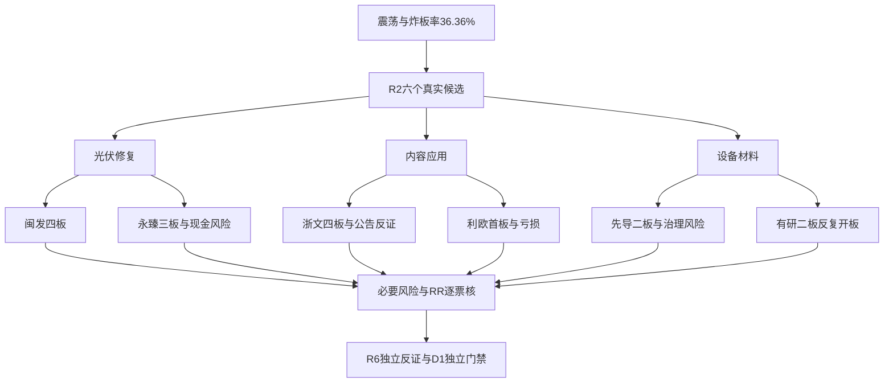

# 2026年11月6日 · 个股画像

> 数据源新鲜度：partial。降级：true。置信度：0.69。

## 🧭 一句话结论

**六票保留研究；永臻、先导、有研降级，四板不等于主升确认。**

## 🔍 详细分析

先认市场再认个股：本轮沿用R2已核观察主线，不由R5重做风格。**情绪=震荡**，市场炸板率36.36%；R2已将每线四票减至两票，R5覆盖这六票而不再次砍掉风险核验对象。市场昨日奖励的是光伏修复、内容高度和设备材料二板，不是六家公司均有新增硬业绩。今日尚未开盘，三条主线都只是研究观察，不代表已确认可交易。

主线=光伏/光储修复，持续性=3日验证窗，封板率=unknown，明日预期=分歧；主线=AI内容应用/短剧，持续性=1日验证窗，封板率=unknown，明日预期=分歧；主线=半导体自主可控，持续性=1日验证窗，封板率=unknown，明日预期=分歧。板块炸板分母缺失，不以全市场封板率冒充板块值，持续性不是已证实存续天数。

本轮只用**树干**主模板，不把五套打法叠成超级策略。六票均保留R2角色，图像存在与失败均不改变档位、排序或买权。六维没有本轮已校准的统一数值量尺，分数留null，不临时新增权重；alpha/risk按本模型对行情、主线地位与真实风险定性分档。档位不是执行资格。

必要财务先计算：六票均有63根日K及同窗口21日资金序列，原三表按累计转单季核F8；永臻是真实Q2/Q3两季经营现金流为负且净利为正，浙文和有研的两季单季CFO为正，不能因累计为负一锅端。先导二板、利欧首板、有研二板仍有中期均线未修复的事实，不标“确认主升低吸”。

## 📊 候选与六维裁决

| 股票 | R2角色 | 板型/地位 | 5日自算主力/亿元 | 5日DC/亿元 | alpha / risk | 态度 |
|---|---|---|---:|---:|---|---|
| 闽发铝业 `002578.SZ` | 龙一 | 缩量一字四板；沪深10cm同权，流通39.18亿属20—50亿风险带。 | 1.876 | 1.872 | B+ / B- | 观察 |
| 永臻股份 `603381.SH` | 龙二 | 缩量一字三板；历史股性仅5个有效封单样本且近期评级差，不把三板升级成长妖。 | 1.105 | 1.104 | B / C | 降级 |
| 浙文影业 `601599.SH` | 龙一 | 缩量一字四板；当日换手2.74%，此前股性月表近期弱；高位本身不是替换龙一理由。 | 0.726 | 0.688 | B+ / B- | 观察 |
| 利欧股份 `002131.SZ` | 龙二 | 首板回封，Tushare开板1次；流通257.03亿、换手8.48%；历史月表近期差。 | 8.898 | 8.890 | B+ / B- | 观察 |
| 先导基电 `600641.SH` | 龙一 | 二板快速封板非一字；换手2.32%；问财业务沿用旧称万业时期资料，现名与业务归属待R5核。 | 1.505 | 1.572 | B / C | 降级 |
| 有研新材 `600206.SH` | 龙二 | 二板多次回封；Tushare开板6次、问财3次，保留差异不择优；收盘回封不等于全日稳定。 | 11.285 | 11.955 | B / B- | 降级 |

所有候选均含板型、龙头判定、RR和禁止清单核验状态。**RR=unknown，止损距离=unknown，降级watch**；完整禁止清单未全核，命中项保持unknown，不把空数组当通过。六票均是“今日核心”的研究假设，首次D1成案前in_today_plan未知，未应用plan_outside_scan。R5不生成进出价格，也不把未知预算改成正额度或零预算。

### 闽发铝业 · 龙一 · 观察

四板身位与光伏合力成立，但扣非亏损，一字开板后的承接未证。

| 维度 | 本轮裁决与证据 |
|---|---|
| 催化背景 | 11月4日异动公告确认经营环境未重大变化、无应披露未披露事项；Q3扭亏主要并不等于主营利润修复，不能将液冷/机器人标签当新订单。 |
| 筹码结构 | 近5日大单与超大单净额及DC代理同向；一字日成交少，净流入强度不代表可成交量，股东户数最新一期反增。 |
| 板块联动 | 继承R2研究地位与树干模板，不按股性分或图像改排序；观察核心承接，不能把昨日一致当今日加速；不以低位后排替换被否龙一。 |
| 财务估值 | 采用铝加工周期PB×ROE框架；Q3归母微利但扣非亏损，非经常损益超过归母净利，PB已处三年高分位，不能以低价当便宜。 |
| 技术形态 | 63根日线显示四板快速修复，收盘高于MA20及MA60，但MA5尚低于MA60，不是成熟均线多头；11月5日缩量一字只能说明成交受限。 |
| 研报机构 | 实际查询近30日研报返回0行；不等于市场不存在研报或机构冷落。 |

数值锚：收盘`4.55`；前复权MA20=`3.735`，MA60=`3.875`；20交易日涨跌`10.44%`；最新量/五日均量`0.32`。这些是事实锚，不是委托价格。

龙头认定：`龙头`，纪律已核`2`条；保留原角色，业务因果及必要风险尚未完整认证。RR未知→watch；禁止清单完整性未知，不授执行资格。

- **大资金意图**: 资金在交易光伏修复叠加四板辨识度，主要假设是短线接力而非已兑现盈利上修；对手盘是连续涨停获利筹码。

- **为什么走强**: 四板身位、光伏22家涨停及两种资金分类净流入支持市场辨识度；没有新硬公告证明业务跨越。

- **逻辑够不够硬**: 价格和板块效应较硬，盈利催化不硬；同一Tushare SDK/MCP不重复计源，异动自查也不等于监管全面排雷。

- **买入理由**: 研究成立理由：光伏链最高非ST身位前排；四板与两源资金方向匹配。仅今日核心观察，不形成买单。

- **风险点**: 四板一字的可得性和兑现风险；Q3扣非仍亏损、历史PB偏高且控股股东质押约50%。

- **止损条件**: 若下一交易日开板后不能回封且光伏前排同时失去扩散，四板接力研究假设失效；不在R5生成委托止损价。

- **可验证假设**: 未来1—3个交易日核开板次数、回封结果、光伏涨停家数与同日资金方向；连续封死只确认不可成交，不确认开板承接。

财务核验：F6；这不代表全部排雷通过。F3/F4已实算，F8已转单季，F11使用同一控制股东分母；F5逐票采用年度原文或保留空列unknown。当前合规终核未完整，交R5/R4补证，不能交禁MCP的R6抓数。

图为原抓取产物；本会话未直接读取图像。本会话读取快照的文字与原始数值上下文，不冒称直接视觉读取图片；周线标为11/6且无partial/available_at，未闭合；各周期复权未知，不能从fq=2升级前复权可比或今日承接。

### 永臻股份 · 龙二 · 降级

三板合力不能掩盖现金流与债务压力，降级watch，不以一字预测抢买。

| 维度 | 本轮裁决与证据 |
|---|---|
| 催化背景 | 11月5日异动公告称经营环境未重大变化、无未披露重大事项；储能投资、员工持股计划属于不同事项，不将其当新增锁定利润订单。 |
| 筹码结构 | 近5日资金分类小幅净入、融资余额上行；10月30日金额偏差25.45%，仍降筹码置信度。一字板0.64亿元成交不足以验证开板承接，龙虎榜是窗口净买而非持续机构配置。 |
| 板块联动 | 继承R2研究地位与树干模板，不按股性分或图像改排序；观察核心承接，不能把昨日一致当今日加速；不以低位后排替换被否龙一。 |
| 财务估值 | PB×ROE并结合现金兑现；Q3归母利润几乎全由非经常损益贡献，连续Q2/Q3单季经营现金流为负且净利为正，有息负债/归母权益超过原80%阈值。 |
| 技术形态 | 63根日线显示三板越过短期箱体与MA60，但最新量仅五日均量约45%；这是短线强修复，不以未闭合周线确认中期反转。 |
| 研报机构 | 实际查询近30日研报返回0行；不等于市场不存在研报或机构冷落。 |

数值锚：收盘`18.85`；前复权MA20=`14.616`，MA60=`14.846`；20交易日涨跌`28.06%`；最新量/五日均量`0.45`。这些是事实锚，不是委托价格。

龙头认定：`龙头`，纪律已核`2`条；保留原角色，业务因果及必要风险尚未完整认证。RR未知→watch；禁止清单完整性未知，不授执行资格。

- **大资金意图**: 资金交易光伏边框链三板身位与小流通盘弹性，不足证明资金认可盈利质量；开板时先手有兑现动机。

- **为什么走强**: 光伏扩散、三板早封及净流入共同解释股价强，不能将股价强倒推成本/现金流已改善。

- **逻辑够不够硬**: 身位硬、财务承受力弱；F8/F10及F6实算命中，属于交R6审查的真实反证，不由R5擅设hard_reject。

- **买入理由**: 研究成立理由：光伏设备真实边框环节；三板与主线扩散匹配。财务风险使本轮降级watch，不因不选而改放后排。

- **风险点**: 连续两季利润未兑现为经营现金；有息债务高、扣非几近零、流通市值20—50亿风险带；一字兑现风险。

- **止损条件**: 若板块回落且开板不能维持前排回封，接力逻辑失效；财务风险只有后续报表现金兑现和债务降低才可能缓解，涨停不解除。

- **可验证假设**: 未来1—3个交易日验证与闽发的联动和开板回封；现金流反证等待正式披露，不能在三天内凭盘口消除。

财务核验：F3、F6、F8、F9、F10、V6；这不代表全部排雷通过。F3/F4已实算，F8已转单季，F11使用同一控制股东分母；F5逐票采用年度原文或保留空列unknown。当前合规终核未完整，交R5/R4补证，不能交禁MCP的R6抓数。

### 浙文影业 · 龙一 · 观察

四板内容身位保留，但连续风险公告与资金源冲突使承接仍待验证。

| 维度 | 本轮裁决与证据 |
|---|---|
| 催化背景 | 11月4—6日连续异动/风险提示，11月6日原文称四日累计涨幅46.67%、经营未重大变化；没有新增AI短剧收入业绩认证。 |
| 筹码结构 | 近5日两源累计均为净入，但11月4日分档自算净入0.034657亿、DC净出0.207069亿，方向相反；11月5日金额偏差约42%，均保留双方，不择优。Q2和Q3单季CFO均已转正，不能把累计负值写连续两季恶化。 |
| 板块联动 | 继承R2研究地位与树干模板，不按股性分或图像改排序；观察核心承接，不能把昨日一致当今日加速；不以低位后排替换被否龙一。 |
| 财务估值 | 纺织+影视多元业务采用分部框架但不编SOTP目标值；利润增长包含费用压降、应收清收冲回，不把这些直接外推为AI变现。 |
| 技术形态 | 63根日线支持均线抬升与四板加速，但11月4日不是一字：原日线最低价低于涨停价，公告还披露当日换手9.67%；快照把11月3—5日均称一字有误。 |
| 研报机构 | 实际查询近30日研报返回0行；不等于市场不存在研报或机构冷落。 |

数值锚：收盘`4.62`；前复权MA20=`3.443`，MA60=`3.266`；20交易日涨跌`43.93%`；最新量/五日均量`0.64`。这些是事实锚，不是委托价格。

龙头认定：`龙头`，纪律已核`2`条；保留原角色，业务因果及必要风险尚未完整认证。RR未知→watch；禁止清单完整性未知，不授执行资格。

- **大资金意图**: 资金交易内容应用族的四板高度，盈利兑现与题材想象分开；多日先手筹码与开板新增买盘博弈。

- **为什么走强**: 四板、AI应用17家涨停和热榜提升共同强化辨识度；公司风险提示不支持用未披露重大变化解释连板。

- **逻辑够不够硬**: 身位与日线硬，短剧业绩和当日承接未证；资金数量冲突降证据置信度，但不伪造成资金净出。

- **买入理由**: 研究成立理由：R2内容族四板龙一；Q2/Q3现金流单季改善可核。今日核心观察，不凭首封或热榜授权。

- **风险点**: 连续四板后的先手兑现与连续风险提示；资金数量冲突；多元业务盈利不等于短剧业务验证。

- **止损条件**: 如开板不能恢复封板且内容扩散消退，四板带队假设失效；公司后续若否定核心业务映射，则停止该映射。

- **可验证假设**: 未来1—3个交易日比较本票开板回封与利欧/内容梯队联动；同一交易日双源金额差异须继续并列，不以单源好看数值确认。

财务核验：本轮已核项没有命中红旗；这不代表全部排雷通过。F3/F4已实算，F8已转单季，F11使用同一控制股东分母；F5逐票采用年度原文或保留空列unknown。当前合规终核未完整，交R5/R4补证，不能交禁MCP的R6抓数。

图为原抓取产物；本会话未直接读取图像。本会话读取快照的文字与原始数值上下文，不冒称直接视觉读取图片；周线标为11/6且无partial/available_at，未闭合；各周期复权未知，不能从fq=2升级前复权可比或今日承接。

### 利欧股份 · 龙二 · 观察

首板容量与真实成交更可检验，但亏损及MA60下方修复不构成主升确认。

| 维度 | 本轮裁决与证据 |
|---|---|
| 催化背景 | 数字营销/AI应用来自R2业务与题材归因；Q3亏损和减值原公告为反证。11月6日期权注销完成不是新增订单、回购或经营改善。 |
| 筹码结构 | 11月5日大单自算与DC约9.14亿元同向，龙虎榜净买约3.30亿元，但机构专用席位合计偏卖，不能写机构游资双买。股东户数增加也不支持无条件锁筹。 |
| 板块联动 | 继承R2研究地位与树干模板，不按股性分或图像改排序；观察核心承接，不能把昨日一致当今日加速；不以低位后排替换被否龙一。 |
| 财务估值 | 数字营销成长业务采用PS与扣非/现金兑现交叉；TTM PE缺失，年度静态PE不当成长估值锚。Q3归母与扣非双亏，不能套用正利润F6比值制造通过。 |
| 技术形态 | 63根日线显示首板放量重回MA20，上方MA60仍高于收盘，MA5也未高于MA10；这属于下降结构中的右侧修复试验，不是确认主升浪低吸。 |
| 研报机构 | 实际查询近30日研报返回0行；不等于市场不存在研报或机构冷落。 |

数值锚：收盘`4.39`；前复权MA20=`4.104`，MA60=`4.518`；20交易日涨跌`6.55%`；最新量/五日均量`1.60`。这些是事实锚，不是委托价格。

龙头认定：`容量核心/首板，非连板龙头`，纪律已核`3`条；保留原角色，业务因果及必要风险尚未完整认证。RR未知→watch；禁止清单完整性未知，不授执行资格。

- **大资金意图**: 资金偏好有容量和可成交换手的应用首板，可能承接内容族外溢，也可能是亏损背景的短线情绪修复。

- **为什么走强**: 首板、21.48亿元成交及同日资金代理净入有数值支持；直接硬业绩催化缺失，不能从净买反推经营见底。

- **逻辑够不够硬**: 交易流动性比一字高位可检验，盈利与中期趋势不硬；龙虎榜总净买和机构净卖须同时呈现。

- **买入理由**: 研究成立理由：内容应用容量核心；首板真实换手及资金方向能核。仍只列今日核心研究，不在MA60下方冠以主升低吸。

- **风险点**: Q3亏损、减值与现金流压力；机构席位分歧和股东户数增加；反弹未收复中期均线。

- **止损条件**: 若首板溢价无法维持且内容族扩散消失，容量回流逻辑失效；经营逻辑只有扣非与现金流正式改善才重评。

- **可验证假设**: 未来1—3个交易日核首板溢价、与浙文联动及是否收复自身滚动MA60；资金净入不能替代价格承接，不能仅凭低价补仓。

财务核验：本轮已核项没有命中红旗；这不代表全部排雷通过。F3/F4已实算，F8已转单季，F11使用同一控制股东分母；F5逐票采用年度原文或保留空列unknown。当前合规终核未完整，交R5/R4补证，不能交禁MCP的R6抓数。

### 先导基电 · 龙一 · 降级

早封二板保留研究身位，增持已兑现，但中期破位修复与关联治理风险并存。

| 维度 | 本轮裁决与证据 |
|---|---|
| 催化背景 | 11月4日原公告确认4名增持主体合计1619.2999万元计划完成，10月24日三人600.6197万元是子集而非另笔加总。关联资产交易未完成条件、控股股东质押50.47%及旧警示函并列。 |
| 筹码结构 | R5补到近5日同窗口资金价格，不能因R7未覆盖写全票停买；融资余额降约30%且融券余额亦降，不满足short_pressure双条件。 |
| 板块联动 | 继承R2研究地位与树干模板，不按股性分或图像改排序；观察核心承接，不能把昨日一致当今日加速；不以低位后排替换被否龙一。 |
| 财务估值 | 高成长设备+材料混合业务采用PS/盈利质量并列，不编PEG增长率；归母微利而合并净利亏损、扣非亏损，非经常收益对归母比值极高。旧年报有董事警示函，重大违法性质不能由标题裁成阴性。 |
| 技术形态 | 63根日线显示收盘仅高于MA5，仍低于MA10/20/30/60，20日跌幅约32%；二板是深跌后的修复，不是既成主升。图像模型连接失败不改变这项数值结论。 |
| 研报机构 | 最新机构研报为华西10/31增持；同稿三个预测年度不算三份，EPS为预测非已实现。 |

数值锚：收盘`31.02`；前复权MA20=`36.166`，MA60=`35.757`；20交易日涨跌`-31.55%`；最新量/五日均量`0.36`。这些是事实锚，不是委托价格。

龙头认定：`龙头`，纪律已核`3`条；保留原角色，业务因果及必要风险尚未完整认证。RR未知→watch；禁止清单完整性未知，不授执行资格。

- **大资金意图**: 资金在设备自主可控中寻找二板早封身位，同时借增持完成修复信心；是否能摆脱旧高位套牢盘仍待真实成交确认。

- **为什么走强**: 二板09:31早封、芯片13家涨停与增持完成构成可核组合，但不证明技术中期转强或收购带来现金回报。

- **逻辑够不够硬**: 增持金额与计划完成硬，盈利质量、关联依赖和监管事件定性未闭环；原警示函不自动等于财务造假，也不能省略。

- **买入理由**: 研究成立理由：R2设备分支早封龙一；管理层实买已完成。仍降级watch，不凭增持或二板解除治理与趋势问题。

- **风险点**: 扣非亏损及累计CFO负；历史关联交易依赖和董事监管警示；控股股东质押超过50%；中期均线下方套牢盘。

- **止损条件**: 如二板修复失去封板且设备材料同步转弱，独立强势假设失效；若补得重大违法/非标原证据，应交R6按原规则裁决。

- **可验证假设**: 未来1—3个交易日核设备分支扩散与能否收复自身滚动MA20；核监管原决定适用主体、事由和有效窗口，不把旧处罚或增持当本日资金。

财务核验：F6、F7；这不代表全部排雷通过。F3/F4已实算，F8已转单季，F11使用同一控制股东分母；F5逐票采用年度原文或保留空列unknown。当前合规终核未完整，交R5/R4补证，不能交禁MCP的R6抓数。

图为原抓取产物；本会话未直接读取图像。原快照实际模型调用失败；保留错误record，不声称本模型看图，不新建图像。

### 有研新材 · 龙二 · 降级

材料二板与资金回流可核，但反复开板、双源冲突及高估值阻止主升认定。

| 维度 | 本轮裁决与证据 |
|---|---|
| 催化背景 | 自主可控材料业务与R2/R3人气证据并列；本轮没有新硬订单公告。Q3利润/扣非及减值公告均已取得，外盘科技冲击仅作为R4隔夜风险背景。 |
| 筹码结构 | R5补到近5日价格资金；11月5日自算7.11亿、DC7.87亿偏差约9.6%，同向不能消除金额冲突。股东户数最新下降是历史持有人统计，不证明11月6日买盘。 |
| 板块联动 | 继承R2研究地位与树干模板，不按股性分或图像改排序；观察核心承接，不能把昨日一致当今日加速；不以低位后排替换被否龙一。 |
| 财务估值 | 材料成长PS/PE与扣非增长交叉；PE TTM约115倍、三年高分位，不能因Q3正增长就说低估。Q2/Q3单季CFO均为正，累计负值不构成F8。 |
| 技术形态 | 63根日线显示二板修复但收盘仍在MA20下方，距MA60更远；Tushare开板6次，R2问财为3次，不择优。按原规则判分歧弱，只入观察。 |
| 研报机构 | 实际查询近30日研报返回0行；不等于市场不存在研报或机构冷落。 |

数值锚：收盘`38.39`；前复权MA20=`38.656`，MA60=`46.378`；20交易日涨跌`-14.00%`；最新量/五日均量`1.32`。这些是事实锚，不是委托价格。

龙头认定：`分歧弱`，纪律已核`3`条；保留原角色，业务因果及必要风险尚未完整认证。RR未知→watch；禁止清单完整性未知，不授执行资格。

- **大资金意图**: 资金回补材料弹性与高人气，但反复开板说明先手抛压和新增买盘竞争，不足证明有组织锁仓。

- **为什么走强**: 二板、材料扩散和热榜跃升说明市场认可；20日仍下跌且金额冲突，不能从两日涨停推导主升波段。

- **逻辑够不够硬**: 半导体材料身份与行情硬，新增订单、资金身份与日内强封不硬；图像失败不额外调档，数值分歧已足够保留watch。

- **买入理由**: 研究成立理由：材料二板与人气前排；Q3扣非增长、季度CFO改善。因反复开板及中期趋势未修复，降级watch。

- **风险点**: 多次开板与双源资金量差异；高估值及中期套牢盘；业务合并范围变化使同比不是纯内生增速。

- **止损条件**: 若再次反复开板而不能有效回封，或材料分支无跟随扩散，弱转强假设失效；不因股价回落而把高位修复改叫便宜低吸。

- **可验证假设**: 未来1—3个交易日核开板次数是否下降、回封与同族扩散，及能否收复自身滚动MA20；不以单源金额或人气名次代替确认。

财务核验：本轮已核项没有命中红旗；这不代表全部排雷通过。F3/F4已实算，F8已转单季，F11使用同一控制股东分母；F5逐票采用年度原文或保留空列unknown。当前合规终核未完整，交R5/R4补证，不能交禁MCP的R6抓数。

## 🧩 专题知识：采用与不选对照

股性只用六代码投影：利欧历史69分但近期差；永臻23分、仅5个有效封单样本；浙文近期弱与当前四板可以并存；先导旧名万业仅按600641代码匹配。历史分不是当下名次，也不重加R2同源支持。闽发当前四板超过旧表三板，反映窗口不同，不擅自篡改历史表。

一字预测目标日虽匹配，但只是不可成交风险的比较素材。其预测概率、排隔夜单措辞不采为指令。先导10月24日三人600.6197万元是11月4日四人1619.2999万元的子集，旧周报与当前公告不能加总；控股股东50.47%质押要保留，不用公司总股本口径掩盖。

增长池、红利池没有本轮六代码精确匹配，因此不选赛诺、天德钰、路维、炬华、中远等专题对照对象进入R5：这不是认定它们差，而是R5不扩大已核R2范围，也没有本轮必要风险与主线地位认证。上游题材锚、旧增长版、旧催化日历仅保留来源索引，不冒称本阶段重读和采纳；空复盘专题反馈为unknown。逐源裁决和相关原文保存在同版JSON，R6无需读专题MD。

## 🔎 关键证据

- 永臻F8按累计转Q2/Q3单季后真实命中，F10有息债务/归母权益高于80%；原三表及计算输入已内嵌。
- 永臻10月30日、浙文11月3—5日、有研10月30日与11月5日双源金额偏差超过5%；浙文11月4日两源方向相反，均保留逐日双方记录，不用累计净入掩盖。
- 浙文11月4日并非一字，日线低价、公告换手9.67%与图像文字有差异；采用原数值并留原record反证。
- 先导FY2025更正年报记载董事徐磊收到警示函；性质和有效窗口继续核实，不自动升级重大违法，也不抹去真实警示。
- 四票图像原record有模型输出，但当前周线未闭合且逐周期复权未核；先导与有研为实际连接失败，不能用已有PNG冒充识图完成。

## 数据源审计

| 源 | 日期 | 状态 | 备注 |
|---|---|:--:|---|
| R2候选与地位 | 2026-11-06 | 🟢 | 本轮sha核对，6票，次线无leaders，不凑票 |
| R4事件 | 2026-11-06 | 🟡 | partial，直接/行业/隔夜风险分层，不将名单外风险移植候选 |
| R7资金背景 | 2026-11-06 | 🟡 | R2同版已绑定行业背景，不能代表未覆盖个股；R5另补同窗口个股 |
| Tushare live SDK | 2026-11-06 | 🟢 | 全六票日线63根、资金21日、多期三表，真实直连非缓存 |
| Tushare MCP | 2026-11-06 | 🟢 | 行情单码、资金、龙虎榜及公告点检；与SDK同源不独立加权 |
| 公司公告PDF | 2026-11-06 | 🟡 | Q3、风险与增持质押原文；年报定向页，不声称全文阅读 |
| 研报/机构调研 | 2026-11-06 | 🟡 | 真实查询；同稿按机构/日期去重，tp不当目标价 |
| 绑定图像快照 | 2026-11-06 | 🔴 | 两票模型连接失败；四票周期有效性未全核；原record随R5版本 |
| 四色四量/缠论/ETF期货映射 | 2026-11-06 | 🟡 | 未取得，仅辅助缺口，不单独硬禁 |
| 专题运输证据 | 2026-11-06 | 🟡 | 全索引与时点保留；仅精确相关内容裁决，同源不重复 |

## ⚠️ 不确定性 / 反证

本轮没有任何“全部必要风险已通过”的票。主要缺口是当前监管/预警完整性和D1未定价RR；辅助未知包括部分商誉空列、资本化流量与当前完整关联交易附注、ETF期货和估值模型。未知逐票列出，不能把辅助缺数变成全局停买，也不能因为市场强就删除财务反证。六票保留研究不代表六票都能交易，R6拥有独立硬否决，D1只能消费本版已嵌入的事实与图像副本。

## 🔗 与其他 R/D/E 的关系

- 依赖：本轮R2/R3/R4、已绑定行业资金背景和本阶段真实补证。
- 被消费：R6反证、D1主决策、E1复盘。R6只需读本JSON，不要求读MD或联网。
- 不变：账户停买、硬预算（含0）、仓位上限、T+1、人工确认和已有交易保护；本报告没有新增买权。

## Sub-Agent 元数据

- skill: analyze_stock_profile_v1
- artifact: data/research/20261106/R5_stock_profiles.json
- 生成耗时: 922秒（首条现场检查至初版生成，后续校验修订另计）
- model: gpt-6.1-sol
- 数值辅助：确定性Python计算；最终六维裁决由当前唯一R5会话完成。

## R5 必要证据局部补证 · r5-external-owner-20261106

# R5未受信候选说明

完整结论与证据见report.md和evidence.json。

## 结论矩阵
| 对象 | F12复用 | S2 | S3 | 必要screen |
|---|---|---|---|---|
| 002578.SZ 闽发铝业 | checked_negative / FY2025 | checked_negative | checked_negative | true |
| 601599.SH 浙文影业 | checked_negative / FY2025 | unknown | unknown | false |
| 002131.SZ 利欧股份 | checked_negative / FY2025 | unknown | checked_negative | false |

闽发仅在下述明确有限公开来源、主体和窗口内完成必要检查，不意味着可交易。利欧与浙文保留逐票必要缺口；未为了凑可买对象消灭unknown。辅助F2/F5/F7/V项原unknown不自动阻断必要screen，原全部financial flags与三表值不变。

此文件不是旧人读主报告的替代品，也不是正式R5发布。候选JSON继承原六票和所有未授权字段，原run/时间/validation不代表本轮信任；新的actual_observed_at仅在证据与三票scope中。

机械接收未接受项（不改模型原文，原候选已归档）：
[]

R5 JSON SHA256: f7bcca6c3acf898fcc4f9ba12f7f3dbeccfb35d2f09f0ffb0f17e377cd48e76b
