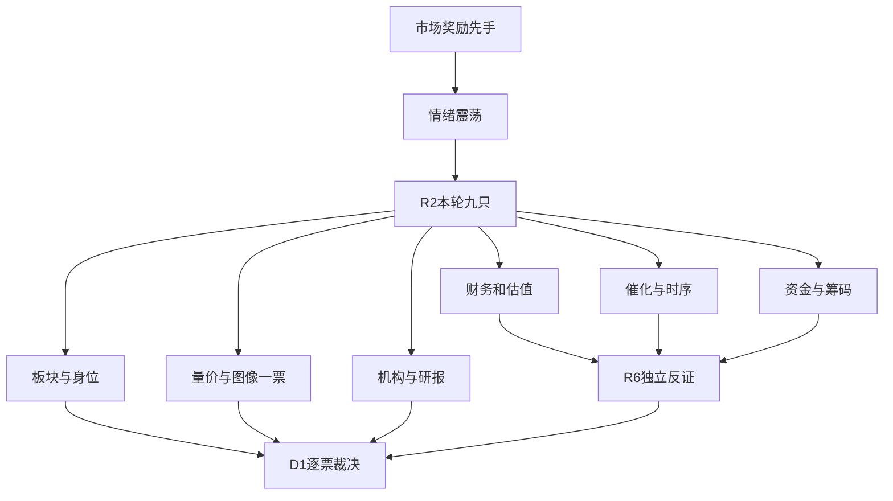

# 2026年11月10日 · 个股画像

> 情绪=震荡；本版研究不授予买权，未评对象不当作安全。

## 一句话结论
9只真实R2对象分批核验；先手强度不等于经营兑现，核心风险不靠杂毛替换。

## 详细分析
市场奖励先手前排而非普涨追价。R2炸板率44.90%，候选已减半，R5不重复减半，不凭辅助缺图或R7未覆盖清空研究。
主线 = 人形机器人，持续性 = 1日，封板率 = 50%，明日预期 = 分歧。主线 = 商业航天/太空算力，持续性 = 1日，封板率 = 56%，明日预期 = 分歧。1日仅为已认证截面，不是保证持续期。
采用树干主模板，先看板块合力和当日身位，再核报表、资金和事件时序。R2的市场观察与必要缺证保留，账户硬禁来源未知不改成正预算，首次D1成案前in_today_plan保持未知。
本轮绑定快照复用，不调用新图像模型。原record及各周期复权局限嵌入JSON；本R5读取的是图像模型文字记录与数值，不自称亲看PNG。

## 逐票六维画像

|对象|角色|态度|进攻/风险档|5日分档/东财净额（亿）|关键反证|
|---|---|---|---|---|---|
|上纬新材 688585.SH|龙一|不进|A-/C|2.8644/2.7910|弹性核心不等于盈利核心；万台下线与前三季亏损并存，保持核心研究、不以补涨替代其风险。|
|宇树科技 688836.SH|龙二|观察|A-/B-|1.1595/1.2558|本体人气与收入增长可核，但冲高回落、估值高和存货增速构成反证，不认证有效突破。|
|锋龙股份 002931.SZ|候补|观察|B/B-|1.9738/1.9547|历史股性强而本轮仅候补；扣非亏损、一次性收益占比高，不把老妖记忆当新龙地位。|
|西部材料 002149.SZ|龙一|观察|A-/B-|6.5239/6.4749|钛材细分先手最强，但几乎封死压缩可得性；应收与库存反证不能被早封掩盖。|
|顺灏股份 002565.SZ|龙二|观察|B+/B-|6.9662/6.9239|太空算力情绪辨识强，资金连续性可核；参股远期叙事不替代当期盈利。|
|中科星图 688568.SH|候补|降级|B/B-|0.1564/0.1488|新事件主体映射最直接，但市场身位与现金流弱；只做事件观察，不用注册资本想象订单。|
|东方嘉盛 002889.SZ|龙一|观察|B+/B-|2.2277/2.1979|冰雪次线2板身位最强，但物流受益关系与存贷双高、一次性收益均需正视。|
|冰山冷热 000530.SZ|龙二|观察|B+/C|4.4483/4.3432|制冷核心保留研究，但收入确认监管事实与关联交易反证提高风险档，不以历史股性豁免。|
|雪人集团 002639.SZ|候补|降级|B/B-|7.0885/7.0183|容量与资金活跃并存，但午后四次开板、扣非亏损，保留次线候补不升核心。|

已评对象：上纬新材、宇树科技、锋龙股份、西部材料、顺灏股份、中科星图、东方嘉盛、冰山冷热、雪人集团。
未评对象：无；辅助缺口仍逐项披露。

### 上纬新材 688585.SH · 不进
弹性核心不等于盈利核心；万台下线与前三季亏损并存，保持核心研究、不以补涨替代其风险。

- **大资金意图**: 更像物理AI弹性与控制权叙事的再定价，而非对已兑现利润估值；分档净额不能识别账户动机。
- **为什么走强**: 20cm收盘新高和33.25亿元成交强化人气，但四次开板及20日近93%涨幅显示先手利润厚。
- **逻辑够不够硬**: 生产公告和经营风险公告均为硬披露，独立于行情但属于同一公司信息面；下线并非交付，机器人收入占比仍低。

- **买入理由**: 仅研究，不是买入许可。今日核心的研究观察：有真实生产里程碑及板块扩散；T-1收盘创近20日新高，但不是本轮买入授权。
- **风险点**: 高位偏离均线与四次开板，获利盘兑现压力；需求转订单、良率和亏损未解决。
- **止损条件**: 后续披露否定需求/订单假设，或日线跌回前20日高点下方且板块扩散失效，撤销突破研究假设；不设卖出委托价。
- **可验证假设**: 未来1—3交易日核验是否守住前20日高点，且机器人涨停家数不低于3；该数仅沿既有板块效应认定，不是新增买权。

|维度|本轮判断|
|---|---|
|催化|生产公告和经营风险公告均为硬披露，独立于行情但属于同一公司信息面；下线并非交付，机器人收入占比仍低。|
|筹码|近5日分档自算2.8644亿，东财2.7910亿；同日偏差超过5%，两口径并列，筹码置信度降低，不能择优使用。|
|板块|T-1机器人弹性、人气核心；20cm首板、33.25亿元成交，R3产业叙事及R4万台下线均有对应；不将下线当交付。早盘已有多票封板，不能把本票当全板唯一启动者。|
|财务估值|前三季归母亏损4.22亿、扣非亏损4.25亿；存货同比上升114.46%且周转下降，扩产需求兑现风险实质存在。|
|技术|日线站上此前20日高点，趋势上行；收盘较MA20显著偏离，不把突破观察升级为次日承接已确认。|
|机构|近30日接口返回3行预测记录、0行调研记录；未把年度预测行数当独立研报数。|

量价窗口：20260803至20261109，65根日K。MA5/10/20/30=181.276/173.530/144.929/140.220；20日涨幅93.00%，量比5=1.28。
板型：首板、回封统计；龙头认定原R2仅通过2条；RR及止损距未知，保留观察，不能进execution；禁止清单已知命中与未核项详见同版JSON，未核不冒充零命中。
比较与不选：与锋龙比较，上纬是R2弹性龙一、但经营反证更直接；不因股性74.7低于或高于某分就换核心。宇树本体有收入增长但也不能替代上纬风险审核。
财务红旗：F4。必要审核完整性：False。
未知与回送：F1、F2、F7、F10、F11、S2、S3；由R5/R4补取，不交禁联网R6抓数。

图注：既有入口产出PNG供阅读；图像模型记录与R5数值判断分别保留，不认证本模型已直接看图。

事件时间线：
- 2026-11-09 · E20261110_005 · 2026-056原公告提示终端需求持续性、订单转化、产能和良率风险；机器人收入占比低。前三季归母亏损42197.92万元，扣非亏损42541.46万元，不能把此前下线规模写成盈利兑现。
- 具体发布时间未知 · E20261110_004 · 2026-055公告称9月20日对外发布Q1/T1，截至该公告披露日合计下线10000台。生产里程碑不是已售出、已交付或已回款10000台。
- 2026-11-10 · E20261110_002 · 科创板日报报道11月9日举行基地签约与总部中心揭牌。上纬启元、金固股份、富阳产投三方设立项目运营主体；报道未给出投资额、销售合同额或新增利润。

### 宇树科技 688836.SH · 观察
本体人气与收入增长可核，但冲高回落、估值高和存货增速构成反证，不认证有效突破。

- **大资金意图**: 资金围绕机器人本体的纯度和热榜跃升交易预期；换手高说明多空交换，不等于机构锁仓。
- **为什么走强**: 上涨9.04%伴51.17亿元成交，盘中759.99创新高但收716低于739.03前高，强势与抛压同时存在。
- **逻辑够不够硬**: 前三季收入18.17亿、同比约55.66%是报表事实，但PE约516.63倍对持续增长要求极高；不能用总主题叙事证明本票订单。

- **买入理由**: 仅研究，不是买入许可。今日核心研究：本体辨识度与R2龙二身份有证据；营收成长与日线修复可核，仍须真实承接及RR判断。
- **风险点**: 长上影、上市后高波动与高换手；高估值与存货激增，量产增长未等于现金转化。
- **止损条件**: 日线回补本轮上攻缺口且板块联动失效时撤销强势延伸假设；仅研究条件，不出委托止损价。
- **可验证假设**: 未来1—3交易日观察收盘能否重新高于此前20日高点；若持续低于且放量，盘中突破假设证伪。

|维度|本轮判断|
|---|---|
|催化|前三季收入18.17亿、同比约55.66%是报表事实，但PE约516.63倍对持续增长要求极高；不能用总主题叙事证明本票订单。|
|筹码|近5日分档自算1.1595亿，东财1.2558亿；同日偏差超过5%，两口径并列，筹码置信度降低，不能择优使用。|
|板块|R3热股35→2；T-1上涨9.0433%，是本体人气对照，不因688前缀拒绝；未涨停，不冒充高度龙。|
|财务估值|存货同比上升266.63%、周转下降；扣非占比未触F6，现金转化与资本化仍须分期核实。|
|技术|日线多头修复，盘中破前高、收盘未站稳；不是已经确认的箱顶突破。53根上市后K足够30日分析，但无60日均线。|
|机构|近30日接口返回3行预测记录、0行调研记录；未把年度预测行数当独立研报数。|

量价窗口：20260819至20261109，53根日K。MA5/10/20/30=666.648/664.071/584.113/542.914；20日涨幅69.95%，量比5=1.17。
板型：未封板；龙头认定原R2仅通过2条；RR及止损距未知，保留观察，不能进execution；禁止清单已知命中与未核项详见同版JSON，未核不冒充零命中。
比较与不选：对照上纬，本体增长事实更强但T-1未封板、并非高度龙；对照锋龙，人气更靠前，不因高价或科创板前缀排除。
财务红旗：F4。必要审核完整性：False。
未知与回送：F1、F2、F5、F7、F8、F10、F11、F12、S2、S3；由R5/R4补取，不交禁联网R6抓数。

事件时间线：
- 本轮R4无本码直接事件，不把主题新闻当个股订单；公告索引与板型事件详见同版JSON。

### 锋龙股份 002931.SZ · 观察
历史股性强而本轮仅候补；扣非亏损、一次性收益占比高，不把老妖记忆当新龙地位。

- **大资金意图**: 偏向机器人情绪通道的补涨博弈，未识别机构或游资护盘账户。
- **为什么走强**: 10cm首板与10.77%换手体现情绪活跃，但收盘尚未越过45.19的20日高点；不是低价即低位。
- **逻辑够不够硬**: 历史涨停58次、最高12板只说明股性；前三季扣非为负，原龙头认定2条不构成充分认证。

- **买入理由**: 仅研究，不是买入许可。仅主线补涨研究观察，R2真实候补对象；历史股性与当前资金可作T+1接力线索，不能独立授予资格。
- **风险点**: 扣非亏损、净利依赖非经常损益；本轮候补、前高压力与尾段兑现风险。
- **止损条件**: 机器人核心未延续且本票不能收复区间高点时取消补涨假设；不生成执行价格。
- **可验证假设**: 未来1—3交易日检验是否出现相对板块核心的强度提升并收复20日高点；未提升则维持候补，不强升龙三。

|维度|本轮判断|
|---|---|
|催化|历史涨停58次、最高12板只说明股性；前三季扣非为负，原龙头认定2条不构成充分认证。|
|筹码|近5日分档自算1.9738亿，东财1.9547亿；同日偏差超过5%，两口径并列，筹码置信度降低，不能择优使用。|
|板块|原锚定分86.3；T-1普通10cm涨停，10.77%换手，沪深同权；作为情绪通道比较对象，锚定分不代替最新地位。|
|财务估值|前三季归母约1852.51万元、扣非约-528.55万元，非经常损益/净利润约128.53%，F6命中。|
|技术|短线回升、MA5/10/20向上，收盘仍低于20日区间高点；回封统计不等于主升新高。|
|机构|近30日接口返回0行预测记录、0行调研记录；未把年度预测行数当独立研报数。|

量价窗口：20260803至20261109，65根日K。MA5/10/20/30=40.902/40.431/38.422/38.690；20日涨幅22.04%，量比5=1.42。
板型：首板、回封统计；龙头认定原R2仅通过2条；RR及止损距未知，保留观察，不能进execution；禁止清单已知命中与未核项详见同版JSON，未核不冒充零命中。
比较与不选：股性74.7高于冰山/顺灏不改变本轮候补身份；相较上纬、宇树缺本轮更强人气与带动，故不选为核心替代。
财务红旗：F6。必要审核完整性：False。
未知与回送：F7、F10、F11、S2、S3；由R5/R4补取，不交禁联网R6抓数。

事件时间线：
- 本轮R4无本码直接事件，不把主题新闻当个股订单；公告索引与板型事件详见同版JSON。

### 西部材料 002149.SZ · 观察
钛材细分先手最强，但几乎封死压缩可得性；应收与库存反证不能被早封掩盖。

- **大资金意图**: 先手交易太空算力材料需求的稀缺预期；单柜钛材测算冲突未解，不能写成确定大单。
- **为什么走强**: 首封09:30零开板、5日资金正向，但量比仅0.31，更多是封板成交受限，不能认证充分换手。
- **逻辑够不够硬**: 细分映射与最早封板可核；星云新闻16:14晚于昨日收盘，不能倒推该新闻驱动早盘。订单、利润弹性仍是假设。

- **买入理由**: 仅研究，不是买入许可。今日核心研究：R2钛材细分龙一及板块14家涨停；近期分档与东财资金均为正，仍未形成开仓RR方案。
- **风险点**: 开盘封死后次日可成交性与追价风险；应收占比高、非经常收益和需求测算冲突。
- **止损条件**: 钛材需求口径被权威原文证伪或日线跌回前高下方且板块失去扩散时取消假设。
- **可验证假设**: 未来1—3交易日检验封板打开后的成交承接与至少3家板块涨停效应，不以低量封死自动判断缩量洗盘。

|维度|本轮判断|
|---|---|
|催化|细分映射与最早封板可核；星云新闻16:14晚于昨日收盘，不能倒推该新闻驱动早盘。订单、利润弹性仍是假设。|
|筹码|近5日分档自算6.5239亿，东财6.4749亿；同日偏差超过5%，两口径并列，筹码置信度降低，不能择优使用。|
|板块|太空算力钛材细分T-1最早封板09:30、无开板、流通202.63亿；比只沾大概念的2板润贝映射更直接，龙一限定该细分而非整张511成分高度榜。|
|财务估值|应收/营收73.22%、非经常损益占比40.13%，存货增长且周转下降；F3负收入增长基数的机械触发需保留解释。|
|技术|日线越过此前39.95区间高点，短期上行；周线价格复权未逐周期核实，不能跨周期强认新主升。|
|机构|近30日接口返回0行预测记录、0行调研记录；未把年度预测行数当独立研报数。|

量价窗口：20260803至20261109，65根日K。MA5/10/20/30=36.906/34.166/31.912/32.082；20日涨幅34.56%，量比5=0.31。
板型：首板、未开板统计；龙头认定原R2仅通过2条；RR及止损距未知，保留观察，不能进execution；禁止清单已知命中与未核项详见同版JSON，未核不冒充零命中。
比较与不选：对照顺灏，本票是钛材细分更早身位且原财务仍盈利；对照中科星图，事件映射不如后者直接，但市场先手更强。成长池退出仅是另一筛选口径，不否定本轮龙一。
财务红旗：F3、F4、F6、F9。必要审核完整性：False。
未知与回送：F2、F7、F10、F11、S2、S3；由R5/R4补取，不交禁联网R6抓数。

图注：既有入口产出PNG供阅读；图像模型记录与R5数值判断分别保留，不认证本模型已直接看图。

事件时间线：
- 本轮R4无本码直接事件，不把主题新闻当个股订单；公告索引与板型事件详见同版JSON。

### 顺灏股份 002565.SZ · 观察
太空算力情绪辨识强，资金连续性可核；参股远期叙事不替代当期盈利。

- **大资金意图**: 围绕参股太空算力的弹性定价与抢先手；不能由大单净额断言产业资本建仓。
- **为什么走强**: 首封09:30:06零开板、5日分档净额约6.97亿，但量比0.32，四次涨停统计不是四连板。
- **逻辑够不够硬**: 主题关系与交易强度可追溯，前三季净亏损、扣非亦负，订单与收入转化未证实。

- **买入理由**: 仅研究，不是买入许可。主线补涨/次核心研究，R2龙二有真实热度与首封事实；5日双口径资金方向一致，只能作为资金证据。
- **风险点**: 参股公司远期商业化不等于上市公司收入；封板成交受限、次日追价及净亏损风险。
- **止损条件**: 参股/商业化关系被原文否定或日线失守上攻前区间且主线无扩散时取消情绪延伸假设。
- **可验证假设**: 未来1—3交易日检验两源5日资金是否仍同方向、与钛材核心是否联动；不要求固定买点。

|维度|本轮判断|
|---|---|
|催化|主题关系与交易强度可追溯，前三季净亏损、扣非亦负，订单与收入转化未证实。|
|筹码|近5日分档自算6.9662亿，东财6.9239亿；同日差异未超5%，同通道不同统计口径不重复加权。|
|板块|R3热度同花顺83→38、东财99→10；T-1首封09:30:06、零开板、4/8强势，太空算力题材辨识优于泛成分。|
|财务估值|前三季营收同比下降约11.06%，归母与扣非亏损；应收、库存与收入增速比较均触发原软红旗。|
|技术|20日区间新高且MA5/10/20多头；快速拉升的封板量缩只证明成交受限，不是低风险低吸点。|
|机构|近30日接口返回0行预测记录、0行调研记录；未把年度预测行数当独立研报数。|

量价窗口：20260803至20261109，65根日K。MA5/10/20/30=9.398/8.600/8.334/8.507；20日涨幅18.96%，量比5=0.32。
板型：首板、未开板统计；龙头认定原R2仅通过2条；RR及止损距未知，保留观察，不能进execution；禁止清单已知命中与未核项详见同版JSON，未核不冒充零命中。
比较与不选：相对西部材料身位龙二、早封相差6秒不独立证明带动；相对中科星图市场情绪更强但业务兑现更远期。
财务红旗：F3、F4。必要审核完整性：False。
未知与回送：F7、F10、F11、S2、S3；由R5/R4补取，不交禁联网R6抓数。

事件时间线：
- 本轮R4无本码直接事件，不把主题新闻当个股订单；公告索引与板型事件详见同版JSON。

### 中科星图 688568.SH · 降级
新事件主体映射最直接，但市场身位与现金流弱；只做事件观察，不用注册资本想象订单。

- **大资金意图**: 观察事件发起主体重估可能性，但5日净流量远弱于西部和顺灏；不猜机构意图。
- **为什么走强**: 日涨2.53%未封板，盘中高33.65收31.96，尚未收复前20日高32.45，涨幅不足以认证事件后新核心。
- **逻辑够不够硬**: 中科星云发起主体为直接报道事实；15亿注册资本不等于实缴、合同或收入，事件在T-1收盘后发布。

- **买入理由**: 仅研究，不是买入许可。只保留计划内事件试错研究，不代表已有今日交易计划；星云发布主体明确，为后续收入验证提供对象。
- **风险点**: 大额亏损及负现金流、应收回收风险；注册资本被误读为收入、盘中冲高回落。
- **止损条件**: 发起主体或项目进展被否定，或后续披露订单及回款持续不兑现时撤销事件盈利假设。
- **可验证假设**: 未来1—3交易日核验新事件后是否出现成交与收盘相对强度改善；没有改善不强行晋级。

|维度|本轮判断|
|---|---|
|催化|中科星云发起主体为直接报道事实；15亿注册资本不等于实缴、合同或收入，事件在T-1收盘后发布。|
|筹码|近5日分档自算0.1564亿，东财0.1488亿；同日偏差超过5%，两口径并列，筹码置信度降低，不能择优使用。|
|板块|R4 E001直接列星云产业发起主体；T-1+2.5345%，新事件映射与市场核心并行比较。非因为旧名单缺席而排除。|
|财务估值|前三季收入同比降64.66%、归母亏损4.91亿、CFO-7.10亿，应收/收入230.72%，现金回笼与订单兑现是主要反证。|
|技术|MA20附近企稳上行、盘中突破未获收盘确认，当前属于事件待验证而非放量新高。|
|机构|近30日接口返回0行预测记录、1行调研记录；未把年度预测行数当独立研报数。|

量价窗口：20260803至20261109，65根日K。MA5/10/20/30=30.968/30.053/30.088/30.004；20日涨幅12.22%，量比5=1.16。
板型：未封板；龙头认定原R2仅通过1条；RR及止损距未知，保留观察，不能进execution；禁止清单已知命中与未核项详见同版JSON，未核不冒充零命中。
比较与不选：相对西部、顺灏虽有直接事件映射，但T-1人气/资金/价格弱；不因消息正宗替代已有市场核心，更不按新闻晚发倒推昨日走势。
财务红旗：F3、F4、F9。必要审核完整性：False。
未知与回送：F7、F10、F11、S2、S3；由R5/R4补取，不交禁联网R6抓数。

事件时间线：
- 2026-11-09 · E20261110_001 · 11月9日合肥大会发布全栈国产化星云星座计划。中科星云注册资本15亿元并成立运营；中科星图、中科曙光、海光信息等为产业发起主体。注册资本不是实缴到账或上市公司新增销售订单。

### 东方嘉盛 002889.SZ · 观察
冰雪次线2板身位最强，但物流受益关系与存贷双高、一次性收益均需正视。

- **大资金意图**: 资金在次线高度与小流通盘的T+1接力中定价，不能断言大机构配置。
- **为什么走强**: 首封09:30、零开板且换手低，体现先手封锁筹码；不是已证实基本面改善。
- **逻辑够不够硬**: 两板高度和板块扩散是交易事实，冰雪直接收入尚未核；归母利润主要来自非经常损益。

- **买入理由**: 仅研究，不是买入许可。次线龙一研究观察，属于主线补涨候选而非今日已准入核心；2板和板块3家以上效应有据，仍需收入映射及必要门禁。
- **风险点**: 20—50亿流通市值警示带与可成交性；存贷双高、非经常收益依赖和冰雪收入未核。
- **止损条件**: 次线板块扩散失效或业务映射被否定，且高度不能延续时撤销接力假设。
- **可验证假设**: 未来1—3交易日核验2板身位是否延续及同板至少3家涨停，若仅孤立封板则降级研究假设。

|维度|本轮判断|
|---|---|
|催化|两板高度和板块扩散是交易事实，冰雪直接收入尚未核；归母利润主要来自非经常损益。|
|筹码|近5日分档自算2.2277亿，东财2.1979亿；同日偏差超过5%，两口径并列，筹码置信度降低，不能择优使用。|
|板块|本轮冰雪成分最高2板并列，首封09:30早于龙江09:30:04，零开板，原锚TOP3；只是62成分身位研究排序，不认证全市场总龙。|
|财务估值|F1存贷双高：货币资金/资产25.72%、短借/资产28.81%；F6非经常占比82.28%；同窗收入下滑与应收占比高。 2026-027原公告承认关联交易未及时履行审议与披露义务；补审不等于从未违规。|
|技术|近期2连板上行，但收盘仍低于20日高17.31；量比0.36不能独立证明惜售长持。|
|机构|近30日接口返回0行预测记录、0行调研记录；未把年度预测行数当独立研报数。|

量价窗口：20260803至20261109，65根日K。MA5/10/20/30=14.246/14.031/13.808/13.203；20日涨幅37.93%，量比5=0.36。
板型：2板、未开板统计；龙头认定原R2仅通过2条；RR及止损距未知，保留观察，不能进execution；禁止清单已知命中与未核项详见同版JSON，未核不冒充零命中。
比较与不选：相较冰山有2板高度、但冰山制冷映射更直接；相较雪人封板更早且未开板，不把净额排行替代身位。
财务红旗：F1、F3、F4、F6、F9。必要审核完整性：False。
未知与回送：F7、F10、F11、S2、S3；由R5/R4补取，不交禁联网R6抓数。

图注：既有入口产出PNG供阅读；图像模型记录与R5数值判断分别保留，不认证本模型已直接看图。

事件时间线：
- 本轮R4无本码直接事件，不把主题新闻当个股订单；公告索引与板型事件详见同版JSON。

### 冰山冷热 000530.SZ · 观察
制冷核心保留研究，但收入确认监管事实与关联交易反证提高风险档，不以历史股性豁免。

- **大资金意图**: 冬季冰雪与制冷弹性交易的活跃筹码，龙虎榜上榜频繁只能说明交易活跃，不等于协同锁仓。
- **为什么走强**: 首封09:32:21零开板、14.80%换手，近期活跃；20日涨83.69%说明并非低位便宜票。
- **逻辑够不够硬**: 制冷业务映射比物流标签直接，但收入净利下滑、应收偏高；没有独立新增大订单认证。

- **买入理由**: 仅研究，不是买入许可。次线龙二研究：制冷业务关联及T-1板块合力；资金正向与早封可核，但不能视为高位票低吸资格。
- **风险点**: 20日涨幅大与估值高位；利润下滑、应收与关联交易未核全；原公告载明2022—2024收入确认不规范及公司治理缺乏独立性，不能以制冷题材强势抹掉。
- **止损条件**: 行业预期失效或日线跌回前区间且板块核心不再承接，取消次线强势延伸假设。
- **可验证假设**: 未来1—3交易日检验前高能否被收盘守住、与2板核心是否同步；失去联动不改口称长期价值。

|维度|本轮判断|
|---|---|
|催化|制冷业务映射比物流标签直接，但收入净利下滑、应收偏高；没有独立新增大订单认证。|
|筹码|近5日分档自算4.4483亿，东财4.3432亿；同日差异未超5%，同通道不同统计口径不重复加权。|
|板块|冰雪原锚TOP1，T-1首板09:32:21零开板、14.8%换手，五日四个上榜日提供交易活跃证据；优先于未涨停的旧锚冰轮。|
|财务估值|前三季净利同比降32.38%，非经常占比36.70%、应收/营收55.40%；PE/PB/PS均处样本高位。 新核H1关联购销/收入下界20.94%命中F7；2026年3月监管决定涉及收入确认和治理，整改闭环未核。|
|技术|日线小幅越过9.53前高，MA5/10/20上行；量比0.42反映封板成交收缩，不确认次日换手。|
|机构|近30日接口返回0行预测记录、0行调研记录；未把年度预测行数当独立研报数。|

量价窗口：20260803至20261109，65根日K。MA5/10/20/30=9.074/8.591/8.235/7.232；20日涨幅83.69%，量比5=0.42。
板型：首板、未开板统计；龙头认定原R2仅通过2条；RR及止损距未知，保留观察，不能进execution；禁止清单已知命中与未核项详见同版JSON，未核不冒充零命中。
比较与不选：股性68.5与最高6板是历史；相较东方嘉盛缺2板高度，相较雪人首封更早且无开板；不因历史锚第一就凌驾当日身位。
财务红旗：F3、F4、F6、F9、F7。必要审核完整性：False。
未知与回送：F10、F11、S2、S3；由R5/R4补取，不交禁联网R6抓数。

事件时间线：
- 本轮R4无本码直接事件，不把主题新闻当个股订单；公告索引与板型事件详见同版JSON。

### 雪人集团 002639.SZ · 降级
容量与资金活跃并存，但午后四次开板、扣非亏损，保留次线候补不升核心。

- **大资金意图**: 容量情绪交换明显，资金净入不能区分新资金接货与旧资金兑现，不推游资协同。
- **为什么走强**: 27.45亿成交和26.76%换手放大人气，但13:09才首封、4次开板明显弱于次线前排。
- **逻辑够不够硬**: 制冷题材与交易数据真实，前三季归母及扣非亏损且CFO为负；营收增长没有转成利润改善。

- **买入理由**: 仅研究，不是买入许可。仅次线补涨研究，真实R2候补对象；制冷方向与市场活跃度可作为观察线索，非新增买权。
- **风险点**: 高换手四次开板、分歧弱；扣非亏损和CFO负、控股股东质押需按原文复核。
- **止损条件**: 次线前排失去承接且本票高换手不能转强，撤销补涨观察假设。
- **可验证假设**: 未来1—3交易日检验是否从午后跟随转为更早封板、开板数是否少于4；仍弱则维持降级。

|维度|本轮判断|
|---|---|
|催化|制冷题材与交易数据真实，前三季归母及扣非亏损且CFO为负；营收增长没有转成利润改善。|
|筹码|近5日分档自算7.0885亿，东财7.0183亿；同日偏差超过5%，两口径并列，筹码置信度降低，不能择优使用。|
|板块|R3冰雪热度跃升、R7东财单日资金榜第4；T-1成交27.45亿、换手26.76%，是人气容量观察对象，不靠净流入挤占2板身位。|
|财务估值|收入同比增18.63%但净利同比降160.24%，应收/收入55.92%；现金流为负与亏损并列，不误命中盈利未变现F8。|
|技术|收盘低于16.33近20日高点，首板回封分歧大；不是14点后首封，不能误命中尾盘首次点火禁项。|
|机构|近30日接口返回0行预测记录、0行调研记录；未把年度预测行数当独立研报数。|

量价窗口：20260803至20261109，65根日K。MA5/10/20/30=14.860/14.423/14.597/14.374；20日涨幅20.29%，量比5=1.42。
板型：首板、回封统计；龙头认定原R2仅通过2条；RR及止损距未知，保留观察，不能进execution；禁止清单已知命中与未核项详见同版JSON，未核不冒充零命中。
比较与不选：对照东方嘉盛、冰山，容量与净额更大但首封更晚、四次开板，故不按资金排名替代龙头认定。股性名称雪人股份与本轮雪人集团须以002639同码匹配。
财务红旗：F9。必要审核完整性：False。
未知与回送：F10、S2、S3；由R5/R4补取，不交禁联网R6抓数。

事件时间线：
- 本轮R4无本码直接事件，不把主题新闻当个股订单；公告索引与板型事件详见同版JSON。

## 关键证据
- T-1炸板率44.90%，R2已减半；本轮仅画像9只真实候选。来源：本版R2绑定副本。
- 每票同窗5日分档自算与东财净额并列；同日相对差异超过5%仅降低筹码置信度，不择优取源。来源：本版逐票原始记录。
- 星云发布晚于T-1收盘，上纬万台下线并非销售与回款。来源：本版R4事件原文摘录。

## 数据源审计
|源|日期|状态|记录数/备注|
|---|---|:--:|---|
|R2|2026-11-10|🟢|本批9码，原status partial保留；已核版本身份不等于全部研究完成|
|R4|2026-11-10|🟢|本轮partial；运输上游invalid与当前文件可用性分开|
|tushare live|2026-11-10|🟢|本阶段180次真实SDK请求；行情T-1；原始响应逐票内嵌|
|chart binding|2026-11-10|🟢|9/9原record绑定复用，不重复模型调用；周线/分钟复权未知保留|
|R7|2026-11-10|🟢|旧对象池覆盖不替代本批R5必要取证；实际来源不改owner|
|independent regulatory coverage|2026-11-10|🔴|交易所/证监会独立覆盖及原决定未完成，保留逐票unknown，不作否决|
|statutory linked PDFs|2026-11-10|🟢|42份PDF取得并提取文字；原文已读仅各票选定片段，扫描图/错误类型另列，不称全文阅读|
|top_list/top_inst|2026-11-10|🟢|30日逐日榜+40次按实际上榜日席位请求；不据窗口缺席作全历史阴性|
|R3 alert scope|2026-11-10|🟢|精确匹配本码，未知与false分开；不移植其他股票alert|

## 不确定性 / 反证
辅助图像、研报和ETF缺口不产生全局停买。S2/S3独立监管来源及部分附注未完成，不能宣称全部排雷通过；实际已检出F类风险完整交R6。月度股性、旧日历与重复转载不重复计独立支持。
Mermaid已用阅读端固定版本11.4.0完成浏览器解析与真实SVG渲染，渲染产物21,071字节。partial源于监管覆盖及逐票未核项，不是图表失败。

## 与其他 R/D/E 的关系
- 依赖：本轮R2/R4/R3及已绑定R7；R7旧池未覆盖不等于本票无资金。
- 被消费：R6只读本JSON内嵌事实/计算；D1只消费本版嵌入图像副本，不要求读取后续raw/latest或现场补抓。

## Sub-Agent 元数据
- skill: analyze_stock_profile_v1
- artifact: data/research/20261110/R5_stock_profiles.json
- model: gpt-6.1-sol
- method: 本会话逐票语义裁决；普通Python仅取证、计算、校验与原子落盘
- status: partial；未完成事项不冒充成功
