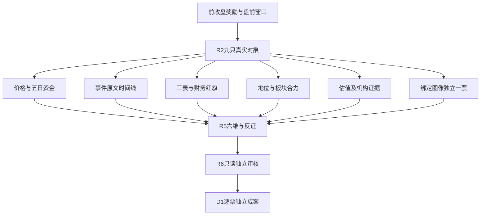

# 2026年11月11日 · 个股画像

> 数据源新鲜度：partial；降级：true；置信度未量化，不以0替代。

## 一句话结论
已评9/9只；核心与补涨分层，现金流及亏损反证优先，不授予交易权限。

## 🧭 市场与候选边界
继承本轮R1/R2：前收盘资金奖励主线弹性与核心，今日尚未开盘。R2三格模板保持，不把五套策略拼接。主线为内容、人形、端侧；持续性与精确板块封板率未知，明日预期为分歧。不能为了固定格式伪填1/3/5日。
候选全部来自本批R2主线，保留原角色与顺序。旧plan_outside_scan不适用首次成案，in_today_plan为未知。用户/账户有效预算、仓位上限、T+1及真实hard_reject保持，研究分档不授权。
未评对象：无。个股合规必要未核及辅助unknown见各票及JSON。

图表渲染验收：本轮尚未获得实际阅读端SVG渲染回执，不将代码块存在冒充渲染通过。

## 📋 覆盖与分档
| 对象 | 原角色 | 态度 | Alpha / Risk | 5日大单净额（亿） | 30日涨幅 | 红旗 |
|---|---|---|---|---:|---:|---|
| 文投控股 600715.SH | 龙一 | 降级 | B+ / C | 2.207 | 72.7% | F3, F4, S1 |
| 掌阅科技 603533.SH | 龙二 | 观察 | B+ / B- | 5.274 | 39.6% | F7 |
| 慈文传媒 002343.SZ | 候补 | 降级 | B- / C | 4.648 | 62.8% | F3, F4, F9 |
| 宇树科技 688836.SH | 龙一 | 观察 | A- / B- | 3.133 | 53.8% | F4 |
| 锋龙股份 002931.SZ | 龙二 | 降级 | B / C | 3.315 | 16.0% | F6 |
| 福莱新材 605488.SH | 候补 | 降级 | B / B- | 4.649 | 89.4% | 未命中已完成项，非全排雷 |
| 富瀚微 300613.SZ | 龙一 | 降级 | A- / C | 2.537 | -2.8% | F3, F8 |
| 瑞芯微 603893.SH | 龙二 | 观察 | A- / B | 13.460 | 17.8% | F4 |
| 创维数字 000810.SZ | 候补 | 降级 | B / C | 1.791 | 25.4% | F4, F8 |

## 🔎 文投控股 600715.SH · 降级
内容高度辨识度成立，但两年亏损与前三季收入回落相冲突；研究保留，不把连板当业绩修复。

| 六维 | 事实与裁决 |
|---|---|
| 催化 | 财报和公司风险提示比AI降本叙事更硬：连续两年亏损、最新仍亏，真实收益兑现尚不足。 |
| 筹码 | 5日大单净额2.207亿；双源口径冲突=True。股东户数变化4.471112162055646%；不等同锁筹。 |
| 联动 | AI内容/短剧游戏，原角色龙一；龙头信号待板块精确广度核验。 |
| 财务估值 | PE=未知，PB=11.0206；红旗=F3, F4, S1；审查完成=False。 |
| 量价技术 | 89根日K；MA5=2.556，MA20=2.079；前5日量比=0.29。图像校验available，不是突破认证。 |
| 机构 | 近30自然日独立研报0篇，原接口0条含多预测年度；调研原记录1条不等于独立活动次数。无记录不认定机构冷落。 |

板型：普通10cm二板，0次开板；不是缩量一字认证；龙头支持3条，不等于七项门禁通过。RR未知，止损距未知；禁止清单已知命中[]、完整性partial。研究机会归类：今日核心，非下单。

- **大资金意图**: 资金购买内容方向的低价高度与接力稀缺性，不是已验证的盈利反转。

- **为什么走强**: 二板早封与内容扩散共振；五日大单净额为正，但单日龙虎榜微净卖，缩量封板不证明新买方承接。

- **逻辑够不够硬**: 财报和公司风险提示比AI降本叙事更硬：连续两年亏损、最新仍亏，真实收益兑现尚不足。

- **买入理由**: 研究理由而非下单：资金购买内容方向的低价高度与接力稀缺性，不是已验证的盈利反转。；二板早封与内容扩散共振；五日大单净额为正，但单日龙虎榜微净卖，缩量封板不证明新买方承接。

- **风险点**: 两年归母亏损，S1财务轴命中；不是自动ST认定；近30交易日涨幅大且缩量封板，开板先手兑现风险

- **止损条件**: 仅研究证伪：未来两日收盘失守本版MA5且板块前排同步走弱则重评；真实执行止损由D1独立推导，R5不出退出价。

- **可验证假设**: 未来两个交易日保持内容高度领先且同方向至少3股涨停；跌出前排或板块扩散收缩则接力假设证伪。

### 财务逐项与原文依据
| 项目 | 结果 | 计算/缺口 |
|---|---|---|
| F1 | unknown | money_cap/total_assets>20% AND st_borr/total_assets>20%；短借null不当0；AND任一分支已证阴性即可排除本条件，否则未知 |
| F2 | checked_negative | goodwill/parent_equity>30%；实算比例=15.84%；null商誉不等于0；仅非空且权益为正时计算 |
| F3 | flagged | AR_yoy>revenue_yoy*1.5；应收同比=42.33055738534324%，收入同比=-29.509456708162528%；同比同累计季度；收入负增长仍按原比例规则披露，不能解释成应收绝对暴增 |
| F4 | flagged | inventory_yoy>revenue_yoy*1.5 AND cost/avg_inventory下降；存货同比=624.692019718152%，收入同比=-29.509456708162528%；周转用同累计成本/年初与期末平均存货，未年化不影响同季度同比；缺分母不填0 |
| F5 | checked_negative | capitalized_R&D_flow/total_R&D_flow>50%；年度流量资本化率=0.00%；2025年当期研发流量已核，资本化率0%不超过50%；结论仅该已披露年度，2026未披露流量不据此默认0。 |
| F6 | not_applicable | (parent_net_profit-deducted_parent_net_profit)/parent_net_profit>30%；亏损分母不适用比例阈值；保留绝对差额而不认定阴性 |
| F7 | checked_negative | actual_operating_related_trade/revenue_2025>20%；实算比例=2.85%；年度购销/服务合计，融资/担保及租赁另有披露，不混成营业收入；按同年收入比较20%，该结论只覆盖所声明营业交易口径，不自动推及2026累计。 |
| F8 | checked_negative | Q3_CFO<0 & Q2_CFO<0 & Q3_NP>0 & Q2_NP>0；20260930单季CFO=-0.195亿、归母净利=-0.177亿 / 20260630单季CFO=2.876亿、归母净利=-0.166亿；Q3=9月累计-6月累计；Q2=6月累计-3月累计；不拿两个累计负值冒充两季 |
| F9 | checked_negative | accounts_receiv/revenue>40%；实算比例=24.82%；已核实际字段；本期未命中阈值 |
| F10 | checked_negative | interestdebt/parent_equity>80%；实算比例=16.49%；直接核fina_indicator.interestdebt；不以负债细目null补0求和 |
| F11 | checked_negative | controlling_shareholder_pledged_shares/held_shares>70%；实算比例=0.00%；截至已披露Q3持股时点未超过70%；二股东北京文资质押187000000股不是本票控股股东，不能错置F11。不延伸成今日无任何质押事件保证。 |
| F12 | checked_negative | 保留/无法表示/强调事项审计意见；最新已披露年度标准无保留意见，已核原文审计正文；文投采用7月修订版。只裁年度F12，不等于后续合规无事。 |
| S1 | flagged | 连续两年净利<0 OR 净资产<0 OR 年营收<1亿；仅既有研究财务轴，不直接认定交易所ST；年度营收而非未满年累计数 |
| S2 | unknown | 立案调查/重大违规/财务造假实锤；年度审计F12已完成；已核法定披露选定页，不将公司自查无未披露事项或无风险标题当作监管阴性；缺来源与相关主体覆盖交R5/R4，不交禁MCP的R6 |
| S3 | unknown | 有效*ST预警或非标审计临近风险；年度审计F12已完成；已核法定披露选定页，不将公司自查无未披露事项或无风险标题当作监管阴性；缺来源与相关主体覆盖交R5/R4，不交禁MCP的R6 |

**技术独立裁决**：日线加速上行且显著远离MA20；量缩早封，承接要待下一交易日验证，不把锁价低量当今日买点。 图像报告仅附加一票，本版评级和顺序不由图像覆盖率改变。

### 事件时间线（日期精度，不倒推首知时分）
- 20261107：文投控股股份有限公司十一届董事会第二十次会议决议公告 · tushare_pro.anns_d；公告索引不等于逐篇已读，涨停/上榜不等于新催化。
- 20261109：市场事实：涨停，非新增公司事件 · tushare_pro.limit_list_d；公告索引不等于逐篇已读，涨停/上榜不等于新催化。
- 20261109：市场事实：龙虎榜上榜，原因与单日/多日口径见筹码原记录 · tushare_pro.top_list；公告索引不等于逐篇已读，涨停/上榜不等于新催化。
- 20261110：市场事实：涨停，非新增公司事件 · tushare_pro.limit_list_d；公告索引不等于逐篇已读，涨停/上榜不等于新催化。
- 20261110：市场事实：龙虎榜上榜，原因与单日/多日口径见筹码原记录 · tushare_pro.top_list；公告索引不等于逐篇已读，涨停/上榜不等于新催化。
- 20261111：文投控股股份有限公司股票交易异常波动公告 · tushare_pro.anns_d；公告索引不等于逐篇已读，涨停/上榜不等于新催化。

### 图像与技术限定
完整原record及各周期来源嵌入本版JSON；R5使用已生成文本并非新看图。周线/分钟复权未核保留unknown，顶部fq=2不能覆盖各周期。不得让D1另读raw/latest或现场补抓替换本版输入。

以上为既有渲染路径引用，R5未重画或独立检查图像像素。

## 🔎 掌阅科技 603533.SH · 观察
IP与衍生业务具真实底座，容量/资金支持强于单纯蹭题材；仍亏损且关联交易较重。

| 六维 | 事实与裁决 |
|---|---|
| 催化 | 原年报可验证阅读/衍生业务与关联方交易；当期亏损缩窄支持改善，但尚未证明盈利拐点。 |
| 筹码 | 5日大单净额5.274亿；双源口径冲突=True。股东户数变化7.153096104468903%；不等同锁筹。 |
| 联动 | AI内容/短剧游戏，原角色龙二；容量/弹性核心（R2认定），非连板高度龙。 |
| 财务估值 | PE=未知，PB=6.3747；红旗=F7；审查完成=False。 |
| 量价技术 | 89根日K；MA5=30.770，MA20=28.254；前5日量比=0.79。图像校验available，不是突破认证。 |
| 机构 | 近30自然日独立研报0篇，原接口0条含多预测年度；调研原记录0条不等于独立活动次数。无记录不认定机构冷落。 |

板型：普通10cm首板回封，1次开板；龙头支持3条，不等于七项门禁通过。RR未知，止损距未知；禁止清单已知命中[]、完整性partial。研究机会归类：今日核心，非下单。

- **大资金意图**: 买IP与投流放大后的内容容量核心，押注产业扩容而非只做最低价弹性。

- **为什么走强**: 首板回封与五日净流入相互支持；但封板不等于流量转化利润，首板也不等于高度总龙。

- **逻辑够不够硬**: 原年报可验证阅读/衍生业务与关联方交易；当期亏损缩窄支持改善，但尚未证明盈利拐点。

- **买入理由**: 研究理由而非下单：买IP与投流放大后的内容容量核心，押注产业扩容而非只做最低价弹性。；首板回封与五日净流入相互支持；但封板不等于流量转化利润，首板也不等于高度总龙。

- **风险点**: 前三季归母仍亏，AI提效尚未穿透利润；日常关联交易占收入高，平台依赖与投流成本可能吞噬增长

- **止损条件**: 仅研究证伪：未来两日收盘失守本版MA5且板块前排同步走弱则重评；真实执行止损由D1独立推导，R5不出退出价。

- **可验证假设**: 未来两个交易日保持内容容量前排，日收盘不失守本版MA5且板块至少3股涨停；任一落空重评。

### 财务逐项与原文依据
| 项目 | 结果 | 计算/缺口 |
|---|---|---|
| F1 | unknown | money_cap/total_assets>20% AND st_borr/total_assets>20%；短借null不当0；AND任一分支已证阴性即可排除本条件，否则未知 |
| F2 | unknown | goodwill/parent_equity>30%；null商誉不等于0；仅非空且权益为正时计算 |
| F3 | checked_negative | AR_yoy>revenue_yoy*1.5；应收同比=-11.338427789583228%，收入同比=12.732294210961603%；同比同累计季度；收入负增长仍按原比例规则披露，不能解释成应收绝对暴增 |
| F4 | unknown | inventory_yoy>revenue_yoy*1.5 AND cost/avg_inventory下降；存货同比=未知%，收入同比=12.732294210961603%；周转用同累计成本/年初与期末平均存货，未年化不影响同季度同比；缺分母不填0 |
| F5 | checked_negative | capitalized_R&D_flow/total_R&D_flow>50%；年度流量资本化率=0.00%；2025年当期研发流量已核，资本化率0%不超过50%；结论仅该已披露年度，2026未披露流量不据此默认0。 |
| F6 | not_applicable | (parent_net_profit-deducted_parent_net_profit)/parent_net_profit>30%；亏损分母不适用比例阈值；保留绝对差额而不认定阴性 |
| F7 | flagged | actual_operating_related_trade/revenue_2025>20%；实算比例=39.17%；年度日常关联实际不含税合计127030.29万元，不是145000万元预计额度；按同年收入比较20%，该结论只覆盖所声明营业交易口径，不自动推及2026累计。 |
| F8 | checked_negative | Q3_CFO<0 & Q2_CFO<0 & Q3_NP>0 & Q2_NP>0；20260930单季CFO=1.693亿、归母净利=-0.183亿 / 20260630单季CFO=-1.036亿、归母净利=-0.164亿；Q3=9月累计-6月累计；Q2=6月累计-3月累计；不拿两个累计负值冒充两季 |
| F9 | checked_negative | accounts_receiv/revenue>40%；实算比例=12.12%；已核实际字段；本期未命中阈值 |
| F10 | checked_negative | interestdebt/parent_equity>80%；实算比例=0.45%；直接核fina_indicator.interestdebt；不以负债细目null补0求和 |
| F11 | checked_negative | controlling_shareholder_pledged_shares/held_shares>70%；实算比例=0.00%；截至已披露Q3持股时点未超过70%；2025一致行动终止后控制人为成湘均，不再把张凌云自动合并。不延伸成今日无任何质押事件保证。 |
| F12 | checked_negative | 保留/无法表示/强调事项审计意见；最新已披露年度标准无保留意见，已核原文审计正文；文投采用7月修订版。只裁年度F12，不等于后续合规无事。 |
| S1 | checked_negative | 连续两年净利<0 OR 净资产<0 OR 年营收<1亿；仅既有研究财务轴，不直接认定交易所ST；年度营收而非未满年累计数 |
| S2 | unknown | 立案调查/重大违规/财务造假实锤；年度审计F12已完成；已核法定披露选定页，不将公司自查无未披露事项或无风险标题当作监管阴性；缺来源与相关主体覆盖交R5/R4，不交禁MCP的R6 |
| S3 | unknown | 有效*ST预警或非标审计临近风险；年度审计F12已完成；已核法定披露选定页，不将公司自查无未披露事项或无风险标题当作监管阴性；缺来源与相关主体覆盖交R5/R4，不交禁MCP的R6 |

**技术独立裁决**：日线修复至前20日高点附近，收盘仍低于此前32.91元高点；不是已确认越过历史压力。 图像报告仅附加一票，本版评级和顺序不由图像覆盖率改变。

### 事件时间线（日期精度，不倒推首知时分）
- 20261102：市场事实：涨停，非新增公司事件 · tushare_pro.limit_list_d；公告索引不等于逐篇已读，涨停/上榜不等于新催化。
- 20261104：市场事实：龙虎榜上榜，原因与单日/多日口径见筹码原记录 · tushare_pro.top_list；公告索引不等于逐篇已读，涨停/上榜不等于新催化。
- 20261105：掌阅科技股份有限公司股票交易异常波动公告 · tushare_pro.anns_d；公告索引不等于逐篇已读，涨停/上榜不等于新催化。
- 20261107：掌阅科技股份有限公司关于持股5%以上股东权益变动触及5%刻度的提示性公告 · tushare_pro.anns_d；公告索引不等于逐篇已读，涨停/上榜不等于新催化。
- 20261107：掌阅科技股份有限公司简式权益变动报告书（张凌云） · tushare_pro.anns_d；公告索引不等于逐篇已读，涨停/上榜不等于新催化。
- 20261110：市场事实：涨停，非新增公司事件 · tushare_pro.limit_list_d；公告索引不等于逐篇已读，涨停/上榜不等于新催化。

### 图像与技术限定
完整原record及各周期来源嵌入本版JSON；R5使用已生成文本并非新看图。周线/分钟复权未核保留unknown，顶部fq=2不能覆盖各周期。不得让D1另读raw/latest或现场补抓替换本版输入。

## 🔎 慈文传媒 002343.SZ · 降级
影视短剧业务有原文支持，但前三季收入仅约0.20亿元，应收/收入严重偏高；仅作反证型观察。 20261020原文：短剧项目归属收入约50万元、海外占比不足1%、AIGC平台尚无相关收入；2025短剧业务亏损。

| 六维 | 事实与裁决 |
|---|---|
| 催化 | 20261020原文：短剧项目归属收入约50万元、海外占比不足1%、AIGC平台尚无相关收入；2025短剧业务亏损。 |
| 筹码 | 5日大单净额4.648亿；双源口径冲突=True。股东户数变化-1.5517095412599935%；不等同锁筹。 |
| 联动 | AI内容/短剧游戏，原角色候补；补涨/跟风观察。 |
| 财务估值 | PE=未知，PB=4.7955；红旗=F3, F4, F9；审查完成=False。 |
| 量价技术 | 89根日K；MA5=8.672，MA20=9.104；前5日量比=0.58。图像校验available，不是突破认证。 |
| 机构 | 近30自然日独立研报0篇，原接口0条含多预测年度；调研原记录0条不等于独立活动次数。无记录不认定机构冷落。 |

板型：普通10cm首板，0次开板；龙头支持3条，不等于七项门禁通过。RR未知，止损距未知；禁止清单已知命中[]、完整性partial。研究机会归类：主线补涨，非下单。

- **大资金意图**: 资金交易内容补涨与影视IP预期，并非当前收入高增长；不能把补涨当高度龙。

- **为什么走强**: 内容首板与五日流入真实，但原文明确热点业务规模小，收入回落构成反证，不能把反抽当产业兑现。

- **逻辑够不够硬**: 20261020原文：短剧项目归属收入约50万元、海外占比不足1%、AIGC平台尚无相关收入；2025短剧业务亏损。

- **买入理由**: 研究理由而非下单：资金交易内容补涨与影视IP预期，并非当前收入高增长；不能把补涨当高度龙。；首板与内容扩散同向，但回升仍靠叙事，最近30日高涨幅不能掩盖此前回撤和收入塌缩。

- **风险点**: 应收/累计收入远超40%，回款和收入确认压力；低营收与影视存货滞留，成长叙事未兑现；20261020原文：短剧项目归属收入约50万元、海外占比不足1%、AIGC平台尚无相关收入；2025短剧业务亏损。

- **止损条件**: 仅研究证伪：未来两日收盘失守本版MA5且板块前排同步走弱则重评；真实执行止损由D1独立推导，R5不出退出价。

- **可验证假设**: 未来两个交易日需保持板块前排且非反复开板；若开板≥4次或内容容量核心走弱，不作补涨升级。

### 财务逐项与原文依据
| 项目 | 结果 | 计算/缺口 |
|---|---|---|
| F1 | checked_negative | money_cap/total_assets>20% AND st_borr/total_assets>20%；短借null不当0；AND任一分支已证阴性即可排除本条件，否则未知 |
| F2 | unknown | goodwill/parent_equity>30%；null商誉不等于0；仅非空且权益为正时计算 |
| F3 | flagged | AR_yoy>revenue_yoy*1.5；应收同比=-7.954734161622401%，收入同比=-89.66592747502197%；同比同累计季度；收入负增长仍按原比例规则披露，不能解释成应收绝对暴增 |
| F4 | flagged | inventory_yoy>revenue_yoy*1.5 AND cost/avg_inventory下降；存货同比=-19.423542506309943%，收入同比=-89.66592747502197%；周转用同累计成本/年初与期末平均存货，未年化不影响同季度同比；缺分母不填0 |
| F5 | not_applicable | capitalized_R&D_flow/total_R&D_flow>50%；年报明确研发投入不适用；本项研发资本化比例无有效研发流量分母，不把影视制作存货当研发。 |
| F6 | not_applicable | (parent_net_profit-deducted_parent_net_profit)/parent_net_profit>30%；亏损分母不适用比例阈值；保留绝对差额而不认定阴性 |
| F7 | checked_negative | actual_operating_related_trade/revenue_2025>20%；实算比例=0.01%；年度营业关联采购37264.15元；销货/服务空项，融资担保不是营业购销；按同年收入比较20%，该结论只覆盖所声明营业交易口径，不自动推及2026累计。 |
| F8 | checked_negative | Q3_CFO<0 & Q2_CFO<0 & Q3_NP>0 & Q2_NP>0；20260930单季CFO=-0.003亿、归母净利=-0.142亿 / 20260630单季CFO=0.012亿、归母净利=-0.201亿；Q3=9月累计-6月累计；Q2=6月累计-3月累计；不拿两个累计负值冒充两季 |
| F9 | flagged | accounts_receiv/revenue>40%；实算比例=1791.39%；按既有R6阈值命中 |
| F10 | checked_negative | interestdebt/parent_equity>80%；实算比例=20.49%；直接核fina_indicator.interestdebt；不以负债细目null补0求和 |
| F11 | checked_negative | controlling_shareholder_pledged_shares/held_shares>70%；实算比例=0.00%；截至已披露Q3持股时点未超过70%；马中骏100%质押和冻结为其他大股东风险，不能冒充控股股东F11命中。不延伸成今日无任何质押事件保证。 |
| F12 | checked_negative | 保留/无法表示/强调事项审计意见；最新已披露年度标准无保留意见，已核原文审计正文；文投采用7月修订版。只裁年度F12，不等于后续合规无事。 |
| S1 | checked_negative | 连续两年净利<0 OR 净资产<0 OR 年营收<1亿；仅既有研究财务轴，不直接认定交易所ST；年度营收而非未满年累计数 |
| S2 | unknown | 立案调查/重大违规/财务造假实锤；年度审计F12已完成；已核法定披露选定页，不将公司自查无未披露事项或无风险标题当作监管阴性；缺来源与相关主体覆盖交R5/R4，不交禁MCP的R6 |
| S3 | unknown | 有效*ST预警或非标审计临近风险；年度审计F12已完成；已核法定披露选定页，不将公司自查无未披露事项或无风险标题当作监管阴性；缺来源与相关主体覆盖交R5/R4，不交禁MCP的R6 |

**技术独立裁决**：收复MA20但远低于前20日10.89元高点，更像高位回撤后的强反抽，不是低位首启动。 图像报告仅附加一票，本版评级和顺序不由图像覆盖率改变。

### 事件时间线（日期精度，不倒推首知时分）
- 20261104：市场事实：龙虎榜上榜，原因与单日/多日口径见筹码原记录 · tushare_pro.top_list；公告索引不等于逐篇已读，涨停/上榜不等于新催化。
- 20261105：市场事实：涨停，非新增公司事件 · tushare_pro.limit_list_d；公告索引不等于逐篇已读，涨停/上榜不等于新催化。
- 20261105：市场事实：龙虎榜上榜，原因与单日/多日口径见筹码原记录 · tushare_pro.top_list；公告索引不等于逐篇已读，涨停/上榜不等于新催化。
- 20261106：市场事实：龙虎榜上榜，原因与单日/多日口径见筹码原记录 · tushare_pro.top_list；公告索引不等于逐篇已读，涨停/上榜不等于新催化。
- 20261109：市场事实：龙虎榜上榜，原因与单日/多日口径见筹码原记录 · tushare_pro.top_list；公告索引不等于逐篇已读，涨停/上榜不等于新催化。
- 20261110：市场事实：涨停，非新增公司事件 · tushare_pro.limit_list_d；公告索引不等于逐篇已读，涨停/上榜不等于新催化。

### 图像与技术限定
完整原record及各周期来源嵌入本版JSON；R5使用已生成文本并非新看图。周线/分钟复权未核保留unknown，顶部fq=2不能覆盖各周期。不得让D1另读raw/latest或现场补抓替换本版输入。

## 🔎 宇树科技 688836.SH · 观察
本体人气与营收增长支持研究核心身份，但PE约549倍、上市历史短，增长兑现需要严验。

| 六维 | 事实与裁决 |
|---|---|
| 催化 | 收入增长与本体业务成立；模型行业事件不是宇树独享订单，极高估值和现金转换限制叙事强度。 |
| 筹码 | 5日大单净额3.133亿；双源口径冲突=True。股东户数变化73.52345839658787%；不等同锁筹。 |
| 联动 | 具身智能/人形机器人，原角色龙一；容量/弹性核心（R2认定），非连板高度龙。 |
| 财务估值 | PE=549.112，PB=34.5437；红旗=F4；审查完成=False。 |
| 量价技术 | 54根日K；MA5=693.934，MA20=600.332；前5日量比=1.38。图像校验available，不是突破认证。 |
| 机构 | 近30自然日独立研报1篇，原接口3条含多预测年度；调研原记录0条不等于独立活动次数。无记录不认定机构冷落。 |

板型：未涨停的趋势/抱团本体核心；不能认证板上接力；龙头支持3条，不等于七项门禁通过。RR未知，止损距未知；禁止清单已知命中[]、完整性partial。研究机会归类：今日核心，非下单。

- **大资金意图**: 资金购买本体平台、实物量产与物理AI映射的稀缺性，而非把板块每个供应商一并认定。

- **为什么走强**: 未涨停仍维持高人气与大成交，五日净流入支持趋势核心；不是连板高度龙。

- **逻辑够不够硬**: 收入增长与本体业务成立；模型行业事件不是宇树独享订单，极高估值和现金转换限制叙事强度。

- **买入理由**: 研究理由而非下单：资金购买本体平台、实物量产与物理AI映射的稀缺性，而非把板块每个供应商一并认定。；未涨停仍维持高人气与大成交，五日净流入支持趋势核心；不是连板高度龙。

- **风险点**: 约549倍TTM PE与上市仅54日样本，估值历史分位不可当三年分位；扣非增速指标与净利润增速差异明显，三季度现金流单季转负

- **止损条件**: 仅研究证伪：未来两日收盘失守本版MA5且板块前排同步走弱则重评；真实执行止损由D1独立推导，R5不出退出价。

- **可验证假设**: 未来两个交易日相对机器人方向不持续落后，收盘保持本版MA5之上且板块至少3股涨停；否则核心溢价重评。

### 财务逐项与原文依据
| 项目 | 结果 | 计算/缺口 |
|---|---|---|
| F1 | unknown | money_cap/total_assets>20% AND st_borr/total_assets>20%；短借null不当0；AND任一分支已证阴性即可排除本条件，否则未知 |
| F2 | unknown | goodwill/parent_equity>30%；null商誉不等于0；仅非空且权益为正时计算 |
| F3 | checked_negative | AR_yoy>revenue_yoy*1.5；应收同比=80.58798046646226%，收入同比=55.65785743354992%；同比同累计季度；收入负增长仍按原比例规则披露，不能解释成应收绝对暴增 |
| F4 | flagged | inventory_yoy>revenue_yoy*1.5 AND cost/avg_inventory下降；存货同比=266.6277365547184%，收入同比=55.65785743354992%；周转用同累计成本/年初与期末平均存货，未年化不影响同季度同比；缺分母不填0 |
| F5 | unknown | capitalized_R&D_flow/total_R&D_flow>50%；已读研发费用构成与项目投入，但费用数不能独立证明全部研发投入或无资本化，需R5/R4补完整流量说明；不是全票财务未查。 |
| F6 | checked_negative | (parent_net_profit-deducted_parent_net_profit)/parent_net_profit>30%；同期间归母与扣非差额计算 |
| F7 | checked_negative | actual_operating_related_trade/revenue_2025>20%；实算比例=1.19%；年度经常性关联销售2018.57万元，采购原文为无；经理薪酬及偶发借款单列；按同年收入比较20%，该结论只覆盖所声明营业交易口径，不自动推及2026累计。 |
| F8 | checked_negative | Q3_CFO<0 & Q2_CFO<0 & Q3_NP>0 & Q2_NP>0；20260930单季CFO=-0.378亿、归母净利=1.127亿 / 20260630单季CFO=1.971亿、归母净利=2.240亿；Q2经营现金流=231545298.96-34399600=正；即使原文万元舍入±50元也不改变符号，连续两季负的AND条件不成立。Q3单季负仍单列风险，不抹去。 |
| F9 | checked_negative | accounts_receiv/revenue>40%；实算比例=7.87%；已核实际字段；本期未命中阈值 |
| F10 | checked_negative | interestdebt/parent_equity>80%；实算比例=1.09%；直接核fina_indicator.interestdebt；不以负债细目null补0求和 |
| F11 | checked_negative | controlling_shareholder_pledged_shares/held_shares>70%；实算比例=0.00%；截至已披露Q3持股时点未超过70%；招股书明确控制身份及无质押；Q3同名持有数、质押0复核，特别表决权另属治理风险。不延伸成今日无任何质押事件保证。 |
| F12 | checked_negative | 保留/无法表示/强调事项审计意见；上市前最新完整年度原文招股书明确审计机构及标准无保留结论；独立签字报告未另抓，不能扩大为全主体合规排雷。 |
| S1 | checked_negative | 连续两年净利<0 OR 净资产<0 OR 年营收<1亿；仅既有研究财务轴，不直接认定交易所ST；年度营收而非未满年累计数 |
| S2 | unknown | 立案调查/重大违规/财务造假实锤；年度审计F12已完成；已核法定披露选定页，不将公司自查无未披露事项或无风险标题当作监管阴性；缺来源与相关主体覆盖交R5/R4，不交禁MCP的R6 |
| S3 | unknown | 有效*ST预警或非标审计临近风险；年度审计F12已完成；已核法定披露选定页，不将公司自查无未披露事项或无风险标题当作监管阴性；缺来源与相关主体覆盖交R5/R4，不交禁MCP的R6 |

**技术独立裁决**：收盘略越前20日高点但809元日内高点回落至761.01，长上影与量能增加并存；高位换手非干净突破。 图像报告仅附加一票，本版评级和顺序不由图像覆盖率改变。

### 事件时间线（日期精度，不倒推首知时分）
- 20261023：市场事实：龙虎榜上榜，原因与单日/多日口径见筹码原记录 · tushare_pro.top_list；公告索引不等于逐篇已读，涨停/上榜不等于新催化。
- 20261026：市场事实：龙虎榜上榜，原因与单日/多日口径见筹码原记录 · tushare_pro.top_list；公告索引不等于逐篇已读，涨停/上榜不等于新催化。
- 20261027：股票交易异常波动公告 · tushare_pro.anns_d；公告索引不等于逐篇已读，涨停/上榜不等于新催化。
- 20261029：2026年第三季度报告 · tushare_pro.anns_d；公告索引不等于逐篇已读，涨停/上榜不等于新催化。
- 20261029：中信证券股份有限公司关于宇树科技股份有限公司向参股公司增资暨关联交易的核查意见 · tushare_pro.anns_d；公告索引不等于逐篇已读，涨停/上榜不等于新催化。
- 20261029：关于向参股公司增资暨关联交易的公告 · tushare_pro.anns_d；公告索引不等于逐篇已读，涨停/上榜不等于新催化。

### 图像与技术限定
完整原record及各周期来源嵌入本版JSON；R5使用已生成文本并非新看图。周线/分钟复权未核保留unknown，顶部fq=2不能覆盖各周期。不得让D1另读raw/latest或现场补抓替换本版输入。

以上为既有渲染路径引用，R5未重画或独立检查图像像素。

## 🔎 锋龙股份 002931.SZ · 降级
机器人高度映射有资金承接，但主营兑现不足且扣非为负，交易地位不能替代产业认定。 20260707原文：优必选承诺收购完成后36个月不注入所持资产；当时机电组件尚未形成关联营业收入，送样报价阶段。20260710只证关联交易预计获批，不证明实际收入；至本轮缺更新兑现原文。

| 六维 | 事实与裁决 |
|---|---|
| 催化 | 20260707原文：优必选承诺收购完成后36个月不注入所持资产；当时机电组件尚未形成关联营业收入，送样报价阶段。20260710只证关联交易预计获批，不证明实际收入；至本轮缺更新兑现原文。 |
| 筹码 | 5日大单净额3.315亿；双源口径冲突=True。股东户数变化1.5490974267059254%；不等同锁筹。 |
| 联动 | 具身智能/人形机器人，原角色龙二；龙头信号待板块精确广度核验。 |
| 财务估值 | PE=535.3052，PB=10.2716；红旗=F6；审查完成=False。 |
| 量价技术 | 89根日K；MA5=42.882，MA20=39.032；前5日量比=0.56。图像校验available，不是突破认证。 |
| 机构 | 近30自然日独立研报0篇，原接口0条含多预测年度；调研原记录0条不等于独立活动次数。无记录不认定机构冷落。 |

板型：普通10cm二板，0次开板；龙头支持3条，不等于七项门禁通过。RR未知，止损距未知；禁止清单已知命中[]、完整性partial。研究机会归类：今日核心，非下单。

- **大资金意图**: 资金购买机器人高度映射和筹码弹性，未证明主营园林/液压等业务已被机器人订单改写。

- **为什么走强**: 二板身位是资金选择，但收购映射不等于主营已转型，预期额度不等于订单收入；当前仍为研究映射，不用7月意见永续否认11月可能新收入。

- **逻辑够不够硬**: 20260707原文：优必选承诺收购完成后36个月不注入所持资产；当时机电组件尚未形成关联营业收入，送样报价阶段。20260710只证关联交易预计获批，不证明实际收入；至本轮缺更新兑现原文。

- **买入理由**: 研究理由而非下单：资金购买机器人高度映射和筹码弹性，未证明主营园林/液压等业务已被机器人订单改写。；二板与板块情绪共振，缩量封板提高辨识度；当期收入温和增长、扣非为负不支持按爆发业绩定价。

- **风险点**: 一次性损益比例高，扣非为负；估值高且二板缩量，接力先手兑现敏感；20260707原文：优必选承诺收购完成后36个月不注入所持资产；当时机电组件尚未形成关联营业收入，送样报价阶段。20260710只证关联交易预计获批，不证明实际收入；至本轮缺更新兑现原文。

- **止损条件**: 仅研究证伪：未来两日收盘失守本版MA5且板块前排同步走弱则重评；真实执行止损由D1独立推导，R5不出退出价。

- **可验证假设**: 未来两个交易日保持机器人高度前二且不出现≥4次开板；核心断板且容量同步走弱即证伪。

### 财务逐项与原文依据
| 项目 | 结果 | 计算/缺口 |
|---|---|---|
| F1 | checked_negative | money_cap/total_assets>20% AND st_borr/total_assets>20%；短借null不当0；AND任一分支已证阴性即可排除本条件，否则未知 |
| F2 | checked_negative | goodwill/parent_equity>30%；实算比例=0.82%；null商誉不等于0；仅非空且权益为正时计算 |
| F3 | checked_negative | AR_yoy>revenue_yoy*1.5；应收同比=-5.217164554168042%，收入同比=6.745327338705165%；同比同累计季度；收入负增长仍按原比例规则披露，不能解释成应收绝对暴增 |
| F4 | checked_negative | inventory_yoy>revenue_yoy*1.5 AND cost/avg_inventory下降；存货同比=15.409738340657263%，收入同比=6.745327338705165%；周转用同累计成本/年初与期末平均存货，未年化不影响同季度同比；缺分母不填0 |
| F5 | checked_negative | capitalized_R&D_flow/total_R&D_flow>50%；年度流量资本化率=0.00%；2025年当期研发流量已核，资本化率0%不超过50%；结论仅该已披露年度，2026未披露流量不据此默认0。 |
| F6 | flagged | (parent_net_profit-deducted_parent_net_profit)/parent_net_profit>30%；同期间归母与扣非差额计算 |
| F7 | checked_negative | actual_operating_related_trade/revenue_2025>20%；实算比例=1.07%；年度关联采购实际5308613.39元；15789.50元是上期不是本期；按同年收入比较20%，该结论只覆盖所声明营业交易口径，不自动推及2026累计。 |
| F8 | checked_negative | Q3_CFO<0 & Q2_CFO<0 & Q3_NP>0 & Q2_NP>0；20260930单季CFO=0.226亿、归母净利=0.205亿 / 20260630单季CFO=0.100亿、归母净利=-0.053亿；Q3=9月累计-6月累计；Q2=6月累计-3月累计；不拿两个累计负值冒充两季 |
| F9 | checked_negative | accounts_receiv/revenue>40%；实算比例=32.18%；已核实际字段；本期未命中阈值 |
| F10 | checked_negative | interestdebt/parent_equity>80%；实算比例=0.19%；直接核fina_indicator.interestdebt；不以负债细目null补0求和 |
| F11 | checked_negative | controlling_shareholder_pledged_shares/held_shares>70%；实算比例=0.00%；截至已披露Q3持股时点未超过70%；Q3显示新控制股东43.01%，不沿用旧诚锋年报身份；控股转换公告原文另作缺口。不延伸成今日无任何质押事件保证。 |
| F12 | checked_negative | 保留/无法表示/强调事项审计意见；最新已披露年度标准无保留意见，已核原文审计正文；文投采用7月修订版。只裁年度F12，不等于后续合规无事。 |
| S1 | checked_negative | 连续两年净利<0 OR 净资产<0 OR 年营收<1亿；仅既有研究财务轴，不直接认定交易所ST；年度营收而非未满年累计数 |
| S2 | unknown | 立案调查/重大违规/财务造假实锤；年度审计F12已完成；已核法定披露选定页，不将公司自查无未披露事项或无风险标题当作监管阴性；缺来源与相关主体覆盖交R5/R4，不交禁MCP的R6 |
| S3 | unknown | 有效*ST预警或非标审计临近风险；年度审计F12已完成；已核法定披露选定页，不将公司自查无未披露事项或无风险标题当作监管阴性；缺来源与相关主体覆盖交R5/R4，不交禁MCP的R6 |

**技术独立裁决**：日线越过前20日高点，但缩量二板与更长周期旧高位套牢并存，不能把日线反弹写成全周期反转。 图像报告仅附加一票，本版评级和顺序不由图像覆盖率改变。

### 事件时间线（日期精度，不倒推首知时分）
- 20261107：关于回购公司股份的进展公告 · tushare_pro.anns_d；公告索引不等于逐篇已读，涨停/上榜不等于新催化。
- 20261109：市场事实：涨停，非新增公司事件 · tushare_pro.limit_list_d；公告索引不等于逐篇已读，涨停/上榜不等于新催化。
- 20261110：市场事实：涨停，非新增公司事件 · tushare_pro.limit_list_d；公告索引不等于逐篇已读，涨停/上榜不等于新催化。
- 20261111：2026年第五次临时股东会决议公告 · tushare_pro.anns_d；公告索引不等于逐篇已读，涨停/上榜不等于新催化。
- 20261111：2026年第五次临时股东会的法律意见书 · tushare_pro.anns_d；公告索引不等于逐篇已读，涨停/上榜不等于新催化。
- 20261111：国信证券股份有限公司关于深圳市优必选科技股份有限公司要约收购浙江锋龙电气股份有限公司之2026年第三季度持续督导意见 · tushare_pro.anns_d；公告索引不等于逐篇已读，涨停/上榜不等于新催化。

### 图像与技术限定
完整原record及各周期来源嵌入本版JSON；R5使用已生成文本并非新看图。周线/分钟复权未核保留unknown，顶部fq=2不能覆盖各周期。不得让D1另读raw/latest或现场补抓替换本版输入。

## 🔎 福莱新材 605488.SH · 降级
材料/触觉方向具研究映射，但30日涨幅约89%，主营利润下滑与高估值抬高兑现要求。 20261029公司原文：前三季柔性传感器累计收入466.75万元，占总营收0.18%；20261111风险提示重申占比极低且净利下滑。

| 六维 | 事实与裁决 |
|---|---|
| 催化 | 20261029公司原文：前三季柔性传感器累计收入466.75万元，占总营收0.18%；20261111风险提示重申占比极低且净利下滑。 |
| 筹码 | 5日大单净额4.649亿；双源口径冲突=True。股东户数变化-5.4380369695391835%；不等同锁筹。 |
| 联动 | 具身智能/人形机器人，原角色候补；补涨/跟风观察。 |
| 财务估值 | PE=249.9565，PB=7.6043；红旗=未命中已完成项；审查完成=False。 |
| 量价技术 | 89根日K；MA5=50.472，MA20=40.514；前5日量比=0.55。图像校验available，不是突破认证。 |
| 机构 | 近30自然日独立研报3篇，原接口9条含多预测年度；调研原记录35条不等于独立活动次数。无记录不认定机构冷落。 |

板型：普通10cm首板回封，MCP2次开板/问财1次存在口径冲突；龙头支持3条，不等于七项门禁通过。RR未知，止损距未知；禁止清单已知命中[]、完整性partial。研究机会归类：主线补涨，非下单。

- **大资金意图**: 资金购买机器人材料/触觉弹性，不等于厂商触觉模型已经给公司带来订单。

- **为什么走强**: 30日涨幅与板块资金流入真实，但柔性传感收入仅0.18%，产业映射强于当期利润贡献，不能将触觉模型发布等同公司订单。

- **逻辑够不够硬**: 20261029公司原文：前三季柔性传感器累计收入466.75万元，占总营收0.18%；20261111风险提示重申占比极低且净利下滑。

- **买入理由**: 研究理由而非下单：资金购买机器人材料/触觉弹性，不等于厂商触觉模型已经给公司带来订单。；板块扩散、涨停和资金流入共振；但涨幅与MA20乖离过大，缩量封板不是低位试错。

- **风险点**: PE约250倍且前三季净利同比下滑；30日急涨后筹码兑现，触觉业务占比和订单传导未核；20261029公司原文：前三季柔性传感器累计收入466.75万元，占总营收0.18%；20261111风险提示重申占比极低且净利下滑。

- **止损条件**: 仅研究证伪：未来两日收盘失守本版MA5且板块前排同步走弱则重评；真实执行止损由D1独立推导，R5不出退出价。

- **可验证假设**: 未来两个交易日保持机器人弹性前排，不能只靠旧高位反抽；若跌破本版MA5且板块扩散减少则重评。

### 财务逐项与原文依据
| 项目 | 结果 | 计算/缺口 |
|---|---|---|
| F1 | checked_negative | money_cap/total_assets>20% AND st_borr/total_assets>20%；短借null不当0；AND任一分支已证阴性即可排除本条件，否则未知 |
| F2 | unknown | goodwill/parent_equity>30%；null商誉不等于0；仅非空且权益为正时计算 |
| F3 | checked_negative | AR_yoy>revenue_yoy*1.5；应收同比=9.73380101885628%，收入同比=25.709145373144217%；同比同累计季度；收入负增长仍按原比例规则披露，不能解释成应收绝对暴增 |
| F4 | checked_negative | inventory_yoy>revenue_yoy*1.5 AND cost/avg_inventory下降；存货同比=19.230144904932533%，收入同比=25.709145373144217%；周转用同累计成本/年初与期末平均存货，未年化不影响同季度同比；缺分母不填0 |
| F5 | checked_negative | capitalized_R&D_flow/total_R&D_flow>50%；年度流量资本化率=0.00%；2025年当期研发流量已核，资本化率0%不超过50%；结论仅该已披露年度，2026未披露流量不据此默认0。 |
| F6 | checked_negative | (parent_net_profit-deducted_parent_net_profit)/parent_net_profit>30%；同期间归母与扣非差额计算 |
| F7 | checked_negative | actual_operating_related_trade/revenue_2025>20%；实算比例=0.41%；年度关联PPF销售11845247.79元；关联采购原文不适用；按同年收入比较20%，该结论只覆盖所声明营业交易口径，不自动推及2026累计。 |
| F8 | checked_negative | Q3_CFO<0 & Q2_CFO<0 & Q3_NP>0 & Q2_NP>0；20260930单季CFO=0.118亿、归母净利=0.041亿 / 20260630单季CFO=1.121亿、归母净利=0.331亿；Q3=9月累计-6月累计；Q2=6月累计-3月累计；不拿两个累计负值冒充两季 |
| F9 | checked_negative | accounts_receiv/revenue>40%；实算比例=24.27%；已核实际字段；本期未命中阈值 |
| F10 | checked_negative | interestdebt/parent_equity>80%；实算比例=53.13%；直接核fina_indicator.interestdebt；不以负债细目null补0求和 |
| F11 | checked_negative | controlling_shareholder_pledged_shares/held_shares>70%；实算比例=0.00%；截至已披露Q3持股时点未超过70%；年度控股身份与Q3股东表同名核对。不延伸成今日无任何质押事件保证。 |
| F12 | checked_negative | 保留/无法表示/强调事项审计意见；最新已披露年度标准无保留意见，已核原文审计正文；文投采用7月修订版。只裁年度F12，不等于后续合规无事。 |
| S1 | checked_negative | 连续两年净利<0 OR 净资产<0 OR 年营收<1亿；仅既有研究财务轴，不直接认定交易所ST；年度营收而非未满年累计数 |
| S2 | unknown | 立案调查/重大违规/财务造假实锤；年度审计F12已完成；已核法定披露选定页，不将公司自查无未披露事项或无风险标题当作监管阴性；缺来源与相关主体覆盖交R5/R4，不交禁MCP的R6 |
| S3 | unknown | 有效*ST预警或非标审计临近风险；年度审计F12已完成；已核法定披露选定页，不将公司自查无未披露事项或无风险标题当作监管阴性；缺来源与相关主体覆盖交R5/R4，不交禁MCP的R6 |

**技术独立裁决**：日线加速续新高，收盘明显远离MA20，前5日量比偏低；高位强势不等于低位试错。 图像报告仅附加一票，本版评级和顺序不由图像覆盖率改变。

### 事件时间线（日期精度，不倒推首知时分）
- 20261031：福莱新材第三届董事会第三十八次会议决议公告 · tushare_pro.anns_d；公告索引不等于逐篇已读，涨停/上榜不等于新催化。
- 20261104：福莱新材关于实际控制人及其一致行动人协议转让股份完成过户登记的公告 · tushare_pro.anns_d；公告索引不等于逐篇已读，涨停/上榜不等于新催化。
- 20261104：市场事实：涨停，非新增公司事件 · tushare_pro.limit_list_d；公告索引不等于逐篇已读，涨停/上榜不等于新催化。
- 20261105：市场事实：涨停，非新增公司事件 · tushare_pro.limit_list_d；公告索引不等于逐篇已读，涨停/上榜不等于新催化。
- 20261110：市场事实：涨停，非新增公司事件 · tushare_pro.limit_list_d；公告索引不等于逐篇已读，涨停/上榜不等于新催化。
- 20261111：福莱新材可转换公司债券交易异常波动的公告 · tushare_pro.anns_d；公告索引不等于逐篇已读，涨停/上榜不等于新催化。

### 图像与技术限定
完整原record及各周期来源嵌入本版JSON；R5使用已生成文本并非新看图。周线/分钟复权未核保留unknown，顶部fq=2不能覆盖各周期。不得让D1另读raw/latest或现场补抓替换本版输入。

## 🔎 富瀚微 300613.SZ · 降级
业绩增长和20cm首板具弹性地位，但连续两季经营现金流为负、净利为正，F8不能被强势K线掩盖。

| 六维 | 事实与裁决 |
|---|---|
| 催化 | 营收和扣非增长有财报锚；应收快增、Q2/Q3现金流负而利润正是具体硬反证，不用成长标签消解。 |
| 筹码 | 5日大单净额2.537亿；双源口径冲突=True。股东户数变化4.35508557117017%；不等同锁筹。 |
| 联动 | 端侧AI/AI眼镜，原角色龙一；容量/弹性核心（R2认定），非连板高度龙。 |
| 财务估值 | PE=22.2431，PB=5.1519；红旗=F3, F8；审查完成=False。 |
| 量价技术 | 89根日K；MA5=70.892，MA20=68.212；前5日量比=1.34。图像校验available，不是突破认证。 |
| 机构 | 近30自然日独立研报0篇，原接口0条含多预测年度；调研原记录39条不等于独立活动次数。无记录不认定机构冷落。 |

板型：创业板20cm首板，0次开板；龙头支持3条，不等于七项门禁通过。RR未知，止损距未知；禁止清单已知命中[]、完整性partial。研究机会归类：今日核心，非下单。

- **大资金意图**: 资金交易视觉芯片业绩与端侧弹性修复，不是对现金回款已经完成的投票。

- **为什么走强**: 20cm涨停伴量能提升，30日仍略跌更像结构修复；正向资金无法推翻现金流反证。

- **逻辑够不够硬**: 营收和扣非增长有财报锚；应收快增、Q2/Q3现金流负而利润正是具体硬反证，不用成长标签消解。

- **买入理由**: 研究理由而非下单：资金交易视觉芯片业绩与端侧弹性修复，不是对现金回款已经完成的投票。；20cm涨停伴量能提升，30日仍略跌更像结构修复；正向资金无法推翻现金流反证。

- **风险点**: F8经营现金流连续负且净利正；F3应收增速快于收入；20cm首板情绪偏差，业绩高增长不能直接外推估值与回款

- **止损条件**: 仅研究证伪：未来两日收盘失守本版MA5且板块前排同步走弱则重评；真实执行止损由D1独立推导，R5不出退出价。

- **可验证假设**: 未来两个交易日不出现放量跌回首板启动区且端侧至少3股涨停；现金流风险只可由后续实报改善，盘中不能解除。

### 财务逐项与原文依据
| 项目 | 结果 | 计算/缺口 |
|---|---|---|
| F1 | checked_negative | money_cap/total_assets>20% AND st_borr/total_assets>20%；短借null不当0；AND任一分支已证阴性即可排除本条件，否则未知 |
| F2 | checked_negative | goodwill/parent_equity>30%；实算比例=6.75%；null商誉不等于0；仅非空且权益为正时计算 |
| F3 | flagged | AR_yoy>revenue_yoy*1.5；应收同比=219.51594758834875%，收入同比=123.94179493747544%；同比同累计季度；收入负增长仍按原比例规则披露，不能解释成应收绝对暴增 |
| F4 | checked_negative | inventory_yoy>revenue_yoy*1.5 AND cost/avg_inventory下降；存货同比=147.75832894581154%，收入同比=123.94179493747544%；周转用同累计成本/年初与期末平均存货，未年化不影响同季度同比；缺分母不填0 |
| F5 | checked_negative | capitalized_R&D_flow/total_R&D_flow>50%；年度流量资本化率=0.00%；2025年当期研发流量已核，资本化率0%不超过50%；结论仅该已披露年度，2026未披露流量不据此默认0。 |
| F6 | checked_negative | (parent_net_profit-deducted_parent_net_profit)/parent_net_profit>30%；同期间归母与扣非差额计算 |
| F7 | checked_negative | actual_operating_related_trade/revenue_2025>20%；实算比例=1.01%；年度关联购销毛额合计；芯熠销售原表总额报表净额，分子用上界仍低于20%，不是净额精算；按同年收入比较20%，该结论只覆盖所声明营业交易口径，不自动推及2026累计。 |
| F8 | flagged | Q3_CFO<0 & Q2_CFO<0 & Q3_NP>0 & Q2_NP>0；20260930单季CFO=-3.683亿、归母净利=4.254亿 / 20260630单季CFO=-1.436亿、归母净利=2.647亿；Q3=9月累计-6月累计；Q2=6月累计-3月累计；不拿两个累计负值冒充两季 |
| F9 | checked_negative | accounts_receiv/revenue>40%；实算比例=38.71%；已核实际字段；本期未命中阈值 |
| F10 | checked_negative | interestdebt/parent_equity>80%；实算比例=20.64%；直接核fina_indicator.interestdebt；不以负债细目null补0求和 |
| F11 | checked_negative | controlling_shareholder_pledged_shares/held_shares>70%；实算比例=0.00%；截至已披露Q3持股时点未超过70%；原质押公告明确控制人为杨小奇；第一大股东西藏东方企慧48.26%质押单列，不混为控制人。不延伸成今日无任何质押事件保证。 |
| F12 | checked_negative | 保留/无法表示/强调事项审计意见；最新已披露年度标准无保留意见，已核原文审计正文；文投采用7月修订版。只裁年度F12，不等于后续合规无事。 |
| S1 | checked_negative | 连续两年净利<0 OR 净资产<0 OR 年营收<1亿；仅既有研究财务轴，不直接认定交易所ST；年度营收而非未满年累计数 |
| S2 | unknown | 立案调查/重大违规/财务造假实锤；年度审计F12已完成；已核法定披露选定页，不将公司自查无未披露事项或无风险标题当作监管阴性；缺来源与相关主体覆盖交R5/R4，不交禁MCP的R6 |
| S3 | unknown | 有效*ST预警或非标审计临近风险；年度审计F12已完成；已核法定披露选定页，不将公司自查无未披露事项或无风险标题当作监管阴性；缺来源与相关主体覆盖交R5/R4，不交禁MCP的R6 |

**技术独立裁决**：20cm长阳收盘越过前20日77.04元高点且量增，30日仍略跌属于箱体修复；周线不同日/复权未核不能认证共振。 图像报告仅附加一票，本版评级和顺序不由图像覆盖率改变。

### 事件时间线（日期精度，不倒推首知时分）
- 20261028：市场事实：龙虎榜上榜，原因与单日/多日口径见筹码原记录 · tushare_pro.top_list；公告索引不等于逐篇已读，涨停/上榜不等于新催化。
- 20261029：关于部分股票期权注销完成的公告 · tushare_pro.anns_d；公告索引不等于逐篇已读，涨停/上榜不等于新催化。
- 20261030：300613富瀚微投资者关系管理信息20261028 · tushare_pro.anns_d；公告索引不等于逐篇已读，涨停/上榜不等于新催化。
- 20261103：关于公司2022年股票期权激励计划预留授予第四个行权期采用自主行权模式的提示性公告 · tushare_pro.anns_d；公告索引不等于逐篇已读，涨停/上榜不等于新催化。
- 20261110：市场事实：涨停，非新增公司事件 · tushare_pro.limit_list_d；公告索引不等于逐篇已读，涨停/上榜不等于新催化。
- 20261110：市场事实：龙虎榜上榜，原因与单日/多日口径见筹码原记录 · tushare_pro.top_list；公告索引不等于逐篇已读，涨停/上榜不等于新催化。

### 图像与技术限定
完整原record及各周期来源嵌入本版JSON；R5使用已生成文本并非新看图。周线/分钟复权未核保留unknown，顶部fq=2不能覆盖各周期。不得让D1另读raw/latest或现场补抓替换本版输入。

以上为既有渲染路径引用，R5未重画或独立检查图像像素。

## 🔎 瑞芯微 603893.SH · 观察
端侧容量、五日净流入与盈利增长三者较一致；库存增长及高PB是必须保留的反证。

| 六维 | 事实与裁决 |
|---|---|
| 催化 | 三表盈利增长及现金流为正支持，但存货增速超过收入、周转下降与估值高需独立看待。 |
| 筹码 | 5日大单净额13.460亿；双源口径冲突=True。股东户数变化-35.81022599775605%；不等同锁筹。 |
| 联动 | 端侧AI/AI眼镜，原角色龙二；容量/弹性核心（R2认定），非连板高度龙。 |
| 财务估值 | PE=61.9952，PB=18.0549；红旗=F4；审查完成=False。 |
| 量价技术 | 89根日K；MA5=214.740，MA20=197.088；前5日量比=1.14。图像校验available，不是突破认证。 |
| 机构 | 近30自然日独立研报4篇，原接口12条含多预测年度；调研原记录0条不等于独立活动次数。无记录不认定机构冷落。 |

板型：普通10cm首板，5天3板不是3连板；龙头支持3条，不等于七项门禁通过。RR未知，止损距未知；禁止清单已知命中[]、完整性partial。研究机会归类：今日核心，非下单。

- **大资金意图**: 资金购买端侧SoC平台的真实盈利扩张和容量流动性，较纯概念映射更可承载大资金。

- **为什么走强**: 首板与较强五日流入同步，营收/扣非增长提供底座；不是仅凭热榜识别核心。

- **逻辑够不够硬**: 三表盈利增长及现金流为正支持，但存货增速超过收入、周转下降与估值高需独立看待。

- **买入理由**: 研究理由而非下单：资金购买端侧SoC平台的真实盈利扩张和容量流动性，较纯概念映射更可承载大资金。；首板与较强五日流入同步，营收/扣非增长提供底座；不是仅凭热榜识别核心。

- **风险点**: 存货增长快于收入，周转压力需核；PB约18倍、PE约62倍，接力不及预期时估值压缩

- **止损条件**: 仅研究证伪：未来两日收盘失守本版MA5且板块前排同步走弱则重评；真实执行止损由D1独立推导，R5不出退出价。

- **可验证假设**: 未来两个交易日保持端侧容量前排，收盘不失守本版MA5且同方向至少3股涨停；量价背离重评。

### 财务逐项与原文依据
| 项目 | 结果 | 计算/缺口 |
|---|---|---|
| F1 | checked_negative | money_cap/total_assets>20% AND st_borr/total_assets>20%；短借null不当0；AND任一分支已证阴性即可排除本条件，否则未知 |
| F2 | unknown | goodwill/parent_equity>30%；null商誉不等于0；仅非空且权益为正时计算 |
| F3 | checked_negative | AR_yoy>revenue_yoy*1.5；应收同比=41.6604028143722%，收入同比=41.63864060754317%；同比同累计季度；收入负增长仍按原比例规则披露，不能解释成应收绝对暴增 |
| F4 | flagged | inventory_yoy>revenue_yoy*1.5 AND cost/avg_inventory下降；存货同比=81.2264516604787%，收入同比=41.63864060754317%；周转用同累计成本/年初与期末平均存货，未年化不影响同季度同比；缺分母不填0 |
| F5 | checked_negative | capitalized_R&D_flow/total_R&D_flow>50%；年度流量资本化率=0.00%；2025年当期研发流量已核，资本化率0%不超过50%；结论仅该已披露年度，2026未披露流量不据此默认0。 |
| F6 | checked_negative | (parent_net_profit-deducted_parent_net_profit)/parent_net_profit>30%；同期间归母与扣非差额计算 |
| F7 | checked_negative | actual_operating_related_trade/revenue_2025>20%；实算比例=0.00%；年度关联购销/劳务原文不适用，0仅在此披露口径；不等于所有关联关系为0；按同年收入比较20%，该结论只覆盖所声明营业交易口径，不自动推及2026累计。 |
| F8 | checked_negative | Q3_CFO<0 & Q2_CFO<0 & Q3_NP>0 & Q2_NP>0；20260930单季CFO=0.819亿、归母净利=4.732亿 / 20260630单季CFO=4.179亿、归母净利=5.298亿；Q3=9月累计-6月累计；Q2=6月累计-3月累计；不拿两个累计负值冒充两季 |
| F9 | checked_negative | accounts_receiv/revenue>40%；实算比例=10.69%；已核实际字段；本期未命中阈值 |
| F10 | checked_negative | interestdebt/parent_equity>80%；实算比例=1.34%；直接核fina_indicator.interestdebt；不以负债细目null补0求和 |
| F11 | checked_negative | controlling_shareholder_pledged_shares/held_shares>70%；实算比例=0.00%；截至已披露Q3持股时点未超过70%；年度控股身份与Q3股东表同名核对。不延伸成今日无任何质押事件保证。 |
| F12 | checked_negative | 保留/无法表示/强调事项审计意见；最新已披露年度标准无保留意见，已核原文审计正文；文投采用7月修订版。只裁年度F12，不等于后续合规无事。 |
| S1 | checked_negative | 连续两年净利<0 OR 净资产<0 OR 年营收<1亿；仅既有研究财务轴，不直接认定交易所ST；年度营收而非未满年累计数 |
| S2 | unknown | 立案调查/重大违规/财务造假实锤；年度审计F12已完成；已核法定披露选定页，不将公司自查无未披露事项或无风险标题当作监管阴性；缺来源与相关主体覆盖交R5/R4，不交禁MCP的R6 |
| S3 | unknown | 有效*ST预警或非标审计临近风险；年度审计F12已完成；已核法定披露选定页，不将公司自查无未披露事项或无风险标题当作监管阴性；缺来源与相关主体覆盖交R5/R4，不交禁MCP的R6 |

**技术独立裁决**：日线放量越过前20日221.50元平台，MA5/20之上；周线旧高压力仍须独立验证，不自动授予追高权限。 图像报告仅附加一票，本版评级和顺序不由图像覆盖率改变。

### 事件时间线（日期精度，不倒推首知时分）
- 20261027：北京国枫律师事务所关于瑞芯微电子股份有限公司2024年第一期股票期权与限制性股票激励计划注销部分股票期权的法律意见书 · tushare_pro.anns_d；公告索引不等于逐篇已读，涨停/上榜不等于新催化。
- 20261027：第四届董事会第十七次会议决议公告 · tushare_pro.anns_d；公告索引不等于逐篇已读，涨停/上榜不等于新催化。
- 20261103：关于部分股票期权注销完成的公告 · tushare_pro.anns_d；公告索引不等于逐篇已读，涨停/上榜不等于新催化。
- 20261104：市场事实：涨停，非新增公司事件 · tushare_pro.limit_list_d；公告索引不等于逐篇已读，涨停/上榜不等于新催化。
- 20261105：市场事实：涨停，非新增公司事件 · tushare_pro.limit_list_d；公告索引不等于逐篇已读，涨停/上榜不等于新催化。
- 20261110：市场事实：涨停，非新增公司事件 · tushare_pro.limit_list_d；公告索引不等于逐篇已读，涨停/上榜不等于新催化。

### 图像与技术限定
完整原record及各周期来源嵌入本版JSON；R5使用已生成文本并非新看图。周线/分钟复权未核保留unknown，顶部fq=2不能覆盖各周期。不得让D1另读raw/latest或现场补抓替换本版输入。

## 🔎 创维数字 000810.SZ · 降级
端侧硬件补涨有板块联动，但存货暴增且前三季现金持续外流，不能按低价补涨视作低风险。

| 六维 | 事实与裁决 |
|---|---|
| 催化 | 收入利润增长可核，Q2/Q3经营现金流均负且利润正；库存增幅远超收入是更强反证。 |
| 筹码 | 5日大单净额1.791亿；双源口径冲突=True。股东户数变化0.5722697275929889%；不等同锁筹。 |
| 联动 | 端侧AI/AI眼镜，原角色候补；补涨/跟风观察。 |
| 财务估值 | PE=41.287，PB=2.0805；红旗=F4, F8；审查完成=False。 |
| 量价技术 | 89根日K；MA5=11.182，MA20=10.143；前5日量比=0.99。图像校验available，不是突破认证。 |
| 机构 | 近30自然日独立研报0篇，原接口0条含多预测年度；调研原记录0条不等于独立活动次数。无记录不认定机构冷落。 |

板型：普通10cm首板，0次开板；龙头支持3条，不等于七项门禁通过。RR未知，止损距未知；禁止清单已知命中[]、完整性partial。研究机会归类：主线补涨，非下单。

- **大资金意图**: 资金购买端侧硬件补涨与业绩修复预期，低股价不是安全边际。

- **为什么走强**: 首板与板块扩散同向，但库存资金占用和现金流大额负值显示需求兑现质量弱于利润增速。

- **逻辑够不够硬**: 收入利润增长可核，Q2/Q3经营现金流均负且利润正；库存增幅远超收入是更强反证。

- **买入理由**: 研究理由而非下单：资金购买端侧硬件补涨与业绩修复预期，低股价不是安全边际。；首板与板块扩散同向，但库存资金占用和现金流大额负值显示需求兑现质量弱于利润增速。

- **风险点**: F8连续单季负现金流且盈利，经营回款恶化；库存增速显著高于收入，关联财务公司敞口与估值不宜忽略

- **止损条件**: 仅研究证伪：未来两日收盘失守本版MA5且板块前排同步走弱则重评；真实执行止损由D1独立推导，R5不出退出价。

- **可验证假设**: 未来两个交易日仅验证补涨强度，不能据涨停解除F8；若核心走弱或反复开板≥4次则补涨假设失效。

### 财务逐项与原文依据
| 项目 | 结果 | 计算/缺口 |
|---|---|---|
| F1 | checked_negative | money_cap/total_assets>20% AND st_borr/total_assets>20%；短借null不当0；AND任一分支已证阴性即可排除本条件，否则未知 |
| F2 | checked_negative | goodwill/parent_equity>30%；实算比例=1.16%；null商誉不等于0；仅非空且权益为正时计算 |
| F3 | checked_negative | AR_yoy>revenue_yoy*1.5；应收同比=16.94737541449165%，收入同比=33.15371556682405%；同比同累计季度；收入负增长仍按原比例规则披露，不能解释成应收绝对暴增 |
| F4 | flagged | inventory_yoy>revenue_yoy*1.5 AND cost/avg_inventory下降；存货同比=189.5970050157362%，收入同比=33.15371556682405%；周转用同累计成本/年初与期末平均存货，未年化不影响同季度同比；缺分母不填0 |
| F5 | checked_negative | capitalized_R&D_flow/total_R&D_flow>50%；年度流量资本化率=0.00%；2025年当期研发流量已核，资本化率0%不超过50%；结论仅该已披露年度，2026未披露流量不据此默认0。 |
| F6 | checked_negative | (parent_net_profit-deducted_parent_net_profit)/parent_net_profit>30%；同期间归母与扣非差额计算 |
| F7 | checked_negative | actual_operating_related_trade/revenue_2025>20%；实算比例=2.69%；年度日常关联实际合计23686.85万元；股权出售、财务公司存贷款另列，不当营业购销重复加总；按同年收入比较20%，该结论只覆盖所声明营业交易口径，不自动推及2026累计。 |
| F8 | flagged | Q3_CFO<0 & Q2_CFO<0 & Q3_NP>0 & Q2_NP>0；20260930单季CFO=-9.396亿、归母净利=0.821亿 / 20260630单季CFO=-7.693亿、归母净利=0.792亿；Q3=9月累计-6月累计；Q2=6月累计-3月累计；不拿两个累计负值冒充两季 |
| F9 | checked_negative | accounts_receiv/revenue>40%；实算比例=38.66%；已核实际字段；本期未命中阈值 |
| F10 | checked_negative | interestdebt/parent_equity>80%；实算比例=53.93%；直接核fina_indicator.interestdebt；不以负债细目null补0求和 |
| F11 | checked_negative | controlling_shareholder_pledged_shares/held_shares>70%；实算比例=0.00%；截至已披露Q3持股时点未超过70%；年度控股身份与Q3股东表同名核对。不延伸成今日无任何质押事件保证。 |
| F12 | checked_negative | 保留/无法表示/强调事项审计意见；最新已披露年度标准无保留意见，已核原文审计正文；文投采用7月修订版。只裁年度F12，不等于后续合规无事。 |
| S1 | checked_negative | 连续两年净利<0 OR 净资产<0 OR 年营收<1亿；仅既有研究财务轴，不直接认定交易所ST；年度营收而非未满年累计数 |
| S2 | unknown | 立案调查/重大违规/财务造假实锤；年度审计F12已完成；已核法定披露选定页，不将公司自查无未披露事项或无风险标题当作监管阴性；缺来源与相关主体覆盖交R5/R4，不交禁MCP的R6 |
| S3 | unknown | 有效*ST预警或非标审计临近风险；年度审计F12已完成；已核法定披露选定页，不将公司自查无未披露事项或无风险标题当作监管阴性；缺来源与相关主体覆盖交R5/R4，不交禁MCP的R6 |

**技术独立裁决**：日线回踩后再越前20日11.68元高点，量能接近前5日均量；数字支持修复，但不化解库存/现金流反证。 图像报告仅附加一票，本版评级和顺序不由图像覆盖率改变。

### 事件时间线（日期精度，不倒推首知时分）
- 20261024：独立董事提名人声明与承诺（祝迎彦） · tushare_pro.anns_d；公告索引不等于逐篇已读，涨停/上榜不等于新催化。
- 20261024：第十二届董事会第二十一次会议决议公告 · tushare_pro.anns_d；公告索引不等于逐篇已读，涨停/上榜不等于新催化。
- 20261026：市场事实：涨停，非新增公司事件 · tushare_pro.limit_list_d；公告索引不等于逐篇已读，涨停/上榜不等于新催化。
- 20261026：市场事实：龙虎榜上榜，原因与单日/多日口径见筹码原记录 · tushare_pro.top_list；公告索引不等于逐篇已读，涨停/上榜不等于新催化。
- 20261027：股票交易异常波动公告 · tushare_pro.anns_d；公告索引不等于逐篇已读，涨停/上榜不等于新催化。
- 20261110：市场事实：涨停，非新增公司事件 · tushare_pro.limit_list_d；公告索引不等于逐篇已读，涨停/上榜不等于新催化。

### 图像与技术限定
完整原record及各周期来源嵌入本版JSON；R5使用已生成文本并非新看图。周线/分钟复权未核保留unknown，顶部fq=2不能覆盖各周期。不得让D1另读raw/latest或现场补抓替换本版输入。

## 关键证据
- 逐票OHLCV、复权因子及5日资金分档保留实际源；单位回代单票净额不超过成交额。
- 现金流按累计转独立单季；F8不由两个累计负值直接推导。
- 财报与公司风险披露高于行业叙事；未知不当安全、也不自动一票否决。

## 数据源审计
| 源 | 日期 | 状态 | 备注 |
|---|---|:--:|---|
| R2 / R1 / R4 / R7 | 2026-11-11 | 🟡 | 本批版本绑定；上游partial不等于停买 |
| tushare SDK直连 | 2026-11-11 | 🟢 | 9只基础取证，另补逐日龙虎榜/席位；SDK直连非MCP实调 |
| 法定披露原PDF | 2026-11-11 | 🟢 | 47份下载；其中1份扫描审计报告无文本，改核同年报审计正文；仅指定页实质裁决 |
| chart绑定副本 | 2026-11-11 | 🟡 | 复用，不重画；每周期复权及图像已读限制保留 |
| 交易所/证监会有限来源覆盖 | 2026-11-11 | 🟡 | 未完整枚举分页，不认定监管阴性；由R5/R4补 |
| canghai-sise / 缠论 | 2026-11-11 | 🟡 | 本轮未执行，独立辅助缺口 |
| 专题prepare | 2026-11-11 | 🟡 | 本阶段prepare失败；传递/读取/采用unknown，上游投影另记 |

## 不确定性 / 反证
S2/S3有限来源尚未闭合，不对监管、案件或ST预警作默认安全。图像标签不替代数值及三表，前收盘封板不证明今日接力。RR由D1推导前不能进入execution。本轮为真实盘前观察，不是冻结历史回放；每个源真实获取时点、原始公告日和证据hash在JSON。
Mermaid实际阅读端SVG渲染尚未验证；辅助缺口与必要核验分别记录，不因partial全局禁买。

## 与其他 R/D/E 的关系
- 依赖：本批R2/R4/R1/R7及本轮R5证据副本；R7旧票池缺席由R5当前资金与价格补齐。
- 被消费：R6只读本版内嵌事实独立反证，不负责联网补抓；D1只消费本版R5嵌入图像及证据，不替换成latest。
- 交易授权：不变；本研究不改变预算、仓位、人工确认与逐票硬拒。

## Sub-Agent 元数据
- skill: analyze_stock_profile_v1
- artifact: data/research/20261111/R5_stock_profiles.json
- model: gpt-6.1-sol
- 生成耗时：真实时点见JSON；本次未单列完整计时，不能猜测。
