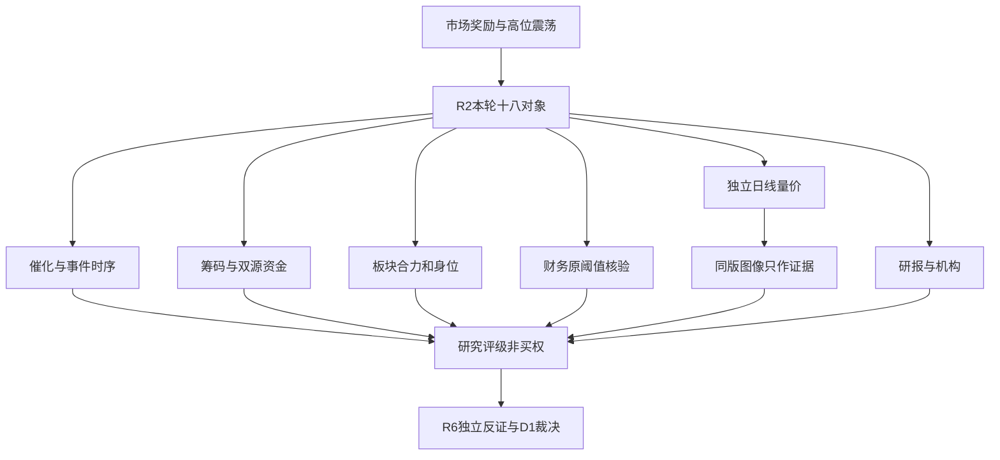

# 2026年11月12日 · **个股画像**

> 数据源新鲜度：partial。降级状态：true。置信度：0.5。

## 一句话结论
**科技回流多为超跌修复；机器人前排有身位但公告反证强，研究不等于买权。**

## 详细分析
本批沿用R2的92科比三格，不融合多套打法。市场奖励容量科技与前排接力，但R1/R2温度为高位震荡。昨日炸板率18.27%，未触35%砍半条件，不因辅助缺数或交付时间裁掉真实研究票。

CPO/PCB短线回流和日线中期走弱可以同时成立。必须区分“在主线中”与“已进入主升”，不能把急跌后的首板直接包装成强势回踩。图像为本阶段绑定副本的一票历史证据，日线数值独立复算。

机器人核心的连板高度不抹掉上市公司收入边界。锋龙无机器人收入及注资承诺、光洋机器人未盈利是本轮上游原文反证，不是对整个板块贴静态标签；仅保留准确相关对象。

本次已评18/18，未评代码：无。分批状态partial，已补大宗、两融、股东户数、研报、调研与配对席位；剩余合规和原文口径unknown逐票公开；未知不自动封票，真实账户硬预算、T+1、逐票硬否决及D1执行门禁独立生效。

## 主线背景（原样继承R2，不重排）
- 主线 = 共封装光学(CPO)，持续性 = 3日，封板率 = 100%，明日预期 = 分歧。
- 主线 = PCB概念，持续性 = 3日，封板率 = 100%，明日预期 = 分歧。
- 主线 = 机器人概念，持续性 = 3日，封板率 = 83.3333%，明日预期 = 分歧。
以上是R2本轮观点和既有成分篮子，不是持续性已兑现；市场意见窗口至竞价重评，不从旧计划无限继承。

## 逐票六维画像
|对象|R2身位|态度|Alpha / Risk|20日涨跌|5日分档资金亿元|已证财务红旗|
|---|---|---|---|---:|---:|---|
|剑桥科技 603083.SH|龙一|观察|B+ / C|-35.64%|2.2803|F3,F4,F8,F9|
|新易盛 300502.SZ|龙二|观察|B+ / B-|-35.01%|32.8590|F4|
|东山精密 002384.SZ|龙一|观察|B+ / B-|-29.94%|-5.4817|F10|
|沪电股份 002463.SZ|龙二|观察|B+ / B-|-22.23%|3.0037|F9|
|锋龙股份 002931.SZ|龙一|降级|B / C|50.84%|3.9220|F6|
|光洋股份 002708.SZ|龙二|降级|B / C|80.52%|3.3652|F3,F6,F9,F10|
|华盛昌 002980.SZ|候补|观察|B- / B-|-31.15%|0.8460|F3,F9|
|中京电子 002579.SZ|候补|降级|C / C|-23.20%|-0.0941|F3,F4,F9,F10|
|合锻智能 603011.SH|候补|观察|B- / C|-7.75%|1.3423|F3,F4,F9,S1|
|宝鼎科技 002552.SZ|候补|降级|B- / B-|-25.11%|-0.4494|F10|
|襄阳轴承 000678.SZ|候补|降级|B- / C|102.19%|0.0137|F3,F4,F10,S1|
|科森科技 603626.SH|候补|降级|C / C|43.20%|4.9361|F3,F6,F9,S1|
|福莱新材 605488.SH|候补|降级|B- / C|135.10%|4.1685|无已确认命中，不等于全项排雷|
|文投控股 600715.SH|龙一|降级|B- / C|67.02%|3.4323|F3,F4,S1|
|凯撒文化 002425.SZ|龙二|观察|B- / C|8.19%|0.5708|F2,F3,F9,S1|
|果麦文化 301052.SZ|候补|降级|B- / C|43.75%|1.6384|F3,F4,F5|
|日出东方 603366.SH|龙一|观察|B / C|65.56%|3.3072|F4,F6,F8|
|亚玛顿 002623.SZ|龙二|降级|B- / C|29.68%|0.2837|F1,F3,F4,F9,F10,S1,F7|

### 剑桥科技 603083.SH · 观察
观察：CPO先封核心，但仍是下降趋势内修复，现金流与应收风险不能被涨停覆盖。

- **催化**：本轮R4未精确匹配独立公司硬事件；以R2主线资金回流作为研究背景，不编新增订单。
- **筹码**：分档自算近5日主力2.2803亿元；DC近5日2.420257亿元。两口径有>5%冲突，保留双方且降低资金置信，不二选一。 最新实际披露席位20261106按一个原榜原因去重复：机构0.0000亿元、股通0.0487亿元、营业部-0.3074亿元；仅榜上披露，非全体资金。
- **联动**：CPO现有成分中当日最早09:34封板，1次打开后回封。与光迅13:46、源杰14:08、东方通信14:35比较为10cm先封核心；25.58亿元成交与8.07%换手支持流动性，不认证新增订单。
- **财务估值**：同口径实际三表及原文检查；命中F3,F4,F8,F9。年度F5/F7与本期三表窗口分别列示；合规范围缺口不等于安全或自动禁买。
- **技术**：日K=111根，前复权20日-35.64%；收盘116.95，MA5/20/60=109.57/137.33/177.29，成交量/前5日=0.80。主力单日回流支持先封辨识度，但20日仍跌35.64%、未站日线MA20，不认定主升回踩。图像是附加历史证据，非今日分钟承接。
- **机构**：近60自然日研报原行3条，按日期/机构/作者/标题去重1份；调研原行1条不等于独立调研场次。最新评级及EPS保留原预测年度，tp不作目标价。
- **板型与龙头认定**：首板，开板后回封；纪律研究认定3条；R2身位龙一不等于执行龙头确认。
- **盈亏比与禁止项**：RR未知，无买点/止损/目标依据，不虚构RR达标；禁止清单仅已核部分，空命中不等于14项通过。首次计划身份未知，不沿用plan_outside_scan。
- **其他已证标志**：fund_source_conflict
- **大资金意图**: 主力单日回流支持先封辨识度，但20日仍跌35.64%、未站日线MA20，不认定主升回踩。 资金流分类不能证明具体机构意图。
- **为什么走强**: CPO现有成分中当日最早09:34封板，1次打开后回封。与光迅13:46、源杰14:08、东方通信14:35比较为10cm先封核心；25.58亿元成交与8.07%换手支持流动性，不认证新增订单。
- **逻辑够不够硬**: 价格与资金地位不等于业务利润兑现；本轮R4未精确匹配独立公司硬事件；以R2主线资金回流作为研究背景，不编新增订单。

- **买入理由**: 仅研究假设，不授买权：CPO现有成分中当日最早09:34封板，1次打开后回封。与光迅13:46、源杰14:08、东方通信14:35比较为10cm先封核心；25.58亿元成交与8.07%换手支持流动性，不认证新增订单。；既有板块资金/催化与当日地位需要次日承接验证。

- **风险点**: 观察：CPO先封核心，但仍是下降趋势内修复，现金流与应收风险不能被涨停覆盖。；原阈值财务命中：F3,F4,F8,F9；监管范围缺口、资金双源冲突与中期价格结构独立保留。

- **止损条件**: 研究证伪：跌回前一交易日最低价以下或公司公告证伪核心业务假设；只描述逻辑，D1独立推导执行价与RR。

- **可验证假设**: 未来1-3交易日须保留同板块至少3只封板响应且本票不能跌破11月11日低点；这是研究检验，不新增交易门禁。

|检查|状态|事实及边界|
|---|---|---|
|F1|checked_negative|按原双条件判据；任一已核条件不成立足以排除此项，null未当0。|
|F2|checked_negative|商誉/归母净资产按30%原阈值；缺商誉不当零。|
|F3|flagged|同季度累计收入与期末应收同比，基期非正或缺字段不作阴性；原规则未改。|
|F4|flagged|存货同比与同累计期间周转率，未拿半年累计周转率和三季度累计直接比。|
|F5|checked_negative|最新完整年度研发投入原文流量计算；未超过50%。这是FY2025已披露结果，不冒充2026前三季研发资本化已核。|
|F6|checked_negative|正利润分母按30%规则；亏损期原比例不适用，保留亏损与扣非绝对数，不宣称无一次收益。|
|F7|unknown|已读FY2025实际关联交易表部分页；购销之外租赁/资产等完整适用口径尚未闭环，不能把预计额度、旧年列或空表当已核全年0。保留已读原文，F7总项仍unknown。|
|F8|flagged|累计转单季后核连续两季，不能用连续累计负值冒充。|
|F9|flagged|按前三季度累计收入原阈值，非应收TTM比。|
|F10|checked_negative|有息债用已核财务指标，不将缺负债细目默认为零。|
|F11|unknown|全公司质押率不是控股股东比例，已查公告索引不足以认证原文，回R5补最近质押/持股披露。|
|F12|checked_negative|已读最新年度原件审计意见及后续报告段；责任段条件式“如果披露不充分应当发表非无保留”不是实际非标。仅FY2025意见范围阴性，不表示当前全合规通过。|
|S1|checked_negative|沿用原财务轴，不把单季亏损等同连续两年亏损。|
|S2|unknown|已检查本票实际索引与R4精确匹配材料；交易所/证监会有限范围分页与相关命中原决定未齐，unknown不是安全也不自动禁买。|
|S3|unknown|已检查本票实际索引与R4精确匹配材料；交易所/证监会有限范围分页与相关命中原决定未齐，unknown不是安全也不自动禁买。|

### 新易盛 300502.SZ · 观察
观察：容量资金最强，利润增长是真实背景，技术仍是急跌后的修复而非新主升确认。

- **催化**：本轮R4未精确匹配独立公司硬事件；以R2主线资金回流作为研究背景，不编新增订单。
- **筹码**：分档自算近5日主力32.8590亿元；DC近5日32.378308999999994亿元。仍不能把分类资金当真实持仓增减。 近30交易日top_list精确代码无返回，已查空不等于没有机构持仓。
- **联动**：CPO可比全成分五日资金排名第1（32.378309亿元），当日+16.975%，双榜前排。容量中军/趋势研究对照，非涨停不当连板；不因300否决。
- **财务估值**：同口径实际三表及原文检查；命中F4。年度F5/F7与本期三表窗口分别列示；合规范围缺口不等于安全或自动禁买。
- **技术**：日K=111根，前复权20日-35.01%；收盘215.0，MA5/20/60=186.50/234.83/351.72，成交量/前5日=1.28。五日资金排序第一与16.98%修复显示容量偏好；历史涨停少不否定20cm容量地位。图像是附加历史证据，非今日分钟承接。
- **机构**：近60自然日研报原行34条，按日期/机构/作者/标题去重12份；调研原行289条不等于独立调研场次。最新评级及EPS保留原预测年度，tp不作目标价。
- **板型与龙头认定**：非涨停；接力板型未确认；纪律研究认定3条；R2身位龙二不等于执行龙头确认。
- **盈亏比与禁止项**：RR未知，无买点/止损/目标依据，不虚构RR达标；禁止清单仅已核部分，空命中不等于14项通过。首次计划身份未知，不沿用plan_outside_scan。
- **其他已证标志**：无额外已证标志；不表示所有风险阴性。
- **大资金意图**: 五日资金排序第一与16.98%修复显示容量偏好；历史涨停少不否定20cm容量地位。 资金流分类不能证明具体机构意图。
- **为什么走强**: CPO可比全成分五日资金排名第1（32.378309亿元），当日+16.975%，双榜前排。容量中军/趋势研究对照，非涨停不当连板；不因300否决。
- **逻辑够不够硬**: 价格与资金地位不等于业务利润兑现；本轮R4未精确匹配独立公司硬事件；以R2主线资金回流作为研究背景，不编新增订单。

- **买入理由**: 仅研究假设，不授买权：CPO可比全成分五日资金排名第1（32.378309亿元），当日+16.975%，双榜前排。容量中军/趋势研究对照，非涨停不当连板；不因300否决。；既有板块资金/催化与当日地位需要次日承接验证。

- **风险点**: 观察：容量资金最强，利润增长是真实背景，技术仍是急跌后的修复而非新主升确认。；原阈值财务命中：F4；监管范围缺口、资金双源冲突与中期价格结构独立保留。

- **止损条件**: 研究证伪：跌回前一交易日最低价以下或公司公告证伪核心业务假设；只描述逻辑，D1独立推导执行价与RR。

- **可验证假设**: 未来1-3交易日须保留同板块至少3只封板响应且本票不能跌破11月11日低点；这是研究检验，不新增交易门禁。

|检查|状态|事实及边界|
|---|---|---|
|F1|checked_negative|按原双条件判据；任一已核条件不成立足以排除此项，null未当0。|
|F2|checked_negative|商誉/归母净资产按30%原阈值；缺商誉不当零。|
|F3|checked_negative|同季度累计收入与期末应收同比，基期非正或缺字段不作阴性；原规则未改。|
|F4|flagged|存货同比与同累计期间周转率，未拿半年累计周转率和三季度累计直接比。|
|F5|checked_negative|最新完整年度研发投入原文流量计算；未超过50%。这是FY2025已披露结果，不冒充2026前三季研发资本化已核。|
|F6|checked_negative|正利润分母按30%规则；亏损期原比例不适用，保留亏损与扣非绝对数，不宣称无一次收益。|
|F7|unknown|已读FY2025实际关联交易表部分页；购销之外租赁/资产等完整适用口径尚未闭环，不能把预计额度、旧年列或空表当已核全年0。保留已读原文，F7总项仍unknown。|
|F8|checked_negative|累计转单季后核连续两季，不能用连续累计负值冒充。|
|F9|checked_negative|按前三季度累计收入原阈值，非应收TTM比。|
|F10|checked_negative|有息债用已核财务指标，不将缺负债细目默认为零。|
|F11|unknown|全公司质押率不是控股股东比例，已查公告索引不足以认证原文，回R5补最近质押/持股披露。|
|F12|checked_negative|已读最新年度原件审计意见及后续报告段；责任段条件式“如果披露不充分应当发表非无保留”不是实际非标。仅FY2025意见范围阴性，不表示当前全合规通过。|
|S1|checked_negative|沿用原财务轴，不把单季亏损等同连续两年亏损。|
|S2|unknown|已检查本票实际索引与R4精确匹配材料；交易所/证监会有限范围分页与相关命中原决定未齐，unknown不是安全也不自动禁买。|
|S3|unknown|已检查本票实际索引与R4精确匹配材料；交易所/证监会有限范围分页与相关命中原决定未齐，unknown不是安全也不自动禁买。|

### 东山精密 002384.SZ · 观察
观察：PCB容量龙一有回流，负债与中期下行压力并存，不把首板等同趋势反转。

- **催化**：本轮R4未精确匹配独立公司硬事件；以R2主线资金回流作为研究背景，不编新增订单。
- **筹码**：分档自算近5日主力-5.4817亿元；DC近5日-5.609114亿元。仍不能把分类资金当真实持仓增减。 最新实际披露席位20261111按一个原榜原因去重复：机构4.6991亿元、股通1.5041亿元、营业部1.0154亿元；仅榜上披露，非全体资金。
- **联动**：PCB产品主线13:11先封于沪电13:13、深南13:55，东财人气第1/同花顺7，成交126.54亿元与换手10.32%为容量核心。五日净额-5.609114亿与单日+23.159144亿并列；光洋归广义PCB但当轮叙事为机器人，不挪其3板给PCB高度。
- **财务估值**：同口径实际三表及原文检查；命中F10。年度F5/F7与本期三表窗口分别列示；合规范围缺口不等于安全或自动禁买。
- **技术**：日K=111根，前复权20日-29.94%；收盘92.06，MA5/20/60=85.31/101.73/157.76，成交量/前5日=0.91。大成交首板及PCB合力是当日奖励；日线仍低于20/60日线，不能按主升低吸模板直接交易。图像是附加历史证据，非今日分钟承接。
- **机构**：近60自然日研报原行3条，按日期/机构/作者/标题去重1份；调研原行2条不等于独立调研场次。最新评级及EPS保留原预测年度，tp不作目标价。
- **板型与龙头认定**：首板，未打开；纪律研究认定3条；R2身位龙一不等于执行龙头确认。
- **盈亏比与禁止项**：RR未知，无买点/止损/目标依据，不虚构RR达标；禁止清单仅已核部分，空命中不等于14项通过。首次计划身份未知，不沿用plan_outside_scan。
- **其他已证标志**：short_pressure
- **大资金意图**: 大成交首板及PCB合力是当日奖励；日线仍低于20/60日线，不能按主升低吸模板直接交易。 资金流分类不能证明具体机构意图。
- **为什么走强**: PCB产品主线13:11先封于沪电13:13、深南13:55，东财人气第1/同花顺7，成交126.54亿元与换手10.32%为容量核心。五日净额-5.609114亿与单日+23.159144亿并列；光洋归广义PCB但当轮叙事为机器人，不挪其3板给PCB高度。
- **逻辑够不够硬**: 价格与资金地位不等于业务利润兑现；本轮R4未精确匹配独立公司硬事件；以R2主线资金回流作为研究背景，不编新增订单。

- **买入理由**: 仅研究假设，不授买权：PCB产品主线13:11先封于沪电13:13、深南13:55，东财人气第1/同花顺7，成交126.54亿元与换手10.32%为容量核心。五日净额-5.609114亿与单日+23.159144亿并列；光洋归广义PCB但当轮叙事为机器人，不挪其3板给PCB高度。；既有板块资金/催化与当日地位需要次日承接验证。

- **风险点**: 观察：PCB容量龙一有回流，负债与中期下行压力并存，不把首板等同趋势反转。；原阈值财务命中：F10；监管范围缺口、资金双源冲突与中期价格结构独立保留。

- **止损条件**: 研究证伪：跌回前一交易日最低价以下或公司公告证伪核心业务假设；只描述逻辑，D1独立推导执行价与RR。

- **可验证假设**: 未来1-3交易日须保留同板块至少3只封板响应且本票不能跌破11月11日低点；这是研究检验，不新增交易门禁。

|检查|状态|事实及边界|
|---|---|---|
|F1|checked_negative|按原双条件判据；任一已核条件不成立足以排除此项，null未当0。|
|F2|checked_negative|商誉/归母净资产按30%原阈值；缺商誉不当零。|
|F3|checked_negative|同季度累计收入与期末应收同比，基期非正或缺字段不作阴性；原规则未改。|
|F4|checked_negative|存货同比与同累计期间周转率，未拿半年累计周转率和三季度累计直接比。|
|F5|checked_negative|最新完整年度研发投入原文流量计算；未超过50%。这是FY2025已披露结果，不冒充2026前三季研发资本化已核。|
|F6|checked_negative|正利润分母按30%规则；亏损期原比例不适用，保留亏损与扣非绝对数，不宣称无一次收益。|
|F7|unknown|已读FY2025实际关联交易表部分页；购销之外租赁/资产等完整适用口径尚未闭环，不能把预计额度、旧年列或空表当已核全年0。保留已读原文，F7总项仍unknown。|
|F8|checked_negative|累计转单季后核连续两季，不能用连续累计负值冒充。|
|F9|checked_negative|按前三季度累计收入原阈值，非应收TTM比。|
|F10|flagged|有息债用已核财务指标，不将缺负债细目默认为零。|
|F11|checked_negative|按最新取得原文的明确控股主体和同口径持股分母计算；低于70%，仅所列披露时点阴性，未宣称11月12日实时无变动。|
|F12|checked_negative|已读最新年度原件审计意见及后续报告段；责任段条件式“如果披露不充分应当发表非无保留”不是实际非标。仅FY2025意见范围阴性，不表示当前全合规通过。|
|S1|checked_negative|沿用原财务轴，不把单季亏损等同连续两年亏损。|
|S2|unknown|已检查本票实际索引与R4精确匹配材料；交易所/证监会有限范围分页与相关命中原决定未齐，unknown不是安全也不自动禁买。|
|S3|unknown|已检查本票实际索引与R4精确匹配材料；交易所/证监会有限范围分页与相关命中原决定未齐，unknown不是安全也不自动禁买。|

### 沪电股份 002463.SZ · 观察
观察：PCB龙二兼业绩核心，单日回流未消除应收和现金转化约束。

- **催化**：本轮R4未精确匹配独立公司硬事件；以R2主线资金回流作为研究背景，不编新增订单。
- **筹码**：分档自算近5日主力3.0037亿元；DC近5日2.8911亿元。仍不能把分类资金当真实持仓增减。 最新实际披露席位20261111按一个原榜原因去重复：机构0.4810亿元、股通2.2741亿元、营业部1.1089亿元；仅榜上披露，非全体资金。
- **联动**：PCB容量龙二研究席，13:13首封、3次开板，成交69.39亿元、五日净入2.8911亿元。是当前两核心比较顺位，不把全成分五日资金排名10说成第2。
- **财务估值**：同口径实际三表及原文检查；命中F9。年度F5/F7与本期三表窗口分别列示；合规范围缺口不等于安全或自动禁买。
- **技术**：日K=111根，前复权20日-22.23%；收盘89.43，MA5/20/60=80.41/95.88/112.44，成交量/前5日=0.97。业绩与同板块容量共振支持研究，短线修复强于日线中期结构，涨停不是基本面风险消失。图像是附加历史证据，非今日分钟承接。
- **机构**：近60自然日研报原行24条，按日期/机构/作者/标题去重9份；调研原行33条不等于独立调研场次。最新评级及EPS保留原预测年度，tp不作目标价。
- **板型与龙头认定**：首板，开板后回封；纪律研究认定3条；R2身位龙二不等于执行龙头确认。
- **盈亏比与禁止项**：RR未知，无买点/止损/目标依据，不虚构RR达标；禁止清单仅已核部分，空命中不等于14项通过。首次计划身份未知，不沿用plan_outside_scan。
- **其他已证标志**：无额外已证标志；不表示所有风险阴性。
- **大资金意图**: 业绩与同板块容量共振支持研究，短线修复强于日线中期结构，涨停不是基本面风险消失。 资金流分类不能证明具体机构意图。
- **为什么走强**: PCB容量龙二研究席，13:13首封、3次开板，成交69.39亿元、五日净入2.8911亿元。是当前两核心比较顺位，不把全成分五日资金排名10说成第2。
- **逻辑够不够硬**: 价格与资金地位不等于业务利润兑现；本轮R4未精确匹配独立公司硬事件；以R2主线资金回流作为研究背景，不编新增订单。

- **买入理由**: 仅研究假设，不授买权：PCB容量龙二研究席，13:13首封、3次开板，成交69.39亿元、五日净入2.8911亿元。是当前两核心比较顺位，不把全成分五日资金排名10说成第2。；既有板块资金/催化与当日地位需要次日承接验证。

- **风险点**: 观察：PCB龙二兼业绩核心，单日回流未消除应收和现金转化约束。；原阈值财务命中：F9；监管范围缺口、资金双源冲突与中期价格结构独立保留。

- **止损条件**: 研究证伪：跌回前一交易日最低价以下或公司公告证伪核心业务假设；只描述逻辑，D1独立推导执行价与RR。

- **可验证假设**: 未来1-3交易日须保留同板块至少3只封板响应且本票不能跌破11月11日低点；这是研究检验，不新增交易门禁。

|检查|状态|事实及边界|
|---|---|---|
|F1|checked_negative|按原双条件判据；任一已核条件不成立足以排除此项，null未当0。|
|F2|unknown|商誉/归母净资产按30%原阈值；缺商誉不当零。|
|F3|checked_negative|同季度累计收入与期末应收同比，基期非正或缺字段不作阴性；原规则未改。|
|F4|checked_negative|存货同比与同累计期间周转率，未拿半年累计周转率和三季度累计直接比。|
|F5|unknown|已读研发披露但资本化列为横线/空白；不把空白默认为0，需附注流量解释；原文与局部已核事实仍保留。|
|F6|checked_negative|正利润分母按30%规则；亏损期原比例不适用，保留亏损与扣非绝对数，不宣称无一次收益。|
|F7|unknown|已读FY2025实际关联交易表部分页；购销之外租赁/资产等完整适用口径尚未闭环，不能把预计额度、旧年列或空表当已核全年0。保留已读原文，F7总项仍unknown。|
|F8|checked_negative|累计转单季后核连续两季，不能用连续累计负值冒充。|
|F9|flagged|按前三季度累计收入原阈值，非应收TTM比。|
|F10|checked_negative|有息债用已核财务指标，不将缺负债细目默认为零。|
|F11|unknown|全公司质押率不是控股股东比例，已查公告索引不足以认证原文，回R5补最近质押/持股披露。|
|F12|checked_negative|已读最新年度原件审计意见及后续报告段；责任段条件式“如果披露不充分应当发表非无保留”不是实际非标。仅FY2025意见范围阴性，不表示当前全合规通过。|
|S1|checked_negative|沿用原财务轴，不把单季亏损等同连续两年亏损。|
|S2|unknown|已检查本票实际索引与R4精确匹配材料；交易所/证监会有限范围分页与相关命中原决定未齐，unknown不是安全也不自动禁买。|
|S3|unknown|已检查本票实际索引与R4精确匹配材料；交易所/证监会有限范围分页与相关命中原决定未齐，unknown不是安全也不自动禁买。|

### 锋龙股份 002931.SZ · 降级
降级：机器人3板地位在，但公司无机器人收入且36个月无注资计划，扣非亏损削弱逻辑。

- **催化**：前三季未产生机器人零部件收入；优必选承诺收购完成后36个月不注入所持资产。
- **筹码**：分档自算近5日主力3.9220亿元；DC近5日3.9046190000000003亿元。仍不能把分类资金当真实持仓增减。 最新实际披露席位20261111按一个原榜原因去重复：机构0.0347亿元、股通0.6301亿元、营业部0.5282亿元；仅榜上披露，非全体资金。
- **联动**：机器人3板并列高度，09:30:21早于光洋09:43:45，1次打开回封，历史锚第一。R4官方披露前三季机器人零收入、36个月不注资；只保留纯情绪高度龙研究席，不编业绩或注资。
- **财务估值**：同口径实际三表及原文检查；命中F6。年度F5/F7与本期三表窗口分别列示；合规范围缺口不等于安全或自动禁买。
- **技术**：日K=111根，前复权20日50.84%；收盘53.08，MA5/20/60=45.37/39.93/42.44，成交量/前5日=0.88。连板与历史股性支持博弈辨识度，不支持把优必选业务注入上市公司收入；盘后澄清须独立计入。图像是附加历史证据，非今日分钟承接。
- **机构**：近60自然日研报原行0条，按日期/机构/作者/标题去重0份；调研原行0条不等于独立调研场次。最新评级及EPS保留原预测年度，tp不作目标价。
- **板型与龙头认定**：3连板，开板后回封；纪律研究认定3条；R2身位龙一不等于执行龙头确认。
- **盈亏比与禁止项**：RR未知，无买点/止损/目标依据，不虚构RR达标；禁止清单仅已核部分，空命中不等于14项通过。首次计划身份未知，不沿用plan_outside_scan。
- **其他已证标志**：无额外已证标志；不表示所有风险阴性。
- **大资金意图**: 连板与历史股性支持博弈辨识度，不支持把优必选业务注入上市公司收入；盘后澄清须独立计入。 资金流分类不能证明具体机构意图。
- **为什么走强**: 机器人3板并列高度，09:30:21早于光洋09:43:45，1次打开回封，历史锚第一。R4官方披露前三季机器人零收入、36个月不注资；只保留纯情绪高度龙研究席，不编业绩或注资。
- **逻辑够不够硬**: 价格与资金地位不等于业务利润兑现；前三季未产生机器人零部件收入；优必选承诺收购完成后36个月不注入所持资产。

- **买入理由**: 仅研究假设，不授买权：机器人3板并列高度，09:30:21早于光洋09:43:45，1次打开回封，历史锚第一。R4官方披露前三季机器人零收入、36个月不注资；只保留纯情绪高度龙研究席，不编业绩或注资。；既有板块资金/催化与当日地位需要次日承接验证。

- **风险点**: 降级：机器人3板地位在，但公司无机器人收入且36个月无注资计划，扣非亏损削弱逻辑。；原阈值财务命中：F6；监管范围缺口、资金双源冲突与中期价格结构独立保留。

- **止损条件**: 研究证伪：跌回前一交易日最低价以下或公司公告证伪核心业务假设；只描述逻辑，D1独立推导执行价与RR。

- **可验证假设**: 未来1-3交易日须保留同板块至少3只封板响应且本票不能跌破11月11日低点；这是研究检验，不新增交易门禁。

|检查|状态|事实及边界|
|---|---|---|
|F1|checked_negative|按原双条件判据；任一已核条件不成立足以排除此项，null未当0。|
|F2|checked_negative|商誉/归母净资产按30%原阈值；缺商誉不当零。|
|F3|checked_negative|同季度累计收入与期末应收同比，基期非正或缺字段不作阴性；原规则未改。|
|F4|checked_negative|存货同比与同累计期间周转率，未拿半年累计周转率和三季度累计直接比。|
|F5|checked_negative|最新完整年度研发投入原文流量计算；未超过50%。这是FY2025已披露结果，不冒充2026前三季研发资本化已核。|
|F6|flagged|正利润分母按30%规则；亏损期原比例不适用，保留亏损与扣非绝对数，不宣称无一次收益。|
|F7|unknown|已读FY2025实际关联交易表部分页；购销之外租赁/资产等完整适用口径尚未闭环，不能把预计额度、旧年列或空表当已核全年0。保留已读原文，F7总项仍unknown。|
|F8|checked_negative|累计转单季后核连续两季，不能用连续累计负值冒充。|
|F9|checked_negative|按前三季度累计收入原阈值，非应收TTM比。|
|F10|checked_negative|有息债用已核财务指标，不将缺负债细目默认为零。|
|F11|unknown|已读旧控股股东诚锋解除质押原件，但本轮控制人已是优必选，旧主体0不能替代当前控制人质押比例；保持unknown。|
|F12|checked_negative|已读最新年度原件审计意见及后续报告段；责任段条件式“如果披露不充分应当发表非无保留”不是实际非标。仅FY2025意见范围阴性，不表示当前全合规通过。|
|S1|checked_negative|沿用原财务轴，不把单季亏损等同连续两年亏损。|
|S2|unknown|已检查本票实际索引与R4精确匹配材料；交易所/证监会有限范围分页与相关命中原决定未齐，unknown不是安全也不自动禁买。|
|S3|unknown|已检查本票实际索引与R4精确匹配材料；交易所/证监会有限范围分页与相关命中原决定未齐，unknown不是安全也不自动禁买。|

### 光洋股份 002708.SZ · 降级
降级：机器人3板趋势强，但业务未盈利、扣非亏损和杠杆风险真实，不能以股价替代业绩。

- **催化**：机器人业务处市场拓展阶段且收入占比较低、尚未盈利；前三季扣非为-3159.30万元属已披露背景。
- **筹码**：分档自算近5日主力3.3652亿元；DC近5日3.257066亿元。仍不能把分类资金当真实持仓增减。 最新实际披露席位20261111按一个原榜原因去重复：机构0.1246亿元、股通0.2813亿元、营业部-1.7371亿元；仅榜上披露，非全体资金。
- **联动**：机器人3板并列高度、后于锋龙封板，换手18.02%，近五日龙虎榜3个交易日。单日主力-1.128624亿、五日+3.257066亿并列；机器人收入低且未盈利，研究龙二不是利润核心认证。
- **财务估值**：同口径实际三表及原文检查；命中F3,F6,F9,F10。年度F5/F7与本期三表窗口分别列示；合规范围缺口不等于安全或自动禁买。
- **技术**：日K=111根，前复权20日80.52%；收盘26.59，MA5/20/60=22.68/18.22/15.83，成交量/前5日=1.07。先封与多头量价支持接力研究，但近20日加速80.52%不是低位试错，扣非及现金流是反证。图像是附加历史证据，非今日分钟承接。
- **机构**：近60自然日研报原行12条，按日期/机构/作者/标题去重4份；调研原行65条不等于独立调研场次。最新评级及EPS保留原预测年度，tp不作目标价。
- **板型与龙头认定**：3连板，开板后回封；纪律研究认定3条；R2身位龙二不等于执行龙头确认。
- **盈亏比与禁止项**：RR未知，无买点/止损/目标依据，不虚构RR达标；禁止清单仅已核部分，空命中不等于14项通过。首次计划身份未知，不沿用plan_outside_scan。
- **其他已证标志**：无额外已证标志；不表示所有风险阴性。
- **大资金意图**: 先封与多头量价支持接力研究，但近20日加速80.52%不是低位试错，扣非及现金流是反证。 资金流分类不能证明具体机构意图。
- **为什么走强**: 机器人3板并列高度、后于锋龙封板，换手18.02%，近五日龙虎榜3个交易日。单日主力-1.128624亿、五日+3.257066亿并列；机器人收入低且未盈利，研究龙二不是利润核心认证。
- **逻辑够不够硬**: 价格与资金地位不等于业务利润兑现；机器人业务处市场拓展阶段且收入占比较低、尚未盈利；前三季扣非为-3159.30万元属已披露背景。

- **买入理由**: 仅研究假设，不授买权：机器人3板并列高度、后于锋龙封板，换手18.02%，近五日龙虎榜3个交易日。单日主力-1.128624亿、五日+3.257066亿并列；机器人收入低且未盈利，研究龙二不是利润核心认证。；既有板块资金/催化与当日地位需要次日承接验证。

- **风险点**: 降级：机器人3板趋势强，但业务未盈利、扣非亏损和杠杆风险真实，不能以股价替代业绩。；原阈值财务命中：F3,F6,F9,F10；监管范围缺口、资金双源冲突与中期价格结构独立保留。

- **止损条件**: 研究证伪：跌回前一交易日最低价以下或公司公告证伪核心业务假设；只描述逻辑，D1独立推导执行价与RR。

- **可验证假设**: 未来1-3交易日须保留同板块至少3只封板响应且本票不能跌破11月11日低点；这是研究检验，不新增交易门禁。

|检查|状态|事实及边界|
|---|---|---|
|F1|checked_negative|按原双条件判据；任一已核条件不成立足以排除此项，null未当0。|
|F2|checked_negative|商誉/归母净资产按30%原阈值；缺商誉不当零。|
|F3|flagged|同季度累计收入与期末应收同比，基期非正或缺字段不作阴性；原规则未改。|
|F4|checked_negative|存货同比与同累计期间周转率，未拿半年累计周转率和三季度累计直接比。|
|F5|checked_negative|最新完整年度研发投入原文流量计算；未超过50%。这是FY2025已披露结果，不冒充2026前三季研发资本化已核。|
|F6|flagged|正利润分母按30%规则；亏损期原比例不适用，保留亏损与扣非绝对数，不宣称无一次收益。|
|F7|unknown|已核营收；关联交易预计额度/资金占用不是实际经营关联交易合计，缺相关附注回R5/R4。|
|F8|checked_negative|累计转单季后核连续两季，不能用连续累计负值冒充。|
|F9|flagged|按前三季度累计收入原阈值，非应收TTM比。|
|F10|flagged|有息债用已核财务指标，不将缺负债细目默认为零。|
|F11|unknown|全公司质押率不是控股股东比例，已查公告索引不足以认证原文，回R5补最近质押/持股披露。|
|F12|checked_negative|已读最新年度原件审计意见及后续报告段；责任段条件式“如果披露不充分应当发表非无保留”不是实际非标。仅FY2025意见范围阴性，不表示当前全合规通过。|
|S1|checked_negative|沿用原财务轴，不把单季亏损等同连续两年亏损。|
|S2|unknown|已检查本票实际索引与R4精确匹配材料；交易所/证监会有限范围分页与相关命中原决定未齐，unknown不是安全也不自动禁买。|
|S3|unknown|已检查本票实际索引与R4精确匹配材料；交易所/证监会有限范围分页与相关命中原决定未齐，unknown不是安全也不自动禁买。|

### 华盛昌 002980.SZ · 观察
观察：CPO历史锚但非当前先封核心，应收增速与中期下跌并存，不因首板晋级龙一。

- **催化**：本轮R4未精确匹配独立公司硬事件；以R2主线资金回流作为研究背景，不编新增订单。
- **筹码**：分档自算近5日主力0.8460亿元；DC近5日0.829984亿元。仍不能把分类资金当真实持仓增减。 最新实际披露席位20261026按一个原榜原因去重复：机构0.7364亿元、股通-0.2326亿元、营业部0.0000亿元；仅榜上披露，非全体资金。
- **联动**：CPO历史锚第三，首板但非最早封板，五日资金排名54。保留龙三观察，不用锚分替代地位。
- **财务估值**：同口径实际三表及原文检查；命中F3,F9。年度F5/F7与本期三表窗口分别列示；合规范围缺口不等于安全或自动禁买。
- **技术**：日K=111根，前复权20日-31.15%；收盘75.82，MA5/20/60=70.15/84.02/100.06，成交量/前5日=1.14。五日资金第54、午后首板，强于普通跟风但没有抢先带动证据；20日仍跌31.15%。图像是附加历史证据，非今日分钟承接。
- **机构**：近60自然日研报原行9条，按日期/机构/作者/标题去重3份；调研原行244条不等于独立调研场次。最新评级及EPS保留原预测年度，tp不作目标价。
- **板型与龙头认定**：首板，未打开；纪律研究认定1条；R2身位候补不等于执行龙头确认。
- **盈亏比与禁止项**：RR未知，无买点/止损/目标依据，不虚构RR达标；禁止清单仅已核部分，空命中不等于14项通过。首次计划身份未知，不沿用plan_outside_scan。
- **其他已证标志**：无额外已证标志；不表示所有风险阴性。
- **大资金意图**: 五日资金第54、午后首板，强于普通跟风但没有抢先带动证据；20日仍跌31.15%。 资金流分类不能证明具体机构意图。
- **为什么走强**: CPO历史锚第三，首板但非最早封板，五日资金排名54。保留龙三观察，不用锚分替代地位。
- **逻辑够不够硬**: 价格与资金地位不等于业务利润兑现；本轮R4未精确匹配独立公司硬事件；以R2主线资金回流作为研究背景，不编新增订单。

- **买入理由**: 仅研究假设，不授买权：CPO历史锚第三，首板但非最早封板，五日资金排名54。保留龙三观察，不用锚分替代地位。；既有板块资金/催化与当日地位需要次日承接验证。

- **风险点**: 观察：CPO历史锚但非当前先封核心，应收增速与中期下跌并存，不因首板晋级龙一。；原阈值财务命中：F3,F9；监管范围缺口、资金双源冲突与中期价格结构独立保留。

- **止损条件**: 研究证伪：跌回前一交易日最低价以下或公司公告证伪核心业务假设；只描述逻辑，D1独立推导执行价与RR。

- **可验证假设**: 未来1-3交易日须保留同板块至少3只封板响应且本票不能跌破11月11日低点；这是研究检验，不新增交易门禁。

|检查|状态|事实及边界|
|---|---|---|
|F1|checked_negative|按原双条件判据；任一已核条件不成立足以排除此项，null未当0。|
|F2|checked_negative|商誉/归母净资产按30%原阈值；缺商誉不当零。|
|F3|flagged|同季度累计收入与期末应收同比，基期非正或缺字段不作阴性；原规则未改。|
|F4|checked_negative|存货同比与同累计期间周转率，未拿半年累计周转率和三季度累计直接比。|
|F5|checked_negative|最新完整年度研发投入原文流量计算；未超过50%。这是FY2025已披露结果，不冒充2026前三季研发资本化已核。|
|F6|checked_negative|正利润分母按30%规则；亏损期原比例不适用，保留亏损与扣非绝对数，不宣称无一次收益。|
|F7|unknown|已读FY2025实际关联交易表部分页；购销之外租赁/资产等完整适用口径尚未闭环，不能把预计额度、旧年列或空表当已核全年0。保留已读原文，F7总项仍unknown。|
|F8|checked_negative|累计转单季后核连续两季，不能用连续累计负值冒充。|
|F9|flagged|按前三季度累计收入原阈值，非应收TTM比。|
|F10|checked_negative|有息债用已核财务指标，不将缺负债细目默认为零。|
|F11|unknown|全公司质押率不是控股股东比例，已查公告索引不足以认证原文，回R5补最近质押/持股披露。|
|F12|checked_negative|已读最新年度原件审计意见及后续报告段；责任段条件式“如果披露不充分应当发表非无保留”不是实际非标。仅FY2025意见范围阴性，不表示当前全合规通过。|
|S1|checked_negative|沿用原财务轴，不把单季亏损等同连续两年亏损。|
|S2|unknown|已检查本票实际索引与R4精确匹配材料；交易所/证监会有限范围分页与相关命中原决定未齐，unknown不是安全也不自动禁买。|
|S3|unknown|已检查本票实际索引与R4精确匹配材料；交易所/证监会有限范围分页与相关命中原决定未齐，unknown不是安全也不自动禁买。|

### 中京电子 002579.SZ · 降级
降级：历史股性好不等于当前核心，未封板且五日净出，亏损与营运资产风险并存。

- **催化**：本轮R4未精确匹配独立公司硬事件；以R2主线资金回流作为研究背景，不编新增订单。
- **筹码**：分档自算近5日主力-0.0941亿元；DC近5日-0.09817799999999995亿元。仍不能把分类资金当真实持仓增减。 最新实际披露席位20261013按一个原榜原因去重复：机构-0.5610亿元、股通0.0065亿元、营业部0.4609亿元；仅榜上披露，非全体资金。
- **联动**：CPO/PCB历史锚第一，今+2.42%未涨停、五日净流出；先入初筛但不占核心执行席，历史49次涨停非今日确定性。
- **财务估值**：同口径实际三表及原文检查；命中F3,F4,F9,F10。年度F5/F7与本期三表窗口分别列示；合规范围缺口不等于安全或自动禁买。
- **技术**：日K=111根，前复权20日-23.20%；收盘12.71，MA5/20/60=12.30/13.25/15.23，成交量/前5日=0.98。CPO/PCB重叠不能重复算两条主线加分；反弹尚低于日线20/60日线，当前缺前排资金。图像是附加历史证据，非今日分钟承接。
- **机构**：近60自然日研报原行0条，按日期/机构/作者/标题去重0份；调研原行1条不等于独立调研场次。最新评级及EPS保留原预测年度，tp不作目标价。
- **板型与龙头认定**：非涨停；接力板型未确认；纪律研究认定1条；R2身位候补不等于执行龙头确认。
- **盈亏比与禁止项**：RR未知，无买点/止损/目标依据，不虚构RR达标；禁止清单仅已核部分，空命中不等于14项通过。首次计划身份未知，不沿用plan_outside_scan。
- **其他已证标志**：无额外已证标志；不表示所有风险阴性。
- **大资金意图**: CPO/PCB重叠不能重复算两条主线加分；反弹尚低于日线20/60日线，当前缺前排资金。 资金流分类不能证明具体机构意图。
- **为什么走强**: CPO/PCB历史锚第一，今+2.42%未涨停、五日净流出；先入初筛但不占核心执行席，历史49次涨停非今日确定性。
- **逻辑够不够硬**: 价格与资金地位不等于业务利润兑现；本轮R4未精确匹配独立公司硬事件；以R2主线资金回流作为研究背景，不编新增订单。

- **买入理由**: 仅研究假设，不授买权：CPO/PCB历史锚第一，今+2.42%未涨停、五日净流出；先入初筛但不占核心执行席，历史49次涨停非今日确定性。；既有板块资金/催化与当日地位需要次日承接验证。

- **风险点**: 降级：历史股性好不等于当前核心，未封板且五日净出，亏损与营运资产风险并存。；原阈值财务命中：F3,F4,F9,F10；监管范围缺口、资金双源冲突与中期价格结构独立保留。

- **止损条件**: 研究证伪：跌回前一交易日最低价以下或公司公告证伪核心业务假设；只描述逻辑，D1独立推导执行价与RR。

- **可验证假设**: 未来1-3交易日须保留同板块至少3只封板响应且本票不能跌破11月11日低点；这是研究检验，不新增交易门禁。

|检查|状态|事实及边界|
|---|---|---|
|F1|checked_negative|按原双条件判据；任一已核条件不成立足以排除此项，null未当0。|
|F2|checked_negative|商誉/归母净资产按30%原阈值；缺商誉不当零。|
|F3|flagged|同季度累计收入与期末应收同比，基期非正或缺字段不作阴性；原规则未改。|
|F4|flagged|存货同比与同累计期间周转率，未拿半年累计周转率和三季度累计直接比。|
|F5|checked_negative|最新完整年度研发投入原文流量计算；未超过50%。这是FY2025已披露结果，不冒充2026前三季研发资本化已核。|
|F6|not_applicable|正利润分母按30%规则；亏损期原比例不适用，保留亏损与扣非绝对数，不宣称无一次收益。|
|F7|unknown|已读FY2025实际关联交易表部分页；购销之外租赁/资产等完整适用口径尚未闭环，不能把预计额度、旧年列或空表当已核全年0。保留已读原文，F7总项仍unknown。|
|F8|checked_negative|累计转单季后核连续两季，不能用连续累计负值冒充。|
|F9|flagged|按前三季度累计收入原阈值，非应收TTM比。|
|F10|flagged|有息债用已核财务指标，不将缺负债细目默认为零。|
|F11|checked_negative|按最新取得原文的明确控股主体和同口径持股分母计算；低于70%，仅所列披露时点阴性，未宣称11月12日实时无变动。|
|F12|checked_negative|已读最新年度原件审计意见及后续报告段；责任段条件式“如果披露不充分应当发表非无保留”不是实际非标。仅FY2025意见范围阴性，不表示当前全合规通过。|
|S1|checked_negative|沿用原财务轴，不把单季亏损等同连续两年亏损。|
|S2|unknown|已检查本票实际索引与R4精确匹配材料；交易所/证监会有限范围分页与相关命中原决定未齐，unknown不是安全也不自动禁买。|
|S3|unknown|已检查本票实际索引与R4精确匹配材料；交易所/证监会有限范围分页与相关命中原决定未齐，unknown不是安全也不自动禁买。|

### 合锻智能 603011.SH · 观察
观察：站回MA20有修复，但不是当前先封核心，连亏财务轴与存货反证保留。

- **催化**：本轮R4未精确匹配独立公司硬事件；以R2主线资金回流作为研究背景，不编新增订单。
- **筹码**：分档自算近5日主力1.3423亿元；DC近5日1.330786亿元。仍不能把分类资金当真实持仓增减。 近30交易日top_list精确代码无返回，已查空不等于没有机构持仓。
- **联动**：CPO/PCB历史锚，今+5.93%未封板、五日净入1.33亿元；缺当前前排时序人气，保留研究不替代龙一。
- **财务估值**：同口径实际三表及原文检查；命中F3,F4,F9,S1。年度F5/F7与本期三表窗口分别列示；合规范围缺口不等于安全或自动禁买。
- **技术**：日K=111根，前复权20日-7.75%；收盘19.28，MA5/20/60=17.83/18.27/22.77，成交量/前5日=1.32。日线站回20日线强于部分容量票，仍低于60日线，研究历史锚不自动替补执行。图像是附加历史证据，非今日分钟承接。
- **机构**：近60自然日研报原行0条，按日期/机构/作者/标题去重0份；调研原行0条不等于独立调研场次。最新评级及EPS保留原预测年度，tp不作目标价。
- **板型与龙头认定**：非涨停；接力板型未确认；纪律研究认定1条；R2身位候补不等于执行龙头确认。
- **盈亏比与禁止项**：RR未知，无买点/止损/目标依据，不虚构RR达标；禁止清单仅已核部分，空命中不等于14项通过。首次计划身份未知，不沿用plan_outside_scan。
- **其他已证标志**：无额外已证标志；不表示所有风险阴性。
- **大资金意图**: 日线站回20日线强于部分容量票，仍低于60日线，研究历史锚不自动替补执行。 资金流分类不能证明具体机构意图。
- **为什么走强**: CPO/PCB历史锚，今+5.93%未封板、五日净入1.33亿元；缺当前前排时序人气，保留研究不替代龙一。
- **逻辑够不够硬**: 价格与资金地位不等于业务利润兑现；本轮R4未精确匹配独立公司硬事件；以R2主线资金回流作为研究背景，不编新增订单。

- **买入理由**: 仅研究假设，不授买权：CPO/PCB历史锚，今+5.93%未封板、五日净入1.33亿元；缺当前前排时序人气，保留研究不替代龙一。；既有板块资金/催化与当日地位需要次日承接验证。

- **风险点**: 观察：站回MA20有修复，但不是当前先封核心，连亏财务轴与存货反证保留。；原阈值财务命中：F3,F4,F9,S1；监管范围缺口、资金双源冲突与中期价格结构独立保留。

- **止损条件**: 研究证伪：跌回前一交易日最低价以下或公司公告证伪核心业务假设；只描述逻辑，D1独立推导执行价与RR。

- **可验证假设**: 未来1-3交易日须保留同板块至少3只封板响应且本票不能跌破11月11日低点；这是研究检验，不新增交易门禁。

|检查|状态|事实及边界|
|---|---|---|
|F1|checked_negative|按原双条件判据；任一已核条件不成立足以排除此项，null未当0。|
|F2|checked_negative|商誉/归母净资产按30%原阈值；缺商誉不当零。|
|F3|flagged|同季度累计收入与期末应收同比，基期非正或缺字段不作阴性；原规则未改。 本期收入同比为负，原有带符号阈值会在应收/存货未绝对增长时也命中，不能把数学命中写成绝对暴增，更不等于造假。|
|F4|flagged|存货同比与同累计期间周转率，未拿半年累计周转率和三季度累计直接比。 本期收入同比为负，原有带符号阈值会在应收/存货未绝对增长时也命中，不能把数学命中写成绝对暴增，更不等于造假。|
|F5|unknown|已读研发披露但资本化列为横线/空白；不把空白默认为0，需附注流量解释；原文与局部已核事实仍保留。|
|F6|not_applicable|正利润分母按30%规则；亏损期原比例不适用，保留亏损与扣非绝对数，不宣称无一次收益。|
|F7|unknown|已读FY2025实际关联交易表部分页；购销之外租赁/资产等完整适用口径尚未闭环，不能把预计额度、旧年列或空表当已核全年0。保留已读原文，F7总项仍unknown。|
|F8|checked_negative|累计转单季后核连续两季，不能用连续累计负值冒充。|
|F9|flagged|按前三季度累计收入原阈值，非应收TTM比。|
|F10|checked_negative|有息债用已核财务指标，不将缺负债细目默认为零。|
|F11|unknown|全公司质押率不是控股股东比例，已查公告索引不足以认证原文，回R5补最近质押/持股披露。|
|F12|checked_negative|已读最新年度原件审计意见及后续报告段；责任段条件式“如果披露不充分应当发表非无保留”不是实际非标。仅FY2025意见范围阴性，不表示当前全合规通过。|
|S1|flagged|沿用原财务轴，不把单季亏损等同连续两年亏损。|
|S2|unknown|已检查本票实际索引与R4精确匹配材料；交易所/证监会有限范围分页与相关命中原决定未齐，unknown不是安全也不自动禁买。|
|S3|unknown|已检查本票实际索引与R4精确匹配材料；交易所/证监会有限范围分页与相关命中原决定未齐，unknown不是安全也不自动禁买。|

### 宝鼎科技 002552.SZ · 降级
降级：PCB历史锚未封板且五日净出，有息债/净资产偏高，尚非当前核心。

- **催化**：本轮R4未精确匹配独立公司硬事件；以R2主线资金回流作为研究背景，不编新增订单。
- **筹码**：分档自算近5日主力-0.4494亿元；DC近5日-0.46736300000000003亿元。仍不能把分类资金当真实持仓增减。 最新实际披露席位20261016按一个原榜原因去重复：机构-0.6781亿元、股通-1.1051亿元、营业部0.1903亿元；仅榜上披露，非全体资金。
- **联动**：PCB历史锚第二但当日+5.54%未封板、五日净出0.4674亿元；历史股性不替代本轮资金选择，龙三不替补执行。
- **财务估值**：同口径实际三表及原文检查；命中F10。年度F5/F7与本期三表窗口分别列示；合规范围缺口不等于安全或自动禁买。
- **技术**：日K=111根，前复权20日-25.11%；收盘34.3，MA5/20/60=32.75/36.07/46.34，成交量/前5日=1.08。盈利增长不等于资金正在付钱；只有历史股性而没有当前前排和持续资金，不升位。图像是附加历史证据，非今日分钟承接。
- **机构**：近60自然日研报原行0条，按日期/机构/作者/标题去重0份；调研原行0条不等于独立调研场次。最新评级及EPS保留原预测年度，tp不作目标价。
- **板型与龙头认定**：非涨停；接力板型未确认；纪律研究认定1条；R2身位候补不等于执行龙头确认。
- **盈亏比与禁止项**：RR未知，无买点/止损/目标依据，不虚构RR达标；禁止清单仅已核部分，空命中不等于14项通过。首次计划身份未知，不沿用plan_outside_scan。
- **其他已证标志**：无额外已证标志；不表示所有风险阴性。
- **大资金意图**: 盈利增长不等于资金正在付钱；只有历史股性而没有当前前排和持续资金，不升位。 资金流分类不能证明具体机构意图。
- **为什么走强**: PCB历史锚第二但当日+5.54%未封板、五日净出0.4674亿元；历史股性不替代本轮资金选择，龙三不替补执行。
- **逻辑够不够硬**: 价格与资金地位不等于业务利润兑现；本轮R4未精确匹配独立公司硬事件；以R2主线资金回流作为研究背景，不编新增订单。

- **买入理由**: 仅研究假设，不授买权：PCB历史锚第二但当日+5.54%未封板、五日净出0.4674亿元；历史股性不替代本轮资金选择，龙三不替补执行。；既有板块资金/催化与当日地位需要次日承接验证。

- **风险点**: 降级：PCB历史锚未封板且五日净出，有息债/净资产偏高，尚非当前核心。；原阈值财务命中：F10；监管范围缺口、资金双源冲突与中期价格结构独立保留。

- **止损条件**: 研究证伪：跌回前一交易日最低价以下或公司公告证伪核心业务假设；只描述逻辑，D1独立推导执行价与RR。

- **可验证假设**: 未来1-3交易日须保留同板块至少3只封板响应且本票不能跌破11月11日低点；这是研究检验，不新增交易门禁。

|检查|状态|事实及边界|
|---|---|---|
|F1|checked_negative|按原双条件判据；任一已核条件不成立足以排除此项，null未当0。|
|F2|unknown|商誉/归母净资产按30%原阈值；缺商誉不当零。|
|F3|checked_negative|同季度累计收入与期末应收同比，基期非正或缺字段不作阴性；原规则未改。|
|F4|checked_negative|存货同比与同累计期间周转率，未拿半年累计周转率和三季度累计直接比。|
|F5|checked_negative|最新完整年度研发投入原文流量计算；未超过50%。这是FY2025已披露结果，不冒充2026前三季研发资本化已核。|
|F6|checked_negative|正利润分母按30%规则；亏损期原比例不适用，保留亏损与扣非绝对数，不宣称无一次收益。|
|F7|unknown|已读FY2025实际关联交易表部分页；购销之外租赁/资产等完整适用口径尚未闭环，不能把预计额度、旧年列或空表当已核全年0。保留已读原文，F7总项仍unknown。|
|F8|checked_negative|累计转单季后核连续两季，不能用连续累计负值冒充。|
|F9|checked_negative|按前三季度累计收入原阈值，非应收TTM比。|
|F10|flagged|有息债用已核财务指标，不将缺负债细目默认为零。|
|F11|unknown|全公司质押率不是控股股东比例，已查公告索引不足以认证原文，回R5补最近质押/持股披露。|
|F12|checked_negative|已读最新年度原件审计意见及后续报告段；责任段条件式“如果披露不充分应当发表非无保留”不是实际非标。仅FY2025意见范围阴性，不表示当前全合规通过。|
|S1|checked_negative|沿用原财务轴，不把单季亏损等同连续两年亏损。|
|S2|unknown|已检查本票实际索引与R4精确匹配材料；交易所/证监会有限范围分页与相关命中原决定未齐，unknown不是安全也不自动禁买。|
|S3|unknown|已检查本票实际索引与R4精确匹配材料；交易所/证监会有限范围分页与相关命中原决定未齐，unknown不是安全也不自动禁买。|

### 襄阳轴承 000678.SZ · 降级
降级：2板高换手但6次开板，连亏与杠杆反证真实，不能借热榜替代龙头。

- **催化**：本轮R4未精确匹配独立公司硬事件；以R2主线资金回流作为研究背景，不编新增订单。
- **筹码**：分档自算近5日主力0.0137亿元；DC近5日-0.13552699999999965亿元。两口径有>5%冲突，保留双方且降低资金置信，不二选一。 最新实际披露席位20261111按一个原榜原因去重复：机构0.6834亿元、股通0.9171亿元、营业部-0.9105亿元；仅榜上披露，非全体资金。
- **联动**：机器人锚第三，2板、同花顺热股第3，换手37.39%与6次开板、五日净出0.135481亿并列；高度落后两只3板，保留龙三不借人气升位。
- **财务估值**：同口径实际三表及原文检查；命中F3,F4,F10,S1。年度F5/F7与本期三表窗口分别列示；合规范围缺口不等于安全或自动禁买。
- **技术**：日K=111根，前复权20日102.19%；收盘21.19，MA5/20/60=19.09/15.97/11.71，成交量/前5日=1.50。20日涨幅102.19%是高位接力而非低位试错；两只3板在上，不从候补跃升。图像是附加历史证据，非今日分钟承接。
- **机构**：近60自然日研报原行0条，按日期/机构/作者/标题去重0份；调研原行0条不等于独立调研场次。最新评级及EPS保留原预测年度，tp不作目标价。
- **板型与龙头认定**：2连板，开板后回封；纪律研究认定1条；R2身位候补不等于执行龙头确认。
- **盈亏比与禁止项**：RR未知，无买点/止损/目标依据，不虚构RR达标；禁止清单仅已核部分，空命中不等于14项通过。首次计划身份未知，不沿用plan_outside_scan。
- **其他已证标志**：fund_source_conflict,反复触板仍封住不等于风险消失；只采当前开板次数，不臆定ST状态
- **大资金意图**: 20日涨幅102.19%是高位接力而非低位试错；两只3板在上，不从候补跃升。 资金流分类不能证明具体机构意图。
- **为什么走强**: 机器人锚第三，2板、同花顺热股第3，换手37.39%与6次开板、五日净出0.135481亿并列；高度落后两只3板，保留龙三不借人气升位。
- **逻辑够不够硬**: 价格与资金地位不等于业务利润兑现；本轮R4未精确匹配独立公司硬事件；以R2主线资金回流作为研究背景，不编新增订单。

- **买入理由**: 仅研究假设，不授买权：机器人锚第三，2板、同花顺热股第3，换手37.39%与6次开板、五日净出0.135481亿并列；高度落后两只3板，保留龙三不借人气升位。；既有板块资金/催化与当日地位需要次日承接验证。

- **风险点**: 降级：2板高换手但6次开板，连亏与杠杆反证真实，不能借热榜替代龙头。；原阈值财务命中：F3,F4,F10,S1；监管范围缺口、资金双源冲突与中期价格结构独立保留。

- **止损条件**: 研究证伪：跌回前一交易日最低价以下或公司公告证伪核心业务假设；只描述逻辑，D1独立推导执行价与RR。

- **可验证假设**: 未来1-3交易日须保留同板块至少3只封板响应且本票不能跌破11月11日低点；这是研究检验，不新增交易门禁。

|检查|状态|事实及边界|
|---|---|---|
|F1|checked_negative|按原双条件判据；任一已核条件不成立足以排除此项，null未当0。|
|F2|unknown|商誉/归母净资产按30%原阈值；缺商誉不当零。|
|F3|flagged|同季度累计收入与期末应收同比，基期非正或缺字段不作阴性；原规则未改。 本期收入同比为负，原有带符号阈值会在应收/存货未绝对增长时也命中，不能把数学命中写成绝对暴增，更不等于造假。|
|F4|flagged|存货同比与同累计期间周转率，未拿半年累计周转率和三季度累计直接比。 本期收入同比为负，原有带符号阈值会在应收/存货未绝对增长时也命中，不能把数学命中写成绝对暴增，更不等于造假。|
|F5|checked_negative|最新完整年度研发投入原文流量计算；未超过50%。这是FY2025已披露结果，不冒充2026前三季研发资本化已核。|
|F6|not_applicable|正利润分母按30%规则；亏损期原比例不适用，保留亏损与扣非绝对数，不宣称无一次收益。|
|F7|unknown|已读FY2025实际关联交易表部分页；购销之外租赁/资产等完整适用口径尚未闭环，不能把预计额度、旧年列或空表当已核全年0。保留已读原文，F7总项仍unknown。|
|F8|checked_negative|累计转单季后核连续两季，不能用连续累计负值冒充。|
|F9|checked_negative|按前三季度累计收入原阈值，非应收TTM比。|
|F10|flagged|有息债用已核财务指标，不将缺负债细目默认为零。|
|F11|unknown|全公司质押率不是控股股东比例，已查公告索引不足以认证原文，回R5补最近质押/持股披露。|
|F12|checked_negative|已读最新年度原件审计意见及后续报告段；责任段条件式“如果披露不充分应当发表非无保留”不是实际非标。仅FY2025意见范围阴性，不表示当前全合规通过。|
|S1|flagged|沿用原财务轴，不把单季亏损等同连续两年亏损。|
|S2|unknown|已检查本票实际索引与R4精确匹配材料；交易所/证监会有限范围分页与相关命中原决定未齐，unknown不是安全也不自动禁买。|
|S3|unknown|已检查本票实际索引与R4精确匹配材料；交易所/证监会有限范围分页与相关命中原决定未齐，unknown不是安全也不自动禁买。|

### 科森科技 603626.SH · 降级
降级：趋势尚强但R2已判当前非前排，扣非亏损及信息披露监管警示须保留。

- **催化**：本轮R4未精确匹配独立公司硬事件；以R2主线资金回流作为研究背景，不编新增订单。
- **筹码**：分档自算近5日主力4.9361亿元；DC近5日4.920223亿元。两口径有>5%冲突，保留双方且降低资金置信，不二选一。 最新实际披露席位20261105按一个原榜原因去重复：机构-0.2675亿元、股通-0.4473亿元、营业部0.7667亿元；仅榜上披露，非全体资金。
- **联动**：机器人历史锚第二；当前0连板、五日资金全成分排名11，命中top3外与0板低于3板龙头-2两项，rank=杂毛仅作原执行过滤，不是公司价值结论。不伪造30日龙虎榜阴性。
- **财务估值**：同口径实际三表及原文检查；命中F3,F6,F9,S1。年度F5/F7与本期三表窗口分别列示；合规范围缺口不等于安全或自动禁买。
- **技术**：日K=111根，前复权20日43.20%；收盘31.46，MA5/20/60=29.18/25.83/22.13，成交量/前5日=0.83。三季正净利主要不是持续主业盈利，扣非为负；股性70.4历史标签不能抹掉已知监管事项。图像是附加历史证据，非今日分钟承接。
- **机构**：近60自然日研报原行3条，按日期/机构/作者/标题去重1份；调研原行0条不等于独立调研场次。最新评级及EPS保留原预测年度，tp不作目标价。
- **板型与龙头认定**：非涨停；接力板型未确认；纪律研究认定1条；R2身位候补不等于执行龙头确认。
- **盈亏比与禁止项**：RR未知，无买点/止损/目标依据，不虚构RR达标；禁止清单仅已核部分，空命中不等于14项通过。首次计划身份未知，不沿用plan_outside_scan。
- **其他已证标志**：fund_source_conflict,disclosed_regulatory_warning
- **大资金意图**: 三季正净利主要不是持续主业盈利，扣非为负；股性70.4历史标签不能抹掉已知监管事项。 资金流分类不能证明具体机构意图。
- **为什么走强**: 机器人历史锚第二；当前0连板、五日资金全成分排名11，命中top3外与0板低于3板龙头-2两项，rank=杂毛仅作原执行过滤，不是公司价值结论。不伪造30日龙虎榜阴性。
- **逻辑够不够硬**: 价格与资金地位不等于业务利润兑现；本轮R4未精确匹配独立公司硬事件；以R2主线资金回流作为研究背景，不编新增订单。

- **买入理由**: 仅研究假设，不授买权：机器人历史锚第二；当前0连板、五日资金全成分排名11，命中top3外与0板低于3板龙头-2两项，rank=杂毛仅作原执行过滤，不是公司价值结论。不伪造30日龙虎榜阴性。；既有板块资金/催化与当日地位需要次日承接验证。

- **风险点**: 降级：趋势尚强但R2已判当前非前排，扣非亏损及信息披露监管警示须保留。；原阈值财务命中：F3,F6,F9,S1；监管范围缺口、资金双源冲突与中期价格结构独立保留。

- **止损条件**: 研究证伪：跌回前一交易日最低价以下或公司公告证伪核心业务假设；只描述逻辑，D1独立推导执行价与RR。

- **可验证假设**: 未来1-3交易日须保留同板块至少3只封板响应且本票不能跌破11月11日低点；这是研究检验，不新增交易门禁。

|检查|状态|事实及边界|
|---|---|---|
|F1|checked_negative|按原双条件判据；任一已核条件不成立足以排除此项，null未当0。|
|F2|checked_negative|商誉/归母净资产按30%原阈值；缺商誉不当零。|
|F3|flagged|同季度累计收入与期末应收同比，基期非正或缺字段不作阴性；原规则未改。 本期收入同比为负，原有带符号阈值会在应收/存货未绝对增长时也命中，不能把数学命中写成绝对暴增，更不等于造假。|
|F4|checked_negative|存货同比与同累计期间周转率，未拿半年累计周转率和三季度累计直接比。 本期收入同比为负，原有带符号阈值会在应收/存货未绝对增长时也命中，不能把数学命中写成绝对暴增，更不等于造假。|
|F5|checked_negative|最新完整年度研发投入原文流量计算；未超过50%。这是FY2025已披露结果，不冒充2026前三季研发资本化已核。|
|F6|flagged|正利润分母按30%规则；亏损期原比例不适用，保留亏损与扣非绝对数，不宣称无一次收益。|
|F7|unknown|已读FY2025实际关联交易表部分页；购销之外租赁/资产等完整适用口径尚未闭环，不能把预计额度、旧年列或空表当已核全年0。保留已读原文，F7总项仍unknown。|
|F8|checked_negative|累计转单季后核连续两季，不能用连续累计负值冒充。|
|F9|flagged|按前三季度累计收入原阈值，非应收TTM比。|
|F10|checked_negative|有息债用已核财务指标，不将缺负债细目默认为零。|
|F11|checked_negative|按最新取得原文的明确控股主体和同口径持股分母计算；低于70%，仅所列披露时点阴性，未宣称11月12日实时无变动。|
|F12|checked_negative|已读最新年度原件审计意见及后续报告段；责任段条件式“如果披露不充分应当发表非无保留”不是实际非标。仅FY2025意见范围阴性，不表示当前全合规通过。|
|S1|flagged|沿用原财务轴，不把单季亏损等同连续两年亏损。|
|S2|unknown|已读公司公告转述监管135/136号原决定；有真实信息披露违规，不能无风险表述；警示函不自动升格立案/重大违规/造假硬否决。监管官网独立有限范围回执未齐，S2最终仍unknown交R6/D1独立审查。|
|S3|unknown|已检查本票实际索引与R4精确匹配材料；交易所/证监会有限范围分页与相关命中原决定未齐，unknown不是安全也不自动禁买。|

### 福莱新材 605488.SH · 降级
降级：电子皮肤收入极低、估值及短期乖离高，正股强势与转债投机不混同。

- **催化**：柔性传感项目收入占比极低且研发订单不确定；11月11日福新转债收948.111元、转股溢价67.12%、换手1088.81%见同日转债公告。
- **筹码**：分档自算近5日主力4.1685亿元；DC近5日4.218067亿元。两口径有>5%冲突，保留双方且降低资金置信，不二选一。 最新实际披露席位20261111按一个原榜原因去重复：机构0.0000亿元、股通-0.6147亿元、营业部-0.5613亿元；仅榜上披露，非全体资金。
- **联动**：电子皮肤叙事2板、换手11.57%，仅龙三观察。R4披露柔性传感收入极低、订单不确定、转债风险，不用转债活跃冒充正股利润与承接。
- **财务估值**：同口径实际三表及原文检查；命中暂无已确认财务阈值项。年度F5/F7与本期三表窗口分别列示；合规范围缺口不等于安全或自动禁买。
- **技术**：日K=111根，前复权20日135.10%；收盘63.03，MA5/20/60=54.12/42.33/33.64，成交量/前5日=0.90。涨停和2板是价格事实，柔性传感盈利兑现不是事实；20日135.10%不属于低位。图像是附加历史证据，非今日分钟承接。
- **机构**：近60自然日研报原行9条，按日期/机构/作者/标题去重3份；调研原行36条不等于独立调研场次。最新评级及EPS保留原预测年度，tp不作目标价。
- **板型与龙头认定**：2连板，未打开；纪律研究认定1条；R2身位候补不等于执行龙头确认。
- **盈亏比与禁止项**：RR未知，无买点/止损/目标依据，不虚构RR达标；禁止清单仅已核部分，空命中不等于14项通过。首次计划身份未知，不沿用plan_outside_scan。
- **其他已证标志**：fund_source_conflict
- **大资金意图**: 涨停和2板是价格事实，柔性传感盈利兑现不是事实；20日135.10%不属于低位。 资金流分类不能证明具体机构意图。
- **为什么走强**: 电子皮肤叙事2板、换手11.57%，仅龙三观察。R4披露柔性传感收入极低、订单不确定、转债风险，不用转债活跃冒充正股利润与承接。
- **逻辑够不够硬**: 价格与资金地位不等于业务利润兑现；柔性传感项目收入占比极低且研发订单不确定；11月11日福新转债收948.111元、转股溢价67.12%、换手1088.81%见同日转债公告。

- **买入理由**: 仅研究假设，不授买权：电子皮肤叙事2板、换手11.57%，仅龙三观察。R4披露柔性传感收入极低、订单不确定、转债风险，不用转债活跃冒充正股利润与承接。；既有板块资金/催化与当日地位需要次日承接验证。

- **风险点**: 降级：电子皮肤收入极低、估值及短期乖离高，正股强势与转债投机不混同。；原阈值财务命中：无已确认命中，不等于全合规排雷；监管范围缺口、资金双源冲突与中期价格结构独立保留。

- **止损条件**: 研究证伪：跌回前一交易日最低价以下或公司公告证伪核心业务假设；只描述逻辑，D1独立推导执行价与RR。

- **可验证假设**: 未来1-3交易日须保留同板块至少3只封板响应且本票不能跌破11月11日低点；这是研究检验，不新增交易门禁。

|检查|状态|事实及边界|
|---|---|---|
|F1|checked_negative|按原双条件判据；任一已核条件不成立足以排除此项，null未当0。|
|F2|unknown|商誉/归母净资产按30%原阈值；缺商誉不当零。|
|F3|checked_negative|同季度累计收入与期末应收同比，基期非正或缺字段不作阴性；原规则未改。|
|F4|checked_negative|存货同比与同累计期间周转率，未拿半年累计周转率和三季度累计直接比。|
|F5|unknown|已读研发披露但资本化列为横线/空白；不把空白默认为0，需附注流量解释；原文与局部已核事实仍保留。|
|F6|checked_negative|正利润分母按30%规则；亏损期原比例不适用，保留亏损与扣非绝对数，不宣称无一次收益。|
|F7|unknown|已读FY2025实际关联交易表部分页；购销之外租赁/资产等完整适用口径尚未闭环，不能把预计额度、旧年列或空表当已核全年0。保留已读原文，F7总项仍unknown。|
|F8|checked_negative|累计转单季后核连续两季，不能用连续累计负值冒充。|
|F9|checked_negative|按前三季度累计收入原阈值，非应收TTM比。|
|F10|checked_negative|有息债用已核财务指标，不将缺负债细目默认为零。|
|F11|unknown|全公司质押率不是控股股东比例，已查公告索引不足以认证原文，回R5补最近质押/持股披露。|
|F12|checked_negative|已读最新年度原件审计意见及后续报告段；责任段条件式“如果披露不充分应当发表非无保留”不是实际非标。仅FY2025意见范围阴性，不表示当前全合规通过。|
|S1|checked_negative|沿用原财务轴，不把单季亏损等同连续两年亏损。|
|S2|unknown|已检查本票实际索引与R4精确匹配材料；交易所/证监会有限范围分页与相关命中原决定未齐，unknown不是安全也不自动禁买。|
|S3|unknown|已检查本票实际索引与R4精确匹配材料；交易所/证监会有限范围分页与相关命中原决定未齐，unknown不是安全也不自动禁买。|

### 文投控股 600715.SH · 降级
降级：短剧旧核心3板仍在，但9次开板、行业流出与连亏财务轴同时保留。

- **催化**：本轮R4未精确匹配独立公司硬事件；以R2主线资金回流作为研究背景，不编新增订单。
- **筹码**：分档自算近5日主力3.4323亿元；DC近5日3.116704亿元。两口径有>5%冲突，保留双方且降低资金置信，不二选一。 最新实际披露席位20261111按一个原榜原因去重复：机构0.0000亿元、股通-0.6000亿元、营业部1.6901亿元；仅榜上披露，非全体资金。
- **联动**：短剧核心观察，双榜1/3，16天9板是区间数、当前3连板；9次开板不支持无分歧加速，比较旧核兑现与新AI游戏分流。
- **财务估值**：同口径实际三表及原文检查；命中F3,F4,S1。年度F5/F7与本期三表窗口分别列示；合规范围缺口不等于安全或自动禁买。
- **技术**：日K=111根，前复权20日67.02%；收盘3.14，MA5/20/60=2.69/2.14/1.83，成交量/前5日=1.29。热榜和区间多板只证明辨识度；真实当前3板不是16连板，日内大分歧不说无阻力加速。图像是附加历史证据，非今日分钟承接。
- **机构**：近60自然日研报原行0条，按日期/机构/作者/标题去重0份；调研原行1条不等于独立调研场次。最新评级及EPS保留原预测年度，tp不作目标价。
- **板型与龙头认定**：3连板，开板后回封；纪律研究认定2条；R2身位龙一不等于执行龙头确认。
- **盈亏比与禁止项**：RR未知，无买点/止损/目标依据，不虚构RR达标；禁止清单仅已核部分，空命中不等于14项通过。首次计划身份未知，不沿用plan_outside_scan。
- **其他已证标志**：fund_source_conflict,反复触板仍封住不等于风险消失；只采当前开板次数，不臆定ST状态
- **大资金意图**: 热榜和区间多板只证明辨识度；真实当前3板不是16连板，日内大分歧不说无阻力加速。 资金流分类不能证明具体机构意图。
- **为什么走强**: 短剧核心观察，双榜1/3，16天9板是区间数、当前3连板；9次开板不支持无分歧加速，比较旧核兑现与新AI游戏分流。
- **逻辑够不够硬**: 价格与资金地位不等于业务利润兑现；本轮R4未精确匹配独立公司硬事件；以R2主线资金回流作为研究背景，不编新增订单。

- **买入理由**: 仅研究假设，不授买权：短剧核心观察，双榜1/3，16天9板是区间数、当前3连板；9次开板不支持无分歧加速，比较旧核兑现与新AI游戏分流。；既有板块资金/催化与当日地位需要次日承接验证。

- **风险点**: 降级：短剧旧核心3板仍在，但9次开板、行业流出与连亏财务轴同时保留。；原阈值财务命中：F3,F4,S1；监管范围缺口、资金双源冲突与中期价格结构独立保留。

- **止损条件**: 研究证伪：跌回前一交易日最低价以下或公司公告证伪核心业务假设；只描述逻辑，D1独立推导执行价与RR。

- **可验证假设**: 未来1-3交易日须保留同板块至少3只封板响应且本票不能跌破11月11日低点；这是研究检验，不新增交易门禁。

|检查|状态|事实及边界|
|---|---|---|
|F1|unknown|按原双条件判据；任一已核条件不成立足以排除此项，null未当0。|
|F2|checked_negative|商誉/归母净资产按30%原阈值；缺商誉不当零。|
|F3|flagged|同季度累计收入与期末应收同比，基期非正或缺字段不作阴性；原规则未改。 本期收入同比为负，原有带符号阈值会在应收/存货未绝对增长时也命中，不能把数学命中写成绝对暴增，更不等于造假。|
|F4|flagged|存货同比与同累计期间周转率，未拿半年累计周转率和三季度累计直接比。 本期收入同比为负，原有带符号阈值会在应收/存货未绝对增长时也命中，不能把数学命中写成绝对暴增，更不等于造假。|
|F5|unknown|已读研发披露但资本化列为横线/空白；不把空白默认为0，需附注流量解释；原文与局部已核事实仍保留。|
|F6|not_applicable|正利润分母按30%规则；亏损期原比例不适用，保留亏损与扣非绝对数，不宣称无一次收益。|
|F7|unknown|已读FY2025实际关联交易表部分页；购销之外租赁/资产等完整适用口径尚未闭环，不能把预计额度、旧年列或空表当已核全年0。保留已读原文，F7总项仍unknown。|
|F8|checked_negative|累计转单季后核连续两季，不能用连续累计负值冒充。|
|F9|checked_negative|按前三季度累计收入原阈值，非应收TTM比。|
|F10|checked_negative|有息债用已核财务指标，不将缺负债细目默认为零。|
|F11|unknown|全公司质押率不是控股股东比例，已查公告索引不足以认证原文，回R5补最近质押/持股披露。|
|F12|checked_negative|已读最新年度原件审计意见及后续报告段；责任段条件式“如果披露不充分应当发表非无保留”不是实际非标。仅FY2025意见范围阴性，不表示当前全合规通过。|
|S1|flagged|沿用原财务轴，不把单季亏损等同连续两年亏损。|
|S2|unknown|已检查本票实际索引与R4精确匹配材料；交易所/证监会有限范围分页与相关命中原决定未齐，unknown不是安全也不自动禁买。|
|S3|unknown|已检查本票实际索引与R4精确匹配材料；交易所/证监会有限范围分页与相关命中原决定未齐，unknown不是安全也不自动禁买。|

### 凯撒文化 002425.SZ · 观察
观察：游戏2板有低位切换研究价值，但商誉超净资产三成及连亏限制逻辑硬度。

- **催化**：本轮R4未精确匹配独立公司硬事件；以R2主线资金回流作为研究背景，不编新增订单。
- **筹码**：分档自算近5日主力0.5708亿元；DC近5日0.5647340000000001亿元。两口径有>5%冲突，保留双方且降低资金置信，不二选一。 近30交易日top_list精确代码无返回，已查空不等于没有机构持仓。
- **联动**：网络游戏2板前排，09:30首封与东财17、换手16.37%支持低位试错研究；流通35.24亿谨慎。AI演示未闭环利润，不自动替补文投。
- **财务估值**：同口径实际三表及原文检查；命中F2,F3,F9,S1。年度F5/F7与本期三表窗口分别列示；合规范围缺口不等于安全或自动禁买。
- **技术**：日K=111根，前复权20日8.19%；收盘3.83，MA5/20/60=3.40/3.26/3.23，成交量/前5日=2.21。量能与先封支持接力观察，不把AI演示当收入；只有本轮D1核资格后才能讨论执行。图像是附加历史证据，非今日分钟承接。
- **机构**：近60自然日研报原行0条，按日期/机构/作者/标题去重0份；调研原行1条不等于独立调研场次。最新评级及EPS保留原预测年度，tp不作目标价。
- **板型与龙头认定**：2连板，开板后回封；纪律研究认定2条；R2身位龙二不等于执行龙头确认。
- **盈亏比与禁止项**：RR未知，无买点/止损/目标依据，不虚构RR达标；禁止清单仅已核部分，空命中不等于14项通过。首次计划身份未知，不沿用plan_outside_scan。
- **其他已证标志**：fund_source_conflict
- **大资金意图**: 量能与先封支持接力观察，不把AI演示当收入；只有本轮D1核资格后才能讨论执行。 资金流分类不能证明具体机构意图。
- **为什么走强**: 网络游戏2板前排，09:30首封与东财17、换手16.37%支持低位试错研究；流通35.24亿谨慎。AI演示未闭环利润，不自动替补文投。
- **逻辑够不够硬**: 价格与资金地位不等于业务利润兑现；本轮R4未精确匹配独立公司硬事件；以R2主线资金回流作为研究背景，不编新增订单。

- **买入理由**: 仅研究假设，不授买权：网络游戏2板前排，09:30首封与东财17、换手16.37%支持低位试错研究；流通35.24亿谨慎。AI演示未闭环利润，不自动替补文投。；既有板块资金/催化与当日地位需要次日承接验证。

- **风险点**: 观察：游戏2板有低位切换研究价值，但商誉超净资产三成及连亏限制逻辑硬度。；原阈值财务命中：F2,F3,F9,S1；监管范围缺口、资金双源冲突与中期价格结构独立保留。

- **止损条件**: 研究证伪：跌回前一交易日最低价以下或公司公告证伪核心业务假设；只描述逻辑，D1独立推导执行价与RR。

- **可验证假设**: 未来1-3交易日须保留同板块至少3只封板响应且本票不能跌破11月11日低点；这是研究检验，不新增交易门禁。

|检查|状态|事实及边界|
|---|---|---|
|F1|checked_negative|按原双条件判据；任一已核条件不成立足以排除此项，null未当0。|
|F2|flagged|商誉/归母净资产按30%原阈值；缺商誉不当零。|
|F3|flagged|同季度累计收入与期末应收同比，基期非正或缺字段不作阴性；原规则未改。 本期收入同比为负，原有带符号阈值会在应收/存货未绝对增长时也命中，不能把数学命中写成绝对暴增，更不等于造假。|
|F4|unknown|存货同比与同累计期间周转率，未拿半年累计周转率和三季度累计直接比。 本期收入同比为负，原有带符号阈值会在应收/存货未绝对增长时也命中，不能把数学命中写成绝对暴增，更不等于造假。|
|F5|checked_negative|最新完整年度研发投入原文流量计算；未超过50%。这是FY2025已披露结果，不冒充2026前三季研发资本化已核。|
|F6|not_applicable|正利润分母按30%规则；亏损期原比例不适用，保留亏损与扣非绝对数，不宣称无一次收益。|
|F7|unknown|已读FY2025实际关联交易表部分页；购销之外租赁/资产等完整适用口径尚未闭环，不能把预计额度、旧年列或空表当已核全年0。保留已读原文，F7总项仍unknown。|
|F8|checked_negative|累计转单季后核连续两季，不能用连续累计负值冒充。|
|F9|flagged|按前三季度累计收入原阈值，非应收TTM比。|
|F10|checked_negative|有息债用已核财务指标，不将缺负债细目默认为零。|
|F11|unknown|全公司质押率不是控股股东比例，已查公告索引不足以认证原文，回R5补最近质押/持股披露。|
|F12|checked_negative|已读最新年度原件审计意见及后续报告段；责任段条件式“如果披露不充分应当发表非无保留”不是实际非标。仅FY2025意见范围阴性，不表示当前全合规通过。|
|S1|flagged|沿用原财务轴，不把单季亏损等同连续两年亏损。|
|S2|unknown|已检查本票实际索引与R4精确匹配材料；交易所/证监会有限范围分页与相关命中原决定未齐，unknown不是安全也不自动禁买。|
|S3|unknown|已检查本票实际索引与R4精确匹配材料；交易所/证监会有限范围分页与相关命中原决定未齐，unknown不是安全也不自动禁买。|

### 果麦文化 301052.SZ · 降级
降级：20cm首板非龙头认证，52.45%高换手和收入亏损反证强，不因涨幅越级。

- **催化**：本轮R4未精确匹配独立公司硬事件；以R2主线资金回流作为研究背景，不编新增订单。
- **筹码**：分档自算近5日主力1.6384亿元；DC近5日1.519372亿元。两口径有>5%冲突，保留双方且降低资金置信，不二选一。 最新实际披露席位20261111按一个原榜原因去重复：机构0.0374亿元、股通0.0000亿元、营业部1.9985亿元；仅榜上披露，非全体资金。
- **联动**：果麦20cm首板、换手52.45%与3次开板，出版/IP扩散非10cm妖股；流通39.29亿谨慎，研究龙三，不因20cm涨幅升位。
- **财务估值**：同口径实际三表及原文检查；命中F3,F4,F5。年度F5/F7与本期三表窗口分别列示；合规范围缺口不等于安全或自动禁买。
- **技术**：日K=111根，前复权20日43.75%；收盘48.96，MA5/20/60=42.02/36.54/28.65，成交量/前5日=1.35。出版/IP扩散与容量科技不是同一资金叙事，候补只作对照；高换手并不天然是机构吸筹。图像是附加历史证据，非今日分钟承接。
- **机构**：近60自然日研报原行1条，按日期/机构/作者/标题去重1份；调研原行0条不等于独立调研场次。最新评级及EPS保留原预测年度，tp不作目标价。
- **板型与龙头认定**：首板，开板后回封；纪律研究认定1条；R2身位候补不等于执行龙头确认。
- **盈亏比与禁止项**：RR未知，无买点/止损/目标依据，不虚构RR达标；禁止清单仅已核部分，空命中不等于14项通过。首次计划身份未知，不沿用plan_outside_scan。
- **其他已证标志**：fund_source_conflict,创业板20cm首板不等于10cm高度龙头；果麦高换手不可直接叫机构吸筹
- **大资金意图**: 出版/IP扩散与容量科技不是同一资金叙事，候补只作对照；高换手并不天然是机构吸筹。 资金流分类不能证明具体机构意图。
- **为什么走强**: 果麦20cm首板、换手52.45%与3次开板，出版/IP扩散非10cm妖股；流通39.29亿谨慎，研究龙三，不因20cm涨幅升位。
- **逻辑够不够硬**: 价格与资金地位不等于业务利润兑现；本轮R4未精确匹配独立公司硬事件；以R2主线资金回流作为研究背景，不编新增订单。

- **买入理由**: 仅研究假设，不授买权：果麦20cm首板、换手52.45%与3次开板，出版/IP扩散非10cm妖股；流通39.29亿谨慎，研究龙三，不因20cm涨幅升位。；既有板块资金/催化与当日地位需要次日承接验证。

- **风险点**: 降级：20cm首板非龙头认证，52.45%高换手和收入亏损反证强，不因涨幅越级。；原阈值财务命中：F3,F4,F5；监管范围缺口、资金双源冲突与中期价格结构独立保留。

- **止损条件**: 研究证伪：跌回前一交易日最低价以下或公司公告证伪核心业务假设；只描述逻辑，D1独立推导执行价与RR。

- **可验证假设**: 未来1-3交易日须保留同板块至少3只封板响应且本票不能跌破11月11日低点；这是研究检验，不新增交易门禁。

|检查|状态|事实及边界|
|---|---|---|
|F1|unknown|按原双条件判据；任一已核条件不成立足以排除此项，null未当0。|
|F2|unknown|商誉/归母净资产按30%原阈值；缺商誉不当零。|
|F3|flagged|同季度累计收入与期末应收同比，基期非正或缺字段不作阴性；原规则未改。 本期收入同比为负，原有带符号阈值会在应收/存货未绝对增长时也命中，不能把数学命中写成绝对暴增，更不等于造假。|
|F4|flagged|存货同比与同累计期间周转率，未拿半年累计周转率和三季度累计直接比。 本期收入同比为负，原有带符号阈值会在应收/存货未绝对增长时也命中，不能把数学命中写成绝对暴增，更不等于造假。|
|F5|flagged|最新完整年度研发投入原文流量计算；资本化率超过50%，果麦2025比例63.74%，保留原soft_suggest。这是FY2025已披露结果，不冒充2026前三季研发资本化已核。|
|F6|not_applicable|正利润分母按30%规则；亏损期原比例不适用，保留亏损与扣非绝对数，不宣称无一次收益。|
|F7|unknown|已读FY2025实际关联交易表部分页；购销之外租赁/资产等完整适用口径尚未闭环，不能把预计额度、旧年列或空表当已核全年0。保留已读原文，F7总项仍unknown。|
|F8|checked_negative|累计转单季后核连续两季，不能用连续累计负值冒充。|
|F9|checked_negative|按前三季度累计收入原阈值，非应收TTM比。|
|F10|checked_negative|有息债用已核财务指标，不将缺负债细目默认为零。|
|F11|unknown|全公司质押率不是控股股东比例，已查公告索引不足以认证原文，回R5补最近质押/持股披露。|
|F12|checked_negative|已读最新年度原件审计意见及后续报告段；责任段条件式“如果披露不充分应当发表非无保留”不是实际非标。仅FY2025意见范围阴性，不表示当前全合规通过。|
|S1|checked_negative|沿用原财务轴，不把单季亏损等同连续两年亏损。|
|S2|unknown|已检查本票实际索引与R4精确匹配材料；交易所/证监会有限范围分页与相关命中原决定未齐，unknown不是安全也不自动禁买。|
|S3|unknown|已检查本票实际索引与R4精确匹配材料；交易所/证监会有限范围分页与相关命中原决定未齐，unknown不是安全也不自动禁买。|

### 日出东方 603366.SH · 观察
观察：4板高度真实但一字低换手，光伏资金连出与连续单季现金流为负并存。

- **催化**：本轮R4未精确匹配独立公司硬事件；以R2主线资金回流作为研究背景，不编新增订单。
- **筹码**：分档自算近5日主力3.3072亿元；DC近5日3.3011120000000003亿元。仍不能把分类资金当真实持仓增减。 最新实际披露席位20261111按一个原榜原因去重复：机构0.0000亿元、股通0.0000亿元、营业部0.6314亿元；仅榜上披露，非全体资金。
- **联动**：4板与网站总龙称号相符，但竞价一字、换手1.15%，可成交承接未知。光伏资金连出，不因名字东方或4板认定新主线；只保留次线高度观察。
- **财务估值**：同口径实际三表及原文检查；命中F4,F6,F8。年度F5/F7与本期三表窗口分别列示；合规范围缺口不等于安全或自动禁买。
- **技术**：日K=111根，前复权20日65.56%；收盘11.97，MA5/20/60=9.98/8.22/7.65，成交量/前5日=0.26。最高板是地位证据，不是本轮主线或可成交证据；太空光伏外国订单不属于本公司。图像是附加历史证据，非今日分钟承接。
- **机构**：近60自然日研报原行0条，按日期/机构/作者/标题去重0份；调研原行1条不等于独立调研场次。最新评级及EPS保留原预测年度，tp不作目标价。
- **板型与龙头认定**：竞价一字，未打开；纪律研究认定1条；R2身位龙一不等于执行龙头确认。
- **盈亏比与禁止项**：RR未知，无买点/止损/目标依据，不虚构RR达标；禁止清单仅已核部分，空命中不等于14项通过。首次计划身份未知，不沿用plan_outside_scan。
- **其他已证标志**：无额外已证标志；不表示所有风险阴性。
- **大资金意图**: 最高板是地位证据，不是本轮主线或可成交证据；太空光伏外国订单不属于本公司。 资金流分类不能证明具体机构意图。
- **为什么走强**: 4板与网站总龙称号相符，但竞价一字、换手1.15%，可成交承接未知。光伏资金连出，不因名字东方或4板认定新主线；只保留次线高度观察。
- **逻辑够不够硬**: 价格与资金地位不等于业务利润兑现；本轮R4未精确匹配独立公司硬事件；以R2主线资金回流作为研究背景，不编新增订单。

- **买入理由**: 仅研究假设，不授买权：4板与网站总龙称号相符，但竞价一字、换手1.15%，可成交承接未知。光伏资金连出，不因名字东方或4板认定新主线；只保留次线高度观察。；既有板块资金/催化与当日地位需要次日承接验证。

- **风险点**: 观察：4板高度真实但一字低换手，光伏资金连出与连续单季现金流为负并存。；原阈值财务命中：F4,F6,F8；监管范围缺口、资金双源冲突与中期价格结构独立保留。

- **止损条件**: 研究证伪：跌回前一交易日最低价以下或公司公告证伪核心业务假设；只描述逻辑，D1独立推导执行价与RR。

- **可验证假设**: 未来1-3交易日须保留同板块至少3只封板响应且本票不能跌破11月11日低点；这是研究检验，不新增交易门禁。

|检查|状态|事实及边界|
|---|---|---|
|F1|checked_negative|按原双条件判据；任一已核条件不成立足以排除此项，null未当0。|
|F2|checked_negative|商誉/归母净资产按30%原阈值；缺商誉不当零。|
|F3|checked_negative|同季度累计收入与期末应收同比，基期非正或缺字段不作阴性；原规则未改。|
|F4|flagged|存货同比与同累计期间周转率，未拿半年累计周转率和三季度累计直接比。|
|F5|checked_negative|最新完整年度研发投入原文流量计算；未超过50%。这是FY2025已披露结果，不冒充2026前三季研发资本化已核。|
|F6|flagged|正利润分母按30%规则；亏损期原比例不适用，保留亏损与扣非绝对数，不宣称无一次收益。|
|F7|unknown|已读FY2025实际关联交易表部分页；购销之外租赁/资产等完整适用口径尚未闭环，不能把预计额度、旧年列或空表当已核全年0。保留已读原文，F7总项仍unknown。|
|F8|flagged|累计转单季后核连续两季，不能用连续累计负值冒充。|
|F9|checked_negative|按前三季度累计收入原阈值，非应收TTM比。|
|F10|checked_negative|有息债用已核财务指标，不将缺负债细目默认为零。|
|F11|unknown|全公司质押率不是控股股东比例，已查公告索引不足以认证原文，回R5补最近质押/持股披露。|
|F12|checked_negative|已读最新年度原件审计意见及后续报告段；责任段条件式“如果披露不充分应当发表非无保留”不是实际非标。仅FY2025意见范围阴性，不表示当前全合规通过。|
|S1|checked_negative|沿用原财务轴，不把单季亏损等同连续两年亏损。|
|S2|unknown|已检查本票实际索引与R4精确匹配材料；交易所/证监会有限范围分页与相关命中原决定未齐，unknown不是安全也不自动禁买。|
|S3|unknown|已检查本票实际索引与R4精确匹配材料；交易所/证监会有限范围分页与相关命中原决定未齐，unknown不是安全也不自动禁买。|

### 亚玛顿 002623.SZ · 降级
降级：控制权正式协议不等于过户完成；3板一字与存贷双高、连亏等风险并列。

- **催化**：本轮R4未精确匹配独立公司硬事件；以R2主线资金回流作为研究背景，不编新增订单。
- **筹码**：分档自算近5日主力0.2837亿元；DC近5日0.283683亿元。仍不能把分类资金当真实持仓增减。 近30交易日top_list精确代码无返回，已查空不等于没有机构持仓。
- **联动**：光伏3板、流通44.94亿，一字换手0.44%；控制权和太空光伏叙事不等于完成过户或国内订单，仅次线高度对照。
- **财务估值**：同口径实际三表及原文检查；命中F1,F3,F4,F9,F10,S1,F7。年度F5/F7与本期三表窗口分别列示；合规范围缺口不等于安全或自动禁买。
- **技术**：日K=106根，前复权20日29.68%；收盘23.33，MA5/20/60=19.94/18.60/17.26，成交量/前5日=0.07。复牌后连续一字是事件情绪奖励，尚无开板换手承接，也不能将11月6日缺指标误认今日停牌。图像是附加历史证据，非今日分钟承接。
- **机构**：近60自然日研报原行0条，按日期/机构/作者/标题去重0份；调研原行0条不等于独立调研场次。最新评级及EPS保留原预测年度，tp不作目标价。
- **板型与龙头认定**：竞价一字，未打开；纪律研究认定1条；R2身位龙二不等于执行龙头确认。
- **盈亏比与禁止项**：RR未知，无买点/止损/目标依据，不虚构RR达标；禁止清单仅已核部分，空命中不等于14项通过。首次计划身份未知，不沿用plan_outside_scan。
- **其他已证标志**：short_pressure
- **大资金意图**: 复牌后连续一字是事件情绪奖励，尚无开板换手承接，也不能将11月6日缺指标误认今日停牌。 资金流分类不能证明具体机构意图。
- **为什么走强**: 光伏3板、流通44.94亿，一字换手0.44%；控制权和太空光伏叙事不等于完成过户或国内订单，仅次线高度对照。
- **逻辑够不够硬**: 价格与资金地位不等于业务利润兑现；本轮R4未精确匹配独立公司硬事件；以R2主线资金回流作为研究背景，不编新增订单。

- **买入理由**: 仅研究假设，不授买权：光伏3板、流通44.94亿，一字换手0.44%；控制权和太空光伏叙事不等于完成过户或国内订单，仅次线高度对照。；既有板块资金/催化与当日地位需要次日承接验证。

- **风险点**: 降级：控制权正式协议不等于过户完成；3板一字与存贷双高、连亏等风险并列。；原阈值财务命中：F1,F3,F4,F9,F10,S1,F7；监管范围缺口、资金双源冲突与中期价格结构独立保留。

- **止损条件**: 研究证伪：跌回前一交易日最低价以下或公司公告证伪核心业务假设；只描述逻辑，D1独立推导执行价与RR。

- **可验证假设**: 未来1-3交易日须保留同板块至少3只封板响应且本票不能跌破11月11日低点；这是研究检验，不新增交易门禁。

|检查|状态|事实及边界|
|---|---|---|
|F1|flagged|按原双条件判据；任一已核条件不成立足以排除此项，null未当0。|
|F2|unknown|商誉/归母净资产按30%原阈值；缺商誉不当零。|
|F3|flagged|同季度累计收入与期末应收同比，基期非正或缺字段不作阴性；原规则未改。 本期收入同比为负，原有带符号阈值会在应收/存货未绝对增长时也命中，不能把数学命中写成绝对暴增，更不等于造假。|
|F4|flagged|存货同比与同累计期间周转率，未拿半年累计周转率和三季度累计直接比。 本期收入同比为负，原有带符号阈值会在应收/存货未绝对增长时也命中，不能把数学命中写成绝对暴增，更不等于造假。|
|F5|checked_negative|最新完整年度研发投入原文流量计算；未超过50%。这是FY2025已披露结果，不冒充2026前三季研发资本化已核。|
|F6|not_applicable|正利润分母按30%规则；亏损期原比例不适用，保留亏损与扣非绝对数，不宣称无一次收益。|
|F7|flagged|已读年度关联交易表；仅凤阳硅谷实际采购79518.43万元即超过年营收20%，其他金额不必拼凑即可证下界命中。非2026新增发生额。|
|F8|checked_negative|累计转单季后核连续两季，不能用连续累计负值冒充。|
|F9|flagged|按前三季度累计收入原阈值，非应收TTM比。|
|F10|flagged|有息债用已核财务指标，不将缺负债细目默认为零。|
|F11|unknown|全公司质押率不是控股股东比例，已查公告索引不足以认证原文，回R5补最近质押/持股披露。|
|F12|checked_negative|已读最新年度原件审计意见及后续报告段；责任段条件式“如果披露不充分应当发表非无保留”不是实际非标。仅FY2025意见范围阴性，不表示当前全合规通过。|
|S1|flagged|沿用原财务轴，不把单季亏损等同连续两年亏损。|
|S2|unknown|已检查本票实际索引与R4精确匹配材料；交易所/证监会有限范围分页与相关命中原决定未齐，unknown不是安全也不自动禁买。|
|S3|unknown|已检查本票实际索引与R4精确匹配材料；交易所/证监会有限范围分页与相关命中原决定未齐，unknown不是安全也不自动禁买。|

## 关键证据
- R2同版18个精确代码，主次线角色保真；版本SHA256在机读产物inputs。
- 同版日K及adj_factor重建前复权，30日以上；资金保留分档公式、原单位与DC双方。
- R4精确代码公告原文摘录随本版R5嵌入；盘后事实不回填盘中因果。

## 数据源审计
|源|日期|状态|备注|
|---|---|:--:|---|
|Tushare日线/三表/资金|2026-11-12|🟢|实际SDK取证；与MCP同底层不是独立两票|
|R2 / R4 / R7绑定版本|2026-11-12|🟡|原上游partial保留；R7旧票池不冒充本轮覆盖|
|chart_vision绑定副本|2026-11-12|🟡|原record嵌入；本模型未直接看像素，逐周期复权限定|
|年度审计与研发原文|2026-11-12|🟢|最新年度意见原文逐票核对；果麦资本化率63.74%已证，年度不冒充本期|
|监管原文有限范围|2026-11-12|🟡|科森警示函已读公司原文；交易所/证监会独立覆盖回执未齐，不证明无风险|
|大宗/两融/股东/研报/调研/配对席位|2026-11-12|🟢|18只真实接口取证；空记录仅限原查询窗，配对席位按榜单去重|
|新增PNG/缠论/四色四量|2026-11-12|🟡|未执行，不造确认|

## 不确定性 / 反证
公告澄清、CFO、负债与应收已证风险不得被反弹或图像available抹掉。必要合规unknown不是安全，也不自动硬否决。Mermaid已用实际阅读端11.4.0完成SVG渲染，研究仍因逐票证据缺口维持partial；不把绘图通过当财务或交易门禁通过。

## 与其他 R/D/E 的关系
- 依赖：本轮R2、R4、R7及本阶段绑定原始证据。
- 消费：R6仅从本版JSON内嵌审查，不联网补数；D1从本版画像副本消费，不读取raw/latest冒充本轮输入。

## Sub-Agent 元数据
- skill: analyze_stock_profile_v1
- artifact: data/research/20261112/R5_stock_profiles.json
- model: gpt-6.1-sol
- 状态: partial；本会话唯一阶段研究者，无再委派。
