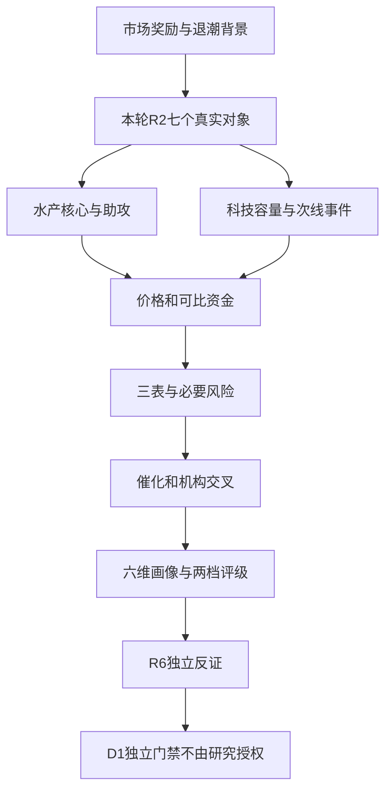

# 2026年11月13日 · 个股画像

> 数据源新鲜度：partial；情绪=震荡/主跌；炸板率48.61%；研究不是买权。

## 🧭 一句话结论

水产辨识度与承接背离，科技容量与现金兑现分离；七票已评，监管缺口逐票保留。

主线=水产概念，持续性=1日，封板率=100%（3/(3+0)，11/12非ST曾触板池），明日预期=分歧；继承R2研究口径，不授权交易。

## 📌 覆盖与交付

本轮真实候选7只，已交付7只；未交付：无。已评对象辅助/必要缺口见下文；不把零预算旧市场意见无限继承。

|代码|名称|态度|进攻/风险档|板型|关键矛盾|
|---|---|---|---|---|---|
|002086.SZ|东方海洋|观察|B/C|反复回封首板（17天9次涨停背景），开板26次|观察：水产辨识度龙一，但20日涨幅近147%、26次开板与5日净流出抵消早封优势。|
|002696.SZ|百洋股份|观察|B+/C|首板回封|观察：水产龙二资金强于龙一，但高杠杆、存货与应收增长不支持把情绪回封当基本面反转。|
|688256.SH|寒武纪|观察|A-/B-|非涨停容量上涨，趋势完整性待R5|观察：国产算力容量核心，5日资金与盈利增长同向，但MA60仍在上方，连续两季现金消耗不可忽略。|
|002156.SZ|通富微电|观察|B+/B-|首板炸板未封|观察：封测容量对照但炸板，扣非与归母差额及有息负债需优先核验，不以低PE认便宜。|
|002593.SZ|日上集团|观察|B+/B-|二板换手回封|观察：福建二板高度核心、放量站上MA60，但小盘高换手与当日资金流出不支持机械追二板。|
|002172.SZ|澳洋健康|降级|B/C|反包首板（4天2板），开板4次|降级：澳洋孤军反包且四次开板，存贷双高、双季负现金流、高杠杆，不认证完整脑机龙头。|
|300058.SZ|蓝色光标|观察|B+/B-|非涨停容量上涨，趋势完整性待R5|观察：AI营销容量分离、放量站上MA60，但应收增速远快于收入，未形成全板块扩散。|

## 🔎 详细分析

图表为证据流程，不表达自动买入规则；SVG实际渲染状态：passed_real_browser_SVG_Mermaid_11.4.0; nodes=10。

### 东方海洋 002086.SZ

观察：水产辨识度龙一，但20日涨幅近147%、26次开板与5日净流出抵消早封优势。

关键实算：Q2/Q3经营现金流分别+0.025亿元/+0.011亿元；对应单季归母利润-0.370亿元/-0.197亿元。应收同比-27.67%，收入同比+0.37%；F3沿用原比例阈值，收入收缩时不能把比例警报写成绝对应收暴增。

|维度|分数（研究参考）|事实与裁决|
|---|---:|---|
|催化|45|水产三票联动和名称辨识度推动，非新增利润拐点。；11/7原公告明确海洋/大健康两大板块均亏损、涨幅偏离基本面，不能以消费主线掩盖。|
|筹码|35|资金可能借最高辨识度完成日内换手而非锁仓，净流出不能称洗盘。|
|板块联动|70|水产三票中首封09:25、跨平台人气第一，仍是研究龙一；26次开板、15:00终封、当日净流出0.52637亿及5日-1.427847亿是真实承接反证。只保留观察，不因单项净流出改用资金第一百洋冒充龙一。首板只是当日连板数，9/17涨停记录不等低位新股。|
|财务估值|35|短线合力有事实，产业催化不足；连续两年亏损是研究红旗，不直接冒充ST。|
|技术|48|水产三票联动和名称辨识度推动，非新增利润拐点。；均线结构见数值；图像缺席无意见，不调整档位。|
|机构|20|近30自然日接口0个预测年度行，按日期/机构/标题/作者去重为0份报告；调研0条。空返回只表示本接口范围无记录，不宣称机构冷落。|

量价：68根日K，截止2026-11-12；MA5/20/60=4.562/3.087/2.425，20日涨幅146.89%，相对前5日均量0.80倍。按逐日复权因子计算，未用图像代替数值。

资金：分档自算近5日-1.243亿元，DC同窗口-1.428亿元；存在单日>5%差异=True，保留双方，不能择优解释。

估值：PE TTM=None，PB=8.2683，总/流通市值101.08/81.58亿元。实际红旗：S1。

|检查|结论|输入/公式与边界|
|---|---|---|
|F1|checked_negative|money_cap/total_assets>0.2 AND st_borr/total_assets>0.2；货币资金占比不达20%可否定AND；未把空短借置零|
|F2|checked_negative|goodwill/equity_parent>0.30；|
|F3|checked_negative|AR_yoy > revenue_yoy*1.5；沿用原阈值；收入收缩时比例警报不等于应收绝对暴增。|
|F4|checked_negative|inventory_yoy > revenue_yoy*1.5 AND turnover_now < turnover_prior；|
|F5|checked_negative|capitalized_flow=(total_RD_input-expensed_RD); capitalized_flow/total_RD_input>0.5；原半年报本期研发投入/费用化流量相等，差额为0；非把开发支出余额当流量。结论仅H1，未外推9M资本化流量。|
|F6|not_applicable|(net_profit_parent-profit_dedt)/net_profit_parent >0.30; positive denominator；负利润分母原收益占比不适用；保留实际差额|
|F7|unknown|actual_related_transaction / same_period_revenue >0.2；实际购销等组成已量化；原20%判据需完整同口径关联交易范围，未量化类别不默认0，所以总项unknown而非未查财务。|
|F8|checked_negative|Q2_CFO=H1-Q1; Q3_CFO=9M-H1; both CFO<0 and both NP>0；|
|F9|checked_negative|accounts_receiv / YTD revenue >0.4；累计9个月收入分母，未伪装全年/TTM。|
|F10|checked_negative|fina_indicator.interestdebt / equity_parent >0.8；|
|F11|not_applicable|controlling-holder pledge ratio requires an existing controlling holder；法定披露明确无控股股东；不是未查，不将历史前控股股东质押率套用于现状。|
|F12|checked_negative|nonstandard opinion: qualified/disclaimer/emphasis; distinguish KAM from emphasis；已核审计正文意见及章节，非标阈值未触发；关键审计事项不等强调事项。|
|S1|flagged|two annual net losses OR equity<0 OR annual revenue<1e8；原R6财务轴研究警报，不等于现行交易所ST认定。|
|S2|unknown|S2: investigation/material violation/fraud; S3: disclosed *ST alert/nonstandard audit；历史虚假陈述赔偿及2022年董高处罚仍在年报披露，原处罚决定、现行有效窗口未核；保留已知反证而不永久沿用旧hard_reject，不能据报告期无处罚抹除。|
|S3|checked_negative|within declared source/window: current ST-list hit OR disclosed imminent *ST OR nonstandard audit；仅声明已披露法定警示与11/12当前ST列表、最新年度审计的有限范围阴性；截至本轮实际获取，未认证未来预警或独立监管记录，监管缺口另在S2，不因正利润认安全。|

- **大资金意图**: 资金可能借最高辨识度完成日内换手而非锁仓，净流出不能称洗盘。

- **为什么走强**: 水产三票联动和名称辨识度推动，非新增利润拐点。

- **逻辑够不够硬**: 短线合力有事实，产业催化不足；连续两年亏损是研究红旗，不直接冒充ST。

**买入理由**：仅为研究假设：水产三票联动和名称辨识度推动，非新增利润拐点。；水产三票中首封09:25、跨平台人气第一，仍是研究龙一；26次开板、15:00终封、当日净流出0.52637亿及5日-1.427847亿是真实承接反证。只保留观察，不因单项净流出改用资金第一百洋冒充龙一。首板只是当日连板数，9/17涨停记录不等低位新股。

**风险点**：短线合力有事实，产业催化不足；连续两年亏损是研究红旗，不直接冒充ST。；市场炸板48.61%，本日竞价未知。

**止损条件**：研究证伪条件而非退出指令：失去R2核心地位且同题材无助攻、或新增原公告证实主营叙事不成立；价格由D1独立制定。

**可验证假设**：未来1—3个交易日，比较同口径主力净额是否续正、核心是否保持相对强势及同板块封板数是否扩散；未观测不判兑现。

龙头认定：继承provisional_research_leader，纪律已核3条；分歧弱。RR未知，禁止清单仅继承已核风险，不声称完整通过。

事件时间线（公告索引不等全文或精确首次公开）：

- 20261110：关于召开2026年第二次临时股东会的通知（原文未核）

- 20261110：关于选举产生第九届董事会职工董事的公告（原文未核）

- 20261107：股票交易异常波动暨风险提示公告（原文已核）

- 20261107：第八届董事会第三十二次会议决议公告（原文未核）

- 20261107：上市公司独立董事候选人声明与承诺-文钊（原文未核）

- 20261107：上市公司独立董事提名人声明与承诺-文钊（原文未核）

- 20261107：上市公司独立董事提名人声明与承诺-何华梁（原文未核）

- 20261107：上市公司独立董事候选人声明与承诺-何华梁（原文未核）

图像：本阶段绑定快照与本票无交集，缺图记unknown。无本票PNG；未把后来刷新版本当本轮证据，缺图不调整档位或买权。

### 百洋股份 002696.SZ

观察：水产龙二资金强于龙一，但高杠杆、存货与应收增长不支持把情绪回封当基本面反转。

关键实算：Q2/Q3经营现金流分别-1.960亿元/-2.498亿元；对应单季归母利润-0.633亿元/-0.480亿元。应收同比+20.54%，收入同比+11.01%；F3沿用原比例阈值，收入收缩时不能把比例警报写成绝对应收暴增。

|维度|分数（研究参考）|事实与裁决|
|---|---:|---|
|催化|48|水产资金回流与首板助攻，历史股性近期极佳仅为辅助。|
|筹码|65|净买与高换手同时发生，买方在博弈水产情绪续强，不等筹码已集中。|
|板块联动|65|水产同梯队09:30首封，5日5.427832亿为18成分第一，当日4.582947亿；原预制菜月度锚TOP3之一。人气和首封不及东方海洋，列龙二而非以净流入篡位；11次开板、14:30终封与36.51%换手必须核次日承接。20—50亿风险警示。|
|财务估值|30|题材联动成立但资金不等业绩，亏损及借款压力为核心反证。|
|技术|60|水产资金回流与首板助攻，历史股性近期极佳仅为辅助。；均线结构见数值；图像缺席无意见，不调整档位。|
|机构|20|近30自然日接口0个预测年度行，按日期/机构/标题/作者去重为0份报告；调研0条。空返回只表示本接口范围无记录，不宣称机构冷落。|

量价：68根日K，截止2026-11-12；MA5/20/60=11.266/10.884/8.226，20日涨幅8.85%，相对前5日均量1.32倍。按逐日复权因子计算，未用图像代替数值。

资金：分档自算近5日+5.474亿元，DC同窗口+5.428亿元；存在单日>5%差异=True，保留双方，不能择优解释。

估值：PE TTM=None，PB=3.238，总/流通市值40.38/39.04亿元。实际红旗：F3、F4、F10。

|检查|结论|输入/公式与边界|
|---|---|---|
|F1|checked_negative|money_cap/total_assets>0.2 AND st_borr/total_assets>0.2；货币资金占比不达20%可否定AND；未把空短借置零|
|F2|checked_negative|goodwill/equity_parent>0.30；|
|F3|flagged|AR_yoy > revenue_yoy*1.5；沿用原阈值；收入收缩时比例警报不等于应收绝对暴增。|
|F4|flagged|inventory_yoy > revenue_yoy*1.5 AND turnover_now < turnover_prior；|
|F5|checked_negative|capitalized_flow=(total_RD_input-expensed_RD); capitalized_flow/total_RD_input>0.5；原半年报本期研发投入/费用化流量相等，差额为0；非把开发支出余额当流量。结论仅H1，未外推9M资本化流量。|
|F6|not_applicable|(net_profit_parent-profit_dedt)/net_profit_parent >0.30; positive denominator；负利润分母原收益占比不适用；保留实际差额|
|F7|unknown|actual_related_transaction / same_period_revenue >0.2；实际购销等组成已量化；原20%判据需完整同口径关联交易范围，未量化类别不默认0，所以总项unknown而非未查财务。|
|F8|checked_negative|Q2_CFO=H1-Q1; Q3_CFO=9M-H1; both CFO<0 and both NP>0；|
|F9|checked_negative|accounts_receiv / YTD revenue >0.4；累计9个月收入分母，未伪装全年/TTM。|
|F10|flagged|fina_indicator.interestdebt / equity_parent >0.8；|
|F11|checked_negative|current_controlling_holder_pledged_shares / same_holder_total_shares >0.7；先以年报识别本期控股股东再用Q3表核同主体质押；零为原文表值。仅截至9/30事实，不用旧控股人/全公司质押率替代。|
|F12|checked_negative|nonstandard opinion: qualified/disclaimer/emphasis; distinguish KAM from emphasis；已核审计报告正文意见与章节结构，无保留/无法表示/强调事项；百洋、寒武纪独立审计PDF无文字层，实际读年报内同一审计报告，不称识读扫描PDF。|
|S1|checked_negative|two annual net losses OR equity<0 OR annual revenue<1e8；原R6财务轴研究警报，不等于现行交易所ST认定。|
|S2|unknown|S2: investigation/material violation/fraud; S3: disclosed *ST alert/nonstandard audit；实际已读年度/半年报告期无处罚披露及本次公告索引；未独立检索证监会/属地局和交易所监管记录，不能认证跨来源合规阴性。相关民事诉讼不当证监会立案。|
|S3|checked_negative|within declared source/window: current ST-list hit OR disclosed imminent *ST OR nonstandard audit；仅声明已披露法定警示与11/12当前ST列表、最新年度审计的有限范围阴性；截至本轮实际获取，未认证未来预警或独立监管记录，监管缺口另在S2，不因正利润认安全。|

- **大资金意图**: 净买与高换手同时发生，买方在博弈水产情绪续强，不等筹码已集中。

- **为什么走强**: 水产资金回流与首板助攻，历史股性近期极佳仅为辅助。

- **逻辑够不够硬**: 题材联动成立但资金不等业绩，亏损及借款压力为核心反证。

**买入理由**：仅为研究假设：水产资金回流与首板助攻，历史股性近期极佳仅为辅助。；水产同梯队09:30首封，5日5.427832亿为18成分第一，当日4.582947亿；原预制菜月度锚TOP3之一。人气和首封不及东方海洋，列龙二而非以净流入篡位；11次开板、14:30终封与36.51%换手必须核次日承接。20—50亿风险警示。

**风险点**：题材联动成立但资金不等业绩，亏损及借款压力为核心反证。；市场炸板48.61%，本日竞价未知。

**止损条件**：研究证伪条件而非退出指令：失去R2核心地位且同题材无助攻、或新增原公告证实主营叙事不成立；价格由D1独立制定。

**可验证假设**：未来1—3个交易日，比较同口径主力净额是否续正、核心是否保持相对强势及同板块封板数是否扩散；未观测不判兑现。

龙头认定：继承provisional_research_leader，纪律已核3条；分歧弱。RR未知，禁止清单仅继承已核风险，不声称完整通过。

事件时间线（公告索引不等全文或精确首次公开）：

- 20261107：关于董事、高级管理人员职务调整的公告（原文未核）

- 20261029：关于2026年第三季度计提资产减值准备的公告（原文未核）

- 20261029：关于为优质客户银行融资用于购买公司产品提供缓释金担保的公告（原文未核）

- 20261029：关于召开2026年第四次临时股东会的通知（原文未核）

- 20261029：第七届董事会第三次会议决议公告（原文未核）

- 20261029：2026年三季度报告（原文已核）

- 20261022：股票交易异常波动暨风险提示公告（原文已核）

- 20261015：股票交易异常波动暨风险提示公告（原文未核）

图像：本阶段绑定快照与本票无交集，缺图记unknown。无本票PNG；未把后来刷新版本当本轮证据，缺图不调整档位或买权。

### 寒武纪 688256.SH

观察：国产算力容量核心，5日资金与盈利增长同向，但MA60仍在上方，连续两季现金消耗不可忽略。

关键实算：Q2/Q3经营现金流分别-5.227亿元/-0.837亿元；对应单季归母利润+12.977亿元/+14.036亿元。应收同比+65.44%，收入同比+106.76%；F3沿用原比例阈值，收入收缩时不能把比例警报写成绝对应收暴增。

|维度|分数（研究参考）|事实与裁决|
|---|---:|---|
|催化|70|盈利高增长与单票容量分离共振，昨日量能放大并收复MA20。|
|筹码|78|大资金集中国产算力核心而非宽芯片普涨，正现金利润不等订单现金回收。|
|板块联动|65|国产算力容量辨识度，11/12上涨8.11%、成交201.72亿；芯片THS现成分949只中5日净流入34.208563亿第一，窄AI芯片39成分也第一。不是连板妖股替代票，不因688前缀剔除；板块仍跌、资金口径冲突，暂列次线观察。|
|财务估值|40|产业与利润是真实支持，但存货膨胀及Q2/Q3负现金流削弱兑现质量；不能认证完整主升。|
|技术|60|盈利高增长与单票容量分离共振，昨日量能放大并收复MA20。；均线结构见数值；图像缺席无意见，不调整档位。|
|机构|78|近30自然日接口18个预测年度行，按日期/机构/标题/作者去重为6份报告；调研0条。空返回只表示本接口范围无记录，不宣称机构冷落。|

量价：68根日K，截止2026-11-12；MA5/20/60=873.022/890.788/1000.507，20日涨幅8.45%，相对前5日均量1.81倍。按逐日复权因子计算，未用图像代替数值。

资金：分档自算近5日+33.536亿元，DC同窗口+34.209亿元；存在单日>5%差异=False，保留双方，不能择优解释。

估值：PE TTM=146.7641，PB=40.4581，总/流通市值6118.75/6118.75亿元。实际红旗：F4、F8、V4。

|检查|结论|输入/公式与边界|
|---|---|---|
|F1|checked_negative|money_cap/total_assets>0.2 AND st_borr/total_assets>0.2；货币资金占比不达20%可否定AND；未把空短借置零|
|F2|unknown|goodwill/equity_parent>0.30；|
|F3|checked_negative|AR_yoy > revenue_yoy*1.5；沿用原阈值；收入收缩时比例警报不等于应收绝对暴增。|
|F4|flagged|inventory_yoy > revenue_yoy*1.5 AND turnover_now < turnover_prior；|
|F5|checked_negative|capitalized_flow=(total_RD_input-expensed_RD); capitalized_flow/total_RD_input>0.5；原半年报本期研发投入/费用化流量相等，差额为0；非把开发支出余额当流量。结论仅H1，未外推9M资本化流量。|
|F6|checked_negative|(net_profit_parent-profit_dedt)/net_profit_parent >0.30; positive denominator；|
|F7|unknown|actual_related_transaction / same_period_revenue >0.2；实际购销等组成已量化；原20%判据需完整同口径关联交易范围，未量化类别不默认0，所以总项unknown而非未查财务。|
|F8|flagged|Q2_CFO=H1-Q1; Q3_CFO=9M-H1; both CFO<0 and both NP>0；|
|F9|checked_negative|accounts_receiv / YTD revenue >0.4；累计9个月收入分母，未伪装全年/TTM。|
|F10|checked_negative|fina_indicator.interestdebt / equity_parent >0.8；|
|F11|checked_negative|current_controlling_holder_pledged_shares / same_holder_total_shares >0.7；先以年报识别本期控股股东再用Q3表核同主体质押；零为原文表值。仅截至9/30事实，不用旧控股人/全公司质押率替代。|
|F12|checked_negative|nonstandard opinion: qualified/disclaimer/emphasis; distinguish KAM from emphasis；已核审计报告正文意见与章节结构，无保留/无法表示/强调事项；百洋、寒武纪独立审计PDF无文字层，实际读年报内同一审计报告，不称识读扫描PDF。|
|S1|checked_negative|two annual net losses OR equity<0 OR annual revenue<1e8；原R6财务轴研究警报，不等于现行交易所ST认定。|
|S2|unknown|S2: investigation/material violation/fraud; S3: disclosed *ST alert/nonstandard audit；实际已读年度/半年报告期无处罚披露及本次公告索引；未独立检索证监会/属地局和交易所监管记录，不能认证跨来源合规阴性。相关民事诉讼不当证监会立案。|
|S3|checked_negative|within declared source/window: current ST-list hit OR disclosed imminent *ST OR nonstandard audit；仅声明已披露法定警示与11/12当前ST列表、最新年度审计的有限范围阴性；截至本轮实际获取，未认证未来预警或独立监管记录，监管缺口另在S2，不因正利润认安全。|

- **大资金意图**: 大资金集中国产算力核心而非宽芯片普涨，正现金利润不等订单现金回收。

- **为什么走强**: 盈利高增长与单票容量分离共振，昨日量能放大并收复MA20。

- **逻辑够不够硬**: 产业与利润是真实支持，但存货膨胀及Q2/Q3负现金流削弱兑现质量；不能认证完整主升。

**买入理由**：仅为研究假设：盈利高增长与单票容量分离共振，昨日量能放大并收复MA20。；国产算力容量辨识度，11/12上涨8.11%、成交201.72亿；芯片THS现成分949只中5日净流入34.208563亿第一，窄AI芯片39成分也第一。不是连板妖股替代票，不因688前缀剔除；板块仍跌、资金口径冲突，暂列次线观察。

**风险点**：产业与利润是真实支持，但存货膨胀及Q2/Q3负现金流削弱兑现质量；不能认证完整主升。；市场炸板48.61%，本日竞价未知。

**止损条件**：研究证伪条件而非退出指令：失去R2核心地位且同题材无助攻、或新增原公告证实主营叙事不成立；价格由D1独立制定。

**可验证假设**：未来1—3个交易日，比较同口径主力净额是否续正、核心是否保持相对强势及同板块封板数是否扩散；未观测不判兑现。

龙头认定：继承provisional_research_leader，纪律已核3条；容量核心观察。RR未知，禁止清单仅继承已核风险，不声称完整通过。

事件时间线（公告索引不等全文或精确首次公开）：

- 20261024：2026年第三季度报告（原文已核）

- 20261024：关于使用部分闲置募集资金临时补充流动资金的公告（原文未核）

- 20261024：中信证券股份有限公司关于中科寒武纪科技股份有限公司使用部分暂时闲置募集资金进行现金管理的核查意见（原文未核）

- 20261024：关于归还临时补充流动资金的闲置募集资金的公告（原文未核）

- 20261024：中信证券股份有限公司关于中科寒武纪科技股份有限公司使用部分闲置募集资金临时补充流动资金的核查意见（原文未核）

- 20261024：关于2026年前三季度计提资产减值准备的公告（原文未核）

- 20261024：关于使用部分暂时闲置募集资金进行现金管理的公告（原文未核）

- 20261024：关于公司近期生产经营情况的公告（原文已核）

图像：本阶段绑定快照与本票无交集，缺图记unknown。无本票PNG；未把后来刷新版本当本轮证据，缺图不调整档位或买权。

### 通富微电 002156.SZ

观察：封测容量对照但炸板，扣非与归母差额及有息负债需优先核验，不以低PE认便宜。

关键实算：Q2/Q3经营现金流分别+19.912亿元/+26.139亿元；对应单季归母利润+13.884亿元/+13.431亿元。应收同比+13.75%，收入同比+23.71%；F3沿用原比例阈值，收入收缩时不能把比例警报写成绝对应收暴增。

|维度|分数（研究参考）|事实与裁决|
|---|---:|---|
|催化|66|当日资金流入与封测叙事支持上涨，但收盘涨幅仅5.36%不是成功封板。|
|筹码|66|资金在封测核心下注而非全面风险偏好恢复，炸板显示上方筹码仍兑现。|
|板块联动|61|封测方向的人气与资金核心对照，当日5.36%、净流入8.622919亿；曾触涨停但收盘炸板，不能写成功首板。与寒武纪作国产芯片容量/封测双核心研究排序第二，不把宽概念4家封板当它自身连板；并不满足全芯片资金前二。|
|财务估值|40|收入增长有基础，归母利润受非经常差额影响明显；仍在MA60下方，不视作强势低吸。；F6非经常差额占归母54.98%，F10有息负债/净资产100.35%。|
|技术|48|当日资金流入与封测叙事支持上涨，但收盘涨幅仅5.36%不是成功封板。；均线结构见数值；图像缺席无意见，不调整档位。|
|机构|65|近30自然日接口6个预测年度行，按日期/机构/标题/作者去重为2份报告；调研0条。空返回只表示本接口范围无记录，不宣称机构冷落。|

量价：68根日K，截止2026-11-12；MA5/20/60=45.184/44.843/54.922，20日涨幅-2.79%，相对前5日均量2.12倍。按逐日复权因子计算，未用图像代替数值。

资金：分档自算近5日+8.761亿元，DC同窗口+8.660亿元；存在单日>5%差异=False，保留双方，不能择优解释。

估值：PE TTM=22.5446，PB=3.4554，总/流通市值770.76/733.84亿元。实际红旗：F4、F6、F10。

|检查|结论|输入/公式与边界|
|---|---|---|
|F1|checked_negative|money_cap/total_assets>0.2 AND st_borr/total_assets>0.2；货币资金占比不达20%可否定AND；未把空短借置零|
|F2|checked_negative|goodwill/equity_parent>0.30；|
|F3|checked_negative|AR_yoy > revenue_yoy*1.5；沿用原阈值；收入收缩时比例警报不等于应收绝对暴增。|
|F4|flagged|inventory_yoy > revenue_yoy*1.5 AND turnover_now < turnover_prior；|
|F5|checked_negative|capitalized_flow=(total_RD_input-expensed_RD); capitalized_flow/total_RD_input>0.5；原半年报本期研发投入/费用化流量相等，差额为0；非把开发支出余额当流量。结论仅H1，未外推9M资本化流量。|
|F6|flagged|(net_profit_parent-profit_dedt)/net_profit_parent >0.30; positive denominator；|
|F7|unknown|actual_related_transaction / same_period_revenue >0.2；实际购销等组成已量化；原20%判据需完整同口径关联交易范围，未量化类别不默认0，所以总项unknown而非未查财务。|
|F8|checked_negative|Q2_CFO=H1-Q1; Q3_CFO=9M-H1; both CFO<0 and both NP>0；|
|F9|checked_negative|accounts_receiv / YTD revenue >0.4；累计9个月收入分母，未伪装全年/TTM。|
|F10|flagged|fina_indicator.interestdebt / equity_parent >0.8；|
|F11|checked_negative|current_controlling_holder_pledged_shares / same_holder_total_shares >0.7；先以年报识别本期控股股东再用Q3表核同主体质押；零为原文表值。仅截至9/30事实，不用旧控股人/全公司质押率替代。|
|F12|checked_negative|nonstandard opinion: qualified/disclaimer/emphasis; distinguish KAM from emphasis；已核审计正文意见及章节，非标阈值未触发；关键审计事项不等强调事项。|
|S1|checked_negative|two annual net losses OR equity<0 OR annual revenue<1e8；原R6财务轴研究警报，不等于现行交易所ST认定。|
|S2|unknown|S2: investigation/material violation/fraud; S3: disclosed *ST alert/nonstandard audit；实际已读年度/半年报告期无处罚披露及本次公告索引；未独立检索证监会/属地局和交易所监管记录，不能认证跨来源合规阴性。相关民事诉讼不当证监会立案。|
|S3|checked_negative|within declared source/window: current ST-list hit OR disclosed imminent *ST OR nonstandard audit；仅声明已披露法定警示与11/12当前ST列表、最新年度审计的有限范围阴性；截至本轮实际获取，未认证未来预警或独立监管记录，监管缺口另在S2，不因正利润认安全。|

- **大资金意图**: 资金在封测核心下注而非全面风险偏好恢复，炸板显示上方筹码仍兑现。

- **为什么走强**: 当日资金流入与封测叙事支持上涨，但收盘涨幅仅5.36%不是成功封板。

- **逻辑够不够硬**: 收入增长有基础，归母利润受非经常差额影响明显；仍在MA60下方，不视作强势低吸。

**买入理由**：仅为研究假设：当日资金流入与封测叙事支持上涨，但收盘涨幅仅5.36%不是成功封板。；封测方向的人气与资金核心对照，当日5.36%、净流入8.622919亿；曾触涨停但收盘炸板，不能写成功首板。与寒武纪作国产芯片容量/封测双核心研究排序第二，不把宽概念4家封板当它自身连板；并不满足全芯片资金前二。

**风险点**：收入增长有基础，归母利润受非经常差额影响明显；仍在MA60下方，不视作强势低吸。；市场炸板48.61%，本日竞价未知。

**止损条件**：研究证伪条件而非退出指令：失去R2核心地位且同题材无助攻、或新增原公告证实主营叙事不成立；价格由D1独立制定。

**可验证假设**：未来1—3个交易日，比较同口径主力净额是否续正、核心是否保持相对强势及同板块封板数是否扩散；未观测不判兑现。

龙头认定：继承provisional_research_leader，纪律已核3条；容量核心观察。RR未知，禁止清单仅继承已核风险，不声称完整通过。

事件时间线（公告索引不等全文或精确首次公开）：

- 20261030：国泰海通证券股份有限公司关于通富微电子股份有限公司增加2026年度日常关联交易计划的核查意见（原文已核）

- 20261030：关于增加2026年度日常关联交易计划的公告（原文未核）

- 20261030：第八届董事会第二十三次会议决议公告（原文未核）

- 20261030：2026年三季度报告（原文已核）

图像：本阶段绑定快照与本票无交集，缺图记unknown。无本票PNG；未把后来刷新版本当本轮证据，缺图不调整档位或买权。

### 日上集团 002593.SZ

观察：福建二板高度核心、放量站上MA60，但小盘高换手与当日资金流出不支持机械追二板。

关键实算：Q2/Q3经营现金流分别+0.465亿元/+1.171亿元；对应单季归母利润+0.541亿元/+0.356亿元。应收同比-9.41%，收入同比+0.80%；F3沿用原比例阈值，收入收缩时不能把比例警报写成绝对应收暴增。

|维度|分数（研究参考）|事实与裁决|
|---|---:|---|
|催化|42|二板高度和同区域助攻是强点；AI政策至钢加工利润的传导未证。；11/13异动原公告明确主营未重大变化、短涨偏离基本面；本阶段实际取到，不反推06:30前已公开。|
|筹码|48|大换手争夺区域情绪高度，净流出提示先手兑现，不以高度抹掉资金反证。|
|板块联动|65|海峡两岸当日2板为已核成分高度第一，09:30首封早于福建水泥和九牧王；流通29.31亿，31.26%换手。净流出0.348989亿不能抹掉地位；5日+0.65983亿、历史近期股性差并列，区域政策传导未核，不称已确认产业受益。|
|财务估值|65|区域情绪逻辑可交易性待D1，本轮不把政策地域等同公司订单；财务现金流好于题材硬度。|
|技术|65|二板高度和同区域助攻是强点；AI政策至钢加工利润的传导未证。；均线结构见数值；图像缺席无意见，不调整档位。|
|机构|20|近30自然日接口0个预测年度行，按日期/机构/标题/作者去重为0份报告；调研0条。空返回只表示本接口范围无记录，不宣称机构冷落。|

量价：68根日K，截止2026-11-12；MA5/20/60=4.494/4.362/4.489，20日涨幅19.13%，相对前5日均量5.74倍。按逐日复权因子计算，未用图像代替数值。

资金：分档自算近5日+0.682亿元，DC同窗口+0.660亿元；存在单日>5%差异=True，保留双方，不能择优解释。

估值：PE TTM=27.3269，PB=1.6672，总/流通市值42.04/29.31亿元。实际红旗：当前已完成项未命中；不是全项排雷通过。

|检查|结论|输入/公式与边界|
|---|---|---|
|F1|checked_negative|money_cap/total_assets>0.2 AND st_borr/total_assets>0.2；货币资金占比不达20%可否定AND；未把空短借置零|
|F2|unknown|goodwill/equity_parent>0.30；|
|F3|checked_negative|AR_yoy > revenue_yoy*1.5；沿用原阈值；收入收缩时比例警报不等于应收绝对暴增。|
|F4|checked_negative|inventory_yoy > revenue_yoy*1.5 AND turnover_now < turnover_prior；|
|F5|checked_negative|capitalized_flow=(total_RD_input-expensed_RD); capitalized_flow/total_RD_input>0.5；原半年报本期研发投入/费用化流量相等，差额为0；非把开发支出余额当流量。结论仅H1，未外推9M资本化流量。|
|F6|checked_negative|(net_profit_parent-profit_dedt)/net_profit_parent >0.30; positive denominator；|
|F7|checked_negative|actual_related_transaction / same_period_revenue >0.2；已核H1适用范围实际未发生，0有明确原文依据；9M关联明细未披露不外推。|
|F8|checked_negative|Q2_CFO=H1-Q1; Q3_CFO=9M-H1; both CFO<0 and both NP>0；|
|F9|checked_negative|accounts_receiv / YTD revenue >0.4；累计9个月收入分母，未伪装全年/TTM。|
|F10|checked_negative|fina_indicator.interestdebt / equity_parent >0.8；|
|F11|checked_negative|current_controlling_holder_pledged_shares / same_holder_total_shares >0.7；先以年报识别本期控股股东再用Q3表核同主体质押；零为原文表值。仅截至9/30事实，不用旧控股人/全公司质押率替代。|
|F12|checked_negative|nonstandard opinion: qualified/disclaimer/emphasis; distinguish KAM from emphasis；已核审计正文意见及章节，非标阈值未触发；关键审计事项不等强调事项。|
|S1|checked_negative|two annual net losses OR equity<0 OR annual revenue<1e8；原R6财务轴研究警报，不等于现行交易所ST认定。|
|S2|unknown|S2: investigation/material violation/fraud; S3: disclosed *ST alert/nonstandard audit；实际已读年度/半年报告期无处罚披露及本次公告索引；未独立检索证监会/属地局和交易所监管记录，不能认证跨来源合规阴性。相关民事诉讼不当证监会立案。|
|S3|checked_negative|within declared source/window: current ST-list hit OR disclosed imminent *ST OR nonstandard audit；仅声明已披露法定警示与11/12当前ST列表、最新年度审计的有限范围阴性；截至本轮实际获取，未认证未来预警或独立监管记录，监管缺口另在S2，不因正利润认安全。|

- **大资金意图**: 大换手争夺区域情绪高度，净流出提示先手兑现，不以高度抹掉资金反证。

- **为什么走强**: 二板高度和同区域助攻是强点；AI政策至钢加工利润的传导未证。

- **逻辑够不够硬**: 区域情绪逻辑可交易性待D1，本轮不把政策地域等同公司订单；财务现金流好于题材硬度。

**买入理由**：仅为研究假设：二板高度和同区域助攻是强点；AI政策至钢加工利润的传导未证。；海峡两岸当日2板为已核成分高度第一，09:30首封早于福建水泥和九牧王；流通29.31亿，31.26%换手。净流出0.348989亿不能抹掉地位；5日+0.65983亿、历史近期股性差并列，区域政策传导未核，不称已确认产业受益。

**风险点**：区域情绪逻辑可交易性待D1，本轮不把政策地域等同公司订单；财务现金流好于题材硬度。；市场炸板48.61%，本日竞价未知。

**止损条件**：研究证伪条件而非退出指令：失去R2核心地位且同题材无助攻、或新增原公告证实主营叙事不成立；价格由D1独立制定。

**可验证假设**：未来1—3个交易日，比较同口径主力净额是否续正、核心是否保持相对强势及同板块封板数是否扩散；未观测不判兑现。

龙头认定：继承provisional_research_leader，纪律已核3条；龙头。RR未知，禁止清单仅继承已核风险，不声称完整通过。

事件时间线（公告索引不等全文或精确首次公开）：

- 20261113：股票交易异常波动的公告（原文已核）

- 20261027：2026年三季度报告（原文已核）

- 20261027：第六届董事会第十次会议决议公告（原文未核）

- 20261027：关于调整对外投资项目暨向相关子公司增资的公告（原文未核）

图像：本阶段绑定快照与本票无交集，缺图记unknown。无本票PNG；未把后来刷新版本当本轮证据，缺图不调整档位或买权。

### 澳洋健康 002172.SZ

降级：澳洋孤军反包且四次开板，存贷双高、双季负现金流、高杠杆，不认证完整脑机龙头。

关键实算：Q2/Q3经营现金流分别-0.816亿元/-0.320亿元；对应单季归母利润+0.189亿元/+0.133亿元。应收同比+4.94%，收入同比-8.22%；F3沿用原比例阈值，收入收缩时不能把比例警报写成绝对应收暴增。

|维度|分数（研究参考）|事实与裁决|
|---|---:|---|
|催化|50|近期股性与康复语义推动反包，标准立项不是公司获认证或订单。|
|筹码|65|单票资金集中但板块整体流出，可能是存量资金反包而非新主线建仓。|
|板块联动|38|脑机接口78只现成分5日净流入6.449818亿第一，11/12唯一封板、4天2板反包。R4标准立项事件与康复语义匹配仅为间接假设，非公司获认证或订单；概念整体净流出8.404亿，个股强与板块弱并存。|
|财务估值|25|仅两条龙头纪律成立，财务三项强警报压过单日封板；真实风险交R6独立审查。|
|技术|53|近期股性与康复语义推动反包，标准立项不是公司获认证或订单。；均线结构见数值；图像缺席无意见，不调整档位。|
|机构|20|近30自然日接口0个预测年度行，按日期/机构/标题/作者去重为0份报告；调研0条。空返回只表示本接口范围无记录，不宣称机构冷落。|

量价：68根日K，截止2026-11-12；MA5/20/60=6.168/5.613/5.165，20日涨幅15.03%，相对前5日均量1.08倍。按逐日复权因子计算，未用图像代替数值。

资金：分档自算近5日+6.478亿元，DC同窗口+6.450亿元；存在单日>5%差异=False，保留双方，不能择优解释。

估值：PE TTM=131.8965，PB=23.8957，总/流通市值51.00/50.96亿元。实际红旗：F1、F3、F8、F10。

|检查|结论|输入/公式与边界|
|---|---|---|
|F1|flagged|money_cap/total_assets>0.2 AND st_borr/total_assets>0.2；|
|F2|checked_negative|goodwill/equity_parent>0.30；|
|F3|flagged|AR_yoy > revenue_yoy*1.5；沿用原阈值；收入收缩时比例警报不等于应收绝对暴增。|
|F4|checked_negative|inventory_yoy > revenue_yoy*1.5 AND turnover_now < turnover_prior；|
|F5|not_applicable|RD capitalization / RD input; applicability reviewed；原年度报告明确研发投入不适用，当前三表研发费用空值未补0；不宣称当前新业务未来永不研发。|
|F6|checked_negative|(net_profit_parent-profit_dedt)/net_profit_parent >0.30; positive denominator；|
|F7|unknown|actual_related_transaction / same_period_revenue >0.2；实际购销等组成已量化；原20%判据需完整同口径关联交易范围，未量化类别不默认0，所以总项unknown而非未查财务。|
|F8|flagged|Q2_CFO=H1-Q1; Q3_CFO=9M-H1; both CFO<0 and both NP>0；|
|F9|checked_negative|accounts_receiv / YTD revenue >0.4；累计9个月收入分母，未伪装全年/TTM。|
|F10|flagged|fina_indicator.interestdebt / equity_parent >0.8；|
|F11|checked_negative|current_controlling_holder_pledged_shares / same_holder_total_shares >0.7；先以年报识别本期控股股东再用Q3表核同主体质押；零为原文表值。仅截至9/30事实，不用旧控股人/全公司质押率替代。|
|F12|checked_negative|nonstandard opinion: qualified/disclaimer/emphasis; distinguish KAM from emphasis；已核标准意见与章节结构；澳洋持续经营疑虑为关键审计事项且审计结论无重大不确定性，不冒充强调事项硬否决。|
|S1|checked_negative|two annual net losses OR equity<0 OR annual revenue<1e8；原R6财务轴研究警报，不等于现行交易所ST认定。|
|S2|unknown|S2: investigation/material violation/fraud; S3: disclosed *ST alert/nonstandard audit；实际已读年度/半年报告期无处罚披露及本次公告索引；未独立检索证监会/属地局和交易所监管记录，不能认证跨来源合规阴性。相关民事诉讼不当证监会立案。|
|S3|checked_negative|within declared source/window: current ST-list hit OR disclosed imminent *ST OR nonstandard audit；仅声明已披露法定警示与11/12当前ST列表、最新年度审计的有限范围阴性；截至本轮实际获取，未认证未来预警或独立监管记录，监管缺口另在S2，不因正利润认安全。|

- **大资金意图**: 单票资金集中但板块整体流出，可能是存量资金反包而非新主线建仓。

- **为什么走强**: 近期股性与康复语义推动反包，标准立项不是公司获认证或订单。

- **逻辑够不够硬**: 仅两条龙头纪律成立，财务三项强警报压过单日封板；真实风险交R6独立审查。

**买入理由**：仅为研究假设：近期股性与康复语义推动反包，标准立项不是公司获认证或订单。；脑机接口78只现成分5日净流入6.449818亿第一，11/12唯一封板、4天2板反包。R4标准立项事件与康复语义匹配仅为间接假设，非公司获认证或订单；概念整体净流出8.404亿，个股强与板块弱并存。

**风险点**：仅两条龙头纪律成立，财务三项强警报压过单日封板；真实风险交R6独立审查。；市场炸板48.61%，本日竞价未知。

**止损条件**：研究证伪条件而非退出指令：失去R2核心地位且同题材无助攻、或新增原公告证实主营叙事不成立；价格由D1独立制定。

**可验证假设**：未来1—3个交易日，比较同口径主力净额是否续正、核心是否保持相对强势及同板块封板数是否扩散；未观测不判兑现。

龙头认定：继承insufficient_full_dragon_confirmation，纪律已核2条；分歧弱。RR未知，禁止清单仅继承已核风险，不声称完整通过。

事件时间线（公告索引不等全文或精确首次公开）：

- 20261107：江苏澳洋健康产业股份有限公司股票交易异常波动暨风险提示公告（原文已核）

- 20261103：江苏澳洋健康产业股份有限公司股票交易异常波动公告（原文未核）

- 20261030：江苏澳洋健康产业股份有限公司股票交易异常波动公告（原文未核）

- 20261030：东吴证券股份有限公司关于江苏澳洋健康产业股份有限公司详式权益变动报告书之2026年第三季度持续督导意见（原文未核）

- 20261024：江苏澳洋健康产业股份有限公司股票交易异常波动公告（原文未核）

- 20261023：江苏澳洋健康产业股份有限公司关于使用自有资金购买理财产品的公告（原文未核）

- 20261023：2026年三季度报告（原文已核）

- 20261023：江苏澳洋健康产业股份有限公司第十届董事会第六次会议决议公告（原文未核）

图像：本阶段绑定快照与本票无交集，缺图记unknown。无本票PNG；未把后来刷新版本当本轮证据，缺图不调整档位或买权。

### 蓝色光标 300058.SZ

观察：AI营销容量分离、放量站上MA60，但应收增速远快于收入，未形成全板块扩散。

关键实算：Q2/Q3经营现金流分别+8.892亿元/-4.741亿元；对应单季归母利润+0.854亿元/+0.955亿元。应收同比+31.10%，收入同比+3.92%；F3沿用原比例阈值，收入收缩时不能把比例警报写成绝对应收暴增。

|维度|分数（研究参考）|事实与裁决|
|---|---:|---|
|催化|65|单日10.89%配合量能和资金，但不是20cm封板，也未证全应用普涨。|
|筹码|72|资金高度集中营销核心，对手盘是前期套牢和兑现筹码，净买不能等同长期机构配置。|
|板块联动|60|AI应用554只现成分中5日资金20.204491亿第一；当日净流入23.471405亿、涨10.89%但不是20cm封板。R7营销个股集中而非全应用回流，保留容量龙一观察；300前缀不构成剔除理由。|
|财务估值|45|收入与扣非均有增长，AR同比约31%而收入约4%是实质反证；CFO单季并非连续两季为负。；收入同比3.92%，应收同比31.1%；Q3扣非利润同比-49.82%为单季反证，不与9M+6.20%混淆。|
|技术|68|单日10.89%配合量能和资金，但不是20cm封板，也未证全应用普涨。；均线结构见数值；图像缺席无意见，不调整档位。|
|机构|45|近30自然日接口3个预测年度行，按日期/机构/标题/作者去重为1份报告；调研0条。空返回只表示本接口范围无记录，不宣称机构冷落。|

量价：68根日K，截止2026-11-12；MA5/20/60=13.498/12.546/13.143，20日涨幅19.51%，相对前5日均量2.53倍。按逐日复权因子计算，未用图像代替数值。

资金：分档自算近5日+20.343亿元，DC同窗口+20.204亿元；存在单日>5%差异=False，保留双方，不能择优解释。

估值：PE TTM=157.7499，PB=6.6098，总/流通市值529.92/513.34亿元。实际红旗：F3。

|检查|结论|输入/公式与边界|
|---|---|---|
|F1|checked_negative|money_cap/total_assets>0.2 AND st_borr/total_assets>0.2；货币资金占比不达20%可否定AND；未把空短借置零|
|F2|checked_negative|goodwill/equity_parent>0.30；|
|F3|flagged|AR_yoy > revenue_yoy*1.5；沿用原阈值；收入收缩时比例警报不等于应收绝对暴增。|
|F4|checked_negative|inventory_yoy > revenue_yoy*1.5 AND turnover_now < turnover_prior；|
|F5|checked_negative|capitalized_flow=(total_RD_input-expensed_RD); capitalized_flow/total_RD_input>0.5；原半年报本期研发投入/费用化流量相等，差额为0；非把开发支出余额当流量。结论仅H1，未外推9M资本化流量。|
|F6|checked_negative|(net_profit_parent-profit_dedt)/net_profit_parent >0.30; positive denominator；|
|F7|unknown|actual_related_transaction / same_period_revenue >0.2；实际购销等组成已量化；原20%判据需完整同口径关联交易范围，未量化类别不默认0，所以总项unknown而非未查财务。|
|F8|checked_negative|Q2_CFO=H1-Q1; Q3_CFO=9M-H1; both CFO<0 and both NP>0；|
|F9|checked_negative|accounts_receiv / YTD revenue >0.4；累计9个月收入分母，未伪装全年/TTM。|
|F10|checked_negative|fina_indicator.interestdebt / equity_parent >0.8；|
|F11|not_applicable|controlling-holder pledge ratio requires an existing controlling holder；法定披露明确无控股股东；不是未查，不将历史前控股股东质押率套用于现状。|
|F12|checked_negative|nonstandard opinion: qualified/disclaimer/emphasis; distinguish KAM from emphasis；已核审计正文意见及章节，非标阈值未触发；关键审计事项不等强调事项。|
|S1|checked_negative|two annual net losses OR equity<0 OR annual revenue<1e8；原R6财务轴研究警报，不等于现行交易所ST认定。|
|S2|unknown|S2: investigation/material violation/fraud; S3: disclosed *ST alert/nonstandard audit；实际已读年度/半年报告期无处罚披露及本次公告索引；未独立检索证监会/属地局和交易所监管记录，不能认证跨来源合规阴性。相关民事诉讼不当证监会立案。|
|S3|checked_negative|within declared source/window: current ST-list hit OR disclosed imminent *ST OR nonstandard audit；仅声明已披露法定警示与11/12当前ST列表、最新年度审计的有限范围阴性；截至本轮实际获取，未认证未来预警或独立监管记录，监管缺口另在S2，不因正利润认安全。|

- **大资金意图**: 资金高度集中营销核心，对手盘是前期套牢和兑现筹码，净买不能等同长期机构配置。

- **为什么走强**: 单日10.89%配合量能和资金，但不是20cm封板，也未证全应用普涨。

- **逻辑够不够硬**: 收入与扣非均有增长，AR同比约31%而收入约4%是实质反证；CFO单季并非连续两季为负。

**买入理由**：仅为研究假设：单日10.89%配合量能和资金，但不是20cm封板，也未证全应用普涨。；AI应用554只现成分中5日资金20.204491亿第一；当日净流入23.471405亿、涨10.89%但不是20cm封板。R7营销个股集中而非全应用回流，保留容量龙一观察；300前缀不构成剔除理由。

**风险点**：收入与扣非均有增长，AR同比约31%而收入约4%是实质反证；CFO单季并非连续两季为负。；市场炸板48.61%，本日竞价未知。

**止损条件**：研究证伪条件而非退出指令：失去R2核心地位且同题材无助攻、或新增原公告证实主营叙事不成立；价格由D1独立制定。

**可验证假设**：未来1—3个交易日，比较同口径主力净额是否续正、核心是否保持相对强势及同板块封板数是否扩散；未观测不判兑现。

龙头认定：继承provisional_research_leader，纪律已核3条；容量核心观察。RR未知，禁止清单仅继承已核风险，不声称完整通过。

事件时间线（公告索引不等全文或精确首次公开）：

- 20261030：关于全资子公司与专业投资机构共同投资的公告（原文未核）

- 20261030：关于全资子公司对外担保的公告（原文未核）

- 20261027：2026年三季度报告（原文已核）

- 20261027：第七届董事会第五次会议决议公告（原文未核）

- 20261027：关于终止发行H股股票并于香港联合交易所有限公司上市的公告（原文未核）

- 20261013：对外担保的进展公告（原文未核）

图像：本阶段绑定快照与本票无交集，缺图记unknown。无本票PNG；未把后来刷新版本当本轮证据，缺图不调整档位或买权。

## 关键证据

- R2版本与用户运输身份完全匹配，主次线七个明确代码，未用mentioned_codes或旧名单扩池。

- 每票68根真实日K、逐日复权因子、同窗口五日分档资金和DC对照均保留于同版画像。

- F8先把累计CFO转单季，蓝色光标Q2转正，不能把两个累计负值判连续两季负现金。

## 数据源审计

|源|日期|状态|备注|
|---|---|:--:|---|
|Tushare Pro live SDK|2026-11-13|🟢|7票17接口；SDK/MCP同源不重复加权|
|R2 main/secondary leaders|2026-11-13|🟡|原status=degraded，真实候选保留|
|R4 news|2026-11-13|🟡|本轮七票无直接公司专属催化，不借他票事件|
|R7 capital flow dated artifact|2026-11-13|🟡|本轮可比资金由R5补齐，不把旧票池缺席当否决|
|chart_vision绑定副本|2026-11-13|🟡|23票与七候选交集0，未读到本票图像|
|年度与当前公告原文|2026-11-13|🟡|39份PDF已取；实际只读相关审计、研发、关联交易、股东及风险段，不称全文已读|
|监管有限范围|2026-11-13|🟡|来源回执与原文缺口逐票披露，不全局禁买|
|股性/成长/红利/增减持/一字预测|2026-11-13|🟡|仅运输截取；只有精确命中采用，逐源裁决留JSON|

## ⚖️ 财务核验范围与明确反证

原文核验后，F5为6只阴性、1只有据不适用；F11为5只阴性、2只无控股股东不适用；F12为7只最新年度审计阴性。S3只在已声明法定披露、审计及11月12日当前ST列表范围内阴性，不是全来源合规认证。独立监管记录S2仍未闭环，最终状态保留partial。

澳洋审计把持续经营疑虑列为关键审计事项，但审计结论未认定重大不确定性，不能错当非标硬否决。旧控股股东澳洋集团质押99.996%是真实股东风险，但现控股股东为悦升科技，不能套用F11。

寒武纪Q2/Q3现金流为负且利润为正，触发F8；蓝色光标Q2现金流转正，不触发F8。通富归母/扣非差额与负债压力另列原红旗；不由机构研报评级覆盖。

## 不确定性 / 反证

市场只证窄线与单票分离，没有本日竞价承接。必要风险未核不等无风险，但也不构造全市场监管阴性证明要求；unknown交R5/R4有权限生产者，不交禁MCP的R6补抓。研究档位不是执行资格，不产生预算。

## 与其他 R/D/E 的关系

- 依赖：本版R2/R4，R2内嵌R1/R3/R7事实；R5补本轮必要资金和三表。

- 被消费：R6只读本版JSON内嵌事实；D1独立成案并核真实账户限制、RR与门禁，不另读raw/latest。

## Sub-Agent 元数据

- skill: analyze_stock_profile_v1

- artifact: data/research/20261113/R5_stock_profiles.json

- model: gpt-6.1-sol

- status: partial

- 工具调用/生成时间保留JSON；正文日期不冒充首次可知时点。
