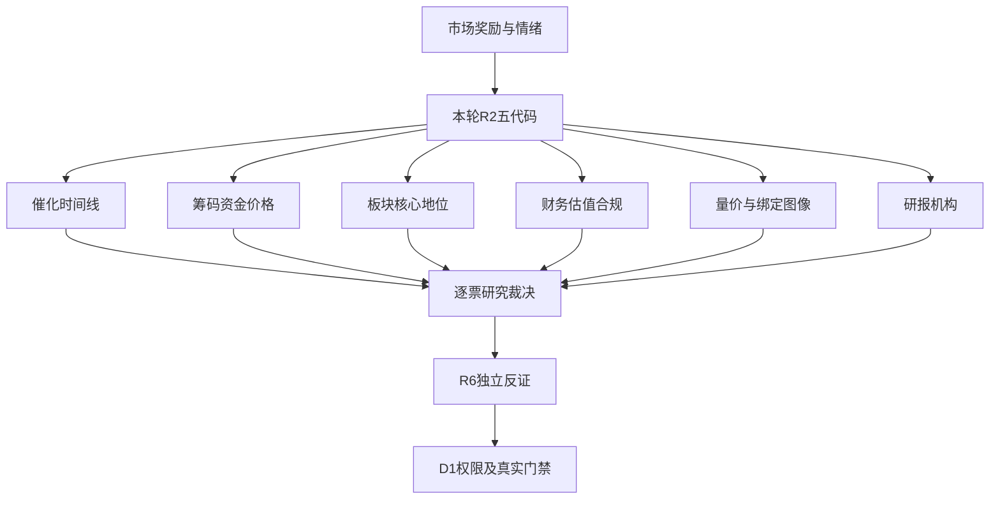

# 2026年11月16日 · 个股画像

## 🧭 一句话结论
**观察传媒核心，次线只作研究；必要风险逐票核，不把缺证扩成全池停买。**

情绪=震荡/主跌。继承R2：主线 = 影视传媒，持续性 = 1日（待验证假设），封板率 = 80%，明日预期 = 分歧。全市场炸板36.21%，R2已由10减为5；研究不授开仓权限。

## 📋 详细分析
本次已画像5/5只；未评对象：无。六维均单列已核与未知，不为达到通常6—15只而新增池外票。
市场当前奖励的是少数相对强势和局部影视扩散，而非全市场主升；同一传媒内短剧资金与院线资金也不能混为一谈。旧市场性no_trade仅在原窗口重评，账户硬限制和真实R6否决不变。
下表资金采用同一窗口分档明细自算，并同时保留DC来源；不把两种Tushare接口算成两家独立来源。财务先核实际三表，公告标题不代替合规原文。

| 对象 | R2角色 / 态度 | 进攻 / 风险档 | 5日分档主力(亿) | 主要反证 |
|---|---|---|---:|---|
| 文投控股 600715.SH | 龙一 / 观察 | A- / B- | 6.4427 | F3、F4、S1、fund_source_conflict |
| 凯撒文化 002425.SZ | 龙二 / 降级 | B+ / C | 1.4558 | F2、F3、F9、S1 |
| 中国电影 600977.SH | 候补 / 降级 | B / B- | 1.1009 | F3、F7、fund_source_conflict |
| 华胜天成 600410.SH | 龙一 / 观察 | B+ / B- | 9.5379 | fund_source_conflict |
| 通化金马 000766.SZ | 龙一 / 降级 | B / C | 2.6641 | F3、F4、F6、F9、F10、F11 |

图表验收：Mermaid 11.4.0 已在隔离浏览器完成解析及可见SVG渲染，源码随报告保留；回执见同版JSON。

## 🔎 文投控股 · 600715.SH · 观察
观察：传媒情绪龙一成立于局部合力，反包与加速并存；不能把热度当业绩兑现。

- **大资金意图**: 可能在全市场亏钱时争夺少数辨识度核心，次日由先手获利盘向周末新增接力者转移；这是资金动机假设，不是账户穿透事实。
- **为什么走强**: 反包首板早封且零开板，文化传媒8封2炸支持局部带动；但旧核心已加速，不是新题材低位首板。
- **逻辑够不够硬**: 价格和板块扩散硬于AI内容利润叙事；电视剧许可关联交易与主营风险公告须分别核经济利益，不把短剧出海榜单变成本公司订单。 保留局部传媒情绪核心的进攻性描述；风险由高位加速、实际业绩与业务占比反证支撑，不由图像available或质量分改变。

- **买入理由**: 仅列待D1裁决的研究假设，不是买权。影视/院线扩散中早封、累计辨识度在R2列龙一；反包形成相对全市场强势，研究等待强势延续，不是抄底
- **风险点**: 前三季收入下滑、归母亏损，AI漫剧占比小且未经审计。；年报涉及2024年既有监管处罚历史；本轮未取得原行政决定及其后续有效窗口，不能升级当前S2硬否决，也不得删除该历史反证。；短期价格加速远强于业绩，反包首板不是全新低位起点。
- **止损条件**: 核心开板后未恢复封板且传媒扩散继续收缩，或许可协议商业利益被实质证伪，原进攻假设失效；这是研究失效条件，不是委托价。
- **可验证假设**: 未来1—3交易日核龙一是否仍强于容量对照、传媒涨停扩散是否维持；若仅孤股锁板而板块退潮，不确认主线延续。

| 六维 | 实际证据与裁决 |
|---|---|
| 催化 | 11月12日风险提示原件确认：截至第三季度AI漫剧收入占营业收入约2.57%（未经审计），不能用AI故事外推全公司增长。11月7日许可协议为子公司向关联方支付单家卫视不超过2400万元授权费，非公司已收到2400万元订单；董事会已审、股东会批准为生效条件，年底前未落地排播有提前终止条款。 |
| 筹码 | 分档自算5日主力6.4427亿，DC同窗5.9024亿；两源偏差超过5%，保留冲突不择优。 |
| 联动 | 观察为唯一研究主线：影视院线4.37%、文化传媒8封2炸封板率80%，文投反包带院线扩散；周末凯撒/文投热榜前二。院线行业+13.87亿、影视概念+8.41亿仅支持局部；短剧概念-28.32亿、传媒行业-20.96亿，不将全部传媒/AI应用视为主升。 |
| 财务估值 | 按已披露三表逐项核验，红旗不被市场强势删除；辅助unknown不产生否决。 |
| 技术 | 均线多头但短期加速，反包尚未消化前日上影；缩量封板不证明今日承接。 |
| 机构 | 已查窗口研报原行0、按日期机构标题去重0；调研原行0。零返回不证明机构不持仓；tp非目标价。 |

量价窗口：20260803—20261113，69根K线；MA5/MA20/MA60 = 3.0140/2.2905/1.8775；本日量比5 = 0.578。
板型：反包首板；龙头认定：原R2通过3条，当前连续高度1，原轮次启动日未知；板块效应判词：研究核心待次日确认。
盈亏比：unknown；无当日成交条件与逻辑失效价，R5不造价格。禁止清单：上游已核命中为空但完整14项未审；不将空数组写成全项通过。
财务期间：20260930；已命中：F3、F4、S1。

| 财务项 | 状态 | 依据 / 限定 |
|---|---|---|
| F1 | unknown | 已知一个合取项不满足可判阴性；null短借不按0。 |
| F2 | checked_negative | 按同口径归母净资产；不以股价走强消除商誉风险。 |
| F3 | flagged | 沿原比较阈值；收入下降时也保留实际增速及反直觉阈值，不改规则。 |
| F4 | flagged | 周转率若指标缺失用累计营业成本/年初年末平均存货复算；合取第一项已阴性不需补0。 |
| F5 | checked_negative | 最新已披露完整年度研发投入资本化率已核且不超过50%；不冒充2026Q3资本化流量，当前期间附注缺口仍单列。 |
| F6 | unknown | 亏损分母时原正利润占比判据不可直接认证阴性；保留损益绝对值。 |
| F7 | checked_negative | 已读H1附注购销/劳务实际发生额；本项仅此营业交易口径，租赁/担保/股权转让不混计为营业额。 Q3未披露同细项不伪装已核；阴性只限H1实际购销范围。 |
| F8 | checked_negative | 累计现金流先转同口径独立单季，利润也同步单季化。 |
| F9 | checked_negative | 资产时点/累计收入比按原判据，保留所用财报期间。 |
| F10 | checked_negative | 实际取得同报告期有息负债合计，与已知债务分项下界核对；不是将null负债当0。 |
| F11 | checked_negative | 按年报控股身份与Q3股东质押表配对，非全公司质押率；这是最新已读披露快照，不承诺11月实时余额。 |
| F12 | checked_negative | 年报财务审计意见段与已取fina_audit同向，未见该段非标/强调事项；仅核FY2025意见，不推及全部合规。 |
| S2 | unknown | 只完成公告索引，尚未完成交易所/证监会有限来源回执与命中原文；未查不当安全，也不自动禁买。 年报披露2024年历史行政处罚原决定及后续尚未核，不能改当前硬否决。 |
| S3 | unknown | 只完成公告索引，尚未完成交易所/证监会有限来源回执与命中原文；未查不当安全，也不自动禁买。 年报披露2024年历史行政处罚原决定及后续尚未核，不能改当前硬否决。 |
| S1 | flagged | 原财务轴预警，不自动等于交易所ST判定。 |

事件时间线（公告索引与原件阅读严格区分）：
- 20261111：文投控股股份有限公司股票交易异常波动公告 · tushare.anns_d
- 20261111：涨停/板型记录 · tushare.limit_list_d
- 20261112：文投控股股份有限公司十一届董事会第二十一次会议决议公告 · tushare.anns_d
- 20261112：文投控股股份有限公司股票交易风险提示公告 · tushare.anns_d
- 20261112：文投控股股份有限公司关于召开2026年第二次临时股东会的通知 · tushare.anns_d
- 20261112：涨停/板型记录 · tushare.limit_list_d
- 20261113：涨停/板型记录 · tushare.limit_list_d
- 20261114：文投控股股份有限公司股票交易异常波动公告 · tushare.anns_d

绑定图像：available；原模型/record完整随JSON交D1，本R5未独立打开像素；日线因子单独核算，周线分钟复权不因fq=2自动通过。

## 🔎 凯撒文化 · 002425.SZ · 降级
降级：传媒龙二保留观察，商誉与控制权变更需和游戏情绪拆开；不能凭人气第一升级总龙。

- **大资金意图**: 周末人气第一可能吸引游戏情绪接力，但对手盘含前日冲板失败筹码；融资席位和真实持仓意图不可从热榜推断。
- **为什么走强**: 四天三板是反包、连续高度仅1；开盘早封与零开板构成相对强，但综合带动不超过文投。
- **逻辑够不够硬**: 游戏业务映射可研究，当前叙事未给利润兑现；商誉占净资产过高是真实独立反证，不能用近期股性好覆盖。 风险档降为C由商誉及年度亏损等实质财务风险形成，非缺图/图像标签或辅助缺数导致；不是R6硬否决或D1开仓门禁。

- **买入理由**: 仅列待D1裁决的研究假设，不是买权。文化传媒成员与游戏情绪映射，早封反包体现相对强度；作为龙二对照观察是否与龙一共振，不靠便宜股价选票
- **风险点**: Q3商誉/归母净资产超过50%，明确命中F2；近两年年度亏损命中原财务轴S1。；半年报有证券虚假陈述责任纠纷民事诉讼；不是证监会立案调查的同义词，案件原决定与后续未全核。；月度历史近期炸板率37.5%只作股性反证，不等于今天炸板概率。
- **止损条件**: 游戏情绪与龙一同步失败，或商誉减值/控制权相关公告实质削弱原假设则不再沿用热度理由。
- **可验证假设**: 未来1—3交易日比较反包是否站稳前日高点结构、文投与凯撒是否同时保有扩散；龙一弱而本票仅脉冲不称接棒。

| 六维 | 实际证据与裁决 |
|---|---|
| 催化 | 10月31日实控人变更公告实际是郑合明向配偶陈玉琴转让控股法人50%股权的家族内部调整，不涉及控股法人所持上市公司股份变动，不代表外部新资本入主或新增经营订单。游戏情绪反包保留研究，不能靠人气第一取代R2综合龙一。 |
| 筹码 | 分档自算5日主力1.4558亿，DC同窗1.4417亿；同窗未检出超过5%偏差，不把同源接口当两家独立采编。 |
| 联动 | 观察为唯一研究主线：影视院线4.37%、文化传媒8封2炸封板率80%，文投反包带院线扩散；周末凯撒/文投热榜前二。院线行业+13.87亿、影视概念+8.41亿仅支持局部；短剧概念-28.32亿、传媒行业-20.96亿，不将全部传媒/AI应用视为主升。 |
| 财务估值 | 按已披露三表逐项核验，红旗不被市场强势删除；辅助unknown不产生否决。 |
| 技术 | 日均线转多、反包收复前收但尚有前日上影套牢，不能写突破已确认。 |
| 机构 | 已查窗口研报原行0、按日期机构标题去重0；调研原行0。零返回不证明机构不持仓；tp非目标价。 |

量价窗口：20260803—20261113，69根K线；MA5/MA20/MA60 = 3.6060/3.3065/3.2417；本日量比5 = 1.013。
板型：反包首板；龙头认定：原R2通过3条，当前连续高度1，原轮次启动日未知；板块效应判词：研究核心待次日确认。
盈亏比：unknown；无当日成交条件与逻辑失效价，R5不造价格。禁止清单：上游已核命中为空但完整14项未审；不将空数组写成全项通过。
财务期间：20260930；已命中：F2、F3、F9、S1。

| 财务项 | 状态 | 依据 / 限定 |
|---|---|---|
| F1 | checked_negative | 已知一个合取项不满足可判阴性；null短借不按0。 |
| F2 | flagged | 按同口径归母净资产；不以股价走强消除商誉风险。 |
| F3 | flagged | 沿原比较阈值；收入下降时也保留实际增速及反直觉阈值，不改规则。 |
| F4 | unknown | 周转率若指标缺失用累计营业成本/年初年末平均存货复算；合取第一项已阴性不需补0。 |
| F5 | checked_negative | 最新已披露完整年度研发投入资本化率已核且不超过50%；不冒充2026Q3资本化流量，当前期间附注缺口仍单列。 |
| F6 | unknown | 亏损分母时原正利润占比判据不可直接认证阴性；保留损益绝对值。 |
| F7 | checked_negative | 已读H1购销/服务表；两项采购与两项销售逐行相加，预计上限5000万未充当实际发生。 Q3未披露同细项不伪装已核；阴性只限H1实际购销范围。 |
| F8 | checked_negative | 累计现金流先转同口径独立单季，利润也同步单季化。 |
| F9 | flagged | 资产时点/累计收入比按原判据，保留所用财报期间。 |
| F10 | checked_negative | 实际取得同报告期有息负债合计，与已知债务分项下界核对；不是将null负债当0。 |
| F11 | checked_negative | 按年报控股身份与Q3股东质押表配对，非全公司质押率；这是最新已读披露快照，不承诺11月实时余额。凯撒10月控制人家族调整不改变控股法人及持股数，公告已读。 |
| F12 | checked_negative | 年报财务审计意见段与已取fina_audit同向，未见该段非标/强调事项；仅核FY2025意见，不推及全部合规。 |
| S2 | unknown | 只完成公告索引，尚未完成交易所/证监会有限来源回执与命中原文；未查不当安全，也不自动禁买。 已见证券虚假陈述民事诉讼，不冒充监管立案，旧案决定尚待核。 |
| S3 | unknown | 只完成公告索引，尚未完成交易所/证监会有限来源回执与命中原文；未查不当安全，也不自动禁买。 已见证券虚假陈述民事诉讼，不冒充监管立案，旧案决定尚待核。 |
| S1 | flagged | 原财务轴预警，不自动等于交易所ST判定。 |

事件时间线（公告索引与原件阅读严格区分）：
- 20261031：浙商证券股份有限公司关于公司详式权益变动报告书之财务顾问核查意见 · tushare.anns_d
- 20261031：关于控股股东股权结构变更暨实际控制人变更的提示性公告 · tushare.anns_d
- 20261102：涨停/板型记录 · tushare.limit_list_d
- 20261103：涨停/板型记录 · tushare.limit_list_d
- 20261110：涨停/板型记录 · tushare.limit_list_d
- 20261111：涨停/板型记录 · tushare.limit_list_d
- 20261112：涨停/板型记录 · tushare.limit_list_d
- 20261113：涨停/板型记录 · tushare.limit_list_d

绑定图像：available；原模型/record完整随JSON交D1，本R5未独立打开像素；日线因子单独核算，周线分钟复权不因fq=2自动通过。

## 🔎 中国电影 · 600977.SH · 降级
降级：院线容量观察，不自动替补龙一；五次开板说明分歧，不能把净流入当机构配置确认。

- **大资金意图**: 可能是局部影视行情的容量承接与轮动，收盘大单净入支持当日买盘但并不证明持续机构配置。
- **为什么走强**: 院线子行业上涨与放量首板同向，但五次开板、首封晚，综合地位弱于情绪核心。
- **逻辑够不够硬**: 电影主营比AI叙事更直接，然而票房/档期的公司现金兑现仍未验证；亏损与现金流不能由单日涨停否定。 院线容量扩散研究价值成立，但地位和财务反证决定只列降级观察，不附交易价格。

- **买入理由**: 仅列待D1裁决的研究假设，不是买权。真实电影业务与院线资金局部净入相对应；容量对照可验证主线是否由情绪扩展到机构容量
- **风险点**: 五次开板与晚封说明分歧，容量票不自动替补龙一。；关联经营采购发生额较高，商业独立性和定价依赖须看原交易，不从国企身份推安全。；前三季累计亏损与正单季现金流同时保留，不将两者互相抵销。
- **止损条件**: 院线容量放量滞涨并与情绪核心背离，或新增现金流/业绩反证出现则容量扩散假设失效。
- **可验证假设**: 未来1—3交易日核容量票成交与传媒扩散是否同向，不能仅凭一次涨停直接认龙一替补。

| 六维 | 实际证据与裁决 |
|---|---|
| 催化 | 本轮仍是院线容量映射，非已核新增盈利催化。半年报关联采购/销售附注明确单位万元，采购单项相对同期间营收已超过20%，保留F7；第三季度独立单季现金流转正，不能把H1累计负值当连续两期现金恶化。 |
| 筹码 | 分档自算5日主力1.1009亿，DC同窗1.0965亿；两源偏差超过5%，保留冲突不择优。 |
| 联动 | 观察为唯一研究主线：影视院线4.37%、文化传媒8封2炸封板率80%，文投反包带院线扩散；周末凯撒/文投热榜前二。院线行业+13.87亿、影视概念+8.41亿仅支持局部；短剧概念-28.32亿、传媒行业-20.96亿，不将全部传媒/AI应用视为主升。 |
| 财务估值 | 按已披露三表逐项核验，红旗不被市场强势删除；辅助unknown不产生否决。 |
| 技术 | 日线放量新高型首板，强于此前震荡但回封反复；盘中分钟承接仅历史记录。 |
| 机构 | 已查窗口研报原行11、按日期机构标题去重4；调研原行0。零返回不证明机构不持仓；tp非目标价。 |

量价窗口：20260803—20261113，69根K线；MA5/MA20/MA60 = 16.0020/15.0990/13.6237；本日量比5 = 1.633。
板型：首板；龙头认定：原R2通过1条，当前连续高度1，原轮次启动日未知；板块效应判词：分歧弱。
盈亏比：unknown；无当日成交条件与逻辑失效价，R5不造价格。禁止清单：上游已核命中为空但完整14项未审；不将空数组写成全项通过。
财务期间：20260930；已命中：F3、F7。

| 财务项 | 状态 | 依据 / 限定 |
|---|---|---|
| F1 | checked_negative | 已知一个合取项不满足可判阴性；null短借不按0。 |
| F2 | checked_negative | 按同口径归母净资产；不以股价走强消除商誉风险。 |
| F3 | flagged | 沿原比较阈值；收入下降时也保留实际增速及反直觉阈值，不改规则。 |
| F4 | checked_negative | 周转率若指标缺失用累计营业成本/年初年末平均存货复算；合取第一项已阴性不需补0。 |
| F5 | checked_negative | 最新已披露完整年度研发投入资本化率已核且不超过50%；不冒充2026Q3资本化流量，当前期间附注缺口仍单列。 |
| F6 | unknown | 亏损分母时原正利润占比判据不可直接认证阴性；保留损益绝对值。 |
| F7 | flagged | H1原文单位万元，实际采购36587.14万元、销售2807.84万元；采购单项下界已超过同期间营收20%，不需假定其他关联交易为0。 Q3未披露同细项不伪装已核；阴性只限H1实际购销范围。 |
| F8 | checked_negative | 累计现金流先转同口径独立单季，利润也同步单季化。 |
| F9 | checked_negative | 资产时点/累计收入比按原判据，保留所用财报期间。 |
| F10 | checked_negative | 实际取得同报告期有息负债合计，与已知债务分项下界核对；不是将null负债当0。 |
| F11 | checked_negative | 按年报控股身份与Q3股东质押表配对，非全公司质押率；这是最新已读披露快照，不承诺11月实时余额。 |
| F12 | checked_negative | 年报财务审计意见段与已取fina_audit同向，未见该段非标/强调事项；仅核FY2025意见，不推及全部合规。 |
| S2 | unknown | 只完成公告索引，尚未完成交易所/证监会有限来源回执与命中原文；未查不当安全，也不自动禁买。 已读定期报告有限章节不见当期处罚表述，只能作范围内公司自报，不能替代未查询监管入口。 |
| S3 | unknown | 只完成公告索引，尚未完成交易所/证监会有限来源回执与命中原文；未查不当安全，也不自动禁买。 已读定期报告有限章节不见当期处罚表述，只能作范围内公司自报，不能替代未查询监管入口。 |
| S1 | checked_negative | 原财务轴预警，不自动等于交易所ST判定。 |

事件时间线（公告索引与原件阅读严格区分）：
- 20261029：中国电影2026年第三季度报告 · tushare.anns_d
- 20261029：中国电影关于召开2026年第二次临时股东会的通知 · tushare.anns_d
- 20261029：中国电影关于变更会计师事务所的公告 · tushare.anns_d
- 20261029：中国电影2026年第二次临时股东会会议材料 · tushare.anns_d
- 20261029：中国电影第四届董事会第十一次会议决议公告 · tushare.anns_d
- 20261113：涨停/板型记录 · tushare.limit_list_d
- 20261114：中国电影2026年第二次临时股东会法律意见书 · tushare.anns_d
- 20261114：中国电影2026年第二次临时股东会决议公告 · tushare.anns_d

绑定图像：available；原模型/record完整随JSON交D1，本R5未独立打开像素；日线因子单独核算，周线分钟复权不因fq=2自动通过。

## 🔎 华胜天成 · 600410.SH · 观察
观察：国产算力集中分离核心，不是全线主升；巨额当日流入与五日前流出并存。

- **大资金意图**: 可能争夺国产算力少数集中核心、从弱板块内向辨识度票收缩；也可能是短期脉冲，不能把大单流入等同长线建仓。
- **为什么走强**: 放量首板重回日线均线区域，五日净额主要由最后一日贡献；算力多数下跌及板块流出不支持广泛合力。
- **逻辑够不够硬**: IT业务映射不能替代CANN受益收入原件；海外治理传言不采为催化。财务亏损/减值另行核验。 观察次线集中分离，不宣称板块已经主升；真实业务、减值与股东风险不因首板删除。

- **买入理由**: 仅列待D1裁决的研究假设，不是买权。算力首板中兼具容量与人气，R2列次线龙一；强于板块的集中分离可研究，必须等待扩散而非抄弱板块
- **风险点**: 概念板块流出而个股集中净入，分离可能失败。；Q3存货同比翻倍；原简化期初期末平均存货公式与提供商指标的同比方向不同，必须同时保留方法差异，不能静默只选有利数值。；无控股股东不等于没有股东质押风险，第一大股东质押快照仍作为独立反证运输。
- **止损条件**: 集中核心相对强势消失且算力仍流出，或产业合作被原件证伪，分离假设失效。
- **可验证假设**: 未来1—3交易日核当日单点净入能否延续、算力封板家数能否扩散；仅本票冲高不算全线主升。

| 六维 | 实际证据与裁决 |
|---|---|
| 催化 | 10月30日减值原件为第三季度合计冲回1375.29万元，增加当季利润总额；不能因标题含计提就写新增同额减值。算力产业受益收入仍待证，海外治理传言不采为事实。年报明确无控股股东、无实控人，王维航大股东高质押不能错贴为控股股东F11。 |
| 筹码 | 分档自算5日主力9.5379亿，DC同窗10.0192亿；两源偏差超过5%，保留冲突不择优。 |
| 联动 | 观察竞争线：5封3炸、华胜集中，但只有74/422上涨、概念连续两日转出。CANN属产业假设，黄仁勋辞职不采为硬催化。 |
| 财务估值 | 按已披露三表逐项核验，红旗不被市场强势删除；辅助unknown不产生否决。 |
| 技术 | 日线修复站回MA60附近，但中期仍有套牢压力；不能将周线未核复权压力直接用作买卖价。 |
| 机构 | 已查窗口研报原行0、按日期机构标题去重0；调研原行0。零返回不证明机构不持仓；tp非目标价。 |

量价窗口：20260803—20261113，69根K线；MA5/MA20/MA60 = 12.9580/12.2265/13.7498；本日量比5 = 1.796。
板型：首板；龙头认定：原R2通过2条，当前连续高度1，原轮次启动日未知；板块效应判词：研究核心待次日确认。
盈亏比：unknown；无当日成交条件与逻辑失效价，R5不造价格。禁止清单：上游已核命中为空但完整14项未审；不将空数组写成全项通过。
财务期间：20260930；已命中：当前已核项无命中，不代表全部安全。

| 财务项 | 状态 | 依据 / 限定 |
|---|---|---|
| F1 | checked_negative | 已知一个合取项不满足可判阴性；null短借不按0。 |
| F2 | checked_negative | 按同口径归母净资产；不以股价走强消除商誉风险。 |
| F3 | checked_negative | 沿原比较阈值；收入下降时也保留实际增速及反直觉阈值，不改规则。 |
| F4 | unknown | 存货同比翻倍已核；提供商周转率2.5204>2.3659而简化期初期末均值复算同比下降，分母方法未核一致。保留两组数值与原F4预警，不择优静默删除，暂不确认全项阴性或命中。 |
| F5 | checked_negative | 最新已披露完整年度研发投入资本化率已核且不超过50%；不冒充2026Q3资本化流量，当前期间附注缺口仍单列。 |
| F6 | unknown | 亏损分母时原正利润占比判据不可直接认证阴性；保留损益绝对值。 |
| F7 | unknown | 已读关联交易附注，天津摩卡等实际值可核；其余空白/跨列未逐一归位，不以日常预计31.42万元冒充全部合并关联交易，因此全项仍unknown。 |
| F8 | checked_negative | 累计现金流先转同口径独立单季，利润也同步单季化。 |
| F9 | checked_negative | 资产时点/累计收入比按原判据，保留所用财报期间。 |
| F10 | checked_negative | 实际取得同报告期有息负债合计，与已知债务分项下界核对；不是将null负债当0。 |
| F11 | not_applicable | 年度原文明确无控股股东/实控人，不能把持股3.04%的王维航自动改成控股股东；其高质押作为独立股东风险保留，不消失。 |
| F12 | checked_negative | 年报财务审计意见段与已取fina_audit同向，未见该段非标/强调事项；仅核FY2025意见，不推及全部合规。 |
| S2 | unknown | 只完成公告索引，尚未完成交易所/证监会有限来源回执与命中原文；未查不当安全，也不自动禁买。 已读定期报告有限章节不见当期处罚表述，只能作范围内公司自报，不能替代未查询监管入口。 |
| S3 | unknown | 只完成公告索引，尚未完成交易所/证监会有限来源回执与命中原文；未查不当安全，也不自动禁买。 已读定期报告有限章节不见当期处罚表述，只能作范围内公司自报，不能替代未查询监管入口。 |
| S1 | checked_negative | 原财务轴预警，不自动等于交易所ST判定。 |

事件时间线（公告索引与原件阅读严格区分）：
- 20260827：关于2026年半年度计提减值准备及确认营业外收入的公告 · tushare.anns_d
- 20260904：董事会秘书辞职暨新聘董事会秘书的公告 · tushare.anns_d
- 20260929：公司关于为全资子公司提供担保的进展公告 · tushare.anns_d
- 20261030：关于召开2026年第三季度业绩说明会的公告 · tushare.anns_d
- 20261030：2026年第三季度报告 · tushare.anns_d
- 20261030：关于2026年第三季度计提及冲回资产减值准备的公告 · tushare.anns_d
- 20261106：涨停/板型记录 · tushare.limit_list_d
- 20261113：涨停/板型记录 · tushare.limit_list_d

绑定图像：available；原模型/record完整随JSON交D1，本R5未独立打开像素；日线因子单独核算，周线分钟复权不因fq=2自动通过。

## 🔎 通化金马 · 000766.SZ · 降级
降级：医保新事件保留研究，但孤军六开板；目录与未来销售、控股股东质押不能混为一谈。

- **大资金意图**: 可能博弈医保目录新增后的支付可及性预期，但周五唯一封板尚无同板块合力，买盘意图只能作为事件假设。
- **为什么走强**: 首板放量并站回日线均线，但六次开板且创新药仅一只封板；地位是低位前排对照，不是已成立总龙。
- **逻辑够不够硬**: 医保纳入原件比泛题材叙事硬，但实施在2027年，适应症、谈判价与准入放量不能越级为当期盈利。 风险档C来自实际财务和控股质押证据，不是R7旧池未覆盖或辅助数据缺口；事件研究保留，交易仍由D1真实权限与R6独立否决裁决。

- **买入理由**: 仅列待D1裁决的研究假设，不是买权。精确公司医保公告提供新事件时间锚；低位首板可用于验证资金是否转向医药，不因当前孤军停止研究
- **风险点**: Q3原件：控股股东于兰军持股1.9亿股、质押1.5亿股，比例超过70%，命中F11；不是将全公司质押率替代。；同期间有息负债/归母净资产超过80%且扣非亏损，医保新事件不能抹除F10/F6。；创新药成分仅一只封板、六次开板，按既有规则孤军/分歧弱，不因硬催化直接授龙头资格。
- **止损条件**: 药品纳入范围/实施被否定或事件后无新增同板块合力且本票相对强度消失，原事件试错假设失效。
- **可验证假设**: 未来1—3交易日核同板块是否从1只封板扩散至原龙头规则所需3只以上，且本票开板次数较6次改善；不是额外评分阈值。

| 六维 | 实际证据与裁决 |
|---|---|
| 催化 | 公司医保原件确认琥珀酸安维吖啶片用于轻、中度阿尔茨海默病症状治疗，协议有效期2027年1月1日至2028年12月31日；支付标准、挂网及医疗机构配备进度影响销售，不能升级为2026年收入兑现。 |
| 筹码 | 分档自算5日主力2.6641亿，DC同窗2.6601亿；同窗未检出超过5%偏差，不把同源接口当两家独立采编。 |
| 联动 | 观察新事件线：目录新增107种、2027年实施；周五23/283上涨、1只封板，无全线合力。保留通化及禾元对照，不宣称无机会。 |
| 财务估值 | 按已披露三表逐项核验，红旗不被市场强势删除；辅助unknown不产生否决。 |
| 技术 | 放量首板是修复起点候选，六次开板说明供应反复；周线仍可能是大级别下跌后的反抽。 |
| 机构 | 已查窗口研报原行0、按日期机构标题去重0；调研原行0。零返回不证明机构不持仓；tp非目标价。 |

量价窗口：20260803—20261113，69根K线；MA5/MA20/MA60 = 15.0140/14.7605/15.4395；本日量比5 = 2.498。
板型：首板；龙头认定：原R2通过1条，当前连续高度1，原轮次启动日未知；板块效应判词：孤军。
盈亏比：unknown；无当日成交条件与逻辑失效价，R5不造价格。禁止清单：上游已核命中为空但完整14项未审；不将空数组写成全项通过。
财务期间：20260930；已命中：F3、F4、F6、F9、F10、F11。

| 财务项 | 状态 | 依据 / 限定 |
|---|---|---|
| F1 | checked_negative | 已知一个合取项不满足可判阴性；null短借不按0。 |
| F2 | checked_negative | 按同口径归母净资产；不以股价走强消除商誉风险。 |
| F3 | flagged | 沿原比较阈值；收入下降时也保留实际增速及反直觉阈值，不改规则。 |
| F4 | flagged | 周转率若指标缺失用累计营业成本/年初年末平均存货复算；合取第一项已阴性不需补0。 |
| F5 | checked_negative | 最新已披露完整年度研发投入资本化率已核且不超过50%；不冒充2026Q3资本化流量，当前期间附注缺口仍单列。 |
| F6 | flagged | 亏损分母时原正利润占比判据不可直接认证阴性；保留损益绝对值。 |
| F7 | unknown | H1实际熊胆汁及技术咨询采购合计7192363.14元；销售表空白不能直接补0，本项只得已核下界，未完整口径仍unknown。 Q3未披露同细项不伪装已核；阴性只限H1实际购销范围。 |
| F8 | checked_negative | 累计现金流先转同口径独立单季，利润也同步单季化。 |
| F9 | flagged | 资产时点/累计收入比按原判据，保留所用财报期间。 |
| F10 | flagged | 实际取得同报告期有息负债合计，与已知债务分项下界核对；不是将null负债当0。 |
| F11 | flagged | 按年报控股身份与Q3股东质押表配对，非全公司质押率；这是最新已读披露快照，不承诺11月实时余额。 |
| F12 | checked_negative | 年报财务审计意见段与已取fina_audit同向，未见该段非标/强调事项；仅核FY2025意见，不推及全部合规。 |
| S2 | unknown | 只完成公告索引，尚未完成交易所/证监会有限来源回执与命中原文；未查不当安全，也不自动禁买。 已读定期报告有限章节不见当期处罚表述，只能作范围内公司自报，不能替代未查询监管入口。 |
| S3 | unknown | 只完成公告索引，尚未完成交易所/证监会有限来源回执与命中原文；未查不当安全，也不自动禁买。 已读定期报告有限章节不见当期处罚表述，只能作范围内公司自报，不能替代未查询监管入口。 |
| S1 | checked_negative | 原财务轴预警，不自动等于交易所ST判定。 |

事件时间线（公告索引与原件阅读严格区分）：
- 20260821：2026年半年度报告 · tushare.anns_d
- 20260821：公司2026年半年度非经营性资金占用及其他关联资金往来情况汇总表 · tushare.anns_d
- 20260821：第十二届董事会第二次会议决议公告 · tushare.anns_d
- 20260821：关于变更会计政策的公告 · tushare.anns_d
- 20261027：2026年三季度报告 · tushare.anns_d
- 20261027：第十二届董事会第三次会议决议公告 · tushare.anns_d
- 20261113：涨停/板型记录 · tushare.limit_list_d
- 20261116：关于琥珀酸安维吖啶片纳入国家医保目录的公告 · tushare.anns_d

绑定图像：available；原模型/record完整随JSON交D1，本R5未独立打开像素；日线因子单独核算，周线分钟复权不因fq=2自动通过。

## 🔗 关键证据
- 本轮R2哈希：`487444ccd866867651d680ffcd6779a6328d5e8bc65787ed61f7f879c9cfb45c`，实际候选5只，非旧固定名单。
- 本轮每票69根日K和5日同窗资金，单位回代均实际执行。
- 专题context：`52db9fa0d78ee9c6f6b6639b7442df98395ba6c1068ffc360c36f522a41b4173`，原索引/时点/限制及上游source_id均保留；股性只作月度历史对照，增长/红利/增减持无精确匹配不移植资格。

## 数据源审计
| 源 | 日期 | 状态 | 记录数 / 范围 / 备注 |
|---|---|:--:|---|
| Tushare SDK日线/三表/资金 | 2026-11-16 | 🟢 | 主批90次＋财务补充25次；行情截至2026-11-13，逐次回执在JSON |
| 公告原件PDF | 2026-11-16 | 🟢 | 27份原件已取得；仅明确嵌入的节选为本模型阅读范围 |
| R2 / R4 | 2026-11-16 | 🟡 | 本批版本已核；上游partial保留，不升级全面验证 |
| 图像绑定副本 | 2026-11-16 | 🟡 | 5只原record嵌入；未独立读像素，周期复权局限保留 |
| 公告/监管有限核验 | 2026-11-16 | 🟡 | 原文证据与缺口逐票；索引无风险标题不是阴性证明 |
| R7资金覆盖 | 2026-11-16 | 🟡 | 不依赖旧票池，R5补本池同窗价格与分档资金 |
| 席位/ETF/四色四量/缠论 | 2026-11-16 | 🟡 | 未完成部分仅无意见，不形成全局禁买 |

## ⚠️ 不确定性 / 反证
市场性主线并非本日已确认可交易。机构/游资身份无法由大单穿透；公开资料和同源转载不重复计权。财务checked_negative仅表示列明字段/期间已算，并非所有风险清零。尚缺原文的项目交R5/R4取证，R6只读同版嵌入资料，不负责联网抓数。

## 与其他 R/D/E 的关系
- 依赖：本批R2、R4；绑定chart原副本与R5 live evidence。
- 被消费：R6独立反证、D1首次成案、E1观察追踪。D1只消费本版R5内嵌图像记录，不读未来更新的raw/latest替代。

## Sub-Agent 元数据
- skill: analyze_stock_profile_v1
- artifact: data/research/20261116/R5_stock_profiles.json
- model: gpt-6.1-sol
- status: partial；覆盖与unknown均列明
- 生成耗时: 以实际工具回执为准，未单独计量总模型重试耗时
