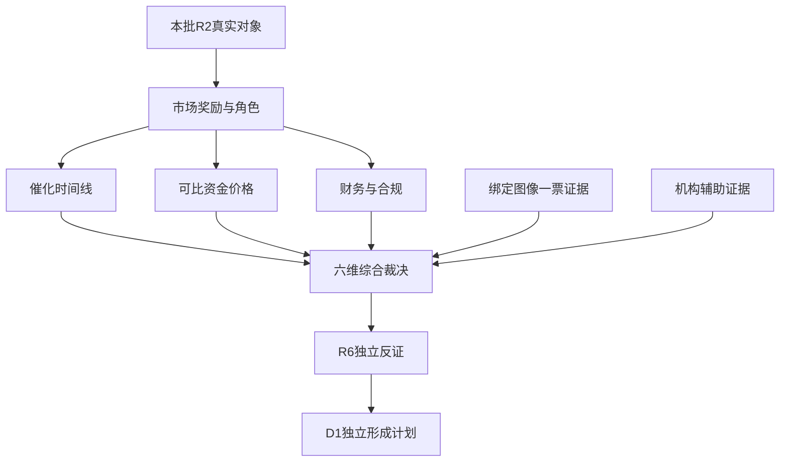

# 2026年11月17日 · 个股画像

> 新鲜度：partial；降级：true；研究置信度：0.58。不含买卖价格和交易授权。

## 🎯 一句话结论
观察局部消费与传媒核心；文投临近退市预警不能被强K线覆盖。

## 🧭 覆盖与市场奖励
本版已评 **24/24** 只真实R2对象，未评：无。主线原池9只，次线及事件15只均来自本轮R2，不从全市场补票。通常6—15只不是配额，本轮扩展覆盖是为保留真实风险与新事件比较。

情绪=震荡/主跌风险，前交易日涨停32、炸板16、跌停60，炸板率33.33%，未触35%强制减半条件。市场奖励局部封板和消费切换，并未奖励所有低价、旧高股性或所有传媒。R5继承R2顺序，不做板块重排；主模板为三格（龙头/补涨/切换），不融合五套打法。

已核主线事实仅适用于前交易日；新开盘承接、板块扩散与具体风险变化即重评。观察不是买权，旧计划缺席和市场性零仓不无限续期。

图表渲染状态：源码已交付；实际阅读端SVG渲染尚未验证，不自报通过。

## 📊 六维总览
| 对象 | 角色/板型 | 研究态度 | 进攻/风险档 | 五日大单亿元 | 真实红旗 |
|---|---|---|---|---:|---|
| 吉视传媒 `601929.SH` | 龙一 / 首板 | 观察 | B+ / B- | 5.9120 | F4,F9,F10,S1 |
| 华数传媒 `000156.SZ` | 龙二 / 首板 | 观察 | B+ / B | 1.5146 | F3,F9 |
| 长虹美菱 `000521.SZ` | 龙一 / 首板 | 观察 | B+ / B | 0.5654 | F3,F6 |
| 华帝股份 `002035.SZ` | 龙二 / 首板 | 观察 | B / B | 0.7209 | F3,F4 |
| 小熊电器 `002959.SZ` | 候补 / 首板 | 观察 | B / B | 0.4195 | 已核数值未命中，非排雷通过 |
| 北鼎股份 `300824.SZ` | 候补 / 首板 | 降级 | B / B- | 0.5420 | F3 |
| 广百股份 `002187.SZ` | 龙一 / 3连板 | 观察 | A- / B- | 1.3310 | F3,F4 |
| 天虹股份 `002419.SZ` | 龙二 / 首板 | 观察 | B+ / B | 0.8836 | F3,F6,F10 |
| 鹏飞绿能 `002356.SZ` | 候补 / 首板 | 降级 | B- / B- | unknown | F4,F7 |
| 北纬科技 `002148.SZ` | 龙一 / 4连板 | 观察 | B+ / B- | 2.1944 | F6,F8 |
| 凯撒文化 `002425.SZ` | 龙二 / 2连板 | 降级 | B / C | 1.2619 | F2,F3,F9,S1 |
| 文投控股 `600715.SH` | 候补 / 2连板 | 拦截 | B / C | -4.0408 | F3,F4,S1,S3 |
| 金逸影视 `002905.SZ` | 候补 / 2连板 | 观察 | B / B- | 0.9609 | F3,F4,F10 |
| 紫竹高科 `002058.SZ` | 龙一 / 首板 | 观察 | B / B- | 0.3565 | F9,F10 |
| 领湃科技 `300530.SZ` | 龙二 / 首板 | 降级 | B / C | 0.3963 | F3,F9,F10,S1 |
| 世龙实业 `002748.SZ` | 候补 / 2连板 | 观察 | B / B- | 1.3471 | F3 |
| 龙江交通 `601188.SH` | 龙一 / 首板 | 观察 | B / B- | 1.5830 | 已核数值未命中，非排雷通过 |
| 冰山冷热 `000530.SZ` | 龙二 / 未封涨停；无接力板型确认 | 降级 | B / C | -5.0610 | F3,F4,F6,F7,F9 |
| 顺钠股份 `000533.SZ` | 候补 / 首板 | 观察 | B+ / B- | 0.9506 | F9 |
| 光启技术 `002625.SZ` | 候补 / 未封涨停；无接力板型确认 | 观察 | B+ / B- | -1.7406 | F3,F4,F9 |
| 福龙马 `603686.SH` | 候补 / 未封涨停；无接力板型确认 | 观察 | B+ / B- | 2.7173 | F3,F9 |
| 朗特智能 `300916.SZ` | 候补 / 未封涨停；无接力板型确认 | 观察 | B+ / B- | 0.2519 | F3,F4 |
| 海思科 `002653.SZ` | 候补 / 未封涨停；无接力板型确认 | 降级 | B- / B | -0.2969 | 已核数值未命中，非排雷通过 |
| 金新农 `002548.SZ` | 候补 / 2连板 | 观察 | B / B- | 0.7912 | F3,F10 |

## 🔎 吉视传媒 `601929.SH` · 观察

早封首板与五日大单净流入支持局部回流核心；亏损、应收存货和高负债使其不是盈利反转核心。前高未过，不能把反包叫主升确认。

- **大资金意图**: 电视广播渠道与内容分发是映射，OTT新增合同和利润尚未证明；资金交易的是局部流量预期，不是已兑现增长。 大单代理不是持仓身份，资金口径有冲突，不能二选一宣称确认。
- **为什么走强**: 细分两只封板中先封（10:12）、东财热榜4、5日大单代理+5.912亿；辨识/扩散/容量三条有研究证据，不称全市场总龙。 数值日K共70个交易日，收盘2.96，MA20/MA60=2.40/2.43；较前五日均量1.11倍。收盘未超过此前20日最高价；涨停或局部小平台上破不等于完整窗口突破。站上MA60只证明数值位置，不证明主线接力。
- **逻辑够不够硬**: 电视广播渠道与内容分发是映射，OTT新增合同和利润尚未证明；资金交易的是局部流量预期，不是已兑现增长。 财务已核20260930，真实红旗F4,F9,F10,S1；监管入口及附注缺口没有被包装成阴性。

**买入理由**: 仅记录待D1验证的研究假设，不是下单建议。第一，R2角色为龙一、板型首板；第二，电视广播渠道与内容分发是映射，OTT新增合同和利润尚未证明；资金交易的是局部流量预期，不是已兑现增长。 今日核心/补涨/计划内试错身份为今日核心。

**风险点**: 第一，一日回流而非已确认主升；2天内反包不等于低位;OTT流量到利润的权益和合同未核；第二，已检出 F4,F9,F10,S1；审计、监管与辅助未知分层记录。 盈亏比与止损距离unknown，没有已核同版入场/结构止损/目标，不能宣称RR≥2。禁止清单：尚无本版额外确认项，不代表全清单阴性；原R2清单原文在JSON保留。

**止损条件**: 不输出交易价位。若本票失去R2所依据的封板承接且同方向前排扩散失败，撤销接力研究假设；若原公告新增实质风险，交R6按原规则裁决。已有仓位须按同版D1既定退出规则执行，本报告不更改。

**可验证假设**: 未来1—3个交易日逐日核查：本票能否保留原核心相对排序、是否继续有同方向涨停扩散、资金两口径是否同向；若扩散数为0且本票不封板，不认板块接力确认。该阈值仅证伪观察，不是新增买权门槛。

| 维度 | 分数 | 本版依据 |
|---|---:|---|
| catalyst | 65 | 电视广播渠道与内容分发是映射，OTT新增合同和利润尚未证明；资金交易的是局部流量预期，不是已兑现增长。 |
| chip_structure | 65 | 五日大单代理+5.9120亿元；东方财富口径存在>5%差异，置信度局部下降，双方保留。 |
| sector_linkage | 72 | 细分两只封板中先封（10:12）、东财热榜4、5日大单代理+5.912亿；辨识/扩散/容量三条有研究证据，不称全市场总龙。 |
| valuation_safety | 35 | 已检出 F4,F9,F10,S1；审计、监管与辅助未知分层记录。 |
| technical_readiness | 72 | 收盘未超过此前20日最高价；涨停或局部小平台上破不等于完整窗口突破。站上MA60只证明数值位置，不证明主线接力。 |
| institutional_interest | unknown | 研报接口窗口实际返回0行、调研0行；不把0记录推为无人关注。机构证据不完整不评默认安全分。 |

事件时间线：2026-11-16 细分两只封板中先封（10:12）、东财热榜4、5日大单代理+5.912亿；辨识/扩散/容量三条有研究证据，不称全市场总龙。

图像：仅采用本版绑定原record的有限技术意见，模型为deepseek-v4.1-flash-1017；规范校验状态available / attributable_technical_structure_only。R5未重新看PNG；周线、分钟复权不因顶层fq=2自动可比，分钟均非今日承接。

财务状态：F1=checked_negative；F2=checked_negative；F3=checked_negative；F4=flagged；F5=checked_negative；F6=unknown；F7=unknown；F8=checked_negative；F9=flagged；F10=flagged；F11=checked_negative；F12=checked_negative；S1=flagged；S2=unknown；S3=unknown

## 🔎 华数传媒 `000156.SZ` · 观察

日线收盘超前20日高点，量能较前五日放大；板块二股效应偏窄、首封较晚且三次开板，仍是容量对照。

- **大资金意图**: 有线网络与数字内容业务相关，但非OTT新订单利润认证；标准审计与盈利不能覆盖应收及监管缺口。 大单代理不是持仓身份，资金口径有冲突，不能二选一宣称确认。
- **为什么走强**: 细分封板与R3内容锚共同支持；大单代理当日+1.732亿，龙虎榜单日净买+1.189634亿，容量大但封板晚于吉视且开板3次。 数值日K共70个交易日，收盘8.54，MA20/MA60=7.58/7.18；较前五日均量3.12倍。收盘已超过此前20个交易日最高价，属于日线窗口新高事实；不是后续守住/回踩确认。站上MA60只证明数值位置，不证明主线接力。
- **逻辑够不够硬**: 有线网络与数字内容业务相关，但非OTT新订单利润认证；标准审计与盈利不能覆盖应收及监管缺口。 财务已核20260930，真实红旗F3,F9；监管入口及附注缺口没有被包装成阴性。

**买入理由**: 仅记录待D1验证的研究假设，不是下单建议。第一，R2角色为龙二、板型首板；第二，有线网络与数字内容业务相关，但非OTT新订单利润认证；标准审计与盈利不能覆盖应收及监管缺口。 今日核心/补涨/计划内试错身份为主线补涨。

**风险点**: 第一，华数不是全传媒龙二，只是细分容量对照;尚无OTT新增订单与收入兑现；第二，已检出 F3,F9；审计、监管与辅助未知分层记录。 盈亏比与止损距离unknown，没有已核同版入场/结构止损/目标，不能宣称RR≥2。禁止清单：尚无本版额外确认项，不代表全清单阴性；原R2清单原文在JSON保留。

**止损条件**: 不输出交易价位。若本票失去R2所依据的封板承接且同方向前排扩散失败，撤销接力研究假设；若原公告新增实质风险，交R6按原规则裁决。已有仓位须按同版D1既定退出规则执行，本报告不更改。

**可验证假设**: 未来1—3个交易日逐日核查：本票能否保留原核心相对排序、是否继续有同方向涨停扩散、资金两口径是否同向；若扩散数为0且本票不封板，不认板块接力确认。该阈值仅证伪观察，不是新增买权门槛。

| 维度 | 分数 | 本版依据 |
|---|---:|---|
| catalyst | 60 | 有线网络与数字内容业务相关，但非OTT新订单利润认证；标准审计与盈利不能覆盖应收及监管缺口。 |
| chip_structure | 61 | 五日大单代理+1.5146亿元；东方财富口径存在>5%差异，置信度局部下降，双方保留。 |
| sector_linkage | 65 | 细分封板与R3内容锚共同支持；大单代理当日+1.732亿，龙虎榜单日净买+1.189634亿，容量大但封板晚于吉视且开板3次。 |
| valuation_safety | 58 | 已检出 F3,F9；审计、监管与辅助未知分层记录。 |
| technical_readiness | 77 | 收盘已超过此前20个交易日最高价，属于日线窗口新高事实；不是后续守住/回踩确认。站上MA60只证明数值位置，不证明主线接力。 |
| institutional_interest | unknown | 研报接口窗口实际返回0行、调研20行；不把0记录推为无人关注。机构证据不完整不评默认安全分。 |

事件时间线：2026-11-16 细分封板与R3内容锚共同支持；大单代理当日+1.732亿，龙虎榜单日净买+1.189634亿，容量大但封板晚于吉视且开板3次。

图像：仅采用本版绑定原record的有限技术意见，模型为deepseek-v4.1-flash-1017；规范校验状态available / attributable_technical_structure_only。R5未重新看PNG；周线、分钟复权不因顶层fq=2自动可比，分钟均非今日承接。

财务状态：F1=checked_negative；F2=checked_negative；F3=flagged；F4=checked_negative；F5=checked_negative；F6=checked_negative；F7=unknown；F8=checked_negative；F9=flagged；F10=unknown；F11=checked_negative；F12=checked_negative；S1=checked_negative；S2=unknown；S3=unknown

## 🔎 长虹美菱 `000521.SZ` · 观察

家电首封最早且无开板，但日线仍低于MA60，研究为低位首板试错，不是主升回踩低吸。

- **大资金意图**: 冰箱等家电业务与消费修复相关；后排扩散可证板块效应，但前三季利润接近零，不能用家电全面复苏解释。 大单代理不是持仓身份，资金口径仅支持成交单层面的观察。
- **为什么走强**: 四只普通家电封板中首封最早09:47:45、开板0次，后续厨电/小家电扩散，容量3.77十亿元可成交；不是因低价或名字选入。 数值日K共70个交易日，收盘4.31，MA20/MA60=4.06/4.41；较前五日均量5.34倍。收盘未超过此前20日最高价；涨停或局部小平台上破不等于完整窗口突破。低于MA60，仍有中期下降修复风险。
- **逻辑够不够硬**: 冰箱等家电业务与消费修复相关；后排扩散可证板块效应，但前三季利润接近零，不能用家电全面复苏解释。 财务已核20260930，真实红旗F3,F6；监管入口及附注缺口没有被包装成阴性。

**买入理由**: 仅记录待D1验证的研究假设，不是下单建议。第一，R2角色为龙一、板型首板；第二，冰箱等家电业务与消费修复相关；后排扩散可证板块效应，但前三季利润接近零，不能用家电全面复苏解释。 今日核心/补涨/计划内试错身份为今日核心。

**风险点**: 第一，流通37.72495亿，20—50亿谨慎;问财41.149亿与Tushare37.725亿口径差异未核；均过20亿，不升级为已核一致；第二，已检出 F3,F6；审计、监管与辅助未知分层记录。 盈亏比与止损距离unknown，没有已核同版入场/结构止损/目标，不能宣称RR≥2。禁止清单：尚无本版额外确认项，不代表全清单阴性；原R2清单原文在JSON保留。

**止损条件**: 不输出交易价位。若本票失去R2所依据的封板承接且同方向前排扩散失败，撤销接力研究假设；若原公告新增实质风险，交R6按原规则裁决。已有仓位须按同版D1既定退出规则执行，本报告不更改。

**可验证假设**: 未来1—3个交易日逐日核查：本票能否保留原核心相对排序、是否继续有同方向涨停扩散、资金两口径是否同向；若扩散数为0且本票不封板，不认板块接力确认。该阈值仅证伪观察，不是新增买权门槛。

| 维度 | 分数 | 本版依据 |
|---|---:|---|
| catalyst | 55 | 冰箱等家电业务与消费修复相关；后排扩散可证板块效应，但前三季利润接近零，不能用家电全面复苏解释。 |
| chip_structure | 72 | 五日大单代理+0.5654亿元；不将总净额字段用作主力；非真实持仓变化。 |
| sector_linkage | 74 | 四只普通家电封板中首封最早09:47:45、开板0次，后续厨电/小家电扩散，容量3.77十亿元可成交；不是因低价或名字选入。 |
| valuation_safety | 52 | 已检出 F3,F6；审计、监管与辅助未知分层记录。 |
| technical_readiness | 58 | 收盘未超过此前20日最高价；涨停或局部小平台上破不等于完整窗口突破。低于MA60，仍有中期下降修复风险。 |
| institutional_interest | unknown | 研报接口窗口实际返回0行、调研0行；不把0记录推为无人关注。机构证据不完整不评默认安全分。 |

事件时间线：2026-11-16 四只普通家电封板中首封最早09:47:45、开板0次，后续厨电/小家电扩散，容量3.77十亿元可成交；不是因低价或名字选入。

图像：仅采用本版绑定原record的有限技术意见，模型为deepseek-v4.1-flash-1017；规范校验状态available / attributable_technical_structure_only。R5未重新看PNG；周线、分钟复权不因顶层fq=2自动可比，分钟均非今日承接。

财务状态：F1=checked_negative；F2=unknown；F3=flagged；F4=checked_negative；F5=checked_negative；F6=flagged；F7=unknown；F8=checked_negative；F9=checked_negative；F10=unknown；F11=unknown；F12=checked_negative；S1=checked_negative；S2=unknown；S3=unknown

## 🔎 华帝股份 `002035.SZ` · 观察

厨电龙二是跟随家电先锋而非红利榜自动上位；日线回收均线，周线和现金流风险仍需分开。

- **大资金意图**: 厨电业务与消费扩散同向；月度7.05%旧口径息率不作收益承诺，Q3现金流警示按当期三表复核。 大单代理不是持仓身份，资金口径仅支持成交单层面的观察。
- **为什么走强**: 首封紧随长虹、东财新进热榜16、大单代理+0.746亿优于本批小熊/北鼎；综合位置第二，并非历史红利榜自动上位。 数值日K共70个交易日，收盘4.68，MA20/MA60=4.37/4.58；较前五日均量5.82倍。收盘已超过此前20个交易日最高价，属于日线窗口新高事实；不是后续守住/回踩确认。站上MA60只证明数值位置，不证明主线接力。
- **逻辑够不够硬**: 厨电业务与消费扩散同向；月度7.05%旧口径息率不作收益承诺，Q3现金流警示按当期三表复核。 财务已核20260930，真实红旗F3,F4；监管入口及附注缺口没有被包装成阴性。

**买入理由**: 仅记录待D1验证的研究假设，不是下单建议。第一，R2角色为龙二、板型首板；第二，厨电业务与消费扩散同向；月度7.05%旧口径息率不作收益承诺，Q3现金流警示按当期三表复核。 今日核心/补涨/计划内试错身份为主线补涨。

**风险点**: 第一，流通36.59936亿谨慎，3次开板;月度红利池指2026Q3经营现金同比-39.5%，旧股息不是护城河；第二，已检出 F3,F4；审计、监管与辅助未知分层记录。 盈亏比与止损距离unknown，没有已核同版入场/结构止损/目标，不能宣称RR≥2。禁止清单：尚无本版额外确认项，不代表全清单阴性；原R2清单原文在JSON保留。

**止损条件**: 不输出交易价位。若本票失去R2所依据的封板承接且同方向前排扩散失败，撤销接力研究假设；若原公告新增实质风险，交R6按原规则裁决。已有仓位须按同版D1既定退出规则执行，本报告不更改。

**可验证假设**: 未来1—3个交易日逐日核查：本票能否保留原核心相对排序、是否继续有同方向涨停扩散、资金两口径是否同向；若扩散数为0且本票不封板，不认板块接力确认。该阈值仅证伪观察，不是新增买权门槛。

| 维度 | 分数 | 本版依据 |
|---|---:|---|
| catalyst | 53 | 厨电业务与消费扩散同向；月度7.05%旧口径息率不作收益承诺，Q3现金流警示按当期三表复核。 |
| chip_structure | 68 | 五日大单代理+0.7209亿元；不将总净额字段用作主力；非真实持仓变化。 |
| sector_linkage | 63 | 首封紧随长虹、东财新进热榜16、大单代理+0.746亿优于本批小熊/北鼎；综合位置第二，并非历史红利榜自动上位。 |
| valuation_safety | 55 | 已检出 F3,F4；审计、监管与辅助未知分层记录。 |
| technical_readiness | 65 | 收盘已超过此前20个交易日最高价，属于日线窗口新高事实；不是后续守住/回踩确认。站上MA60只证明数值位置，不证明主线接力。 |
| institutional_interest | unknown | 研报接口窗口实际返回15行、调研0行；不把0记录推为无人关注。机构证据不完整不评默认安全分。 |

事件时间线：2026-11-16 首封紧随长虹、东财新进热榜16、大单代理+0.746亿优于本批小熊/北鼎；综合位置第二，并非历史红利榜自动上位。

图像：仅采用本版绑定原record的有限技术意见，模型为deepseek-v4.1-flash-1017；规范校验状态available / attributable_technical_structure_only。R5未重新看PNG；周线、分钟复权不因顶层fq=2自动可比，分钟均非今日承接。

财务状态：F1=checked_negative；F2=checked_negative；F3=flagged；F4=flagged；F5=checked_negative；F6=checked_negative；F7=unknown；F8=checked_negative；F9=checked_negative；F10=unknown；F11=unknown；F12=checked_negative；S1=checked_negative；S2=unknown；S3=unknown

## 🔎 小熊电器 `002959.SZ` · 观察

无开板首板支持小家电扩散，但不是早封先锋；20日旧高未越，不把局部箱体突破冒充整个观察窗口突破。

- **大资金意图**: 小家电业务有消费映射；缺公司级新增硬催化，不因分数或股价更高递补龙一。 大单代理不是持仓身份，资金口径有冲突，不能二选一宣称确认。
- **为什么走强**: 小家电首板、开板0次、流通50.70亿，证明板块扩散；首封晚，不用较高价格或稳定封板替换已定龙一。 数值日K共70个交易日，收盘36.27，MA20/MA60=34.27/33.67；较前五日均量3.46倍。收盘未超过此前20日最高价；涨停或局部小平台上破不等于完整窗口突破。站上MA60只证明数值位置，不证明主线接力。
- **逻辑够不够硬**: 小家电业务有消费映射；缺公司级新增硬催化，不因分数或股价更高递补龙一。 财务已核20260930，真实红旗暂未检出；监管入口及附注缺口没有被包装成阴性。

**买入理由**: 仅记录待D1验证的研究假设，不是下单建议。第一，R2角色为候补、板型首板；第二，小家电业务有消费映射；缺公司级新增硬催化，不因分数或股价更高递补龙一。 今日核心/补涨/计划内试错身份为主线补涨。

**风险点**: 第一，研究龙三不进执行池，不能因龙一被否而自动递补；第二，已核数值项未命中，不等于全部排雷完成；审计、监管与辅助未知分层记录。 盈亏比与止损距离unknown，没有已核同版入场/结构止损/目标，不能宣称RR≥2。禁止清单：尚无本版额外确认项，不代表全清单阴性；原R2清单原文在JSON保留。

**止损条件**: 不输出交易价位。若本票失去R2所依据的封板承接且同方向前排扩散失败，撤销接力研究假设；若原公告新增实质风险，交R6按原规则裁决。已有仓位须按同版D1既定退出规则执行，本报告不更改。

**可验证假设**: 未来1—3个交易日逐日核查：本票能否保留原核心相对排序、是否继续有同方向涨停扩散、资金两口径是否同向；若扩散数为0且本票不封板，不认板块接力确认。该阈值仅证伪观察，不是新增买权门槛。

| 维度 | 分数 | 本版依据 |
|---|---:|---|
| catalyst | 50 | 小家电业务有消费映射；缺公司级新增硬催化，不因分数或股价更高递补龙一。 |
| chip_structure | 58 | 五日大单代理+0.4195亿元；东方财富口径存在>5%差异，置信度局部下降，双方保留。 |
| sector_linkage | 58 | 小家电首板、开板0次、流通50.70亿，证明板块扩散；首封晚，不用较高价格或稳定封板替换已定龙一。 |
| valuation_safety | 65 | 已核数值项未命中，不等于全部排雷完成；审计、监管与辅助未知分层记录。 |
| technical_readiness | 65 | 收盘未超过此前20日最高价；涨停或局部小平台上破不等于完整窗口突破。站上MA60只证明数值位置，不证明主线接力。 |
| institutional_interest | unknown | 研报接口窗口实际返回26行、调研10行；不把0记录推为无人关注。机构证据不完整不评默认安全分。 |

事件时间线：2026-11-16 小家电首板、开板0次、流通50.70亿，证明板块扩散；首封晚，不用较高价格或稳定封板替换已定龙一。

图像：仅采用本版绑定原record的有限技术意见，模型为deepseek-v4.1-flash-1017；规范校验状态available / attributable_technical_structure_only。R5未重新看PNG；周线、分钟复权不因顶层fq=2自动可比，分钟均非今日承接。

财务状态：F1=unknown；F2=checked_negative；F3=checked_negative；F4=checked_negative；F5=checked_negative；F6=checked_negative；F7=unknown；F8=checked_negative；F9=checked_negative；F10=unknown；F11=unknown；F12=checked_negative；S1=checked_negative；S2=unknown；S3=unknown

## 🔎 北鼎股份 `300824.SZ` · 降级

20cm首板且放量，但八次开板；尾盘封住不等于全日强承接。跨日后排接力不替代家电核心。

- **大资金意图**: 小家电有业务联动，创业板弹性不是逻辑硬度；无新增订单或业绩证据，保留20cm一板认知偏差警示。 大单代理不是持仓身份，资金口径仅支持成交单层面的观察。
- **为什么走强**: 20cm首板是弹性效应证据；保留研究不是前缀限制。封板晚且8次开板、封单约291万元，不能因涨幅20%取代10cm先锋。 数值日K共70个交易日，收盘8.60，MA20/MA60=7.46/7.75；较前五日均量13.38倍。收盘已超过此前20个交易日最高价，属于日线窗口新高事实；不是后续守住/回踩确认。站上MA60只证明数值位置，不证明主线接力。
- **逻辑够不够硬**: 小家电有业务联动，创业板弹性不是逻辑硬度；无新增订单或业绩证据，保留20cm一板认知偏差警示。 财务已核20260930，真实红旗F3；监管入口及附注缺口没有被包装成阴性。

**买入理由**: 仅记录待D1验证的研究假设，不是下单建议。第一，R2角色为候补、板型首板；第二，小家电有业务联动，创业板弹性不是逻辑硬度；无新增订单或业绩证据，保留20cm一板认知偏差警示。 今日核心/补涨/计划内试错身份为主线补涨。

**风险点**: 第一，流通27.4313亿谨慎;多次开板；不是已核趋势低吸资格；第二，已检出 F3；审计、监管与辅助未知分层记录。 盈亏比与止损距离unknown，没有已核同版入场/结构止损/目标，不能宣称RR≥2。禁止清单：尚无本版额外确认项，不代表全清单阴性；原R2清单原文在JSON保留。

**止损条件**: 不输出交易价位。若本票失去R2所依据的封板承接且同方向前排扩散失败，撤销接力研究假设；若原公告新增实质风险，交R6按原规则裁决。已有仓位须按同版D1既定退出规则执行，本报告不更改。

**可验证假设**: 未来1—3个交易日逐日核查：本票能否保留原核心相对排序、是否继续有同方向涨停扩散、资金两口径是否同向；若扩散数为0且本票不封板，不认板块接力确认。该阈值仅证伪观察，不是新增买权门槛。

| 维度 | 分数 | 本版依据 |
|---|---:|---|
| catalyst | 48 | 小家电有业务联动，创业板弹性不是逻辑硬度；无新增订单或业绩证据，保留20cm一板认知偏差警示。 |
| chip_structure | 58 | 五日大单代理+0.5420亿元；不将总净额字段用作主力；非真实持仓变化。 |
| sector_linkage | 54 | 20cm首板是弹性效应证据；保留研究不是前缀限制。封板晚且8次开板、封单约291万元，不能因涨幅20%取代10cm先锋。 |
| valuation_safety | 60 | 已检出 F3；审计、监管与辅助未知分层记录。 |
| technical_readiness | 61 | 收盘已超过此前20个交易日最高价，属于日线窗口新高事实；不是后续守住/回踩确认。站上MA60只证明数值位置，不证明主线接力。 |
| institutional_interest | unknown | 研报接口窗口实际返回19行、调研66行；不把0记录推为无人关注。机构证据不完整不评默认安全分。 |

事件时间线：2026-11-16 20cm首板是弹性效应证据；保留研究不是前缀限制。封板晚且8次开板、封单约291万元，不能因涨幅20%取代10cm先锋。

图像：仅采用本版绑定原record的有限技术意见，模型为deepseek-v4.1-flash-1017；规范校验状态available / attributable_technical_structure_only。R5未重新看PNG；周线、分钟复权不因顶层fq=2自动可比，分钟均非今日承接。

财务状态：F1=checked_negative；F2=unknown；F3=flagged；F4=checked_negative；F5=unknown；F6=checked_negative；F7=unknown；F8=checked_negative；F9=checked_negative；F10=unknown；F11=unknown；F12=checked_negative；S1=checked_negative；S2=unknown；S3=unknown

## 🔎 广百股份 `002187.SZ` · 观察

零售三板、早封和后排扩散支持接力核心；缩量加速和一字预测只增加拥挤核验，不增加次日胜率。

- **大资金意图**: 免税和零售转型有业务落点；市场交易消费切换，2025年度经营下滑仍是反证，不能把三板当业绩验证。 大单代理不是持仓身份，资金口径有冲突，不能二选一宣称确认。
- **为什么走强**: 零售当前3连板最高，09:30:03封住后有天虹/鹏飞首板跟随；热榜10与6.14%换手共同支持研究辨识度、扩散、容量。 数值日K共70个交易日，收盘7.67，MA20/MA60=5.84/5.65；较前五日均量0.92倍。收盘已超过此前20个交易日最高价，属于日线窗口新高事实；不是后续守住/回踩确认。站上MA60只证明数值位置，不证明主线接力。
- **逻辑够不够硬**: 免税和零售转型有业务落点；市场交易消费切换，2025年度经营下滑仍是反证，不能把三板当业绩验证。 财务已核20260930，真实红旗F3,F4；监管入口及附注缺口没有被包装成阴性。

**买入理由**: 仅记录待D1验证的研究假设，不是下单建议。第一，R2角色为龙一、板型3连板；第二，免税和零售转型有业务落点；市场交易消费切换，2025年度经营下滑仍是反证，不能把三板当业绩验证。 今日核心/补涨/计划内试错身份为今日核心。

**风险点**: 第一，三板接力T+1隔日兑现；板块总体资金负;一字预测不是已成交，强封无价格安全垫需D1重算RR；第二，已检出 F3,F4；审计、监管与辅助未知分层记录。 盈亏比与止损距离unknown，没有已核同版入场/结构止损/目标，不能宣称RR≥2。禁止清单：尚无本版额外确认项，不代表全清单阴性；原R2清单原文在JSON保留。

**止损条件**: 不输出交易价位。若本票失去R2所依据的封板承接且同方向前排扩散失败，撤销接力研究假设；若原公告新增实质风险，交R6按原规则裁决。已有仓位须按同版D1既定退出规则执行，本报告不更改。

**可验证假设**: 未来1—3个交易日逐日核查：本票能否保留原核心相对排序、是否继续有同方向涨停扩散、资金两口径是否同向；若扩散数为0且本票不封板，不认板块接力确认。该阈值仅证伪观察，不是新增买权门槛。

| 维度 | 分数 | 本版依据 |
|---|---:|---|
| catalyst | 62 | 免税和零售转型有业务落点；市场交易消费切换，2025年度经营下滑仍是反证，不能把三板当业绩验证。 |
| chip_structure | 67 | 五日大单代理+1.3310亿元；东方财富口径存在>5%差异，置信度局部下降，双方保留。 |
| sector_linkage | 78 | 零售当前3连板最高，09:30:03封住后有天虹/鹏飞首板跟随；热榜10与6.14%换手共同支持研究辨识度、扩散、容量。 |
| valuation_safety | 48 | 已检出 F3,F4；审计、监管与辅助未知分层记录。 |
| technical_readiness | 73 | 收盘已超过此前20个交易日最高价，属于日线窗口新高事实；不是后续守住/回踩确认。站上MA60只证明数值位置，不证明主线接力。 |
| institutional_interest | unknown | 研报接口窗口实际返回0行、调研0行；不把0记录推为无人关注。机构证据不完整不评默认安全分。 |

事件时间线：2026-11-16 零售当前3连板最高，09:30:03封住后有天虹/鹏飞首板跟随；热榜10与6.14%换手共同支持研究辨识度、扩散、容量。

图像：仅采用本版绑定原record的有限技术意见，模型为deepseek-v4.1-flash-1017；规范校验状态available / attributable_technical_structure_only。R5未重新看PNG；周线、分钟复权不因顶层fq=2自动可比，分钟均非今日承接。

财务状态：F1=checked_negative；F2=checked_negative；F3=flagged；F4=flagged；F5=not_applicable；F6=unknown；F7=unknown；F8=checked_negative；F9=checked_negative；F10=unknown；F11=checked_negative；F12=checked_negative；S1=checked_negative；S2=unknown；S3=unknown

## 🔎 天虹股份 `002419.SZ` · 观察

零售首板、当日大单改善支持龙二容量观察；突破前高幅度小，租赁债务与一次性收益要从经营复苏中剥离。

- **大资金意图**: AI零售/门店数字化是转型叙事，不把跨概念归属机械当储能合力；商业转化仍需业绩验证。 大单代理不是持仓身份，资金口径仅支持成交单层面的观察。
- **为什么走强**: 首封09:32:33仅次广百，流通61.63亿、当日大单代理+0.946亿、东财新进20；身份为零售低位联动，不以储能概念标签归政策核心。 数值日K共70个交易日，收盘5.40，MA20/MA60=4.82/4.76；较前五日均量1.47倍。收盘已超过此前20个交易日最高价，属于日线窗口新高事实；不是后续守住/回踩确认。站上MA60只证明数值位置，不证明主线接力。
- **逻辑够不够硬**: AI零售/门店数字化是转型叙事，不把跨概念归属机械当储能合力；商业转化仍需业绩验证。 财务已核20260930，真实红旗F3,F6,F10；监管入口及附注缺口没有被包装成阴性。

**买入理由**: 仅记录待D1验证的研究假设，不是下单建议。第一，R2角色为龙二、板型首板；第二，AI零售/门店数字化是转型叙事，不把跨概念归属机械当储能合力；商业转化仍需业绩验证。 今日核心/补涨/计划内试错身份为主线补涨。

**风险点**: 第一，非板块最高；首板不等于低估或必晋级；第二，已检出 F3,F6,F10；审计、监管与辅助未知分层记录。 盈亏比与止损距离unknown，没有已核同版入场/结构止损/目标，不能宣称RR≥2。禁止清单：尚无本版额外确认项，不代表全清单阴性；原R2清单原文在JSON保留。

**止损条件**: 不输出交易价位。若本票失去R2所依据的封板承接且同方向前排扩散失败，撤销接力研究假设；若原公告新增实质风险，交R6按原规则裁决。已有仓位须按同版D1既定退出规则执行，本报告不更改。

**可验证假设**: 未来1—3个交易日逐日核查：本票能否保留原核心相对排序、是否继续有同方向涨停扩散、资金两口径是否同向；若扩散数为0且本票不封板，不认板块接力确认。该阈值仅证伪观察，不是新增买权门槛。

| 维度 | 分数 | 本版依据 |
|---|---:|---|
| catalyst | 55 | AI零售/门店数字化是转型叙事，不把跨概念归属机械当储能合力；商业转化仍需业绩验证。 |
| chip_structure | 67 | 五日大单代理+0.8836亿元；不将总净额字段用作主力；非真实持仓变化。 |
| sector_linkage | 62 | 首封09:32:33仅次广百，流通61.63亿、当日大单代理+0.946亿、东财新进20；身份为零售低位联动，不以储能概念标签归政策核心。 |
| valuation_safety | 48 | 已检出 F3,F6,F10；审计、监管与辅助未知分层记录。 |
| technical_readiness | 73 | 收盘已超过此前20个交易日最高价，属于日线窗口新高事实；不是后续守住/回踩确认。站上MA60只证明数值位置，不证明主线接力。 |
| institutional_interest | unknown | 研报接口窗口实际返回3行、调研0行；不把0记录推为无人关注。机构证据不完整不评默认安全分。 |

事件时间线：2026-11-16 首封09:32:33仅次广百，流通61.63亿、当日大单代理+0.946亿、东财新进20；身份为零售低位联动，不以储能概念标签归政策核心。

图像：仅采用本版绑定原record的有限技术意见，模型为deepseek-v4.1-flash-1017；规范校验状态available / attributable_technical_structure_only。R5未重新看PNG；周线、分钟复权不因顶层fq=2自动可比，分钟均非今日承接。

财务状态：F1=unknown；F2=checked_negative；F3=flagged；F4=checked_negative；F5=checked_negative；F6=flagged；F7=checked_negative；F8=checked_negative；F9=checked_negative；F10=flagged；F11=unknown；F12=checked_negative；S1=checked_negative；S2=unknown；S3=unknown

## 🔎 鹏飞绿能 `002356.SZ` · 降级

R2保留的零售扩散候补而非龙头；日线仍低于MA60，当前资金原接口缺口不能用其他股票替代。

- **大资金意图**: R2当前名鹏飞绿能与月度历史赫美名称不同；只按精确代码关联历史，不由旧商业标签证明当前主营资格。 大单代理不是持仓身份，资金口径仅支持成交单层面的观察。
- **为什么走强**: 零售首板的扩散样本，09:36较晚且3次开板；保留龙三不自动替代。 数值日K共70个交易日，收盘2.52，MA20/MA60=2.37/2.61；较前五日均量4.52倍。收盘未超过此前20日最高价；涨停或局部小平台上破不等于完整窗口突破。低于MA60，仍有中期下降修复风险。
- **逻辑够不够硬**: R2当前名鹏飞绿能与月度历史赫美名称不同；只按精确代码关联历史，不由旧商业标签证明当前主营资格。 财务已核20260930，真实红旗F4,F7；监管入口及附注缺口没有被包装成阴性。

**买入理由**: 仅记录待D1验证的研究假设，不是下单建议。第一，R2角色为候补、板型首板；第二，R2当前名鹏飞绿能与月度历史赫美名称不同；只按精确代码关联历史，不由旧商业标签证明当前主营资格。 今日核心/补涨/计划内试错身份为主线补涨。

**风险点**: 第一，流通33.043亿谨慎；5日个股资金本轮未拉，未知；第二，已检出 F4,F7；审计、监管与辅助未知分层记录。 盈亏比与止损距离unknown，没有已核同版入场/结构止损/目标，不能宣称RR≥2。禁止清单：尚无本版额外确认项，不代表全清单阴性；原R2清单原文在JSON保留。

**止损条件**: 不输出交易价位。若本票失去R2所依据的封板承接且同方向前排扩散失败，撤销接力研究假设；若原公告新增实质风险，交R6按原规则裁决。已有仓位须按同版D1既定退出规则执行，本报告不更改。

**可验证假设**: 未来1—3个交易日逐日核查：本票能否保留原核心相对排序、是否继续有同方向涨停扩散、资金两口径是否同向；若扩散数为0且本票不封板，不认板块接力确认。该阈值仅证伪观察，不是新增买权门槛。

| 维度 | 分数 | 本版依据 |
|---|---:|---|
| catalyst | 42 | R2当前名鹏飞绿能与月度历史赫美名称不同；只按精确代码关联历史，不由旧商业标签证明当前主营资格。 |
| chip_structure | 45 | 五日大单代理缺口；不将总净额字段用作主力；非真实持仓变化。 |
| sector_linkage | 48 | 零售首板的扩散样本，09:36较晚且3次开板；保留龙三不自动替代。 |
| valuation_safety | 50 | 已检出 F4,F7；审计、监管与辅助未知分层记录。 |
| technical_readiness | 53 | 收盘未超过此前20日最高价；涨停或局部小平台上破不等于完整窗口突破。低于MA60，仍有中期下降修复风险。 |
| institutional_interest | unknown | 研报接口窗口实际返回0行、调研0行；不把0记录推为无人关注。机构证据不完整不评默认安全分。 |

事件时间线：2026-11-16 零售首板的扩散样本，09:36较晚且3次开板；保留龙三不自动替代。

图像：仅采用本版绑定原record的有限技术意见，模型为deepseek-v4.1-flash-1017；规范校验状态available / attributable_technical_structure_only。R5未重新看PNG；周线、分钟复权不因顶层fq=2自动可比，分钟均非今日承接。

财务状态：F1=unknown；F2=checked_negative；F3=checked_negative；F4=flagged；F5=not_applicable；F6=unknown；F7=flagged；F8=checked_negative；F9=checked_negative；F10=unknown；F11=unknown；F12=checked_negative；S1=checked_negative；S2=unknown；S3=unknown

## 🔎 北纬科技 `002148.SZ` · 观察

四板高度和早封提供情绪辨识度；F8两单季现金流与利润背离、一次性收益风险仍存在，不因高度删除。

- **大资金意图**: 游戏/卫星物联网等分支不应强行唯一归短剧；四板交易结构不是短剧新增营收证明。 大单代理不是持仓身份，资金口径仅支持成交单层面的观察。
- **为什么走强**: 最高4板为全市场高度温度计；归因多主题，不认定独占短剧龙头；单日开板7次及42.59%换手，席位净卖0.882909亿但5日大单代理仍正。 数值日K共70个交易日，收盘8.75，MA20/MA60=6.28/6.32；较前五日均量4.13倍。收盘已超过此前20个交易日最高价，属于日线窗口新高事实；不是后续守住/回踩确认。站上MA60只证明数值位置，不证明主线接力。
- **逻辑够不够硬**: 游戏/卫星物联网等分支不应强行唯一归短剧；四板交易结构不是短剧新增营收证明。 财务已核20260930，真实红旗F6,F8；监管入口及附注缺口没有被包装成阴性。

**买入理由**: 仅记录待D1验证的研究假设，不是下单建议。第一，R2角色为龙一、板型4连板；第二，游戏/卫星物联网等分支不应强行唯一归短剧；四板交易结构不是短剧新增营收证明。 今日核心/补涨/计划内试错身份为unknown，首次D1成案后独立裁决。

**风险点**: 第一，流通39.46亿谨慎;多主题混归，独立板块带动未核；不是因高度单项剔除；第二，已检出 F6,F8；审计、监管与辅助未知分层记录。 盈亏比与止损距离unknown，没有已核同版入场/结构止损/目标，不能宣称RR≥2。禁止清单：尚无本版额外确认项，不代表全清单阴性；原R2清单原文在JSON保留。

**止损条件**: 不输出交易价位。若本票失去R2所依据的封板承接且同方向前排扩散失败，撤销接力研究假设；若原公告新增实质风险，交R6按原规则裁决。已有仓位须按同版D1既定退出规则执行，本报告不更改。

**可验证假设**: 未来1—3个交易日逐日核查：本票能否保留原核心相对排序、是否继续有同方向涨停扩散、资金两口径是否同向；若扩散数为0且本票不封板，不认板块接力确认。该阈值仅证伪观察，不是新增买权门槛。

| 维度 | 分数 | 本版依据 |
|---|---:|---|
| catalyst | 58 | 游戏/卫星物联网等分支不应强行唯一归短剧；四板交易结构不是短剧新增营收证明。 |
| chip_structure | 67 | 五日大单代理+2.1944亿元；不将总净额字段用作主力；非真实持仓变化。 |
| sector_linkage | 67 | 最高4板为全市场高度温度计；归因多主题，不认定独占短剧龙头；单日开板7次及42.59%换手，席位净卖0.882909亿但5日大单代理仍正。 |
| valuation_safety | 42 | 已检出 F6,F8；审计、监管与辅助未知分层记录。 |
| technical_readiness | 75 | 收盘已超过此前20个交易日最高价，属于日线窗口新高事实；不是后续守住/回踩确认。站上MA60只证明数值位置，不证明主线接力。 |
| institutional_interest | unknown | 研报接口窗口实际返回0行、调研0行；不把0记录推为无人关注。机构证据不完整不评默认安全分。 |

事件时间线：2026-11-16 最高4板为全市场高度温度计；归因多主题，不认定独占短剧龙头；单日开板7次及42.59%换手，席位净卖0.882909亿但5日大单代理仍正。

图像：仅采用本版绑定原record的有限技术意见，模型为deepseek-v4.1-flash-1017；规范校验状态available / attributable_technical_structure_only。R5未重新看PNG；周线、分钟复权不因顶层fq=2自动可比，分钟均非今日承接。

财务状态：F1=unknown；F2=unknown；F3=checked_negative；F4=checked_negative；F5=checked_negative；F6=flagged；F7=unknown；F8=flagged；F9=checked_negative；F10=unknown；F11=checked_negative；F12=checked_negative；S1=checked_negative；S2=unknown；S3=unknown

## 🔎 凯撒文化 `002425.SZ` · 降级

短剧游戏存量核心具技术强势，但商誉/权益超过原F2阈值及连年亏损是真风险；不按图像强势粉饰估值。

- **大资金意图**: 游戏与IP有题材映射，海外短剧行业数据不是本公司分成确认；高商誉对未来减值敏感。 大单代理不是持仓身份，资金口径仅支持成交单层面的观察。
- **为什么走强**: 5天4板但实际连续2板；R3热榜上升，同日封板早且仅1次开板，保留核心位置而不称新题材低位。 数值日K共70个交易日，收盘4.36，MA20/MA60=3.36/3.26；较前五日均量1.50倍。收盘已超过此前20个交易日最高价，属于日线窗口新高事实；不是后续守住/回踩确认。站上MA60只证明数值位置，不证明主线接力。
- **逻辑够不够硬**: 游戏与IP有题材映射，海外短剧行业数据不是本公司分成确认；高商誉对未来减值敏感。 财务已核20260930，真实红旗F2,F3,F9,S1；监管入口及附注缺口没有被包装成阴性。

**买入理由**: 仅记录待D1验证的研究假设，不是下单建议。第一，R2角色为龙二、板型2连板；第二，游戏与IP有题材映射，海外短剧行业数据不是本公司分成确认；高商誉对未来减值敏感。 今日核心/补涨/计划内试错身份为unknown，首次D1成案后独立裁决。

**风险点**: 第一，流通40.12亿谨慎;3日龙虎榜净买0.228522亿不能当单日资金；本日大单代理为负；第二，已检出 F2,F3,F9,S1；审计、监管与辅助未知分层记录。 盈亏比与止损距离unknown，没有已核同版入场/结构止损/目标，不能宣称RR≥2。禁止清单：尚无本版额外确认项，不代表全清单阴性；原R2清单原文在JSON保留。

**止损条件**: 不输出交易价位。若本票失去R2所依据的封板承接且同方向前排扩散失败，撤销接力研究假设；若原公告新增实质风险，交R6按原规则裁决。已有仓位须按同版D1既定退出规则执行，本报告不更改。

**可验证假设**: 未来1—3个交易日逐日核查：本票能否保留原核心相对排序、是否继续有同方向涨停扩散、资金两口径是否同向；若扩散数为0且本票不封板，不认板块接力确认。该阈值仅证伪观察，不是新增买权门槛。

| 维度 | 分数 | 本版依据 |
|---|---:|---|
| catalyst | 58 | 游戏与IP有题材映射，海外短剧行业数据不是本公司分成确认；高商誉对未来减值敏感。 |
| chip_structure | 62 | 五日大单代理+1.2619亿元；不将总净额字段用作主力；非真实持仓变化。 |
| sector_linkage | 60 | 5天4板但实际连续2板；R3热榜上升，同日封板早且仅1次开板，保留核心位置而不称新题材低位。 |
| valuation_safety | 30 | 已检出 F2,F3,F9,S1；审计、监管与辅助未知分层记录。 |
| technical_readiness | 73 | 收盘已超过此前20个交易日最高价，属于日线窗口新高事实；不是后续守住/回踩确认。站上MA60只证明数值位置，不证明主线接力。 |
| institutional_interest | unknown | 研报接口窗口实际返回0行、调研0行；不把0记录推为无人关注。机构证据不完整不评默认安全分。 |

事件时间线：2026-11-16 5天4板但实际连续2板；R3热榜上升，同日封板早且仅1次开板，保留核心位置而不称新题材低位。

图像：仅采用本版绑定原record的有限技术意见，模型为deepseek-v4.1-flash-1017；规范校验状态available / attributable_technical_structure_only。R5未重新看PNG；周线、分钟复权不因顶层fq=2自动可比，分钟均非今日承接。

财务状态：F1=checked_negative；F2=flagged；F3=flagged；F4=unknown；F5=checked_negative；F6=unknown；F7=checked_negative；F8=checked_negative；F9=flagged；F10=unknown；F11=checked_negative；F12=checked_negative；S1=flagged；S2=unknown；S3=unknown

## 🔎 文投控股 `600715.SH` · 拦截

强K线不抵消公司已披露条件性*ST预警：按原S3临近轴提交R6独立硬否决，不是R5自行豁免风险。

- **大资金意图**: AI漫剧占比仅2.57%且未经审计，前三季营收1.80亿元及亏损与高涨幅矛盾；不能把题材视为利润替代品。 大单代理不是持仓身份，资金口径有冲突，不能二选一宣称确认。
- **为什么走强**: 保留高辨识度风险对照，不用股性或低价遮盖公告；5日大单代理-4.041亿、本日-6.026亿，龙虎榜单日-3.554438亿。 数值日K共70个交易日，收盘3.74，MA20/MA60=2.39/1.91；较前五日均量2.00倍。收盘已超过此前20个交易日最高价，属于日线窗口新高事实；不是后续守住/回踩确认。站上MA60只证明数值位置，不证明主线接力。
- **逻辑够不够硬**: AI漫剧占比仅2.57%且未经审计，前三季营收1.80亿元及亏损与高涨幅矛盾；不能把题材视为利润替代品。 财务已核20260930，真实红旗F3,F4,S1,S3；监管入口及附注缺口没有被包装成阴性。

**买入理由**: 仅记录待D1验证的研究假设，不是下单建议。第一，R2角色为候补、板型2连板；第二，AI漫剧占比仅2.57%且未经审计，前三季营收1.80亿元及亏损与高涨幅矛盾；不能把题材视为利润替代品。 今日核心/补涨/计划内试错身份为unknown，首次D1成案后独立裁决。

**风险点**: 第一，R4 E009条件性风险未解；未经审计AI占比2.57%;开板8次、末封14:54，不能当封单承接无条件合格；第二，已检出 F3,F4,S1,S3；审计、监管与辅助未知分层记录。 盈亏比与止损距离unknown，没有已核同版入场/结构止损/目标，不能宣称RR≥2。禁止清单：S3已披露条件性*ST预警；原R2清单原文在JSON保留。

**止损条件**: 不输出交易价位。若本票失去R2所依据的封板承接且同方向前排扩散失败，撤销接力研究假设；若原公告新增实质风险，交R6按原规则裁决。已有仓位须按同版D1既定退出规则执行，本报告不更改。

**可验证假设**: 未来1—3个交易日逐日核查：本票能否保留原核心相对排序、是否继续有同方向涨停扩散、资金两口径是否同向；若扩散数为0且本票不封板，不认板块接力确认。该阈值仅证伪观察，不是新增买权门槛。

| 维度 | 分数 | 本版依据 |
|---|---:|---|
| catalyst | 30 | AI漫剧占比仅2.57%且未经审计，前三季营收1.80亿元及亏损与高涨幅矛盾；不能把题材视为利润替代品。 |
| chip_structure | 28 | 五日大单代理-4.0408亿元；东方财富口径存在>5%差异，置信度局部下降，双方保留。 |
| sector_linkage | 43 | 保留高辨识度风险对照，不用股性或低价遮盖公告；5日大单代理-4.041亿、本日-6.026亿，龙虎榜单日-3.554438亿。 |
| valuation_safety | 20 | 已检出 F3,F4,S1,S3；审计、监管与辅助未知分层记录。 |
| technical_readiness | 65 | 收盘已超过此前20个交易日最高价，属于日线窗口新高事实；不是后续守住/回踩确认。站上MA60只证明数值位置，不证明主线接力。 |
| institutional_interest | unknown | 研报接口窗口实际返回0行、调研0行；不把0记录推为无人关注。机构证据不完整不评默认安全分。 |

事件时间线：2026-11-16 保留高辨识度风险对照，不用股性或低价遮盖公告；5日大单代理-4.041亿、本日-6.026亿，龙虎榜单日-3.554438亿。；2026-11-16 文投AI漫剧收入约2.57%并提示条件性退市风险

图像：仅采用本版绑定原record的有限技术意见，模型为deepseek-v4.1-flash-1017；规范校验状态available / attributable_technical_structure_only。R5未重新看PNG；周线、分钟复权不因顶层fq=2自动可比，分钟均非今日承接。

财务状态：F1=unknown；F2=checked_negative；F3=flagged；F4=flagged；F5=unknown；F6=unknown；F7=unknown；F8=checked_negative；F9=checked_negative；F10=unknown；F11=unknown；F12=checked_negative；S1=flagged；S2=unknown；S3=flagged

## 🔎 金逸影视 `002905.SZ` · 观察

影视首板可作传媒扩散对照，准一字缺少换手验证；租赁等债务与存货、应收项单列，不因首板自动低位安全。

- **大资金意图**: 电影与消费内容有业务落点，但票房修复和最新盈利需实际财报，不用行业热度替代本票现金流。 大单代理不是持仓身份，资金口径有冲突，不能二选一宣称确认。
- **为什么走强**: 一字反包2板、5天3板；只作院线对照，不能因为先封就等同短剧收益龙头。 数值日K共70个交易日，收盘10.89，MA20/MA60=8.55/8.51；较前五日均量0.26倍。收盘已超过此前20个交易日最高价，属于日线窗口新高事实；不是后续守住/回踩确认。站上MA60只证明数值位置，不证明主线接力。
- **逻辑够不够硬**: 电影与消费内容有业务落点，但票房修复和最新盈利需实际财报，不用行业热度替代本票现金流。 财务已核20260930，真实红旗F3,F4,F10；监管入口及附注缺口没有被包装成阴性。

**买入理由**: 仅记录待D1验证的研究假设，不是下单建议。第一，R2角色为候补、板型2连板；第二，电影与消费内容有业务落点，但票房修复和最新盈利需实际财报，不用行业热度替代本票现金流。 今日核心/补涨/计划内试错身份为unknown，首次D1成案后独立裁决。

**风险点**: 第一，流通38.05亿谨慎；1.29%换手且一字，流动性与接力风险；第二，已检出 F3,F4,F10；审计、监管与辅助未知分层记录。 盈亏比与止损距离unknown，没有已核同版入场/结构止损/目标，不能宣称RR≥2。禁止清单：尚无本版额外确认项，不代表全清单阴性；原R2清单原文在JSON保留。

**止损条件**: 不输出交易价位。若本票失去R2所依据的封板承接且同方向前排扩散失败，撤销接力研究假设；若原公告新增实质风险，交R6按原规则裁决。已有仓位须按同版D1既定退出规则执行，本报告不更改。

**可验证假设**: 未来1—3个交易日逐日核查：本票能否保留原核心相对排序、是否继续有同方向涨停扩散、资金两口径是否同向；若扩散数为0且本票不封板，不认板块接力确认。该阈值仅证伪观察，不是新增买权门槛。

| 维度 | 分数 | 本版依据 |
|---|---:|---|
| catalyst | 48 | 电影与消费内容有业务落点，但票房修复和最新盈利需实际财报，不用行业热度替代本票现金流。 |
| chip_structure | 59 | 五日大单代理+0.9609亿元；东方财富口径存在>5%差异，置信度局部下降，双方保留。 |
| sector_linkage | 52 | 一字反包2板、5天3板；只作院线对照，不能因为先封就等同短剧收益龙头。 |
| valuation_safety | 45 | 已检出 F3,F4,F10；审计、监管与辅助未知分层记录。 |
| technical_readiness | 70 | 收盘已超过此前20个交易日最高价，属于日线窗口新高事实；不是后续守住/回踩确认。站上MA60只证明数值位置，不证明主线接力。 |
| institutional_interest | unknown | 研报接口窗口实际返回0行、调研0行；不把0记录推为无人关注。机构证据不完整不评默认安全分。 |

事件时间线：2026-11-16 一字反包2板、5天3板；只作院线对照，不能因为先封就等同短剧收益龙头。

图像：仅采用本版绑定原record的有限技术意见，模型为deepseek-v4.1-flash-1017；规范校验状态available / attributable_technical_structure_only。R5未重新看PNG；周线、分钟复权不因顶层fq=2自动可比，分钟均非今日承接。

财务状态：F1=checked_negative；F2=unknown；F3=flagged；F4=flagged；F5=not_applicable；F6=unknown；F7=unknown；F8=checked_negative；F9=checked_negative；F10=flagged；F11=unknown；F12=checked_negative；S1=checked_negative；S2=unknown；S3=unknown

## 🔎 紫竹高科 `002058.SZ` · 观察

R2固态分支研究龙一，但日线未超过前窗口高点；撤销风险警示公告应按时效核验，不将过去预警无限续期。

- **大资金意图**: 历史威尔泰与当前紫竹高科按代码关联仅历史股性；固态商业权益和主业转化未核完整。 大单代理不是持仓身份，资金口径仅支持成交单层面的观察。
- **为什么走强**: 仅作固态分支首板先锋研究：10:18首封0开板且归因固态/铝塑膜；不称整个锂电链总龙。 数值日K共70个交易日，收盘22.40，MA20/MA60=19.98/18.68；较前五日均量1.10倍。收盘未超过此前20日最高价；涨停或局部小平台上破不等于完整窗口突破。站上MA60只证明数值位置，不证明主线接力。
- **逻辑够不够硬**: 历史威尔泰与当前紫竹高科按代码关联仅历史股性；固态商业权益和主业转化未核完整。 财务已核20260930，真实红旗F9,F10；监管入口及附注缺口没有被包装成阴性。

**买入理由**: 仅记录待D1验证的研究假设，不是下单建议。第一，R2角色为龙一、板型首板；第二，历史威尔泰与当前紫竹高科按代码关联仅历史股性；固态商业权益和主业转化未核完整。 今日核心/补涨/计划内试错身份为unknown，首次D1成案后独立裁决。

**风险点**: 第一，流通32.11亿谨慎；分支地位仍待R5核产品关系；第二，已检出 F9,F10；审计、监管与辅助未知分层记录。 盈亏比与止损距离unknown，没有已核同版入场/结构止损/目标，不能宣称RR≥2。禁止清单：尚无本版额外确认项，不代表全清单阴性；原R2清单原文在JSON保留。

**止损条件**: 不输出交易价位。若本票失去R2所依据的封板承接且同方向前排扩散失败，撤销接力研究假设；若原公告新增实质风险，交R6按原规则裁决。已有仓位须按同版D1既定退出规则执行，本报告不更改。

**可验证假设**: 未来1—3个交易日逐日核查：本票能否保留原核心相对排序、是否继续有同方向涨停扩散、资金两口径是否同向；若扩散数为0且本票不封板，不认板块接力确认。该阈值仅证伪观察，不是新增买权门槛。

| 维度 | 分数 | 本版依据 |
|---|---:|---|
| catalyst | 48 | 历史威尔泰与当前紫竹高科按代码关联仅历史股性；固态商业权益和主业转化未核完整。 |
| chip_structure | 57 | 五日大单代理+0.3565亿元；不将总净额字段用作主力；非真实持仓变化。 |
| sector_linkage | 55 | 仅作固态分支首板先锋研究：10:18首封0开板且归因固态/铝塑膜；不称整个锂电链总龙。 |
| valuation_safety | 40 | 已检出 F9,F10；审计、监管与辅助未知分层记录。 |
| technical_readiness | 65 | 收盘未超过此前20日最高价；涨停或局部小平台上破不等于完整窗口突破。站上MA60只证明数值位置，不证明主线接力。 |
| institutional_interest | unknown | 研报接口窗口实际返回0行、调研2行；不把0记录推为无人关注。机构证据不完整不评默认安全分。 |

事件时间线：2026-11-16 仅作固态分支首板先锋研究：10:18首封0开板且归因固态/铝塑膜；不称整个锂电链总龙。

图像：仅采用本版绑定原record的有限技术意见，模型为deepseek-v4.1-flash-1017；规范校验状态available / attributable_technical_structure_only。R5未重新看PNG；周线、分钟复权不因顶层fq=2自动可比，分钟均非今日承接。

财务状态：F1=checked_negative；F2=unknown；F3=checked_negative；F4=checked_negative；F5=checked_negative；F6=checked_negative；F7=checked_negative；F8=checked_negative；F9=flagged；F10=flagged；F11=checked_negative；F12=checked_negative；S1=checked_negative；S2=unknown；S3=unknown

## 🔎 领湃科技 `300530.SZ` · 降级

20cm首板反包但仍在区间上沿下，连年亏损、高负债与应收风险限制研究强度，不用大阳线覆盖财务。

- **大资金意图**: 储能/钠电与政策有行业映射，但不是纯固态相同主营；历史达志科技统计不证明本期盈利能力。 大单代理不是持仓身份，资金口径有冲突，不能二选一宣称确认。
- **为什么走强**: 20cm储能/钠电首板，0开板；保留弹性研究，与固态不是同一主营。 数值日K共70个交易日，收盘27.83，MA20/MA60=24.51/22.41；较前五日均量1.96倍。收盘未超过此前20日最高价；涨停或局部小平台上破不等于完整窗口突破。站上MA60只证明数值位置，不证明主线接力。
- **逻辑够不够硬**: 储能/钠电与政策有行业映射，但不是纯固态相同主营；历史达志科技统计不证明本期盈利能力。 财务已核20260930，真实红旗F3,F9,F10,S1；监管入口及附注缺口没有被包装成阴性。

**买入理由**: 仅记录待D1验证的研究假设，不是下单建议。第一，R2角色为龙二、板型首板；第二，储能/钠电与政策有行业映射，但不是纯固态相同主营；历史达志科技统计不证明本期盈利能力。 今日核心/补涨/计划内试错身份为unknown，首次D1成案后独立裁决。

**风险点**: 第一，流通47.85亿谨慎；跨分支龙二只代表研究排序，不授执行资格；第二，已检出 F3,F9,F10,S1；审计、监管与辅助未知分层记录。 盈亏比与止损距离unknown，没有已核同版入场/结构止损/目标，不能宣称RR≥2。禁止清单：尚无本版额外确认项，不代表全清单阴性；原R2清单原文在JSON保留。

**止损条件**: 不输出交易价位。若本票失去R2所依据的封板承接且同方向前排扩散失败，撤销接力研究假设；若原公告新增实质风险，交R6按原规则裁决。已有仓位须按同版D1既定退出规则执行，本报告不更改。

**可验证假设**: 未来1—3个交易日逐日核查：本票能否保留原核心相对排序、是否继续有同方向涨停扩散、资金两口径是否同向；若扩散数为0且本票不封板，不认板块接力确认。该阈值仅证伪观察，不是新增买权门槛。

| 维度 | 分数 | 本版依据 |
|---|---:|---|
| catalyst | 50 | 储能/钠电与政策有行业映射，但不是纯固态相同主营；历史达志科技统计不证明本期盈利能力。 |
| chip_structure | 48 | 五日大单代理+0.3963亿元；东方财富口径存在>5%差异，置信度局部下降，双方保留。 |
| sector_linkage | 54 | 20cm储能/钠电首板，0开板；保留弹性研究，与固态不是同一主营。 |
| valuation_safety | 30 | 已检出 F3,F9,F10,S1；审计、监管与辅助未知分层记录。 |
| technical_readiness | 65 | 收盘未超过此前20日最高价；涨停或局部小平台上破不等于完整窗口突破。站上MA60只证明数值位置，不证明主线接力。 |
| institutional_interest | unknown | 研报接口窗口实际返回0行、调研0行；不把0记录推为无人关注。机构证据不完整不评默认安全分。 |

事件时间线：2026-11-16 20cm储能/钠电首板，0开板；保留弹性研究，与固态不是同一主营。

图像：仅采用本版绑定原record的有限技术意见，模型为deepseek-v4.1-flash-1017；规范校验状态available / attributable_technical_structure_only。R5未重新看PNG；周线、分钟复权不因顶层fq=2自动可比，分钟均非今日承接。

财务状态：F1=checked_negative；F2=checked_negative；F3=flagged；F4=checked_negative；F5=unknown；F6=unknown；F7=unknown；F8=checked_negative；F9=flagged；F10=flagged；F11=unknown；F12=checked_negative；S1=flagged；S2=unknown；S3=unknown

## 🔎 世龙实业 `002748.SZ` · 观察

二板是化工分支，不是纯固态龙；日线转强但前高区域和换手仍待验证，三日龙虎榜不能冒充单日净买。

- **大资金意图**: 氯化亚砜等化工景气需价格与订单确认；周期估值采用PB×ROE，不以低PE视作便宜。 大单代理不是持仓身份，资金口径仅支持成交单层面的观察。
- **为什么走强**: 2板高度是化工分支而非纯固态，保留对照；3日龙虎榜净买0.479665亿不冒充单日。 数值日K共70个交易日，收盘13.63，MA20/MA60=11.09/11.86；较前五日均量2.45倍。收盘未超过此前20日最高价；涨停或局部小平台上破不等于完整窗口突破。站上MA60只证明数值位置，不证明主线接力。
- **逻辑够不够硬**: 氯化亚砜等化工景气需价格与订单确认；周期估值采用PB×ROE，不以低PE视作便宜。 财务已核20260930，真实红旗F3；监管入口及附注缺口没有被包装成阴性。

**买入理由**: 仅记录待D1验证的研究假设，不是下单建议。第一，R2角色为候补、板型2连板；第二，氯化亚砜等化工景气需价格与订单确认；周期估值采用PB×ROE，不以低PE视作便宜。 今日核心/补涨/计划内试错身份为unknown，首次D1成案后独立裁决。

**风险点**: 第一，流通32.71亿谨慎；氯化亚砜景气需核；第二，已检出 F3；审计、监管与辅助未知分层记录。 盈亏比与止损距离unknown，没有已核同版入场/结构止损/目标，不能宣称RR≥2。禁止清单：尚无本版额外确认项，不代表全清单阴性；原R2清单原文在JSON保留。

**止损条件**: 不输出交易价位。若本票失去R2所依据的封板承接且同方向前排扩散失败，撤销接力研究假设；若原公告新增实质风险，交R6按原规则裁决。已有仓位须按同版D1既定退出规则执行，本报告不更改。

**可验证假设**: 未来1—3个交易日逐日核查：本票能否保留原核心相对排序、是否继续有同方向涨停扩散、资金两口径是否同向；若扩散数为0且本票不封板，不认板块接力确认。该阈值仅证伪观察，不是新增买权门槛。

| 维度 | 分数 | 本版依据 |
|---|---:|---|
| catalyst | 50 | 氯化亚砜等化工景气需价格与订单确认；周期估值采用PB×ROE，不以低PE视作便宜。 |
| chip_structure | 67 | 五日大单代理+1.3471亿元；不将总净额字段用作主力；非真实持仓变化。 |
| sector_linkage | 50 | 2板高度是化工分支而非纯固态，保留对照；3日龙虎榜净买0.479665亿不冒充单日。 |
| valuation_safety | 52 | 已检出 F3；审计、监管与辅助未知分层记录。 |
| technical_readiness | 68 | 收盘未超过此前20日最高价；涨停或局部小平台上破不等于完整窗口突破。站上MA60只证明数值位置，不证明主线接力。 |
| institutional_interest | unknown | 研报接口窗口实际返回0行、调研0行；不把0记录推为无人关注。机构证据不完整不评默认安全分。 |

事件时间线：2026-11-16 2板高度是化工分支而非纯固态，保留对照；3日龙虎榜净买0.479665亿不冒充单日。

图像：仅采用本版绑定原record的有限技术意见，模型为deepseek-v4.1-flash-1017；规范校验状态available / attributable_technical_structure_only。R5未重新看PNG；周线、分钟复权不因顶层fq=2自动可比，分钟均非今日承接。

财务状态：F1=checked_negative；F2=unknown；F3=flagged；F4=checked_negative；F5=checked_negative；F6=checked_negative；F7=checked_negative；F8=checked_negative；F9=checked_negative；F10=unknown；F11=unknown；F12=checked_negative；S1=checked_negative；S2=unknown；S3=unknown

## 🔎 龙江交通 `601188.SH` · 观察

日线趋势强但已远离中期均线；当日资金与五日方向分裂要按同版序列比较，不能从冰雪地名推利润。

- **大资金意图**: 交通收费业务与冰雪客流只有传导假设；没有已核专项收入，季节热度不能替代核心地位。 大单代理不是持仓身份，资金口径有冲突，不能二选一宣称确认。
- **为什么走强**: 本日封板且东财热榜7，个股大单代理+3.963亿，作为跨属性情绪对照；铁路公路并非冰雪实际收入认证。 数值日K共70个交易日，收盘4.73，MA20/MA60=3.67/3.18；较前五日均量0.72倍。收盘已超过此前20个交易日最高价，属于日线窗口新高事实；不是后续守住/回踩确认。站上MA60只证明数值位置，不证明主线接力。
- **逻辑够不够硬**: 交通收费业务与冰雪客流只有传导假设；没有已核专项收入，季节热度不能替代核心地位。 财务已核20260930，真实红旗暂未检出；监管入口及附注缺口没有被包装成阴性。

**买入理由**: 仅记录待D1验证的研究假设，不是下单建议。第一，R2角色为龙一、板型首板；第二，交通收费业务与冰雪客流只有传导假设；没有已核专项收入，季节热度不能替代核心地位。 今日核心/补涨/计划内试错身份为unknown，首次D1成案后独立裁决。

**风险点**: 第一，7/13统计与网页7天5板口径不一致，保留各自窗口；第二，已核数值项未命中，不等于全部排雷完成；审计、监管与辅助未知分层记录。 盈亏比与止损距离unknown，没有已核同版入场/结构止损/目标，不能宣称RR≥2。禁止清单：尚无本版额外确认项，不代表全清单阴性；原R2清单原文在JSON保留。

**止损条件**: 不输出交易价位。若本票失去R2所依据的封板承接且同方向前排扩散失败，撤销接力研究假设；若原公告新增实质风险，交R6按原规则裁决。已有仓位须按同版D1既定退出规则执行，本报告不更改。

**可验证假设**: 未来1—3个交易日逐日核查：本票能否保留原核心相对排序、是否继续有同方向涨停扩散、资金两口径是否同向；若扩散数为0且本票不封板，不认板块接力确认。该阈值仅证伪观察，不是新增买权门槛。

| 维度 | 分数 | 本版依据 |
|---|---:|---|
| catalyst | 45 | 交通收费业务与冰雪客流只有传导假设；没有已核专项收入，季节热度不能替代核心地位。 |
| chip_structure | 52 | 五日大单代理+1.5830亿元；东方财富口径存在>5%差异，置信度局部下降，双方保留。 |
| sector_linkage | 48 | 本日封板且东财热榜7，个股大单代理+3.963亿，作为跨属性情绪对照；铁路公路并非冰雪实际收入认证。 |
| valuation_safety | 65 | 已核数值项未命中，不等于全部排雷完成；审计、监管与辅助未知分层记录。 |
| technical_readiness | 68 | 收盘已超过此前20个交易日最高价，属于日线窗口新高事实；不是后续守住/回踩确认。站上MA60只证明数值位置，不证明主线接力。 |
| institutional_interest | unknown | 研报接口窗口实际返回0行、调研0行；不把0记录推为无人关注。机构证据不完整不评默认安全分。 |

事件时间线：2026-11-16 本日封板且东财热榜7，个股大单代理+3.963亿，作为跨属性情绪对照；铁路公路并非冰雪实际收入认证。

图像：仅采用本版绑定原record的有限技术意见，模型为deepseek-v4.1-flash-1017；规范校验状态available / attributable_technical_structure_only。R5未重新看PNG；周线、分钟复权不因顶层fq=2自动可比，分钟均非今日承接。

财务状态：F1=unknown；F2=checked_negative；F3=checked_negative；F4=checked_negative；F5=checked_negative；F6=checked_negative；F7=unknown；F8=checked_negative；F9=checked_negative；F10=unknown；F11=unknown；F12=checked_negative；S1=checked_negative；S2=unknown；S3=unknown

## 🔎 冰山冷热 `000530.SZ` · 降级

人气高、趋势尚未破与五日净卖并存；没有封板，不称弱转强已确认，也不把单项净卖直接升级霸榜出货hard_reject。

- **大资金意图**: 制冷设备可映射冰雪季节，但财报利润的非经常部分和应收存货风险不能被月度极佳股性覆盖。 大单代理不是持仓身份，资金口径有冲突，不能二选一宣称确认。
- **为什么走强**: 月度冰雪心智锚第一且R3热榜4，保留研究不因净卖单项删除；本日未封板、5日大单代理-5.061亿、单日龙虎榜-0.904715亿。 数值日K共70个交易日，收盘11.00，MA20/MA60=9.22/6.67；较前五日均量1.08倍。收盘未超过此前20日最高价；涨停或局部小平台上破不等于完整窗口突破。站上MA60只证明数值位置，不证明主线接力。
- **逻辑够不够硬**: 制冷设备可映射冰雪季节，但财报利润的非经常部分和应收存货风险不能被月度极佳股性覆盖。 财务已核20260930，真实红旗F3,F4,F6,F7,F9；监管入口及附注缺口没有被包装成阴性。

**买入理由**: 仅记录待D1验证的研究假设，不是下单建议。第一，R2角色为龙二、板型未封涨停；无接力板型确认；第二，制冷设备可映射冰雪季节，但财报利润的非经常部分和应收存货风险不能被月度极佳股性覆盖。 今日核心/补涨/计划内试错身份为unknown，首次D1成案后独立裁决。

**风险点**: 第一，人气上涨与出货竞争假设并列；未证明霸榜出货hard_reject；第二，已检出 F3,F4,F6,F7,F9；审计、监管与辅助未知分层记录。 盈亏比与止损距离unknown，没有已核同版入场/结构止损/目标，不能宣称RR≥2。禁止清单：尚无本版额外确认项，不代表全清单阴性；原R2清单原文在JSON保留。

**止损条件**: 不输出交易价位。若本票失去R2所依据的封板承接且同方向前排扩散失败，撤销接力研究假设；若原公告新增实质风险，交R6按原规则裁决。已有仓位须按同版D1既定退出规则执行，本报告不更改。

**可验证假设**: 未来1—3个交易日逐日核查：本票能否保留原核心相对排序、是否继续有同方向涨停扩散、资金两口径是否同向；若扩散数为0且本票不封板，不认板块接力确认。该阈值仅证伪观察，不是新增买权门槛。

| 维度 | 分数 | 本版依据 |
|---|---:|---|
| catalyst | 48 | 制冷设备可映射冰雪季节，但财报利润的非经常部分和应收存货风险不能被月度极佳股性覆盖。 |
| chip_structure | 25 | 五日大单代理-5.0610亿元；东方财富口径存在>5%差异，置信度局部下降，双方保留。 |
| sector_linkage | 45 | 月度冰雪心智锚第一且R3热榜4，保留研究不因净卖单项删除；本日未封板、5日大单代理-5.061亿、单日龙虎榜-0.904715亿。 |
| valuation_safety | 45 | 已检出 F3,F4,F6,F7,F9；审计、监管与辅助未知分层记录。 |
| technical_readiness | 61 | 收盘未超过此前20日最高价；涨停或局部小平台上破不等于完整窗口突破。站上MA60只证明数值位置，不证明主线接力。 |
| institutional_interest | unknown | 研报接口窗口实际返回0行、调研0行；不把0记录推为无人关注。机构证据不完整不评默认安全分。 |

事件时间线：2026-11-16 月度冰雪心智锚第一且R3热榜4，保留研究不因净卖单项删除；本日未封板、5日大单代理-5.061亿、单日龙虎榜-0.904715亿。

图像：仅采用本版绑定原record的有限技术意见，模型为deepseek-v4.1-flash-1017；规范校验状态available / attributable_technical_structure_only。R5未重新看PNG；周线、分钟复权不因顶层fq=2自动可比，分钟均非今日承接。

财务状态：F1=checked_negative；F2=checked_negative；F3=flagged；F4=flagged；F5=checked_negative；F6=flagged；F7=flagged；F8=checked_negative；F9=flagged；F10=unknown；F11=unknown；F12=checked_negative；S1=checked_negative；S2=unknown；S3=unknown

## 🔎 顺钠股份 `000533.SZ` · 观察

回购新事件与已首板并列；回购在16日盘后公开，不能倒推当天涨停由回购驱动，控股相关冻结拍卖风险另核。

- **大资金意图**: 变压器业务与电网叙事相关，1.2—2.4亿元为拟回购不是已买入；用途员工持股激励并非注销利好等价物。 大单代理不是持仓身份，资金口径仅支持成交单层面的观察。
- **为什么走强**: R4回购1.2—2.4亿与行业催化，11月16日已首板；大单代理当日+2.027亿，但行业5日-19.354334亿。 数值日K共70个交易日，收盘9.82，MA20/MA60=9.19/10.33；较前五日均量0.79倍。收盘未超过此前20日最高价；涨停或局部小平台上破不等于完整窗口突破。低于MA60，仍有中期下降修复风险。
- **逻辑够不够硬**: 变压器业务与电网叙事相关，1.2—2.4亿元为拟回购不是已买入；用途员工持股激励并非注销利好等价物。 财务已核20260930，真实红旗F9；监管入口及附注缺口没有被包装成阴性。

**买入理由**: 仅记录待D1验证的研究假设，不是下单建议。第一，R2角色为候补、板型首板；第二，变压器业务与电网叙事相关，1.2—2.4亿元为拟回购不是已买入；用途员工持股激励并非注销利好等价物。 今日核心/补涨/计划内试错身份为unknown，首次D1成案后独立裁决。

**风险点**: 第一，17.37%冻结与拍卖风险需要R5逐项核清；回购非股价下限；第二，已检出 F9；审计、监管与辅助未知分层记录。 盈亏比与止损距离unknown，没有已核同版入场/结构止损/目标，不能宣称RR≥2。禁止清单：尚无本版额外确认项，不代表全清单阴性；原R2清单原文在JSON保留。

**止损条件**: 不输出交易价位。若本票失去R2所依据的封板承接且同方向前排扩散失败，撤销接力研究假设；若原公告新增实质风险，交R6按原规则裁决。已有仓位须按同版D1既定退出规则执行，本报告不更改。

**可验证假设**: 未来1—3个交易日逐日核查：本票能否保留原核心相对排序、是否继续有同方向涨停扩散、资金两口径是否同向；若扩散数为0且本票不封板，不认板块接力确认。该阈值仅证伪观察，不是新增买权门槛。

| 维度 | 分数 | 本版依据 |
|---|---:|---|
| catalyst | 73 | 变压器业务与电网叙事相关，1.2—2.4亿元为拟回购不是已买入；用途员工持股激励并非注销利好等价物。 |
| chip_structure | 65 | 五日大单代理+0.9506亿元；不将总净额字段用作主力；非真实持仓变化。 |
| sector_linkage | 45 | R4回购1.2—2.4亿与行业催化，11月16日已首板；大单代理当日+2.027亿，但行业5日-19.354334亿。 |
| valuation_safety | 52 | 已检出 F9；审计、监管与辅助未知分层记录。 |
| technical_readiness | 53 | 收盘未超过此前20日最高价；涨停或局部小平台上破不等于完整窗口突破。低于MA60，仍有中期下降修复风险。 |
| institutional_interest | unknown | 研报接口窗口实际返回0行、调研0行；不把0记录推为无人关注。机构证据不完整不评默认安全分。 |

事件时间线：2026-11-16 R4回购1.2—2.4亿与行业催化，11月16日已首板；大单代理当日+2.027亿，但行业5日-19.354334亿。；2026-11-16 顺钠拟1.2至2.4亿元回购用于持股激励

图像：仅采用本版绑定原record的有限技术意见，模型为deepseek-v4.1-flash-1017；规范校验状态available / attributable_technical_structure_only。R5未重新看PNG；周线、分钟复权不因顶层fq=2自动可比，分钟均非今日承接。

财务状态：F1=checked_negative；F2=checked_negative；F3=checked_negative；F4=checked_negative；F5=checked_negative；F6=checked_negative；F7=unknown；F8=checked_negative；F9=flagged；F10=unknown；F11=unknown；F12=checked_negative；S1=checked_negative；S2=unknown；S3=unknown

## 🔎 光启技术 `002625.SZ` · 观察

合同硬度高于泛概念，但日线下行且五日净卖；保留事件研究，不把旧弱行情取消盘后新合同，也不认证右侧。

- **大资金意图**: 17.904亿元超材料航空结构产品合同对应明确主营；履约节奏、毛利与收入确认不同于合同金额。 大单代理不是持仓身份，资金口径仅支持成交单层面的观察。
- **为什么走强**: R4原公告17.904亿合同直接受益，商业关联强；11月16日-1.7876%，不因旧股价弱否定盘后新订单。 数值日K共70个交易日，收盘18.13，MA20/MA60=20.57/24.62；较前五日均量0.93倍。收盘未超过此前20日最高价；涨停或局部小平台上破不等于完整窗口突破。低于MA60，仍有中期下降修复风险。
- **逻辑够不够硬**: 17.904亿元超材料航空结构产品合同对应明确主营；履约节奏、毛利与收入确认不同于合同金额。 财务已核20260930，真实红旗F3,F4,F9；监管入口及附注缺口没有被包装成阴性。

**买入理由**: 仅记录待D1验证的研究假设，不是下单建议。第一，R2角色为候补、板型未封涨停；无接力板型确认；第二，17.904亿元超材料航空结构产品合同对应明确主营；履约节奏、毛利与收入确认不同于合同金额。 今日核心/补涨/计划内试错身份为unknown，首次D1成案后独立裁决。

**风险点**: 第一，合同不是即期确认利润；行业资金负和新资金承接待开盘验证；第二，已检出 F3,F4,F9；审计、监管与辅助未知分层记录。 盈亏比与止损距离unknown，没有已核同版入场/结构止损/目标，不能宣称RR≥2。禁止清单：尚无本版额外确认项，不代表全清单阴性；原R2清单原文在JSON保留。

**止损条件**: 不输出交易价位。若本票失去R2所依据的封板承接且同方向前排扩散失败，撤销接力研究假设；若原公告新增实质风险，交R6按原规则裁决。已有仓位须按同版D1既定退出规则执行，本报告不更改。

**可验证假设**: 未来1—3个交易日逐日核查：本票能否保留原核心相对排序、是否继续有同方向涨停扩散、资金两口径是否同向；若扩散数为0且本票不封板，不认板块接力确认。该阈值仅证伪观察，不是新增买权门槛。

| 维度 | 分数 | 本版依据 |
|---|---:|---|
| catalyst | 82 | 17.904亿元超材料航空结构产品合同对应明确主营；履约节奏、毛利与收入确认不同于合同金额。 |
| chip_structure | 42 | 五日大单代理-1.7406亿元；不将总净额字段用作主力；非真实持仓变化。 |
| sector_linkage | 43 | R4原公告17.904亿合同直接受益，商业关联强；11月16日-1.7876%，不因旧股价弱否定盘后新订单。 |
| valuation_safety | 55 | 已检出 F3,F4,F9；审计、监管与辅助未知分层记录。 |
| technical_readiness | 35 | 收盘未超过此前20日最高价；涨停或局部小平台上破不等于完整窗口突破。低于MA60，仍有中期下降修复风险。 |
| institutional_interest | unknown | 研报接口窗口实际返回0行、调研70行；不把0记录推为无人关注。机构证据不完整不评默认安全分。 |

事件时间线：2026-11-16 R4原公告17.904亿合同直接受益，商业关联强；11月16日-1.7876%，不因旧股价弱否定盘后新订单。；2026-11-16 光启签订17.904亿元超材料航空结构产品合同

图像：仅采用本版绑定原record的有限技术意见，模型为deepseek-v4.1-flash-1017；规范校验状态available / attributable_technical_structure_only。R5未重新看PNG；周线、分钟复权不因顶层fq=2自动可比，分钟均非今日承接。

财务状态：F1=unknown；F2=checked_negative；F3=flagged；F4=flagged；F5=checked_negative；F6=checked_negative；F7=checked_negative；F8=checked_negative；F9=flagged；F10=unknown；F11=unknown；F12=checked_negative；S1=checked_negative；S2=unknown；S3=unknown

## 🔎 福龙马 `603686.SH` · 观察

机器人预售具直接映射，日线改善但本日大单净卖和上影并存；首发产品不是已兑现规模订单。

- **大资金意图**: 联合研发并预售清扫机器人是新信息；核心环卫业务与机器人盈利贡献仍须拆分，估值不计未经证实TAM。 大单代理不是持仓身份，资金口径有冲突，不能二选一宣称确认。
- **为什么走强**: R4直接点名福龙马联合研发并预售；11月16日+3.3088%、5日大单代理+2.717亿，但日内代理为负。 数值日K共70个交易日，收盘14.05，MA20/MA60=12.29/13.12；较前五日均量3.50倍。收盘已超过此前20个交易日最高价，属于日线窗口新高事实；不是后续守住/回踩确认。站上MA60只证明数值位置，不证明主线接力。
- **逻辑够不够硬**: 联合研发并预售清扫机器人是新信息；核心环卫业务与机器人盈利贡献仍须拆分，估值不计未经证实TAM。 财务已核20260930，真实红旗F3,F9；监管入口及附注缺口没有被包装成阴性。

**买入理由**: 仅记录待D1验证的研究假设，不是下单建议。第一，R2角色为候补、板型未封涨停；无接力板型确认；第二，联合研发并预售清扫机器人是新信息；核心环卫业务与机器人盈利贡献仍须拆分，估值不计未经证实TAM。 今日核心/补涨/计划内试错身份为unknown，首次D1成案后独立裁决。

**风险点**: 第一，预售规模及订单未核；机器人概念9日榜单持续不等于新主升；第二，已检出 F3,F9；审计、监管与辅助未知分层记录。 盈亏比与止损距离unknown，没有已核同版入场/结构止损/目标，不能宣称RR≥2。禁止清单：尚无本版额外确认项，不代表全清单阴性；原R2清单原文在JSON保留。

**止损条件**: 不输出交易价位。若本票失去R2所依据的封板承接且同方向前排扩散失败，撤销接力研究假设；若原公告新增实质风险，交R6按原规则裁决。已有仓位须按同版D1既定退出规则执行，本报告不更改。

**可验证假设**: 未来1—3个交易日逐日核查：本票能否保留原核心相对排序、是否继续有同方向涨停扩散、资金两口径是否同向；若扩散数为0且本票不封板，不认板块接力确认。该阈值仅证伪观察，不是新增买权门槛。

| 维度 | 分数 | 本版依据 |
|---|---:|---|
| catalyst | 72 | 联合研发并预售清扫机器人是新信息；核心环卫业务与机器人盈利贡献仍须拆分，估值不计未经证实TAM。 |
| chip_structure | 50 | 五日大单代理+2.7173亿元；东方财富口径存在>5%差异，置信度局部下降，双方保留。 |
| sector_linkage | 46 | R4直接点名福龙马联合研发并预售；11月16日+3.3088%、5日大单代理+2.717亿，但日内代理为负。 |
| valuation_safety | 53 | 已检出 F3,F9；审计、监管与辅助未知分层记录。 |
| technical_readiness | 67 | 收盘已超过此前20个交易日最高价，属于日线窗口新高事实；不是后续守住/回踩确认。站上MA60只证明数值位置，不证明主线接力。 |
| institutional_interest | unknown | 研报接口窗口实际返回6行、调研0行；不把0记录推为无人关注。机构证据不完整不评默认安全分。 |

事件时间线：2026-11-16 R4直接点名福龙马联合研发并预售；11月16日+3.3088%、5日大单代理+2.717亿，但日内代理为负。；2026-11-16 CloudRobo模型发布并披露福龙马清扫机器人预售

图像：仅采用本版绑定原record的有限技术意见，模型为deepseek-v4.1-flash-1017；规范校验状态available / attributable_technical_structure_only。R5未重新看PNG；周线、分钟复权不因顶层fq=2自动可比，分钟均非今日承接。

财务状态：F1=checked_negative；F2=unknown；F3=flagged；F4=checked_negative；F5=checked_negative；F6=checked_negative；F7=unknown；F8=checked_negative；F9=flagged；F10=unknown；F11=unknown；F12=checked_negative；S1=checked_negative；S2=unknown；S3=unknown

## 🔎 朗特智能 `300916.SZ` · 观察

短线抬升与并购事件同向，但不是已完成资产交割；关联交易和高评估增值保留，不靠并购叙事跳过风险。

- **大资金意图**: 拟收购成都奥捷51%为附条件交易；413.33%评估增值不是未来利润同比，海外光通信负反馈构成反向剧本。 大单代理不是持仓身份，资金口径有冲突，不能二选一宣称确认。
- **为什么走强**: R4拟收购成都奥捷51%，附条件未生效；11月16日+4.9518%，事件先纳入并行比较而非旧票补故事。 数值日K共70个交易日，收盘31.58，MA20/MA60=29.22/27.14；较前五日均量1.62倍。收盘未超过此前20日最高价；涨停或局部小平台上破不等于完整窗口突破。站上MA60只证明数值位置，不证明主线接力。
- **逻辑够不够硬**: 拟收购成都奥捷51%为附条件交易；413.33%评估增值不是未来利润同比，海外光通信负反馈构成反向剧本。 财务已核20260930，真实红旗F3,F4；监管入口及附注缺口没有被包装成阴性。

**买入理由**: 仅记录待D1验证的研究假设，不是下单建议。第一，R2角色为候补、板型未封涨停；无接力板型确认；第二，拟收购成都奥捷51%为附条件交易；413.33%评估增值不是未来利润同比，海外光通信负反馈构成反向剧本。 今日核心/补涨/计划内试错身份为unknown，首次D1成案后独立裁决。

**风险点**: 第一，413.33%评估增值、关联交易、整合和海外科技负反馈；第二，已检出 F3,F4；审计、监管与辅助未知分层记录。 盈亏比与止损距离unknown，没有已核同版入场/结构止损/目标，不能宣称RR≥2。禁止清单：尚无本版额外确认项，不代表全清单阴性；原R2清单原文在JSON保留。

**止损条件**: 不输出交易价位。若本票失去R2所依据的封板承接且同方向前排扩散失败，撤销接力研究假设；若原公告新增实质风险，交R6按原规则裁决。已有仓位须按同版D1既定退出规则执行，本报告不更改。

**可验证假设**: 未来1—3个交易日逐日核查：本票能否保留原核心相对排序、是否继续有同方向涨停扩散、资金两口径是否同向；若扩散数为0且本票不封板，不认板块接力确认。该阈值仅证伪观察，不是新增买权门槛。

| 维度 | 分数 | 本版依据 |
|---|---:|---|
| catalyst | 70 | 拟收购成都奥捷51%为附条件交易；413.33%评估增值不是未来利润同比，海外光通信负反馈构成反向剧本。 |
| chip_structure | 47 | 五日大单代理+0.2519亿元；东方财富口径存在>5%差异，置信度局部下降，双方保留。 |
| sector_linkage | 44 | R4拟收购成都奥捷51%，附条件未生效；11月16日+4.9518%，事件先纳入并行比较而非旧票补故事。 |
| valuation_safety | 48 | 已检出 F3,F4；审计、监管与辅助未知分层记录。 |
| technical_readiness | 72 | 收盘未超过此前20日最高价；涨停或局部小平台上破不等于完整窗口突破。站上MA60只证明数值位置，不证明主线接力。 |
| institutional_interest | unknown | 研报接口窗口实际返回0行、调研0行；不把0记录推为无人关注。机构证据不完整不评默认安全分。 |

事件时间线：2026-11-16 R4拟收购成都奥捷51%，附条件未生效；11月16日+4.9518%，事件先纳入并行比较而非旧票补故事。；2026-11-16 朗特拟6.63亿元收购成都奥捷51%股权；2026-11-16 朗特收购评估增值413.33%且审批整合风险未消除

图像：仅采用本版绑定原record的有限技术意见，模型为deepseek-v4.1-flash-1017；规范校验状态available / attributable_technical_structure_only。R5未重新看PNG；周线、分钟复权不因顶层fq=2自动可比，分钟均非今日承接。

财务状态：F1=checked_negative；F2=checked_negative；F3=flagged；F4=flagged；F5=unknown；F6=checked_negative；F7=unknown；F8=checked_negative；F9=checked_negative；F10=unknown；F11=unknown；F12=checked_negative；S1=checked_negative；S2=unknown；S3=unknown

## 🔎 海思科 `002653.SZ` · 降级

医保事实有年度执行锚，但当前价量仍是下降结构；不做左侧抄底，不将2027支付安排算成当季收入。

- **大资金意图**: 产品入目录不等于新增销量利润；支付价格和放量未知，技术走弱与真实研发资产可同时成立。 大单代理不是持仓身份，资金口径仅支持成交单层面的观察。
- **为什么走强**: R4公告医保产品及2027年执行，现期不能直接算新增放量；消息真实仍保留。 数值日K共70个交易日，收盘55.56，MA20/MA60=58.14/61.93；较前五日均量1.18倍。收盘未超过此前20日最高价；涨停或局部小平台上破不等于完整窗口突破。低于MA60，仍有中期下降修复风险。
- **逻辑够不够硬**: 产品入目录不等于新增销量利润；支付价格和放量未知，技术走弱与真实研发资产可同时成立。 财务已核20260930，真实红旗暂未检出；监管入口及附注缺口没有被包装成阴性。

**买入理由**: 仅记录待D1验证的研究假设，不是下单建议。第一，R2角色为候补、板型未封涨停；无接力板型确认；第二，产品入目录不等于新增销量利润；支付价格和放量未知，技术走弱与真实研发资产可同时成立。 今日核心/补涨/计划内试错身份为unknown，首次D1成案后独立裁决。

**风险点**: 第一，支付时间、价格及销量未核；行业医药生物5日净流出；第二，已核数值项未命中，不等于全部排雷完成；审计、监管与辅助未知分层记录。 盈亏比与止损距离unknown，没有已核同版入场/结构止损/目标，不能宣称RR≥2。禁止清单：尚无本版额外确认项，不代表全清单阴性；原R2清单原文在JSON保留。

**止损条件**: 不输出交易价位。若本票失去R2所依据的封板承接且同方向前排扩散失败，撤销接力研究假设；若原公告新增实质风险，交R6按原规则裁决。已有仓位须按同版D1既定退出规则执行，本报告不更改。

**可验证假设**: 未来1—3个交易日逐日核查：本票能否保留原核心相对排序、是否继续有同方向涨停扩散、资金两口径是否同向；若扩散数为0且本票不封板，不认板块接力确认。该阈值仅证伪观察，不是新增买权门槛。

| 维度 | 分数 | 本版依据 |
|---|---:|---|
| catalyst | 60 | 产品入目录不等于新增销量利润；支付价格和放量未知，技术走弱与真实研发资产可同时成立。 |
| chip_structure | 42 | 五日大单代理-0.2969亿元；不将总净额字段用作主力；非真实持仓变化。 |
| sector_linkage | 40 | R4公告医保产品及2027年执行，现期不能直接算新增放量；消息真实仍保留。 |
| valuation_safety | 62 | 已核数值项未命中，不等于全部排雷完成；审计、监管与辅助未知分层记录。 |
| technical_readiness | 28 | 收盘未超过此前20日最高价；涨停或局部小平台上破不等于完整窗口突破。低于MA60，仍有中期下降修复风险。 |
| institutional_interest | unknown | 研报接口窗口实际返回17行、调研0行；不把0记录推为无人关注。机构证据不完整不评默认安全分。 |

事件时间线：2026-11-16 R4公告医保产品及2027年执行，现期不能直接算新增放量；消息真实仍保留。；2026-11-16 海思科与舒泰神新药纳入医保但2027年实施

图像：仅采用本版绑定原record的有限技术意见，模型为deepseek-v4.1-flash-1017；规范校验状态available / attributable_technical_structure_only。R5未重新看PNG；周线、分钟复权不因顶层fq=2自动可比，分钟均非今日承接。

财务状态：F1=checked_negative；F2=checked_negative；F3=checked_negative；F4=checked_negative；F5=unknown；F6=checked_negative；F7=unknown；F8=checked_negative；F9=checked_negative；F10=checked_negative；F11=unknown；F12=checked_negative；S1=checked_negative；S2=unknown；S3=unknown

## 🔎 金新农 `002548.SZ` · 观察

二板早封但行业只有单股效应，不能从高度认定生猪行业主线；现金压力与周期波动需核。

- **大资金意图**: 饲料养殖与消费同属宽口径不代表同一资金合力；猪价、成本和盈利弹性未完成商品独立验证。 大单代理不是持仓身份，资金口径仅支持成交单层面的观察。
- **为什么走强**: 二板0开板、3日龙虎榜净买0.271801亿，消费中的独立低位效应；不因农业旧标签否定。 数值日K共70个交易日，收盘4.21，MA20/MA60=3.59/3.93；较前五日均量2.79倍。收盘已超过此前20个交易日最高价，属于日线窗口新高事实；不是后续守住/回踩确认。站上MA60只证明数值位置，不证明主线接力。
- **逻辑够不够硬**: 饲料养殖与消费同属宽口径不代表同一资金合力；猪价、成本和盈利弹性未完成商品独立验证。 财务已核20260930，真实红旗F3,F10；监管入口及附注缺口没有被包装成阴性。

**买入理由**: 仅记录待D1验证的研究假设，不是下单建议。第一，R2角色为候补、板型2连板；第二，饲料养殖与消费同属宽口径不代表同一资金合力；猪价、成本和盈利弹性未完成商品独立验证。 今日核心/补涨/计划内试错身份为unknown，首次D1成案后独立裁决。

**风险点**: 第一，只有单只封板，行业生猪净流出3.752213亿；不能凭2板称全行业主线；第二，已检出 F3,F10；审计、监管与辅助未知分层记录。 盈亏比与止损距离unknown，没有已核同版入场/结构止损/目标，不能宣称RR≥2。禁止清单：尚无本版额外确认项，不代表全清单阴性；原R2清单原文在JSON保留。

**止损条件**: 不输出交易价位。若本票失去R2所依据的封板承接且同方向前排扩散失败，撤销接力研究假设；若原公告新增实质风险，交R6按原规则裁决。已有仓位须按同版D1既定退出规则执行，本报告不更改。

**可验证假设**: 未来1—3个交易日逐日核查：本票能否保留原核心相对排序、是否继续有同方向涨停扩散、资金两口径是否同向；若扩散数为0且本票不封板，不认板块接力确认。该阈值仅证伪观察，不是新增买权门槛。

| 维度 | 分数 | 本版依据 |
|---|---:|---|
| catalyst | 48 | 饲料养殖与消费同属宽口径不代表同一资金合力；猪价、成本和盈利弹性未完成商品独立验证。 |
| chip_structure | 63 | 五日大单代理+0.7912亿元；不将总净额字段用作主力；非真实持仓变化。 |
| sector_linkage | 42 | 二板0开板、3日龙虎榜净买0.271801亿，消费中的独立低位效应；不因农业旧标签否定。 |
| valuation_safety | 45 | 已检出 F3,F10；审计、监管与辅助未知分层记录。 |
| technical_readiness | 61 | 收盘已超过此前20个交易日最高价，属于日线窗口新高事实；不是后续守住/回踩确认。站上MA60只证明数值位置，不证明主线接力。 |
| institutional_interest | unknown | 研报接口窗口实际返回0行、调研0行；不把0记录推为无人关注。机构证据不完整不评默认安全分。 |

事件时间线：2026-11-16 二板0开板、3日龙虎榜净买0.271801亿，消费中的独立低位效应；不因农业旧标签否定。

图像：仅采用本版绑定原record的有限技术意见，模型为deepseek-v4.1-flash-1017；规范校验状态available / attributable_technical_structure_only。R5未重新看PNG；周线、分钟复权不因顶层fq=2自动可比，分钟均非今日承接。

财务状态：F1=checked_negative；F2=checked_negative；F3=flagged；F4=checked_negative；F5=checked_negative；F6=unknown；F7=unknown；F8=checked_negative；F9=checked_negative；F10=flagged；F11=unknown；F12=checked_negative；S1=checked_negative；S2=unknown；S3=unknown

## 关键证据
- 核心身份、首封时间与原gate来自同hash本批R2；研究资格与执行资格分层。
- 价格按Tushare日线及复权因子独立计算；资金自算大单加超大单净额，保留东财交叉冲突。
- 年度审计、三期累计现金流转单季和原公告风险逐项存证，不从空flags推全部安全。

## 数据源审计
| 源 | 日期 | 状态 | 备注 |
|---|---|:--:|---|
| R2本批绑定 | 2026-11-17 | 🟢 | 24真实代码及逐票原gate |
| Tushare SDK日K/复权/三表 | 2026-11-17 | 🟢 | 实际请求回执见同版JSON；行情事实到前交易日 |
| R4本批事件及原公告 | 2026-11-17 | 🟢 | 精确代码匹配，不将行业报道当本票订单 |
| 绑定图像模型记录 | 2026-11-17 | 🟡 | 原record完整内嵌；R5不宣称重新看图或跨周期复权已核 |
| 公告索引与有限原文 | 2026-11-17 | 🟡 | 年报片段不等于全文语义核验；缺项逐票披露 |
| R7资金 | 2026-11-17 | 🟡 | 旧池缺覆盖不全票停买，R5补同版本可比证据 |
| 研报/调研 | 2026-11-17 | 🟡 | 已查实际返回保留；空记录非无人关注 |
| 独立监管公开入口 | 2026-11-17 | 🟡 | 有限范围回执未齐，不认证S2全阴性 |
| canghai-sise/独立缠论 | 2026-11-17 | 🟡 | 未获原权限/未运行，不冒充确认 |

## 不确定性 / 反证
标准审计不等于没有监管案件；历史股性不等于今天封单；一字预测不等于命中或可成交。真实风险不会因强K线、partial或资金正值被删除。评分和档位仅是未校准研究描述，不产生预算、买权或新的否决。全文只对已评对象裁决，未评和各项unknown仍按JSON逐项披露。

## 与其他 R/D/E 的关系
- 依赖：本批R2、R4和R5绑定输入、实际取数回执。
- R6只读本版研究JSON内嵌事实与计算独立反证，不负责联网补抓。
- D1从同版R5嵌入图像、价格、资金和风险裁决，不另读后刷raw/latest替代。

## Sub-Agent 元数据
- skill: analyze_stock_profile_v1
- artifact: data/research/20261117/R5_stock_profiles.json
- model: gpt-6.1-sol
- 使用量：usage_unknown；未按0计量，不保证低于努力目标。
