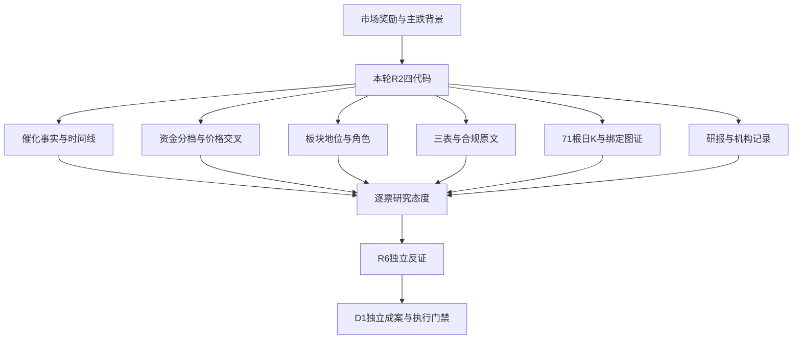

# 2026年11月18日 · 个股画像

## 一句话结论
光刻前排与算力核心分开观察，已证财务风险不被涨停覆盖；本报告不产生买权。

## 🧭 研究范围与市场前提

情绪=主跌。主线 = 光刻机/胶（国产替代），持续性 = 1日，封板率 = 70%，明日预期 = 分歧。以上继承本轮R2，非R5重新评风格。炸板率约35.09%，R2已由8只压为4只，本阶段不重复机械砍池。

当前已评 4/4 只；未评对象：无。原始账户预算未知，不提升额度，不继承旧市场停买为硬禁。

## 详细分析

市场目前只为局部新首板和个别算力核心付钱，不能把四冰后的修复愿望写成主升已确认。因此本轮沿R2“首板隔日”研究主模板，不把3板高度、反包容量和所有低吸通道拼成超级策略。

西陇与盛剑均有前排交易辨识度，但产业纯度不同于先进光刻胶龙头。西陇H1电子化学品占产品合计约9%，盛剑约5.55%；这些真实收入证明有业务，不证明本轮新订单。西陇处罚公告引述的造假认定是实质反证，不因月度股性好、当日涨停而删去。

华东是本批高度锚，但H1芯片收入仅占产品合计约1.28%，加速板不能代替GPU业绩。华胜是容量反包候选，现金回款改善与累计亏损可以同时成立；存货增长快于营收且周转下降是需要D1和R6保留的风险，而不是用资金回流抹平。

四只都保留研究身份、真实原文与unknown。R5不设置入场/退出价格，盈亏比仍待D1真实推导；评级、图证可运输状态和辅助缺口都不单独生成买权或全局禁买。其余专题投影没有精确匹配本轮四代码，不因资料里出现其他名字而扩票。

## 📊 六维结论

| 股票 | R2角色 | 态度 | 研究分 | alpha / risk | 必要核验 |
|---|---|---|---:|---|---|
| 西陇科学 002584.SZ | 龙一 | 降级 | 53.83 | B+ / C | 局部未核，非默认安全 |
| 盛剑科技 603324.SH | 龙二 | 降级 | 47.17 | B / B- | 局部未核，非默认安全 |
| 华东重机 002685.SZ | 龙一 | 观察 | 56.5 | B+ / B- | 局部未核，非默认安全 |
| 华胜天成 600410.SH | 龙二 | 观察 | 55.0 | B+ / B- | 局部未核，非默认安全 |

### 🔎 西陇科学 · 002584.SZ · 降级

光刻首板前排但历史财务造假原决定已核；降级，S2按原规则交R6独立硬否决审查。

- **大资金意图**: 研究解释（资金身份未核）：前排封板带来短线风险偏好回流，但分档与DC需逐日核；不能用负的net_mf_amount把正分档流错误判为出货。
- **为什么走强**: 71根日K中最新价收复MA5/10/20/30，但仍低于MA50，30交易日收益为负。属于箱体上沿修复，不据一次涨停认证主升；图文的突破观察不等于突破确认。
- **逻辑够不够硬**: 电子材料叙事不能覆盖原[2023]16号已终结处罚认定的虚构贸易。原文称整改、不触发强退与本研究S2硬反证并存，不冒充新立案。

**买入理由**: 电子材料进口替代提供产业研究理由；11月17日首封09:35且板块有7只封板，提供前排相对地位证据。仅研究，不构成买入。

**风险点**: 历史财务虚假记载及未决证券诉讼；电子化学品不等于先进光刻胶；日中期均线未完全转多。

**止损条件**: 若官方确认新增重大违法、撤销关键业务事实，或次日板块前排集体失去承接，研究假设失效；不在R5给止损价格。

**可验证假设**: 未来1—3交易日核光刻胶封板家数是否仍≥3、该票是否保持早于主要助攻的承接；无扩散或出现官方业务否认即否定接力假设。

| 维度 | 分数 | 证据与判断 |
|---|---:|---|
| 催化 | 66 | 国产替代是板块催化，电子化学品已有业务不等于先进光刻胶自产或HBM扩产新订单。半年报分部可核，年度披露历史违规与赔偿必须独立保留。 |
| 筹码 | 58 | 前排封板带来短线风险偏好回流，但分档与DC需逐日核；不能用负的net_mf_amount把正分档流错误判为出货。 |
| 联动 | 73 | 光刻胶低位前排、双源人气及最早10cm时序；配套试剂≠自产先进光刻胶，订单与带动因果待R5核；配套试剂历史映射不能升级光刻胶新订单；今日开盘兑现未知 |
| 财务估值 | 28 | PS相对不高但低毛利化学品/贸易占大头；PE高且利润同比来自亏损基数，不宜用高增速机械套低PEG。已核历史造假披露比相对便宜更重要。 |
| 技术 | 58 | 71根日K中最新价收复MA5/10/20/30，但仍低于MA50，30交易日收益为负。属于箱体上沿修复，不据一次涨停认证主升；图文的突破观察不等于突破确认。 |
| 机构 | 40 | 近30自然日1篇国泰海通增持报告，三个预测年度不是三篇；未读研报全文、未验证目标价，不支持当日机构买盘。 |

量价：71根日K，30交易日收益`-8.87%`，MA20=`7.309`，MA50=`8.057`。五日分档主力`1.2840亿元`，DC`1.2820亿元`；同源运输不另加一票。

板型：首板回封；Tushare开板1次，THS为0次，保留冲突。龙头纪律已核`2/3`必要条目，地位仍暂定。盈亏比`unknown`，R5不设买卖价，由D1按原门禁推导；禁止清单已命中项仅继承R2已核内容，未知不当全通过。

财务逐项：F1=checked_negative；F2=checked_negative；F3=checked_negative；F4=checked_negative；F5=checked_negative；F6=checked_negative；F7=checked_negative；F8=checked_negative；F9=checked_negative；F10=unknown；F11=checked_negative；F12=checked_negative；S1=checked_negative；S2=flagged；S3=unknown。

图证：复用绑定快照原record，未在本阶段独立视觉读取PNG；周线/分钟各自数据日与复权限定随JSON运输。`available`只是校验可运输，不是突破已确认。

### 🔎 盛剑科技 · 603324.SH · 降级

同批首板不等于产业龙头；前三季亏损、应收/收入过高、低换手，降级为前排联动观察。

- **大资金意图**: 研究解释（资金身份未核）：首封早、封单抑制成交与低换手并存，不能只凭未开板宣布充分机构合力；与西陇共享主线证据不重复计票。
- **为什么走强**: 71根日K显示仅勉强收复MA30，仍低于MA50；涨停是下跌后的箱体反弹，不是已证主升。日内开板0不等于全天一字，开盘与最低价已明确不是全日同价。
- **逻辑够不够硬**: F9应收/累计收入>40%为已证软反证；亏损不自动等于ST。监管窗口缺口另列，不做安全认证。

**买入理由**: 绿色厂务与电子化学品提供半导体供应链映射；同批早封板提供短线辨识度，但经营数据未支持加速估值。仅研究。

**风险点**: 前三季归母亏损；应收高于累计营收；换手低于板块中位与日中期趋势仍弱。

**止损条件**: 若主线回流而该股不能同步，或应收回款/新增订单假设被原文证伪，取消第二前排假设；R5不定价格。

**可验证假设**: 未来1—3交易日观察同板块扩散能否带动其有效换手并相对强于板块；只剩单票缩量封单不算合力验证。

| 维度 | 分数 | 证据与判断 |
|---|---:|---|
| 催化 | 57 | 有电子化学品与绿色厂务业务，但不能把FPD剥离/蚀刻历史标签改写为先进光刻胶大单；本轮尚无该公司新增量产订单原文。 |
| 筹码 | 48 | 首封早、封单抑制成交与低换手并存，不能只凭未开板宣布充分机构合力；与西陇共享主线证据不重复计票。 |
| 联动 | 66 | 与西陇同批最早10cm，SDK首封稍后且同花顺同刻；先作第二前排，不能从1.65%换手证明充分换手或机构合力；FPD剥离/蚀刻液历史关联≠EUV光刻胶；换手低于行业中位数，承接证据弱 |
| 财务估值 | 36 | PS框架比负PE更合适；Q3累计营收下滑且亏损，净资产仍正但应收超过9个月营收，收入变现与验收周期是核心风险。 |
| 技术 | 40 | 71根日K显示仅勉强收复MA30，仍低于MA50；涨停是下跌后的箱体反弹，不是已证主升。日内开板0不等于全天一字，开盘与最低价已明确不是全日同价。 |
| 机构 | 36 | 近30日研报返回0，11月17日为面向投资者的业绩说明会，不冒充机构调研或机构追捧。 |

量价：71根日K，30交易日收益`-16.62%`，MA20=`20.074`，MA50=`22.841`。五日分档主力`0.1178亿元`，DC`0.1187亿元`；同源运输不另加一票。

板型：首板未开板，日线开18.76/低18.41/收20.82，非全日一字。龙头纪律已核`0/3`必要条目，地位仍暂定。盈亏比`unknown`，R5不设买卖价，由D1按原门禁推导；禁止清单已命中项仅继承R2已核内容，未知不当全通过。

财务逐项：F1=checked_negative；F2=checked_negative；F3=checked_negative；F4=checked_negative；F5=checked_negative；F6=not_applicable；F7=unknown；F8=checked_negative；F9=flagged；F10=unknown；F11=checked_negative；F12=checked_negative；S1=checked_negative；S2=unknown；S3=unknown。

图证：复用绑定快照原record，未在本阶段独立视觉读取PNG；周线/分钟各自数据日与复权限定随JSON运输。`available`只是校验可运输，不是突破已确认。

### 🔎 华东重机 · 002685.SZ · 观察

唯一3板是高度地位，不是GPU经营龙头；芯片收入占比小、定增待注册，一字缩量后接力风险高。

- **大资金意图**: 研究解释（资金身份未核）：高度与极低流通供给形成抢先手，11月16日换手后17日缩量；这种结构也容易在一致转分歧时放大兑现压力。THS/DC冲突不择优消除。
- **为什么走强**: 71根日K站上全部日均线，连续3板收6.70，30日上涨明显；最新OHLC同价为日线一字形态，量能急缩只表明可交易筹码少，不能证明次日承接。
- **逻辑够不够硬**: 锐信图芯2025业绩承诺未完成且商誉已减值；现有商誉占比不高不代表产业兑现完成。

**买入理由**: GPU国产替代提供切换题材；唯一非ST3板与日线多头提供地位及量价证据。只能列计划内试错研究，不授予追板许可。

**风险点**: 一致缩量与次日筹码释放；芯片收入占比小、锐信业绩未达标；定增审批及摊薄。

**止损条件**: 若换手后失去高度与低位助攻，或GPU核心业务事实被证伪，失去高度试错研究理由；不因跌回均线改做左侧抄底。

**可验证假设**: 未来1—3交易日核能否以有效换手保留最高标地位，并带动≥3只同题材强势对象；仅自身一字而助攻消失不算确认。

| 维度 | 分数 | 证据与判断 |
|---|---:|---|
| 催化 | 60 | GPU国产替代给主题映射；已读11月17日异动公告称经营环境无重大变化，2.92亿元定增用于智能制造基地且注册待批，不是GPU订单落地。 |
| 筹码 | 55 | 高度与极低流通供给形成抢先手，11月16日换手后17日缩量；这种结构也容易在一致转分歧时放大兑现压力。THS/DC冲突不择优消除。 |
| 联动 | 70 | 唯一非ST3板高度锚；网站映射GPU，与东数西算成分非同一集合；缩量封单不能单凭板数叫总龙；THS当日-1.210608亿与DC+0.513341亿矛盾，不能平均；一字预测不是排单许可 |
| 财务估值 | 48 | 主体收入仍为集装箱装卸设备；H1芯片收入仅小部分，不可用全部市值按高增长纯GPU公司估值。PE/PB处于什么历史位置需分位计算后再看。 |
| 技术 | 72 | 71根日K站上全部日均线，连续3板收6.70，30日上涨明显；最新OHLC同价为日线一字形态，量能急缩只表明可交易筹码少，不能证明次日承接。 |
| 机构 | 34 | 近30日研报与调研接口返回0；只表接口覆盖窗口无记录，不推出机构永久冷落。 |

量价：71根日K，30交易日收益`27.38%`，MA20=`4.937`，MA50=`5.139`。五日分档主力`3.0978亿元`，DC`3.0703亿元`；同源运输不另加一票。

板型：3连板，11月17日日线OHLC均为6.70，一字日K；逐笔封单承接未核。龙头纪律已核`1/3`必要条目，地位仍暂定。盈亏比`unknown`，R5不设买卖价，由D1按原门禁推导；禁止清单已命中项仅继承R2已核内容，未知不当全通过。

财务逐项：F1=checked_negative；F2=checked_negative；F3=checked_negative；F4=checked_negative；F5=checked_negative；F6=checked_negative；F7=checked_negative；F8=checked_negative；F9=checked_negative；F10=unknown；F11=checked_negative；F12=checked_negative；S1=checked_negative；S2=unknown；S3=unknown。

图证：复用绑定快照原record，未在本阶段独立视觉读取PNG；周线/分钟各自数据日与复权限定随JSON运输。`available`只是校验可运输，不是突破已确认。

### 🔎 华胜天成 · 600410.SH · 观察

容量反包核心而非连续2板；五日资金有回流但亏损、存货与低毛利约束真实，观察分离承接。

- **大资金意图**: 研究解释（资金身份未核）：容量与热度使其成为回流载体，DC五日净入需与分档同日比较；H1到Q3现金改善不能代替股价次日买盘。
- **为什么走强**: 71根日K收复全部短中期均线，3天2板反包；前一天冲高回落仍需消化，不把反包称两连板。长周期历史结构不能用盘前分钟承接措辞。
- **逻辑够不够硬**: F4存货增速与周转率构成软反证；第一大股东高质押应披露，但无控股身份时不可偷换F11定义。

**买入理由**: 国产算力系统集成映射与容量地位提供产业和交易研究理由；反包及资金回流有事实，不等于全板块主升。

**风险点**: 前三季归母亏损；存货堆积/周转下降；出口限制与毛利压缩；第一大股东质押需单列。

**止损条件**: 若指数/算力修复而该股不能相对走强、资金持续净出或业务映射被官方证伪，取消容量分离假设；R5不设置交易价格。

**可验证假设**: 未来1—3交易日核与高度锚能否独立走强并出现≥3只同题材助攻；反包次日无承接视为短线假设证伪。

| 维度 | 分数 | 证据与判断 |
|---|---:|---|
| 催化 | 64 | 本土算力替代与BIS限制双向作用；系统集成能承接国产化预算不代表海外GPU供货自动放松。尚无本公司新增订单/利润兑现原文。 |
| 筹码 | 60 | 容量与热度使其成为回流载体，DC五日净入需与分档同日比较；H1到Q3现金改善不能代替股价次日买盘。 |
| 联动 | 70 | 算力系统容量/人气核心，3天2板不是连续2板；独立于华东高度线作龙二观察，非总龙授予；DC五日+12.699704亿但THS解析窗11/12—17为负，非可比五交易日；毛利率与BIS双向约束仍在 |
| 财务估值 | 36 | TTM亏损下PE不可用，采用PS加毛利与存货/现金流检验；营收增长并未带来利润同步，PB4倍也非天然安全垫。 |
| 技术 | 66 | 71根日K收复全部短中期均线，3天2板反包；前一天冲高回落仍需消化，不把反包称两连板。长周期历史结构不能用盘前分钟承接措辞。 |
| 机构 | 34 | 近30日研报与调研接口返回0；只表接口覆盖窗口无记录，不推出机构永久冷落。 |

量价：71根日K，30交易日收益`4.80%`，MA20=`12.434`，MA50=`13.734`。五日分档主力`12.3198亿元`，DC`12.6997亿元`；同源运输不另加一票。

板型：首板回封、3天2板反包，开板1次。龙头纪律已核`2/3`必要条目，地位仍暂定。盈亏比`unknown`，R5不设买卖价，由D1按原门禁推导；禁止清单已命中项仅继承R2已核内容，未知不当全通过。

财务逐项：F1=checked_negative；F2=checked_negative；F3=checked_negative；F4=flagged；F5=checked_negative；F6=not_applicable；F7=unknown；F8=checked_negative；F9=checked_negative；F10=unknown；F11=not_applicable；F12=checked_negative；S1=checked_negative；S2=unknown；S3=unknown。

图证：复用绑定快照原record，未在本阶段独立视觉读取PNG；周线/分钟各自数据日与复权限定随JSON运输。`available`只是校验可运输，不是突破已确认。

## 🧮 逐票数字与必要缺口

| 股票 | 可核经营结构 / 已证风险 | 辅助核验与范围 |
|---|---|---|
| 西陇科学 | H1电子化学品收入占产品合计9.00%，非先进光刻胶纯业务；S2：已读公司公告全文逐字引述的原行政处罚决定主要内容及2025年报延续诉讼，满足历史财务造假实锤。原案调查审理终结，不称当前在查；原R6硬否决规则适用由R6独立裁决，R5不得删事实。 | 30自然日龙虎榜已核22交易日；资金冲突=在已定义5%公式下未触发；F12年度意见已核，当前S2/S3逐项见JSON |
| 盛剑科技 | H1绿色厂务占68.99%、电子化学品5.55%，非EUV光刻胶认证；F9：应收855782764.87元 / Q3累计营收791842595.13元=108.07% >40% | 30自然日龙虎榜已核22交易日；资金冲突=有；F12年度意见已核，当前S2/S3逐项见JSON |
| 华东重机 | H1芯片领域收入969.67万元，占产品合计1.28%；97.68%为装卸设备；本表已算项未命中红旗，不代表全部合规安全 | 30自然日龙虎榜已核22交易日；资金冲突=有；F12年度意见已核，当前S2/S3逐项见JSON |
| 华胜天成 | Q3归母累计亏损2.59亿元；经营现金流累计4.31亿元，不把回款改写盈利；F4：存货同比102.23% > 营收同比20.83%×1.5，9个月周转2.520 < 去年同期3.314 | 30自然日龙虎榜已核22交易日；资金冲突=在已定义5%公式下未触发；F12年度意见已核，当前S2/S3逐项见JSON |

所有检查都保留公式、实际输入、单位、期间、公告日期和原文页码。F8最近两个独立单季未命中，不把累计负值误判连续恶化；F10债务明细缺项仍unknown。盛剑股东户数H1至Q3下降40.34%仅是集中线索，不能抵消亏损与应收风险；华胜第一大股东Q3约80%质押另列，但公司无控股股东，F11按定义not_applicable。

## 关键证据

- 同版R5嵌入71根日K、5日分档/DC及价格序列，供R6独立复算。
- 实际三表按同季度累计比较，现金流先累计转单季，不把连续累计负值误判F8。
- 专题股性只采4行历史投影；预测素材不等于一字命中，成长/红利/增持资料没有本轮四代码精确命中，不扩票。

## 数据源审计

| 源 | 日期 | 状态 | 备注 |
|---|---|:--:|---|
| R2 / R4 / R7本轮 | 2026-11-18 | 🟢 | 已核版本hash与实际窗口；R7未覆盖不构成否决 |
| Tushare SDK行情/资金/三表 | 2026-11-18 | 🟢 | 每票71根K，市场事实截至2026-11-17；与MCP不独立重复加权 |
| 公司年报/半年报/季报PDF | 2026-11-18 | 🟢 | 26份已取得；仅选定段落实际阅读，非26份全文阅读 |
| 绑定图像分析记录 | 2026-11-18 | 🟡 | 4只覆盖；T-1结构，周期复权与视觉读取限定保留 |
| 交易所/证监局当前窗口 | 2026-11-18 | 🟡 | 不完整，逐票unknown不冒充阴性 |
| canghai-sise / 缠论 | 2026-11-18 | 🟡 | 独立证据未核，不据缺图改评级或买权 |

## 不确定性 / 反证

价格上涨不证明经营兑现。西陇历史违规、盛剑亏损与应收、华东GPU收入小且商誉减值、华胜存货与亏损分别保留；西陇原处罚决定已取得并读原文；其他公司当前监管/交易所窗口未完整覆盖，不把未查当阴性。资金冲突留双方，不择优采信。必要检查未闭环仅表本票研究未核，非R5全局禁买。Mermaid 11.4.0 已由真实浏览器解析并渲染SVG，回执见R5_render_validation.json；只认证本图可渲染，不认证投资结论。

## 与其他 R/D/E 的关系

- 依赖：本轮R2、R4、R7及绑定图证。
- 被消费：R6只读本版JSON内嵌事实；D1从同版R5图证副本消费，不读取后来raw/latest冒充本轮输入；E1复盘。

## Sub-Agent 元数据

- skill: analyze_stock_profile_v1
- artifact: data/research/20261118/R5_stock_profiles.json
- 生成耗时: 1187 秒（自本阶段启动至本版生成）
- model: gpt-6.1-sol
- 状态：partial；真实覆盖与未核事项见JSON，不声称全量审核完成。
