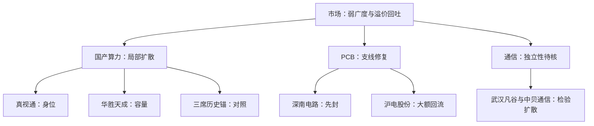

# 2026年11月19日 · 个股画像

## 🧭 一句话结论
算力身位和容量各有核心，PCB只作修复对照；不把昨日涨停当今日承接。

情绪=震荡/主跌（偏弱震荡，未认证主跌）；涨停41、炸板24，炸板率36.92%。全A上涨1,318、下跌4,133，昨日涨停开盘平均溢价+3.19%、收盘+1.57%；低位先手相对占优，追价后回吐。主模板：分歧接力。

状态：partial；已评 9/9（002771.SZ, 600410.SH, 002354.SZ, 002579.SZ, 603636.SH, 002916.SZ, 002463.SZ, 002194.SZ, 603220.SH）；未评：无；聚焦：002771.SZ, 600410.SH, 002916.SZ, 002463.SZ。研究范围不变，活跃聚焦减半，不新增权限。

## 📊 逐股比较

| 代码 | 标的 | 身位 | 态度 | 进攻/风险 | 近5日大单/东财（亿） |
|---|---|---|---|---|---|
| 002771.SZ | 真视通 | 前排卡位，非总龙 | 观察 | B+/B- | +0.560/+0.556 |
| 600410.SH | 华胜天成 | 算力容量核心 | 观察 | A-/B- | +15.071/+15.447 |
| 002354.SZ | 天娱数科 | 历史锚对照 | 降级 | C/B- | -8.347/-8.386 |
| 002579.SZ | 中京电子 | 历史锚对照 | 降级 | B-/B- | -0.810/-0.812 |
| 603636.SH | 南威软件 | 背离对照 | 拦截 | C/C | +0.428/+0.406 |
| 002916.SZ | 深南电路 | PCB支线身位 | 观察 | B+/B | +1.713/+1.660 |
| 002463.SZ | 沪电股份 | PCB容量交叉 | 观察 | B+/B- | -2.679/-2.825 |
| 002194.SZ | 武汉凡谷 | 通信早封对照 | 观察 | B/B- | +0.831/+0.827 |
| 603220.SH | 中贝通信 | 算力与通信交叉对照 | 观察 | B/B- | +1.196/+1.207 |

### 真视通 · 002771.SZ
- **大资金意图**: 5日大单净额+0.560亿，东财+0.556亿；实际资金意图不可由分档单独识别。
- **为什么走强**: 早封二板和租赁扩散同向，但当日大单净卖、三日榜净卖，接力由价格先行而非确定机构加仓。 收13.07，5/20日+19.25%/+5.74%，量比1.77，收盘突破过去20日高点（数字事实，非次日确认），站上MA30。
- **逻辑够不够硬**: R4未有本股直接已核新催化；产业链事件只代表传导假设，不是中标、订单或收益。 产业需求、上市公司收入、订单兑现分开；两家分档资金口径不作两份机构席位。
- **买入理由**: 本栏仅记录可复核的观察理由，非买入指令。前排卡位，非总龙；早封二板和租赁扩散同向，但当日大单净卖、三日榜净卖，接力由价格先行而非确定机构加仓。
- **风险点**: 2026Q3累计归母-0.361亿元；PE(TTM)=缺值，不作低估；红旗F9,F3,F4。 同版前置记录缺失；交获准图像生产端，R6/D1不补抓 T+1及前排兑现风险不可用评级抵销。
- **止损条件**: 只列研究证伪：若华胜同步失承接或租赁封板簇回落，卡位假设失效。 真实盈亏比/失效价未完成，R5不生成委托或止损。
- **可验证假设**: 于本次竞价/开盘核对分时溢价、涨停簇、换手与同窗资金变化；若华胜同步失承接或租赁封板簇回落，卡位假设失效。
- **板型及纪律**: T-1早盘封板未开；龙头（T-1早封高度规则，非总龙）；RR unknown；禁止清单为T-1有限范围，11/19未认证；计划内状态未知。
- **财务缺口**: F2, F7, F11, S2, S3, current_material_compliance；必要合规完成=False。已证命中：F9, F3, F4。
- **股东/席位与机构**: 股东户数变动（%）-9.070899580506497；龙虎榜核日30；Tushare窗口研报0篇（接口内去重），机构调研原始行0；不推机构仓位。
- **事件时间线**: 2026-11-18 腾讯核心盈利承压与资本支出扩张同现；2026-11-18 腾讯资本开支和云服务增长；20261118 Tushare涨停：高度2，首次封板93003，开板0；20261118 Tushare 龙虎榜入榜（按实际理由保留记录，非日内全量资金）

### 华胜天成 · 600410.SH
- **大资金意图**: 5日大单净额+15.071亿，东财+15.447亿；实际资金意图不可由分档单独识别。
- **为什么走强**: 成交与五日同窗净流入强于真视通；资金更像容量博弈。异动公告明确基本面未重大变化，不把两连/四天三板写成连续四板。 收16.82，5/20日+34.56%/+26.28%，量比1.60，收盘突破过去20日高点（数字事实，非次日确认），站上MA30。
- **逻辑够不够硬**: 存在精确R4发行人事实；先读反证。 产业需求、上市公司收入、订单兑现分开；两家分档资金口径不作两份机构席位。
- **买入理由**: 本栏仅记录可复核的观察理由，非买入指令。算力容量核心；成交与五日同窗净流入强于真视通；资金更像容量博弈。异动公告明确基本面未重大变化，不把两连/四天三板写成连续四板。
- **风险点**: 2026Q3累计归母-2.592亿元；PE(TTM)=缺值，不作低估；红旗在已算项无命中。 模型记录已绑定，不声称本会话已读图。周线/分钟的复权与可比性以逐周期字段为准；不确认盘中信号。 T+1及前排兑现风险不可用评级抵销。
- **止损条件**: 只列研究证伪：若涨停溢价开盘即兑现或容量净流入逆转，不再按容量领涨解释。 真实盈亏比/失效价未完成，R5不生成委托或止损。
- **可验证假设**: 于本次竞价/开盘核对分时溢价、涨停簇、换手与同窗资金变化；若涨停溢价开盘即兑现或容量净流入逆转，不再按容量领涨解释。
- **板型及纪律**: T-1早盘封板未开；未证独立龙头，研究身位沿用R2；RR unknown；禁止清单为T-1有限范围，11/19未认证；计划内状态未知。
- **财务缺口**: F7, F11, S2, S3, current_material_compliance；必要合规完成=False。已证命中：无（仅限已算项）。
- **股东/席位与机构**: 股东户数变动（%）1.0286592348839552；龙虎榜核日30；Tushare窗口研报0篇（接口内去重），机构调研原始行0；不推机构仓位。
- **事件时间线**: 2026-11-18 腾讯资本开支和云服务增长；20261118 Tushare涨停：高度2，首次封板95501，开板0；20261118 Tushare 龙虎榜入榜（按实际理由保留记录，非日内全量资金）；20261119 华胜天成｜华胜天成异动；11/18换手19.03%，前三季归母亏2.59亿元，公告称基本面未重大变化

### 天娱数科 · 002354.SZ
- **大资金意图**: 5日大单净额-8.347亿，东财-8.386亿；实际资金意图不可由分档单独识别。
- **为什么走强**: 小幅上涨不能抵消5日量价与资金双弱；仅用来检验算力是否扩散，不取代双核心。 收7.15，5/20日-16.67%/-9.61%，量比0.66，仍在过去20日高低区间（非突破），未收复MA30。
- **逻辑够不够硬**: R4未有本股直接已核新催化；产业链事件只代表传导假设，不是中标、订单或收益。 产业需求、上市公司收入、订单兑现分开；两家分档资金口径不作两份机构席位。
- **买入理由**: 本栏仅记录可复核的观察理由，非买入指令。历史锚对照；小幅上涨不能抵消5日量价与资金双弱；仅用来检验算力是否扩散，不取代双核心。
- **风险点**: 2026Q3累计归母+0.509亿元；PE(TTM)=缺值，不作低估；红旗F4,S1。 同版前置记录缺失；交获准图像生产端，R6/D1不补抓 T+1及前排兑现风险不可用评级抵销。
- **止损条件**: 只列研究证伪：若板块继续走强而其仍弱于板块中位且流出持续，剔除作为接力对象。 真实盈亏比/失效价未完成，R5不生成委托或止损。
- **可验证假设**: 于本次竞价/开盘核对分时溢价、涨停簇、换手与同窗资金变化；若板块继续走强而其仍弱于板块中位且流出持续，剔除作为接力对象。
- **板型及纪律**: T-1未收涨停；未证独立龙头，研究身位沿用R2；RR unknown；禁止清单为T-1有限范围，11/19未认证；计划内状态未知。
- **财务缺口**: F7, F11, S2, S3, current_material_compliance；必要合规完成=False。已证命中：F4, S1。
- **股东/席位与机构**: 股东户数变动（%）-4.3778492200502335；龙虎榜核日30；Tushare窗口研报0篇（接口内去重），机构调研原始行0；不推机构仓位。
- **事件时间线**: 20261027 Tushare 龙虎榜入榜（按实际理由保留记录，非日内全量资金）；20261028 Tushare 龙虎榜入榜（按实际理由保留记录，非日内全量资金）；20261029 2026年三季度报告；20261030 Tushare 龙虎榜入榜（按实际理由保留记录，非日内全量资金）

### 中京电子 · 002579.SZ
- **大资金意图**: 5日大单净额-0.810亿，东财-0.812亿；实际资金意图不可由分档单独识别。
- **为什么走强**: 小幅回升、当日大单偏正；五日资金和二十日结构仍弱，不能把单次反弹当板块新前排。 收11.06，5/20日-12.98%/-28.09%，量比0.85，仍在过去20日高低区间（非突破），未收复MA30。
- **逻辑够不够硬**: R4未有本股直接已核新催化；产业链事件只代表传导假设，不是中标、订单或收益。 产业需求、上市公司收入、订单兑现分开；两家分档资金口径不作两份机构席位。
- **买入理由**: 本栏仅记录可复核的观察理由，非买入指令。历史锚对照；小幅回升、当日大单偏正；五日资金和二十日结构仍弱，不能把单次反弹当板块新前排。
- **风险点**: 2026Q3累计归母-1.174亿元；PE(TTM)=缺值，不作低估；红旗F9,F10,F3,F4。 同版前置记录缺失；交获准图像生产端，R6/D1不补抓 T+1及前排兑现风险不可用评级抵销。
- **止损条件**: 只列研究证伪：需要同群修复和连续资金改善，否则历史辨识度无验证力。 真实盈亏比/失效价未完成，R5不生成委托或止损。
- **可验证假设**: 于本次竞价/开盘核对分时溢价、涨停簇、换手与同窗资金变化；需要同群修复和连续资金改善，否则历史辨识度无验证力。
- **板型及纪律**: T-1未收涨停；未证独立龙头，研究身位沿用R2；RR unknown；禁止清单为T-1有限范围，11/19未认证；计划内状态未知。
- **财务缺口**: F7, S2, S3, current_material_compliance；必要合规完成=False。已证命中：F9, F10, F3, F4。
- **股东/席位与机构**: 股东户数变动（%）-20.393078450674572；龙虎榜核日30；Tushare窗口研报0篇（接口内去重），机构调研原始行0；不推机构仓位。
- **事件时间线**: 20261013 Tushare 龙虎榜入榜（按实际理由保留记录，非日内全量资金）；20261023 关于对子公司提供担保进展情况的公告；20261023 2026年三季度报告；20261112 关于签订募集资金三方监管协议的公告

### 南威软件 · 603636.SH
- **大资金意图**: 5日大单净额+0.428亿，东财+0.406亿；实际资金意图不可由分档单独识别。
- **为什么走强**: 板块扩散时该股收跌，小幅净流入不足以验证承接；不把历史股性升级成涨停逻辑。 收8.14，5/20日-9.86%/-16.77%，量比0.76，仍在过去20日高低区间（非突破），未收复MA30。
- **逻辑够不够硬**: R4未有本股直接已核新催化；产业链事件只代表传导假设，不是中标、订单或收益。 产业需求、上市公司收入、订单兑现分开；两家分档资金口径不作两份机构席位。
- **买入理由**: 本栏仅记录可复核的观察理由，非买入指令。背离对照；板块扩散时该股收跌，小幅净流入不足以验证承接；不把历史股性升级成涨停逻辑。
- **风险点**: 2026Q3累计归母-2.205亿元；PE(TTM)=缺值，不作低估；红旗F9,F3,F4,F12,S1,S2,S3。 同版前置记录缺失；交获准图像生产端，R6/D1不补抓 T+1及前排兑现风险不可用评级抵销。
- **止损条件**: 只列研究证伪：若下一次主线强而该股仍相对走弱，不升级。 真实盈亏比/失效价未完成，R5不生成委托或止损。
- **可验证假设**: 于本次竞价/开盘核对分时溢价、涨停簇、换手与同窗资金变化；若下一次主线强而该股仍相对走弱，不升级。
- **板型及纪律**: T-1未收涨停；未证独立龙头，研究身位沿用R2；RR unknown；禁止清单为T-1有限范围，11/19未认证；计划内状态未知。
- **财务缺口**: F7；必要合规完成=True。已证命中：F9, F3, F4, F12, S1, S2, S3, current_material_compliance。
- **股东/席位与机构**: 股东户数变动（%）12.329815387558597；龙虎榜核日30；Tushare窗口研报0篇（接口内去重），机构调研原始行0；不推机构仓位。
- **事件时间线**: 20261029 南威软件：2026年第三季度报告；20261113 南威软件：关于控股股东部分股份质押延期购回的公告；20261113 Tushare涨停：高度1，首次封板133630，开板3；20261113 南威软件：关于控股股东部分股份质押延期购回的公告

### 深南电路 · 002916.SZ
- **大资金意图**: 5日大单净额+1.713亿，东财+1.660亿；实际资金意图不可由分档单独识别。
- **为什么走强**: 比沪电先封且未开板，五日资金仍正；但20日大幅回撤、当日量不及前5日均量，先作反弹而非趋势反转。 收201.19，5/20日-12.15%/-34.17%，量比0.92，仍在过去20日高低区间（非突破），未收复MA30。
- **逻辑够不够硬**: R4未有本股直接已核新催化；产业链事件只代表传导假设，不是中标、订单或收益。 产业需求、上市公司收入、订单兑现分开；两家分档资金口径不作两份机构席位。
- **买入理由**: 本栏仅记录可复核的观察理由，非买入指令。PCB支线身位；比沪电先封且未开板，五日资金仍正；但20日大幅回撤、当日量不及前5日均量，先作反弹而非趋势反转。
- **风险点**: 2026Q3累计归母+41.292亿元；PE(TTM)=26.9807；红旗F4。 同版前置记录缺失；交获准图像生产端，R6/D1不补抓 T+1及前排兑现风险不可用评级抵销。
- **止损条件**: 只列研究证伪：需观察次日放量承接与PCB多票修复；若沪电开板兑现、行业无扩散，深南孤强不升级。 真实盈亏比/失效价未完成，R5不生成委托或止损。
- **可验证假设**: 于本次竞价/开盘核对分时溢价、涨停簇、换手与同窗资金变化；需观察次日放量承接与PCB多票修复；若沪电开板兑现、行业无扩散，深南孤强不升级。
- **板型及纪律**: T-1午后封板未开；未证独立龙头，研究身位沿用R2；RR unknown；禁止清单为T-1有限范围，11/19未认证；计划内状态未知。
- **财务缺口**: F2, F7, F11, S2, S3, current_material_compliance；必要合规完成=False。已证命中：F4。
- **股东/席位与机构**: 股东户数变动（%）-18.37296760754379；龙虎榜核日30；Tushare窗口研报4篇（接口内去重），机构调研原始行130；不推机构仓位。
- **事件时间线**: 2026-11-18 腾讯核心盈利承压与资本支出扩张同现；2026-11-18 腾讯资本开支和云服务增长；20261118 Tushare涨停：高度1，首次封板131912，开板0；20261118 Tushare 龙虎榜入榜（按实际理由保留记录，非日内全量资金）

### 沪电股份 · 002463.SZ
- **大资金意图**: 5日大单净额-2.679亿，东财-2.825亿；实际资金意图不可由分档单独识别。
- **为什么走强**: 单日大单回流与成交领先，但五日总额仍负，且3次开板；区分回补与持续配置。 收80.19，5/20日-10.33%/-30.25%，量比1.24，仍在过去20日高低区间（非突破），未收复MA30。
- **逻辑够不够硬**: R4未有本股直接已核新催化；产业链事件只代表传导假设，不是中标、订单或收益。 产业需求、上市公司收入、订单兑现分开；两家分档资金口径不作两份机构席位。
- **买入理由**: 本栏仅记录可复核的观察理由，非买入指令。PCB容量交叉；单日大单回流与成交领先，但五日总额仍负，且3次开板；区分回补与持续配置。
- **风险点**: 2026Q3累计归母+56.219亿元；PE(TTM)=23.061；红旗F9。 同版前置记录缺失；交获准图像生产端，R6/D1不补抓 T+1及前排兑现风险不可用评级抵销。
- **止损条件**: 只列研究证伪：若单日回流不延续或深南先手溢价回吐，不按PCB共同修复解释。 真实盈亏比/失效价未完成，R5不生成委托或止损。
- **可验证假设**: 于本次竞价/开盘核对分时溢价、涨停簇、换手与同窗资金变化；若单日回流不延续或深南先手溢价回吐，不按PCB共同修复解释。
- **板型及纪律**: T-1首封回封；未证独立龙头，研究身位沿用R2；RR unknown；禁止清单为T-1有限范围，11/19未认证；计划内状态未知。
- **财务缺口**: F2, F5, F7, F11, S2, S3, current_material_compliance；必要合规完成=False。已证命中：F9。
- **股东/席位与机构**: 股东户数变动（%）-19.71436587644676；龙虎榜核日30；Tushare窗口研报6篇（接口内去重），机构调研原始行46；不推机构仓位。
- **事件时间线**: 2026-11-18 腾讯核心盈利承压与资本支出扩张同现；2026-11-18 腾讯资本开支和云服务增长；20261118 Tushare涨停：高度1，首次封板133015，开板3；20261118 Tushare 龙虎榜入榜（按实际理由保留记录，非日内全量资金）

### 武汉凡谷 · 002194.SZ
- **大资金意图**: 5日大单净额+0.831亿，东财+0.827亿；实际资金意图不可由分档单独识别。
- **为什么走强**: 早封首板且五日偏正，但通信仅两只封板、封板率40%；早封是子组身位，不是独立总龙。 收9.31，5/20日-0.96%/-1.38%，量比1.27，仍在过去20日高低区间（非突破），站上MA30。
- **逻辑够不够硬**: R4未有本股直接已核新催化；产业链事件只代表传导假设，不是中标、订单或收益。 产业需求、上市公司收入、订单兑现分开；两家分档资金口径不作两份机构席位。
- **买入理由**: 本栏仅记录可复核的观察理由，非买入指令。通信早封对照；早封首板且五日偏正，但通信仅两只封板、封板率40%；早封是子组身位，不是独立总龙。
- **风险点**: 2026Q3累计归母-0.045亿元；PE(TTM)=缺值，不作低估；红旗F3,F4。 同版前置记录缺失；交获准图像生产端，R6/D1不补抓 T+1及前排兑现风险不可用评级抵销。
- **止损条件**: 只列研究证伪：只有新增通信封板簇与两票同步才可重估独立性；单票脉冲降级。 真实盈亏比/失效价未完成，R5不生成委托或止损。
- **可验证假设**: 于本次竞价/开盘核对分时溢价、涨停簇、换手与同窗资金变化；只有新增通信封板簇与两票同步才可重估独立性；单票脉冲降级。
- **板型及纪律**: T-1早盘封板未开；未证独立龙头，研究身位沿用R2；RR unknown；禁止清单为T-1有限范围，11/19未认证；计划内状态未知。
- **财务缺口**: F2, F7, F11, S2, S3, current_material_compliance；必要合规完成=False。已证命中：F3, F4。
- **股东/席位与机构**: 股东户数变动（%）4.3710303966433495；龙虎榜核日30；Tushare窗口研报0篇（接口内去重），机构调研原始行0；不推机构仓位。
- **事件时间线**: 20261027 2026年三季度报告；20261027 关于增加2026年度日常关联交易预计的公告；20261027 关于计提2026年前三季度资产减值准备的公告；20261118 Tushare涨停：高度1，首次封板93000，开板0

### 中贝通信 · 603220.SH
- **大资金意图**: 5日大单净额+1.196亿，东财+1.207亿；实际资金意图不可由分档单独识别。
- **为什么走强**: 当日量比显著放大，开板后回封；不能区分纯通信或算力驱动，TTM高倍数伴低利润基数。 收15.62，5/20日+4.55%/-1.01%，量比4.05，仍在过去20日高低区间（非突破），站上MA30。
- **逻辑够不够硬**: R4未有本股直接已核新催化；产业链事件只代表传导假设，不是中标、订单或收益。 产业需求、上市公司收入、订单兑现分开；两家分档资金口径不作两份机构席位。
- **买入理由**: 本栏仅记录可复核的观察理由，非买入指令。算力与通信交叉对照；当日量比显著放大，开板后回封；不能区分纯通信或算力驱动，TTM高倍数伴低利润基数。
- **风险点**: 2026Q3累计归母+0.179亿元；PE(TTM)=589.9157；红旗F9,F10,F3,F4,F6。 同版前置记录缺失；交获准图像生产端，R6/D1不补抓 T+1及前排兑现风险不可用评级抵销。
- **止损条件**: 只列研究证伪：若放量无延续、量价背离或两组同时衰减，不确认独立领先。 真实盈亏比/失效价未完成，R5不生成委托或止损。
- **可验证假设**: 于本次竞价/开盘核对分时溢价、涨停簇、换手与同窗资金变化；若放量无延续、量价背离或两组同时衰减，不确认独立领先。
- **板型及纪律**: T-1首封回封；未证独立龙头，研究身位沿用R2；RR unknown；禁止清单为T-1有限范围，11/19未认证；计划内状态未知。
- **财务缺口**: F7, S2, S3, current_material_compliance；必要合规完成=False。已证命中：F9, F10, F3, F4, F6。
- **股东/席位与机构**: 股东户数变动（%）1.3703678427625654；龙虎榜核日30；Tushare窗口研报0篇（接口内去重），机构调研原始行0；不推机构仓位。
- **事件时间线**: 20260423 2025年年度报告；20260423 关于控股股东部分股份质押的公告；20261029 2026年第三季度报告；20261118 Tushare涨停：高度1，首次封板111403，开板1

## ⚠️ 不确定性 / 反证
若真视通、华胜一起失承接，算力从接力假设转兑现观察；深南、沪电独强不自动接棒。若前一日溢价不回吐、宽度改善且各组多点跟随，再重评。观察窗口按R2原窗口，最晚开盘复评；非长期市场停买建议。公告与图像缺口由有权限生产端补，R6只读本版JSON；D1不另读raw/latest。

## 数据源审计

| 源 | 日期 | 状态 | 备注 |
|---|---|:--:|---|
| R2 / R4 / R7 | 2026-11-19 | 🟡 | 本run正式版本与哈希；R7早票池不覆盖不推停买 |
| Tushare daily / adj_factor / daily_basic | 2026-11-18 | 🟢 | 每票49日，日线价格独立算前复权，复权因子与原价格均留存 |
| Tushare moneyflow / moneyflow_dc | 2026-11-18 | 🟢 | 五日同窗双口径，不互相覆盖 |
| Tushare income / balancesheet / cashflow / fina_indicator / fina_audit | 2026-11-18 | 🟡 | 三表与年度审计结构化；当前监管与部分原文未闭环 |
| 前置chart_vision | 2026-11-19 | 🟡 | 本轮精确交集 1；图与日线不互相替代 |
| Tushare block_trade | 2026-11-18 | 🟢 | 9/9 个已评对象取得接口回执，细节及失败见JSON |
| Tushare margin_detail | 2026-11-18 | 🟢 | 9/9 个已评对象取得接口回执，细节及失败见JSON |
| Tushare limit_list_d | 2026-11-18 | 🟢 | 9/9 个已评对象取得接口回执，细节及失败见JSON |
| Tushare anns_d | 2026-11-18 | 🟢 | 9/9 个已评对象取得接口回执，细节及失败见JSON |
| Tushare report_rc | 2026-11-18 | 🟢 | 9/9 个已评对象取得接口回执，细节及失败见JSON |
| Tushare stk_holdernumber | 2026-11-18 | 🟢 | 9/9 个已评对象取得接口回执，细节及失败见JSON |
| Tushare stk_surv | 2026-11-18 | 🟢 | 9/9 个已评对象取得接口回执，细节及失败见JSON |
| Tushare pledge_detail | 2026-11-18 | 🟢 | 9/9 个已评对象取得接口回执，细节及失败见JSON |
| Tushare top10_holders | 2026-11-18 | 🟢 | 9/9 个已评对象取得接口回执，细节及失败见JSON |
| 专题及上游投影 | 2026-11-19 | 🟡 | 按source_id裁决，截取/partial不升格，来源重复不加权 |

## 🔗 与其他 R/D/E 的关系
R6复核同版财务、资金、公告和反证；禁止清单及真实账户硬规则不改。D1独立复评，不消费本文件作为交易授权。

## 📎 Sub-Agent 元数据
- skill: analyze_stock_profile_v1
- artifact: data/research/20261119/R5_stock_profiles.json
- context_sha256: `92c78b622af95fd9504d7f93c8de6480c65f81b64e711ef17bdfd57e9a821861`
- 净额、字段、期间、披露日和逐源裁决见同版 JSON。
