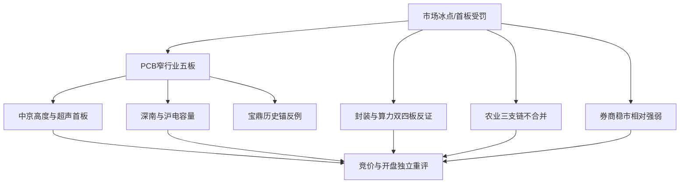

# 2026-11-23 · 个股画像

## 一句话结论
PCB有局部梯队但非主升；以农业和证券验证反向情景，不授予买权。

## 详细分析
11/20放量下跌：R2口径先手局部获奖、首板隔日和日内追价普遍受罚。PCB窄行业5板（48只、20只上涨，封板率100%，板块东财1日+20.39亿但5日−4.17亿）；局部轮动早期，非主升。11/23先验看分歧；中京与超声的梯队须和深南/沪电容量同时验证。若PCB独活/回吐，转核农业内部同支链或券商量价扩散；不能用一字或护盘一票证明风格翻转。

已画像 14/14；快照可归属 4/14；必要财务/合规全部齐备 0/14。未评选中：无。未晋级画像：长华集团：人形宽度4.18%，英国割草调查非人形催化；单首板对PCB/农业/券商的关键反向验证边际较低。；国泰海通：与中信功能重叠；前收+0.61%、资金近零；以中信代表容量锚检验。；龙版传媒：公开AI视频归组有早封，但不证广义AI应用成员或共振；该轮不是本阶段独立主假设。；华媒控股：AI应用成员、较晚首封且单日榜略净卖；泛AI的弱支验证已由荣联承担。

## 关键证据

### 中京电子（002579.SZ）｜观察｜窄PCB高度锚；2板先封带动、四个同业随后封；异动非新增订单
- **为什么走强**: 窄PCB高度锚：窄行业唯一2板；9:36先封，4家窄行业同伴之后封；东财个股5日+5.35亿但窄行业第4，地位来自带动而非资金第一。 板型：2板；首封93624，开板0次；认定 龙头 / R2检查通过4项；RR与止损距未核，禁止项：历史范围未见命中；非完整通过。
- **大资金意图**: 5日大/超大净额 5.37亿，东财 5.35亿；已列窗口未见偏差超既有界值。 数据是订单分档、不是账户身份；龙虎榜按原因分开。前复权日K 97根，11/20收13.39（+10.02%），对前5日量比1.65，近5/20日+15.03%/-2.76%；MA20 12.06，前20日高/低 13.88/10.61。历史越位不等于11/23突破。
- **逻辑够不够硬**: 2板先封带动、四个同业随后封；异动非新增订单；本窗索引公告 18条。PE/PB/PS=未知/2.99/2.77；三年PE分位未知%，前三季收入同比 +1.83%。按公开报表算红旗，非基本面过关。 Tushare 有界窗独立报告0份（成功返回零不等于全市场无覆盖）；调研活动0日，不视为建仓。
- **买入理由**: 仅为待证研究假设，不形成买权。2板先封带动、四个同业随后封；异动非新增订单。
- **风险点**: F3, F4, F9, F10；未核 F7, S2, S3。图文描述V反与数值修复一致，但13.39仍低于前20日高13.88，且20日收益仍负；不是中期突破。
- **止损条件**: 不预设执行价。结构失效：孤板、高开回吐或深南/沪电同步变弱，否定由点到面的修复。
- **可验证假设**: 11/23开盘核本票是否守住T−1结构、同支链是否出现后续确认；不确认保留观察。图像 available（历史，未独立验图）。

### 超声电子（000823.SZ）｜观察｜PCB首板助攻；零开板，单日承接强，但比中京少一板
- **为什么走强**: PCB首板助攻：首板首个窄行业助攻，零开板；窄行业东财5日第3，单日净+8.11亿、单日龙虎榜净买+4.41亿（不当持仓）。不是二板高度。 板型：1板；首封100045，开板0次；认定 低位助攻 / R2检查通过3项；RR与止损距未核，禁止项：历史范围未见命中；非完整通过。
- **大资金意图**: 5日大/超大净额 7.64亿，东财 7.62亿；已列窗口未见偏差超既有界值。 数据是订单分档、不是账户身份；龙虎榜按原因分开。前复权日K 97根，11/20收18.51（+9.98%），对前5日量比1.32，近5/20日+6.32%/-10.32%；MA20 17.63，前20日高/低 21.69/15.32。历史越位不等于11/23突破。
- **逻辑够不够硬**: 零开板，单日承接强，但比中京少一板；本窗索引公告 3条。PE/PB/PS=27.79/1.89/1.56；三年PE分位59.34%，前三季收入同比 +15.21%。按公开报表算红旗，非基本面过关。 Tushare 有界窗独立报告0份（成功返回零不等于全市场无覆盖）；调研活动0日，不视为建仓。
- **买入理由**: 仅为待证研究假设，不形成买权。零开板，单日承接强，但比中京少一板。
- **风险点**: F4；未核 F2, F5, F7, F11, S2, S3。本轮绑定快照无精确记录；只做日线量价判断，不拿相邻标的或新图替代。
- **止损条件**: 不预设执行价。结构失效：只剩自身大单、不能晋级或中京断板时不升级为高度锚。
- **可验证假设**: 11/23开盘核本票是否守住T−1结构、同支链是否出现后续确认；不确认保留观察。图像 unknown（历史，未独立验图）。

### 深南电路（002916.SZ）｜观察｜PCB容量对照；20日相对抗跌而未封，不能替换板位
- **为什么走强**: PCB容量对照：18日同沪电两板启动窗口；20日-0.59%相对抗跌、5日资金窄行业第二，证明容量能承接，不能替换板位。 板型：未封涨停；非板型；认定 容量/跨支反证 / R2检查通过3项；RR与止损距未核，禁止项：历史范围未见命中；非完整通过。
- **大资金意图**: 5日大/超大净额 9.11亿，东财 9.05亿；已列窗口未见偏差超既有界值。 数据是订单分档、不是账户身份；龙虎榜按原因分开。前复权日K 97根，11/20收210.00（-0.59%），对前5日量比1.30，近5/20日+0.85%/-25.79%；MA20 222.10，前20日高/低 285.00/179.90。历史越位不等于11/23突破。
- **逻辑够不够硬**: 20日相对抗跌而未封，不能替换板位；本窗索引公告 13条。PE/PB/PS=28.16/7.13/4.38；三年PE分位19.37%，前三季收入同比 +53.84%。按公开报表算红旗，非基本面过关。 Tushare 有界窗独立报告20份（成功返回零不等于全市场无覆盖）；调研活动0日，不视为建仓。
- **买入理由**: 仅为待证研究假设，不形成买权。20日相对抗跌而未封，不能替换板位。
- **风险点**: F4；未核 F2, F5, F7, F11, S2, S3。图文称低位修复，独立日K仍低于MA20且20日跌约26%；定位容量确认器，不以图的分钟箱体定价。
- **止损条件**: 不预设执行价。结构失效：中京加速而容量不收复均线，判为局部先手而非机构共振。
- **可验证假设**: 11/23开盘核本票是否守住T−1结构、同支链是否出现后续确认；不确认保留观察。图像 available（历史，未独立验图）。

### 沪电股份（002463.SZ）｜观察｜PCB资金容量对照；东财五日窄行业第一，20日仍收跌，资金口径与身位分开
- **为什么走强**: PCB资金容量对照：窄行业5日实测第一+13.83亿，18日有板；20日-0.96%，与中京比较后不把资金排名等同当日龙一。 板型：未封涨停；非板型；认定 容量/跨支反证 / R2检查通过2项；RR与止损距未核，禁止项：历史范围未见命中；非完整通过。
- **大资金意图**: 5日大/超大净额 13.98亿，东财 13.83亿；逐日两口径有分歧，不取其一作硬认证。 数据是订单分档、不是账户身份；龙虎榜按原因分开。前复权日K 97根，11/20收80.32（-0.96%），对前5日量比0.92，近5/20日-2.29%/-24.98%；MA20 84.92，前20日高/低 107.95/71.77。历史越位不等于11/23突破。
- **逻辑够不够硬**: 东财五日窄行业第一，20日仍收跌，资金口径与身位分开；本窗索引公告 15条。PE/PB/PS=23.10/7.57/5.42；三年PE分位6.32%，前三季收入同比 +71.88%。按公开报表算红旗，非基本面过关。 Tushare 有界窗独立报告22份（成功返回零不等于全市场无覆盖）；调研活动0日，不视为建仓。
- **买入理由**: 仅为待证研究假设，不形成买权。东财五日窄行业第一，20日仍收跌，资金口径与身位分开。
- **风险点**: F9；未核 F2, F5, F7, F11, S2, S3。图文称止跌震荡，独立日K仍在MA20下方且缩量收跌；五日资金第一尚未转化。
- **止损条件**: 不预设执行价。结构失效：持续不改善时推翻资金排名可转化成价格承接的假说。
- **可验证假设**: 11/23开盘核本票是否守住T−1结构、同支链是否出现后续确认；不确认保留观察。图像 available（历史，未独立验图）。

### 宝鼎科技（002552.SZ）｜观察｜PCB反例/历史锚；历史辨识度不转化为当日位阶，东财五日近零
- **为什么走强**: PCB反例/历史锚：广义PCB历史锚次位且在窄行业，但20日-1.02%，5日净额近零，无当日升位证据；保留历史辨识度观察。 板型：未封涨停；非板型；认定 容量/跨支反证 / R2检查通过0项；RR与止损距未核，禁止项：历史范围未见命中；非完整通过。
- **大资金意图**: 5日大/超大净额 -0.01亿，东财 -0.01亿；已列窗口未见偏差超既有界值。 数据是订单分档、不是账户身份；龙虎榜按原因分开。前复权日K 97根，11/20收28.27（-1.02%），对前5日量比1.54，近5/20日-8.36%/-26.36%；MA20 31.87，前20日高/低 38.75/27.43。历史越位不等于11/23突破。
- **逻辑够不够硬**: 历史辨识度不转化为当日位阶，东财五日近零；本窗索引公告 17条。PE/PB/PS=25.54/5.90/2.27；三年PE分位25.82%，前三季收入同比 +77.40%。按公开报表算红旗，非基本面过关。 Tushare 有界窗独立报告0份（成功返回零不等于全市场无覆盖）；调研活动0日，不视为建仓。
- **买入理由**: 仅为待证研究假设，不形成买权。历史辨识度不转化为当日位阶，东财五日近零。
- **风险点**: F10；未核 F2, F5, F7, F11, S2, S3。本轮绑定快照无精确记录；只做日线量价判断，不拿相邻标的或新图替代。
- **止损条件**: 不预设执行价。结构失效：板块有涨停扩散而自身不转强，保留反例，不升核心。
- **可验证假设**: 11/23开盘核本票是否守住T−1结构、同支链是否出现后续确认；不确认保留观察。图像 unknown（历史，未独立验图）。

### 盛剑科技（603324.SH）｜观察｜封装高位分歧对照；4板四开、同花顺归组而东财不同；否认光刻胶
- **为什么走强**: 封装高位分歧对照：同花顺先进封装四板；四次开板，5日资金非前排、三日龙虎榜净卖，否认光刻胶；东财先进封装样本不纳入。 板型：4板；首封92501，开板4次；认定 分歧弱 / R2检查通过0项；RR与止损距未核，禁止项：历史范围未见命中；非完整通过。
- **大资金意图**: 5日大/超大净额 0.91亿，东财 0.93亿；已列窗口未见偏差超既有界值。 数据是订单分档、不是账户身份；龙虎榜按原因分开。前复权日K 97根，11/20收27.71（+10.00%），对前5日量比6.45，近5/20日+39.46%/+33.74%；MA20 20.75，前20日高/低 25.19/18.36。历史越位不等于11/23突破。
- **逻辑够不够硬**: 4板四开、同花顺归组而东财不同；否认光刻胶；本窗索引公告 10条。PE/PB/PS=未知/2.71/3.85；三年PE分位未知%，前三季收入同比 -4.70%。按公开报表算红旗，非基本面过关。 Tushare 有界窗独立报告1份（成功返回零不等于全市场无覆盖）；调研活动0日，不视为建仓。
- **买入理由**: 仅为待证研究假设，不形成买权。4板四开、同花顺归组而东财不同；否认光刻胶。
- **风险点**: F9；未核 F7, F11, S2, S3。本轮绑定快照无精确记录；只做日线量价判断，不拿相邻标的或新图替代。
- **止损条件**: 不预设执行价。结构失效：不能收敛开板且没有同链助攻，判高位独立筹码博弈。
- **可验证假设**: 11/23开盘核本票是否守住T−1结构、同支链是否出现后续确认；不确认保留观察。图像 unknown（历史，未独立验图）。

### 易天股份（300812.SZ）｜观察｜封装20cm首板弹性；双归属不等于同链广度；首板高振幅非安全
- **为什么走强**: 封装20cm首板弹性：同花顺及东财先进封装双归属、20cm首板；与同概念更高位对象分开。 板型：1板；首封94242，开板3次；认定 低位观察 / R2检查通过0项；RR与止损距未核，禁止项：历史范围未见命中；非完整通过。
- **大资金意图**: 5日大/超大净额 1.75亿，东财 1.75亿；已列窗口未见偏差超既有界值。 数据是订单分档、不是账户身份；龙虎榜按原因分开。前复权日K 97根，11/20收18.00（+20.00%），对前5日量比4.68，近5/20日+18.42%/+11.87%；MA20 15.22，前20日高/低 16.39/14.04。历史越位不等于11/23突破。
- **逻辑够不够硬**: 双归属不等于同链广度；首板高振幅非安全；本窗索引公告 7条。PE/PB/PS=2860.27/4.49/5.73；三年PE分位99.64%，前三季收入同比 -3.19%。按公开报表算红旗，非基本面过关。 Tushare 有界窗独立报告0份（成功返回零不等于全市场无覆盖）；调研活动0日，不视为建仓。
- **买入理由**: 仅为待证研究假设，不形成买权。双归属不等于同链广度；首板高振幅非安全。
- **风险点**: F9；未核 F2, F5, F7, F11, S2, S3。本轮绑定快照无精确记录；只做日线量价判断，不拿相邻标的或新图替代。
- **止损条件**: 不预设执行价。结构失效：开板放量回吐或四板与同链分离，不把弹性当强共振。
- **可验证假设**: 11/23开盘核本票是否守住T−1结构、同支链是否出现后续确认；不确认保留观察。图像 unknown（历史，未独立验图）。

### 建业股份（603948.SH）｜观察｜封装弱封首板反例；四开且封单不足0.1亿；现金警示不能由日K抵消
- **为什么走强**: 封装弱封首板反例：同花顺先进封装首板、开板4次和封单不足0.1亿；红利旧截面现金警示与盘中交易属性不同。 板型：1板；首封93757，开板4次；认定 分歧弱 / R2检查通过0项；RR与止损距未核，禁止项：历史范围未见命中；非完整通过。
- **大资金意图**: 5日大/超大净额 0.52亿，东财 0.54亿；逐日两口径有分歧，不取其一作硬认证。 数据是订单分档、不是账户身份；龙虎榜按原因分开。前复权日K 97根，11/20收19.56（+10.01%），对前5日量比7.32，近5/20日+8.31%/-3.41%；MA20 18.02，前20日高/低 20.30/17.17。历史越位不等于11/23突破。
- **逻辑够不够硬**: 四开且封单不足0.1亿；现金警示不能由日K抵消；本窗索引公告 4条。PE/PB/PS=22.35/1.53/1.53；三年PE分位98.49%，前三季收入同比 +1.08%。按公开报表算红旗，非基本面过关。 Tushare 有界窗独立报告0份（成功返回零不等于全市场无覆盖）；调研活动0日，不视为建仓。
- **买入理由**: 仅为待证研究假设，不形成买权。四开且封单不足0.1亿；现金警示不能由日K抵消。
- **风险点**: F3, F4；未核 F1, F5, F7, F11, S2, S3。本轮绑定快照无精确记录；只做日线量价判断，不拿相邻标的或新图替代。
- **止损条件**: 不预设执行价。结构失效：封单修复前维持弱封对照，不包装成红利防守。
- **可验证假设**: 11/23开盘核本票是否守住T−1结构、同支链是否出现后续确认；不确认保留观察。图像 unknown（历史，未独立验图）。

### 真视通（002771.SZ）｜观察｜算力孤板高度对照；4板零开而算力租赁仅一只涨停，一字预测不是可买
- **为什么走强**: 算力孤板高度对照：4板零开，封单1.59亿；算力租赁实测只有它封板。 板型：4板；首封93021，开板0次；认定 孤军 / R2检查通过0项；RR与止损距未核，禁止项：历史范围未见命中；非完整通过。
- **大资金意图**: 5日大/超大净额 1.32亿，东财 1.30亿；逐日两口径有分歧，不取其一作硬认证。 数据是订单分档、不是账户身份；龙虎榜按原因分开。前复权日K 97根，11/20收15.82（+10.01%），对前5日量比3.26，近5/20日+47.03%/+32.83%；MA20 11.40，前20日高/低 14.38/9.96。历史越位不等于11/23突破。
- **逻辑够不够硬**: 4板零开而算力租赁仅一只涨停，一字预测不是可买；本窗索引公告 3条。PE/PB/PS=未知/5.83/11.44；三年PE分位未知%，前三季收入同比 -37.43%。按公开报表算红旗，非基本面过关。 Tushare 有界窗独立报告0份（成功返回零不等于全市场无覆盖）；调研活动0日，不视为建仓。
- **买入理由**: 仅为待证研究假设，不形成买权。4板零开而算力租赁仅一只涨停，一字预测不是可买。
- **风险点**: F3, F4, F9；未核 F2, F7, F11, S2, S3。图文称四板加速，前复权日K确实超前20日高，量比3.26而非无换手；保留分钟表述与日成交量不等价、算力孤板的反证。
- **止损条件**: 不预设执行价。结构失效：高位断板或无同链真实晋级，削弱算力修复剧本。
- **可验证假设**: 11/23开盘核本票是否守住T−1结构、同支链是否出现后续确认；不确认保留观察。图像 available（历史，未独立验图）。

### 荣联科技（002642.SZ）｜观察｜算力归属反例；早封零开但未核为算力租赁成员；不拿泛AI重叠作助攻
- **为什么走强**: 算力归属反例：9:31首封零开，但不是算力租赁成分，不用泛板块重叠冒充同链扩散。 板型：1板；首封93133，开板0次；认定 孤军 / R2检查通过0项；RR与止损距未核，禁止项：历史范围未见命中；非完整通过。
- **大资金意图**: 5日大/超大净额 0.93亿，东财 0.93亿；已列窗口未见偏差超既有界值。 数据是订单分档、不是账户身份；龙虎榜按原因分开。前复权日K 97根，11/20收7.26（+10.00%），对前5日量比1.51，近5/20日+5.68%/+3.71%；MA20 6.80，前20日高/低 7.37/6.30。历史越位不等于11/23突破。
- **逻辑够不够硬**: 早封零开但未核为算力租赁成员；不拿泛AI重叠作助攻；本窗索引公告 12条。PE/PB/PS=264.65/4.03/2.35；三年PE分位82.66%，前三季收入同比 +8.93%。按公开报表算红旗，非基本面过关。 Tushare 有界窗独立报告0份（成功返回零不等于全市场无覆盖）；调研活动0日，不视为建仓。
- **买入理由**: 仅为待证研究假设，不形成买权。早封零开但未核为算力租赁成员；不拿泛AI重叠作助攻。
- **风险点**: F6, F9；未核 F2, F5, F7, S2, S3。本轮绑定快照无精确记录；只做日线量价判断，不拿相邻标的或新图替代。
- **止损条件**: 不预设执行价。结构失效：若只有泛AI名称并无真实算力成分跟随，不升级算力主线。
- **可验证假设**: 11/23开盘核本票是否守住T−1结构、同支链是否出现后续确认；不确认保留观察。图像 unknown（历史，未独立验图）。

### 东方海洋（002086.SZ）｜观察｜农业水产启动对照；最早封的农业跨支篮子对象；非猪肉也非种植
- **为什么走强**: 农业水产启动对照：公开农业篮子最先封板；首板不炸、单日净+5.63亿/龙虎榜净买+3.14亿；实际水产，非猪肉、非东财农业种植代理。 板型：1板；首封94206，开板0次；认定 孤军 / R2检查通过0项；RR与止损距未核，禁止项：历史范围未见命中；非完整通过。
- **大资金意图**: 5日大/超大净额 3.82亿，东财 3.72亿；已列窗口未见偏差超既有界值。 数据是订单分档、不是账户身份；龙虎榜按原因分开。前复权日K 97根，11/20收3.75（+9.97%），对前5日量比0.69，近5/20日-22.20%/+79.43%；MA20 3.64，前20日高/低 5.16/2.01。历史越位不等于11/23突破。
- **逻辑够不够硬**: 最早封的农业跨支篮子对象；非猪肉也非种植；本窗索引公告 13条。PE/PB/PS=未知/6.01/20.58；三年PE分位未知%，前三季收入同比 +0.37%。按公开报表算红旗，非基本面过关。 Tushare 有界窗独立报告0份（成功返回零不等于全市场无覆盖）；调研活动0日，不视为建仓。
- **买入理由**: 仅为待证研究假设，不形成买权。最早封的农业跨支篮子对象；非猪肉也非种植。
- **风险点**: S1；未核 F1, F7, F11, S2, S3。本轮绑定快照无精确记录；只做日线量价判断，不拿相邻标的或新图替代。
- **止损条件**: 不预设执行价。结构失效：若仅水产孤板，不能上推全农业反向主线。
- **可验证假设**: 11/23开盘核本票是否守住T−1结构、同支链是否出现后续确认；不确认保留观察。图像 unknown（历史，未独立验图）。

### 万向德农（600371.SH）｜观察｜农业种植对照；东财种植唯一封板；历史股性偏强不证持续
- **为什么走强**: 农业种植对照：东财农业种植唯一封板；主营玉米杂交种，锚分来自历史，不支持将农业一篮子当同一轮。 板型：1板；首封101725，开板0次；认定 孤军 / R2检查通过0项；RR与止损距未核，禁止项：历史范围未见命中；非完整通过。
- **大资金意图**: 5日大/超大净额 0.42亿，东财 0.41亿；逐日两口径有分歧，不取其一作硬认证。 数据是订单分档、不是账户身份；龙虎榜按原因分开。前复权日K 97根，11/20收10.69（+9.98%），对前5日量比0.96，近5/20日-7.12%/-1.84%；MA20 11.01，前20日高/低 13.69/9.19。历史越位不等于11/23突破。
- **逻辑够不够硬**: 东财种植唯一封板；历史股性偏强不证持续；本窗索引公告 6条。PE/PB/PS=未知/6.06/16.27；三年PE分位未知%，前三季收入同比 -3.56%。按公开报表算红旗，非基本面过关。 Tushare 有界窗独立报告0份（成功返回零不等于全市场无覆盖）；调研活动0日，不视为建仓。
- **买入理由**: 仅为待证研究假设，不形成买权。东财种植唯一封板；历史股性偏强不证持续。
- **风险点**: 所查项未触发（缺口另列）；未核 F1, F2, F3, F7, F9, F11, S2, S3。本轮绑定快照无精确记录；只做日线量价判断，不拿相邻标的或新图替代。
- **止损条件**: 不预设执行价。结构失效：若种植无明确第二只同支链跟随，仅防守轮动。
- **可验证假设**: 11/23开盘核本票是否守住T−1结构、同支链是否出现后续确认；不确认保留观察。图像 unknown（历史，未独立验图）。

### 金新农（002548.SZ）｜观察｜农业猪肉对照；同口径猪肉32只里17只上涨，仅它封板
- **为什么走强**: 农业猪肉对照：猪肉概念已报价17/32涨，板块唯一涨停且零开；与水产分开。 板型：1板；首封104721，开板0次；认定 孤军 / R2检查通过0项；RR与止损距未核，禁止项：历史范围未见命中；非完整通过。
- **大资金意图**: 5日大/超大净额 0.12亿，东财 0.12亿；逐日两口径有分歧，不取其一作硬认证。 数据是订单分档、不是账户身份；龙虎榜按原因分开。前复权日K 97根，11/20收3.76（+9.94%），对前5日量比0.90，近5/20日-1.83%/+2.17%；MA20 3.60，前20日高/低 4.21/3.30。历史越位不等于11/23突破。
- **逻辑够不够硬**: 同口径猪肉32只里17只上涨，仅它封板；本窗索引公告 25条。PE/PB/PS=未知/4.46/0.68；三年PE分位未知%，前三季收入同比 -4.52%。按公开报表算红旗，非基本面过关。 Tushare 有界窗独立报告0份（成功返回零不等于全市场无覆盖）；调研活动0日，不视为建仓。
- **买入理由**: 仅为待证研究假设，不形成买权。同口径猪肉32只里17只上涨，仅它封板。
- **风险点**: F3, F10；未核 F7, F11, S2, S3。本轮绑定快照无精确记录；只做日线量价判断，不拿相邻标的或新图替代。
- **止损条件**: 不预设执行价。结构失效：若猪肉宽度回落与容量无响应，不把农业跨支聚在一起。
- **可验证假设**: 11/23开盘核本票是否守住T−1结构、同支链是否出现后续确认；不确认保留观察。图像 unknown（历史，未独立验图）。

### 中信证券（600030.SH）｜观察｜稳市容量反向对照；价抗跌而东财五日负净额、证券无板，未见迁移
- **为什么走强**: 稳市容量反向对照：证券成分、前收+0.79%相对抗跌；大容量对照，非板型。 板型：未封涨停；非板型；认定 容量/跨支反证 / R2检查通过0项；RR与止损距未核，禁止项：历史范围未见命中；非完整通过。
- **大资金意图**: 5日大/超大净额 -4.79亿，东财 -4.72亿；逐日两口径有分歧，不取其一作硬认证。 数据是订单分档、不是账户身份；龙虎榜按原因分开。前复权日K 97根，11/20收25.39（+0.79%），对前5日量比1.76，近5/20日+1.56%/-0.24%；MA20 25.31，前20日高/低 26.20/24.01。历史越位不等于11/23突破。
- **逻辑够不够硬**: 价抗跌而东财五日负净额、证券无板，未见迁移；本窗索引公告 10条。PE/PB/PS=10.52/1.25/4.65；三年PE分位4.53%，前三季收入同比 +19.31%。按公开报表算红旗，非基本面过关。 Tushare 有界窗独立报告38份（成功返回零不等于全市场无覆盖）；调研活动0日，不视为建仓。
- **买入理由**: 仅为待证研究假设，不形成买权。价抗跌而东财五日负净额、证券无板，未见迁移。
- **风险点**: 所查项未触发（缺口另列）；未核 F5, F7, F10, F11, S2, S3。本轮绑定快照无精确记录；只做日线量价判断，不拿相邻标的或新图替代。
- **止损条件**: 不预设执行价。结构失效：反向剧本须券商宽度和同源资金同步扩张，仅指数护盘不成立。
- **可验证假设**: 11/23开盘核本票是否守住T−1结构、同支链是否出现后续确认；不确认保留观察。图像 unknown（历史，未独立验图）。

## 数据源审计
| 源 | 状态 | 事实日期/窗 | 备注 |
|---|---|---|---|
| R2/R4 | 🟢 已绑定 | 11/20收盘与盘前已知 | 版本哈希精确一致 |
| Tushare 价格/资金 | 🟢 逐票有源 | 11/16–11/20资金 | 两资金口径与原单位保留，不当独立增票 |
| 图像快照 | 🟡 局部 | 11/20历史 | 完整原record随JSON，未补历史快照外票 |
| 监管、会计附注 | 🟡 部分 | FY2025、截至盘前已知公告 | R5/R4有权生产者补，R6只读 |

## 不确定性 / 反证
- 有效硬预算、账户停买、人工确认、T+1、R6真否决保持不变；不把R2市场性意见、R7缺席或未成案当硬禁。
- 归属、研报样本、现金流和质押必须按主体、时点与窗口解释；图像可归属不是突破确认。盈利、低PE或缺负面标题不是排雷。

## 与其他 R/D/E 的关系
- 上游：本轮R2/R4、R7覆盖说明、本轮已绑定图、Tushare逐票同窗。
- 下游：R6只读同版JSON；D1消费其中图像副本、行情、资金和实质风险，无须另读raw/latest。

## Sub-Agent 元数据
- skill: analyze_stock_profile_v1
- artifact: data/research/20261123/R5_stock_profiles.json
- model: gpt-6.2-sol；图表模型独立保留于快照记录
- 使用量：usage_unknown；实际生成时点见frontmatter。
