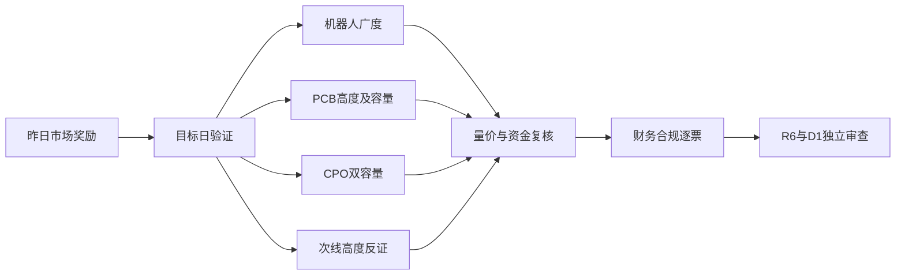

# 2026年11月24日 · 个股画像

## 一句话结论
反弹先看板块合力，不把高度、单日放量或专项缺项当买入结论。

## 详细分析
11/23上涨4658家、涨停146/跌停3、昨板奖励和成交恢复；宽度先于单票身位。机器人扩散先于宇树；PCB看高度与容量同时承接，CPO看双容量。11/24首选高潮、备选降温：维持页面基础首位，依据反弹宽度及隔夜科技价格反应；最强反证是缺四板、首板占比高、机器人五日板块资金净出及同景降温，若竞价至10:00昨日涨停溢价回吐、宽度与容量同弱则改判。并非当日观察。

已评 14/14 只；未评：无。R2整件状态仍为 degraded，只采版本锁定且明确研究合格的对象。

## 关键证据
### 宇树科技（688836.SH）｜观察
**为什么走强／对照对象：** 机器人本体弹性，不是早盘总领涨。 到13:44才封、五日仍净出；锋龙和科森早板提供先后对照，不能用热度抹掉。 11/23板型：首封后未开板，未据此认一字；高度/首次封板/开板次数：1.0/134449/0；同板涨停 68，判定：高度未成立／容量或助攻对照。

**大资金意图：** 近5日大单+超大单 -0.6574 亿元；东财 -0.6639 亿元。逐日有口径冲突，两组并列，不以任一口径定向。 61根有效日K；收盘708.0，MA5/20/50=624.406/669.482/560.3662，前20日区间565.0–809.0，当日量/前5日均量1.5626。未认定区间突破或目标日确认。 图像副本：已嵌入，非独立读图。

**逻辑够不够硬：** 到13:44才封、五日仍净出；锋龙和科森早板提供先后对照，不能用热度抹掉。 公告与事件时间线 2 条；PE(TTM) 510.8623、PB 32.1375；近一年正PE分位 93.6508（样本63）；2026Q3累计收入同比55.6579%、归母净利同比270.5418%。命中 F4 SDK研报最新日 20261110；机构调研窗口命中0条（接口覆盖，不等同不存在其他机构）。 财务尚未核：F1、F2、F5、F7、F8、F11、S1、S2、S3、V2。

**风险点／可验证假设：** 若前排助攻先散、容量不同步，20cm首板不能单独证明主线持续。 盈亏比、目标日结构与计划内身份未核；原筛除项：非执行首位，不递补。

图为绑定历史快照；不是盘中承接或本会话独立阅图。

### 锋龙股份（002931.SZ）｜观察
**为什么走强／对照对象：** 泛机器人前排锚，但不是狭义人形本体。 早盘首板领先宇树封板时序，但五日仍净出；历史股性不能替代当前订单。 11/23板型：换手封板；高度/首次封板/开板次数：1.0/93357/1；同板涨停 68，判定：高度未成立／容量或助攻对照。

**大资金意图：** 近5日大单+超大单 -1.4584 亿元；东财 -1.4888 亿元。逐日有口径冲突，两组并列，不以任一口径定向。 60根有效日K；收盘42.46，MA5/20/50=42.804/44.3325/41.2676，前20日区间34.51–62.26，当日量/前5日均量0.3652。未认定区间突破或目标日确认。 图像副本：缺记录，unknown。

**逻辑够不够硬：** 早盘首板领先宇树封板时序，但五日仍净出；历史股性不能替代当前订单。 公告与事件时间线 16 条；PE(TTM) 471.0686、PB 9.0391；近一年正PE分位 17.3333（样本225）；2026Q3累计收入同比6.7453%、归母净利同比-13.9108%。命中 F6 SDK研报最新日 窗口内无已核记录；机构调研窗口命中0条（接口覆盖，不等同不存在其他机构）。 财务尚未核：F7、F11、S1、S2、S3、V6、V2。

**风险点／可验证假设：** 若后排补涨先于其兑现、断板且前排扩散收缩，不认持续带动。 盈亏比、目标日结构与计划内身份未核；原筛除项：非执行首位，不递补。

### 科森科技（603626.SH）｜观察
**为什么走强／对照对象：** 泛机器人早盘助攻，不等于机器人本体。 较宇树早封但五日净出，和锋龙的同向是前排宽度证据，不认证共同产业订单。 11/23板型：换手封板；高度/首次封板/开板次数：1.0/94221/1；同板涨停 68，判定：高度未成立／容量或助攻对照。

**大资金意图：** 近5日大单+超大单 -1.7171 亿元；东财 -1.7247 亿元。双源验证按逐日回执，不以上游旧池缺席推无资金。 60根有效日K；收盘23.84，MA5/20/50=24.58/27.033/24.1698，前20日区间21.67–32.31，当日量/前5日均量0.8363。未认定区间突破或目标日确认。 图像副本：缺记录，unknown。

**逻辑够不够硬：** 较宇树早封但五日净出，和锋龙的同向是前排宽度证据，不认证共同产业订单。 公告与事件时间线 11 条；PE(TTM) None、PB 6.3909；近一年正PE分位 None（样本122）；2026Q3累计收入同比-28.9353%、归母净利同比258.9358%。命中 F3,F6,F9 SDK研报最新日 20260912；机构调研窗口命中2条（接口覆盖，不等同不存在其他机构）。 财务尚未核：F7、F11、S1、S2、S3、V2。

**风险点／可验证假设：** 若早盘高开后量价走弱、同批早板无法承接，维持助攻而非抬位。 盈亏比、目标日结构与计划内身份未核；原筛除项：非执行首位，不递补。

### 襄阳轴承（000678.SZ）｜观察
**为什么走强／对照对象：** 机器人非连续高度；减速器业务量级要用披露核对。 三天两板、午后封，对比锋龙和科森更像后续助攻而非早盘发起。 11/23板型：首封后未开板，未据此认一字；高度/首次封板/开板次数：1.0/143045/0；同板涨停 68，判定：高度未成立／容量或助攻对照。

**大资金意图：** 近5日大单+超大单 3.4758 亿元；东财 3.4095 亿元。逐日有口径冲突，两组并列，不以任一口径定向。 61根有效日K；收盘18.68，MA5/20/50=16.724/18.432/13.6436，前20日区间13.91–23.31，当日量/前5日均量1.1289。未认定区间突破或目标日确认。 图像副本：缺记录，unknown。

**逻辑够不够硬：** 三天两板、午后封，对比锋龙和科森更像后续助攻而非早盘发起。 公告与事件时间线 21 条；PE(TTM) None、PB 11.0447；近一年正PE分位 None（样本0）；2026Q3累计收入同比-4.2179%、归母净利同比2.5457%。命中 F3,F4,F10 SDK研报最新日 窗口内无已核记录；机构调研窗口命中0条（接口覆盖，不等同不存在其他机构）。 财务尚未核：F2、F6、F7、F11、S1、S2、S3、V2。

**风险点／可验证假设：** 若二次扩散缺前排确认，不给午后封板溢价。 盈亏比、目标日结构与计划内身份未核；原筛除项：R4已核监管或业务澄清，R6独立裁决、非执行首位，不递补。

### 中京电子（002579.SZ）｜观察
**为什么走强／对照对象：** PCB高度锚，不把跨标签之同一只票重复成光模块核心。 09:30 首封、三板但开板6次；强于宝鼎的无板修复，容量须看沪电而非独扛。 11/23板型：换手封板；高度/首次封板/开板次数：3.0/93051/6；同板涨停 11，判定：分歧弱。

**大资金意图：** 近5日大单+超大单 8.5906 亿元；东财 8.5505 亿元。双源验证按逐日回执，不以上游旧池缺席推无资金。 60根有效日K；收盘14.73，MA5/20/50=12.45/12.154/15.0212，前20日区间10.61–13.5，当日量/前5日均量3.4143。收破前20日最高价，仅确认日K价格条件，不等于有效突破或目标日接力。 图像副本：已嵌入，非独立读图。

**逻辑够不够硬：** 09:30 首封、三板但开板6次；强于宝鼎的无板修复，容量须看沪电而非独扛。 公告与事件时间线 11 条；PE(TTM) None、PB 3.2847；近一年正PE分位 None（样本182）；2026Q3累计收入同比1.8346%、归母净利同比-558.4747%。命中 F3,F4,F9,F10 SDK研报最新日 窗口内无已核记录；机构调研窗口命中1条（接口覆盖，不等同不存在其他机构）。 财务尚未核：F6、F7、F11、S1、S2、S3、V6、V2。

**风险点／可验证假设：** 若打开后回封不稳、PCB助攻或沪电承接转弱，不能把高开当确认。 盈亏比、目标日结构与计划内身份未核；原筛除项：原记录无条目，不等于必要门禁通过。

图为绑定历史快照；不是盘中承接或本会话独立阅图。

### 沪电股份（002463.SZ）｜观察
**为什么走强／对照对象：** PCB容量验证而非高度替换。 五日资金居该线领先但无板，不能替换中京做短线高度；生益是材料对照。 11/23板型：未涨停；高度/首次封板/开板次数：None/未出具/None；同板涨停 11，判定：高度未成立／容量或助攻对照。

**大资金意图：** 近5日大单+超大单 22.6474 亿元；东财 22.5117 亿元。逐日有口径冲突，两组并列，不以任一口径定向。 60根有效日K；收盘82.7，MA5/20/50=79.442/84.106/104.8816，前20日区间71.77–105.9，当日量/前5日均量1.1422。未认定区间突破或目标日确认。 图像副本：已嵌入，非独立读图。

**逻辑够不够硬：** 五日资金居该线领先但无板，不能替换中京做短线高度；生益是材料对照。 公告与事件时间线 23 条；PE(TTM) 23.7828、PB 7.7919；近一年正PE分位 4.9587（样本242）；2026Q3累计收入同比71.8825%、归母净利同比106.8703%。命中 F9 SDK研报最新日 20261119；机构调研窗口命中99条（接口覆盖，不等同不存在其他机构）。 财务尚未核：F2、F7、F11、S1、S2、S3、V2。

**风险点／可验证假设：** 若中京表现与沪电资金价格持续背离，降低PCB合力判断。 盈亏比、目标日结构与计划内身份未核；原筛除项：非执行首位，不递补。

### 宝鼎科技（002552.SZ）｜降级
**为什么走强／对照对象：** PCB弹性对照，无板无独立带动。 五日资金排名明显落后沪电，中京已有三板，不因历史股性替代。 11/23板型：未涨停；高度/首次封板/开板次数：None/未出具/None；同板涨停 11，判定：高度未成立／容量或助攻对照。

**大资金意图：** 近5日大单+超大单 0.3793 亿元；东财 0.3753 亿元。双源验证按逐日回执，不以上游旧池缺席推无资金。 61根有效日K；收盘29.23，MA5/20/50=28.58/31.5745/40.6794，前20日区间27.43–38.6，当日量/前5日均量1.6244。未认定区间突破或目标日确认。 图像副本：已嵌入，非独立读图。

**逻辑够不够硬：** 五日资金排名明显落后沪电，中京已有三板，不因历史股性替代。 公告与事件时间线 5 条；PE(TTM) 26.4115、PB 6.0962；近一年正PE分位 2.4793（样本242）；2026Q3累计收入同比77.3951%、归母净利同比588.9183%。无已证红旗不等于安全。 SDK研报最新日 窗口内无已核记录；机构调研窗口命中0条（接口覆盖，不等同不存在其他机构）。 财务尚未核：F2、F7、F11、S1、S2、S3、V2。

**风险点／可验证假设：** 即使个股上涨，板块容量与高度若不共振，不认分歧转强。 盈亏比、目标日结构与计划内身份未核；原筛除项：非执行首位，不递补。

### 生益科技（600183.SH）｜观察
**为什么走强／对照对象：** PCB材料容量对照；资金为正不等于连板带动。 对比沪电的五日领先和中京的高度，生益承担材料侧同步验证。 11/23板型：未涨停；高度/首次封板/开板次数：None/未出具/None；同板涨停 11，判定：高度未成立／容量或助攻对照。

**大资金意图：** 近5日大单+超大单 5.7098 亿元；东财 6.5562 亿元。逐日有口径冲突，两组并列，不以任一口径定向。 61根有效日K；收盘60.75，MA5/20/50=59.784/74.4465/109.1132，前20日区间57.3–109.49，当日量/前5日均量1.2194。未认定区间突破或目标日确认。 图像副本：缺记录，unknown。

**逻辑够不够硬：** 对比沪电的五日领先和中京的高度，生益承担材料侧同步验证。 公告与事件时间线 12 条；PE(TTM) 19.3697、PB 6.1365；近一年正PE分位 1.6529（样本242）；2026Q3累计收入同比61.0956%、归母净利同比175.3556%。命中 F9 SDK研报最新日 20261105；机构调研窗口命中2条（接口覆盖，不等同不存在其他机构）。 财务尚未核：F2、F7、S1、S2、S3、V2。

**风险点／可验证假设：** 材料相对强但PCB宽度缩小，仅认独立交易，不认主线加强。 盈亏比、目标日结构与计划内身份未核；原筛除项：非执行首位，不递补。

### 新易盛（300502.SZ）｜观察
**为什么走强／对照对象：** CPO容量首位，前一日是资金集中修复而非已有趋势反转。 五日净额领先中际，11/23同涨才构成容量合力；单票无板。 11/23板型：未涨停；高度/首次封板/开板次数：None/未出具/None；同板涨停 8，判定：高度未成立／容量或助攻对照。

**大资金意图：** 近5日大单+超大单 36.3206 亿元；东财 35.8983 亿元。双源验证按逐日回执，不以上游旧池缺席推无资金。 61根有效日K；收盘181.36，MA5/20/50=166.326/190.211/300.4062，前20日区间152.0–260.21，当日量/前5日均量1.3407。未认定区间突破或目标日确认。 图像副本：已嵌入，非独立读图。

**逻辑够不够硬：** 五日净额领先中际，11/23同涨才构成容量合力；单票无板。 公告与事件时间线 10 条；PE(TTM) 17.3525、PB 9.0476；近一年正PE分位 3.719（样本242）；2026Q3累计收入同比92.9736%、归母净利同比79.7402%。命中 F4 SDK研报最新日 20261116；机构调研窗口命中290条（接口覆盖，不等同不存在其他机构）。 财务尚未核：F7、F11、S1、S2、S3、V2。

**风险点／可验证假设：** 若中际与新易盛同步回吐、成交放大而涨幅不保，否定容量延续。 盈亏比、目标日结构与计划内身份未核；原筛除项：原记录无条目，不等于必要门禁通过。

图为绑定历史快照；不是盘中承接或本会话独立阅图。

### 中际旭创（300308.SZ）｜观察
**为什么走强／对照对象：** CPO容量交叉对照；回购预案强化次日验证，不倒填为前日拉升原因。 与新易盛双容量，但五日净额次位；回购是方案，不是实际买盘。 11/23板型：未涨停；高度/首次封板/开板次数：None/未出具/None；同板涨停 8，判定：高度未成立／容量或助攻对照。

**大资金意图：** 近5日大单+超大单 32.5946 亿元；东财 30.4871 亿元。逐日有口径冲突，两组并列，不以任一口径定向。 60根有效日K；收盘417.2，MA5/20/50=401.62/485.523/671.8311，前20日区间377.96–636.68，当日量/前5日均量1.224。未认定区间突破或目标日确认。 图像副本：已嵌入，非独立读图。

**逻辑够不够硬：** 与新易盛双容量，但五日净额次位；回购是方案，不是实际买盘。 公告与事件时间线 13 条；PE(TTM) 18.9715、PB 5.2078；近一年正PE分位 2.4793（样本242）；2026Q3累计收入同比178.1348%、归母净利同比211.808%。无已证红旗不等于安全。 SDK研报最新日 20261120；机构调研窗口命中335条（接口覆盖，不等同不存在其他机构）。 财务尚未核：F1、F5、F7、F11、S1、S2、S3、V2。

**风险点／可验证假设：** 低开或冲高回吐且同伴走弱，否定消息带来的净增承接。 盈亏比、目标日结构与计划内身份未核；原筛除项：非执行首位，不递补。

### 华盛昌（002980.SZ）｜降级
**为什么走强／对照对象：** CPO概念侧对照，不与双光模块容量等同。 无板且缺独立带动，月度锚不能证明当日产业兑现。 11/23板型：未涨停；高度/首次封板/开板次数：None/未出具/None；同板涨停 8，判定：高度未成立／容量或助攻对照。

**大资金意图：** 近5日大单+超大单 0.3079 亿元；东财 0.2957 亿元。逐日有口径冲突，两组并列，不以任一口径定向。 61根有效日K；收盘60.66，MA5/20/50=59.946/68.126/94.7866，前20日区间58.0–90.77，当日量/前5日均量1.2383。未认定区间突破或目标日确认。 图像副本：缺记录，unknown。

**逻辑够不够硬：** 无板且缺独立带动，月度锚不能证明当日产业兑现。 公告与事件时间线 9 条；PE(TTM) 44.0266、PB 8.4899；近一年正PE分位 8.6777（样本242）；2026Q3累计收入同比88.3817%、归母净利同比262.7959%。命中 F3,F9 SDK研报最新日 20261119；机构调研窗口命中308条（接口覆盖，不等同不存在其他机构）。 财务尚未核：F7、F11、S1、S2、S3、V2。

**风险点／可验证假设：** 只有出现与新易盛和中际可比的强度、资金及合力，才重评。 盈亏比、目标日结构与计划内身份未核；原筛除项：非执行首位，不递补。

### 浙文影业（601599.SH）｜观察
**为什么走强／对照对象：** AI视频次线首板验证，非主线升级。 有早板和短剧资金排名，但前期尖顶回撤，不把单板当趋势反转。 11/23板型：换手封板；高度/首次封板/开板次数：1.0/94323/1；同板涨停 20，判定：高度未成立／容量或助攻对照。

**大资金意图：** 近5日大单+超大单 1.6537 亿元；东财 1.7284 亿元。逐日有口径冲突，两组并列，不以任一口径定向。 61根有效日K；收盘3.65，MA5/20/50=3.862/4.2715/3.676，前20日区间3.11–5.88，当日量/前5日均量1.1698。未认定区间突破或目标日确认。 图像副本：已嵌入，非独立读图。

**逻辑够不够硬：** 有早板和短剧资金排名，但前期尖顶回撤，不把单板当趋势反转。 公告与事件时间线 15 条；PE(TTM) 30.5898、PB 2.5607；近一年正PE分位 10.3306（样本242）；2026Q3累计收入同比8.5683%、归母净利同比4.2108%。无已证红旗不等于安全。 SDK研报最新日 窗口内无已核记录；机构调研窗口命中0条（接口覆盖，不等同不存在其他机构）。 财务尚未核：F1、F2、F7、F11、S1、S2、S3、V2。

**风险点／可验证假设：** AI应用宽度与该股承接不能共同延续即否定次线扩散假设。 盈亏比、目标日结构与计划内身份未核；原筛除项：20–50亿元流通盘谨慎、非执行首位，不递补。

### 盛剑科技（603324.SH）｜降级
**为什么走强／对照对象：** 高度与产业兑现分离，监管函和低占比是实质反证。 五板不证明光刻胶利润兑现；交易风险提示与ST/立案是不同概念。 11/23板型：首封后未开板，未据此认一字；高度/首次封板/开板次数：5.0/130303/0；同板涨停 5，判定：高度未成立／容量或助攻对照。

**大资金意图：** 近5日大单+超大单 0.7864 亿元；东财 0.8206 亿元。逐日有口径冲突，两组并列，不以任一口径定向。 60根有效日K；收盘30.48，MA5/20/50=25.42/21.2495/22.896，前20日区间18.36–27.71，当日量/前5日均量3.404。收破前20日最高价，仅确认日K价格条件，不等于有效突破或目标日接力。 图像副本：已嵌入，非独立读图。

**逻辑够不够硬：** 五板不证明光刻胶利润兑现；交易风险提示与ST/立案是不同概念。 公告与事件时间线 17 条；PE(TTM) None、PB 2.9794；近一年正PE分位 None（样本99）；2026Q3累计收入同比-4.7033%、归母净利同比-587.9412%。命中 F9 SDK研报最新日 20260914；机构调研窗口命中2条（接口覆盖，不等同不存在其他机构）。 财务尚未核：F6、F11、S1、S2、S3、V6、V2。

**风险点／可验证假设：** 若工作函跟进升级、或高位开板后缺同板块承接，当前叙事不能延伸。 盈亏比、目标日结构与计划内身份未核；原筛除项：20–50亿元流通盘谨慎、R4已核监管或业务澄清，R6独立裁决、次线高度仅作观察。

### 真视通（002771.SZ）｜降级
**为什么走强／对照对象：** 高度观察，不把09:25首封误当全天一字。 五板、开板6次、约60%换手；相较盛剑是不同板块的高度标尺，不互为助攻。 11/23板型：竞价先封后有开板，非一字；高度/首次封板/开板次数：5.0/92500/6；同板涨停 4，判定：分歧弱。

**大资金意图：** 近5日大单+超大单 1.1824 亿元；东财 1.1278 亿元。逐日有口径冲突，两组并列，不以任一口径定向。 60根有效日K；收盘17.4，MA5/20/50=14.51/11.671/12.7152，前20日区间9.96–15.82，当日量/前5日均量7.1392。收破前20日最高价，仅确认日K价格条件，不等于有效突破或目标日接力。 图像副本：已嵌入，非独立读图。

**逻辑够不够硬：** 五板、开板6次、约60%换手；相较盛剑是不同板块的高度标尺，不互为助攻。 公告与事件时间线 10 条；PE(TTM) None、PB 6.4118；近一年正PE分位 None（样本0）；2026Q3累计收入同比-37.4253%、归母净利同比31.6105%。命中 F3,F4,F9 SDK研报最新日 窗口内无已核记录；机构调研窗口命中0条（接口覆盖，不等同不存在其他机构）。 财务尚未核：F1、F2、F6、F7、F11、S1、S2、S3、V2。

**风险点／可验证假设：** 若昨日涨停溢价回吐、目标日高位负反馈外溢，不认高标独立接力。 盈亏比、目标日结构与计划内身份未核；原筛除项：20–50亿元流通盘谨慎、次线高度仅作观察。

## 数据源审计
| 源 | 状态 | 生成/事实 | 记录数 | 备注 |
|---|---|---|---|---|
| R2研究候选 | 🟢 ok | 2026-11-24 | 14 | 实际采用范围见JSON |
| R4关联事件 | 🟢 ok | 2026-11-24 | — | 实际采用范围见JSON |
| 绑定chart快照 | 🟢 ok | 2026-11-24 | 9 | 实际采用范围见JSON |
| 原批manifest | 🟢 ok | 2026-11-24 | — | 实际采用范围见JSON |
| R7只作背景 | 🟢 ok | 2026-11-24 | — | 实际采用范围见JSON |
| Tushare SDK | 🟢 ok | 2026-11-24 | 27504 | 实际采用范围见JSON |

## 不确定性 / 反证
公开复盘同源不重复计权；显示转移行 36% 高潮、33% 降温，原行合计99%不补余；同景96次，首位高潮33%、次位降温30%，精确转移行与展示分母未核。图像周期价制不全、同日资金口径冲突、未取得监管范围回执均为逐票缺口，不生成全局禁买或买权。盛剑监管工作函及交易风险提示是实质反证，但不冒认立案或ST；并不删除其他已证风险。

## 与其他 R/D/E 的关系
R2/R4按本轮版本消费；R7覆盖仅作交叉，不沿用旧股票池门禁。R6只读本版，D1只消费嵌入的图像副本，不另读缓存。

## Sub-Agent 元数据
analyze_stock_profile_v1 · R5_stock_profiles.json · 同一研究会话 · 逐批原子覆盖。
