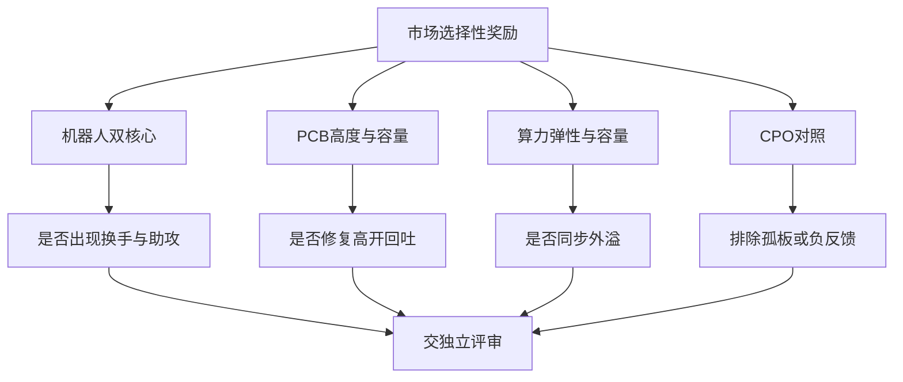

# 2026年11月25日 · 个股画像

> **数据源新鲜度**：partial；价格事实日 11/24；**情绪=震荡**（风险措辞，不是阶段）。
> **覆盖**：R2验证17只，选择8只，已评8只；状态 `partial`。盘前6维研究无买权。

## 一句话结论
机器人看开板承接，PCB看容量跟随；算力保留轮动观察，CPO高开回吐不追认。

## 详细分析
事实基线降温（11/24）；11/25首选退潮，备选降温。放量广度收窄与隔夜半导体回吐优先；109/146昨板红、仅2跌停是最强反证。有效成交、广度/昨板和核心梯队同改善改判降温；若持续齐扩再评估修复。09:25起首个有效同口径窗口复评，最迟10:00；不是仓位。

机器人／执行器当日题材板19家（前67），PCB 2家（前2），算力7家（前6）。题材数不相加；分线封板分母及同一轮真实启动日未核，不能报分线封板率与持续天数；全市场封板率44.7%。主模板：分歧接力。

| 对象 | 角色 / 板型 | 研究态度 | 档位 α / 风险 | 事实 K 根 | 必要缺口 |
|---|---|---|---|---:|---|
| 长华集团 605018.SH | 龙一 / 一字锁价 | 观察 | B- / B | 76 | F2、F11、S2、S3 |
| 福莱新材 605488.SH | 龙二 / 回封板 | 观察 | B- / B | 76 | F2、F11、S1、S2、S3 |
| 中京电子 002579.SZ | 龙一 / 一字锁价 | 观察 | B+ / A | 76 | S2、S3 |
| 沪电股份 002463.SZ | 龙二 / 未封板 | 观察 | A- / B | 76 | F2、F11、S1、S2、S3 |
| 同星科技 301252.SZ | 观察 / 回封板 | 观察 | B- / B+ | 76 | F11、S2、S3 |
| 寒武纪 688256.SH | 观察 / 未封板 | 观察 | B+ / A | 76 | F2、F11、S2、S3 |
| 中际旭创 300308.SZ | 观察 / 未封板 | 降级 | B+ / B | 76 | S2、S3 |
| 克来机电 603960.SH | 观察 / 一字锁价 | 不进 | B- / A | 76 | F11、S2、S3 |

### 长华集团（605018.SH）— 观察
**为什么走强／为何不确认**：执行器高度核心，三板一字与极低换手不是流动性。 首封领先且同向梯队尚在，正流仅小量。

**大资金意图**：大单分档五日+0.60亿｜DC五日+0.61亿；同日偏差>5%=True，不可将主力标签等同买方身份。 榜单日 ['20261120', '20261123']，不是买方身份；大宗折溢价不可判。

**逻辑够不够硬**：20261124 长华执行器收入有限且丝杠未定点（issuer） Q3累计收入12.44亿、归母0.02亿；PE=161.4265，PB=2.125，PS=3.0773。正样本历史分位不等于横截面估值；极贵。 财务红旗：F3, F4, F6；未知：F2, F10, F11, S2, S3, V2, V6。

**量价与机构**：不复权收12.42，较MA20 +19.07%，收对开+0.00%，当日量/此前5日均量0.56；执行器高度核心，三板一字与极低换手不是流动性。 识图记录 `available`，未重读PNG，周/分钟各周期复权待核项不外推。Tushare 近窗研报记录0行、最新日0行；调研记录10行。空接口不等于全市场无人跟踪。

**买入理由（仅供验证）**：首封领先且同向梯队尚在，正流仅小量。 **风险点**：执行器高度核心，三板一字与极低换手不是流动性。 **止损条件（研究证伪、非交易价）**：未形成计划，RR未核；只有实际开板换手、回封并带动福莱等同伴才支持继续接力；独强或开板失承接即降级。 **可验证假设**：首个有效盘面验证同期广度、同伴与价格。禁止项依R2：[]（仅其已查范围）；计划身份未知。

### 福莱新材（605488.SH）— 观察
**为什么走强／为何不确认**：机器人换手核心优先验证，不用长华一字替代市场承接。 回封和相对更多成交可验证可交易流动性；涂布主业不等于触觉手套规模入账。

**大资金意图**：大单分档五日+3.87亿｜DC五日+3.85亿；同日偏差>5%=False，不可将主力标签等同买方身份。 榜单日 ['20261028', '20261111', '20261112', '20261119', '20261124']，不是买方身份；大宗折溢价不可判。

**逻辑够不够硬**：同版R4无可直接归因的新个股条目，不等于无公告。 Q3累计收入26.36亿、归母0.56亿；PE=224.4374，PB=6.828，PS=4.5466。正样本历史分位不等于横截面估值；极贵。 财务红旗：所查未列命中（不是排雷完成）；未知：F2, F11, S1, S2, S3, V2, V6。

**量价与机构**：不复权收51.45，较MA20 +4.92%，收对开+1.82%，当日量/此前5日均量0.52；机器人换手核心优先验证，不用长华一字替代市场承接。 识图记录 `available`，未重读PNG，周/分钟各周期复权待核项不外推。Tushare 近窗研报记录15行、最新日3行；调研记录36行。空接口不等于全市场无人跟踪。

**买入理由（仅供验证）**：回封和相对更多成交可验证可交易流动性；涂布主业不等于触觉手套规模入账。 **风险点**：机器人换手核心优先验证，不用长华一字替代市场承接。 **止损条件（研究证伪、非交易价）**：未形成计划，RR未核；复核回封后同向梯队能否维持；放量冲高回吐且同伴转弱即降级。 **可验证假设**：首个有效盘面验证同期广度、同伴与价格。禁止项依R2：[]（仅其已查范围）；计划身份未知。

### 中京电子（002579.SZ）— 观察
**为什么走强／为何不确认**：PCB四板高度核心，先验证封板打开后能否承接，不把高度等同带动。 主业是PCB，但南亚扩产是同行资本开支、不是中京订单；累计亏损使PE失效。

**大资金意图**：大单分档五日+9.96亿｜DC五日+9.90亿；同日偏差>5%=False，不可将主力标签等同买方身份。 榜单日 ['20261119', '20261120', '20261123']，不是买方身份；大宗折溢价不可判。

**逻辑够不够硬**：20261125 南亚新材董事会通过28.8亿元覆铜板建设计划（sector_readthrough_not_order）；20261125 南亚新材新产能仍受审批与投产约束（sector_readthrough_not_order） Q3累计收入24.45亿、归母-1.17亿；PE=None，PB=3.6125，PS=3.3554。正样本历史分位不等于横截面估值；未核/亏损期PE不可用。 财务红旗：F3, F4, F9, F10；未知：F7, S2, S3, V2, V6。

**量价与机构**：不复权收16.2，较MA20 +31.22%，收对开+0.00%，当日量/此前5日均量0.64；PCB四板高度核心，先验证封板打开后能否承接，不把高度等同带动。 识图记录 `available`，未重读PNG，周/分钟各周期复权待核项不外推。Tushare 近窗研报记录0行、最新日0行；调研记录1行。空接口不等于全市场无人跟踪。

**买入理由（仅供验证）**：主业是PCB，但南亚扩产是同行资本开支、不是中京订单；累计亏损使PE失效。 **风险点**：PCB四板高度核心，先验证封板打开后能否承接，不把高度等同带动。 **止损条件（研究证伪、非交易价）**：未形成计划，RR未核；若开板后不能回封或沪电等容量不跟，孤立高度失去意义。 **可验证假设**：首个有效盘面验证同期广度、同伴与价格。禁止项依R2：[]（仅其已查范围）；计划身份未知。

### 沪电股份（002463.SZ）— 观察
**为什么走强／为何不确认**：PCB容量核心，涨幅为正却高开回落，优先检验资金能否变成价格承接。 主营印制电路板可直接映射；南亚/胜宏为行业参考，不是沪电盈利公告。

**大资金意图**：大单分档五日+29.18亿｜DC五日+29.02亿；同日偏差>5%=False，不可将主力标签等同买方身份。 榜单日 ['20261029', '20261111', '20261113', '20261116', '20261118']，不是买方身份；大宗折溢价不可判。

**逻辑够不够硬**：20261125 南亚新材董事会通过28.8亿元覆铜板建设计划（sector_readthrough_not_order）；20261125 南亚新材新产能仍受审批与投产约束（sector_readthrough_not_order）；20261125 胜宏科技拟10派10元（sector_readthrough_not_order） Q3累计收入232.25亿、归母56.22亿；PE=24.194，PB=7.9266，PS=5.6788。正样本历史分位不等于横截面估值；同股估值相对比较。 财务红旗：F9；未知：F2, F7, F10, F11, S1, S2, S3, V6。

**量价与机构**：不复权收84.13，较MA20 +0.93%，收对开-7.20%，当日量/此前5日均量1.16；PCB容量核心，涨幅为正却高开回落，优先检验资金能否变成价格承接。 识图记录 `available`，未重读PNG，周/分钟各周期复权待核项不外推。Tushare 近窗研报记录45行、最新日3行；调研记录99行。空接口不等于全市场无人跟踪。

**买入理由（仅供验证）**：主营印制电路板可直接映射；南亚/胜宏为行业参考，不是沪电盈利公告。 **风险点**：PCB容量核心，涨幅为正却高开回落，优先检验资金能否变成价格承接。 **止损条件（研究证伪、非交易价）**：未形成计划，RR未核；若容量在有效成交下修复开盘回吐并与高度同向才可上修；再次大额成交贴日低则降级。 **可验证假设**：首个有效盘面验证同期广度、同伴与价格。禁止项依R2：[]（仅其已查范围）；计划身份未知。

### 同星科技（301252.SZ）— 观察
**为什么走强／为何不确认**：算力次线二板换手弹性，20%板不代表液冷订单已经兑现。 制冷设备主业是间接证据；同题材行云合同不映射同星订单。

**大资金意图**：大单分档五日+0.91亿｜DC五日+0.90亿；同日偏差>5%=False，不可将主力标签等同买方身份。 榜单日 ['20261124']，不是买方身份；大宗折溢价不可判。

**逻辑够不够硬**：20261124 行云科技签五年算力服务合同（sector_readthrough_not_order） Q3累计收入12.48亿、归母0.89亿；PE=66.1499，PB=5.562，PS=4.439。正样本历史分位不等于横截面估值；偏贵。 财务红旗：F3；未知：F11, S2, S3, V2, V6。

**量价与机构**：不复权收42.48，较MA20 +24.21%，收对开+16.29%，当日量/此前5日均量1.12；算力次线二板换手弹性，20%板不代表液冷订单已经兑现。 识图记录 `available`，未重读PNG，周/分钟各周期复权待核项不外推。Tushare 近窗研报记录6行、最新日3行；调研记录4行。空接口不等于全市场无人跟踪。

**买入理由（仅供验证）**：制冷设备主业是间接证据；同题材行云合同不映射同星订单。 **风险点**：算力次线二板换手弹性，20%板不代表液冷订单已经兑现。 **止损条件（研究证伪、非交易价）**：未形成计划，RR未核；同星开板能承接、寒武纪与其他同向票延续才支持次线成为有效轮动；孤强降级。 **可验证假设**：首个有效盘面验证同期广度、同伴与价格。禁止项依R2：[]（仅其已查范围）；计划身份未知。

### 寒武纪（688256.SH）— 观察
**为什么走强／为何不确认**：算力容量对照，不把反弹日的高换手等同新主线启动。 AI芯片主业直接相关，但隔夜半导体负反馈、定价敏感与大宗折价口径未核。

**大资金意图**：大单分档五日+20.26亿｜DC五日+20.69亿；同日偏差>5%=True，不可将主力标签等同买方身份。 榜单日 []，不是买方身份；大宗折溢价不可判。

**逻辑够不够硬**：20261125 海外半导体回吐复职行情（sector_readthrough_not_order）；20261124 美国议员质疑英伟达复职（sector_readthrough_not_order） Q3累计收入95.26亿、归母37.15亿；PE=146.3116，PB=40.3333，PS=53.4319。正样本历史分位不等于横截面估值；同股估值相对比较。 财务红旗：F4, F8；未知：F2, F7, F10, F11, S2, S3, V6。

**量价与机构**：不复权收970.0，较MA20 +8.34%，收对开+3.19%，当日量/此前5日均量1.24；算力容量对照，不把反弹日的高换手等同新主线启动。 识图记录 `available`，未重读PNG，周/分钟各周期复权待核项不外推。Tushare 近窗研报记录30行、最新日3行；调研记录0行。空接口不等于全市场无人跟踪。

**买入理由（仅供验证）**：AI芯片主业直接相关，但隔夜半导体负反馈、定价敏感与大宗折价口径未核。 **风险点**：算力容量对照，不把反弹日的高换手等同新主线启动。 **止损条件（研究证伪、非交易价）**：未形成计划，RR未核；有效量维持且容量与弹性同步走强才支持升级；容量不能承接则不进。 **可验证假设**：首个有效盘面验证同期广度、同伴与价格。禁止项依R2：[]（仅其已查范围）；计划身份未知。

### 中际旭创（300308.SZ）— 降级
**为什么走强／为何不确认**：CPO容量对照，账面资金流入与高开几乎全吐相冲突。 光模块直接敞口，回购仍是报告书程序，不能当实施、订单或消息后收益。

**大资金意图**：大单分档五日+52.75亿｜DC五日+50.61亿；同日偏差>5%=True，不可将主力标签等同买方身份。 榜单日 []，不是买方身份；大宗折溢价不可判。

**逻辑够不够硬**：20261124 中际旭创回购进入报告书披露（issuer）；20261125 海外半导体回吐复职行情（sector_readthrough_not_order）；20261124 美国议员质疑英伟达复职（sector_readthrough_not_order）；20261125 工信部牵头6G部省协同试点启动（sector_readthrough_not_order） Q3累计收入695.47亿、归母222.38亿；PE=18.9624，PB=5.2053，PS=5.9335。正样本历史分位不等于横截面估值；同股估值相对比较。 财务红旗：所查未列命中（不是排雷完成）；未知：F6, F7, F10, S2, S3, V6。

**量价与机构**：不复权收417.0，较MA20 -12.67%，收对开-9.97%，当日量/此前5日均量1.41；CPO容量对照，账面资金流入与高开几乎全吐相冲突。 识图记录 `available`，未重读PNG，周/分钟各周期复权待核项不外推。Tushare 近窗研报记录85行、最新日3行；调研记录335行。空接口不等于全市场无人跟踪。

**买入理由（仅供验证）**：光模块直接敞口，回购仍是报告书程序，不能当实施、订单或消息后收益。 **风险点**：CPO容量对照，账面资金流入与高开几乎全吐相冲突。 **止损条件（研究证伪、非交易价）**：未形成计划，RR未核；仅在有效成交收复开盘失地且CPO同伴扩散时重评；隔夜利空下再弱则保持降级。 **可验证假设**：首个有效盘面验证同期广度、同伴与价格。禁止项依R2：[]（仅其已查范围）；计划身份未知。

### 克来机电（603960.SH）— 不进
**为什么走强／为何不确认**：三板一字留作分离反证，不把智能装备/汽零当已证人形或CPO。 公司澄清不涉人形机器人产品，16.91锁价也不能验证买方承接。

**大资金意图**：大单分档五日+0.84亿｜DC五日+0.84亿；同日偏差>5%=True，不可将主力标签等同买方身份。 榜单日 ['20261123']，不是买方身份；大宗折溢价不可判。

**逻辑够不够硬**：20261124 克来机电确认不涉人形机器人产品（issuer） Q3累计收入3.74亿、归母-0.05亿；PE=None，PB=3.9766，PS=8.082。正样本历史分位不等于横截面估值；未核/亏损期PE不可用。 财务红旗：F3, F4, F9；未知：F7, F10, F11, S2, S3, V2, V6。

**量价与机构**：不复权收16.91，较MA20 +18.49%，收对开+0.00%，当日量/此前5日均量0.33；三板一字留作分离反证，不把智能装备/汽零当已证人形或CPO。 识图记录 `available`，未重读PNG，周/分钟各周期复权待核项不外推。Tushare 近窗研报记录0行、最新日0行；调研记录0行。空接口不等于全市场无人跟踪。

**买入理由（仅供验证）**：公司澄清不涉人形机器人产品，16.91锁价也不能验证买方承接。 **风险点**：三板一字留作分离反证，不把智能装备/汽零当已证人形或CPO。 **止损条件（研究证伪、非交易价）**：未形成计划，RR未核；只有新的披露能验证业务映射；若只是独立封板并不修复主线逻辑。 **可验证假设**：首个有效盘面验证同期广度、同伴与价格。禁止项依R2：[]（仅其已查范围）；计划身份未知。

## 关键证据
- 11/24广度1952涨 / 3498跌，55涨停 / 68炸板 / 2跌停；前排有选择性奖励，不能从指数红得出普涨。
- 资金以同窗口两口径列数，超过5%偏差就不合并；日线不复权，遇到除权间断应重核，不配成历史执行价。
- 已评：605018.SH、605488.SH、002579.SZ、002463.SZ、301252.SZ、688256.SH、300308.SZ、603960.SH；本批仍待评：无。
- 本轮不选：
  - 锋龙股份（002931.SZ）：机器人历史锚有回封，但先验证高度与换手双核心；不以历史股性换福莱。
  - 科森科技（603626.SH）：机器人候补早封，五日流向仍负，不替代当日换手核心。
  - 襄阳轴承（000678.SZ）：未封板且当日东财净流出，冲高不给核心地位。
  - 宝鼎科技（002552.SZ）：PCB候补当日收跌，容量与高度对照证据更强。
  - 合锻智能（603011.SH）：R2杂毛，资金日/五日双负。
  - 行云科技（300209.SZ）：订单真实但收近零涨、冲高回吐，合同不等于回款；保留为同星反证，不作为新增核心。
  - 联创电子（002036.SZ）：端侧一字且五日资金负，端侧未取代前两主线。
  - 奥尼电子（301189.SZ）：端侧早板相对强，但独立梯队与发布后兑现未证。
  - 浙文影业（601599.SH）：AI应用涨停广度17降至4，个股回封不能反推主线。

## 数据源审计
| 源 | 状态 | 数据日／窗口 | 覆盖 | 缺口 |
|---|---|---|---|---|
| R2/R4/R3 | 🟢 | 本批已验 SHA | 同轮绑定 | 原公告窗口与来源限制随 JSON |
| Tushare | 🟢 | 11/24前收、近五交易日、可知财期 | 已评对象逐票 | 不把缺根或空字段当0 |
| 同版图表 | 🟡 | T−1或各周期自身时点 | 原记录嵌入 | 不重读PNG，不声称盘中，兼容性按记录 |
| 交易所／证监合规 | 🟡 | 最新年度披露后至本轮截止 | 逐对象列回执/未知 | 缺实际分页或原文的留给R4/R5，而非R6 |

## 不确定性 / 反证
多个提供方分档不一致；公告发布后的目标日价格尚不可知。现有真实账户与执行硬限制不变，旧市场性意见不滚动继承。

## 与其他 R/D/E 的关系
- R5 仅消费本轮验证 R2 代码以及同版R1/R3/R4/R7。
- R6 仅从本版 JSON 读取检查及回执；D1 消费本版内嵌图表，不读 raw/latest，不代替授权。

## Sub-Agent 元数据
- skill: analyze_stock_profile_v1
- artifact: data/research/20261125/R5_stock_profiles.json
- 研究判断：本会话；规则计算：可复核确定性辅助。
