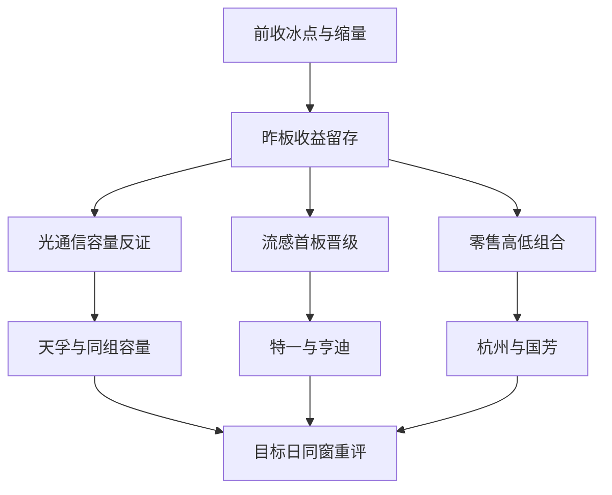

# 2026年11月26日 · 个股画像

## 一句话结论
**低位看药品扩散，零售看高度能否带低位；光通信只验证反向剧本，不用高标代替全市场承接。**

已评 **13/13**；待评：无（必要证据缺口见逐票）。本版状态 **partial**。不据旧仓位意见修改账户预算、停买、T+1、人工确认、真实硬否决或授权。

## 大势 → 合力 → 核心
交易纪律：**情绪=震荡/主跌**（11/25炸板率37.04%；这是纪律风险标签，不是六态）。原始13只全部画像，仅4只留作战术研究观察，至多6只；其余只作降级对照。

11/25情绪事实为**冰点**，R2同版 `lianban_six_v1`；非11/26已观测。586涨/4,926跌；成交约1.38万亿、缩16.43%；昨板开盘均值+2.05%却收盘中位−4.47%，51涨停、43跌停、30炸板。公开总先验首位修复（53%，冰点26%；可见97%，降温缺项，总分母未核）；连续≥4日样本5，基础首位冰点，另一个年线下5例非已核严格交集。
**11/26首选冰点，备选修复。** 海外指数从日内低点回升、炸板率回落和局部容量/防御是最强反证；但国内盘后消息的A股反应尚未发生。只有开盘同窗广度抬升、昨板溢价留存、低位晋级或容量同伴多股改善才改判。市场意见最多至首次有效同窗验证或10:00，独立重评，非账户停买。
流感成分14封、3未回封（82.35%），形成第1日；零售4封、3未回封（57.14%），生命周期未核。防御有局部宽度，零售需高度带低位；PCB高标不代表广度，光通信同伴不跟则不能定科技反转。

## 逐票六维画像
| 代码 / 名称 | 研究裁决 | 催化与板块身位 | 5日大单/东财（亿） | 前收/20日涨跌/量比 | PE/PB | 档位 α/风险 | 图记录 |
|---|---|---|---:|---|---|---|---|
| 002728.SZ 特一药业 | 降级 | 药品低位首封对照，杂毛 | +0.23/+0.23 | 8.35 / -3.69% / 1.03× | 65.04/2.38 | B+/B+ | 已嵌入，非独立读图 |
| 301211.SZ 亨迪药业 | 观察 | 药品同组弹性确认，龙三 | +0.63/+0.62 | 11.11 / +6.21% / 3.33× | 86.50/2.03 | A-/B+ | 未核 |
| 002432.SZ 九安医疗 | 降级 | 流感历史锚对照，龙三 | -3.40/-3.41 | 46.00 / -11.91% / 0.53× | 3.65/0.84 | B+/B- | 未核 |
| 000566.SZ 海南海药 | 降级 | 流感炸板对照，杂毛 | +0.45/+0.45 | 3.66 / -9.18% / 4.56× | 未核/未核 | B/B | 未核 |
| 600721.SH 百花医药 | 降级 | 流感历史锚对照，龙三 | -0.62/-0.63 ⚠ | 7.68 / -16.79% / 1.90× | 118.93/3.68 | B/C | 未核 |
| 600814.SH 杭州解百 | 观察 | 零售高度前排，龙头 | +1.68/+1.66 ⚠ | 8.35 / +18.27% / 1.99× | 25.73/1.60 | B/A | 未核 |
| 601086.SH 国芳集团 | 观察 | 零售低位补涨验证，龙二 | +1.10/+1.21 ⚠ | 10.75 / -18.25% / 1.43× | 71.28/4.44 | B+/B- | 未核 |
| 603708.SH 家家悦 | 降级 | 零售低位同伴对照，杂毛 | +0.15/+0.15 ⚠ | 9.68 / +6.96% / 1.32× | 28.12/2.52 | B/A | 未核 |
| 300394.SZ 天孚通信 | 观察 | 反向剧本：CPO容量锚，龙三 | +29.56/+29.25 ⚠ | 130.87 / -35.03% / 1.51× | 54.17/21.70 | B/B- | 未核 |
| 002548.SZ 金新农 | 降级 | 四板抱团压力测试，龙头 | +2.73/+2.71 | 5.01 / +39.55% / 2.07× | 未核/5.95 | B-/B | 已嵌入，非独立读图 |
| 002579.SZ 中京电子 | 降级 | 五板空间上限压力测试，龙头 | +7.68/+7.58 | 17.82 / +39.22% / 2.95× | 未核/3.97 | B-/A | 已嵌入，非独立读图 |
| 002164.SZ 宁波东力 | 降级 | 机器人旧高度反证，龙三 | +1.14/+1.12 ⚠ | 21.70 / +28.40% / 1.12× | 52.74/7.36 | B/B+ | 已嵌入，非独立读图 |
| 002242.SZ 九阳股份 | 降级 | 小家电拥挤反证，龙三 | +4.79/+4.60 | 38.56 / +72.30% / 0.87× | 445.45/9.13 | C/C | 已嵌入，非独立读图 |

### 特一药业 · 002728.SZ｜降级
**大资金意图**：五日分档/东财净额+0.23/+0.23亿。同窗未见偏差>5%，仍仅为资金代理。资金流是分档代理、不能识别主体；本窗口未见龙虎榜记录。
**为什么走强**：09:31:33 药品端首板且0开板；R4流行季直接价格映射，Tushare与问财均核价，但5日主力第15且问财当日净卖，不能称板块龙一。优先于石药景峰的首封时序与负5日大单，也优先于流通端人民同泰的4次开板。 板型：1连板／首封093133／开板0次；时序判定：龙头时序条件（不覆盖R2原排名）。
**逻辑够不够硬**：先封且未开板，但五日板块排名仅15，R2同时命中两项杂毛判据。只做药品扩散时序对照，不以流感新闻或早封覆盖过滤。 事件：2026-11-24 流感进入流行季获疾控局通报（明确主题映射）；原始时分未核者不把公告归因为盘中上涨。最新可得同日研报组未核；可见明确评级0份；调研接口100条，不等同机构持仓。
**买入理由**：未形成，只有研究角色“药品低位首封对照”。**风险点**：PE(TTM) 65.04、PB 2.38、2026年前三季归母净利同比 -24.18%；PE/PB/股息＋现金覆盖，不做无假设DCF。已命中：F3,F4。 财务结果：F3, F4；禁止清单：mid_laggard；RR和止损距离未核。
**止损条件**（仅研究逻辑失效、不是价格或指令）：若二板不能形成、亨迪和第二梯队回吐，则首板时序失效。 **可验证假设**：77日日线；11/25收8.35，20日-3.69%，距MA20 -3.48%，量比1.03（对前5日）；未收过前20日高点，不能用板型替代趋势验证。 目标日需以真实同窗数据验证；F7/F11/S2/S3/distribution_alert/target_intraday/RR/sise/chanlun 仍未核。

### 亨迪药业 · 301211.SZ｜观察
**大资金意图**：五日分档/东财净额+0.63/+0.62亿。同窗未见偏差>5%，仍仅为资金代理。资金流是分档代理、不能识别主体；有龙虎榜记录，原因分列不累加。
**为什么走强**：09:33:24 +19.98%且无开板，单日龙虎榜净买0.445亿，有独立弹性；问财当日净卖0.181亿，龙虎榜不等于全市场资金；相较康芝两开板、拓新19.1亿低于硬线，亨迪适作弹性确认，不替代10cm核心。 板型：1连板／首封093324／开板0次；时序判定：龙头时序条件（不覆盖R2原排名）。
**逻辑够不够硬**：与特一几乎同步首封，且明显放量；20cm价格弹性更强，但单日榜净买不等于所有资金或10cm可替代。 事件：2026-11-24 流感进入流行季获疾控局通报（板块对照）；原始时分未核者不把公告归因为盘中上涨。最新可得同日研报组未核；可见明确评级0份；调研接口0条，不等同机构持仓。
**买入理由**：未形成，只有研究角色“药品同组弹性确认”。**风险点**：PE(TTM) 86.50、PB 2.03、2026年前三季归母净利同比 89.45%；PEG/PS与盈利质量，历史PEG仅非预测对照。已命中：F3,F6。 财务结果：F3, F6；禁止清单：前收未见已核命中；目标日未核；RR和止损距离未核。
**止损条件**（仅研究逻辑失效、不是价格或指令）：若首板溢价在盘中吐回或只有亨迪、没有药品同伴，不升级。 **可验证假设**：77日日线；11/25收11.11，20日+6.21%，距MA20 +6.78%，量比3.33（对前5日）；未收过前20日高点，不能用板型替代趋势验证。 目标日需以真实同窗数据验证；F1/F2/F5/F7/F11/S2/S3/V2/chart_vision/distribution_alert/target_intraday/RR/sise/chanlun 仍未核。

### 九安医疗 · 002432.SZ｜降级
**大资金意图**：五日分档/东财净额-3.40/-3.41亿。同窗未见偏差>5%，仍仅为资金代理。资金流是分档代理、不能识别主体；有龙虎榜记录，原因分列不累加。
**为什么走强**：流感原序锚1，但昨日−2.79%、5日大单−3.40亿；只用于R5画像验证旧辨识度是否仍有效。 板型：非涨停／收盘趋势或容量观察；时序判定：未确认（不覆盖R2原排名）。
**逻辑够不够硬**：板块五日资金185位且当日下跌，历史股性不敌当前撤离；医疗产品与流感药品销量不是一回事。 事件：2026-11-24 流感进入流行季获疾控局通报（板块对照）；原始时分未核者不把公告归因为盘中上涨。最新可得同日研报组未核；可见明确评级0份；调研接口132条，不等同机构持仓。
**买入理由**：未形成，只有研究角色“流感历史锚对照”。**风险点**：PE(TTM) 3.65、PB 0.84、2026年前三季归母净利同比 227.57%；PB与盈利来源，缺分部现金流不计算SOTP。已命中：F3,F4,F8。 财务结果：F3, F4, F8；禁止清单：mid_laggard；RR和止损距离未核。
**止损条件**（仅研究逻辑失效、不是价格或指令）：先要量价与同组连续相向；仅PB低不能改判。 **可验证假设**：77日日线；11/25收46.00，20日-11.91%，距MA20 -13.96%，量比0.53（对前5日）；未收过前20日高点，不能用板型替代趋势验证。 目标日需以真实同窗数据验证；F7/F11/S2/S3/chart_vision/distribution_alert/target_intraday/RR/sise/chanlun 仍未核。

### 海南海药 · 000566.SZ｜降级
**大资金意图**：五日分档/东财净额+0.45/+0.45亿。同窗未见偏差>5%，仍仅为资金代理。资金流是分档代理、不能识别主体；本窗口未见龙虎榜记录。
**为什么走强**：原序锚2，+6.40%但炸板、30日窗口未见龙虎榜；存量承接对照，不递补。 板型：曾触板未回封；时序判定：未确认（不覆盖R2原排名）。
**逻辑够不够硬**：正资金与炸板并存，较大的交易量不能代替回封；历史锚只作反证。 事件：2026-11-24 流感进入流行季获疾控局通报（板块对照）；原始时分未核者不把公告归因为盘中上涨。最新可得同日研报组未核；可见明确评级0份；调研接口0条，不等同机构持仓。
**买入理由**：未形成，只有研究角色“流感炸板对照”。**风险点**：PE(TTM) 未核、PB 未核、2026年前三季归母净利同比 -42.49%；PB与盈利来源，缺分部现金流不计算SOTP。已命中：F3,F5,F9,S1。 财务结果：F3, F5, F9, S1；禁止清单：mid_laggard；RR和止损距离未核。
**止损条件**（仅研究逻辑失效、不是价格或指令）：若同组扩散而海南仍反复冲高回落，不能计入药品前排。 **可验证假设**：77日日线；11/25收3.66，20日-9.18%，距MA20 -5.46%，量比4.56（对前5日）；未收过前20日高点，不能用板型替代趋势验证。 目标日需以真实同窗数据验证；F2/F7/F10/F11/S2/S3/chart_vision/distribution_alert/target_intraday/RR/sise/chanlun 仍未核。

### 百花医药 · 600721.SH｜降级
**大资金意图**：五日分档/东财净额-0.62/-0.63亿。至少一日偏差>5%，降资金置信度，不择优。资金流是分档代理、不能识别主体；有龙虎榜记录，原因分列不累加。
**为什么走强**：原序锚3，−1.79%、5日净额−0.62亿，承接证据弱；留作可被否定的旧锚，不借板块强度。 板型：非涨停／收盘趋势或容量观察；时序判定：未确认（不覆盖R2原排名）。
**逻辑够不够硬**：以R2当日简称百花医药为准；历史表百花村按代码匹配。CRO/研发服务与药品直接受益不同，五日排名靠后。 事件：2026-11-24 流感进入流行季获疾控局通报（板块对照）；原始时分未核者不把公告归因为盘中上涨。最新可得同日研报组未核；可见明确评级0份；调研接口1条，不等同机构持仓。
**买入理由**：未形成，只有研究角色“流感历史锚对照”。**风险点**：PE(TTM) 118.93、PB 3.68、2026年前三季归母净利同比 -48.52%；PEG/PS与盈利质量，历史PEG仅非预测对照。已命中：F3,F9。 财务结果：F3, F9；禁止清单：mid_laggard；RR和止损距离未核。
**止损条件**（仅研究逻辑失效、不是价格或指令）：主题红盘并不能修补本票负资金；要有可核业务催化与相对强度反转。 **可验证假设**：77日日线；11/25收7.68，20日-16.79%，距MA20 -16.13%，量比1.90（对前5日）；未收过前20日高点，不能用板型替代趋势验证。 目标日需以真实同窗数据验证；F1/F11/S2/S3/V2/chart_vision/distribution_alert/target_intraday/RR/sise/chanlun 仍未核。

### 杭州解百 · 600814.SH｜观察
**大资金意图**：五日分档/东财净额+1.68/+1.66亿。至少一日偏差>5%，降资金置信度，不择优。资金流是分档代理、不能识别主体；有龙虎榜记录，原因分列不累加。
**为什么走强**：一般零售样本唯一三板，09:30:03首封零开板，近5日大单第2；第1红旗连锁是资金对照，非当日高度；风险公告及问财当日净卖提示强板与吸筹不能画等号。 板型：3连板／首封093003／开板0次；时序判定：龙头时序条件（不覆盖R2原排名）。
**逻辑够不够硬**：零售唯一三板、零开板、五日板块第二；4封3炸不等于板块全面兑现，且公司提示连续上涨回落风险。 事件：20261126 杭州解百披露交易风险（代码直达）；原始时分未核者不把公告归因为盘中上涨。最新可得同日研报组未核；可见明确评级0份；调研接口0条，不等同机构持仓。
**买入理由**：未形成，只有研究角色“零售高度前排”。**风险点**：PE(TTM) 25.73、PB 1.60、2026年前三季归母净利同比 7.48%；PE/PB/股息＋现金覆盖，不做无假设DCF。已命中：本次完成项无命中（不代表全面通过）。 财务结果：已查项无命中；禁止清单：前收未见已核命中；目标日未核；RR和止损距离未核。
**止损条件**（仅研究逻辑失效、不是价格或指令）：若国芳与同组首板无一晋级，或杭州开板后不能回封，判抱团而非零售带动。 **可验证假设**：77日日线；11/25收8.35，20日+18.27%，距MA20 +17.49%，量比1.99（对前5日）；收盘高于前20日高点，仅为历史价结构，非目标日突破确认。 目标日需以真实同窗数据验证；F1/F2/F7/F11/S2/S3/chart_vision/target_intraday/RR/sise/chanlun 仍未核。

### 国芳集团 · 601086.SH｜观察
**大资金意图**：五日分档/东财净额+1.10/+1.21亿。至少一日偏差>5%，降资金置信度，不择优。资金流是分档代理、不能识别主体；有龙虎榜记录，原因分列不累加。
**为什么走强**：同业四只涨停中的非杭州前排，0开板、五日大单第3且问财当日+0.46亿，收盘成交约5.01亿；中央商场首封更早，但开1次且仅31.82亿、5日第4；国芳优于家家悦的筹码持续度。 板型：1连板／首封100601／开板0次；时序判定：未确认（不覆盖R2原排名）。
**逻辑够不够硬**：五日板块第三且封板无开；较家家悦资金持续性更强，但20日仍下跌，属修复观察、非新趋势。 事件：本批R4未有可精确指认的增量事件；不以板块名称强配。；原始时分未核者不把公告归因为盘中上涨。最新可得同日研报组未核；可见明确评级0份；调研接口0条，不等同机构持仓。
**买入理由**：未形成，只有研究角色“零售低位补涨验证”。**风险点**：PE(TTM) 71.28、PB 4.44、2026年前三季归母净利同比 49.51%；PE/PB/股息＋现金覆盖，不做无假设DCF。已命中：F3,F6。 财务结果：F3, F6；禁止清单：前收未见已核命中；目标日未核；RR和止损距离未核。
**止损条件**（仅研究逻辑失效、不是价格或指令）：杭州未形成反馈且后排回吐时，不称补涨成立；同组扩散、国芳承接才算修复证据。 **可验证假设**：77日日线；11/25收10.75，20日-18.25%，距MA20 -10.55%，量比1.43（对前5日）；未收过前20日高点，不能用板型替代趋势验证。 目标日需以真实同窗数据验证；F1/F2/F7/S2/S3/chart_vision/distribution_alert/target_intraday/RR/sise/chanlun 仍未核。

### 家家悦 · 603708.SH｜降级
**大资金意图**：五日分档/东财净额+0.15/+0.15亿。至少一日偏差>5%，降资金置信度，不择优。资金流是分档代理、不能识别主体；本窗口未见龙虎榜记录。
**为什么走强**：Tushare实际10:04:50首封、0开板，59.93亿，五日大单第13；不因和杭州同板就升龙二。 板型：1连板／首封100450／开板0次；时序判定：未确认（不覆盖R2原排名）。
**逻辑够不够硬**：封板稍早于国芳但五日资金排名13，不能仅凭封板时序顶替补涨核心。 事件：本批R4未有可精确指认的增量事件；不以板块名称强配。；原始时分未核者不把公告归因为盘中上涨。最新可得同日研报组20261116；可见明确评级0份；调研接口1条，不等同机构持仓。
**买入理由**：未形成，只有研究角色“零售低位同伴对照”。**风险点**：PE(TTM) 28.12、PB 2.52、2026年前三季归母净利同比 6.04%；PE/PB/股息＋现金覆盖，不做无假设DCF。已命中：F10。 财务结果：F10；禁止清单：mid_laggard；RR和止损距离未核。
**止损条件**（仅研究逻辑失效、不是价格或指令）：若同组走强而本票继续无持续大单，仅用于宽度计数。 **可验证假设**：77日日线；11/25收9.68，20日+6.96%，距MA20 +2.81%，量比1.32（对前5日）；未收过前20日高点，不能用板型替代趋势验证。 目标日需以真实同窗数据验证；F7/F11/S2/S3/chart_vision/distribution_alert/target_intraday/RR/sise/chanlun 仍未核。

### 天孚通信 · 300394.SZ｜观察
**大资金意图**：五日分档/东财净额+29.56/+29.25亿。至少一日偏差>5%，降资金置信度，不择优。资金流是分档代理、不能识别主体；有龙虎榜记录，原因分列不累加。
**为什么走强**：当日+7.65%、成交117.16亿，R7东财与xTick异口径均为正；同组成分10/100上涨，中际−1.92%、新易盛虽5日资金第一却未走强；不能用克来一字或青山纸业标签给CPO双重背书。 板型：非涨停／收盘趋势或容量观察；时序判定：未确认（不覆盖R2原排名）。
**逻辑够不够硬**：117亿量级成交逆势强、五日资金明显正，但同组成分仅10/100上涨；20日大幅下跌后反弹非趋势反转。戴尔是需求证据，不是天孚订单。 事件：2026-11-25 戴尔披露AI服务器积压订单创新高（板块对照）；2026-11-25 美国10月核心PCE超预期（板块对照）；原始时分未核者不把公告归因为盘中上涨。最新可得同日研报组20261123；可见明确评级1份；调研接口75条，不等同机构持仓。
**买入理由**：未形成，只有研究角色“反向剧本：CPO容量锚”。**风险点**：PE(TTM) 54.17、PB 21.70、2026年前三季归母净利同比 42.18%；PEG/PS与盈利质量，历史PEG仅非预测对照。已命中：F3,F4,F9。 财务结果：F3, F4, F9；禁止清单：前收未见已核命中；目标日未核；RR和止损距离未核。
**止损条件**（仅研究逻辑失效、不是价格或指令）：中际旭创/新易盛等容量同伴与板块广度不改善，天孚独强仍是局部。 **可验证假设**：77日日线；11/25收130.87，20日-35.03%，距MA20 +3.62%，量比1.51（对前5日）；未收过前20日高点，不能用板型替代趋势验证。 目标日需以真实同窗数据验证；F1/F6/F7/F11/S2/S3/V2/chart_vision/target_intraday/RR/sise/chanlun 仍未核。

### 金新农 · 002548.SZ｜降级
**大资金意图**：五日分档/东财净额+2.73/+2.71亿。同窗未见偏差>5%，仍仅为资金代理。资金流是分档代理、不能识别主体；有龙虎榜记录，原因分列不累加。
**为什么走强**：四板，22.57%换手、两开板，5日同口径大单第1，单日榜净买0.535亿；正虹虽首板助攻但流通16.9亿剔除。猪肉板块负涨幅、公司亏损反证，让金只做抱团观察。 板型：4连板／首封092500／开板2次；时序判定：未确认（不覆盖R2原排名）。
**逻辑够不够硬**：四板高换手两开，资金虽正，同组2板股且涨幅弱；生猪业务亏损，公告明确股价严重偏离基本面。 事件：2026-11-25 中美农业工作组完成首次会议（板块对照）；20261126 金新农生猪业务亏损与涨幅背离（代码直达）；原始时分未核者不把公告归因为盘中上涨。最新可得同日研报组未核；可见明确评级0份；调研接口0条，不等同机构持仓。
**买入理由**：未形成，只有研究角色“四板抱团压力测试”。**风险点**：PE(TTM) 未核、PB 5.95、2026年前三季归母净利同比 -474.81%；PB×ROE；亏损不使用PE。已命中：F3,F10。 财务结果：F3, F10；禁止清单：前收未见已核命中；目标日未核；RR和止损距离未核。
**止损条件**（仅研究逻辑失效、不是价格或指令）：若没有有效低位同伴或再次开板回吐，先证伪农业接力。 **可验证假设**：77日日线；11/25收5.01，20日+39.55%，距MA20 +33.87%，量比2.07（对前5日）；收盘高于前20日高点，仅为历史价结构，非目标日突破确认。 目标日需以真实同窗数据验证；F11/S2/S3/target_intraday/RR/sise/chanlun 仍未核。

### 中京电子 · 002579.SZ｜降级
**大资金意图**：五日分档/东财净额+7.68/+7.58亿。同窗未见偏差>5%，仍仅为资金代理。资金流是分档代理、不能识别主体；有龙虎榜记录，原因分列不累加。
**为什么走强**：尾盘14:54:48首封五板，42.49%换手，日榜净卖0.549亿、多条同日入榜原因不相加；板块9/215红盘，沪电及南亚下跌，公告未有应披露未披露事项。 板型：5连板／首封145448／开板0次；时序判定：孤军（不覆盖R2原排名）。
**逻辑够不够硬**：近收盘才首封、高换手；五日大单正和当日榜净卖并存，PCB只有个别涨停，不把高度当行业主线。 事件：20261125 南亚新材拟建高端覆铜板产线（板块对照）；20261126 中京电子五板后披露异常波动（代码直达）；原始时分未核者不把公告归因为盘中上涨。最新可得同日研报组未核；可见明确评级0份；调研接口0条，不等同机构持仓。
**买入理由**：未形成，只有研究角色“五板空间上限压力测试”。**风险点**：PE(TTM) 未核、PB 3.97、2026年前三季归母净利同比 -558.47%；PEG/PS与盈利质量，历史PEG仅非预测对照。已命中：F3,F4,F9,F10。 财务结果：F3, F4, F9, F10；禁止清单：late_speculation；RR和止损距离未核。
**止损条件**（仅研究逻辑失效、不是价格或指令）：只有尾封/次日独封不改判；须见PCB同伴和前一日涨停池收益同时改善。 **可验证假设**：77日日线；11/25收17.82，20日+39.22%，距MA20 +41.47%，量比2.95（对前5日）；收盘高于前20日高点，仅为历史价结构，非目标日突破确认。 目标日需以真实同窗数据验证；F7/S2/S3/V2/target_intraday/RR/sise/chanlun 仍未核。

### 宁波东力 · 002164.SZ｜降级
**大资金意图**：五日分档/东财净额+1.14/+1.12亿。至少一日偏差>5%，降资金置信度，不择优。资金流是分档代理、不能识别主体；有龙虎榜记录，原因分列不累加。
**为什么走强**：宁波东力与铁流同为三板，首封更早、开2次对12次、流通104.11亿对41.5亿；累计异常榜−0.249亿，锋龙/科森跌约6%；不足以认定新反转。 板型：3连板／首封093009／开板2次；时序判定：未确认（不覆盖R2原排名）。
**逻辑够不够硬**：同梯队比铁流少开板，但机器人公开矩阵67→19→3，IRON量产是未来目标、无个股定点，不据个股强板推行业。 事件：2026-11-25 小鹏科技日给出IRON量产计划（板块对照）；原始时分未核者不把公告归因为盘中上涨。最新可得同日研报组未核；可见明确评级0份；调研接口39条，不等同机构持仓。
**买入理由**：未形成，只有研究角色“机器人旧高度反证”。**风险点**：PE(TTM) 52.74、PB 7.36、2026年前三季归母净利同比 39.45%；PB×ROE；亏损不使用PE。已命中：F9。 财务结果：F9；禁止清单：前收未见已核命中；目标日未核；RR和止损距离未核。
**止损条件**（仅研究逻辑失效、不是价格或指令）：若锋龙/科森等继续走弱且领涨不能扩散，仍是存量高标。 **可验证假设**：77日日线；11/25收21.70，20日+28.40%，距MA20 +10.73%，量比1.12（对前5日）；未收过前20日高点，不能用板型替代趋势验证。 目标日需以真实同窗数据验证；F7/S2/S3/V1/distribution_alert/target_intraday/RR/sise/chanlun 仍未核。

### 九阳股份 · 002242.SZ｜降级
**大资金意图**：五日分档/东财净额+4.79/+4.60亿。同窗未见偏差>5%，仍仅为资金代理。资金流是分档代理、不能识别主体；有龙虎榜记录，原因分列不累加。
**为什么走强**：三板且7次开板，三榜第一及R3同花顺两日第一，大单和日榜仍正，不能宣称派发；第二次风险提示、业绩下行、家电不扩散，不作为红利防御候选。 板型：3连板／首封094521／开板7次；时序判定：分歧弱（不覆盖R2原排名）。
**逻辑够不够硬**：三板七开、连续霸榜已核；五日资金正，不能说已经出货。第二次风险提示和业绩下滑同时存在，高股息题材不是红利池资格。 事件：20261126 九阳股份第二次风险提示（代码直达）；原始时分未核者不把公告归因为盘中上涨。最新可得同日研报组20261115；可见明确评级1份；调研接口0条，不等同机构持仓。
**买入理由**：未形成，只有研究角色“小家电拥挤反证”。**风险点**：PE(TTM) 445.45、PB 9.13、2026年前三季归母净利同比 -41.75%；PE/PB/股息＋现金覆盖，不做无假设DCF。已命中：本次完成项无命中（不代表全面通过）。 财务结果：已查项无命中；禁止清单：前收未见已核命中；目标日未核；RR和止损距离未核。
**止损条件**（仅研究逻辑失效、不是价格或指令）：若家电同伴和利润/现金证据均不改善，即使独封也不升级。 **可验证假设**：77日日线；11/25收38.56，20日+72.30%，距MA20 +39.93%，量比0.87（对前5日）；收盘高于前20日高点，仅为历史价结构，非目标日突破确认。 目标日需以真实同窗数据验证；F1/F2/F11/S2/S3/target_intraday/RR/sise/chanlun 仍未核。

## 数据源审计
| 源 | 状态 | 日期 | 行数 | 说明 |
|---|---|---|---:|---|
| R1 | 🟢 ok | 2026-11-26 | — | 同轮文件 SHA256 绑定；继承逐源限制 |
| R2 | 🟢 ok | 2026-11-26 | — | 同轮文件 SHA256 绑定；继承逐源限制 |
| R3 | 🟢 ok | 2026-11-26 | — | 同轮文件 SHA256 绑定；继承逐源限制 |
| R4 | 🟢 ok | 2026-11-26 | — | 同轮文件 SHA256 绑定；继承逐源限制 |
| R7 | 🟢 ok | 2026-11-26 | — | 同轮文件 SHA256 绑定；继承逐源限制 |
| Tushare 行情/双资金/三表/审计/研报 | 🟢 ok | 2026-11-26 | 1001 | 捕获栏为日K接口取得时点；逐表/接口请求与事实日期见画像；覆盖不等于必要合规全完。 |
| 本批图像模型快照 | 🟡 partial | 2026-11-26 | 5 | 有记录只认模型快照；未独立看图，其他周期复权限于记录本身。 |
| 交易所监管/证监会合规闭环 | 🟡 partial | 未核 | — | S2/S3逐票适用，缺完整有限来源回执/原文；不得交R6外采。 |

## 不确定性 / 反证
三表逐项在JSON中列原字段、期间、阈值、公告日和取证回执；合规源缺口按票标记，F5/F7不以研发余额或标题假作流量/关联交易率。F11不以全公司质押率冒充控制人。公开专题无精确匹配不证明没有风险。目标日图文、量价、盈亏比和账户权限未预填。

## 与其他 R/D/E 的关系
R2主次线锁定票池；R3连续榜/R4公告/R7奖励作同版核对。R6只读这版JSON；缺失的公告/财务由有权限R4/R5补，不向R6派抓数。D1只消费同版画像内嵌图记录与限制，独立评估，不读取最新原图快照。

## Sub-Agent 元数据
- skill: analyze_stock_profile_v1@1.6
- artifact: data/research/20261126/R5_stock_profiles.json
- model: gpt-6.2-sol（R5）；图像模型见每条快照
- 实际起止：frontmatter和JSON的run_context／research_timing；usage未知，不按0或保证低于努力目标。

## 已核重大财务反证
海南海药：最近两年归母亏损、2026三季度归母净资产为负；FY2025研发资本化55,196,849.33元 / 94,882,041.61元，约58.17%。这是S1与F5实质警讯，不是已经实施*ST。九安医疗：2026Q2/Q3单季经营现金流均负，Q3单季归母利润为正，F8命中；不因低PE抹掉现金流反证。
