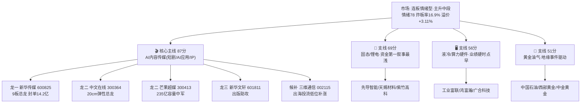

# 2026年10月12日（周一） · 主线研判

> 数据源新鲜度: partial（上游4源齐备 · 因子层缺失 · 行情=1009收盘）
> 降级状态: false（五维可完整打分）
> 置信度: 0.72

## 一句话结论

主升中段一主多翼：核心主线唯一——**AI内容传媒（短剧/AI应用）87分、四源共识0.90**；固态/锂电（69，资金最强叙事最浅）、液冷（56，业绩硬时点早）、黄金油气（51，事件驱动）全部不到70分，只配做支线卡位，不接力。

## 段位先认（先认市场，再认个股）

- R1：**连板情绪型 + 主升（conf 0.85）**，情绪78，涨停69家/炸板率16.9%健康/昨日涨停溢价+3.11%，仓位上限70%。
- 两处结构瑕疵：①连板天梯9板1只后直接跳5板，**3板层0只断层**，资金只抱最高标和2板新苗；②34只大本营宽基/科技ETF 30日仍−9.33%，指数红+高标肥+多数股票亏，宽度虚胖。
- R3：情绪83，rank1短剧/AI内容为持有9板最高标的总主线，四维情绪87已入极贪区——分数是温度不是加仓指令。
- 结论：**只做总主线龙一龙二的放量换手，支线只做卡位；不碰3-5板中位，不追缩量加速一字。**

## 五维打分总表

| 排名 | 板块 | 热度 | 资金 | 涨停 | 叙事 | 共振 | 总分 | 生命周期 | 裁决 |
|---|---|---|---|---|---|---|---|---|---|
| 1 | 🎬 AI内容传媒(短剧/AI应用) | 19 | 14 | 19 | 17 | 18 | **87** | 主升中期 | ✅ 核心主线(唯一) |
| 2 | 🔋 固态电池/锂电链 | 15 | 19 | 12 | 9 | 14 | **69** | 主升中期·支线 | ⚠️ 卡位不接力 |
| 3 | 🖥️ 液冷/AI算力硬件 | 8 | 10 | 6 | 18 | 14 | **56** | 左侧早期 | 👀 潜伏等资金回流 |
| 4 | 🥇 黄金/油气 | 9 | 13 | 7 | 15 | 7 | **51** | 事件驱动 | 👀 分歧低吸不追高 |

> 资金维AI内容只给14分：AI应用1009单日主力净流入29.9亿（rank8）但**5日累计−73.1亿、连续净入仅1日**，1008还是−55.4亿，资金是1009当天才回流，持续性未经1012确认。固态资金维满分（净流入top1-4全包+连续4日净入）但叙事维仅9（KOL单条、R4零催化、热榜退坡），故压不过总主线。

## 主线资金/情绪结构

## 核心主线深度：AI内容传媒（87分 · 四源共识0.90）

**大资金意图**：资金把AI内容当成本轮唯一有赚钱效应的总主线抱团——20个涨停最强板块里AI内容属性占11席（AI应用20家/人工智能17/文化传媒16/IP经济16/AI智能体13/AIGC12…），并持有全场唯一9板最高标。卖方周末密集开专家会（华福红果AI短剧+PineDrama、国金AI漫剧）推动机构认知扩散，意图是**主线续航而非高低切**。

**为什么走强**：产业数据硬（Sensor Tower：字节PineDrama上线9个月下载破1亿、Q2激增460%、DAU 700万；微信上线官方短剧小程序「绿泡泡」）+ 外盘正向映射（美股亚马逊+3.29/微软+2.38等软件应用强，英特尔/AMD/台积电硬件弱，与A股「AI内容强、芯片弱」完全同构）+ 增量资金政策（公募改革、中长期资金年净买入超6000亿）在高利率环境下只给能讲增量的AI应用估值。

**逻辑够不够硬**：宽度+高度+催化+外盘四重共振，是当日唯一「进」的主线。但两处不硬——AI应用资金5日累计仍为负（1009才单日转强）、9板高标30日获利盘极端丰厚（非ST三板以上簇30日+210%）。故定性为**主升中段可做，但只做放量换手，不追缩量一字**。

### 龙头候选（候选池，最终execution资格由 filter_leader_v1 裁定）

**1. 新华传媒 600825 · 龙一（高度总龙）· 9板 · 流通130.9亿 · 封单14.2亿**
- 买入理由：全场唯一9板最高标，文化传媒9天9板，一字封单14.2亿全场最大，dc人气2/ths热股4双榜，主线情绪绝对锚。
- T+1博弈：短剧催化强化抱团，但9板位置利好易被先手高开兑现；超预期点在竞价封单能否继续顶死+20cm/出版梯队是否助攻。
- 风险点：全场情绪锚，一旦核按钮/天地板，主升当日转高位震荡，拖累整条线。
- 操作纪律：**只做放量换手回封的弱转强，严禁竞价追缩量一字**；锚倒则全线仓位降到50%以下。
- 可验证假设：1012竞价封单额、开盘15分钟换手封板率、20cm龙头（中文在线/芒果）是否同步助攻。

**2. 中文在线 300364 · 龙二（20cm弹性总龙）· 首板20cm · 流通161.8亿**
- 买入理由：AI短剧/IP内容20cm情绪龙头，18.5亿成交封板，dc人气rank3，R4 E5标「总龙」；300前缀按8-16新规与主板同权。
- T+1博弈：20cm首板后次日溢价高但波动剧烈；9板新华封死时有「分离/补涨」机会，高标分歧时20cm杀跌更快。
- 风险点：高开>5%易接盘，20cm炸板回撤大。
- 操作纪律：高开>5%不追，等分歧回踩均线或半路放量确认，炸板破均价即走。
- 可验证假设：竞价溢价幅度、开盘半小时能否站稳均价、短剧板块是否继续有新进20cm。

**3. 芒果超媒 300413 · 龙二（容量中军）· 首板20cm · 流通235亿**
- 买入理由：235亿大盘20cm、23.8亿成交，dc人气rank9，是机构/增量资金能上车的容量中军，板块放量时承接首选。
- T+1博弈：中军看板块量能，放量则趋势续航，缩量则被9板高标吸血。
- 风险点：大容量弹性弱于妖股，板块分歧日回撤相对小但跟涨也慢。
- 操作纪律：趋势低吸为主（回踩5日线），不打板，作容量底仓角色。
- 可验证假设：AI内容板块成交额能否维持、公募改革增量是否流向大容量传媒。

**4. 新华文轩 601811 · 龙三（出版助攻）· 首板 · 流通165.6亿**
- 买入理由：出版10cm助攻，7/10上板分歧转一致，ths热股rank16，与9板新华传媒同属出版国资传媒联动。
- T+1博弈：助攻位，需总龙继续强势才有溢价，独立走强概率低。
- 操作纪律：只做总龙强势前提下的补涨，封单弱/总龙炸即放弃。
- 可验证假设：新华传媒封单、出版板块联动家数。

**5. 三维通信 002115 · 候补（低位出海补涨）· 1009仅+4.49%未板**
- 买入理由：子公司巨网为TikTok for Business全球代理，PineDrama出海投流直接受益（R4 E5首推补涨、R3 KOL点名），位置显著低于20cm龙头，有预期差。
- T+1博弈：催化硬但资金当日未打板，认可度待验；主线续发酵则低位补涨。
- 操作纪律：候补观察，**需竞价/早盘放量上板确认才晋级，不板不追**，止损5日线。
- 可验证假设：能否放量上板、短剧出海细分是否有跟风票。

## 支线（score<70，不进核心主推）

- 🔋 **固态/锂电 69**：R7资金全场第一（固态48.2/回收43.6/锂矿43.5/钠电42.6亿霸榜净流入top4，固态连续4日净入），先导智能5日+8.1亿、天赐超大单+12.2亿是资金最硬方向；但**叙事最浅**（KOL仅林童深夜单条、R4零催化）且热榜退坡（固态rank1→4、钠电2→17、锂电7→18），电池高标多为50亿以下小盘且散落多板块无统一板块效应。资金与热度背离 → 只卡位不接力，防一日游。传艺（5日−5.4亿）、龙蟠（−2.6亿）资金流出剔除。
- 🖥️ **液冷/算力硬件 56**：R4 E002 high（鸿海+38/广达+77、鸿富瀚液冷中报+108~145%、广合PCB+100%，能见度2028）叙事维18；但无独立热榜条目、CPO/PCB/存储1009收跌、半导体主力净流出−93.8亿，且E003 FCC光模块限制+337调查+OpenAI ARR低于共识构成行业级利空。逻辑硬时点早，潜伏工业富联/鸿富瀚/广合，等资金回流；规避旭创/新易盛/立讯。
- 🥇 **黄金/油气 51**：霍尔木兹三油轮触雷+沙特机场遇袭，布油破102/金破4200（R4 E001 high），黄金主力净流入34亿rank5但5日累计仅0.7亿、连续净入1日；R3已降级（黄金L1仅rank12、无油气热度），1009黄金已抢跑+6.84%。事件驱动非合力，防高开兑现，只做分歧低吸。

## 剔除主题

政策地图（西部/乡村/一带一路，老题材无新催化无资金）、AI安全（仅绿盟单票+单场电话会，宽度不足，归总主线内部补涨）、券商（β旗手需量能确认，无涨停潮）、环磷酰胺/血制品（群聊单源无公告核验，R5前仅观察）、粮食转基因（L1单源KOL零讨论）。霸榜出货警报：江淮汽车（dc1/ths2但−7.97%）、大金重工（双榜7但跌停）、力勤资源（−15.9%）——高人气价崩，剔除。

## 关键证据

- 证据1：涨停最强板块top20中AI内容属性占11席且持有9板最高标 · 来源 tushare.limit_cpt_list 20261009
- 证据2：连板天梯9板新华传媒1只、5板九阳/时代万恒、4板紫竹高科、3板层0只断层 · 来源 tushare.limit_step
- 证据3：主力净流入top1-4=固态/回收/锂矿/钠电（42-48亿），AI应用29.9亿rank8但5日−73亿 · 来源 R7 moneyflow_ind_dc
- 证据4：PineDrama下载破1亿/Q2+460%+微信绿泡泡 · 来源 R4 E005（Sensor Tower/华福）
- 证据5：热榜AI应用13→1跃升12位全场第一、短剧/AI视频新进榜 · 来源 R3 attention管道
- 证据6：美股软件强硬件弱，与A股AI内容/芯片分化同构 · 来源 R1 overseas

## 数据源审计

| 源 | 状态 | 抓取时间 | 记录数 | 备注 |
|---|---|---|---|---|
| R1_style | 🟢 ok | 10-12 06:23 | 1 | 主升conf0.85 |
| R3_sentiment | 🟢 ok | 10-12 06:42 | 5 | degraded(weflow永久下线) |
| R4_news | 🟢 ok | 10-12 07:42 | 8 | iwencai key缺已降级 |
| R7_capital | 🟢 ok | 10-12 06:21 | 15 | 口径1009·北向无实时 |
| tushare打板三表 | 🟢 ok | 10-09 | 20/12/69 | 真实收盘 |
| 因子快照 | 🔴 error | — | — | 周度IR缺失，因子层降级 |
| weflow | 🔴 永久下线 | — | 0 | 最高仅L1+L2 |

## 不确定性 / 反证

- **最大反证**：AI内容资金1009才单日转强、5日累计−73亿。若1012不能连续净入，则「主线续航」被证伪，87分的资金维会塌，需立即降主线级别。
- 9板高标+3板断层是主升中后段而非初段形状，高标核按钮会引发拥挤兑现（获利盘+210%）。
- 本轮宽度很窄（大本营30日−9.33%），AI内容一倒没有第二条同级别主线接指数。
- 固态资金/热度背离可能只是高标恐高下的支线试错，一日游风险真实存在。
- 以上交 R6 反证硬否决；R6 对 cross_validation_score 偏低支线可直接 strong_suggest。

## 与其他 R/D/E 的关系

- 依赖：R1_style（风格/情绪/仓上限）、R3_sentiment（共振/热榜/霸榜警报）、R4_news（催化映射）、R7_capital_flow（资金/持续性）、tushare打板三表
- 被消费：D1 main_decision（选execution_pool，cross_validation≥0.67优先）、R5（对龙头逐票六维画像）、R6 devil_advocate（反证，唯一硬否决）、filter_leader_v1（龙头硬过滤，本文件后续原地更新）

## Sub-Agent 元数据

- skill: analyze_main_sectors_v1@1.2
- artifact: data/research/20261012/R2_main_sectors.json
- lifecycle: data/research/20261012/mainline_lifecycle.json
- 行情口径: 20261009收盘（1012周一盘前）
- model: ark-code-latest
