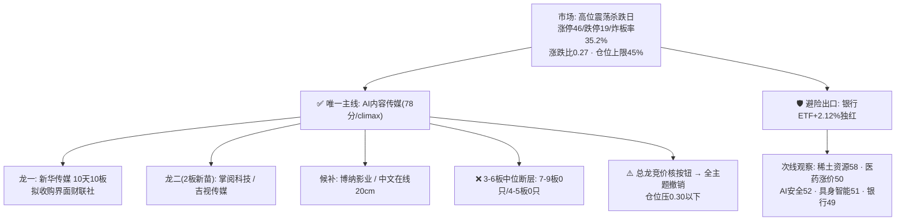

# 2026年10月13日(周二) · 主线研判

> **数据源新鲜度**: partial(R1/R3/R4/R7 全 ok · R2 直拉 MCP 与因子层降级)
> **降级状态**: false(上游齐全,降级项不影响主线判定)
> **置信度**: 0.66

## 一句话结论

🔴 **独苗主线,只认总龙**:AI内容传媒(短剧/AI应用/IP)10板高标独活,阶段=**高潮分歧(climax)**,只做总龙换手与2板新苗,中位断层带一律划掉;总龙核按钮则全线撤销、降维主跌。

## 详细分析

### 一、先认市场:这是"高标独活、个股血洗"的高潮分歧日

R1 六源独立一致:1012 涨停从 69 家收缩到 46 家(-33%),跌停 8→19 家翻倍,炸板率 16.9%→**35.21% 正踩纪律线**;全市场涨跌比 0.27、4325 只下跌、471 只跌超 5%,深成 -2.03%、创业板 -2.61%,唯上证50 +0.43% 收红。情绪没崩(昨日涨停溢价仍 +1.81%、打板族还赚钱),但钱极端抱团:非ST三板以上当日 +8.38%、30日 +235.6%,而34只大本营标的(全部宽基+科技硬件ETF)当日均值 -1.69%。

连板天梯 **10板1只 → 6板2只 → 3板1只 → 2板14只**,7-9板与4-5板双断层,二板当日 -2.05% 是唯一亏钱层。结论:二进三与3-6板中高位是当前最危险接力区,只许做最高标附近或2板首分。按 R1 `main_lines_count=1` 硬约束,R2 只推一条主线。

### 二、主线:AI内容传媒 — 三源共识,但位置在 climax

| 维度 | 得分 | 核心证据 |
|---|---|---|
| 🔥 热度 | 17/20 | ths_hot top100 中 AI视频/短剧/传媒 ≥12只;博纳 rank79→11(+68全场最大跃升)、中文在线10、芒果16、掌阅19 新进top20 |
| 💰 资金 | 13/20 | 文娱消费10.4亿#4、影视概念10.06亿#5、知识产权9.86亿#6、AI语料8.76亿#9、短剧游戏7.04亿#14;但背景是融资融券 -350亿/科技风格 -121亿机构大流出,存量抱团 |
| 🚀 涨停 | 17/20 | 全场唯一10板总龙 + 文化传媒概念16家/AI应用15/AIGC11/短剧8;但多数强板块当日指数收负,高标撑住的虚胖宽度 |
| 📰 叙事 | 16/20 | R3 rank1 L1+L2:5群437条刷屏AI短漫剧,华福两场PineDrama电话会、国金"AI漫剧=应用数据爆发排头兵"、央视频《刘铭传》、周星驰押注AI短剧;R4无独立硬催化(扣分) |
| 🎯 共振 | 15/20 | R3/R7双命中,cross_validation=0.67;late位置+R4缺口+外盘只给情绪锚,不给满 |
| **合计** | **78** | ≥70 主线阈值,全场唯一 |

**生命周期**:运行≥10日、龙头10板、板块资金1009起连续2日净入、炸板率35.2%、KOL已是"找接力找补涨"口吻 → 硬命中 **climax(高潮分歧)**。动作铁律:只做龙头或空仓等分歧,禁追高缩量一字。

### 三、龙头梯队与 T+1 博弈推演

| 角色 | 标的 | 板型 | 类型 | 1013 买点结论 |
|---|---|---|---|---|
| **龙一** | 新华传媒 600825 | 10天10板 | 连板妖股 | 只做竞价/开盘**放量换手**确认;不打缩量一字;核按钮/天地板=全主题撤销 |
| **龙二** | 掌阅科技 603533 | 2板 | 连板妖股 | KOL一致性最高的AI漫剧首选,lhb净买1.54亿;强更强或换手回封,高开>7%缩量不追 |
| **龙二** | 吉视传媒 601929 | 2板 | 连板妖股 | 《第一瞳术师》红果热播榜第二,低价群众基础好;换手板/弱转强,与掌阅二选一 |
| 候补 | 博纳影业 001330 | 2板 | 波段趋势 | 人气+68位最大跃升,但机构专用净卖出,只做分歧转一致回封 |
| 候补 | 中文在线 300364 | 待确认 | 波段趋势 | 20cm弹性/AI语料,只作分歧低吸锚,不打板 |

**大资金意图**:在指数级风险释放日,用最小成本抱团唯一最高标维持赚钱效应,同时躲进银行避险——这是守势中做最后的进攻旗帜,不是增量行情。
**为什么走强**:AI短剧/漫剧有 PineDrama 海外数据、红果榜单、央视频落地等可验证叙事,软件端不受费半杀跌映射。
**逻辑够不够硬**:方向硬(3源共识+资金5细分同入top15),位置不硬(10板+霸榜2日+板块内分化)——所以只配做龙头与2板,不配做中位接力。

### 四、次线与排除项

- **稀土资源线(58分,最接近主线)**:北方稀土Q3预增135-139%+氧化镝涨价双硬锚,与科技杀跌低相关;但R3零情绪共振、R7流入榜无资源(有色30日-15.74%),资金未确认 → 只等竞价验证,不主推。
- **AI安全(52)**:格尔软件盘中确认涨停,但是AI内容外溢+热榜无强标,一日游概率高。
- **医药涨价(50)**:华北制药单点事件,链霉素收入公司自证规模小。
- **具身智能(51)**:DeepSeek入局消息硬但无热标、受费半负反馈,主题日。
- **❌ 坚决排除**:光模块/算力硬件(业绩利好兑现+费半-2.7%+中际旭创退潮,不抄硬件)、存储、新能源车出口/电子烟、风电(L1-only)、霸王茶姬/汽车检测等L2-only事件。

## 关键证据

- 证据1: R1 limit_cpt 强板块16个中AI内容占11席且持有10板最高标,main_lines_count=1 · 来源 R1_style
- 证据2: R3 rank1 L1+L2 双源共振,ths_hot top100≥12只,4只新进top20 · 来源 R3_sentiment
- 证据3: R7 moneyflow_ind_dc top15 中文娱/影视/知识产权/AI语料/短剧5细分同入,5只lhb净买top10为本线 · 来源 R7_capital_flow
- 证据4: 炸板率35.21%踩纪律线+天梯双断层+非ST二板当日-2.05% → 候选砍半、剔除中位 · 来源 R1/R3
- 证据5: 机构专用净卖7.76亿且卖出含博纳/欢瑞/果麦,板块为存量抱团 · 来源 R7 lhb_bull_trap

## 数据源审计

| 源 | 状态 | 抓取时间 | 记录数 | 备注 |
|---|---|---|---|---|
| R1_style | 🟢 | 06:20 | - | 完整,conf 0.72 |
| R3_sentiment | 🟢 | 06:35 | 3主题 | weflow永久下线已扣减 |
| R4_news | 🟢 | 06:15 | 8事件 | 短剧无独立催化条目 |
| R7_capital_flow | 🟢 | 06:24 | - | degraded=true(无北向实时口径外缺口),板块流完整 |
| R2板块MCP直拉 | 🟡 | - | - | 未直拉,消费上游量化结论 |
| 因子周扫描 | 🔴 | - | 0 | data/factor_snapshot缺失,factor_layer降级 |

## 不确定性 / 反证

1. **总龙依赖是最大单点风险**:新华传媒10板独苗,30日高标簇获利盘+235%,竞价核按钮则本研判主线部分全部失效,当日降维主跌。
2. **3源非4源共识**:R4硬新闻催化字典无短剧条目,叙事全在群聊侧,若1013群聊降温则共振退潮更快。
3. **资金是抱团不是增量**:机构大流出背景下的流入,持续性只有2日,1013若影视/AI语料跌出top15,climax→fade确认。
4. 中文在线板型/涨幅缺失,已留null不编造,交 filter_leader_v1 补齐。

## 与其他 R/D/E 的关系

- 依赖: R1_style / R3_sentiment / R4_news / R7_capital_flow(均 complete)
- 被消费: D1(execution_pool 只取龙一/龙二,次线仅watch)、R6(反证重点核查总龙霸榜出货模式与机构卖出结构)、filter_leader_v1(同文件原地硬过滤)

## Sub-Agent 元数据

- skill: analyze_main_sectors_v1@1.2
- artifact: data/research/20261013/R2_main_sectors.json
- 生成耗时: 约4分钟(纯上游消费,无MCP直拉)
- model: ark-code-latest
- 验收: tests/checks/check_r2_cross_validation.py 20261013 ✅ 通过
