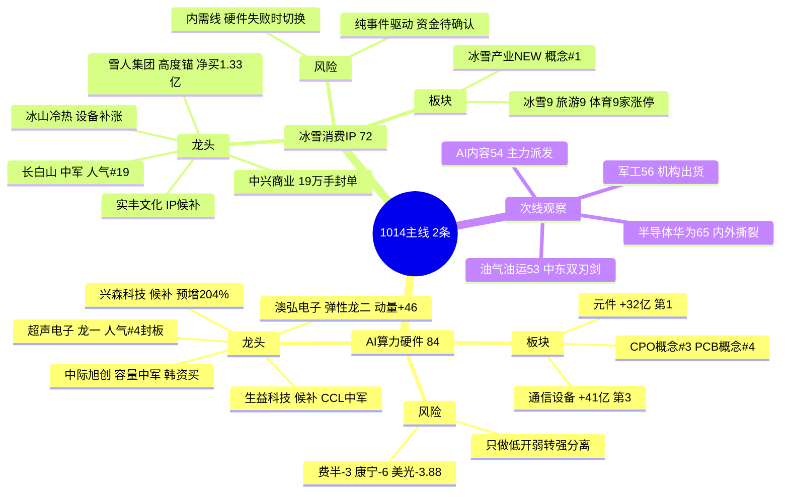

# 2026年10月14日(周三) · **主线研判**

> **数据源新鲜度**: partial(核心四源 1013 收盘 fresh,概念资金流/因子层降级)
> **降级状态**: true · **置信度**: 0.57
> **行情口径**: 1014 盘前,最新收盘 = 20261013(周二)

## 一句话结论

退潮后扩散修复日,**只认 2 条主线**——AI算力硬件(84,四源共识,但开盘先挨外盘费半一刀)与冰雪消费(72,内需新题材热度满分但资金待确认);AI内容应用主力派发降次线,**不硬凑第三条**。

## 市场段位与五维打分

R1 定性 `主线扩散型`(退潮后扩散修复),情绪周期 `高位震荡`(conf 0.52),涨停 67 家、炸板率 22.09%、但连板高度从 10 板塌到**最高仅 3 板**、昨日涨停溢价仅 `+1.13%`(主升硬线 +3%)。这是高标派发、资金下沉低位首板/二板试错的结构,**不是新主升确认**。纪律:只做各线龙一龙二与低位弱转强,总仓 ≤ `55%`,不追 3 板以上旧高标。

| 排名 | 主线 | 热度 | 资金 | 涨停 | 叙事 | 共振 | **总分** | 生命周期 | 跨源分 |
|:--:|---|:--:|:--:|:--:|:--:|:--:|:--:|:--:|:--:|
| 1 | **AI算力硬件**(CPO/PCB/光连接/元件) | 18 | 19 | 17 | 17 | 13 | **84** | 主升早期(回流) | 1.00 |
| 2 | **冰雪消费/IP经济**(冰雪大世界×迪士尼) | 19 | 11 | 15 | 13 | 14 | **72** | 主升早期(首日) | 0.34 |
| — | AI内容应用(世界模型/AI短剧) | — | — | — | — | — | 54 | **退潮** | — |
| — | 半导体国产替代/华为先进封装 | — | — | — | — | — | 65 | 早期(内部撕裂) | — |
| — | 军工/中船系 | — | — | — | — | — | 56 | 启动(有L1无L2) | — |
| — | 油气/油运/贵金属(中东地缘) | — | — | — | — | — | 53 | 启动(宏观双刃剑) | — |

> 70 硬线之上仅 2 条;50–70 进次线观察;AI 内容虽 R3 仍给 L1+L2,但 R7 资金证伪,不升主线。

## 主线一 · AI算力硬件(84分) · 四源共识但开盘挨刀

**资金**:`元件 +32亿`(THS行业全市场#1)、`通信设备 +41亿`(#3)、光学光电子 +10亿;龙虎榜 PCB 元件(迅捷兴/金百泽/澳弘/骏亚)密集涨停。**叙事**:R4 双 high 硬事件——PCB 三季报业绩潮(兴森预增 204–227%、宝鼎 536–614%)+ Lumentum 订单排到 2029–2030、杰普特北美 V 客户 1.63 亿美元硬订单,开源通信 1014 早 7:30 专场。**热度**:CPO 概念 #3、PCB #4,澳弘电子人气 56→10(delta 46 全场最强),超声电子 NEW#11、68 万手封板。

- **大资金意图**: 主力在 1012 血洗后从高位 AI 内容/新能源/金融权重撤出(保险 -20、电池 -40、银行 -11 亿),切向 30 日仍超跌的通信/元件(通信ETF 30日 -11.7%)做超跌回流,博的是 CPO 从主题切业绩的估值修复;对手盘是隔夜外盘硬件空头与打二板获利盘。
- **为什么走强**: 位置(30日深度超跌、1013刚首日回流)+ 催化(业绩预增 + 2030 订单可见度,硬锚)+ 筹码(元件/通信行业级净流入 + 龙虎榜密集封板)三维共振;但这是**回流首日不是主升中继**。
- **逻辑够不够硬**: 4 源全命中(cross_validation=1.0,当日唯一),有硬业绩与硬订单;**最大证伪路径在开盘**——隔夜费半盘中 -3%(收窄 -0.6)、康宁 -6%、美光/海力士 -3%+,A股硬件 1013 白天的回流与外盘暴跌时间口径背离,低开后 30min 不能放量收回即当日回流证伪,整条主线候选撤销。

### 首推票思维链 · 超声电子(000823)

- **买入理由**: ① dc 人气 #4 + 涨停 + PCB/CPO 双概念卡位,R4 载 68 万手封板,new_in_top#11,板块内辨识度与封单强度最高;② 直接受益 PCB 业绩潮与光连接涨价,板块 cross_validation 满分。
- **风险点**: ① 隔夜康宁 -6%、费半暴跌,情绪负反馈下首板隔日可能低开兑现;② 同板块中京电子已现涨停机构净卖 -5610 万,板块内封板分歧可能扩散。
- **止损条件**: 低开后 30min 跌破开盘价且分时无承接、或板块(CPO/PCB)竞价整体大幅低开(>-4%)不收回,直接放弃;具体价位由 D1 用 09:25 竞价快照 ×0.93 校准,不允许"灵活调整"。
- **可验证假设**: 24h 内——低开后 30min 放量翻红("外崩我不崩"分离成立)则弱转强确认可做;若低开低走、元件/通信行业资金转净流出,则回流证伪。买点只做弱转强/分歧回封,**禁止高开追板**。

> 其余龙头:澳弘电子(弹性龙二,动量最强但高波动,板块确认后打板)、中际旭创(CPO 容量中军,韩资逆势买入,低开回踩均线低吸)、生益科技(CCL 中军候补)、兴森科技(预增 204% 业绩锚候补,不追公告次日高开)。**剔除中京电子**(涨停机构出货,命中禁止清单)、新易盛/天孚/亨通(跟涨非龙一龙二,不做中位)。

## 主线二 · 冰雪消费/IP经济(72分) · 内需新题材,硬件失败时的切换位

**热度满分**:冰雪产业首日登 ths 概念榜即 `rank1`、hot 值 184813 全场最高,是 1013 最新最强的低位方向,也是唯一横跨全部题材群的主题。**涨停**:R1 口径冰雪 9 / 旅游 9 / 体育 9 家,中兴商业 19 万手封单,雪人/冰山冷热/长白山批量涨停。**叙事**:园区扩至 125 万㎡创历史新高 + 时隔 16 年再牵手迪士尼冰雪奇缘专区。

- **大资金意图**: 外盘暴跌压制硬件时,游资提前卡位一条**不受外盘映射的内需季节性新线**(R1 明确的硬件失败切换方向),博首日发酵到连板接力;对手盘是一日游获利盘与退潮期脆弱情绪。
- **为什么走强**: 位置(低位全新题材,首日 rank1)+ 催化(开园扩容 + 迪士尼硬时间锚)+ 情绪(5 群全天刷屏、官媒报封单)三维成立;但**资金维仅 11 分**——R7 THS 行业口径 top15 无零售/消费/旅游,仅个股龙虎榜(雪人净买 1.33 亿、东百连续 2 日 +1.52 亿)确认,缺板块级主力净流入。
- **逻辑够不够硬**: 仅 R1/R3 双源(cross_validation=0.34),R4 无冰雪硬事件、R7 无行业资金;按契约 D1 原则上应降 watch,能否进 execution 取决于开盘零售行业资金与二板高度确认。证伪路径:首日题材历史一日游概率高,全场高度仅 3 板、溢价 +1.13%,若无标的走出 2 板即证伪。

### 首推票思维链 · 长白山(603099)

- **买入理由**: ① 冰雪旅游最纯正中军/核心资产,dc 人气 #19 涨停 + ths 热股入榜,容量与辨识度兼备;② 冰雪大世界×迪士尼 + 园区扩容直接拉动景区客流预期,冬季时间窗确定。
- **风险点**: ① 纯事件驱动、无业绩/政策硬锚,板块资金跨源未确认;② 中军非最高弹性,若情绪走妖则跑输雪人集团这类高度锚。
- **止损条件**: 板块整体二板溢价不走强(雪人/中兴无一进二)或盘中放量跌破首板涨停价,降观察;具体价位 D1 竞价校准。
- **可验证假设**: 24–48h——雪人集团/长白山其一走出换手二板且零售/旅游行业资金进 R7 top10,则新题材确认;若全线一日游、冲高回落则证伪。买点分歧低吸或打板确认,**不追缩量一字**。

> 其余:雪人集团(高度锚,净买率 10.28%,弱转强换手板)、中兴商业(19 万手封单,东北零售扩散,只做换手二板)、实丰文化(迪士尼 IP 候补,无涨停确认不埋伏)、冰山冷热(设备补涨,龙头不强不碰)。东百集团资金最强(连续 2 日 +1.52 亿)但福州百货题材纯度低,列独立零售线观察,不占冰雪名额。

## 次线与剔除逻辑

- **AI内容应用(54,退潮)**: R3 仍有梯队(龙版 +9.99%、慈文三连板、字节世界模型叙事强、Meta +3.38 映射),但 R7 确认 1013 全线主力派发——博纳 -1.67、中文在线 -0.74、新华文轩 -0.69 亿,lhb_bull_trap 点名博纳高换手派发 + 新华文轩龙头破位。跷跷板明确切向硬件。只留慈文三连板活口观察,**不接飞刀、不做中位**。
- **半导体/华为(65)**: 麒麟 9050 量产 high + 半导体 +12 亿 + 国产替代三源成立,但板块涨幅仅 +0.01% 无涨停潮(粤芯 +223% 新股不追),内部被外盘存储崩跌撕裂,只看"外崩我不崩"分离。
- **军工(56)**: 资金实打实(军工装备 +33 亿 #2)但有 L1 无 L2、R4 无催化,电科思仪 35% 换手 + 机构净卖 -9137 万(全市场最大机构卖出)借热度派发,不主推。
- **油气/油运(53)**: 中东遇袭最新催化,中远海能/中国石油已被 R7 提前反应(石油加工 +7、航运 +7),属宏观双刃剑——同时压制高估值成长,事件驱动保留等开盘,失控升级则全场降维。

## 不确定性 / 反证

最大的不确定性是**硬件回流与外盘暴跌的开盘对决**,盘前不可验证(R7 已标注时间口径背离)。若低开分离失败,主线一整条撤销,资金可能切向内需冰雪或直接降仓;若韩国 -5.46% 引发北向联动流出(本次北向为防御托底单日仅 26 亿),题材修复外部流动性恶化。R6 应重点反证:硬件是否为"利好兑现 + 外盘共振"的高开低走陷阱、冰雪是否纯首日情绪无接力。本 R2 已主动剔除中京电子/AI内容中位/电科思仪三类有资金出货证据的标的。

## 与其他 R/D/E 的关系

- **依赖**: R1_style(风格/仓位上限)、R3_sentiment(共振主题/热榜)、R4_news(催化事件)、R7_capital_flow(行业资金/龙虎榜/跷跷板)
- **被消费**: 交 `filter_leader_v1` 做龙头硬过滤(流通市值≥20亿、ST、920 前缀、leader_preference top2)→ D1 主决策选 execution_pool(cross_validation≥0.67 优先,冰雪 0.34 需开盘确认)→ R6 反证(hard_reject 唯一否决权)

## 数据源审计

| 源 | 日期 | 状态 | 备注 |
|---|---|:--:|---|
| R1_style | 2026-10-14 | 🟢 | 完整 · 风格/情绪周期/仓位0.55 |
| R3_sentiment | 2026-10-14 | 🟢 | 5个L1+L2主题 · weflow永久下线降级 |
| R4_news | 2026-10-14 | 🟢 | 8硬事件/3966扫描 · 三季报+订单硬锚 |
| R7_capital_flow | 2026-10-14 | 🟢 | THS行业资金/龙虎榜/跷跷板 · confidence0.55 |
| tushare 热榜 | 2026-10-13 | 🟢 | ths热股/概念20 + dc人气/飙升各100 |
| moneyflow_ind_dc(概念) | 2026-10-13 | 🔴 | 不可用 · 退 THS 行业口径 |
| factor_snapshot(周度IR) | — | 🔴 | 目录不存在 · factor_layer_degraded |
| 实时收盘价 | 2026-10-13 | 🟡 | 部分票 pct_chg=null · D1竞价校准 |
| 行业分析师群/游资群(匿名) | 2026-10-13 | 🟢 | 5群483条 · 老钱防守/游资挖新苗 |

## Sub-Agent 元数据

- skill: analyze_main_sectors_v1@1.2
- artifact: data/research/20261014/R2_main_sectors.json
- model: ark-code-latest
- confidence: 0.57 = base 0.75 × freshness 0.85 × agreement 0.9
- 后续: filter_leader_v1 龙头硬过滤(同文件原地更新)
