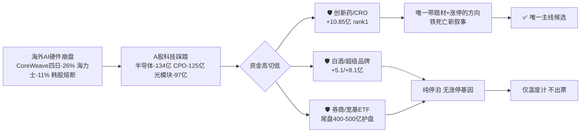

# 2026年10月16日（周五） · 主线研判

> **数据源新鲜度**: partial（因子层降级）
> **降级状态**: true（仅因子层；R1/R3/R4/R7 全部 ok）
> **置信度**: 0.62

## 一句话结论

🔴 **主跌放量恐慌日，主动降维：全场仅「创新药/铁死亡/CRO」一条三源共振主线（78分），只观察/极小试错，默认不开进攻仓。**

---

## 段位判断（先认市场，再认个股）

R1 口径：**崩溃退潮型 · 情绪周期=主跌（main_down）· 情绪浓度 28（恐惧区）**。

- 1015 全市场 **430 涨 / 5108 跌**，涨跌比 **0.08**；中位 **-3.04%**，≤-3% 达 2842 只。
- 涨停 36 家 / 跌停 **26 家**（较前日 11 家翻倍）；炸板率 16.28% 是「能封皆硬封、无人敢撬板」；成交 **1.65 万亿放量 2193 亿**——带量下杀，不是缩量磨底。
- 指数：上证 -1.59 / 深成 -2.43 / 创业板 -2.92 / 中证1000 -3.28，仅上证50（-0.42）抗跌。
- 封板榜散乱，全场仅一只 5 板孤高标；前一日的资源避险舱单日补跌逾 4%，**连避险板块都被流动性抽血**。

**纪律动作**：主跌期降维——R1 限主线 1 条、仓位上限 25%，R2 只输出唯一高共识方向，候选票一律不给进攻背书；等「放量降速 + 跌停收敛 + 主线二日确认」再恢复进攻。

## 市场在为什么付钱

资金性质要分清：白酒/超级品牌/券商的流入是**恐慌停泊**（无涨停家数、无题材、无涨停基因），不产生龙头；**只有创新药是「避险资金 + 铁死亡新题材 + 涨停 + 龙虎榜」四者叠加**，所以它是主跌日唯一能讨论的方向——但也只是逆势萌芽，不是主升。

---

## 唯一主线：创新药 / 铁死亡 / CRO（78 分）

| 维度 | 得分 | 依据 |
|---|---|---|
| 🔥 热度 | 16/20 | 热榜 top100 占 11 席、top20 占 3 席；华北制药 41→5、百花 r22、联亚 r17 新进 |
| 💰 资金 | 16/20 | CRO 主力净流入 **+10.85 亿全市场 rank1**；肝炎/肝素/基因/精准诊断 4 子项同进 top15 |
| 🚫 涨停 | 13/20 | 百花、华北、哈药硬封板，但未形成涨停潮（广度不足，主跌日客观受限） |
| 📰 叙事 | 17/20 | R4 E004 铁死亡全球首例临床数据（high）+ E006 AI制药 18.8亿$/15亿$ 两单合作（medium） |
| 🔗 共振 | 16/20 | R3 rank1 **L1+L2**，题材三群+突发群+新闻群三群刷屏，上证报/财联社官媒同步 |

**生命周期：formation（低位试错萌芽，第 1 日）**。龙头高度仅首板；CRO 概念 5 日 cum_net 仍为 **-23.39 亿、positive_days=1**——这是连续流出后的**首日翻转**，不是持续流入。升级条件：1016 板块再涨停 ≥3 家 + CRO 资金续流入，方可升 early_up。

**大资金意图**：科技硬件踩踏后，资金需要一个「跌不动 + 有新故事 + 有容量」的地方。医药同时满足防御（老钱避险）与进攻（铁死亡新题材给弹性），CRO rank1 是机构底仓性质的承接，百花龙虎榜净率 28% 是游资打弹性——两股资金在此交汇。

**为什么走强**：不是单一利好，是「海外 AI 去杠杆 → 科技抽血 → 高切低」的资金位移，叠加铁死亡临床催化点燃题材。逻辑的**资金面很硬（真金白银 rank1）**，题材面偏新偏软（仅 II 期临床信号）。

**逻辑够不够硬**：够当「主跌日避风港 + 萌芽试错」，**不够当主升主线重仓**——涨停广度不足、资金仅首日翻转、题材兑现度低。定性为观察池，非进攻池。

### 候选龙头（候选池，最终资格由 filter_leader_v1 裁定）

#### 1. 百花医药 600721.SH —— 龙一（连板妖股 · 高度龙头）

+10.05% 首板。涨停 + 龙虎榜净买 1.91 亿（净率 **28.27% 板块最高**）+ 热榜 r22，资金/涨停/热度三项硬确认最齐；rank_reason 直接写明「AI硬件走弱医药逆势走强资金轮动」。

- **买入理由**：主跌日硬封板 + 游资高净率承接 + 医药轮动标签最显性，是板块情绪的卡位票。
- **风险点**：主跌期系统性抽血；首板高度未经验证，次日溢价全看板块二日确认。
- **止损条件**：次日低开破首板启动价 / 板块涨停家数归零 / CRO 资金转净流出，即证伪离场。
- **可验证假设**：1016 医药板块续涨停 ≥3 家、CRO 资金续流入 → 弱转强成立；反之是一日游。
- **T+1 博弈**：卡位/逆势分离。只接分歧低吸或回封确认，**不接一字高开**；主跌期仓位 ≤ 试错档。

#### 2. 华北制药 600812.SH —— 龙二（波段趋势 · 容量中军）

+10.05% 首板。热榜 **41→5（+36 全场最快升速之一）**，大市值老牌药企，承担容量中军；未进龙虎榜净买 top10 故列龙二而非龙一。

- **买入理由**：容量资金避险 + 铁死亡外溢搭车，大盘医药趋势续航理论上强于纯小票。
- **风险点**：弹性弱，若避险资金一日撤退则首板即顶。
- **止损条件**：跌破首板日均价 / 医药防御资金（CRO+肝炎+肝素）整体转流出。
- **可验证假设**：若医药持续获避险配置，华北走趋势而非连板；需放量站稳。
- **T+1 博弈**：联动/助攻（容量）。只做板块确认后的分歧低吸，不追高。

#### 3. 莱美药业 300006.SZ —— 龙二（连板妖股 · 题材弹性，20cm）

铁死亡「赛道首创」、公司已就异动发公告，题材纯度最高，G4/G5 高频挖苗，热榜 r71。创业板 20cm，弹性角色（前缀同权，不因 300 降级）。

- **买入理由**：板块内铁死亡直接映射，若题材发酵弹性最大，存在首日未封板的补涨预期差。
- **风险点**：公司自证仅 **II 期临床**，情绪溢价远高于基本面；首日未涨停本身就是资金保留态度。
- **止损条件**：板块确认后仍不能封板 / 异动公告后高开低走，快切不讲故事。
- **可验证假设**：1016 板块续强则半路/低吸补涨成立；板块熄火则它杀最狠。
- **T+1 博弈**：补涨苗，高弹性高风险，严格试错仓，不打无封板票的板。

#### 4. 昭衍新药 603127.SH —— 候补（波段趋势 · 潜在 CRO 中军）

CRO 正统龙头之一，热榜 r61 新进。对应 R7 资金 rank1 的 **CRO 本体**——当日涨停的多是传统药企，CRO 正主还没大涨（CRO 板块 pct -1.34）。

- **买入理由**：资金首日翻正 + 股价未涨，若流入持续存在修复差；E006 AI制药/CRO 扩容直接受益。
- **风险点**：**左侧属性**——资金流入股价仍跌，可能是下跌中继接飞刀。
- **止损条件**：CRO 资金重新转净流出 / 股价不能站回 5/10 日均线。
- **可验证假设**：资金续流入 + 股价站回均线「双确认」才从候补升级；主跌期不抢先手。

#### 5. 联亚药业 301569.SZ —— 候补/情绪温度计（建议拦截追高）

次新 CRO 单日 **+401.71% 临停**，热榜 r17，龙虎榜净买 1.37 亿。极端情绪标志，非可交易龙头。

- 次新无涨跌幅约束，临停说明博弈白热化，次日高波动、接盘风险极高。
- **定位：板块温度计**——它继续强代表题材情绪在；自身无安全买点，建议 filter_leader 强制 watch、不进 execution。

---

## 次线与剔除

| 方向 | 分数 | 处置 | 理由 |
|---|---|---|---|
| 三季报业绩超预期 | 58 | 次线观察 | R3 rank2 L1+L2 + 老钱预设的暴跌后接力方向 + E002 业绩共振；但是跨板块**因子**非独立板块，高标崇达/金禄多属被抛售的 PCB，难脱板块 beta；只选业绩+逆势资金双确认个股 |
| 固态电池/新型电池 | 54 | 次线观察 | E003 双政策 high（十五五规划+免消费税至2028）+上海洗霸涨停，但**R3 无共振、R7 仅复合集流体边缘上榜**，政策未经资金确认 |
| 短剧/AI内容/传媒 | 50 | ⚠️ fade 降级 | 叙事 high（微信绿泡泡+华福会）+慈文5板，但 R7 资金反手大流出（AIGC-32亿/短剧-16亿），前总龙新华传媒断板、龙版-9.45 进出货警报，G1 Jason 判「AI传媒结束」。**只留慈文孤标看情绪，禁追补涨苗** |
| 大金融/白酒纯防御 | 47 | 不出票 | 资金避险抱团但无题材/无涨停/无涨停基因，属停泊；其走强反而是「主跌未结束」的温度计 |
| ❌ PCB/CPO/AI硬件 | 31 | **剔除·移送R6** | 热榜霸榜 39 席但疑似模式六出货：权重旭创-5.19/新易盛-7.49 继续杀 + E001 海外崩盘负面 high + R7 五项巨幅流出。三源向下共振，禁以「业绩好」左侧接刀 |

## 关键证据

- 证据1：CRO 主力净流入 +10.85 亿、东财概念 rank1，且肝炎/肝素/基因/精准诊断 4 个医药子项同进 top15 · 来源 R7 moneyflow_ind_dc
- 证据2：R3 rank1 L1+L2，热榜 11 席 + 三群 KOL 刷屏「铁死亡」+ 上证报/财联社官媒 · 来源 R3
- 证据3：R4 E004（铁死亡临床 high）+ E006（Vir/吉利德 18.8亿$、阿斯利康/insitro 15亿$）· 来源 R4
- 证据4：百花医药龙虎榜净买 1.91 亿/净率 28.27%、联亚净买 1.37 亿 · 来源 R7 龙虎榜
- 证据5（反证）：CRO 概念 5 日 cum_net -23.39 亿、positive_days=1，首日翻转而非持续流入 · 来源 R7 sector_5d

## 数据源审计

| 源 | 状态 | 抓取时间 | 记录数 | 备注 |
|---|---|---|---|---|
| R1 风格 | 🟢 ok | 10-16 06:32 | 1 | 崩溃退潮/主跌/情绪28 |
| R3 情绪 | 🟢 ok | 10-16 06:46 | 1 | 4主题，医药rank1 |
| R4 消息 | 🟢 ok | 10-16 06:26 | 1 | 8事件，铁死亡/短剧high |
| R7 资金 | 🟢 ok | 10-16 06:18 | 1 | CRO rank1，科技大流出 |
| 因子快照 | 🔴 stale | — | 0 | 周度IR缺失，因子层降级 |

## 不确定性 / 反证

1. **主跌系统性风险压倒一切**：即便医药三源共振，参照 1014 资源避险舱 1015 单日补跌逾 4%，任何逆势方向都可能被流动性无差别抽血。这是本次置信度仅 0.62 的首要原因。
2. **资金只有一天**：CRO 5 日仍净流出 23.39 亿，首日翻转可能只是单日避险，1016 若不续流入则萌芽证伪。
3. **题材软、广度窄**：铁死亡仅 II 期临床信号，板块硬封板仅个位数，不符合主升主线的板块效应。
4. **疑似出货对照**：PCB 热榜霸榜 39 席却资金巨幅流出+权重续跌+海外利空，是典型「热度在、钱在撤」结构，已剔除并请 R6 做霸榜出货硬否决核验；医药也需 R6 反向检验是否存在同类诱多（尤其联亚 +401% 极端值）。

## 与其他 R/D/E 的关系

- **依赖**：R1_style（定主线上限/仓位）、R3_sentiment（共振主题+出货警报）、R4_news（催化板块）、R7_capital_flow（板块资金+龙虎榜+跷跷板）
- **被消费**：filter_leader_v1（龙头硬过滤，同文件原地更新）→ D1（execution_pool 选池）、R6（反证，cross_validation_score=1.0 仍需独立核验）、E1（复盘）
- **给 D1 的硬提示**：主跌期 default 不新开进攻仓；唯一主线 cross_validation=1.0 但 stage=formation，龙头只可进 watch/极小试错；联亚强制 watch

## Sub-Agent 元数据

- skill: analyze_main_sectors_v1（v1.2 cross_validation）
- artifact: data/research/20261016/R2_main_sectors.json
- 生成耗时: 约 4 分钟（消费四上游 artifact，无 MCP 实时调用）
- model: ark-code-latest
- 降级: 因子层（无周度 IR 快照）；主数据源全部 ok
