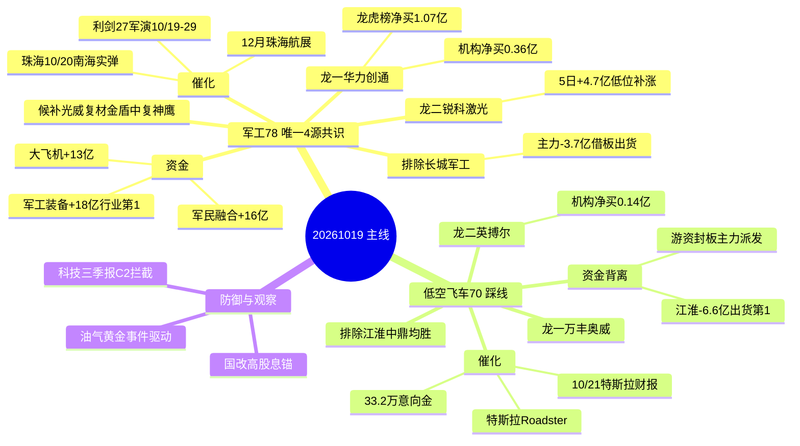
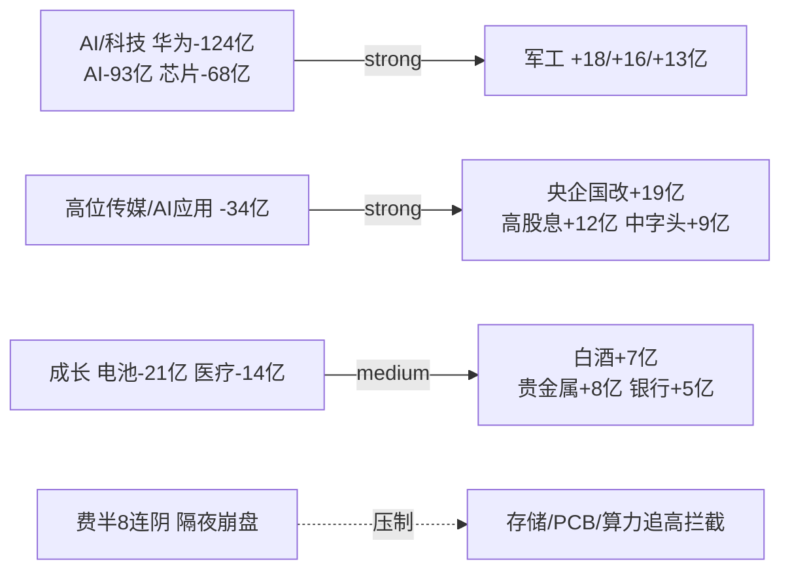

# 2026年10月19日(周一) · **主线研判**

> **数据源新鲜度**: partial(R7资金/热榜=1016收盘口径)
> **降级状态**: true(因子层缺失 + 热榜非T+0)
> **置信度**: 0.49 = 基准0.70 × 新鲜度0.7 × 多源一致1.0
> **市场段位(R1)**: 主跌(conf0.85)· 炸板率44.55%(≥35%砍半线)· 昨日涨停溢价 **-1.64%** · 主力净流出 **340.7亿** · 仓位上限 **30%**

## 🎯 一句话结论

**主跌段只认一条真主线=军工(4源共识+资金行业第1,做低位补涨不追被出货的总龙);低空飞车是热度叙事满格但资金缺一位的踩线线,只做总龙分歧回封、禁追一致高开;科技三季报再硬也被资金面拦截,仅观察。**

## 📊 5维板块打分总表

| 排名 | 板块 | 热度 | 资金 | 涨停 | 叙事 | 共振 | **总分** | 段位 | 结论 |
|---|---|:--:|:--:|:--:|:--:|:--:|:--:|---|---|
| 1 | 军工/军民融合/大飞机 | 16 | **19** | 16 | 17 | 10 | **78** | 主升早期(低位补涨) | ✅ 进·唯一4源共识 |
| 2 | 低空经济/飞行汽车 | **19** | 10 | 17 | 17 | 7 | **70** | 高潮分歧 | ⚠️ 踩线·只做龙头分歧 |
| — | 国产算力/存储/PCB | 12 | 6 | 8 | **18** | 8 | 52 | 高位退潮 | 👀 C2拦截·仅观察 |
| — | 油气/黄金 | 8 | 13 | 6 | 16 | 9 | 55 | 事件驱动 | 👀 次线·只做龙头 |
| — | 央企国改/高股息 | 9 | **16** | 5 | 4 | 6 | 50 | 防御锚 | 🔒 不进攻 |
| — | AI应用/AI医疗 | 14 | 3 | 6 | 12 | 13 | 48 | 纯预期early | 👀 只观察 |
| ❌ | 创新药/CRO | — | — | — | — | — | 30 | 负向 | 剔除(药明跌停+出口管制) |
| ❌ | 人形机器人(高位) | — | — | — | — | — | 33 | 弱共振 | 剔除(泡沫警告双向) |

> **打分纪律**: 每维0-20,总分100;主线核心须≥70。主跌段候选砍半,仅留2条主线。霸榜第一(江淮/新华传媒)按R3 distribution_alert **不加分反扣分**。

## 🗺️ 主线结构脑图

## 🥇 主线一 · 军工/军民融合(含商业航天·大飞机) — 78分

**交叉验证**: R3共振 ✅ · R4催化 ✅(E005+E007 high) · R7资金 ✅ → `cross_validation_score=1.00`,4源共识 `composite≈0.90`

- **大资金意图**: 周五科技获利了结+美股费半8连阴,主力把进攻仓位从AI硬件切到**低位+有硬时间锚**的军工——军工装备净流入`+18亿`为全行业第1,对手盘是从CPO/半导体高位撤出来的获利盘和追高飞车明牌的情绪盘。资金刻意绕开一字总龙长城军工(主力`-3.7亿`),做**板块内部高低切**,选20cm低位新军,说明是配置型+游资合力而非纯情绪抱团。
- **为什么走强**: 位置(板块仅4天、低位20cm新军首板) + 催化(利剑27军演10/19-29八国6万人 + 珠海10/20南海实弹 + 12月航展,三重时间锚) + 筹码(华力创通龙虎榜净买`1.07亿`+机构净买`0.36亿`;锐科激光5日`+4.7亿`)三维共振。
- **逻辑够不够硬**: 是今日唯一**资金+热度+叙事+共振四源齐全**的方向,有硬时间锚(军演19日开幕即当日)。证伪路径: ①总龙长城军工竞价撤单/核按钮带崩情绪;②周一缩量纯内资,1016的`+18亿`流入不能在1019延续;③军演"买预期卖事实"高开低走。

**龙头结构**: 打高度的旧总龙=长城军工(被出货,排除);资金新容量核心=华力创通;量能萎缩日偏好低位20cm弹性而非沈飞/中直类大盘总装。

| role | 代码 | 名称 | 属性 | 执行资格 | 核心依据 |
|---|---|---|---|:--:|---|
| 龙一 | 300045.SZ | 华力创通 | 连板妖股 | ✅ | 大飞机概念资金领涨+龙虎榜机构游资合力,新上榜rank14 |
| 龙二 | 300747.SZ | 锐科激光 | 波段趋势 | ✅ | 5日主力+4.7亿涨16.4%、T日+3.2亿,低位补涨真金 |
| 候补 | 300699.SZ | 光威复材 | 波段趋势 | ❌ | 碳纤维,T日+2.9亿涨9.45%,高低切受益(backup) |
| 候补 | 300411.SZ | 金盾股份 | 连板妖股 | ❌ | 新上榜rank16,20cm军团成建制(backup) |
| 候补 | 688295.SH | 中复神鹰 | 波段趋势 | ❌ | 中字头概念领涨+9亿,容量票(backup) |

> 排除: **长城军工**(601606,总龙但主力-3.7亿/5日-4.1亿借板出货,C3不板上接力)、**晟楠科技**(军工装备领涨但北交所,920流动性规则不进execution)。

### 首推票思维链 · 华力创通(300045.SZ)
- **买入理由**: ①大飞机概念1016资金领涨(R7 lead,+13亿),龙虎榜净买`1.07亿`且机构净买`0.36亿`,是板块内唯一"游资+机构合力"的低位20cm;②军演19日开幕+航展时间锚,板块为当日唯一4源共识主线。
- **风险点**: 短期——一致性高开后先手兑现、旧总龙长城军工核按钮拖累板块;中期——板块已运行4天,若1019缩量流入不延续则落入高潮分歧。
- **止损条件**: 只接开盘分歧换手后的回封/弱转强,不追一致高开;买入后跌破回封当日均价且板块龙头(长城军工)封单竞价撤单即离场;硬止损参照10日线,约-7%~-9%。
- **可验证假设**(24-72h): 观测量=①竞价金额较1016放大且高开幅度<5%后不破均价;②军工装备板块1019主力净流入仍为正;③大飞机/军民融合概念继续位列资金流入top5。三项中两项不成立=证伪,降级观察。

### 首推票思维链 · 锐科激光(300747.SZ)
- **买入理由**: ①5日主力`+4.7亿`、股价`+16.4%`,T日再`+3.2亿`涨7%,是R7 bargain_divergence钦点的"低位军工补涨真金",资金连续性优于一字情绪票;②军工链激光,间接受益军演+航展,位置低不拥挤。
- **风险点**: 短期——非事件最前排,若板块只炒事件龙头则弹性滞后;中期——激光主业与军工收入占比需R5核实,主题纯度待验。
- **止损条件**: 分歧低吸/半路参与,不追高;跌破5日线或单日主力净流出>2亿即走,硬止损约-8%。
- **可验证假设**(24-72h): ①1019主力资金仍净流入;②相对长城军工/华力创通不出现大幅补跌(高低切延续);③量能维持在5日均量上方。资金转净流出即证伪。

## 🥈 主线二 · 低空经济/飞行汽车(eVTOL) — 70分(踩线)

**交叉验证**: R3共振 ✅(rank1 L1+L2) · R4催化 ✅(E004 high) · R7资金 ❌ → `cross_validation_score=0.67`,3源共识 `composite≈0.62`(资金缺一位)

- **大资金意图**: 这是**游资封板、老钱派发**的典型背离局——周末电话会+央媒+马斯克把Roadster打成明牌,热榜新上榜11只中7只全是低空汽零,一致性已100%在榜单兑现;但人气龙一江淮汽车主力`-6.6亿`(全市场净流出第1,5日`-7.7亿`)、中鼎/均胜涨停却主力出货。大资金借最热的板把货倒给周末被"复制22年机器人"话术点燃的接力盘。
- **为什么走强**: 热度(飞行汽车ths概念#1热度96989/低空#2) + 叙事(Roadster+33.2万意向金+华创/长城专家会) + 涨停(万丰封死、英搏尔20cm、首板群启动首日)三项满分级;**唯独资金是骗的**。
- **逻辑够不够硬**: 题材热度硬,但**无板块级主力资金确认 + 纯主题2028前无业绩 + 无预期差(卖方一致度极高)**。按纪律这是"高潮分歧"而非主升早期。证伪/加强节点=`10-21特斯拉财报`;周一龙头封不住即退潮。只做总龙万丰、不做杂毛(文灿/铭科/旭升等新上榜首板一律不追)。

**龙头结构**: 情绪高度龙=万丰奥威(辨识度/连板第1);无容量中军(纯主题);人气龙一江淮汽车被R7判涨停诱多头号,排除。

| role | 代码 | 名称 | 属性 | 执行资格 | 核心依据 |
|---|---|---|---|:--:|---|
| 龙一 | 002085.SZ | 万丰奥威 | 连板妖股 | ✅(有条件) | 飞车情绪总龙,1016涨停封死,东财人气#3,飞机制造占收入14.84% |
| 龙二 | 300681.SZ | 英搏尔 | 连板妖股 | ✅(有条件) | 电驱动20cm,板块内唯一机构净买(0.14亿)的弹性票 |
| 候补 | 603197.SH | 保隆科技 | 波段趋势 | ❌ | 卖方点名储气罐/传感,新上榜rank44,无资金确认(backup) |
| 候补 | 002510.SZ | 天汽模 | 连板妖股 | ❌ | 新上榜首板rank18,封单质量未知(backup) |

> 排除: **江淮汽车**(600418,-6.6亿全市场出货第1,头号涨停诱多)、**中鼎股份**(000887,游资封板主力-2.3亿)、**均胜电子**(600699,涨停开板4次主力-1.9亿)。
> **有条件执行**: 龙一龙二的execution资格须在竞价确认——只接开盘分歧换手后的回封,**禁止追一致高开**;若竞价无放量承接,D1须将本线整体降级watch_pool。

### 首推票思维链 · 万丰奥威(002085.SZ)
- **买入理由**: ①飞车情绪总龙,1016涨停封死+东财人气#3,辨识度/连板高度板块第1,飞机制造占收入14.84%是少数有实际通航/eVTOL布局的标的;②Roadster+33.2万意向金+百度热搜第一,情绪龙头地位明确。
- **风险点**: 短期——明牌一致性高开即先手兑现窗口,板块无主力资金确认、人气龙江淮被出货;中期——纯主题2028前无业绩贡献,10-21特斯拉财报若不及预期直接证伪。
- **止损条件**: 只接分歧换手后回封,不追高开;高开>7%且不回封=弃;买入后炸板不回封或跌破回封日均价-5%即走;事件证伪(财报)无条件离场。
- **可验证假设**(24-72h): ①竞价高开幅度≤5%且开盘30分钟内完成换手回封;②封单金额较1016不衰减;③板块内首板群(天汽模/保隆)有≥2只助攻涨停。龙头封不住/无助攻=退潮证伪。

## 🔄 资金跷跷板与被拦截方向(R7)

- **科技三季报(算力/存储/PCB)**: R4有最硬的业绩×涨价×回购(长鑫净利1310亿扭亏、生益+164%、十万卡超集群),但R7 C2**硬约束拦截**——元件-24亿/半导体-23亿/华为-124亿,费半8连阴。逆势流入票(中际旭创5日+30亿但价-13.6%、长鑫T日转流入、拓荆)只列观察,**竞价放量企稳才允许低吸**,不进进攻主线。
- **油气/黄金**: 霍尔木兹触雷+金4180美元,贵金属+8亿,事件驱动只做中国海油/山东黄金龙头;"伊朗7日重开提议"是反转开关,非R3共振主题,列次线。
- **AI应用/AI医疗**: R3纯政策+KOL预期(颜晓滨"风起云涌"),但AI应用概念资金-80亿/传媒-34亿,价格资金双未确认,主跌段只观察。

## ⚠️ 不确定性 / 反证(交R6硬否决)

1. **口径风险**: R7资金与热榜均为**1016收盘**口径,1019为重阳节翌日沪深股通休市、纯内资缩量日,1016的军工`+18亿`能否延续须竞价验证——这是本研判最大不确定性。
2. **双出货警报**: 旧主线总龙新华传媒(11板,官媒风险提示)+长城军工(主力-3.7亿)若同时竞价核按钮,会把主跌从短线接力层推向系统性下杀(R1警示),届时两条主线全部降级。
3. **低空主线资金缺一位**(cross_validation仅0.67),本质是情绪局,若D1竞价不见放量承接应直接砍到watch,不要因热度第1而放宽。
4. 因子层缺失(`top_ir_factors.json`),板块内个股排序无量化IR因子复核,`factor_layer_degraded=true`,个股排序依赖R7资金+龙虎榜定性。

## 与其他 R/D/E 的关系
- **依赖**: R1_style(段位/仓位) · R3_sentiment(共振/热榜/出货警报) · R4_news(催化/首推票) · R7_capital_flow(资金/跷跷板/诱多名单)
- **被消费**: D1(只取leader_rank 1/2 且 execution_eligible 的票进execution_pool) · R5(对龙一龙二+未过滤候补做六维画像) · R6(对执行龙头做反证,长城军工/江淮类出货为重点)
- **硬过滤**: 已执行 filter_leader_v1,每条主线 execution_eligible ≤2;龙三及以下标 filtered_out/backup_eligible

## Sub-Agent 元数据
- skill: analyze_main_sectors_v1@1.2(内联 filter_leader_v1)
- artifact: data/research/20261019/R2_main_sectors.json
- 验收: tests/checks/check_r2_cross_validation.py 20261019 通过
- 主模板: 分歧接力/总龙锁仓混合(主跌段只接龙头分歧+低位补涨)
- model: ark-code-latest

## 数据源审计

| 源 | 日期 | 状态 | 备注 |
|---|---|:--:|---|
| R1_style.json | 2026-10-19 | 🟢 | complete conf0.70·主跌conf0.85·仓位上限30% |
| R3_sentiment.json | 2026-10-19 | 🟢 | complete conf0.72·情绪41·5群(匿名)+51公众号 |
| R4_news.json | 2026-10-19 | 🟢 | complete conf0.72·8硬事件·三大必读源全绿 |
| R7_capital_flow.json | 2026-10-16 | 🟡 | complete但资金/情绪口径=1016收盘·freshness=0.7 |
| 热榜 attention_signals | 2026-10-16 | 🟡 | 1016周五收盘榜,1019新榜盘前未生成 |
| factor_snapshot | — | 🔴 | 无top_ir_factors.json·因子层降级 |
| 北向资金 | 2026-10-19 | 🔴 | 重阳翌日沪深股通休市·纯内资博弈 |
| user_preferences | 2026-10-19 | 🟢 | leader_preference 同板块只留龙一龙二·黑名单空 |
