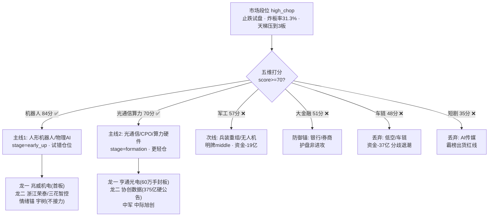

# 2026年10月20日(周二) · 主线研判

> **数据源新鲜度**: partial(R7 用原始缓存替代)
> **降级状态**: false(五维均可计算)
> **置信度**: 0.72
> **段位**: 主跌恐慌后的高位震荡/止跌试盘(high_chop)· 仓位上限 50%

## 一句话结论

🤖 **机器人/物理AI 四源共振是唯一真主线**;🔌 光通信/CPO/算力硬件靠硬公告做反抽次主线;🚗 R1 的车链代理主线被资金面否决,军工只配做明牌观察。

## 主线决策全景

## 详细分析

### 🤖 主线一:人形机器人/物理AI — 84分 · 主升早期(反抽首段)

**为什么是它**:这是 1019 全市场唯一"热榜跳升 + 资金连续两日净流入 + 涨停梯队 + 硬催化"四者齐备的方向。人形机器人概念从 ths 概念榜 #20 直接跳到 **#1(Δ+19)**,减速器#11、机器人概念#5 均为 NEW 进榜;1019 机器人概念 **19家涨停**、人形12家、机器人ETF 20只涨停,板块封板家数全场第一。

**大资金意图**:1015 恐慌日机器人概念单日被抽血 -102亿,1016 立刻转正 +9.3亿、1019 再加 +19.9亿(人形+24.7/减速器+9.8/执行器+6.3)——这是典型的**恐慌后资金率先回流的破局方向**。宇树科技个股主力净流入 0.50亿、超大单 +0.60亿,机构在高标上真金白银试盘。结合 ETF 托底路径,资金要的是"用产业催化最密、位置被杀最透的科技方向带动风险偏好修复"。

**为什么走强**:英伟达投德数十亿+投资敏捷机器人等4家机器人公司(E003 high)、优必选签日本独家代理、Optimus 周产数百台→年底1000台→远期2万台;**10/21 黄仁勋 GTC 柏林、10/22 宇树世界物理AI大会**双明牌节点;工信部定调具身智能为新质生产力抓手。5个微信群 43 条相关消息,产业真实度高(非纯口号)。

**逻辑够不够硬**:中高。量产数据+大会催化+政策定调是真的,但 30日超跌反抽的第一根,1015-16 AI硬件两次反抽都次日埋人,且严格共振(指数放量长阳+板块前三)未出现。**定性=计划内试错,不是主升确认**。

**候选梯队(候选池,执行资格待 filter_leader 裁定)**:

| 角色 | 票 | 板型 | 关键依据 | T+1 买点结论 |
|---|---|---|---|---|
| 龙一 | 兆威机电 003021 | 首板10cm | 灵巧手微型驱动核心,封单0.59亿,R4首推 | 弱转强半路/打板,高开>8%放弃 |
| 龙二 | 浙江荣泰 603119 | 首板10cm | 机器人绝缘件,封单0.88亿 | 龙一强则跟风回封,否则不碰 |
| 龙二(中军) | 三花智控 002050 | +3.91% | 执行器+热管理双主线容量中军 | 分歧低吸,不追高 |
| 候补 | 步科股份 688160 | +9.41%未封 | dc飙升#1,20cm运控弹性 | 仅板块延续做半路,试错仓 |
| 情绪锚 | 宇树科技 688836 | +16.15% | 整机总龙,龙虎榜,495元高标 | **不接力**,仅作情绪温度计 |

首推票思维链(兆威机电):
- **买入理由**:板块封板家数第一的首板梯队中产业硬度最高(已送样多家人形厂商)+ E003 直接催化 + 180亿市值兼顾弹性与容量
- **风险点**:明牌首日板块已12家涨停,次日高开即可能被先手兑现;E008 机构十年最快砍科技股的β压制
- **止损条件**:跌破10日线或开盘高开低走跌破昨收;R4 参考止损位 62.51(-7%)
- **可验证假设**:10/21 黄仁勋演讲提及物理AI/机器人超预期;竞价高开3-6%且放量承接;兆威竞价强度领先同梯队

### 🔌 主线二:光通信/CPO/算力硬件 — 70分 · 雏形期(超跌反抽,内部分化)

**为什么卡线入选**:通信30日 -19.5%、芯片 -21.5% 是全场被杀最透的方向,隔夜费半**终结八连跌**(美光+4.33/西数+6.09/Lumentum+5.02)+ Nscale-Anthropic 约450亿美元算力大单,光模块组件订单排到2027。1019 光通信模块 +23.2亿、算力概念 +21.9亿、CPO +17.1亿主力转正。

**大资金意图**:**先救总熊头**。亨通光电 60万手封板(封单3.99亿)是大市值容量票被资金选作破局旗手,复刻7月宽基ETF托底+龙头破局的标准操作。但注意——这是反抽不是反转,资金只进了光通信/算力两个子口。

**为什么走强**:E001 协创数据盘后**374.9亿/60个月算力云硬公告**(年化62.5亿远超营收)是当日唯一的真 alpha;Meta 纪要(1.6T 中际/新易盛主供)+ 光纤现货报价倍数攀升+高盛PCB三连推。

**逻辑够不够硬**:分歧。硬在真实订单与外盘止跌;软在 ① **PCB 主力净流出 -26.8亿、存储仅 +0.5亿、半导体设备 -5.96亿**,子方向严重分裂;② 高盛数据机构正以2016年来最快速度砍科技股(E008),外资路演点名"存储激光器宏观不利、2028开支可见性不足";③ 1015-16 两次反抽均次日埋人。**仓位必须低于机器人线,只做封板龙和硬公告龙,不做存储高位反抽**。

| 角色 | 票 | 板型 | 关键依据 | T+1 买点结论 |
|---|---|---|---|---|
| 龙一 | 亨通光电 600487 | 首板10cm | dc人气#1,60万手封单,双主线容量旗手 | 不追高,分歧低吸/回封打 |
| 龙二 | 协创数据 300857 | +1.22%未抢跑 | 375亿盘后硬公告,预期差最大 | **竞价定强弱**,高开5-9%放量半路 |
| 龙二(中军) | 中际旭创 300308 | 待核验 | 1.6T主供,容量中军 | 仅低吸 |
| 候补 | 澳弘电子 605058 | 首板(开4次) | 飙升Δ60但封单仅0.15亿=弱封板 | 只做弱转强一进二 |
| 候补 | 润泽科技 300442 | +3.03% | IDC龙头+股东增持,扩散方向 | 协创强则低吸补涨 |

⚠️ 大普微(301666)虽20cm涨停,但918→257跌72%,纯筹码反抽,R3明确排除;长鑫科技 -7.77%、拓荆 -13.9% 的高位硬件不接飞刀。

### 🎖️ 次线与丢弃方向

- **军工/兵装重组/无人机(57分,middle 明牌)**:兵装重组概念#2(+4.75%)、甘化科工2板、9只涨停;催化时间轴真实(利剑27军演、无人机管制11/18落地、珠海航展12/7)。**但主力净流出军工 -19亿/无人机 -15.4亿**,明牌已被兑现,大V说的"第三主线"是预期不是现状。观察甘化科工/六九一二/长城军工/内蒙一机,资金转正+出3板空间板才升级。
- **大金融(51分,防御锚)**:银行行业榜#1(Δ+9)、国有大行净流入+8.75亿;金融街论坛18只主动ETF+券商并购重组。这是**给指数下限的护盘,不是连板题材**,交D1做仓位结构锚;只有券商集体涨停才按动态风格规则重估为进攻。
- **🚗 低空/车链(48分,丢弃)**:这是本次最重要的**跨源冲突裁决**。R1 用涨停梯队(新能源车17/比亚迪12/汽零10)代理为双主线,但资金面实算:新能源车 **-37.4亿**、低空 -19.3亿、飞行汽车 -6.8亿;eVTOL 热榜 #1→#6,江淮汽车 -1.34% 滞涨。周末一致明牌后进入接力分歧段,按"资金现在在买什么"铁律,**降入丢弃**,万丰/保隆/东安仅观察。
- **AI短剧/传媒(35分,丢弃)**:新华传媒双榜#1但仅+2.77%封不住、新华文轩跌停=霸榜出货红线,总龙与断板高标严禁触碰。

## 关键证据

- 证据1: 人形机器人概念主力净流入 +24.7亿(1019)+11.2亿(1016),全市场唯一连续2日净流入主题簇 · 来源 _r7_data/mf_ind_concept(东财moneyflow)
- 证据2: 机器人概念19家/人形12家涨停、机器人ETF 20只涨停,封板家数全场第一 · 来源 R1 limit_cpt_list
- 证据3: 亨通光电60万手封板、封单3.99亿,dc人气#1/ths热股#5(Δ+32) · 来源 limit_list_d + R3热榜
- 证据4: 协创数据374.9亿/60个月算力云协议,公告+两报+群聊三源 · 来源 R4 E001
- 证据5: 车链资金否决——新能源车-37.4亿/低空-19.3亿,与R1涨停梯队代理冲突,以资金面为准 · 来源 mf_ind_concept
- 证据6: 高盛PB数据对冲基金五日砍科技股幅度创2016年来最大(E008) · 来源 R4

## 数据源审计

| 源 | 状态 | 抓取时间 | 记录数 | 备注 |
|---|---|---|---|---|
| R1_style | 🟢 | 06:22 | 1 | conf0.70,high_chop/双主线cap2 |
| R3_sentiment | 🟢 | 06:48 | 5主题 | conf0.66,L1+L2,WeFlow永久下线无L3 |
| R4_news | 🟢 | 07:25 | 8事件 | conf0.62,5硬事件源 |
| R7_capital_flow | 🟡 | - | - | 正式artifact未落盘,用_r7_data五日资金缓存实算;北向休市 |
| factor_ir周扫描 | 🔴 | - | - | top_ir_factors.json缺失,因子层降级 |
| limit_list_d/top_list | 🟢 | 1019收盘 | 全市场 | 封单/连板/龙虎榜核验 |

## 不确定性 / 反证

1. **反抽 vs 反转未决**:所有主线都建立在"止跌试盘"假设上,右侧确认信号(指数放量长阳+涨停回60+跌停个位数+4板空间板)一个都没出现。若1020高开低走,机器人首板梯队同样会埋人——这是最大的自我批判。
2. **机构在撤、游资在试**:E008 与机器人/光通信反抽是两股相反的力,1020竞价就是裁决场,盘前 R2 无法预判谁赢。
3. **明牌节点风险**:10/21黄仁勋、10/22宇树大会、10/21美光会全部在24-48小时内落地,典型"利好兑现"窗口,追高盈亏比差。
4. R7正式artifact与因子层双缺,资金持续性只有2日样本、个股排序无量化因子背书,交 R6 重点反证机器人线的资金可持续性与协创公告的履约能力(年化62.5亿 vs 当前营收)。

## 与其他 R/D/E 的关系

- 依赖: R1_style(段位/主线cap)、R3_sentiment(共振/热榜/出货警报)、R4_news(催化/硬公告)、_r7_data(R7替代资金缓存)
- 被消费: filter_leader_v1(龙头硬过滤,本次未执行待续)、D1主决策(execution_pool 选取,CV=1.0双线优先)、R6反证(重点:反抽持续性、协创履约、宇树透支)、E1复盘(车链代理主线被资金否决的裁决质量)

## Sub-Agent 元数据

- skill: analyze_main_sectors_v1@1.2
- artifact: data/research/20261020/R2_main_sectors.json
- 生成耗时: 约12分钟
- model: ark-code-latest
