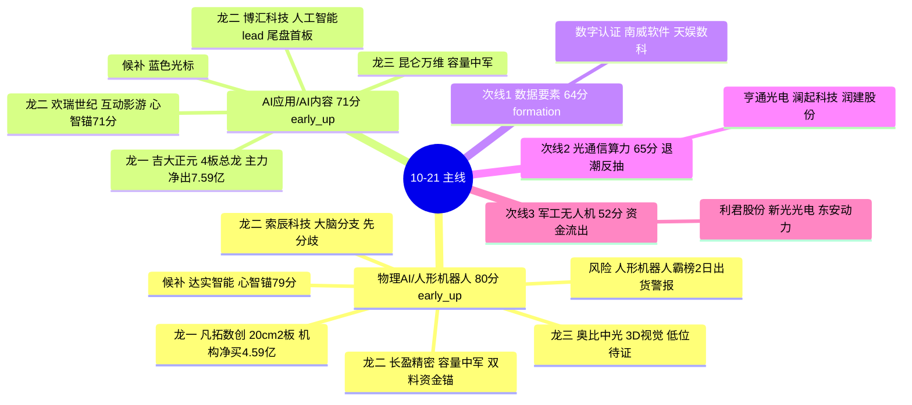

# 2026年10月21日 周二 · **主线研判**

> **数据源新鲜度**: 🟡 partial(T-1 截面)
> **降级状态**: true(因子层缺失 + 外盘无收盘)
> **置信度**: 0.70 · **情绪周期**: 高位震荡(炸板率 `34.9%`,候选砍半)
> **总仓上限(R1)**: `55%`

## 一句话结论

**只认两条主线——物理AI/人形机器人(4源共识但母体霸榜出货警报)与AI应用(热榜首日加速最干净);数据要素/光通信/军工全降次线,无弱转强证明则空仓。**

## 主线结构图

## 五维打分总表 📊

| 排名 | 主线 | 热度 | 资金 | 涨停 | 叙事 | 共振 | **总分** | 生命周期 | 跨源分 | 裁决 |
|:--:|---|:--:|:--:|:--:|:--:|:--:|:--:|---|:--:|:--:|
| 1 | 物理AI/人形机器人 | 18 | 15 | 18 | 17 | 12 | **80** | early_up(新分支)/母体高潮 | **1.00** | ✅ 主线 |
| 2 | AI应用/AI内容 | 17 | 14 | 14 | 14 | 12 | **71** | early_up(热榜首日加速) | **0.67** | ✅ 主线 |
| 3 | 光通信/算力 | 13 | 12 | 11 | 18 | 11 | 65 | 退潮簇反抽第二日 | 1.00 | ⚠️ 次线(外盘逆风) |
| 4 | 数据要素 | 14 | 9 | 8 | 18 | 15 | 64 | formation(政策第1日) | 0.67 | ⚠️ 次线(零资金零身位) |
| 5 | 军工/无人机 | 12 | 7 | 12 | 13 | 8 | 52 | formation(无梯队) | 0.33 | ❌ 观察 |

**为什么满分跨源的光通信反而只做次线**: 五维是绝对分,裁决还要叠加 R1 段位(高位震荡)+ R1 最弱簇(芯片/半导体30日 `-21.7%`)+ 隔夜美股半导体集体回落、韩股 `-3.73%`。4源共识证明的是"反抽有共识",不是"反转有基础"——CPO 5日轨迹 `-115→-38→-39→+51→+22`,仍深负 `-119亿`。

---

## 🥇 主线一:物理AI/人形机器人(80分)

**板块定位**: 进攻 · 母体(人形机器人)在高潮位,分裂出的新名词"物理AI(大脑/数据采集)"发酵第2-3日,按 early_up 处理。涨停梯队实测: 机器人概念 `up_nums=27`(全市场#1,7天6板)、人形机器人 `12`(#5);资金 `机器人概念+66亿`、`人形机器人+40亿`、`机器视觉+37亿`。

- **大资金意图**: 防御簇(国企改革`-131亿`/高股息`-46亿`/证券`-26亿`)资金向科技进攻簇跷跷板切换(R7 strong seesaw),机构在凡拓数创单日净买 `4.59亿`(全市场机构买第一),打的是"GPT-6具身大脑+GTC柏林"产业趋势的右侧确认;对手盘是霸榜母体里兑现的先手游资。
- **为什么走强**: 位置上板块5日深负(`-144亿`)后连续2日回流=深坑反抽的新分支;催化上黄仁勋10-21演讲+南京大会60亿签约+宇树22日生态大会三个硬时间锚同日叠加;筹码上凡拓一字不开板、换手 `31.6%` 完成充分换手。
- **逻辑够不够硬**: 硬在三卖方(国金/东吴/招商)同日推+五群全覆盖+两大报报道,且有机构席位真金白银;软肋是母本人形机器人热榜霸榜#1连续2日已触发出货警报、宇树连夜风险提示——**只做物理AI新分支身位票,不碰母体中位扩散股**。证伪路径: 凡拓高开低走放量阴线 + 机器人概念资金第三日断流。

### 龙头候选

| 角色 | 票 | 板型 | 身位/资金 | 属性 | T+1 买点结论 |
|---|---|---|---|---|---|
| **龙一** | 301313 凡拓数创 | 20cm二连板一字(0开板) | 机构净买4.59亿,人气#10 | 连板妖股/小盘36.8亿⚠️ | 只接受分歧低吸/回封,不追一字 |
| 龙二 | 300115 长盈精密 | 20cm首板 | 机器人+消费电子双lead,成交21.8亿 | 容量中军335亿 | 低吸/半路,中军不打板 |
| 龙二 | 688507 索辰科技 | 10-19首板后分歧 | 软件行业资金lead | 波段趋势 | 分歧低吸,与凡拓二选一 |
| 龙三 | 688322 奥比中光 | 未板 | 3D视觉传感器,低位 | B计划补涨 | 仅首板半路,不低吸未动票 |
| 候补 | 002421 达实智能 | 未板 | 物理AI心智锚#1(79分) | 心智锚 | 观察,上板才激活 |

> 北交所嘉晨智能(30cm首板,机器人+专精特新双lead)仅作情绪温度计,920 前缀 execution 硬禁。

#### 🎯 首推票思维链 · 凡拓数创(301313)

- **买入理由**: ① 产业逻辑——物理AI"大脑"是全市场共识的价值最高点(KOL原话"大脑最值钱,壳无意义"),GPT-6具身化里程碑叙事的身位龙;② 数据锚——20cm二连板一字不开板、机构席位净买 `4.59亿`(R7全市场机构买第一)、跨平台人气#10、换手31.6%筹码干净。
- **风险点**: ① 短期——母体霸榜出货警报+宇树风险提示,若一字高开>8%被先手兑现,高开低走单日回撤可超15%;② 中期——流通市值仅36.8亿(20-50亿caution带),20cm二板后波动率极高,机构买盘可能是一日配置而非锁仓。
- **止损条件**: 买入逻辑为"身位龙+机构买盘",证伪即走——收盘跌破二板启动价 `46.80元`(约 `-0%` 基准,实盘按介入价 `-8%` 硬止损);盘中放量砸穿分时均线且机器人概念资金翻净流出,尾盘不等隔日直接走。
- **可验证假设**(24-72h): GTC柏林演讲(10-21)后物理AI分支仍有新首板跟进(数采/传感器≥2板上板)=证真;若凡拓断板且分支零首板承接、热榜跌出#5=证伪,次日(10-22)不做该分支。

---

## 🥈 主线二:AI应用/AI内容(71分)

**板块定位**: 进攻 · 本批**最干净的共振**——AI应用热榜 `rank13→3`(全场最强动量)+词条净流入 `1.41亿`,MLOps#7/AI视频#16/智能音箱#14 集体新入;无霸榜警报。催化来自抖音互动影游征集(周末发酵)+KOL夜间明示"AI应用出5-10倍股"。

- **大资金意图**: 人工智能概念 `+71亿`(全概念第一)是踏空物理AI高位资金的低位补涨选择,博汇科技14:17尾盘上板与"神秘大哥收盘前半小时突袭"时点重合,打的是政策(禁用DeepSeek→国产替代情绪)+平台(抖音分发)双叙事;对手盘是高位机器人兑现盘。
- **为什么走强**: 位置上AI应用词条长期不在热榜前排=低位;催化上征集令验证付费模型(《不问凡尘》3周30万份);但注意这是旧闻周末发酵,**首日一致性可能直接顶太高**。
- **逻辑够不够硬**: 这是主线里唯一跨源分不满的(`cv=0.67`)——R4 的8条硬事件里没有独立AI应用催化,叙事只在R3群聊侧。硬伤在"无硬业绩/无硬政策,只有平台动作+KOL喊话"。证伪路径: 吉大正元4进5失败 + AI应用热榜次日rank跌回10名外。

### 龙头候选

| 角色 | 票 | 板型 | 身位/资金 | 属性 | T+1 买点结论 |
|---|---|---|---|---|---|
| **龙一** | 003029 吉大正元 | 4板(全市场最高标) | 竞价封1.12亿但**主力净出7.59亿**🔴 | 连板妖股/46.7亿⚠️ | 只做竞价弱转强,绝不低吸核按钮 |
| 龙二 | 688004 博汇科技 | 20cm首板(尾盘) | 人工智能+华为+IT服务三料lead | 连板妖股/29.8亿⚠️ | 高开<6%半路,回封可打 |
| 龙二 | 000892 欢瑞世纪 | 未板 | 互动影游直接映射,心智锚71.4 | 连板妖股 | 低位首板打板,无板不买 |
| 龙三 | 300418 昆仑万维 | 未板 | KOL 5-10倍股载体,容量中军 | 波段趋势 | 低吸均线 |
| 候补 | 300058 蓝色光标 | 未板 | AI营销/视频 | 波段趋势 | 观察 |

#### 🎯 首推票思维链 · 吉大正元(003029,总龙开关)

- **买入理由**: ① 身位——全市场唯一4板,9:25竞价封单 `1.12亿`,11家席位参与=总龙头地位无争议,断板则全场高标情绪受拖累;② 叙事——AI安全+DeepSeek国产替代,踩在禁用事件情绪线上。
- **风险点**: ① R7陷阱榜第一:涨停当日主力净流出 `-7.59亿`、全天炸板4次,封板质量是12家高标里最差档;② 46.7亿小盘+4板高度,高位震荡期高标一旦断板缺乏中位梯队承接(R1明示),A杀风险真实存在。
- **止损条件**: 本票只做弱转强——竞价高开秒板且封单加厚才进,不满足则放弃;若进场后翻绿或封单被砸穿,当日(不等隔日)`-5%` 内无条件离场;总开关: 全市场炸板率盘中破 `40%`,本票通道整体关闭。
- **可验证假设**(当日盘中): 9:25-9:30竞价金额较T-1放大且高开>+3%=弱转强证真;低开/平开或竞价封单撤减=证伪,放弃4进5并相应下调AI应用整条主线评级。

---

## ⚠️ 次线裁决(不进主攻)

### 数据要素(64分 · formation)
硬政策最强(丁薛祥揭牌+新央企+五源官方),但**事件19:23盘后落地,资金维零证据、板块零高标梯队**。映射票数字认证(群内首推,2源待竞价验证)、南威软件(T-1尾盘首板,先手博弈)、天娱数科(心智锚75.2但未板)。**结论: 计划内试错仓,只打首板证真,不上板不买;无合格身位则空仓。**

### 光通信/算力(65分 · 退潮反抽)
4源共识、叙事18分(光纤缺口至2028+亚马逊50亿GB300+美光研讨会),但30日深度退潮簇+5日资金`-119亿`+隔夜美股半导体回落三重逆风。容量锚亨通光电(预增151-168%)只做弱转强,澜起科技(预增154-175%)低吸不追;润建股份2板但封单仅0.14亿/炸4次=弱板不接力;超声电子机构净卖`-4.67亿`,观察。**结论: 竞价被外盘拖低开则等分离,不接飞刀。**

### 军工/无人机(52分 · 观察)
催化密(管制优化11/18+航展+军演)但资金T-1 `-22亿`、R4无独立词条、跨源仅0.33。利君股份/新光光电均无身位;东安动力3板一字但主业汽零、军工仅叠加属性。**结论: 观察,不占用计划内仓位。**

## 4源共识主题(供 D1)

| 主题 | 共识源数 | 综合分 | R2 处置 |
|---|:--:|:--:|---|
| 物理AI/人形机器人 | 4(R2/R3/R4/R7) | 0.87 | 主线 |
| AI应用/AI内容 | 3(R2/R3/R7) | 0.80 | 主线 |
| 光通信/算力 | 4(R2/R3/R4/R7) | 0.77 | 次线(外盘风控降级) |
| 数据要素 | 3(R2/R3/R4) | 0.79 | 次线(缺资金源) |

## 不确定性 / 反证(移交 R6)

1. **人形机器人霸榜#1连续2日**: R6 模式六重点核验——今日是否高位赖榜+主力净卖出,凡拓/宇树映射是否构成出货;
2. **吉大正元4板主力净出7.59亿+炸4次**: 总龙陷阱嫌疑,弱转强不成立即对AI应用整条降级;
3. 全部资金/涨停截面为T-1,隔夜美股半导体无收盘价,竞价科技链低开幅度是今日最大外生变量;
4. 20条强势板块快速轮动+缩量,若今日不补量,普涨次日分化、主线可能整体证伪。

## 与其他 R/D/E 的关系
- **依赖**: R1(风格/仓位上限)、R3(双源共振/热榜动量/出货警报)、R4(8硬事件催化)、R7(板块资金/陷阱榜/跷跷板)
- **被消费**: `filter_leader_v1`(本文件原地龙头硬过滤)→ D1 execution_pool 裁决;R6 反证;R5 对主线龙头做六维画像

## 数据源审计

| 源 | 日期 | 状态 | 备注 |
|---|---|:--:|---|
| tushare/limit_cpt_list | 2026-10-20 | 🟢 | 20 板块 · 涨停家数/连板统计 |
| tushare/limit_list_d | 2026-10-20 | 🟢 | 50 只非ST涨停全量 |
| R7 东财概念/行业资金 | 2026-10-20 | 🟡 | T-1收盘截面,15概念+12行业+5日轨迹 |
| R3 热榜(同花顺/东财) | 2026-10-20 | 🟡 | T-1收盘榜/人气榜,盘前无当日数据 |
| R4 六源消息 | 2026-10-21 | 🟢 | 8硬事件,≥2独立源 |
| theme_anchors 心智锚 | 2026-10-20 | 🟢 | 597概念 TOP8 锚定分 |
| 焦点群文本(5群,匿名) | 2026-10-21 | 🟢 | 537条 |
| 量化因子层 top_ir_factors | — | 🔴 | 缺失,factor_layer_degraded=true |
| 隔夜美股半导体收盘 | 2026-10-20夜 | 🔴 | 仅盘中新闻,无收盘数据 |

## Sub-Agent 元数据
- skill: analyze_main_sectors_v1@1.3
- artifact: data/research/20261021/R2_main_sectors.json
- 生成耗时: 约 12 分钟(含上游读取+MCP实测)
- model: ark-code-latest
