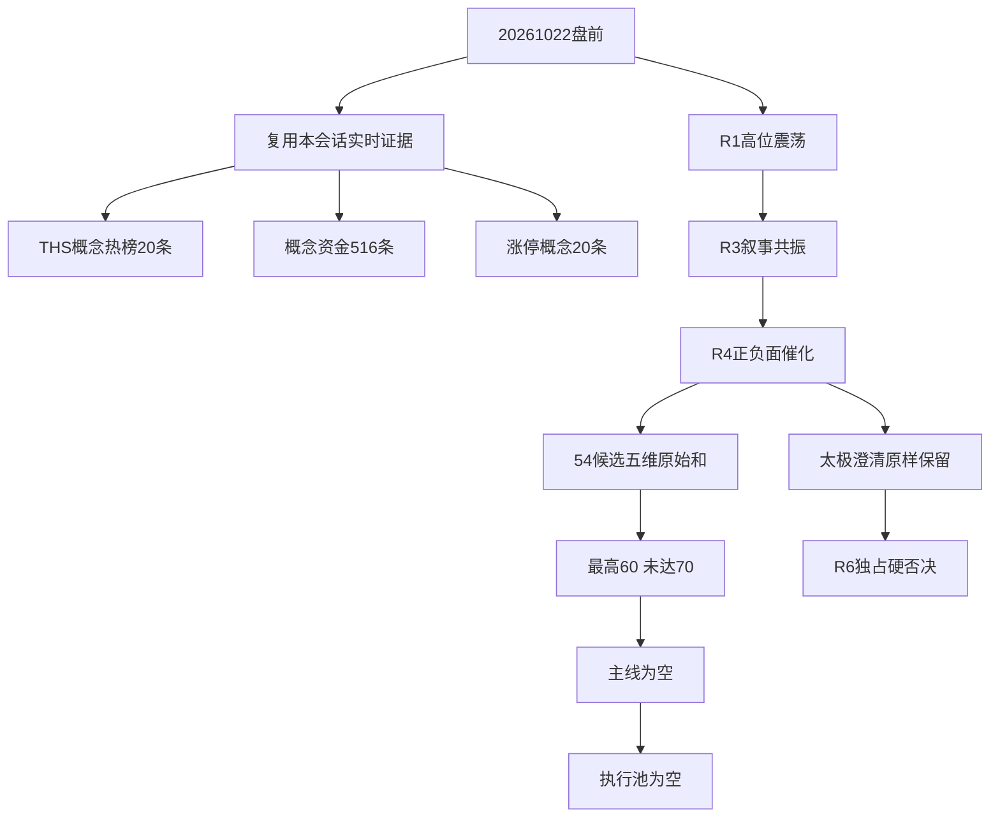

补交声明
实际交付时间：2026-10-22 11:28:16 CST(+0800)
声明修正时间：2026-10-22 11:30:17 CST(+0800)
原始研究生成时间：2026-10-22T06:35:49+08:00（读取自 data/research/20261022/R2_main_sectors.json.generated_at）。
渲染稿生成时间：2026-10-22T06:38:44+08:00（读取自 data/research/20261022/R2_validation_recheck.json.rendered_markdown 的原始 YAML 前言 generated_at；不同于主 JSON 的研究生成时间）。
早晨因目标路径写入权限缺失未交付；本次仅补交既有内容，不重新研究、不新增任何授权（包括交易授权）。正文内“未写入”等表述是原始生成时的审计状态，按来源原样保留；本次补交状态以本声明为准。

# 2026年10月22日 · 主线研判

> 数据源新鲜度：partial · 降级：true · 置信度：0.308
> 本稿已渲染并存证，但因开发者写白名单限制，未写入请求的 Markdown 路径。

## 一句话结论
**不进：无达到70分的主线；数据要素降级、AI应用观察，执行池为空。**

## 🧭 先认市场，再认个股

R1判定情绪=震荡、阶段=高位震荡。最近完成交易日有50家涨停、19家炸板，炸板率27.54%，低于35%强制减半阈值，但不等于新仓许可。R1主线数量3是上限代理而非已确认主线。

市场愿意为数据要素政策、AI内容和物理AI叙事提供热度，但热度尚未等同资金持续合力。数据要素虽居THS概念热榜第1、概念涨停14家，实测净流出；不能把“看起来最热”写成已经获得交易资格。

本次仅定义“分歧接力”一套主模板；无合格主线则模板不激活。今天做证据验证，不做临时选票、低位杂毛替补或用旧龙头凑数。R1仓位上限属于风险预算，不是本次调仓指令。

主线=空；持续性=未证实（1日观察验证窗口，非预测）；封板率=未核验；明日预期=未核验。年龄、连续资金净流入天数、板块全量龙头排名不齐，生命周期留空，不借用涨停题材榜days字段伪造主线年龄。

## 📊 五维候选并列表

每项0—20分，原始和不重标至100分。低于50分仅存审计，不列主线或次线。零分必须结合机读证据中的missing字段区分：已证实净流出与无覆盖数据不是一回事。

| 板块 | 热度 | 资金 | 涨停 | 叙事 | 共振 | 总分 | 态度 |
|---|---:|---:|---:|---:|---:|---:|---|
| 数据要素 | 20 | 0 | 20 | 8 | 12 | 60 | 降级 |
| AI应用 | 16 | 0 | 20 | 16 | 0 | 52 | 观察 |
| 商业航天 | 20 | 12 | 16 | 0 | 0 | 48 | 观察 |
| 芯片概念 | 4 | 20 | 20 | 0 | 0 | 44 | 观察 |
| AI算力基础设施 | 16 | 12 | 0 | 0 | 12 | 40 | 观察 |
| 人工智能 | 12 | 4 | 20 | 0 | 0 | 36 | 观察 |
| 数据安全 | 0 | 0 | 14 | 16 | 0 | 30 | 观察 |
| 东数西算(算力) | 0 | 8 | 20 | 0 | 0 | 28 | 观察 |
| 数据中心(AIDC) | 0 | 8 | 20 | 0 | 0 | 28 | 观察 |
| DeepSeek概念 | 0 | 8 | 20 | 0 | 0 | 28 | 观察 |
| 物理AI与具身智能 | 16 | 0 | 0 | 0 | 12 | 28 | 观察 |
| 物联网 | 0 | 8 | 18 | 0 | 0 | 26 | 观察 |
| 智慧城市 | 0 | 4 | 20 | 0 | 0 | 24 | 观察 |
| 机器人概念 | 8 | 0 | 16 | 0 | 0 | 24 | 观察 |
| 云服务 | 0 | 16 | 0 | 8 | 0 | 24 | 降级 |
| 智慧政务 | 0 | 8 | 14 | 0 | 0 | 22 | 观察 |
| 华为概念 | 0 | 0 | 20 | 0 | 0 | 20 | 观察 |
| 数字经济 | 0 | 0 | 20 | 0 | 0 | 20 | 观察 |
| 海峡两岸 | 8 | 0 | 0 | 0 | 12 | 20 | 观察 |
| DRG/DIP | 20 | 0 | 0 | 0 | 0 | 20 | 观察 |
| 数据确权 | 12 | 8 | 0 | 0 | 0 | 20 | 观察 |
| 存储芯片 | 4 | 16 | 0 | 0 | 0 | 20 | 观察 |
| 通信技术 | 0 | 20 | 0 | 0 | 0 | 20 | 观察 |
| 5G概念 | 0 | 20 | 0 | 0 | 0 | 20 | 观察 |
| 科技风格 | 0 | 20 | 0 | 0 | 0 | 20 | 观察 |
| 百元股 | 0 | 20 | 0 | 0 | 0 | 20 | 观察 |
| 小盘成长 | 0 | 20 | 0 | 0 | 0 | 20 | 观察 |
| QFII重仓 | 0 | 20 | 0 | 0 | 0 | 20 | 观察 |
| 光纤概念 | 0 | 20 | 0 | 0 | 0 | 20 | 观察 |
| 半导体概念 | 0 | 20 | 0 | 0 | 0 | 20 | 观察 |
| 国产芯片 | 0 | 20 | 0 | 0 | 0 | 20 | 观察 |
| CPO概念 | 0 | 20 | 0 | 0 | 0 | 20 | 观察 |
| 腾讯概念 | 0 | 0 | 18 | 0 | 0 | 18 | 观察 |
| 文化传媒概念 | 0 | 0 | 18 | 0 | 0 | 18 | 观察 |
| 一带一路 | 0 | 0 | 18 | 0 | 0 | 18 | 观察 |
| AI智能体 | 0 | 0 | 16 | 0 | 0 | 16 | 观察 |
| AI短剧 | 4 | 0 | 0 | 0 | 12 | 16 | 观察 |
| 互联网服务 | 0 | 8 | 0 | 8 | 0 | 16 | 降级 |
| 网络安全 | 0 | 0 | 0 | 16 | 0 | 16 | 观察 |
| 虚拟电厂 | 0 | 4 | 0 | 12 | 0 | 16 | 观察 |
| 人形机器人 | 16 | 0 | 0 | 0 | 0 | 16 | 观察 |
| 算力租赁 | 16 | 0 | 0 | 0 | 0 | 16 | 观察 |
| 英伟达概念 | 4 | 12 | 0 | 0 | 0 | 16 | 观察 |
| AIGC概念 | 0 | 0 | 14 | 0 | 0 | 14 | 观察 |
| AI医疗 | 0 | 0 | 0 | 12 | 0 | 12 | 观察 |
| 半导体测试设备 | 0 | 0 | 0 | 12 | 0 | 12 | 观察 |
| 新型储能 | 0 | 0 | 0 | 12 | 0 | 12 | 观察 |
| 猪肉 | 12 | 0 | 0 | 0 | 0 | 12 | 观察 |
| 共封装光学(CPO) | 12 | 0 | 0 | 0 | 0 | 12 | 观察 |
| 创新药 | 8 | 4 | 0 | 0 | 0 | 12 | 观察 |
| 军工 | 8 | 0 | 0 | 0 | 0 | 8 | 观察 |
| PCB概念 | 8 | 0 | 0 | 0 | 0 | 8 | 观察 |
| 短剧游戏 | 4 | 0 | 0 | 0 | 0 | 4 | 观察 |
| 冰雪产业 | 4 | 0 | 0 | 0 | 0 | 4 | 观察 |

### 评分规则与逐项依据

- **热度**：THS概念榜1-3/4-6/7-10/11-15/16-20得20/16/12/8/4，样本未覆盖得0且missing
- **资金**：实测net_amount<=0得0非missing；正值按本次516条金额重排名1-10/11-20/21-40/41-80/81-150得20/16/12/8/4，之后0；不使用供应商不唯一rank
- **涨停**：精确同名概念min(20,2×up_nums)，无精确映射得0且missing；不把父板块家数借给子题材
- **叙事**：R4精确映射high16/medium12/low6；有负面封顶8，负面仍单列且不进/降级不变；无精确映射0且missing
- **共振**：R3精确主题L1+L2=12；未映射0且missing；公众号不做第三源，榜首霸榜不额外加分

下列为每个候选的五维观测依据；完整结构化值、精确source字段及缺失语义保存在机读JSON。跨题材映射标“局部映射”，不等同精确成分覆盖。

- 数据要素：热度：数据要素榜第1；资金：数据要素净额-2.16亿元，金额重排第287；涨停：数据要素涨停14家；叙事：R4事件E20261022_001,E20261022_002；正负交织；共振：R3 L1+L2；观察，非交易许可。
- AI应用：热度：AI应用榜第6；资金：AI应用净额-4.30亿元，金额重排第338；涨停：AI应用涨停13家；叙事：R4事件E20261022_005,E20261022_006；正面；共振：无精确覆盖，零证据分。
- 商业航天：热度：商业航天榜第2；资金：商业航天净额11.46亿元，金额重排第30；涨停：商业航天涨停8家；叙事：无精确覆盖，零证据分；共振：无精确覆盖，零证据分。
- 芯片概念：热度：芯片概念榜第18；资金：国产芯片净额27.62亿元，金额重排第9（局部映射）；涨停：芯片概念涨停10家；叙事：无精确覆盖，零证据分；共振：无精确覆盖，零证据分。
- AI算力基础设施：热度：算力租赁榜第5（局部映射）；资金：算力概念净额15.52亿元，金额重排第23（局部映射）；涨停：无精确覆盖，零证据分；叙事：无精确覆盖，零证据分；共振：R3 L1+L2；观察，非交易许可。
- 人工智能：热度：人工智能榜第8；资金：人工智能净额2.54亿元，金额重排第90；涨停：人工智能涨停15家；叙事：无精确覆盖，零证据分；共振：无精确覆盖，零证据分。
- 数据安全：热度：无精确覆盖，零证据分；资金：数据安全净额-4.89亿元，金额重排第356；涨停：数据安全涨停7家；叙事：R4事件E20261022_001,E20261022_003；正面；共振：无精确覆盖，零证据分。
- 东数西算(算力)：热度：无精确覆盖，零证据分；资金：东数西算净额5.85亿元，金额重排第58（局部映射）；涨停：东数西算(算力)涨停10家；叙事：无精确覆盖，零证据分；共振：无精确覆盖，零证据分。
- 数据中心(AIDC)：热度：无精确覆盖，零证据分；资金：数据中心净额9.19亿元，金额重排第43（局部映射）；涨停：数据中心(AIDC)涨停10家；叙事：无精确覆盖，零证据分；共振：无精确覆盖，零证据分。
- DeepSeek概念：热度：无精确覆盖，零证据分；资金：DeepSeek概念净额9.47亿元，金额重排第41；涨停：DeepSeek概念涨停10家；叙事：无精确覆盖，零证据分；共振：无精确覆盖，零证据分。
- 物理AI与具身智能：热度：人形机器人榜第4（局部映射）；资金：人形机器人净额-15.73亿元，金额重排第456（局部映射）；涨停：无精确覆盖，零证据分；叙事：无精确覆盖，零证据分；共振：R3 L1+L2；观察，非交易许可。
- 物联网：热度：无精确覆盖，零证据分；资金：物联网净额8.69亿元，金额重排第45；涨停：物联网涨停9家；叙事：无精确覆盖，零证据分；共振：无精确覆盖，零证据分。
- 智慧城市：热度：无精确覆盖，零证据分；资金：智慧城市净额2.37亿元，金额重排第94；涨停：智慧城市涨停13家；叙事：无精确覆盖，零证据分；共振：无精确覆盖，零证据分。
- 机器人概念：热度：机器人概念榜第13；资金：机器人概念净额-31.23亿元，金额重排第484；涨停：机器人概念涨停8家；叙事：无精确覆盖，零证据分；共振：无精确覆盖，零证据分。
- 云服务：热度：无精确覆盖，零证据分；资金：云计算净额17.23亿元，金额重排第17（局部映射）；涨停：无精确覆盖，零证据分；叙事：R4事件E20261022_004,E20261022_005；正负交织；共振：无精确覆盖，零证据分。
- 智慧政务：热度：无精确覆盖，零证据分；资金：智慧政务净额5.82亿元，金额重排第59；涨停：智慧政务涨停7家；叙事：无精确覆盖，零证据分；共振：无精确覆盖，零证据分。
- 华为概念：热度：无精确覆盖，零证据分；资金：华为概念净额-15.54亿元，金额重排第454；涨停：华为概念涨停15家；叙事：无精确覆盖，零证据分；共振：无精确覆盖，零证据分。
- 数字经济：热度：无精确覆盖，零证据分；资金：数字经济净额-5.88亿元，金额重排第374；涨停：数字经济涨停12家；叙事：无精确覆盖，零证据分；共振：无精确覆盖，零证据分。
- 海峡两岸：热度：海峡两岸榜第15；资金：无精确覆盖，零证据分；涨停：无精确覆盖，零证据分；叙事：无精确覆盖，零证据分；共振：R3 L1+L2；观察，非交易许可。
- DRG/DIP：热度：DRG/DIP榜第3；资金：DRG/DIP净额0.18亿元，金额重排第167；涨停：无精确覆盖，零证据分；叙事：无精确覆盖，零证据分；共振：无精确覆盖，零证据分。
- 数据确权：热度：数据确权榜第10；资金：数据确权净额3.59亿元，金额重排第72；涨停：无精确覆盖，零证据分；叙事：无精确覆盖，零证据分；共振：无精确覆盖，零证据分。
- 存储芯片：热度：存储芯片榜第16；资金：存储芯片净额19.12亿元，金额重排第15；涨停：无精确覆盖，零证据分；叙事：无精确覆盖，零证据分；共振：无精确覆盖，零证据分。
- 通信技术：热度：无精确覆盖，零证据分；资金：通信技术净额42.94亿元，金额重排第1；涨停：无精确覆盖，零证据分；叙事：无精确覆盖，零证据分；共振：无精确覆盖，零证据分。
- 5G概念：热度：无精确覆盖，零证据分；资金：5G概念净额33.43亿元，金额重排第2；涨停：无精确覆盖，零证据分；叙事：无精确覆盖，零证据分；共振：无精确覆盖，零证据分。
- 科技风格：热度：无精确覆盖，零证据分；资金：科技风格净额32.25亿元，金额重排第3；涨停：无精确覆盖，零证据分；叙事：无精确覆盖，零证据分；共振：无精确覆盖，零证据分。
- 百元股：热度：无精确覆盖，零证据分；资金：百元股净额30.67亿元，金额重排第4；涨停：无精确覆盖，零证据分；叙事：无精确覆盖，零证据分；共振：无精确覆盖，零证据分。
- 小盘成长：热度：无精确覆盖，零证据分；资金：小盘成长净额30.56亿元，金额重排第5；涨停：无精确覆盖，零证据分；叙事：无精确覆盖，零证据分；共振：无精确覆盖，零证据分。
- QFII重仓：热度：无精确覆盖，零证据分；资金：QFII重仓净额28.72亿元，金额重排第6；涨停：无精确覆盖，零证据分；叙事：无精确覆盖，零证据分；共振：无精确覆盖，零证据分。
- 光纤概念：热度：无精确覆盖，零证据分；资金：光纤概念净额28.37亿元，金额重排第7；涨停：无精确覆盖，零证据分；叙事：无精确覆盖，零证据分；共振：无精确覆盖，零证据分。
- 半导体概念：热度：无精确覆盖，零证据分；资金：半导体概念净额28.27亿元，金额重排第8；涨停：无精确覆盖，零证据分；叙事：无精确覆盖，零证据分；共振：无精确覆盖，零证据分。
- 国产芯片：热度：无精确覆盖，零证据分；资金：国产芯片净额27.62亿元，金额重排第9；涨停：无精确覆盖，零证据分；叙事：无精确覆盖，零证据分；共振：无精确覆盖，零证据分。
- CPO概念：热度：无精确覆盖，零证据分；资金：CPO概念净额24.85亿元，金额重排第10；涨停：无精确覆盖，零证据分；叙事：无精确覆盖，零证据分；共振：无精确覆盖，零证据分。
- 腾讯概念：热度：无精确覆盖，零证据分；资金：无精确覆盖，零证据分；涨停：腾讯概念涨停9家；叙事：无精确覆盖，零证据分；共振：无精确覆盖，零证据分。
- 文化传媒概念：热度：无精确覆盖，零证据分；资金：无精确覆盖，零证据分；涨停：文化传媒概念涨停9家；叙事：无精确覆盖，零证据分；共振：无精确覆盖，零证据分。
- 一带一路：热度：无精确覆盖，零证据分；资金：一带一路净额-4.99亿元，金额重排第358；涨停：一带一路涨停9家；叙事：无精确覆盖，零证据分；共振：无精确覆盖，零证据分。
- AI智能体：热度：无精确覆盖，零证据分；资金：AI智能体净额-0.99亿元，金额重排第244；涨停：AI智能体涨停8家；叙事：无精确覆盖，零证据分；共振：无精确覆盖，零证据分。
- AI短剧：热度：短剧游戏榜第17（局部映射）；资金：短剧互动游戏净额-6.94亿元，金额重排第390（局部映射）；涨停：无精确覆盖，零证据分；叙事：无精确覆盖，零证据分；共振：R3 L1+L2；观察，非交易许可。
- 互联网服务：热度：无精确覆盖，零证据分；资金：互联网服务净额3.41亿元，金额重排第76；涨停：无精确覆盖，零证据分；叙事：R4事件E20261022_004；负面；共振：无精确覆盖，零证据分。
- 网络安全：热度：无精确覆盖，零证据分；资金：网络安全净额-11.31亿元，金额重排第440；涨停：无精确覆盖，零证据分；叙事：R4事件E20261022_003；正面；共振：无精确覆盖，零证据分。
- 虚拟电厂：热度：无精确覆盖，零证据分；资金：虚拟电厂净额1.41亿元，金额重排第117；涨停：无精确覆盖，零证据分；叙事：R4事件E20261022_008；正面；共振：无精确覆盖，零证据分。
- 人形机器人：热度：人形机器人榜第4；资金：人形机器人净额-15.73亿元，金额重排第456；涨停：无精确覆盖，零证据分；叙事：无精确覆盖，零证据分；共振：无精确覆盖，零证据分。
- 算力租赁：热度：算力租赁榜第5；资金：无精确覆盖，零证据分；涨停：无精确覆盖，零证据分；叙事：无精确覆盖，零证据分；共振：无精确覆盖，零证据分。
- 英伟达概念：热度：英伟达概念榜第19；资金：英伟达概念净额14.96亿元，金额重排第24；涨停：无精确覆盖，零证据分；叙事：无精确覆盖，零证据分；共振：无精确覆盖，零证据分。
- AIGC概念：热度：无精确覆盖，零证据分；资金：AIGC概念净额-15.05亿元，金额重排第453；涨停：AIGC概念涨停7家；叙事：无精确覆盖，零证据分；共振：无精确覆盖，零证据分。
- AI医疗：热度：无精确覆盖，零证据分；资金：无精确覆盖，零证据分；涨停：无精确覆盖，零证据分；叙事：R4事件E20261022_006；正面；共振：无精确覆盖，零证据分。
- 半导体测试设备：热度：无精确覆盖，零证据分；资金：无精确覆盖，零证据分；涨停：无精确覆盖，零证据分；叙事：R4事件E20261022_007；正面；共振：无精确覆盖，零证据分。
- 新型储能：热度：无精确覆盖，零证据分；资金：无精确覆盖，零证据分；涨停：无精确覆盖，零证据分；叙事：R4事件E20261022_008；正面；共振：无精确覆盖，零证据分。
- 猪肉：热度：猪肉榜第7；资金：无精确覆盖，零证据分；涨停：无精确覆盖，零证据分；叙事：无精确覆盖，零证据分；共振：无精确覆盖，零证据分。
- 共封装光学(CPO)：热度：共封装光学(CPO)榜第9；资金：无精确覆盖，零证据分；涨停：无精确覆盖，零证据分；叙事：无精确覆盖，零证据分；共振：无精确覆盖，零证据分。
- 创新药：热度：创新药榜第11；资金：创新药净额0.99亿元，金额重排第137；涨停：无精确覆盖，零证据分；叙事：无精确覆盖，零证据分；共振：无精确覆盖，零证据分。
- 军工：热度：军工榜第12；资金：军工净额-3.35亿元，金额重排第316；涨停：无精确覆盖，零证据分；叙事：无精确覆盖，零证据分；共振：无精确覆盖，零证据分。
- PCB概念：热度：PCB概念榜第14；资金：无精确覆盖，零证据分；涨停：无精确覆盖，零证据分；叙事：无精确覆盖，零证据分；共振：无精确覆盖，零证据分。
- 短剧游戏：热度：短剧游戏榜第17；资金：无精确覆盖，零证据分；涨停：无精确覆盖，零证据分；叙事：无精确覆盖，零证据分；共振：无精确覆盖，零证据分。
- 冰雪产业：热度：冰雪产业榜第20；资金：无精确覆盖，零证据分；涨停：无精确覆盖，零证据分；叙事：无精确覆盖，零证据分；共振：无精确覆盖，零证据分。

## 🔬 顶级研究对象：数据要素（60分，降级）

- **大资金意图**: 政策叙事可能吸引短线试错，这是可证伪假设；概念实测净流出约2.16亿元，不能声称主力在增仓。
- **为什么走强**: THS概念热榜第1与14家概念涨停形成传播效应，R3为L1+L2。位置、订单与个股接力承接仍未核验。
- **逻辑够不够硬**: R4有国家数据集团成立事件，也有太极直接合作澄清。叙事因冲突封顶8分，跨源匹配1.00只表示两个可用agent匹配，不是资金确认，更不是100%胜率。

## 🔬 顶级研究对象：AI应用（52分，观察）

- **大资金意图**: 可能交易模型降本与应用扩散，但概念实测净流出约4.30亿元，不把应用催化推演成机构买入事实。
- **为什么走强**: 热榜第6与13家概念涨停提供表面板块效应；R4两项正面事件支持叙事，R3没有精确AI应用共振，因此共振记0而非借用AI短剧。
- **逻辑够不够硬**: R4支持不足以覆盖资金流出与R3缺口；跨源匹配0.50，低于主线门槛，不进行个股替补。

## 🗣 R3五个主题全部消费，不把邻近题材混算

### AI短剧（16分，观察）
- **大资金意图**: 内容降本和出海是接力假设，短剧互动游戏资金净流出，尚非增仓证据。
- **为什么走强**: R3确认L1+L2传播与热榜共振；THS短剧游戏第17仅作局部热度映射，不借文化传媒概念9家涨停。
- **逻辑够不够硬**: R4没有精确AI短剧催化评分；红果功能下线构成R3保留的监管与留存反证，不能由增长叙事覆盖。

### 物理AI与具身智能（28分，观察）
- **大资金意图**: 世界模型和训练数据可能吸引产业预期资金，但没有该完整主题的独立资金口径。
- **为什么走强**: R3 L1+L2与人形机器人热榜第4提供局部传播证据，人形机器人资金实测为负；不能把机器人概念涨停数整体借给物理AI。
- **逻辑够不够硬**: 世界模型、仿真、关节是不同环节，未核验订单、利润与主题整体涨停家数，R4无精确映射记0。

### AI算力基础设施（40分，观察）
- **大资金意图**: 算力概念局部资金为正，不能外推所有基础设施环节同步获益。
- **为什么走强**: 算力租赁热榜第5局部映射热度，R3 L1+L2；不把东数西算和AIDC涨停数叠加。
- **逻辑够不够硬**: R4无精确映射，生命周期和龙头资格未核验，故仍不进主线。

### 海峡两岸（20分，观察）
- **大资金意图**: 地缘与历史辨识度可能吸引短线博弈，但概念流出，不作资金流入结论。
- **为什么走强**: R3 L1+L2与THS概念第15提供热度证据；没有精确涨停概念样本支持评分。
- **逻辑够不够硬**: R4无精确催化映射，不把旧题材心智锚等同新一轮主升或确定次日接力。

## 🛑 龙头硬过滤与空池说明

filter_leader_v1已按现有证据执行：主线为空；R4五只消息映射参考均未通过龙一任一条件或龙二综合top2的核验，execution_eligible均为false。不伪造龙二，不把资格未知贴成“杂毛”。300/688同权，只有920前缀受限。

本次无首推股票、无执行股票、无观察池顶部股票，故每票板型、龙头认定、盈亏比、禁止清单与四段交易思维链不适用；未知数据不通过闸门，不编造买卖点。历史心智锚只作辨识度先验，无合格主线不触发入候选。

## ⚠️ 不确定性 / 反证

太极股份002368.SZ：不进，理由限定为“与国家数据集团直接合作”假设被公告澄清；R4核验双方尚无具体合作、数据要素业务约占上半年收入2%。不把个股澄清扩展为全行业硬否决，完整负面事件E20261022_002原样传递。

PHP风险E20261022_004保留：公网用户系统风险不等于云底座漏洞，不点名未核验受损A股公司。互联网服务纯负面不计正面催化匹配；云服务正负冲突保留，不用净分抵消负面。仅R6可hard_reject。

R7 unavailable使所有r7_capital_match=null，不进入分母。R3、R4可读但降级，分母为2；共享传播原文不算独立观点。THS与涨停概念各仅20条、资金516条只是观测范围，不宣称穷尽全市场成分。周度因子缺失，factor_layer_degraded=true。

## 数据源审计

| 源 | 日期 | 状态 | 记录数 | 备注 |
|---|---|:--:|---:|---|
| R1 | 2026-10-22 | 🟡 | 未计数 | degraded / 降级原样继承 |
| R3 | 2026-10-22 | 🟡 | 未计数 | degraded / 降级原样继承 |
| R4 | 2026-10-22 | 🟡 | 未计数 | partial / 降级原样继承 |
| R7 | 2026-10-22 | 🟡 | 未计数 | partial / unavailable：不作跨源确认 |
| manifest | 2026-10-22 | 🟢 | 1 | global_severity=2 |
| theme_anchors | 2026-10-20 | 🟢 | 597 | 20261020历史辨识度先验，不是当日行情 |
| user_preferences | 未提供 | 🟢 | 1 | 只读；300/688同权，920限制，20亿市值底线 |
| ths_hot概念 | 2026-10-22 | 🟢 | 20 | 现场查询20261021完成日；单THS板块热榜，不宣称双平台板块验证 |
| moneyflow_ind_dc概念 | 2026-10-22 | 🟢 | 516 | 现场查询20261021；单位元，供应商rank非全榜唯一，按net_amount重排 |
| limit_cpt_list | 2026-10-22 | 🟢 | 20 | 现场查询20261021，交叠概念不累加家数 |
| limit_list_d | 2026-10-22 | 🟢 | 50 | 现场查询20261021；无全板块成分映射，不据此认龙头 |
| trade_cal | 2026-10-22 | 🟢 | 2 | 20261022开市，前交易日20261021 |
| wechat_official_20/RSS | 2026-10-22 | 🟢 | 87 | 经R3/R4语义消费，不重复计独立共振源 |
| wechat_cli_5groups | 2026-10-22 | 🟢 | 548 | 经R3/R4消费；同稿转发不增加独立源 |
| weflow_snapshot | 未提供 | 🔴 | 未计数 | manifest报告HTTP404；不补成L3 |
| attention_signals | 未提供 | 🔴 | 未计数 | R3明确缺失 |
| factor_snapshot | 未提供 | 🔴 | 0 | 目录无匹配 |
| human_thesis | 未提供 | 🟢 | 0 | 已检索为空 |
| 长期主线 | 未提供 | 🔴 | 0 | 目录不存在 |

## 🔗 与其他 R/D/E 的关系

依赖：R1_style.json、R3_sentiment.json、R4_news.json、R7_capital_flow_20261022.json，均为本日research目录。R3叙事与R4催化分别消费，负面不得合并抵消。

被消费：R5画像、R6反证、D1计划、E1复盘。D1不得从54条审计记录直接形成执行池；空主线不是抓取失败的代名词，也不授权随意替换标的。

## Sub-Agent 元数据

- skill：analyze_main_sectors_v1 + filter_leader_v1
- artifact：data/research/20261022/R2_main_sectors.json
- 方法：显式五维保守证据打分；非估值、非买点
- model：gpt-6.1-sol（会话配置）
- 生成耗时：复用前序工作，总耗时未独立计量，不填虚构秒数
- 交付状态：Markdown目标路径写入受开发者白名单阻断；全文存于R2_validation.json的rendered_markdown字段
