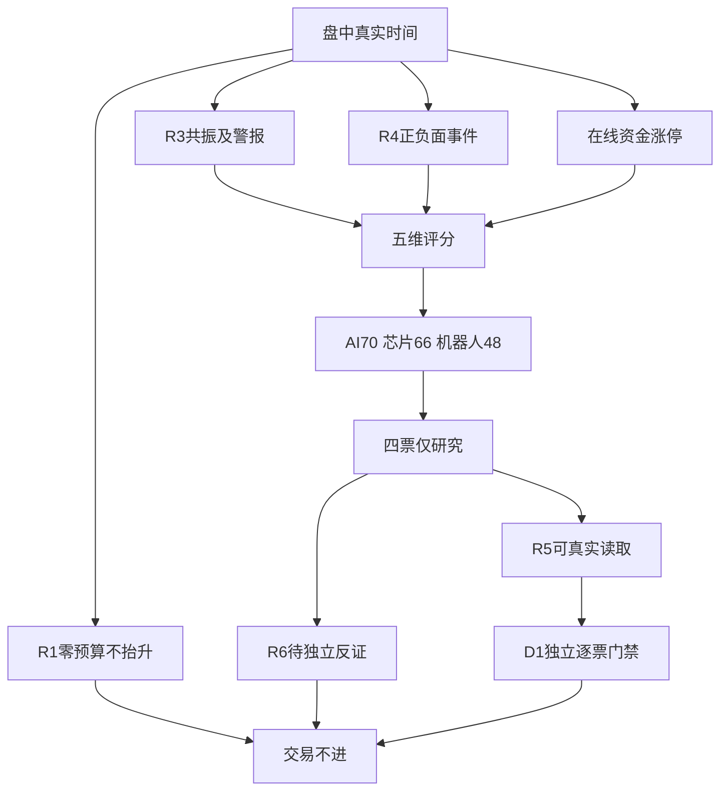

# 2026年10月23日 · 主线研判

> **intraday_recovery · 盘中生产恢复补跑**。13:23启动，在线补核13:25–13:26；实际生成时间见frontmatter。不是开盘前重建，不用于证明早晨预测正确。
> **分析completed；数据partial_coverage；情绪=震荡/主跌风险未解除；置信度0.245。** 北向仅可选且null，不用额度余额或总成交替代。

## 🧭 一句话结论
**市场奖励局部首板、二板承接，而非科技板块普涨；研究保留4票，交易不进。**

R1震荡分化，零预算与禁新仓仍有效。日内曾触发38.71%炸板，不用后来回落擦除触发：研究容量8减4，8是容量不是8只已合格票。主模板只选首板隔日，不拼接五套打法。通道按赚钱效应动态核验，不按阶段静态禁用；本次买点证据不足，channel=null，不给价格、止损、仓位建议。

## 📊 五维评分与分层
| 方向 | 热度 | 资金 | 涨停 | 叙事 | 共振 | 合计 | 态度 |
|---|---:|---:|---:|---:|---:|---:|---|
| AI应用 | 14 | 16 | 16 | 8 | 16 | 70 | 观察 |
| 芯片概念 | 8 | 18 | 16 | 8 | 16 | 66 | 观察 |
| 人形机器人 | 0 | 16 | 20 | 12 | 0 | 48 | 观察 |
| 网络安全 | 8 | 12 | 4 | 12 | 0 | 36 | 不进 |
| 白酒概念 | 8 | 12 | 0 | 0 | 0 | 20 | 不进 |

每维0–20，总分相加不放大。热度THS第1为20、2–5为18、6–10为14、11–20为8；机器人双日top1警报的热度和共振均0，不借父子概念绕过。资金按问财同概念当日元口径：非正0、正且低于10亿12、10–50亿16、50亿以上18；未跨源标定不打20，缺值null。涨停min(20,2×家数)。R4精确medium正面叙事12；仅R3合格长文未核商业化8；无正面0。R3精确L1+L2为16，警报或无匹配0，不伪造L3。分数为研究规则非胜率；转载不增加独立源。

评分达标研究方向1条，可交易确认主线0条。**70分核心门槛不变**：AI应用70；芯片66为次线；机器人48是低于50的警报观察。按用户本次明确要求保留真实研究且能由R5读取，后两者以research_carrier留在main_lines[].leaders，不冒充核心主线。main_lines_count=3只是研究载体数，另列main_lines_scored_core_count=1、main_lines_confirmed_count=0。旧技能低分不列main_lines的描述在此仅为消费者兼容而例外，未降低评分或交易门槛。

主线 = 未确认；研究方向 = AI应用/芯片概念/人形机器人；持续性 = 未知；封板率 = 未知；下一交易日预期 = 分歧（条件推演）。缺年龄、连续资金和触板分母，不硬填1/3/5日或生命周期；“明日”指下一交易日，不是周六。

## 🔎 三个顶部研究方向

### AI应用：70分，局部封板不等于整体回流
- **大资金意图**: 问财主力净买24.418655亿元但板块跌3.6503%，只能说局部承接；天娱自身净卖出，不能代言机构整板配置。
- **为什么走强**: 强在涨停8家、THS热度第8、R3购物/医疗应用叙事；弱在板块收益为负。天娱有DC第3与首板，但不是购物/医疗事件直接受益的证明。
- **逻辑够不够硬**: R3为L1+L2，R4无精确正面同题，叙事8分只来自已审计观点而非R4确认。CV0.33低于0.34，交易只能观察。下一交易日板块继续负收益则普涨假设不成立。

### 芯片概念：66分次线，正资金与负收益背离
- **大资金意图**: 问财同概念净买75.03079亿元，整板仍跌4.2852%。R7的22日封测行业资金不能偷换成23日概念确认。
- **为什么走强**: 涨停8家，睿能在在线10只排序样本中2板并列最高、首封早；好上好首板，有R3点名及正资金，但不是最高身位，不授予龙一。
- **逻辑够不够硬**: FCC限制到分销新增订单未独立核实，R4海外半导体负面仍在；不能把限制本身当利润。CV0.33，睿能旧披露存储收入占比低，应核主营而非贴纯存储标签。

### 人形机器人：48分警报研究，不把霸榜当共振
- **大资金意图**: 当日同概念净买26.556962亿元、整板跌3.3913%，局部承接存在但未证明整板主升。行业与概念金额不相加。
- **为什么走强**: 局部涨停11家。天奇由R4午间16.91变为本次17.30并记录首板回封，这是盘中新增证据，不是早晨预测功劳。在线大业6板是高度锚，天奇首板不替代总龙执行席位。
- **逻辑够不够硬**: R4 Isaac平台为medium正面，但不证明天奇是英伟达供应商或新增订单。R3双日top1排除正向加分，CV0.33。警报不是已证实出货，R6独享hard_reject。

## 🧩 四票只观察，不是执行池
| 股票 | 板型 / 龙头地位 | 参考价 | 流通市值（亿元） | 主力（亿元） | 态度 |
|---|---|---:|---:|---:|---|
| 天娱数科 002354.SZ | 首板；龙头未认定 | 8.03 | 130.6476 | -1.5198 | 观察 |
| 睿能科技 603933.SH | 2板；芯片样本临时并列高度、非总龙 | 20.94 | 43.4598 | -0.2653 | 观察 |
| 好上好 001298.SZ | 首板；龙头未认定 | 17.36 | 70.7280 | 0.3894 | 观察 |
| 天奇股份 002009.SZ | 首板；龙头未认定 | 17.30 | 61.2820 | 0.8465 | 观察 |

取价来自本次禁缓存在线问财20261023列，13:25–13:26为接收时间，源内没有精确逐笔时刻。“收盘价”字段不代表今日最终收盘。原始响应完整存入R2_recovery_evidence.json，不把接收时间伪装成报价时刻。

逐票RR都未知：取价如表，止损=null、目标=null、预期赚幅=null、允许亏幅=null、原始比值=null。RR=预期赚幅/允许亏幅；SOUL既有RR<2或止损距<5%降级约束保留，本次用户未选新统一门槛；R2不推导D1买卖点。冲突不能消歧就保留观察，不降低门槛，单票失败不扩成全局失败。

已核返回名称非ST、非920、流通市值≥20亿；14项禁止清单、5日资金全池排名、30日席位、完整龙头资格、本次R6仍待核，均partial_not_all_clear。verified_hits空不等于全通过。睿能43.4598亿元处于20–50亿谨慎区，逐票标注流动性/冲击风险，不能按50亿统一剔除。300/688不因前缀扣分。

### 天娱数科：计划内试错研究，非交易授权
- **买入理由**: 此处解释纳入研究而非建议买入。AI营销/应用的产业映射与同花顺心智锚第三交叉；DC当日人气第3，在线首板。；数据锚：本次禁缓存问财当日指标，源日期20261023，非晨间预测。
- **风险点**: 短剧/AI标签可带来拥挤；当日主力净流出1.5198亿元，封板并非资金同向确认。；报价源内只有日期；不把接收时间当逐笔时点，也不把研究标签当完整门禁。
- **止损条件**: 若下一交易日失去涨停溢价且两个平台均退出top100，撤销强辨识度承接假设；不设置虚构价格止损。
- **可验证假设**: 下一交易日同口径板块涨幅转正、该票保持前排且公告/业务映射未被否认；任一不成立则降级，仅验证研究、不自动买入。周末无交易观测则记未验证，不造24–72小时结果。

### 睿能科技：计划内试错研究，非交易授权
- **买入理由**: 此处解释纳入研究而非建议买入。芯片分销/工控业务连接，在线芯片排序样本2板并列最高且09:25首封早于多伦；低位前排研究。；数据锚：本次禁缓存问财当日指标，源日期20261023，非晨间预测。
- **风险点**: 流通43.4598亿元属20–50亿谨慎区；主力净流出0.2653亿元，历史存储收入占比较低，不能当纯存储。；报价源内只有日期；不把接收时间当逐笔时点，也不把研究标签当完整门禁。
- **止损条件**: 若原始业务披露否认映射，或下一交易日2板梯队断裂且同口径主力继续负流入，撤销接力假设。
- **可验证假设**: 下一交易日同口径板块涨幅转正、该票保持前排且公告/业务映射未被否认；任一不成立则降级，仅验证研究、不自动买入。周末无交易观测则记未验证，不造24–72小时结果。

### 好上好：计划内试错研究，非交易授权
- **买入理由**: 此处解释纳入研究而非建议买入。国产芯片分销与R3点名事件假设交叉；在线首板、DC第78，保留低位研究。；数据锚：本次禁缓存问财当日指标，源日期20261023，非晨间预测。
- **风险点**: FCC限制到分销订单的受益链未核公告；芯片整板仍跌4.2852%，不能称芯片龙一。；报价源内只有日期；不把接收时间当逐笔时点，也不把研究标签当完整门禁。
- **止损条件**: 若原始限制报道/公司业务否认相关受益，撤销事件研究；下一交易日不能维持板块前排则降级。
- **可验证假设**: 下一交易日同口径板块涨幅转正、该票保持前排且公告/业务映射未被否认；任一不成立则降级，仅验证研究、不自动买入。周末无交易观测则记未验证，不造24–72小时结果。

### 天奇股份：计划内试错研究，非交易授权
- **买入理由**: 此处解释纳入研究而非建议买入。工业场景数据与物流自动化有R4业务证据；在线从R4的16.91升至17.30且已记录首板回封。；数据锚：本次禁缓存问财当日指标，源日期20261023，非晨间预测。
- **风险点**: 机器人双日top1仅拥挤警报；板块内大业股份6板，天奇不是高度总龙，业务合作不等于新增订单。；报价源内只有日期；不把接收时间当逐笔时点，也不把研究标签当完整门禁。
- **止损条件**: 若原始公告否认业务连接，或下一交易日首板无承接并退出双平台top100，撤销研究假设。
- **可验证假设**: 下一交易日同口径板块涨幅转正、该票保持前排且公告/业务映射未被否认；任一不成立则降级，仅验证研究、不自动买入。周末无交易观测则记未验证，不造24–72小时结果。

## 🛡️ 覆盖、剔除与空执行池
在线概念返回46行（请求20但返回46），已按真实数记录；响应不是逐行降序，未冒称全市场top46。五维聚焦5方向，在线股票覆盖18个代码、聚焦研究4票；R4其余事件映射全部读入，油气/黄金等缺同题五维不造完整分。网络安全36：漏洞不等于付费收入；白酒20：净买入与相对抗跌存在，但0涨停、无R3/R4同题正向共振，不宣布主线，也不静态否定传统行业。

华阳智能按R4本次15.3387亿元<20亿拦截；正裕工业2板、32.7830亿元保留覆盖但未占4位，不判杂毛；华天科技资金正向，但R3双日top1拥挤、当日0板未占4位。大业6板保留高度锚，不接高位不代表低位自动替补。各方向历史锚TOP3已读，天娱为AI锚第三并有当日证据；其余当前资格未核不按历史名单造票。杂毛四条件须≥2实证命中，本次缺完整数据，剔除审计明确rank=杂毛的判定缺口，不能虚构具体票已命中。

交易空池有独立原因：R1零预算与禁新仓；逐票RR、完整龙头/禁止清单和同步时点不足。不是北向缺失，不是全资金unavailable，不声称R6全票通过。研究未读取私人实盘持仓、未调用账户/下单/撤单或凭据、未写模拟成交、未外发。

## 🚦 决策传导图

## 🔬 不确定性 / 反证
正净额与负收益并存不等于机构吸筹，不保证T+1接力。行情、热榜与R7不是同一秒、定义不同不求和。生命周期缺age_days与连续资金，未给函数塞0/1骗出阶段。本周因子目录缺，factor_composite_score=null。北向23日及5/10/20日可信同口径净买缺失，仅可选参考，不触发R7_STALE。

R1/R3/R4/R7原状态保留为degraded/partial，不伪造complete。completed只指R2分析与交付完成，不等于覆盖齐全；R6完整性不变。各研究方向CV均0.33、consensus_themes为空：无三/四源共识，问财当前概念资金不冒充R7精确命中。睿能只有样本内一项高度条件，非总龙或7项开仓条件全部通过。

## 数据源审计
| 源 | 日期 | 状态 | 备注 |
|---|---|:--:|---|
| R1 | 2026-10-23 | 🟡 | 1条；当日恢复版已实际消费，但原status=degraded；stale在此表示覆盖降级，非过期24h |
| R3 | 2026-10-23 | 🟡 | 1条；当日恢复版已实际消费，但原status=degraded；stale在此表示覆盖降级，非过期24h |
| R4 | 2026-10-23 | 🟡 | 1条；当日恢复版已实际消费，但原status=partial；stale在此表示覆盖降级，非过期24h |
| R7 | 2026-10-23 | 🟡 | 1条；当日恢复版已实际消费，但原status=partial；stale在此表示覆盖降级，非过期24h |
| hithink/breadth | 2026-10-23 | 🟢 | 46条；is_cache=0；接收时间不是逐笔报价时刻；日期字段核验通过 |
| hithink/themes | 2026-10-23 | 🟢 | 8条；is_cache=0；接收时间不是逐笔报价时刻；日期字段核验通过 |
| hithink/stocks | 2026-10-23 | 🟢 | 4条；is_cache=0；接收时间不是逐笔报价时刻；日期字段核验通过 |
| hithink/robot_leaders | 2026-10-23 | 🟢 | 10条；is_cache=0；接收时间不是逐笔报价时刻；日期字段核验通过 |
| hithink/chip_leaders | 2026-10-23 | 🟢 | 10条；is_cache=0；接收时间不是逐笔报价时刻；日期字段核验通过 |
| hithink/ai_stock | 2026-10-23 | 🟢 | 1条；is_cache=0；接收时间不是逐笔报价时刻；日期字段核验通过 |
| THS/DC热榜 | 2026-10-23 | 🟡 | 219条；THS概念20/股票99/DC100；时间12:30至12:33，不冒称当前13:27榜 |
| 公众号/群聊 | 2026-10-23 | 🟡 | 未知条；转载不重复计独立源；R2不再直接读取私人群消息 |
| Tushare limit_cpt_list/limit_step | 2026-10-23 | 🔴 | 0条；R1当日概念梯队接口空；本次用问财同日指数涨停与排序补齐部分维度，不声明Tushare成功 |
| 北向净买可选 | 2026-10-23 | 🔴 | 未知条；20261023及5/10/20日可信同口径净买缺测，null；不影响其他维度 |
| WeFlow | 2026-10-23 | 🔴 | 0条；永久退场，不声称三层共振 |
| 因子快照 | 2026-10-23 | 🔴 | 0条；目录缺失；factor_layer_degraded=true |
| 心智锚 | 2026-10-20 | 🟡 | 597条；历史辨识度背景；非当日资金证据，不按TOP3无条件认证龙一 |
| 用户偏好/长期笔记 | 2026-10-23 | 🟢 | 0条；偏好只读；active无笔记，黑白名单空，无长期继承加成 |

## 🔗 与其他 R/D/E 的关系
- 依赖：当日R1、R3、R4，以及带日期后缀R7主产物，具体路径与SHA见JSON meta.upstream_lineage；本次在线原文见R2_recovery_evidence.json。
- R5：已运行仓库_collect_leaders实际纯函数，4票从main_lines[].leaders可见；低分是研究载体不是核心主线，不因禁交易合法skipped画像。
- R6：本次未运行、未给hard_reject、未宣称全票通过；后续仅消费本次上游。
- D1：零预算不抬升；所有票execution_eligible=false；独立模拟授权不是实盘开启或成交。
- E1：按真实时点验证假设，不将盘中证据回填晨间胜负。

## 🧪 自检与Sub-Agent元数据
- 五维/CV/候选数/零执行资格/实际R5收集器/上游SHA和时间血缘：程序检查。
- 三方向三问、四票四段、12节点图、三色审计、匿名群、正文无秒级时间戳；未造价格止损。
- skill：analyze_main_sectors_v1；filter_leader_v1逐票分层检查，完整排名仍partial。
- artifact：data/research/20261023/R2_main_sectors.json。
- model：gpt-6.1-sol；Pydantic 2.13.4，会话内约束模型，未冒称仓库有专属生产schema。
