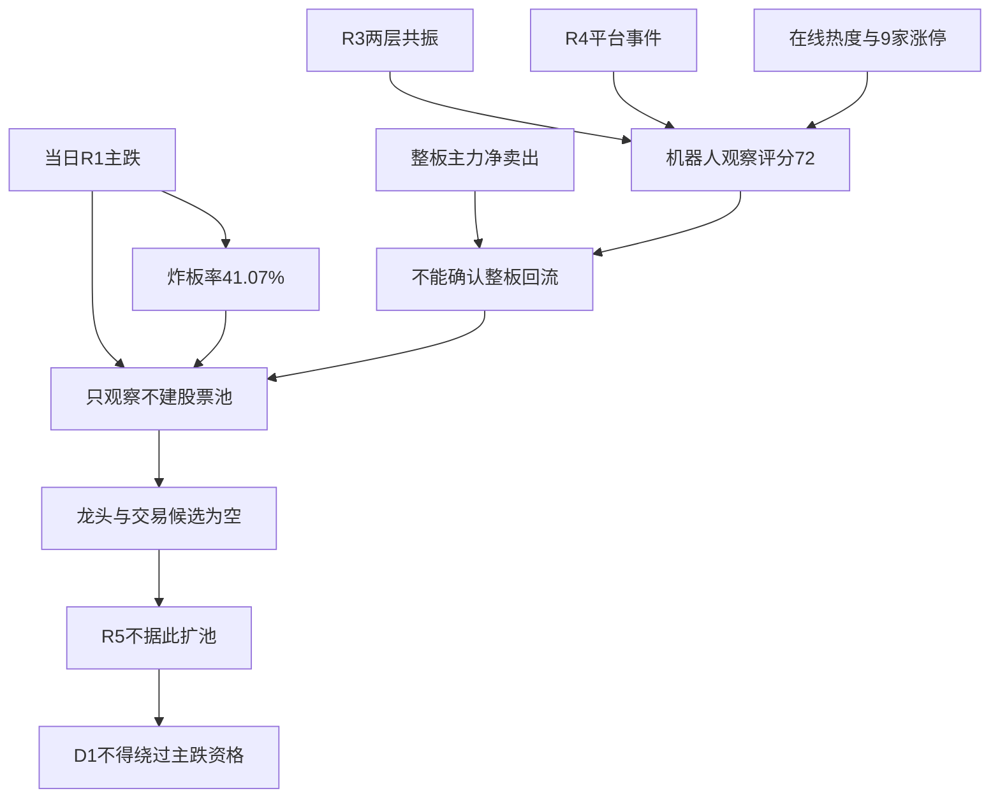

# 2026年10月23日 · 主线研判

> ⚠️ **数据源时间错位**：任务交易日为 **2026-10-23**；境内行情实际归属 **2026-10-22（T-1）**，消息含当日。此为提前版，不是生产窗口已刷新版本。
> **数据源新鲜度**：partial　｜　**降级状态**：true　｜　**置信度**：0.392

## 🧭 一句话结论
**情绪=主跌；人形机器人72分仅观察，整板净卖出，所有股票候选为空。**

## 📊 五维评分与明确态度

| 板块 | 热度 | 资金 | 涨停 | 叙事 | 共振 | 完整分 / 已知区间 | 态度 |
|---|---:|---:|---:|---:|---:|---|---|
| 人形机器人 | 20 | 0 | 18 | 18 | 16 | 72 | 观察 |
| 网络安全 | 8 | 0 | 2 | 18 | 16 | 44 | 不进 |
| 军工 | 14 | 0 | 10 | 0 | 16 | 40 | 不进 |
| AI应用 | 14 | 0 | 6 | 0 | 16 | 36 | 不进 |
| CPO | 18 | 0 | 2 | 0 | 0 | 20 | 不进 |
| 油气开采/油服 | null | 0 | null | 16 | 0 | null / 16–56 | 不进 |
| 基础油 | null | null | null | 0 | 16 | null / 16–76 | 不进 |

各维满分20。热度按同花顺名次分档，涨停按 `min(20, 2×家数)`；资金以精确概念净额方向计分，负值为0，不因负净额的供应商rank靠前加分。叙事为R4事件支撑度，共振为R3明确的L1+L2。评分是研究规则，不是概率，也未使用旧代码三维放大到百分制。

主线 = **人形机器人（仅观察）**，持续性 = **null**，封板率 = **null**，明日预期 = **null**。没有充分历史与概念成分触板分母，不能把供应商 `days` 直接当主线年龄，也不能凭热度填写加速/分歧/退潮。观察主线1条，可交易确认主线0条；其余低分或缺测主题仅作排除审计，不进股票观察池。

## 🔎 详细分析

### 人形机器人：最有辨识度的讨论方向，不是整板资金回流
- **大资金意图**: 东财人形机器人净额为负，因此“机构正在整板增仓”不成立。减速器与执行器正净入提示可能有细分轮动，但这是局部承接假设，不能把重叠板块金额相加。
- **为什么走强**: 强的是热度与部分涨停共振：同花顺概念热榜第1、人形机器人涨停9家；整板仍跌约1.79%。R4的Isaac平台事件与R3的具身数采/执行器讨论连接，暂未证明订单、利润或全市场赚钱效应。
- **逻辑够不够硬**: 平台升级是事件锚；R3为L1+L2，未达到L3。概念资金净流出构成明确反证。R2/R3/R4三源形式匹配，R7正流入行业名单未匹配；0.67交叉验证分不能抵消主跌资格限制。

### 网络安全：漏洞是硬事件，资金和价格尚未验证需求兑现
- **大资金意图**: 东财网络安全概念净流出，不能把紧急补丁需求写成主力提前布局。R7也没有该概念的正流入确认。
- **为什么走强**: 仅事件讨论与热度共振成立，板块实际跌3.50%，问财精确同花顺指数只有1家涨停；不称板块已经走强。
- **逻辑够不够硬**: PHP漏洞对应R4 E20261023_003，但补丁不等于国内厂商收入；资金持续转负或事件未形成付费订单均可证伪。44分不进主线。

### 军工、AI应用、CPO：热榜并非赚钱榜
- **大资金意图**: 三方向东财精确概念净额均为负；未见整板资金支持。R7国防军工与通信等行业流出只能补充风险背景，不能与概念净额叠加。
- **为什么走强**: 军工热榜第6、涨停5家，但整板下跌；AI应用热榜第9、涨停3家但概念回落；CPO热榜第4、涨停1家，仍承受海外硬件风险偏好冲击。这里是活跃讨论，不是可确认的主升。
- **逻辑够不够硬**: 军工和AI应用在R4无精确正面事件，不外推群转发为订单；CPO的提产消息不能抵消R4海外抛售风险。完整分分别40、36、20，均不进。

### 油气与基础油：价格传导和单股人气不能替代完整板块证据
- **大资金意图**: 油气资源、油气设服在线净额为负；基础油没有精确同级概念资金，保留null。未将单只涨停或行业总额当作概念增仓。
- **为什么走强**: 油气供给扰动有R4事件锚，基础油有R3供给讨论；但无独立基础油热榜/板块涨停家数。石油石化行业涨停1家不能偷换成油气开采或基础油统计。
- **逻辑够不够硬**: 油气资源的风险溢价不保证基础油价差与利润改善；总基础油产能不等于III类产能。两主题完整分null，不按理论上界补入次线。

## 🧩 关键证据与交叉验证

| 证据 | 数值 / 结论 | 来源与边界 |
|---|---|---|
| 市场阶段 | 涨停33、跌停48、炸板23；炸板率41.07% | R1当日主源，R2在线取得非ST涨跌停明细；不混入XTick口径 |
| 机器人热度与涨停 | 热榜第1；人形9家、广义机器人14家 | Tushare THS热榜/limit_cpt；问财同花顺指数复核；重叠不相加 |
| 人形机器人概念资金 | `-26.8853亿元` | 在线Tushare/DC概念原始元转亿元；不得与行业及子概念相加 |
| 机器人执行器概念资金 | `6.0056亿元` | 在线Tushare/DC概念原始元转亿元；不得与行业及子概念相加 |
| 减速器概念资金 | `6.4994亿元` | 在线Tushare/DC概念原始元转亿元；不得与行业及子概念相加 |
| 网络安全概念资金 | `-25.0282亿元` | 在线Tushare/DC概念原始元转亿元；不得与行业及子概念相加 |
| 军工概念资金 | `-35.8593亿元` | 在线Tushare/DC概念原始元转亿元；不得与行业及子概念相加 |
| AI应用概念资金 | `-67.2099亿元` | 在线Tushare/DC概念原始元转亿元；不得与行业及子概念相加 |
| CPO概念概念资金 | `-127.4268亿元` | 在线Tushare/DC概念原始元转亿元；不得与行业及子概念相加 |
| 油气资源概念资金 | `-14.3695亿元` | 在线Tushare/DC概念原始元转亿元；不得与行业及子概念相加 |
| 油气设服概念资金 | `-5.0675亿元` | 在线Tushare/DC概念原始元转亿元；不得与行业及子概念相加 |
| R7实际文件 | 北向缺测；正流入行业仅美容护理、家用电器 | 使用带日期后缀主产物，不读取错误别名；北向缺测不等于行业数据全部无效 |
| 共识 | 人形机器人R3=true、R4=true、R7=false，交叉验证0.67 | 三源观察共识，非四源资金共识；综合分0.61采用四项固定分母 |
| 龙头与因子 | 均未输出 | 心智锚仅背景；本周因子目录缺失，不合成IC/IR或龙一 |

## 🚦 决策传导图

## 🛡️ 空池、主模板与反证

主模板只选 **首板隔日**，用于观察后续是否出现新题材低位赚钱效应；本次不启用交易通道，不混合五套打法。没有股票首推、股票观察顶部或execution标的，因此逐票四段思维链、板型、龙头rank、RR、禁止清单命中均不适用；不得为凑契约填入未经认证的股票。R2不推导D1买卖点、止损价或仓位。

已执行 `filter_leader_v1` 空池适用检查：所有板块leaders、candidates及顶层execution/watch股票池均为空，满足同板块最多龙一龙二的上限；ST、920与杂毛逐票筛选无需执行。用户配置仅读取，300/688不因前缀降级。R6是唯一hard_reject来源，本R2未生成或改写任何硬否决。

主要不确定性是单日热度/涨停与整板净卖出的背离。未来24–72小时，若同口径人形机器人连续两个可得交易日净流入为正且概念涨幅转正，才支持从局部承接升级为整板修复的假设；若下一可得日资金仍负，则“整板回流”假设继续不成立。这个核验条件不是开仓信号，阶段变更仍须R1重判。

## 数据源审计
| 源 | 日期 | 状态 | 备注 |
|---|---|:--:|---|
| R1当日 | 2026-10-23 | 🟡 | degraded提前版；主跌优先，禁止用风格标签扩大资格 |
| R3当日 | 2026-10-23 | 🟡 | degraded；五主题已实际消费；无L3，霸榜警报不加分 |
| R4当日 | 2026-10-23 | 🟡 | partial；8事件及正负面映射已消费，不重复累计转载 |
| R7带日期后缀主产物 | 2026-10-23 | 🟡 | partial；北向缺测，行业资金不能替代概念 |
| Tushare/ths_hot | 2026-10-22 | 🟢 | 本次在线概念20条；不是当日开盘后行情 |
| Tushare/dc_hot | 2026-10-22 | 🟡 | 本次在线人气股100条；concept为null，不合成概念热度 |
| Tushare/moneyflow_ind_dc | 2026-10-22 | 🟢 | 本次在线概念516条；保留原始单位，rank不作全局排序 |
| Tushare/limit_cpt_list | 2026-10-22 | 🟢 | 本次在线20条；概念重叠、days不等同生命周期 |
| Tushare/limit_list_d | 2026-10-22 | 🟢 | 本次在线非ST涨跌停/炸板明细；不外推含ST全市场 |
| hithink-sector-selector | 2026-10-22 | 🟢 | 在线禁缓存请求；首轮20条，次轮8条；首次问句资金列未返回，资金改用DC核验 |
| fetch manifest | 2026-10-23 | 🟡 | 仅读元数据；severity=2，不把raw行情当本次在线验证 |
| 公众号/群聊 | 2026-10-23 | 🟡 | 消费R3/R4已审计引文，群匿名化；未重新计独立源 |
| WeFlow快照 | 2026-10-23 | 🔴 | 退场；不声称三层群共振 |
| 因子快照 | 2026-10-23 | 🔴 | 目录缺失；因子分null，不阻断空池观察产出 |
| 心智锚 | 2026-10-20 | 🟡 | 597概念历史背景；主跌不展开个股候选 |
| 用户偏好/长期笔记 | 2026-10-23 | 🟢 | 偏好只读；active笔记0篇，无继承加分 |

## 🔗 与其他 R/D/E 的关系
- 依赖：当日R1_style.json、R3_sentiment.json、R4_news.json，以及R7_capital_flow_20261023.json。
- 被消费：R5只接收空股票池；R6独立反证；D1只能将该文件作为提前版板块观察，不得按72分直接放行执行；E1审计缺测及后续证伪。
- 生产边界：当前早于生产窗口，production_ready=false；必须在生产时点刷新后才能声称完整盘前版本。未运行整条流水线。

## 🧪 写作契约自检
- 图表：1张、12节点、至少3层；通过。
- 推理：每个顶部分析方向均有大资金意图、为什么走强、逻辑够不够硬三问；通过。
- 逐票四段：股票池为空，不适用，未编造首推。
- 审计：必读与在线源逐项列示、三色、仅日期、群匿名；通过。
- 正文：无JSON dump、无秒级时间戳；frontmatter按契约保留带时区生成时间。
- 风格：表格、emoji、因果句、反证和消费边界；通过。

## Sub-Agent 元数据
- skill：analyze_main_sectors_v1；filter_leader_v1空池适用检查
- artifact：data/research/20261023/R2_main_sectors.json
- model：gpt-6.1-sol
- schema：本次scratch Pydantic模型；仓库无R2专属生产类，不伪称生产schema存在
- 生成耗时：组装与校验阶段0.06秒；总分析时长未单独计时
