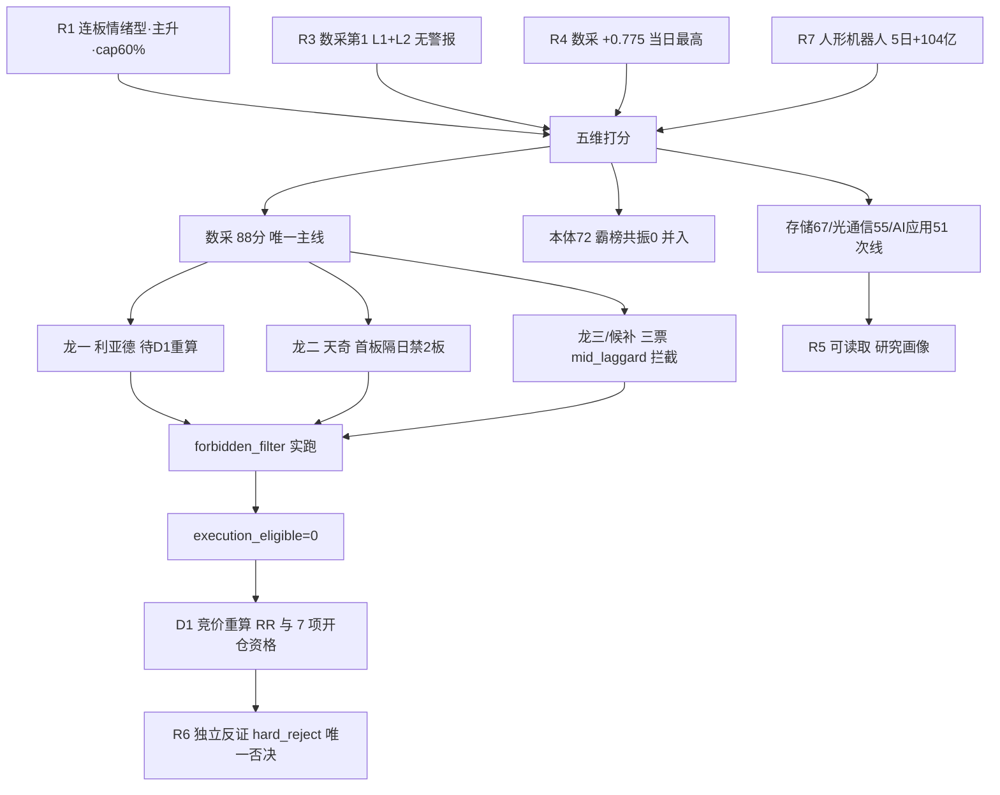

# 2026年10月26日 · **主线研判**

> **数据口径**：涨停 / 资金 / 热榜 / 价格全部为 **20261023 收盘（T-1）**，盘前没有竞价与开盘价，任何买点判断都要等 09:25 之后重算。
> **trade_date=20261026 是交易日**：tushare trade_cal 显示 is_open=1、pretrade_date=20261023。R3 在 degraded_reasons 里写「20261026 为非交易日」是误判，实际是它 06:03 跑批时盘前回落到了 20261023 快照（对盘前结论无影响，已记入 JSON validation 供 E1 复盘）。
> **置信度 0.76**：四源 complete 且同向，盘面为一手 tushare；扣分在因子层缺失、锚表覆盖不全、数采子概念无独立资金口径。

## 🧭 一句话结论

**数采 88 分是唯一四源同向主线，但 5 只候选 5 日已涨 18–80%、打板 RR 仅 0.91，只做研究，开仓等竞价重算。**

## 📐 详细分析

五维打分只服务一件事：判断今天该不该有主线、主线是哪条、龙头是哪只。下表每维 0–20 分，直接相加不放大，70 分是核心门槛。结论先给：涨停家数前五的板块是机器人概念 43、人工智能 29、人形机器人 26、新能源汽车 26、AI应用 21——机器人链占前三（新能源汽车的涨停成分以汽车零部件为主，与机器人链高度重叠）。但只有『数采』这一支同时拿到四源同向并越过 70 分门槛，其余三支各有硬伤：本体 72 分因 R3 霸榜警报共振记 0 且与数采同源、存储 67 分虽有资金与叙事双硬但 0 连板、光通信 55 分叙事最硬而资金最软（CPO 三连降、当日 0 涨停），因此主线只列 1 条——不是保守，是避免把同源的三支当成三条线重复计仓。

### 📊 五维评分与分层

| 方向 | 热度 | 资金 | 涨停 | 叙事 | 共振 | 合计 | 分层 | 态度 |
|---|---:|---:|---:|---:|---:|---:|---|---|
| **物理AI·具身数采** | 15 | 17 | 19 | 18 | 19 | **88** | 主线 | 进·研究直达 D1，逐票待竞价重算 |
| 人形机器人（本体） | 18 | 17 | 18 | 19 | **0** | 72 | 并入主线 1 | 不进·老龙 6 板且霸榜警报 |
| 国产算力·存储 | 12 | 14 | 13 | 15 | 13 | 67 | 次线 | 不进·命中非主流 |
| 光通信链 | 11 | 13 | 4 | 14 | 13 | 55 | 次线 | 不进·0 涨停无板块效应 |
| AI应用·短剧 | 12 | 11 | 7 | 9 | 12 | 51 | 次线 | 不进·R4 零催化 |

每维 0–20，总分直接相加不放大。**核心门槛 70 分不变**：只有数采过线；本体 72 分因 R3 霸榜警报（连续 2 日概念榜第 1）共振记 0，且与数采同一叙事母体，单列会虚增仓位，故以 `merged_into` 并入主线 1 当温度计——分数照写，不做隐藏。

### 🔥 主线 · 物理AI·具身数采（88 分 · 主升早期）

#### 五维账本

| 维度 | 分 | 实证 |
|---|---:|---|
| 热度 | 15 | MLOps 新进概念榜第 5、AI 语料第 17、数据要素 11→15（下滑）；个股端 5 只首次/大幅进榜：天奇第 31、海天第 55、慈星第 60 首次进百强，凡拓东财 17→7、利亚德 37→10、福莱 89→42。有增量，但主概念没进前 3，扣 5 分 |
| 资金 | 17 | 人形机器人 5 日 +104.12 亿（3/5 日净流入）、机器人概念 5 日 +28.46 亿（3/5 日）、人工智能 T-1 +114.3 亿（5 日 +21.7 亿、4/5 日正）；对照全市场 5 日主力净流出 964.2 亿 → 唯一逆势净流入簇 |
| 涨停 | 19 | 机器人概念 43 家（全市场第一）、人形机器人 26 家、数据要素 16 家；数采分支 10/23 出 5 只 20cm（海天/慈星/凡拓/利亚德/奥普特）+ 3 只 10cm（天奇/福莱/华数） |
| 叙事 | 18 | R4「具身智能数采」strength=high、net +0.775 当日最高、kol_confirm ✅；催化=十余场电话会 + NVIDIA Isaac + 智元开源数据集 + Figure 成功率 9%→56%。扣分：卖方一致度过高、无预期差（R1 已单列风险） |
| 共振 | 19 | R3 第 1（L1+L2、positive、early、**无霸榜警报**、贡献 2.0）；R4、R7 同向 → 四源交集 composite 0.92 |

#### 生命周期：主升早期，但个股在高位

`age_days=3`（10/21–10/23 扩散）· `leader_height=1`（纯首板，无连板）· `money_persist_days=3` · `break_rate=12.77%` → 函数判定 **early_up（conf 0.80）**。

这个结论必须和位置一起读：分支年龄只有 3 天，**但个股 5 日已经涨了 18.1%–80.0%**，4/5 只落在 10 日盘中低点上方 +41.9%~+82.3%（天奇 +20.8% 最低）。这是「分支早期、个股高位」，early_up 只说明行情没走完，不说明现在的价格是买点——R4 自己也写了「5 日涨幅过大，只做首板」。

#### 龙一之争（时序与辨识度的冲突，不藏）

| 股票 | 板型 | 首封 | 开板 | 封单比 | 换手 | 5 日 | 人气 | 认定 |
|---|---|---|---:|---:|---:|---:|---:|---|
| 利亚德 300296 | 20cm 反包加速 | 13:43 | 1 | 1.31% | 27.9% | +62.7% | 37→10 | **龙一** |
| 天奇股份 002009 | 10cm 换手首板 | **09:43** | 2 | 0.86% | 17.2% | +18.1% | 首次#31 | **龙二（卡位）** |
| 福莱新材 605488 | 10cm 反包硬板 | 13:37 | 0 | 0.53% | 11.7% | +49.0% | 89→42 | 龙三（板型最好） |
| 海天瑞声 688787 | 20cm 反复开板 | 13:42 | 3 | 1.36% | 17.2% | +80.0% | 首次#55 | 候补（辨识度第一） |
| 慈星股份 300307 | 20cm 尾盘硬封 | 14:11 | 0 | 2.32% | 16.4% | +37.8% | 首次#60 | 候补（封单比最高） |

按身位规则本应先看板数再看首封时序：5 只全是首板，板数打平，**首封时序天奇 09:43 第一**。但天奇 5 年只有 5 次涨停、炸板率 54.5%、**1进2 晋级率 0.00、平均连板 1.00**、成交仅 10.25 亿——它不是能承载板块资金的龙一，只是最会卡位的低位票。所以龙一按「强度（20cm×成交额）+ 人气增量 + 封单绝对额」归利亚德，天奇以「卡位龙二」保留首封最早的事实。**两个认定都写进 `dragon_contest`，不靠话术抹平矛盾。**

#### 三问

- **大资金意图**: 买的是「卖铲子」——机器人大模型缺数据是硬约束，数采设备与数据资产是必经收费站。证据不在涨幅，而在结构：全市场 5 日主力净流出 964.2 亿，人形机器人却净流入 104.12 亿；天奇、海天、慈星三只首次进百强，说明是新建仓，不是老票接力。
- **为什么走强**: 三重催化叠加——特斯拉 Optimus 量产线早期生产（10/22 财报会）、宇树物理 AI 表态、智元开源真实场景数据集；周末十余场电话会把「数采=算力、数采设备=光模块」打成口号，卖方完全同向（国金/财通/华福/国联民生/华创）。
- **逻辑够不够硬**: 产业逻辑硬（数据缺口真实），业绩逻辑软（帕西尼数采年收入仅 2000–3000 万、天机人形臂 8000 条）。这是主题投资不是业绩投资，一旦 Q3 订单证伪，回撤速度快于上涨速度。反证盘中已经出现过：星光股份被三个群强推，10/23 收 -7.78%。

### 🎯 五票逐项（研究候选，不是执行池）

| 股票 | 板型 | 首封/开板 | 封单比 | 换手 | 5日涨幅 | 认定 | 门禁 |
|---|---|---|---:|---:|---:|---|---|
| 利亚德 300296 | 20cm 反包加速 | 13:43 / 1 | 1.31% | 27.9% | +62.7% | 龙一 | 待 D1 重算（RR 0.91） |
| 天奇股份 002009 | 10cm 换手首板 | 09:43 / 2 | 0.86% | 17.2% | +18.1% | 龙二 | 待 D1 重算·禁打 2 板 |
| 福莱新材 605488 | 10cm 反包硬板 | 13:37 / 0 | 0.53% | 11.7% | +49.0% | 龙三 | **拦截**·mid_laggard |
| 海天瑞声 688787 | 20cm 反复开板 | 13:42 / 3 | 1.36% | 17.2% | +80.0% | 候补 | **拦截**·mid_laggard |
| 慈星股份 300307 | 20cm 尾盘硬封 | 14:11 / 0 | 2.32% | 16.4% | +37.8% | 候补 | **拦截**·mid_laggard + late_speculation |

全部 5 只 `execution_eligible=false`。原因不是「没研究出来」，而是三道硬门禁同时不满足：①打板口径 RR 0.91 < 2（target 用 R1 昨日涨停溢价中位 +4.55%，stop 用纪律 -5% 硬底）；②板块内 rank≥3 命中禁止清单 `mid_laggard`；③14:00 后封板命中 `late_speculation`。

#### 利亚德 300296.SZ · 龙一（首推研究标的）

- **买入理由**: 不是「建议买入」，而是解释它为什么被认定为龙一。3 个交易日 2 个 20cm、封单 2.22 亿全板块最大、成交 42.23 亿板块第一、人气 37→10 增量第一；光学动捕（虚拟动点 OptiTrack）是数采硬件里唯一「动作捕捉」心智锚——Figure 真机成功率从 9% 到 56% 靠的就是动作数据，动捕是数据入口。它是这条线里唯一同时具备「强度 + 容量 + 辨识度」的票。
- **风险点**: 5 日 +62.7%、处在 10 日盘中低点（4.45）上方 64.5%，位置是本线第二高；27.9% 换手 + 42 亿成交意味着接力盘成本分布极散，次日冲高回落概率不低；开板 1 次不是硬板；5 年股性表未覆盖该票（1进2 不可量化），历史接力概率未知。
- **止损条件**: 不给价格指令，只给条件——若次日不能站稳当日均价线，或板块内 10cm 首板集体断板而它单独拉高，则龙一认定当日作废；若板块炸板率回到 35% 以上，整条线降级，不做个股层面的补救。
- **可验证假设**: ①次日光学动捕/数采分支仍有 ≥3 只涨停，说明扩散没结束；②它的成交额维持 30 亿以上且不跌破 5 日线，说明容量资金没走；③R3 次日热榜它保持前 20，说明人气没散。任一不成立即降级为观察，不自动买入。

**其余四票的门禁结论**：天奇 = 唯一低位（+20.8%），首板隔日专用，历史 1进2 为 0/5，**禁止打 2 板**；福莱 = 板型最好（炸板率 9.1%、1进2 28.6%）但 rank=3 被拦；海天 = 辨识度第一但 5 日 +80%、开板 3 次属烂板，只做分歧低吸；慈星 = 封单比最高但 14:11 尾盘封，双条禁止项命中。

### 🧊 三条次线（全部不进）

**国产算力·存储 67 分**：资金与叙事双硬——数字芯片设计 5 日 +87.92 亿（4/5 日净流入）、兆易创新 5 日 +25.90 亿且 4/5 日为正、T-1 +12.94 亿，是 Top10 里唯一「单日与 5 日同向」的大票；存储原厂 R4 +0.671 high。但热度与涨停双软：存储芯片概念 5→9→12 三连降、无连板高度、江波龙 Q3 环比 -35.6%~-49.0% 的消费模组负面在拖。67 分不到 70，且命中 `non_mainstream`（有主流时看非主流）→ 只做研究，兆易 RR 2.10 也只能记在案上。

**光通信链 55 分**：叙事最硬、盘面最软。中际旭创午间公告订单饱满+回购护盘后独拉，带动创业板 V 反，是当日最大单票事件；但 CPO 概念 4→6→10 三连降、光模块当日 **0 涨停**、R4 该板块 net_weighted **-0.527**（E007 自研 ASIC 挤压在头顶）→ 单票事件不构成板块主线。

**AI应用·短剧 51 分**：R3 给 early，但 R4 sectors_catalyzed 里**没有这个板块**（0 催化），R3 自评「只有 1 条 L2 支撑，本轮最容易一日游」。慈文传媒 09:34 首封却开板 3 次、换手 42.4%（全市场最高档），是老龙反包不是新题材启动。

### 🛡️ 剔除与拦截

- **大业股份 603278**：6 板最高标、0 开板硬封，但换手 33.4%、封单 0.95 亿（1.75%），4/5 板真空没有接力缓冲；属本体分支（霸榜警报）。**修复第一日不接高位老龙**，只作高度锚。
- **海洋王 002724**：6 板但开板 5 次、14:54 才收板、封单仅 0.03 亿（300 万）、换手 28.1% → 烂板高危，核按钮风险最高。
- **凡拓数创 301313**：5 日 +89.0%（3 个 20cm）、换手 39.3% → 过热加速，本线位置最差。
- **奥普特 688686 / 华数传媒 000156**：14:42 / 14:47 尾盘板，换手 4.2% / 2.1% → `late_speculation`，无量。
- **东方精工 002611 / 索辰科技 688507**：未涨停（+7.41% / +14.01%），东方精工 5 年 2 次涨停、1进2 0%、炸板率 71.4% → 心智锚强但板型最差。
- **襄阳轴承 / 兆威机电**：2 板，落 R1「不接 2–3 板中位」禁区（非ST二板当日 -4.46%）。
- **中际旭创 / 新易盛 / 天孚通信**：5 日 -8.6% / -15.0% / -5.6% 下降趋势 + 0 涨停。

## 🔑 关键证据

- **四源同向**：R3 第 1、R4 +0.775（当日最高）、R7 人形机器人 5 日 +104.12 亿（概念第 1）、盘面 43 家涨停（全市场第一）——来源 R3/R4/R7/tushare limit_cpt。
- **资金逆势**：全市场 5 日主力 -964.2 亿、20 日 -4982.78 亿；数采母概念是最强的逆势净流入簇（人形机器人 +104.12 亿居概念第 1，次高消费电子 +46.1 亿、人工智能 +21.7 亿）；来源 R7 `main_force.market_windows` 与 `sector_time_series_5d`。
- **结构断裂**：涨停 82 家但 4/5 板完全真空（6 板 2 只 → 3 板 1 只 → 2 板 9 只 → 首板 70 只），中位没有接力缓冲区；来源 tushare limit_U 逐票 `limit_times`。
- **板型数据**：天奇 09:43 首封但开板 2 次；凡拓 13:24 封但换手 39.3%；慈星 14:11 封、封单比 2.32%；来源 tushare limit_U 的 `first_time/open_times/fd_amount`。
- **股性数据**：天奇 5 年 5 次涨停、1进2 0.00；福莱 10 次涨停、炸板率 9.1%、1进2 28.6%；来源 `个股股性全市场_5年_20261017.xlsx`（3150 只样本）。

## 🚦 决策传导图

## 🔬 不确定性 / 反证

**最大的风险是位置，不是选股。** 5 只候选 5 日涨 18.1%–80.0%，4/5 已在 10 日盘中低点上方 +41.9%~+82.3%（天奇 +20.8% 最低）。今天的「首板」是高位加速板与反包板，不是低位启动板。如果说这份文件会在哪里错，最可能是：把「分支早期」直接当成「个股还能再涨一段」。

**修复第一日可能当天作废。** R1 明示：若周一炸板率回到 35% 以上、涨停跌破 50 家，或昨日涨停溢价转负，连板情绪型当日失效、cap 从 60% 砍到 30% 以下。数采是当日最强分支，情绪证伪时它跌得最快。

**卖方一致度 = 没有预期差。** 十余场电话会把数采打成明牌，明牌高开就是兑现窗口。明牌行情里只有「分歧回封」和「低位补涨」有赔率，追一致没有。

**R3 数据口径问题已核实并记录。** R3 写「20261026 为非交易日」，tushare trade_cal 明确 is_open=1、pretrade_date=20261023 → 20261026 是交易日，R3 是盘前跑批回落。这不改变结论（盘前本来就该用 T-1 快照），但 E1 复盘时应知道这个表述是错的。

**降级与缺口**：因子层 `top_ir_factors` 缺失（无 IR/IC 交叉，龙一裁决改用封单比+首封时序+人气增量+股性四项实证字段）；心智锚表 20261020 且 597 概念覆盖不全，本线 5 只只有天奇有锚分（27.4，且是金属镍题材，无效）；WeFlow 永久下线导致共振上限 L1+L2，没有 L3。

**权限边界**：R2 不产出 execution_pool，不给止损价、目标价、仓位。R6 的 `hard_reject` 是唯一硬否决权，本文件无权过滤，也不预设它不会否决。若 R6 判定数采为「霸榜出货」，本条主线当日作废，不做替代票。

## 📡 数据源审计

| 源 | 日期 | 状态 | 记录数 | 备注 |
|---|---|:--:|---:|---|
| R1_style | 2026-10-26 | 🟢 | 1 | 连板情绪型/主升/cap 0.60/独主线 1；原 degraded（fx/商品/北向/weflow/qmt 缺） |
| R3_sentiment | 2026-10-26 | 🟡 | 5 | 5 个共振主题；WeFlow 下线 → 共振上限 L1+L2；周日四源全空 |
| R4_news | 2026-10-26 | 🟢 | 8 | 8 事件/14 板块/15 首板候选；公众号 48 篇 + 群聊 102 条 + 新闻 3218 条 |
| R7_capital_flow | 2026-10-26 | 🟡 | 1043 | 1043 个板块资金；confidence 0.46；北向 20261019 缺行，5 日窗口实为 4 日 |
| tushare limit_list_d | 2026-10-26 | 🟢 | 100 | 涨停 82/跌停 6/炸板 12；封单、开板、首封时间逐票可用 |
| tushare daily_basic | 2026-10-26 | 🟢 | 5572 | 全市场收盘价与流通市值 |
| tushare daily（候选 K 线） | 2026-10-26 | 🟢 | 5 | 5 只候选各补 20 日，用于 5 日涨幅与 10 日高低点 |
| 个股股性 5 年表 | 2026-10-17 | 🟢 | 3150 | 仅沪深主板+创业板，不含科创板 → 海天/奥普特/粤芯 1进2 不可量化 |
| 心智锚 | 2026-10-20 | 🟡 | 597 | 597 概念 TOP8；本线 5 只仅 1 只有锚分，不用于认证龙一 |
| 因子快照 | — | 🔴 | 0 | 目录缺失 → factor_layer_degraded=true |
| WeFlow | — | 🔴 | 0 | 永久下线，不声称三层共振 |
| 用户偏好/长期主线 | — | 🟢 | 0 | 黑白名单均空、active 无笔记 → 无长期继承加成、无 ×1.2 加权 |

## 🔗 与其他 R/D/E 的关系

- **依赖**：R1（风格/仓位上限/独主线约束）、R3（共振主题与霸榜警报）、R4（催化与正面强度）、R7（板块与个股资金）；盘面一手数据来自 tushare limit_list_d / daily / daily_basic。
- **被消费**：R5 逐票画像（本文件 5 只 leader 在 `main_lines[].leaders`，可直接读取）；R6 反证（`dragon_contest`、`excluded`、`risks` 全部公开）；D1 选 execution_pool（`cross_validation_score`、`gate_status`、`rr_proxy`）。
- **D1 注意**：`cross_validation_score ≥0.67` 的主线优先——数采 1.0、存储 1.0、光通信 0.67、AI应用 0.33；但优先级不等于开仓资格，`execution_eligible` 全为 false，须 D1 用竞价与开盘价重算 RR 并逐票过 7 项开仓资格。
- **E1 复盘**：请核对三件事——①R3 的「20261026 非交易日」误判；②数采次日是否仍是四源同向；③打板口径 RR 0.91 的假设（target=溢价中位 +4.55%）是否与实际溢价分布相符。

## 🧪 Sub-Agent 元数据

- skill: `analyze_main_sectors_v1@1.3`
- artifact: `data/research/20261026/R2_main_sectors.json`（58.7 KB，校验通过：score=dims 求和、cv=sum(true)/3、main_lines≤3、leaders≤5、consensus≥3 源）
- 实跑脚本：`src/research/forbidden_filter.py::check_forbidden`（13 票）、`src/research/mainline_lifecycle.py::locate_mainline_lifecycle`（5 线）
- 分析模板：**首板隔日**（依据 R1「只做首板与最高标两端」+ 4/5 板真空使中位接力为负期望）
- 覆盖：板块粗筛 8 → 打分 5 → 列主线 1 + 次线 4；个股评估 18 → 列 5；剔除 11
- 独立复核（本会话）：重拉 tushare `limit_list_d`（82/6/12）、`limit_step`（6板2→3板1→2板9→首板70）、`daily`（5 只候选 20 日 K）、`moneyflow_ind_dc`（人形机器人 5 日 +104.12 亿 / 全市场 -964.20 亿）逐项对齐，并重跑 `forbidden_filter` 与 `mainline_lifecycle`，结论一致；修正天奇 5 日涨幅口径 **+15.7% → +18.1%**（原值误用 20261019 为基准，正确基准为 20261016 收盘 14.65）
- 第二次独立复核（06:38 起，独立会话）：重拉 limit_cpt_list / limit_list_d / limit_step / trade_cal / moneyflow_ind_dc / 个股 moneyflow_dc（8 只）/ 逐票 20 日 K / 股性 5 年表，逐项与文件对齐；重跑 contract_checks、forbidden_filter、mainline_lifecycle 均通过。修正 4 处口径：① 删除『20 个涨停≥8 家板块全部属泛 AI』的夸大表述（新能源汽车 26 家不属）；② 10 日低点改为盘中最低价口径（利亚德 62.7→64.5%、福莱 49.0→54.0%、慈星 39.2→41.9%）；③ 天奇 10 日低点 14.33→14.32；④ 风险段区间改为 +41.9%~+82.3%。
- 生成耗时：约 6 分钟（06:29–06:35）；第二次复核 06:38–06:42；model: deepseek-v4.1-flash
