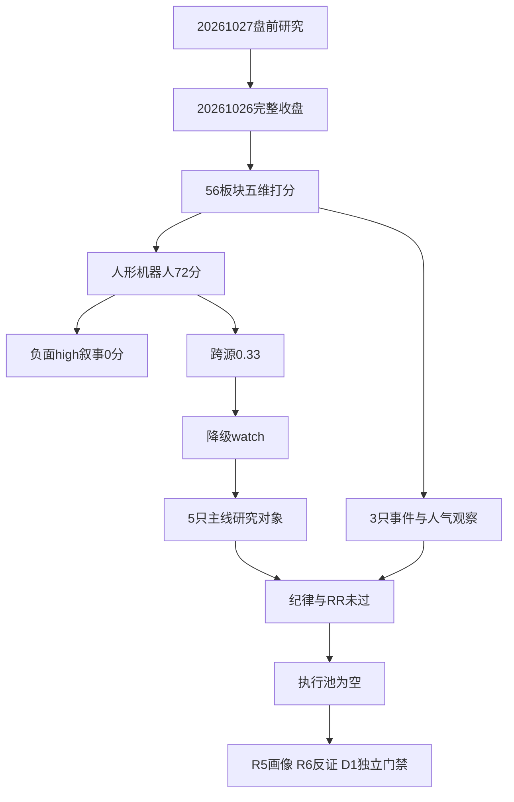

# 2026年10月27日 · **主线研判**

> ⚠️ **数据源时间错位**
> 文件日期为2026-10-27；国内行情实际归属2026-10-26完整收盘。这是正常盘前基准，不是今日开盘确认；MD仅研究上下文，D1消费机读产物时仍须逐票门禁。
> **数据源新鲜度**：partial · **降级状态**：true · **置信度**：0.392

## 🧭 一句话结论
**观察：人形机器人72分为研究主线；跨源仅0.33，零交易授权，不用负面催化造进攻。**

## 📊 详细分析

市场在为局部机器人高度与触觉叙事、部分零售和油气付注意力，而非全面普涨。R1定义情绪=震荡、阶段=高位震荡；55家涨停、23家炸板，统一炸板率29.49%，未触发35%候选减半线。研究保留8只真实对象，执行池为空；研究不是下单理由。

主线 = **人形机器人（研究）**，持续性 = **1日**验证窗口，封板率 = **60.87%**（14涨停/23触板），明日预期 = **分歧**。14家较前一日26家收缩，指数仍跌0.7874%；精准人形资金流入不等于广义机器人同步走强。所谓1日不是承诺能涨1日，也不是宣称历史只运行1日。

R4两项机器人事件均为负面high，叙事维严格0分；R3按theme_name映射具身母题，L1+L2多空并存给12分，宇树连续榜首不加分。同日R7真实文件已经读取，行业top10没有精确人形板块，不能拿汽车零部件正流入充当整个人形机器人确认，所以跨源仅1/3，按契约降级watch。

生命周期函数实跑得到mid_up兜底、置信度0.55，但年龄只是已观测至少6个交易日的下界；不得把供应商days重置到3称新题材，也不得把函数标签当主升中期已证实。今日唯一研究主模板为分歧接力，不与首板隔日、总龙锁仓等拼接；通道等待当日赚钱效应，不静态禁用或强推任何通道。

### 人形机器人：三问与反证
- **大资金意图**: 精确人形概念净额26.324636亿元且连续两日为正，只支持局部交易活跃；不能据此识别机构身份、长期配置意图或订单兑现。
- **为什么走强**: 三板前排与触觉讨论共振，但概念指数下跌、涨停扩散收缩，说明价格与人气分化，不是普涨主升。
- **逻辑够不够硬**: 资金和涨停已核，商业落地仍受风险公告约束；纪律§2四条未达3条，跨源0.33，无资格进入execution。

### 五维板块面板
各维0—20，实际相加不做三维放大。缺证据计证据分0，不代表指标事实为零。

| 板块 | 热度 | 资金 | 涨停 | 叙事 | 共振 | 总分 | 态度 |
|---|---:|---:|---:|---:|---:|---:|---|
| 人形机器人 | 20 | 20 | 20 | 0 | 12 | 72 | 观察 |
| 机器人概念 | 20 | 0 | 20 | 0 | 12 | 52 | 观察 |
| 商贸零售 | 12 | 8 | 4 | 0 | 16 | 40 | 不进 |
| 油气开采 | 12 | 12 | 0 | 0 | 16 | 40 | 不进 |
| 人工智能 | 16 | 0 | 20 | 0 | 0 | 36 | 不进 |
| AI应用 | 20 | 0 | 12 | 0 | 0 | 32 | 不进 |
| 乳业 | 12 | 12 | 8 | 0 | 0 | 32 | 不进 |
| 数据要素 | 16 | 0 | 16 | 0 | 0 | 32 | 不进 |
| 低空经济 | 0 | 12 | 16 | 0 | 0 | 28 | 不进 |
| 创新药 | 16 | 12 | 0 | 0 | 0 | 28 | 不进 |
| 算力租赁 | 4 | 0 | 4 | 20 | 0 | 28 | 不进 |
| 无人驾驶 | 4 | 0 | 0 | 20 | 0 | 24 | 不进 |
| 白酒概念 | 8 | 12 | 4 | 0 | 0 | 24 | 不进 |
| 统一大市场 | 0 | 12 | 12 | 0 | 0 | 24 | 不进 |
| 改性塑料 | 0 | 0 | 0 | 20 | 0 | 20 | 不进 |
| 数据安全 | 0 | 0 | 0 | 20 | 0 | 20 | 不进 |
| 新能源汽车 | 0 | 0 | 20 | 0 | 0 | 20 | 不进 |
| 知识产权服务 | 0 | 0 | 0 | 20 | 0 | 20 | 不进 |
| 银行理财 | 0 | 0 | 0 | 20 | 0 | 20 | 不进 |
| 非银资管 | 0 | 0 | 0 | 20 | 0 | 20 | 不进 |

热度采用同花顺概念榜固定分箱；零售/油气仅用R3个股人气作为12分代理。资金对516条概念净额重新排序，不信供应商分组rank；负流入给0，五日合计为负封顶12。涨停家数达到12/8/5/3/1对应20/16/12/8/4；零售仅验证上海九百一家下界。正向high催化20，负面0；严格命名映射不借用AI母题。全部56板块及每项证据索引在JSON中。

52分广义机器人只列次线且与人形母题合并计数，不造第二条独立主线。零售40、油气40、租赁28低于核心门槛，但有真实热度/事件个股，放研究观察而非冒充secondary主线。乳业32、AI应用32、数据要素32不进入核心。

## 🔬 研究候选与filter_leader结果
研究相对龙一/龙二并非纪律已认证交易龙头。两只三板前排零开板，容量换手条件不能冒认通过；仅证实辨识度1条，未达四条过三。所有候选RR及止损距离均null，禁止编价补齐。

| 个股 | 身位标注 | 板型 | 纪律§2已证/4 | 流通亿元 | 五日大单净额亿元 | 态度 |
|---|---|---|---:|---:|---:|---|
| 多伦科技 `603528.SH` | 龙头（研究） | 三连板一字/零开板（缩量未核） | 1 | 63.18 | +3.0871 | 观察、不进执行 |
| 赛福天 `603028.SH` | 龙二（研究） | 三连板一字/零开板（缩量未核） | 1 | 26.63 | +0.8357 | 观察、不进执行 |
| 福莱新材 `605488.SH` | 龙三（研究） | 二连板换手回封 | 1 | 125.27 | +3.6293 | 观察、不进执行 |
| 旭光电子 `600353.SH` | 龙三（研究） | 非涨停趋势待验证 | 0 | 184.33 | +0.4236 | 观察、不进执行 |
| 中京电子 `002579.SZ` | 龙三（研究） | 非涨停趋势待验证 | 0 | 75.50 | -2.1528 | 观察、不进执行 |
| 上海九百 `600838.SH` | 龙三（研究） | 四连板换手回封 | 1 | 48.51 | +1.3505 | 观察、不进执行 |
| 中国石油 `601857.SH` | 龙三（研究） | 非涨停趋势待验证 | 0 | 21665.17 | +3.0624 | 观察、不进执行 |
| 行云科技 `300209.SZ` | 龙三（研究） | 非涨停趋势待验证 | 0 | 208.09 | -5.6729 | 观察、不进执行 |

### 多伦科技 `603528.SH` · 观察

- **大资金意图**: 未识别资金身份；五日大单净额`+3.0871亿元`只作资金方向，不冒充全板块资金排名。
- **为什么走强**: 全量476成分与涨停表交叉：并列最高3板、最早竞价封板；R3东财第6并前移，有已核人气证据，非独占最高；名称/行情基准为2026-10-26，不据此宣称今日走强。
- **逻辑够不够硬**: 纪律§2仅证实`1/4`，硬逻辑及带动因果不足，不授交易龙头。

- **买入理由**: 仅列待验证研究理由，不是买入指令：智慧交通机器人场景具产业映射；三板并列高度与R3第6名提供研究锚。

- **风险点**: 一字缺换手与接力断层；机器人收入贡献及带动因果未证。 RR、入场与失效价均未由D1核定，RR=null，止损距离=null。

- **止损条件**: 本栏为研究假设失效条件而非持仓卖单：若下一交易日不再位居板块最高连板组，撤销研究龙一；若风险公告明确场景未商业化则撤销商业化假设。

- **可验证假设**: 24—72h核验其仍处最高连板组且人形板块至少8家封板；任一不达不升级。

四要素核验：板型=`三连板一字/零开板（缩量未核）`；龙头认定=`1/4`（filter相对层级=1）；盈亏比=`null/未核`；禁止清单命中=尚无可确认交易情境命中，不等于14项全通过。近30日席位、全板块五日top3及换手中位数为unknown，不把未知按未命中放行。计划分类=今日核心，仅研究登记，不是D1批准的计划内买入。

### 赛福天 `603028.SH` · 观察

- **大资金意图**: 未识别资金身份；五日大单净额`+0.8357亿元`只作资金方向，不冒充全板块资金排名。
- **为什么走强**: 与多伦并列最高3板且同一竞价封板时点；研究综合排序第二，非五日资金top2；流通26.63亿谨慎；名称/行情基准为2026-10-26，不据此宣称今日走强。
- **逻辑够不够硬**: 纪律§2仅证实`1/4`，硬逻辑及带动因果不足，不授交易龙头。

- **买入理由**: 仅列待验证研究理由，不是买入指令：机器人腱绳为产业映射；并列三板与最早竞价封板可复核。

- **风险点**: 26.63亿流通盘偏小且一字；问财转述历史披露称在手相关订单小、财务影响可忽略。 RR、入场与失效价均未由D1核定，RR=null，止损距离=null。

- **止损条件**: 本栏为研究假设失效条件而非持仓卖单：若断板且板块高度未降，撤销并列高度前排假设；公告确认相关订单终止则撤销产业假设。

- **可验证假设**: 24—72h核验保持最高高度组、出现真实成交承接；只数板不算纪律三条通过。

四要素核验：板型=`三连板一字/零开板（缩量未核）`；龙头认定=`1/4`（filter相对层级=2）；盈亏比=`null/未核`；禁止清单命中=尚无可确认交易情境命中，不等于14项全通过。近30日席位、全板块五日top3及换手中位数为unknown，不把未知按未命中放行。计划分类=今日核心，仅研究登记，不是D1批准的计划内买入。

### 福莱新材 `605488.SH` · 观察

- **大资金意图**: 未识别资金身份；五日大单净额`+3.6293亿元`只作资金方向，不冒充全板块资金排名。
- **为什么走强**: 触觉数据叙事及R3排名42到15；2连板低于高度前排，仅助攻不替补；名称/行情基准为2026-10-26，不据此宣称今日走强。
- **逻辑够不够硬**: 纪律§2仅证实`1/4`，硬逻辑及带动因果不足，不授交易龙头。

- **买入理由**: 仅列待验证研究理由，不是买入指令：电子皮肤与触觉数据链相关；两板且R3人气42升15是事件锚。

- **风险点**: 两板低于三板不替补上位；柔性传感送样与规模收入之间仍有缺口。 RR、入场与失效价均未由D1核定，RR=null，止损距离=null。

- **止损条件**: 本栏为研究假设失效条件而非持仓卖单：若后续不再保持板块低位前排或触觉相关业务被公司否认，撤销助攻研究假设。

- **可验证假设**: 24—72h核验排名保留前20且仍有板块至少8家封板；未达则降级，不凭排名自动交易。

四要素核验：板型=`二连板换手回封`；龙头认定=`1/4`（filter相对层级=filtered_out）；盈亏比=`null/未核`；禁止清单命中=尚无可确认交易情境命中，不等于14项全通过。近30日席位、全板块五日top3及换手中位数为unknown，不把未知按未命中放行。计划分类=主线补涨，仅研究登记，不是D1批准的计划内买入。

### 旭光电子 `600353.SH` · 观察

- **大资金意图**: 未识别资金身份；五日大单净额`+0.4236亿元`只作资金方向，不冒充全板块资金排名。
- **为什么走强**: theme_anchors第一旭光电子；当日-3.60%无前排证据，仅默认研究；名称/行情基准为2026-10-26，不据此宣称今日走强。
- **逻辑够不够硬**: 纪律§2仅证实`0/4`，硬逻辑及带动因果不足，不授交易龙头。

- **买入理由**: 仅列待验证研究理由，不是买入指令：人形概念锚第一是先验产业映射；20261020锚分76.2供研究核验，非今日买点。

- **风险点**: 当日跌3.60%无涨停；历史锚不能证明当前业绩映射与领涨。 RR、入场与失效价均未由D1核定，RR=null，止损距离=null。

- **止损条件**: 本栏为研究假设失效条件而非持仓卖单：若下一交易日仍不属于板块涨幅前10或无市场地位证据，撤销前排试错研究资格。

- **可验证假设**: 24—72h验证板块涨幅前10及资金正向同时出现；否则维持纯锚研究、不进交易。

四要素核验：板型=`非涨停趋势待验证`；龙头认定=`0/4`（filter相对层级=filtered_out）；盈亏比=`null/未核`；禁止清单命中=连板高度低于龙头超过2板;禁止清单1：未证明当日前排地位，不进交易候选。近30日席位、全板块五日top3及换手中位数为unknown，不把未知按未命中放行。计划分类=计划内试错，仅研究登记，不是D1批准的计划内买入。

### 中京电子 `002579.SZ` · 观察

- **大资金意图**: 未识别资金身份；五日大单净额`-2.1528亿元`只作资金方向，不冒充全板块资金排名。
- **为什么走强**: theme_anchors第二中京电子；当日-6.03%无前排证据，仅默认研究；名称/行情基准为2026-10-26，不据此宣称今日走强。
- **逻辑够不够硬**: 纪律§2仅证实`0/4`，硬逻辑及带动因果不足，不授交易龙头。

- **买入理由**: 仅列待验证研究理由，不是买入指令：人形概念锚第二是题材先验；锚分76.0和真实收盘数据提供核对入口。

- **风险点**: 当日跌6.03%且五日主力为负；PCB及人形标签重叠不证明人形业务硬逻辑。 RR、入场与失效价均未由D1核定，RR=null，止损距离=null。

- **止损条件**: 本栏为研究假设失效条件而非持仓卖单：若五日主力仍为负且未进入板块涨幅前10，撤销前排试错假设。

- **可验证假设**: 24—72h需核实五日主力转正及板块涨幅前10；不满足不抬升地位。

四要素核验：板型=`非涨停趋势待验证`；龙头认定=`0/4`（filter相对层级=filtered_out）；盈亏比=`null/未核`；禁止清单命中=连板高度低于龙头超过2板;禁止清单1：未证明当日前排地位，不进交易候选。近30日席位、全板块五日top3及换手中位数为unknown，不把未知按未命中放行。计划分类=计划内试错，仅研究登记，不是D1批准的计划内买入。

### 上海九百 `600838.SH` · 观察

- **大资金意图**: 未识别资金身份；五日大单净额`+1.3505亿元`只作资金方向，不冒充全板块资金排名。
- **为什么走强**: 全市场唯一4板但全零售成分地位未核，R3人气前移；不由全市场高度自动授予板块龙一；名称/行情基准为2026-10-26，不据此宣称今日走强。
- **逻辑够不够硬**: 纪律§2仅证实`1/4`，硬逻辑及带动因果不足，不授交易龙头。

- **买入理由**: 仅列待验证研究理由，不是买入指令：商贸零售对标讨论具产业映射；全市场唯一四板与R3排名24升11是研究锚。

- **风险点**: 48.51亿小流通盘；全行业资金五日为负，单票高度不等于板块赚钱效应。 RR、入场与失效价均未由D1核定，RR=null，止损距离=null。

- **止损条件**: 本栏为研究假设失效条件而非持仓卖单：若断板且同板块没有至少2家新封板，撤销带板块假设。

- **可验证假设**: 24—72h核验零售至少2家同向封板、完整成分排序；否则不认证行业龙一。

四要素核验：板型=`四连板换手回封`；龙头认定=`1/4`（filter相对层级=filtered_out）；盈亏比=`null/未核`；禁止清单命中=尚无可确认交易情境命中，不等于14项全通过。近30日席位、全板块五日top3及换手中位数为unknown，不把未知按未命中放行。计划分类=计划内试错，仅研究登记，不是D1批准的计划内买入。

### 中国石油 `601857.SH` · 观察

- **大资金意图**: 未识别资金身份；五日大单净额`+3.0624亿元`只作资金方向，不冒充全板块资金排名。
- **为什么走强**: R3东财第8且收涨4.94%；油气资源五日资金为负，容量股不等于龙头；名称/行情基准为2026-10-26，不据此宣称今日走强。
- **逻辑够不够硬**: 纪律§2仅证实`0/4`，硬逻辑及带动因果不足，不授交易龙头。

- **买入理由**: 仅列待验证研究理由，不是买入指令：油气资源具地缘敏感产业映射；收涨4.94%与东财第8名是可复核锚。

- **风险点**: 油气资源五日合计为负；隔夜商品价格未在本R2重新核验，石油石化行业不能偷换油气开采。 RR、入场与失效价均未由D1核定，RR=null，止损距离=null。

- **止损条件**: 本栏为研究假设失效条件而非持仓卖单：若油气资源当日资金转负且板块涨幅非正，撤销本轮回流假设。

- **可验证假设**: 24—72h核验油气资源连续两日净流入且指数收涨；缺任一不升级。

四要素核验：板型=`非涨停趋势待验证`；龙头认定=`0/4`（filter相对层级=filtered_out）；盈亏比=`null/未核`；禁止清单命中=尚无可确认交易情境命中，不等于14项全通过。近30日席位、全板块五日top3及换手中位数为unknown，不把未知按未命中放行。计划分类=计划内试错，仅研究登记，不是D1批准的计划内买入。

### 行云科技 `300209.SZ` · 观察

- **大资金意图**: 未识别资金身份；五日大单净额`-5.6729亿元`只作资金方向，不冒充全板块资金排名。
- **为什么走强**: R4 E20261027_001合同正向high真实事件候选；收跌5.53%且无前排证明，不认龙一；名称/行情基准为2026-10-26，不据此宣称今日走强。
- **逻辑够不够硬**: 纪律§2仅证实`0/4`，硬逻辑及带动因果不足，不授交易龙头。

- **买入理由**: 仅列待验证研究理由，不是买入指令：算力租赁合同具产业映射；R4原文核验协议金额88.48亿元是明确事件锚。

- **风险点**: 合同额不是当期确认收入；收跌5.53%且五日主力为负，不得由新闻直接授龙头。 RR、入场与失效价均未由D1核定，RR=null，止损距离=null。

- **止损条件**: 本栏为研究假设失效条件而非持仓卖单：若公告变更或取消合同，撤销事件假设；若资金持续负流且无相对强势，撤销短线回流假设。

- **可验证假设**: 24—72h核验个股当日大单净额转正、板块相对强势；合同兑现交后续收入核验，不把72h当收入确认期。

四要素核验：板型=`非涨停趋势待验证`；龙头认定=`0/4`（filter相对层级=filtered_out）；盈亏比=`null/未核`；禁止清单命中=尚无可确认交易情境命中，不等于14项全通过。近30日席位、全板块五日top3及换手中位数为unknown，不把未知按未命中放行。计划分类=计划内试错，仅研究登记，不是D1批准的计划内买入。

## 🧱 过滤、锚与剔除覆盖

filter_leader已对冻结的8只对象执行，未新增票、未改板块分。多伦与赛福天保留相对研究龙一/龙二，另外三只主线研究对象标filtered_out；其他方向地位未核同样filtered_out。两名研究前排仍因跨源0.33、纪律四条不足3条、RR与门禁缺口而execution_eligible=false。硬否决只由R6出具，本R2没有生成hard_reject。

人形锚前三按默认规则均检查：旭光、中京保留研究；北自科技流通15.882082亿元低于20亿剔除。华阳智能18.406395亿、奥雅股份17.696262亿同样剔除，原因不是300前缀。20—50亿的赛福天与上海九百保留但标小流通谨慎。不能把这种合规剔除写成R6硬否决，也不能在龙一被否后自动升福莱替补。

杂毛四判据中，两个历史锚仅可确认连板高度低于当前前排超过2板；五日全板块资金名次、30日席位、板块换手中位数未知，不能声称已命中≥2条。它们仍因当日前排地位缺失命中禁止清单第1项，研究可留、交易不进。剔除列表中的“杂毛”是执行剔除分类，不冒充四判据确认。

## 🔗 关键证据
- 同花顺概念热榜20条、涨停强板20条；人形14家涨停与9家炸板由476成分交叉复核。来源：本次live MCP及SDK，日期2026-10-26。
- 东方财富概念资金516条；人形`+26.324636亿元`，广义机器人为负，R7行业top10另行审计。来源：R2_flow_evidence及同日R7主产物。
- R3 theme_name适配机器人、商贸零售、油气开采；R4机器人两公告负面high、行云租赁合同正面high，不能混用极性。
- 官方同花顺问财返回17个概念筛选结果与15只人形涨停核验结果；日期明确，供应商封板秒数和开板次数有小差异，本报告优先完整涨停表。

## 数据源审计
| 源 | 日期 | 状态 | 备注 |
|---|---|:--:|---|
| R1 | 2026-10-27 | 🟡 | 同日上游已读但源覆盖partial/degraded，非缺失 |
| R3 | 2026-10-27 | 🟡 | 同日上游已读但源覆盖partial/degraded，非缺失 |
| R4 | 2026-10-27 | 🟡 | 同日上游已读但源覆盖partial/degraded，非缺失 |
| R7 | 2026-10-27 | 🟡 | 同日上游已读但源覆盖partial/degraded，非缺失 |
| tushare.live.limit_cpt_list | 2026-10-26 | 🟢 | 20条，盘前已核T-1完整收盘 |
| tushare.live.ths_hot | 2026-10-26 | 🟢 | 20条，盘前已核T-1完整收盘 |
| tushare.live.moneyflow_ind_dc | 2026-10-26 | 🟢 | 516条，盘前已核T-1完整收盘 |
| tushare.live.limit_list_d | 2026-10-26 | 🟢 | 78条，盘前已核T-1完整收盘 |
| tushare.live.daily/daily_basic | 2026-10-26 | 🟢 | 5570条，盘前已核T-1完整收盘 |
| tushare.live.ths_member | 2026-10-26 | 🟢 | 1716条，盘前已核T-1完整收盘 |
| hithink.sector_selector | 2026-10-26 | 🟢 | 17条，盘前已核T-1完整收盘 |
| hithink.robot_verify | 2026-10-26 | 🟢 | 15条，盘前已核T-1完整收盘 |
| tushare.live.moneyflow | 2026-10-26 | 🟢 | 45条，盘前已核T-1完整收盘 |
| vibe.iwencai | 2026-10-27 | 🔴 | VIBE_TRADING_IWENCAI_KEY not configured；官方hithink已成功替代 |
| factor_layer | 2026-10-27 | 🔴 | 目录不存在，不虚构因子分 |
| theme_anchors | 2026-10-20 | 🟢 | 20261020先验，不是当日排名 |
| dc_hot_stock_via_R3 | 2026-10-26 | 🟢 | 继承已核T-1双平台个股榜；未独立直拉东财概念榜 |
| kpl_concept | 2026-10-27 | 🔴 | 用limit_cpt+完整涨停明细替代，不假称已覆盖 |
| wechat_text_via_R3_R4 | 2026-10-27 | 🟡 | 本地81+544条审计；语义依赖R3/R4，未读图 |
| long_term_thesis | 2026-10-27 | 🟢 | 目录空；chzl_kg/主线不存在，不伪造长期继承 |

## ⚠️ 不确定性 / 反证

本次状态partial是实质数据缺口，不是执行未完成：因子目录不存在，未构造IC/IR；30日龙虎榜原区间调用被供应商拒绝“必填trade_date”，仅最新交易日89条成功，不能把单日总净额替代机构/游资30日席位。东财个股热榜继承R3，未额外直拉东财概念热榜；开盘啦概念源未覆盖，已有涨停表替代。微信图片和远端同步不确定性继承上游，不按转发数增源。

板块生命周期只有观测下界；主力资金是供应商大单分类，不等于真实主力身份。单日板块家数高度重叠，不可相加为全市场涨停。零售只验证1家下界，不伪造全板块家数。所有个股缺价格方案和盈亏比，必须由D1独立检查RR≥2、止损距离至少5%、预算和7项资格/14项禁令，R5继续画像，R6独立反证。

## 🤝 与其他 R/D/E 的关系
- 依赖：R1_style.json、R3_sentiment.json、R4_news.json、R7_capital_flow_20261027.json；四份同日上游均存在。
- 被消费：R5对8只真实研究对象画像；R6对证据与缺口反证；D1仅消费研究排序，不承接任何自动交易权；E1回填验证假设。

## 🧾 Sub-Agent 元数据
- skill: analyze_main_sectors_v1 + filter_leader_v1
- artifact: data/research/20261027/R2_main_sectors.json
- model: gpt-6.1-sol
- schema: 任务级Pydantic v2强类型模型，非仓库官方R2模型；schema与实测报告落同研究目录。
- method: llm_v1，元数据仅列于此；不输出买卖点、止损价或仓位。
- 生成耗时: 638秒（含前次超时中断）
