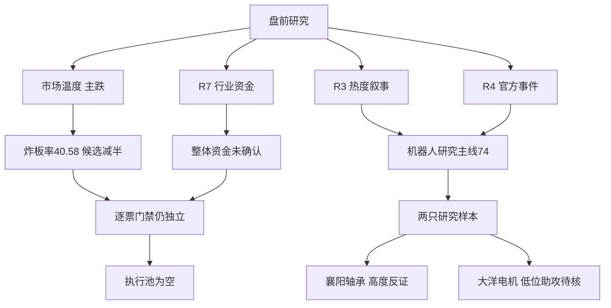

# 2026年10月28日 · 主线研判

> **数据源新鲜度**：partial · **降级状态**：true · **置信度**：0.245（证据质量，非胜率）
> **情绪=主跌**。行情观察日为2026-10-27；不是2026-10-28实时盘口。

## 🎯 一句话结论

**机器人74分进入研究主线，零售54分列次线；已确认可交易主线为空，执行池不进。**

## 🧭 先认市场，再认个股

市场现在只在少数身位票与低位首板上支付溢价，不是在给科技板块全面扩张定价。R1记录上涨606、下跌4922，中位涨幅-2.9749%；涨停41、炸板28，炸板率40.58%。前日涨停池仍有正溢价，却不能反证全市场主跌。R1的“三主线以上”是重叠涨停榜代理，不是已经确认三条可交易主线。

本次选择唯一主模板为**首板隔日**，研究权重偏向新题材首二板的身位、扩散与次日承接，不混入总龙锁仓等其他四套。现有机器人是老方向新增政策，不因盘后新文件就冒充新题材。昨日4板核心保留为高度与反证样本；不是把它改成今天的首板标的，也不因高位单独否定后随意换票。

研究层主线=**人形机器人/物理AI数采**；持续性=**1日研究复核窗口**，不是已实测只有一天；封板率=**未知**，缺概念成分与炸板归属，不能硬填百分比；2026-10-28下一交易时段预期=**分歧**。已确认可交易主线=空；新仓权限不授予。题材真实生命周期年龄未核，阶段留空，不把供应商days字段当主线年龄。

## 📊 五维板块打分

每维0—20分，直接相加满分100。≥70仅进入研究主线，50—69进入次线，低于50留在覆盖/剔除审计，不升格核心。以下是**证据评分**，不是拟合概率；未覆盖记0仅表示本次未获支持，不代表市场实际热度为零。热度与共振分栏：前者是榜单及价格强弱，后者是独立叙事层与榜单的同向程度。榜首不额外加分，亏损关注扣分，不把叙事热度重算为资金。

| 方向 | 热度 | 资金 | 涨停 | 叙事 | 共振 | 总分 | 态度与层级 |
|---|---:|---:|---:|---:|---:|---:|---|
| 人形机器人/物理AI数采 | 18 | 8 | 18 | 16 | 14 | 74 | 观察·研究主线 |
| 商贸零售/一般零售 | 18 | 12 | 16 | 0 | 8 | 54 | 观察·次线 |
| 新能源汽车/汽车零部件 | 10 | 7 | 20 | 0 | 0 | 37 | 降级·不进核心 |
| AI短剧/传媒 | 14 | 2 | 4 | 5 | 10 | 35 | 降级·不进核心 |
| 券商/上海国资改革 | 0 | 2 | 0 | 16 | 0 | 18 | 降级·不进核心 |
| 航运港口 | 0 | 10 | 4 | 4 | 0 | 18 | 降级·不进核心 |
| 工业软件/工业母机 | 0 | 1 | 0 | 16 | 0 | 17 | 降级·不进核心 |
| 覆铜板/PCB | 4 | 0 | 0 | 12 | 0 | 16 | 降级·不进核心 |
| 银行 | 0 | 16 | 0 | 0 | 0 | 16 | 降级·不进核心 |
| 光学元件 | 0 | 16 | 0 | 0 | 0 | 16 | 降级·不进核心 |
| 卫星互联网 | 0 | 1 | 0 | 14 | 0 | 15 | 降级·不进核心 |
| 光通信设备/精密激光 | 0 | 1 | 4 | 10 | 0 | 15 | 降级·不进核心 |
| 创新药 | 0 | 1 | 0 | 10 | 0 | 11 | 降级·不进核心 |
| 工业金属/铝 | 0 | 10 | 0 | 0 | 0 | 10 | 降级·不进核心 |
| 电视开机广告/IPTV | 0 | 0 | 0 | 0 | 0 | 0 | 拦截·不进核心 |

### 评分依据与合并口径

机器人热度18分来自襄阳轴承、大洋电机双榜上移，但宇树降温与福莱跨平台分化，故不满分。资金8分是机器人行业五日仍为正、当日转负，加上电机子环节相对强的折扣评分；绝不是以电机的正流入替代整个物理AI概念。涨停18分来自机器人13家、人形9家；两者重叠，只取较宽口径，不加成22家。官方政策叙事16分，原因是产业目标清楚但公司采购预算与合同未证实；L1+L2经内部负反馈折扣，共振14分。

零售热度18分来自上海九百双榜上移及同行前列；涨停16分来自6家涨停和5板身位。资金12分来自一般零售当日+2.4881亿元、五日+3.1957亿元，但商贸零售母行业当日-0.5283亿元，故折扣。R4只给高位零售负面风险，本次正面叙事记0；L2仅一条短句，弱双源共振8分。不能把“被监管”算作有催化就加正分。

AI短剧35分、新能源汽车37分都不进核心。前者慈文跌停而榜单上升、粤传媒炸板，传媒行业-12.8932亿元，流量传播没有抵消负反馈；后者涨停数量领先却缺R3/R4直接叙事，汽零当日资金微负，不能仅凭18家涨停就定主线。比亚迪、汽零、长安、特斯拉等重叠标签不另造独立主线。

## 🤖 研究主线：人形机器人/物理AI数采 · 74分 · 观察

- **大资金意图**: 可检验假设是缩量环境中，资金沿电机、轴承等有辨识度环节保留局部进攻，同时寻找数采与进厂新增业务；并非已经确认全面建仓。机器人行业昨日-3.4649亿元，五日+9.2593亿元；电机Ⅱ昨日+7.2513亿元，不能相加成整个概念净流入。
- **为什么走强**: 襄阳轴承昨日4板，大洋电机首板，双榜上移且价格封板，说明局部身位仍有注意力。机器人与人形概念分别13/9家涨停，但指数各跌2.9480%/2.7567%，表明并非板块普涨。上海智能制造方案为盘后公开，只能构成下一时段预期，不能倒因解释昨日涨停。
- **逻辑够不够硬**: R3的L1+L2与R4官方政策构成研究层支撑；机器人训练入口和进厂目标不等于公司订单。R7仅东财行业主源、完整概念资金与成员未核，交易逻辑不够硬。若订单不能验证、前排扩散消失或资金继续流出，维持观察而不升格。

### 真实研究对象与门禁

炸板率≥35%，每条主线原上限5只乘0.5向下取整，保留**2只研究对象**；不为3—5只的原始数量目标造票。顺序是研究展示顺序，不是已核全板块交易地位。

| 研究顺序 | 对象 | 昨日状态 | 流通市值 | 纪律四项 | 最终态度 |
|---|---|---|---:|---|---|
| 暂列龙头 | 襄阳轴承 000678.SZ | +10.03%，4板，开板1次 | 73.58亿元 | 板型未核；龙头纪律验证通过0项；RR未知；禁止清单未完成 | 观察，执行不进 |
| 暂列龙二 | 大洋电机 002249.SZ | +10.00%，首板，开板1次 | 144.18亿元 | 板型未核；龙头纪律验证通过0项；RR未知；禁止清单未完成 | 观察，执行不进 |

“已验证通过0项”表示缺完整逐项证据，不代表实际四项全不满足。开板次数只是原始涨停统计，不能自动叫烂板或弱转强。空的禁止命中数组不代表无命中。未核全板块成员及高度并列，**不声称襄阳已经当日唯一龙一，也不声称大洋综合评分稳居全板块第二**。个股属性仅用于研究节奏：襄阳按连板妖股，大洋暂按波段型趋势股，后者不是已完成技术形态确认。

### 襄阳轴承 · 高度与背离研究样本

- **买入理由**: **不进，仅研究**。其一，R3将其作为机器人注意力锚，THS由6至2、DC由3至1；其二，R1原始涨停记录确认4板和流通市值门槛。榜首本身不加分，题材标签不等于收入。
- **风险点**: 其一，主跌环境下4板老身位可能先手兑现，不能用首板隔日模板替它背书；其二，R7东财主力昨日约-1.0077亿元，而XTick主动大额代理为正，分类不同，不能相减、平均或选择乐观值。中期还缺数采收入与订单证明。
- **止损条件**: 本次不生成交易止损价，RR和止损距未核，因此开仓权限为不进。研究逻辑撤销条件是公司实际业务不能支持机器人映射，或前排扩散消失且自身失去相对强势；并非据此指挥现有持仓交易。
- **可验证假设**: 未来1—3个交易日检查题材是否连续两日净流入、非ST涨停扩散是否维持，并核验此票相对板块承接。未得到同口径数据就不自动升格；即使达标仍须逐票门禁与D1计划归属。

### 大洋电机 · 低位助攻研究样本

- **买入理由**: **不进，仅研究**。其一，R3双榜由THS29至11、DC84至3，昨日首板而非追认高位连板；其二，电机Ⅱ日度与五日净额为正，且该股流通市值符合研究门槛。行业流入并不证明本票资金第一。
- **风险点**: 其一，电机行业行情可能来自传统业务或其他电机需求，不必然是人形机器人；其二，低位助攻可能失去板块β后无人接力，不能因为便宜就替换高度核心。中期数采或具身收入尚无独立量化验证。
- **止损条件**: 数值止损与RR缺失，执行不进。若机器人业务关系无法核实，或板块资金/封板扩散不能延续，撤销助攻假设；不提供临时交易买卖点。
- **可验证假设**: 未来1—3个交易日核验电机与机器人是否同向持续净流入、此票是否出现相对板块更强的承接及有效业务佐证；只有榜单继续变热而资金不确认时，维持观察。

两票的T+1博弈均是**下一日谁接先手筹码**：政策高开可能成为兑现窗口，不能把涨停历史当未来溢价承诺。今日核心/主线补涨/计划内试错归属均未取得，不将新闻映射临时授予计划资格。通道留空不是静态禁止打板、半路或低吸，而是没有当日盘口，不凭空指定。

## 🛒 次线：商贸零售/一般零售 · 54分 · 观察

- **大资金意图**: 一般零售正流入与少数连板说明局部避险/轮动假设可研究，但母行业微负，没有证据确认全消费大进攻。
- **为什么走强**: 上海九百5板、零售6家涨停和多个同行上榜提供身位及扩散证据；反面是R3仅一条同业对标、盘后监管风险增加，不能用尾盘报道推定新增大资金进场。
- **逻辑够不够硬**: 股价和热榜硬，新增产业催化不足。上海九百经营未有重大变化、异动风险有R4官方文本。高位接力拦截仅是研究风险态度，不是R6的hard_reject；不改用中百等补涨杂毛绕过风险，也不授予龙二。

## 🔎 不进核心的方向与真实事件覆盖

| 方向 | 明确处理与因果证据 |
|---|---|
| AI短剧/传媒 | 降级：R3流量传播成立但慈文跌停、粤传媒炸板；R4本次没有短剧官方正催化，不能把电视开机广告禁令外推为全传媒利空 |
| 新能源汽车/汽车零部件 | 降级：涨停榜领先但题材重叠，缺独立叙事与整体资金确认，不等于所有涨停都是同一增量逻辑 |
| 券商/上海国资改革 | 观察事件，不进核心：华鑫股份转让及复牌已核，但实控人未变、非券商合并；银行资金正流入不替代证券资金负流出 |
| 工业软件/母机 | 观察事件，不进核心：与机器人同一政策文件，不能拆成三份独立催化；软件和自动化行业仍流出 |
| 卫星互联网 | 观察事件，不进核心：26日已公开，2030产业目标非今日财政预算；缺R3双源与资金确认 |
| 光通信设备 | 降级：逸飞拟并购正反两条只计一个底层文件，交割、商誉及技术适配风险并列；不因300/688前缀降级 |
| 创新药 | 降级：恒瑞利润与目标缺口同报，CXO不冒充创新药净流入 |
| 覆铜板/PCB | 降级：金安国纪环比已核但现货价和预期差未核，R4中性；PCB大额流出不能被同比数字抹去 |
| 航运港口 | 观察证据，不进核心：罢工版本冲突、只有R3单源，资金当日正但五日负 |
| 银行/光学元件/工业金属 | 不进核心：承认当日资金相对强，未见同批叙事和涨停效应，不以传统/防守标签永久排除 |
| 电视开机广告/IPTV | 拦截：R4监管直接约束特定商业模式，不当作正向叙事 |

华鑫股份、逸飞激光、恒瑞医药、金安国纪仍是R4的真实研究事件映射，不因禁新仓消失；但本次没有将其额外加进已减半的R2逐票候选预算。R5可独立消费R4原始研究对象，不能误以为本次已授予龙头资格。ST、920、流通市值低于20亿元及身份未核的票不凭新闻补入；例如大明电子原始涨停流通市值约8.42亿元，低于门槛，不进候选。300/688与主板同权。

杂毛不是“缺数据”的同义词。本次没有票被事实确认满足杂毛至少两项，故不伪标rank=杂毛；对标、低价、单日资金榜上位而无地位证明的替补均不进。逐票缺口已写入JSON，后续不得用R6否决龙一为理由自动启用龙三。

## 🔗 交叉验证与共识

| 研究方向 | R3共振 | R4正面直接催化 | R7同口径原始前十 | CV | 结论 |
|---|:---:|:---:|:---:|---:|---|
| 人形机器人/物理AI数采 | 是 | 是 | 否 | 0.67 | 三源研究共识；不是四源资金确认 |
| 商贸零售/一般零售 | 是 | 否，监管为负 | 否，一般零售未入前十 | 0.33 | 次线观察；不得包装正面催化 |

R4的sectors_catalyzed以方向名为键，值中无name；本次按实际键与事件极性读取，不使用空字符串模糊匹配制造命中。R3实际字段是theme_name与suggested_sectors，按语义归并IMU/触觉/视觉；不得因别名制造三条主线。R7行业原始前十中银行及电机有重复层级，不相加，也不把去重后扩到的第十一名补成原始前十。

共识主题只有机器人一项，agreement_count=3，composite_score=0.56：按R2的0.74、R3的0.70、R4的0.80、R7的0等权计算。它是证据归一化研究摘要，不是胜率。所有上游均降级，cross_validation_degraded=true；false表示同口径未匹配，真正缺失才用null并移出分母。

## 数据源审计

| 源 | 日期 | 状态 | 记录与范围 | 备注 |
|---|---|:---:|---|---|
| R1_style | 2026-10-28 | 🟡 | 风格及昨日全市场统计 | 上游degraded；52分不是市场中性 |
| R3_sentiment | 2026-10-28 | 🟡 | 3个共振主题、双平台热榜及匿名群观点 | L1+L2最高；图片、文件及远端同步有缺口 |
| R4_news | 2026-10-28 | 🟡 | 10条方向事件、8个底层文件 | 上游partial；同份并购/季报拆正负不增源 |
| R7_capital_flow_20261028 | 2026-10-28 | 🟡 | 东财行业截面及五日跟踪 | 标准无后缀路径缺，消费真实后缀路径；单主源、ETF与独立验证不足 |
| Tushare limit_cpt_list | 2026-10-27 | 🟢 | 20条概念涨停榜 | 来自当日R1实查证据，不宣称本次独立重拉；标签重叠不累加 |
| Tushare limit_list_d/daily | 2026-10-27 | 🟢 | 涨停41、炸板28及个股市值/涨幅 | 字段已复核；float_mv单位元，daily成交额未冒充净流入 |
| THS/DC热榜 | 2026-10-27 | 🟡 | 两日榜单证据由R3透传 | THS完整差分；DC仅部分逐项配对持久化；未将排名当净额 |
| hithink/iwencai全量成员 | 2026-10-28 | 🔴 | 本次未调用 | 缺完整板块成员与综合位次，龙头资格不授予 |
| DataPro/独立资金核验 | 2026-10-28 | 🔴 | R7记录DataPro失败 | XTick主动成交分类不能代替东财订单桶 |
| theme_anchors/latest | 2026-10-20 | 🟡 | 597个概念历史锚 | 距本次8个自然日；已审阅机器人/人形TOP3，静态锚不自动升格 |
| top_ir_factors | 2026-10-28 | 🔴 | 未发现文件 | factor_layer_degraded=true，不造因子排名 |
| user_preferences | 2026-10-28 | 🟢 | 只读规则，黑白名单均空 | 只禁920；20亿元下限、20—50亿元谨慎；未改文件 |
| human_thesis/active | 2026-10-28 | 🟡 | 本次未发现活跃文件 | 不伪写长期主线继承 |
| WeFlow | 2026-10-28 | 🔴 | 永久下线 | 不读取旧快照冒充第三共振层 |

新鲜度partial并非所有市场价格过期：核心A股收盘日正确，但完整成员、独立资金、因子、题材年龄与逐票门禁缺失。置信度按0.70×0.70×0.50=**0.245**；资金代理来源限制一致度因子为0.5，不因消费四个文件就当作四个独立资金来源。

## ⚠️ 不确定性 / 反证

1. 74分可能仍被少数前排注意力托高：机器人13家涨停与概念整体下跌并存，若27日资金转负继续扩大，研究主线也应降级。封板率未知、真实年龄未核，不调用定位函数硬塞默认年龄，不断言主升早期。
2. 20条涨停概念仅是有限覆盖，非已完成597个概念全市场逐项筛选。西部大开发、专精特新等广泛标签与汽车/机器人重叠；其余榜项已登记覆盖，未自动都判为真实弱板块。
3. 历史机器人锚TOP3为达实智能、艾华集团、中京电子；人形锚为旭光电子、中京电子、北自科技。历史文件8日前生成，缺当日业务和地位核验，故只作审阅痕迹；与TOP3默认入候选规则有降级差异，已在JSON记录，不扩充已减半预算。
4. 襄阳与大洋均未核板型、完整龙头纪律、RR、5%—10%止损距离和禁止清单；不以未知当合格。R6是唯一hard_reject来源，本次不产生hard_reject、不覆盖其未来反证。
5. 仓库没有检索到R2/ResearchUnit生产Pydantic模型。本次使用skill明文契约内存严格模型，先校验后写盘；只证明本次结构、分数及边界一致，不宣称仓库生产集成验收或数据真实性全部认证。

## 🤝 与其他 R/D/E 的关系

- 依赖：R1_style.json、R3_sentiment.json、R4_news.json、实际存在的R7_capital_flow_20261028.json；附R1实查证据。没有读取旧日主线替代当日结论。
- R5：真实研究对象与R4事件映射继续画像；研究顺序不构成交易地位授权。
- R6：重点核验74分与机器人当日资金转负、襄阳跨桶背离、静态锚未实时核验及题材年龄缺口；所有原始风险保留，不干预其hard_reject。
- D1：已确认可交易主线为0、执行池为空。五维总分/CV只能用于研究优先级，不能越过R1权限和逐票门禁；不输出买卖价或仓位调整。
- E1：复盘研究主线是否真正资金转正、低位助攻是否产生隔日溢价，以及为何热榜与价格/资金背离。

## Sub-Agent 元数据

- skill：analyze_main_sectors_v1@1.3
- 后置过滤：filter_leader_v1已应用，两只因证据不足均为filtered_out；保留研究排序，不伪认杂毛，不新增替补。
- artifact：data/research/20261028/R2_main_sectors.json
- method：llm_v1_upstream_evidence_only
- model：gpt-6.1-sol
- 状态：partial，降级研究交付；生产模型及实时独立查询验收未完成，不冒报complete。
