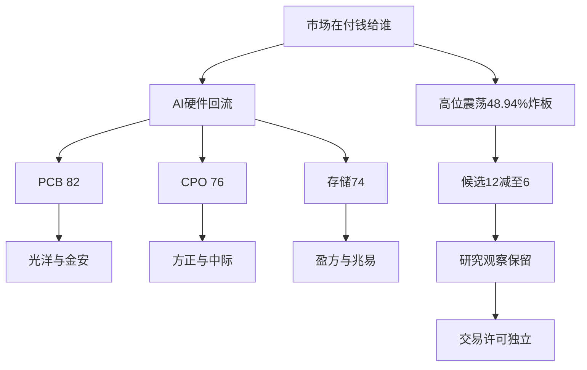

# 2026年10月29日 · 主线研判

> ⚠️ **数据源时间错位**
> 业务日为2026-10-29，价格/涨停/资金观测为2026-10-28最新已收盘市场，消息跨至29日盘前。本次是真实时钟下的盘前研究，不是回放。
> **情绪=震荡；降级=true；置信度=0.392。研究候选12→6；交易权限不变。**

## 🧭 一句话结论

观察PCB、CPO与存储回流；三者同属AI硬件簇，尚未确认可交易主线，执行不进。

## 📊 五维板块打分

|研究顺序|板块|热度|资金|涨停|叙事|共振|合计|态度|
|---|---|---:|---:|---:|---:|---:|---:|---|
|1|PCB概念|16|16|18|16|16|82|观察|
|2|共封装光学(CPO)|16|18|12|14|16|76|观察|
|3|存储芯片|20|16|8|12|18|74|观察|
|4|人形机器人|20|16|20|0|0|56|降级|

五维各20分，直接相加，不使用三维放大。资金分同时保留多日流出反证；叙事强度不把负面翻成正面。机器人连续第一仅计热度，不加共振。AI应用34分，不进主线。全20项涨停强度板块覆盖及剔除依据存于JSON。

## 🔍 详细分析

市场给的是科技硬件回流溢价，不是已经证成的连续主升：R1涨停72家，但炸板69家、四板断层，上一涨停群体收盘反馈均值仅2.33%。所以先认震荡，再研究地位；不把指数普涨当接力风险消失。

R3存储/CPO/PCB三条语义虽不同，共同依赖AI硬件需求。R7三个相关行业5日累计均负；单日净买与20日旧筹码退出可以同时成立。三条研究主线不是三个独立风险预算，更不是三条独立行情轮次。

R4新增微软/谷歌财报发生在昨日收盘后，不能用于解释昨日已经发生的涨幅。奥士康资本开支也不等于当前新增订单；海力士需求强与净利润环比弱要同时保留。正负消息不作简单净额抵消。

本次主模板仅为分歧接力研究。竞价尚未发生，打板/半路/低吸通道均未授权；高位龙头不能只因高就换成低位杂毛，也不能因容量资金强就自动升为身位龙头。

### PCB概念：82分，观察

主线 = PCB概念，持续性 = 1日（R7行业代理连续净流入，非行情年龄），封板率 = 75.0%，明日预期 = 分歧（相对上一收盘日指29日待验）。

- **大资金意图**: 单日净买体现回补/风险偏好修复假设，5日与20日流出说明还不能确认新增长期增配。
- **为什么走强**: 同花顺热度第6；9涨停、3炸板，宽概念封板率75%。 东财PCB概念主力净流入70.21421056亿元；R7印制电路板47.0233472亿元，口径不同不相加。
- **逻辑够不够硬**: R4奥士康项目规划在昨日收盘后披露，是今日待验证新增催化，不能解释昨日已发生涨幅；融资及审批约束同时保留。 当前价格与事件两族证据仍不足证明同轮连续主升。

|代码|名称|研究层级|板型|流通市值/亿元|RR|禁止清单|态度|
|---|---|---|---|---:|---|---|---|
|002708.SZ|光洋股份|龙头|三板连板|96.52|未核|未运行，非零风险|观察|
|002636.SZ|金安国纪|龙二|首板|424.92|未核|未运行，非零风险|观察|

#### 光洋股份：仅研究

- **买入理由**: 这是待核研究理由而非买入授权。①当前成分内非ST涨停高度最高，符合龙一高度top1；同高度按首封先后，剔除流通市值<20亿后排序；PCB成分同时为人形机器人最高身位，PCB主营纯度未核，不冒充PCB纯正总龙。②R4奥士康项目规划在昨日收盘后披露，是今日待验证新增催化，不能解释昨日已发生涨幅；融资及审批约束同时保留。

- **风险点**: ①炸板率48.94%下次日兑现压力；②R4正负极性及供货/盈利传导待证；板块成员身份不等于主营纯度。

- **止损条件**: 研究逻辑撤销条件为下一已完成交易日该同概念主力净额≤0且封板率低于本次基准75.0%；这不是订单止损价，真实止损与RR由D1另核。

- **可验证假设**: 从本次生成后至当日收盘，同概念主力净额>0且封板率≥75.0%才保留回流持续假设；否则降级。竞价/分时未发生，不补造买点。

#### 金安国纪：仅研究

- **买入理由**: 这是待核研究理由而非买入授权。①同题材首封09:25、两平台热股前十，综合辨识度龙二；不替换3板最高身位。②R4奥士康项目规划在昨日收盘后披露，是今日待验证新增催化，不能解释昨日已发生涨幅；融资及审批约束同时保留。

- **风险点**: ①炸板率48.94%下次日兑现压力；②R4正负极性及供货/盈利传导待证；板块成员身份不等于主营纯度。

- **止损条件**: 研究逻辑撤销条件为下一已完成交易日该同概念主力净额≤0且封板率低于本次基准75.0%；这不是订单止损价，真实止损与RR由D1另核。

- **可验证假设**: 从本次生成后至当日收盘，同概念主力净额>0且封板率≥75.0%才保留回流持续假设；否则降级。竞价/分时未发生，不补造买点。

### 共封装光学(CPO)：76分，观察

主线 = 共封装光学(CPO)，持续性 = 1日（R7行业代理连续净流入，非行情年龄），封板率 = 50.0%，明日预期 = 分歧（相对上一收盘日指29日待验）。

- **大资金意图**: 单日净买体现回补/风险偏好修复假设，5日与20日流出说明还不能确认新增长期增配。
- **为什么走强**: 同花顺热度3→5，绝对强但相对退位；4涨停、4炸板，封板率50%。 东财CPO概念主力净流入103.83385856亿元；R7通信器件净流入66.01956864亿元仅父级代理。
- **逻辑够不够硬**: 中际旭创单日主力31.97068亿元、5日29.72153808亿元，但20日-101.4408904亿元，不认定主升恢复。 当前价格与事件两族证据仍不足证明同轮连续主升。

|代码|名称|研究层级|板型|流通市值/亿元|RR|禁止清单|态度|
|---|---|---|---|---:|---|---|---|
|600601.SH|方正科技|龙头|首板|430.37|未核|未运行，非零风险|观察|
|300308.SZ|中际旭创|龙三|未核|7062.53|未核|未运行，非零风险|观察|

#### 方正科技：仅研究

- **买入理由**: 这是待核研究理由而非买入授权。①当前成分内非ST涨停高度最高，符合龙一高度top1；同高度按首封先后，剔除流通市值<20亿后排序。②中际旭创单日主力31.97068亿元、5日29.72153808亿元，但20日-101.4408904亿元，不认定主升恢复。

- **风险点**: ①炸板率48.94%下次日兑现压力；②R4正负极性及供货/盈利传导待证；板块成员身份不等于主营纯度。

- **止损条件**: 研究逻辑撤销条件为下一已完成交易日该同概念主力净额≤0且封板率低于本次基准50.0%；这不是订单止损价，真实止损与RR由D1另核。

- **可验证假设**: 从本次生成后至当日收盘，同概念主力净额>0且封板率≥50.0%才保留回流持续假设；否则降级。竞价/分时未发生，不补造买点。

#### 中际旭创：仅研究

- **买入理由**: 这是待核研究理由而非买入授权。①容量研究对象；缺板块全体5日资金排名与首封地位，不伪造龙二，filter_leader降级研究观察。②中际旭创单日主力31.97068亿元、5日29.72153808亿元，但20日-101.4408904亿元，不认定主升恢复。

- **风险点**: ①炸板率48.94%下次日兑现压力；②R4正负极性及供货/盈利传导待证；板块成员身份不等于主营纯度。

- **止损条件**: 研究逻辑撤销条件为下一已完成交易日该同概念主力净额≤0且封板率低于本次基准50.0%；这不是订单止损价，真实止损与RR由D1另核。

- **可验证假设**: 从本次生成后至当日收盘，同概念主力净额>0且封板率≥50.0%才保留回流持续假设；否则降级。竞价/分时未发生，不补造买点。

### 存储芯片：74分，观察

主线 = 存储芯片，持续性 = 1日（R7行业代理连续净流入，非行情年龄），封板率 = 50.0%，明日预期 = 分歧（相对上一收盘日指29日待验）。

- **大资金意图**: 单日净买体现回补/风险偏好修复假设，5日与20日流出说明还不能确认新增长期增配。
- **为什么走强**: 同花顺热度4→3；207当前成分仅2涨停、2炸板，封板率50%，不以芯片大板块9涨停冒充存储。 东财存储概念主力65.00922112亿元；R7半导体68.90792448亿元仅父级代理，不能重复加总。
- **逻辑够不够硬**: R3 L1+L2，海力士需求及长单与净利润环比下行并存；不采用群中单边大超预期措辞。 当前价格与事件两族证据仍不足证明同轮连续主升。

|代码|名称|研究层级|板型|流通市值/亿元|RR|禁止清单|态度|
|---|---|---|---|---:|---|---|---|
|000670.SZ|盈方微|龙头|首板|58.76|未核|未运行，非零风险|观察|
|603986.SH|兆易创新|龙三|未核|1944.28|未核|未运行，非零风险|观察|

#### 盈方微：仅研究

- **买入理由**: 这是待核研究理由而非买入授权。①当前成分内非ST涨停高度最高，符合龙一高度top1；同高度按首封先后，剔除流通市值<20亿后排序。②R3 L1+L2，海力士需求及长单与净利润环比下行并存；不采用群中单边大超预期措辞。

- **风险点**: ①炸板率48.94%下次日兑现压力；②R4正负极性及供货/盈利传导待证；板块成员身份不等于主营纯度。

- **止损条件**: 研究逻辑撤销条件为下一已完成交易日该同概念主力净额≤0且封板率低于本次基准50.0%；这不是订单止损价，真实止损与RR由D1另核。

- **可验证假设**: 从本次生成后至当日收盘，同概念主力净额>0且封板率≥50.0%才保留回流持续假设；否则降级。竞价/分时未发生，不补造买点。

#### 兆易创新：仅研究

- **买入理由**: 这是待核研究理由而非买入授权。①容量研究对象；缺板块全体5日资金排名与首封地位，不伪造龙二，filter_leader降级研究观察。②R3 L1+L2，海力士需求及长单与净利润环比下行并存；不采用群中单边大超预期措辞。

- **风险点**: ①炸板率48.94%下次日兑现压力；②R4正负极性及供货/盈利传导待证；板块成员身份不等于主营纯度。

- **止损条件**: 研究逻辑撤销条件为下一已完成交易日该同概念主力净额≤0且封板率低于本次基准50.0%；这不是订单止损价，真实止损与RR由D1另核。

- **可验证假设**: 从本次生成后至当日收盘，同概念主力净额>0且封板率≥50.0%才保留回流持续假设；否则降级。竞价/分时未发生，不补造买点。

## 🧪 历史证据裁决与时点作用域

唯一历史包run_id与本轮一致，但接收轮次不等于行情轮次。包内历史records为空，三份E1因字节预算不可回放。仅有一条2026-10-23反馈，缺稳定sector_id/round_id及有效窗口，因此disposition=unknown；不宣布采纳、不冒充冻结预测兑现、不把纠错经验当批准规则。该记录的完整evidence_id与包顶层context_sha256已写入JSON。

本次所有主线/次线显式含sector_id、round_id、event_at、valid_from、valid_until。板块ID来自实时TI成分请求；round_id均为null。event_at是R4记录的催化披露时点而非行情起点；研究窗口从实际生成到当日收盘，详见JSON的带时区时点与依据。不追溯补造首次可用或旧立场。

## 🔑 关键证据

- R1：72涨停、69炸板，炸板率48.94%，情绪震荡。
- R3：存储4→3、CPO3→5、PCB5→6，均为L1+L2；机器人霸榜仅拥挤警报。
- R4：八个底层事件正负拆分为十二条记录，不计十二个独立源。
- R7：半导体5日-42.24亿元、印制电路板5日-120.14亿元；不以单日净流入掩盖多日流出。
- 实时补查：20个涨停强度板块、516个概念资金、5570只日基本面、5个当前主题成分；样本与上游同底层，不新增独立事实族。

## 数据源审计

|源|日期|状态|备注|
|---|---|:--:|---|
|R1_style|2026-10-29|🟡|当前版本已解析，市场为28日；轮次不由风格推断|
|R3_sentiment|2026-10-29|🟡|当前版本已解析，五群正文观点非独立公告，图片未覆盖|
|R4_news|2026-10-29|🟡|当前版本已解析，硬事件已由R4核验，预告/窗口不完整|
|R7_capital_flow|2026-10-29|🟡|独立读取主输入；包内unavailable仅字节预算限制|
|Tushare实时补查|2026-10-29|🟢|U72/Z69；limit_cpt20；概念资金516；日基本面5570；五主题成分|
|hithink-sector-selector|2026-10-29|🟢|返回20项，不把HTTP成功等同全市场穷尽|
|WeFlow|2026-10-29|🔴|R3已降级，本轮不宣称可用|
|公众号及匿名群聊|2026-10-29|🟡|沿R3/R4有审计正文消费，不重算转发为独立源|
|主题锚及因子层|2026-10-29|🟡|锚元数据过期且不在唯一历史包，不参与分数/扩池；因子快照缺失|
|唯一E1历史包|2026-10-29|🟡|一条反馈作用域unknown，三份历史正文缺失|

## ⚠️ 不确定性 / 反证

人形TI成分交叉18封板而强度表为17，保留口径冲突；机器人宽概念与专属概念不能相加。CPO同属成分中的涨停票并不都是光模块主营，中际容量与方正首封地位也不可混同。光洋同时为PCB及机器人身位证据，不能据PCB标签抹去业务纯度缺口。

生命周期年龄缺证，模块依赖age_days，因此没有用零值伪跑formation；完整技能状态partial。六只票都缺RR、逐票禁止清单及完整龙头纪律，执行不进。R6是唯一hard_reject来源，本次不生成替代否决。

## 🔗 与其他 R/D/E 的关系

- 依赖：R1/R3/R4/R7四份当前主输入；只用指定历史包作待核经验。
- 被消费：R5逐票画像、R6反证、D1独立门禁及E1后续证伪；R2研究入池不等于交易计划批准。
- 保持：既有零预算、不交易决定、授权、保护与持仓计划均未更改。

## Sub-Agent 元数据

- skill: analyze_main_sectors_v1；filter_leader_v1已应用，容量候补降级保留。
- artifact: data/research/20261029/R2_main_sectors.json
- model: gpt-6.1-sol
- method: llm_v1，五维证据裁决；非旧规则三维放大。
- token usage: usage_unknown，不当作0，也不承诺低于努力目标。
- 交付目标为08:30，仅observe_only；不触发强杀、撤单或清池。
