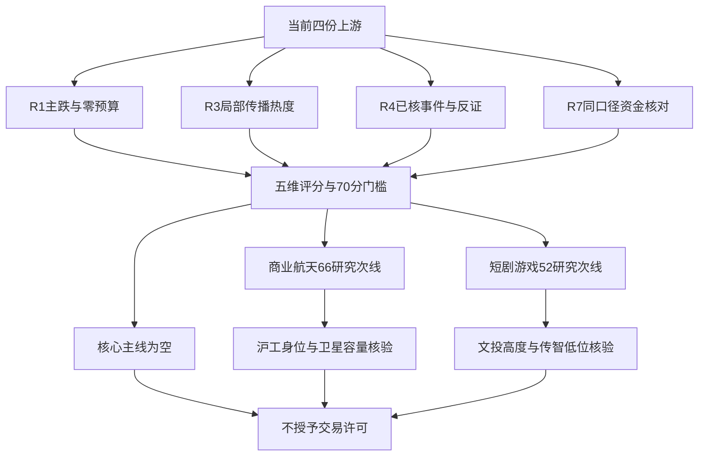

# 2026年10月30日 · 主线研判

> 数据源新鲜度：partial ｜ 降级：是 ｜ 置信度：0.359125

## 🧭 一句话结论

**观察：没有70分核心主线；商业航天66、短剧游戏52留研究，零交易预算不变。**

## 🌡️ 先认市场，再认个股

市场在为局部航天辨识度、少数短剧高度以及部分防守行业承接付钱，不是在为整个热门概念普涨付钱。R1的主线数量2只是“涨停家数≥8”的强度代理，本报告没有把代理直接改写成两条已确认可交易主线。

**情绪=主跌**：上一个交易日39涨停、41跌停、25炸板，炸板率为39.0625%。这是全市场统计，不是商业航天或短剧游戏的板块封板率。涨停全池次日反馈为负，主跌温度不允许把局部强股直接解释成广泛赚钱效应。

**阶段与轮次分开**：商业航天出现11只涨停，但10月19日、21日已有同概念强度记录。供应商当前days=1只说明其榜单计数，不证明一条新行情刚开始。缺实际启动催化和完整延续证据，两条观察方向的round_id、event_at均保留null；不因日期、run_id或阶段标签相同而沿用历史轮次。

今日主模板只选**首板隔日**，用于研究“新题材首板/二板能否持续”的假设，不与总龙锁仓、三格、树干、分歧接力拼接。各交易通道仍须依今日赚钱效应动态核验，当前未产生竞价或开盘证据，不预设具体通道。有效零交易预算、禁新仓及保护独立生效，正式研究提名从每方向最多5只减半为2只；源覆盖、反证、四只R4真实事件研究对象均不随之清空。

## 📊 五维板块打分

每维0—20、合计100；核心门槛70、次线门槛50，沿用既有排序规则。本轮分数是有来源约束的定性有序评分，不是收益概率或新增获批规则。未核维度按0保守评分，不把“未覆盖”写成“客观不存在”；负面催化不作为正面叙事加分。

| 方向 | 热度 | 资金 | 涨停 | 叙事 | 共振 | 总分 | 明确态度 |
|---|---:|---:|---:|---:|---:|---:|---|
| 商业航天 | 20 | 4 | 20 | 8 | 14 | **66** | 观察，仅次线 |
| 短剧游戏 | 12 | 2 | 16 | 8 | 14 | **52** | 观察，仅次线 |
| 卫星导航 | 8 | 10 | 16 | 4 | 4 | 42 | 不进主次线，重叠核验 |
| 海工装备 | 6 | 2 | 16 | 18 | 0 | 42 | 不进主次线，保留复牌事件核验 |
| 机器人概念 | 16 | 0 | 18 | 0 | 0 | 34 | 不进，资金显著流出 |
| 军工 | 10 | 6 | 14 | 2 | 2 | 34 | 不进，不能用行业资金覆盖整个概念 |

### 🛰️ 商业航天：注意力第一，概念资金没有确认

稳定板块ID为`886078.TI`，资金对照ID为`BK0963.DC`。热榜第一与11只涨停，配合上海沪工2板、中国卫星首板，构成最强研究线索。但东财商业航天概念当日净流出**18.99亿元**、5日净流出**123.45亿元**；问财同花顺概念当日净流出约46.02亿元。两家概念样本不同，数值不做简单拼接，但流出方向一致。

- **大资金意图**: 局部资金选择卫星制造等窄方向抗跌，是可检验解释而非已知机构动机。R7航天装备Ⅲ当日净流入10.00亿元、5日净流入10.92亿元，只代表该窄行业，不能替代商业航天整个概念的资金字段。
- **为什么走强**: 热榜关注与11只涨停共同说明局部结构强，沪工2板提供身位、卫星双榜提供容量辨识度；但概念整体跌2.21%，不能写成全板块普涨。
- **逻辑够不够硬**: 不够升核心。R3有L1+L2传播共振；R4没有该概念的已核正面启动催化，R7前十无同名概念。严格同范围交叉分为0.33，而非把相关行业算进去凑0.67。原始项目、订单及持续性均需补核。

结论：**商业航天=研究次线；持续性=null，板块封板率=null，下个交易时段预期=分歧。** 1/3/5日持续性缺证，不填任意档位。研究窗口从本报告实际生成开始，到本交易日收盘复核；这不是行情起点、旧立场或事前冻结预测。

### 🎬 短剧游戏：有局部梯队，无全板块资金接力

稳定板块ID为`886060.TI`，资金对照为`BK1151.DC`短剧互动游戏，二者是跨源概念映射，不宣称成分完全一致。概念热榜13，当前成分涨停集合可核文投控股、传智教育、横店影视、祥源文旅四只；该数量由成分与涨停对象交叉，不套用手机游戏或网络游戏的四只统计。

- **大资金意图**: 可能是低相关内容题材的局部轮动，但当日概念净流出15.95亿元，不能把题材传播直接写成机构增配。5日微流入0.29亿元不足证明连续净流入。
- **为什么走强**: 文投3板形成身位、传智较早首封且零开板提供低位助攻；R3记录互动道具内测相关讨论，但概念本身跌2.00%，多数对象并未获得正反馈。
- **逻辑够不够硬**: 尚不够。内测、股权或合作说法需公司/平台原文验证，不把群聊复读计为独立来源；文投当日龙虎榜净卖出1.05亿元与6次开板构成反证。R4的广电终止算力项目是特定对象风险，不能倒推整个短剧行业利空，也不能拿它为短剧正向叙事加分。

结论：**短剧游戏=研究次线；持续性=null，板块封板率=null，下个交易时段预期=分歧。** 文投3板不是主跌后新题材首二板试错资格，研究身位保留，交易资格不授予。

## 🗺️ 研究与授权分层

## 🔎 四只正式研究提名：不是买入名单

| 方向 | 研究层级 | 标的 | 客观板型 | 流通市值/亿元 | RR | 执行 |
|---|---|---|---|---:|---|---|
| 商业航天 | 龙头 | 603131 上海沪工 | 2连板、0开板 | 53.74 | 未验证 | 不进 |
| 商业航天 | 龙二/容量 | 600118 中国卫星 | 首板、8开板 | 661.01 | 未验证 | 不进 |
| 短剧游戏 | 龙头 | 600715 文投控股 | 3连板、6开板 | 64.98 | 未验证 | 不进 |
| 短剧游戏 | 龙二/低位 | 003032 传智教育 | 首板、0开板 | 25.75 | 未验证 | 不进 |

所有票均明确给出板型、龙头依据、RR与禁止清单核验状态。禁止清单hits为空不表示通过：完整14项、近30日席位、全成分五日资金排名及换手中位数均未完成，统一降级watch。R2不虚构入场价、目标价、数值止损或仓位；R5/D1必须重新推导RR与止损距离，RR≥2及其他门禁未过不得进执行。

### 上海沪工：身位龙头，只进研究

- **买入理由**: 此处仅陈述研究多头假设而非买入指令。第一，在线同花顺成分确认其航天关联，2连板在当前成分涨停集合中高度领先；第二，零开板与DC人气由37升至9，支持研究其是否成为新一轮合力锚。龙头认定已确认1项硬过滤条件，但未完成全套交易资格。
- **风险点**: 第一，主跌里二板升三板可能转入中位接力；第二，焊接与卫星业务收入敞口未深核，行业标签不等于订单；龙虎榜该条是三日异动统计，净买入约0.12亿元不能写成今日独立单日流入。
- **止损条件**: 这里只定义研究证伪：后续可交易时段若失去该涨停组内身位且同口径概念资金仍流出，取消优先研究层级。不是自动卖出或价格止损；R2不越权给具体价位。
- **可验证假设**: 后续1—3个交易日，商业航天概念主力净额须出现正值且至少2只首板/二板封住，才能重评；未满足则不升级核心。今日竞价尚未发生，不预判已弱转强。

### 中国卫星：容量助攻，不抢高度龙主位

- **买入理由**: 第一，在线资料确认宇航制造与卫星应用关联；第二，THS14/DC3及R7个股当日净流入6.64亿元、5日6.40亿元使其成为容量研究对象。其综合辨识度高，但首板低于沪工2板，不能因容量资金强将其升龙一；也不虚称其首封时序第二。
- **风险点**: 第一，首板8次开板、封板偏晚说明抛压尚在；第二，单股资金为正不代表大概念资金转正，问财/东财/传统大单资金值口径不同，不做累加。
- **止损条件**: 若下个可交易时段容量承接失去、同时商业航天同口径资金继续净流出，则取消“容量助攻可持续”研究假设。价格保护仍由D1确定，不因本报告自动调仓。
- **可验证假设**: 后续1—3个交易日，检查沪工的身位与卫星的容量是否联动，而非容量单票独强；概念净额>0且至少2只新首二板封住前不升级。

### 文投控股：高度身份保留，接力资格降级

- **买入理由**: 第一，在线成分确认短剧游戏关联；第二，3连板为当前概念涨停集合最高、DC人气从19升至11，适合验证内容题材接力。供应商4/7是7日4次涨停，不是4连板；高度硬条件满足1项不代表开仓资格完成。
- **风险点**: 第一，3板已超出当前新题材首二板研究试错重点；第二，6次开板与龙虎榜当日净卖出约1.05亿元，加上内测收入未实锤，对T+1接力构成双重反证。
- **止损条件**: 若平台/公司材料否认相关商业化叙事，或后续身位失去且概念净流出持续，取消研究优先级。这是逻辑撤销条件，非R6硬否决或执行卖单。
- **可验证假设**: 后续1—3个交易日须看到至少2只该概念首二板有效助攻和同口径资金转正；若只剩高位高度股孤立，则不做接力。

### 传智教育：低位助攻，但小市值与业务映射需核

- **买入理由**: 第一，同花顺最新成分及静态锚TOP3均包含该票，但锚不额外加分；第二，当前首板零开板、首封早于横店影视与祥源文旅，按身位/封板次序列研究龙二，不是因为便宜才补位。
- **风险点**: 第一，流通市值25.75亿元在20—50亿元谨慎区，不能直接按安全容量票处理；第二，教育主业与短剧变现关联未实核，行业标签、历史最大连板均不能替代今日订单或资金共识。
- **止损条件**: 若R5核验确认相关业务映射不成立，或下一个可交易时段低位助攻不持续且概念继续流出，取消研究层级。不得为凑RR人为放大目标价。
- **可验证假设**: 后续1—3个交易日核验平台/公司公开材料中的实质业务关联，同时检查概念资金>0与至少2只新首二板封住；两类证据缺一不升级。

## 🧩 覆盖、剔除与真实事件假设

商业航天静态心智锚TOP3为金螳螂、中京电子、魅视科技；短剧游戏为天娱数科、欢瑞世纪、传智教育。该表更新于10月20日，已超过每周维护周期，六条均保留在JSON核验覆盖中。没有已确认核心主线，故不触发“核心主线锚TOP3默认提名”的条件；不让旧静态锚挤掉今日涨停身位，也不以过旧锚证明同一轮行情。

本轮仅就题材前排排序，将襄阳轴承、小崧股份列为非目标前排的“杂毛”剔除留痕，并非永久股性评价。襄阳连续榜首不得加共振分，两资金口径不一致，R3没有证明已发生机构出货，R2不宣告hard_reject；小崧在线问财实际下跌且无连板，群聊“低位”口号不构成替代龙头的理由。四项杂毛量化条件≥2的硬触发并未完整核验，不冒充规则通过。横店影视首板较晚，为龙三覆盖记录，正式提名减半后不自动替补。

R4的普冉股份、三花智控、博盈特焊、上海洗霸仍全部保留为真实研究假设交给R5，不因核心为空或零预算消失。普冉的扣非与并表基数、三花的液冷供应身份、博盈的收购审批与停牌前旧价、洗霸的Q3扣非亏损和低业务敞口各自独立核验。海工装备得分42未进次线，不能凭博盈复牌单事件变成整板块主线。300/688与主板同权，920执行限制保留。

## 🧾 唯一历史包与轮次裁决

已核包run_id=`20261030T061042-77225-17596`与本次指定值一致，且按仓库canonical JSON算法复算顶层sha256一致。该包history为unreplayable，records=0、scopes=0、market_feedback=0，没有可逐项裁决的evidence_id，因此`history_adjudications=[]`。包级disposition明确为unknown；不虚构历史记录ID填充数组，也不把本报告自述当成独立工具读取收据。

E1的sector_postmortem、logic_corrections在该包没有正文可核。不能称兑现、已批准规则或同sector同round延续；所有历史作用仅限待核假设，不改评分规则、预算、授权或保护。本轮两个secondary_lines完整对象均显式提供sector_id/round_id/event_at/valid_from/valid_until；后两者仅界定这次研究的前向复核窗口。缺历史不清研究，不回填旧首次可用时间或旧立场。

## 🧪 不确定性 / 反证

最强反证不是热度不足，而是广度与概念资金背离：航天11板却概念整体下跌、概念五日净流出巨大；短剧有高度却当日资金流出。R7窄行业流入是有价值的修复线索，不能偷换为大概念趋势确认。持续性、全成分触板封住分母、实际行情起点都缺证，所以不填1/3/5日、不报假封板率、也不授予可交易主线。

问财组合问句被服务端自动附加“主力资金流向>0”，且首屏实际100条却声明206；补取第2/3页仍有大量重叠。这是语义与分页质量问题，不能用来判断某只票“不存在”、全概念资金排名或完整覆盖206只。主排序使用在线涨停数据与三概念成分核验，问财仅交叉单股事实。主题锚过旧、因子快照缺失、R3远端同步及图像映射降级均已记入机读缺口。

旧的交叉验证检查器把main_lines为空直接判失败，与现行“无合格核心允许空池”约束不兼容。本报告不为过旧检查器把66分硬抬70或虚构核心；将实际检查结果与允许空核心的Pydantic/语义校验分开记录，资料状态保持partial。

## 🔗 与其他 R/D/E 的关系

- 依赖：当前R1_style.json、R3_sentiment.json、R4_news.json、R7_capital_flow.json；四份精确版本哈希在机读inputs中。
- 被消费：R5继续对四只正式研究对象与四条R4真实事件假设画像；R6独立完整反证，保留唯一hard_reject权；D1不得把secondary或研究龙头身份当作交易许可。
- 交叉结果：没有核心主线，也没有三源以上同范围共识主题；两个研究次线各为0.33。单源/同底层多接口不得增加agreement_count。

## 🔬 关键证据

- R1当前市场指标：39涨停、25炸板、41跌停，主跌，零交易预算。
- 本轮在线limit_cpt_list：商业航天11只、机器人8只、卫星导航7只，概念可重叠，不相加当全市场唯一股票数。
- 本轮在线moneyflow_ind_dc：商业航天概念当日-18.99亿元，5日-123.45亿元；短剧互动游戏当日-15.95亿元，5日+0.29亿元。
- R7当前资金报告：航天装备Ⅲ当日+10.00亿元、5日+10.92亿元，窄行业口径单列。
- 本轮逐票daily_basic：流通市值单位为万元，统一除10000得亿元；没有因300/688前缀降级。

## 📚 完整来源标签评分覆盖

下表包含跨源别名和嵌套行业，不能当作彼此独立的59条赛道；核心/次线仅以前述唯一对象为准。

| 来源方向标签 | 热度 | 资金 | 涨停 | 叙事 | 共振 | 合计 | 态度 |
|---|---:|---:|---:|---:|---:|---:|---|
| 商业航天 | 20 | 4 | 20 | 8 | 14 | 66 | 观察 |
| 短剧游戏 | 12 | 2 | 16 | 8 | 14 | 52 | 观察 |
| 卫星导航 | 8 | 10 | 16 | 4 | 4 | 42 | 不进 |
| 海工装备 | 6 | 2 | 16 | 18 | 0 | 42 | 不进 |
| 军工 | 10 | 6 | 14 | 2 | 2 | 34 | 不进 |
| 机器人概念 | 16 | 0 | 18 | 0 | 0 | 34 | 不进 |
| 证金持股 | 8 | 18 | 0 | 0 | 0 | 26 | 不进 |
| 风电 | 4 | 8 | 12 | 0 | 0 | 24 | 不进 |
| 高股息精选 | 12 | 12 | 0 | 0 | 0 | 24 | 不进 |
| 存储芯片 | 14 | 0 | 0 | 8 | 0 | 22 | 不进 |
| CPO光模块 | 18 | 0 | 0 | 0 | 0 | 18 | 不进 |
| 人形机器人 | 18 | 0 | 0 | 0 | 0 | 18 | 不进 |
| 共封装光学(CPO) | 18 | 0 | 0 | 0 | 0 | 18 | 不进 |
| 并购重组 | 0 | 0 | 0 | 18 | 0 | 18 | 不进 |
| 创新药 | 16 | 0 | 0 | 0 | 0 | 16 | 不进 |
| 一带一路 | 0 | 0 | 14 | 0 | 0 | 14 | 不进 |
| 保险Ⅲ | 0 | 14 | 0 | 0 | 0 | 14 | 不进 |
| 军工电子Ⅲ | 0 | 14 | 0 | 0 | 0 | 14 | 不进 |
| 国产算力 | 0 | 0 | 0 | 14 | 0 | 14 | 不进 |
| 国有大型银行Ⅲ | 0 | 14 | 0 | 0 | 0 | 14 | 不进 |
| 国防军工 | 0 | 14 | 0 | 0 | 0 | 14 | 不进 |
| 炼油化工 | 0 | 14 | 0 | 0 | 0 | 14 | 不进 |
| 白酒Ⅲ | 0 | 14 | 0 | 0 | 0 | 14 | 不进 |
| 航天装备Ⅲ | 0 | 14 | 0 | 0 | 0 | 14 | 不进 |
| 风电设备 | 0 | 14 | 0 | 0 | 0 | 14 | 不进 |
| 风电零部件 | 0 | 14 | 0 | 0 | 0 | 14 | 不进 |
| 食品饮料 | 0 | 14 | 0 | 0 | 0 | 14 | 不进 |
| PCB概念 | 12 | 0 | 0 | 0 | 0 | 12 | 不进 |
| 光伏钙钛矿 | 0 | 0 | 0 | 12 | 0 | 12 | 不进 |
| 固态电池 | 0 | 0 | 0 | 12 | 0 | 12 | 不进 |
| 新能源汽车 | 0 | 0 | 12 | 0 | 0 | 12 | 不进 |
| 智能电网 | 0 | 0 | 0 | 12 | 0 | 12 | 不进 |
| 液流储能 | 0 | 0 | 0 | 12 | 0 | 12 | 不进 |
| 人工智能 | 11 | 0 | 0 | 0 | 0 | 11 | 不进 |
| AI应用 | 10 | 0 | 0 | 0 | 0 | 10 | 不进 |
| 低空经济 | 0 | 0 | 10 | 0 | 0 | 10 | 不进 |
| 冷链物流 | 0 | 0 | 10 | 0 | 0 | 10 | 不进 |
| 比亚迪概念 | 0 | 0 | 10 | 0 | 0 | 10 | 不进 |
| 氢能源 | 0 | 0 | 10 | 0 | 0 | 10 | 不进 |
| 绿色电力 | 0 | 0 | 10 | 0 | 0 | 10 | 不进 |
| 高端装备 | 0 | 0 | 10 | 0 | 0 | 10 | 不进 |
| IP经济(谷子经济) | 0 | 0 | 8 | 0 | 0 | 8 | 不进 |
| 三胎概念 | 0 | 0 | 8 | 0 | 0 | 8 | 不进 |
| 乡村振兴 | 0 | 0 | 8 | 0 | 0 | 8 | 不进 |
| 冰雪产业 | 8 | 0 | 0 | 0 | 0 | 8 | 不进 |
| 手机游戏 | 0 | 0 | 8 | 0 | 0 | 8 | 不进 |
| 核电 | 0 | 0 | 8 | 0 | 0 | 8 | 不进 |
| 网络游戏 | 0 | 0 | 8 | 0 | 0 | 8 | 不进 |
| AI算力 | 0 | 0 | 0 | 6 | 0 | 6 | 不进 |
| 液冷散热 | 0 | 0 | 0 | 6 | 0 | 6 | 不进 |
| 猪肉 | 5 | 0 | 0 | 0 | 0 | 5 | 不进 |
| 减速器 | 4 | 0 | 0 | 0 | 0 | 4 | 不进 |
| ST板块 | 3 | 0 | 0 | 0 | 0 | 3 | 不进 |
| 国企改革 | 2 | 0 | 0 | 0 | 0 | 2 | 不进 |
| 白酒概念 | 2 | 0 | 0 | 0 | 0 | 2 | 不进 |
| 化工出口 | 0 | 0 | 0 | 0 | 0 | 0 | 不进 |
| 广电传媒 | 0 | 0 | 0 | 0 | 0 | 0 | 不进 |
| 汽车出口 | 0 | 0 | 0 | 0 | 0 | 0 | 不进 |
| 算力租赁 | 0 | 0 | 0 | 0 | 0 | 0 | 不进 |

## 数据源审计

| 源 | 日期 | 状态 | 记录数 | 说明 |
|---|---|:--:|---:|---|
| R1 | 2026-10-30 | 🟢 | 1 | 当前主要输入，完整JSON已解析并锁定哈希；源结论降级不抹去其可用字段 |
| R3 | 2026-10-30 | 🟢 | 1 | 当前主要输入，完整JSON已解析并锁定哈希；源结论降级不抹去其可用字段 |
| R4 | 2026-10-30 | 🟢 | 1 | 当前主要输入，完整JSON已解析并锁定哈希；源结论降级不抹去其可用字段 |
| R7 | 2026-10-30 | 🟢 | 1 | 当前主要输入，完整JSON已解析并锁定哈希；源结论降级不抹去其可用字段 |
| tushare.limit_cpt_list | 2026-10-30 | 🟢 | 20 | 本轮在线，观察日20261029；航天追加回看返回3条，短剧回看为空；不是实际轮次年龄 |
| tushare.moneyflow_ind_dc | 2026-10-30 | 🟢 | 516 | 本轮在线概念516条；商业航天/短剧各5日数据单独请求。rank为供应商字段未直接当全市场唯一名次 |
| tushare.ths_hot | 2026-10-30 | 🟢 | 20 | 本轮在线概念榜，观察日20261029；并以R3两平台个股榜交叉 |
| tushare.ths_member | 2026-10-30 | 🟢 | 未独立计数 | 本轮在线商业航天/短剧游戏/海工三概念；未给有程序复核的总行数，不声称全历史成分冻结 |
| tushare.limit_list_d | 2026-10-30 | 🟢 | 64 | 本轮在线U39/Z25；与R7当前原始证据一致，市场封板率不冒充板块封板率 |
| tushare.daily_basic | 2026-10-30 | 🟢 | 4 | 4只正式研究对象逐票在线；circ_mv万元转亿元 |
| tushare.top_list | 2026-10-30 | 🟢 | 2 | 文投当日榜单及沪工三日异动榜；保留统计窗口区别，不算两次单日买入 |
| hithink-sector-selector | 2026-10-30 | 🟢 | 20 | 本轮官方API；与THS概念资金同底层，不额外算独立源 |
| hithink-market-query | 2026-10-30 | 🟡 | 未独立计数 | 本轮在线，但问句自动附资金>0筛选，分页重叠；只用已核单股字段，不声称完整206只或资金排名 |
| wechat_official_20 | 2026-10-30 | 🟢 | 未独立计数 | 通过当前R4/R3读取观点来源，未另开历史读取；不把转载当独立催化 |
| wechat_cli_5groups | 2026-10-30 | 🟡 | 未独立计数 | R3远端同步/图像映射有缺口，引用匿名观点，不冒充R2直接重抓 |
| theme_anchors | 2026-10-20 | 🟡 | 6 | 10月20日静态锚，已核两主题各TOP3，非今日资金/轮次证据 |
| factor_snapshot | 2026-10-30 | 🔴 | 0 | 目录缺失，因子层降级 |
| history_context | 2026-10-29 | 🟡 | 0 | run与canonical digest一致；history不可重放且无任何evidence_id，不构成独立读取收据 |

审计表日期表示本轮获取/引用日；市场观察日另明确为10月29日，不能把10月30日获取写成10月30日已交易行情。上游文件存在不等于源完全健康；四份上游都不是complete。公众号/匿名群聊仅通过当前R3/R4消费，未宣称R2直接远端同步成功。未另读任何可选历史报告。

## ⚙️ Sub-Agent 元数据

- skill：analyze_main_sectors_v1；同会话完成filter_leader_v1，未启动另一模型会话。
- model：gpt-6.1-sol。
- artifact：data/research/20261030/R2_main_sectors.json。
- evidence：data/research/20261030/R2_scoring_evidence.json。
- schema：data/research/20261030/R2_main_sectors.schema.json。
- 状态：partial，研究交付不等于资料完整，不等于交易放行。
- 实际盘前在线研究，非回放，未声称事前冻结预测；各源观察窗口分别披露。
- token使用未计量，不能当0，也不保证低于努力目标；交付目标是观察性目标，不强杀或清池。
