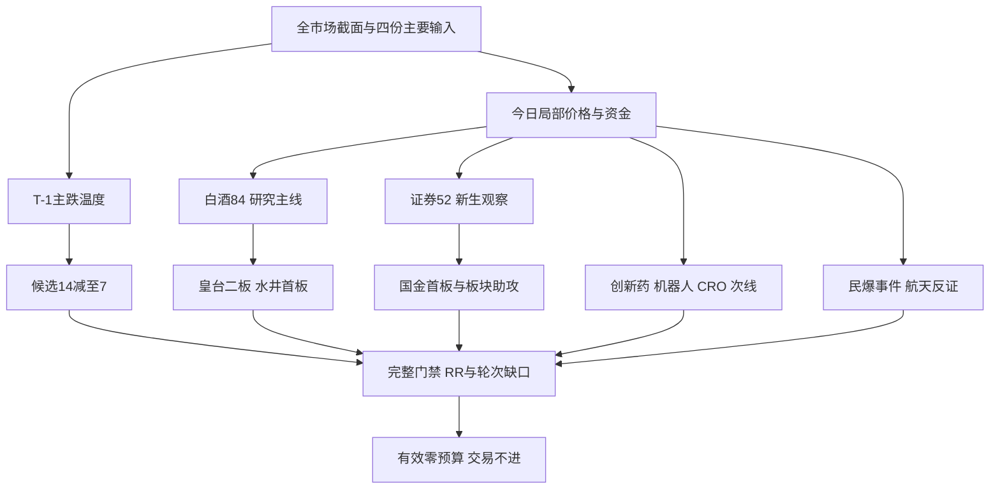

# 2026年11月2日 · 主线研判

> **数据源新鲜度**：partial；T-1收盘基准与今日盘中证据分列。
> **降级状态**：true；**置信度**：0.392，不是预测胜率。
> **交易态度**：不进。研究观察继续，不清研究池，不改有效零交易预算。

## 一句话结论
白酒是局部研究主线；证券出现新首板，科技热度未获资金确认；零预算下全部不进。

## 🧭 详细分析：先认市场，再认个股

市场在为什么付钱？现有证据偏向消费延续与金融低位修复，而不是科技卖方声音最大的方向。10月30日全市场上涨893家、下跌4602家，47家涨停与82家跌停并存；炸板率为31÷78＝39.74%，情绪明确标为**主跌**。昨日涨停池在次日的收盘平均反馈为-0.68%，不能拿开盘正溢价当成接力兑现。

本报告不是盘前预测，也不是冻结输入回放。会话首个可核本地时钟为09:52；引用的实时股票报价约10:01，问财数据只明确业务日期而非逐笔精确时刻。08:30交付目标已经逾时，但迟交不会触发撤单、清研究池、强制结束或恢复买权。R1所判主跌仍是10月30日温度，不能用今日两条局部红盘方向替代全市场周期复核。

主线 = **白酒概念（研究层）**，持续性 = **1日可核涨停潮**，封板率 = **100%（T-1现成分交集5/5）**，明日预期 = **分歧**。这里的1日不是行情真实首次启动年龄，100%也不是今日封板率；今日完整触板、炸板全集缺失，今日封板率保留未知。白酒概念周五净额+26.09亿元，已完成交易日连续净流入2日；R7白酒行业+25.00亿元与概念口径不同，不可相加。

五维各0—20分、总分100分仅用于研究比较，保留热度、资金、涨停、叙事、共振五个维度，不使用三维放大，也不新增历史反馈扣分规则。白酒84分达研究主线门槛；创新药68分、机器人54分、证券52分、CRO50分留作次线。民爆38分只保留公告事件观察，航天36分留覆盖与反证，不用弱方向填满三条主线。

谁有地位？当前白酒已返回封板样本中，皇台酒业二板且09:30首封，水井坊首板09:38封板。证券两个首板样本中国金证券先于太平洋封板。板块选择后再按身位和首封排序，不以资金额大小取代辨识度。主模板只选**首板隔日**供研究字段取权，通道未启用；不把总龙锁仓、低吸与补涨五套拼在一起。今日研究做前排核验、不做计划外开仓；有效交易预算依旧为0。

## 📊 五维板块打分

| 对象 | 稳定板块ID | 热度 | 资金 | 涨停 | 叙事 | 共振 | 总分 | 态度 |
|---|---|---:|---:|---:|---:|---:|---:|---|
| 白酒概念 | `885525.TI` | 20 | 20 | 18 | 10 | 16 | 84 | 观察·研究主线 |
| 创新药 | `886015.TI` | 20 | 12 | 12 | 18 | 6 | 68 | 降级·次线观察 |
| 机器人概念 | `885517.TI` | 12 | 0 | 18 | 8 | 16 | 54 | 降级·次线观察 |
| 证券 | `881157.TI` | 0 | 20 | 12 | 16 | 4 | 52 | 降级·次线观察 |
| CRO概念 | `885927.TI` | 12 | 8 | 14 | 10 | 6 | 50 | 降级·次线观察 |
| 民爆概念 | `885960.TI` | 0 | 4 | 8 | 18 | 8 | 38 | 观察·事件专案 |
| 商业航天 | `886078.TI` | 20 | 0 | 16 | 0 | 0 | 36 | 不进主次线 |

资金维度区分“昨天有净流入”和“今天仍在流入”。CRO盘中净流出6.53亿元、指数-2.01%，因此不能沿用周五的资金确认；证券盘中净额+21.35亿元、指数+2.80%，但R3正式主题与R7昨日前十都未匹配，尚不包装为四源共识。机器人零资金分来自可核的负净额，不是因为它属于科技，也不是把热度等同派发。

## 🌳 研究路径与授权边界

## 🔍 各方向因果与反证

### 白酒概念：五维84为局部研究主线，不等于可交易主线；T-1涨停潮与今日两只封板/正资金方向一致，催化为配置假设而非行业业绩反转。

- **大资金意图**: 可能在流动性收缩后从高波动资产移向消费；东财概念正净额、同花顺盘中正净额支持方向，但不证明具体机构身份。
- **为什么走强**: 周五5只概念成分涨停，今日皇台二板、水井首板；行业与概念的不同涨幅都必须保留口径。
- **逻辑够不够硬**: 两套底层市场数据方向一致，R3仅一份消费防御纪要、R4稳市场为间接映射；没有白酒专属业绩拐点证据，次日扩散失败即可证伪。

### 创新药：68分降级观察：临床硬事件只支持益方生物，不把单公司成功外推成行业资金趋势。

- **大资金意图**: 临床里程碑可能吸引事件资金，但目前不能用医药母行业净流入替代创新药完整成分的净买入。
- **为什么走强**: 热榜第二与益方三期主要终点形成事件锚；益方实际由13.32回落至12.25、低于昨收，说明利好不等于获承接。
- **逻辑够不够硬**: 公司公告为硬事件，但明确不对当期业绩产生重大影响；获批、商业化和收益兑现都未被证明。

### 机器人概念：54分降级：7只T-1涨停不抵消12只炸板及概念-102.4467亿净流出；R3人形/机器人大脑观点仅叙事，不代表量产或机构净买。

- **大资金意图**: 观点层在博弈物理AI与机器人数据价值；实际东财机器人概念T-1净流出102.45亿元，不证明机构已下注叙事。
- **为什么走强**: 走强的是注意力而非板块；7只涨停同时有12只炸板，现成员交集封板率36.84%，上海沪工今日冲板回落。
- **逻辑够不够硬**: 两份署名观点不等于两份产业事实；量产、模型发布与供应商身份尚未由R4确认，不拿消息条数抵销负反馈。

### 证券：52分观察：T0证券+2.7953%、+21.3477亿、两首板是新生资金方向；热榜无直接行业记录，热度记0而非拿涨幅充热度。

- **大资金意图**: 可能交易稳市场工具预期，也可能只是风险对冲；盘中21.35亿元正净额与两个首板提供新生方向证据。
- **为什么走强**: 国金09:34先封、太平洋09:50跟随，行业同步上涨；不是仅凭一只容量股红盘推主线。
- **逻辑够不够硬**: 拟开会与意向回购贷款额度有R4来源，但额度不等于已投放。R3/R7昨日交叉不足，需继续核验首板溢价与资金持续。

### CRO概念：50分观察：T-1概念资金+18.7152亿与行业连续5日流入有支撑，但今日同花顺CRO-2.0069%、资金-6.5261亿形成反证；不沿用昨日强势为今日确认。

- **大资金意图**: T-1资金曾偏向研发外包；今日资金反向，可能是兑现而非持续配置，不能写成已证实主力撤退全行业。
- **为什么走强**: T-1现成分交集3涨停1炸板、行业连续5日净流入；T0概念下跌和负净额是相反证据。
- **逻辑够不够硬**: 益方临床向CRO只是低权重间接映射；东方海洋主业与概念纯度待R5核实，单票封板不能证明行业主线。

### 民爆概念：38分不列主/次线，但保留具体重组研究对象；个股一字不等于板块已扩散，今日板块-0.201%、净流入仅0.0203亿。

- **大资金意图**: 可能重估高争矿业注入资产结构；这种资金假设只针对已公告方案，不外推所有民爆企业都要注矿。
- **为什么走强**: 高争复牌一字；民爆概念却小跌、净额仅约203万元，个股与板块传播并未闭环。
- **逻辑够不够硬**: 复牌及股权比例已由公告核实，但交易价格、审计评估与审批均未完成；一字板不可直接视作可买入机会。

### 商业航天：36分不进主/次线：热榜第一保留热度20，不机械等同派发；无已核新增催化与R3正向共振，T-1-55.2881亿、今日-8.8963亿均不支持确认。

- **大资金意图**: 热榜注意力仍高，但T-1及本次盘中资金都负；没有席位证据，不能直接称为集体出货。
- **为什么走强**: 局部高度票仍在，板块净额与价格却偏弱；涨停最强榜6家与当前成分交集5家不一致，不能混分母。
- **逻辑够不够硬**: R3霸榜警报只是风险代理，不自动一票否决；无新增已核催化与资金持续共同支持，维持弱方向覆盖。

## 🧾 轮次、事件与有效窗口

| 对象 | 轮次ID | 事件时点依据 | 本次研究窗口 |
|---|---|---|---|
| 白酒 | null | 启动催化及真实首次扩散时点缺证，event_at=null | 本次生成后至今日15:00 |
| 创新药 | null | R4临床公告摘要首次已知：11月1日15:47（CST） | 本次生成后至今日15:00 |
| CRO | null | 不把单公司临床事件直接当行业启动，event_at=null | 本次生成后至今日15:00 |
| 机器人 | null | 卖方观点不能定位行情首次启动，event_at=null | 本次生成后至今日15:00 |
| 证券 | null | R4拟召开会议摘要：11月1日15:15（CST），不证明行情首次启动 | 本次生成后至今日15:00 |
| 民爆事件 | null | R4具体资产预案披露：11月1日15:34（CST）；此前已有筹划 | 本次生成后至今日15:00 |
| 航天 | null | 多次上榜不证明同一轮次，event_at=null | 本次生成后至今日15:00 |

机读文件每个完整对象均有sector_id、round_id、event_at、valid_from、valid_until，时点为带时区ISO；这里仅展示日期与分钟。全部轮次保留null，不沿用历史日期、run_id或阶段替代真实行情轮次。有效窗口是本次新增的复核声明，不追溯补造旧首次可用时点或旧立场。

生命周期函数已实际调用：若把“观察到1日涨停潮”当作真实年龄1日、资金持续2日，会返回early_up；但真实启动年龄并未证明，因此该输出只存为条件敏感性，白酒维持形成期研究假设而不据此确认主升。机器人榜单days=15也不能直接当真实轮次年龄。

## 👤 七只研究观察对象

炸板率达到39.74%，14个有来源提名减至7个，白酒保留2个前排，不为达到常态3—5只而造票。无执行池，R5仍能对真实对象画像。以下“买入理由”为研究入池理由，不是下单依据；“止损条件”为研究逻辑撤销条件，R2不制定价格止损。

| 股票 | 研究地位 | 板型 | 流通市值亿元 | RR / 止损距 | 禁止项 | 态度 |
|---|---|---|---:|---|---|---|
| 皇台酒业 `000995.SZ` | 龙头 | 换手二板（盘中） | 27.68 | 未核 / 未核 | 计划外 | 观察、不进 |
| 水井坊 `600779.SH` | 龙二 | 换手首板（盘中） | 137.05 | 未核 / 未核 | 计划外 | 观察、不进 |
| 益方生物 `688382.SH` | 未认定龙头·事件映射 | 非涨停；临床事件冲高回落 | 71.81 | 未核 / 未核 | 计划外 | 观察、不进 |
| 东方海洋 `002086.SZ` | 龙头 | T-1二板，今日触板（未确认三板） | 44.74 | 未核 / 未核 | 计划外 | 观察、不进 |
| 上海沪工 `603131.SH` | 龙头 | T-1三板；T0冲板回落 | 59.13 | 未核 / 未核 | 计划外 | 观察、不进 |
| 国金证券 `600109.SH` | 龙头 | 换手首板（盘中） | 311.24 | 未核 / 未核 | 计划外 | 观察、不进 |
| 高争民爆 `002827.SZ` | 未认定龙头·事件映射 | 复牌一字首板（盘中） | 142.97（停牌前旧值） | 未核 / 未核 | 计划外、一字不可成交 | 观察、不进 |

### 皇台酒业：当前白酒已返回封板样本最高2板、09:30首封早于水井09:38；不沿用周五迎驾首封名次

- **买入理由**: ①仅研究入池：当前白酒已返回封板样本最高2板、09:30首封早于水井09:38；不沿用周五迎驾首封名次；②数据锚：R2_hithink_verification.json#[0]；流通市值元/1e8。研究模板归入计划内试错，但并未进入今日批准计划。

- **风险点**: ①流通市值20-50亿警惕筹码集中；②高开约9.52%，T+1跳空和封单撤回风险未覆盖。龙头四条不能由同一高度证据重复凑足，完整3/4资格未通过。

- **止损条件**: 研究撤销条件：同题材资金与前排承接同时转弱、或原始事件被公告否定；非卖单或数值止损。因无经D1确认的真实入场、失效价和净目标，RR与止损距离均为未知，不能宣称达到RR≥2和止损距≥5%。

- **可验证假设**: 24-72h核验二板能否保持、白酒新增前排至少1只；若核心开板且板块净额转负则延续假设减弱。这一假设从本次生成后生效，未来只能按原窗口核验，不回填历史方向。

### 水井坊：白酒返回涨停样本另一首板，09:38首封；高度低于皇台，暂列研究龙二不替代龙一

- **买入理由**: ①仅研究入池：白酒返回涨停样本另一首板，09:38首封；高度低于皇台，暂列研究龙二不替代龙一；②数据锚：R2_hithink_verification.json#[0]；流通市值元/1e8。研究模板归入计划内试错，但并未进入今日批准计划。

- **风险点**: ①未核昨日及更长区间资金共识；②低位首板可能只受板块β拉动，不能由涨停推盈利拐点。龙头四条不能由同一高度证据重复凑足，完整3/4资格未通过。

- **止损条件**: 研究撤销条件：同题材资金与前排承接同时转弱、或原始事件被公告否定；非卖单或数值止损。因无经D1确认的真实入场、失效价和净目标，RR与止损距离均为未知，不能宣称达到RR≥2和止损距≥5%。

- **可验证假设**: 24-72h核验首板次日溢价与白酒资金，若只有皇台独涨、水井无承接，则助攻失效。这一假设从本次生成后生效，未来只能按原窗口核验，不回填历史方向。

### 益方生物：R4三期主要终点原公告支持真实事件研究，当前12.25低于昨收12.39，不授予行业龙头名号

- **买入理由**: ①仅研究入池：R4三期主要终点原公告支持真实事件研究，当前12.25低于昨收12.39，不授予行业龙头名号；②数据锚：MCP daily_basic 20261030 circ_mv=718114.488万元。研究模板归入计划内试错，但并未进入今日批准计划。

- **风险点**: ①达到临床终点不等于获批、收入或短期利润；②早盘高点13.32回落至12.25，正面事件兑现可能。龙头四条不能由同一高度证据重复凑足，完整3/4资格未通过。

- **止损条件**: 研究撤销条件：同题材资金与前排承接同时转弱、或原始事件被公告否定；非卖单或数值止损。因无经D1确认的真实入场、失效价和净目标，RR与止损距离均为未知，不能宣称达到RR≥2和止损距≥5%。

- **可验证假设**: 24-72h复核公告无更正、创新药价格广度与资金共同转强；单票临床成功不能代替行业趋势。这一假设从本次生成后生效，未来只能按原窗口核验，不回填历史方向。

### 东方海洋：当前成分表映射CRO且T-1该样本最高2板；业务主业归农产品，R5须复核题材纯度；R3周末霸榜警报仅作风险

- **买入理由**: ①仅研究入池：当前成分表映射CRO且T-1该样本最高2板；业务主业归农产品，R5须复核题材纯度；R3周末霸榜警报仅作风险；②数据锚：R2_live_supplement.json#basic_002086.SZ；万元/10000。研究模板归入计划内试错，但并未进入今日批准计划。

- **风险点**: ①R3周末连续榜首有拥挤警报，但不认定已经派发；②CRO盘中资金转负，题材与主业纯度有冲突。龙头四条不能由同一高度证据重复凑足，完整3/4资格未通过。

- **止损条件**: 研究撤销条件：同题材资金与前排承接同时转弱、或原始事件被公告否定；非卖单或数值止损。因无经D1确认的真实入场、失效价和净目标，RR与止损距离均为未知，不能宣称达到RR≥2和止损距≥5%。

- **可验证假设**: 下一交易时段核验CRO从负资金转正且至少2只相关前排跟随；若仍仅单票封板则是分离抱团而非主线扩散。这一假设从本次生成后生效，未来只能按原窗口核验，不回填历史方向。

### 上海沪工：T-1机器人候选最高3板且09:25封板；当前18元已低于19.31盘中高点，旧高度不转换成今日买权

- **买入理由**: ①仅研究入池：T-1机器人候选最高3板且09:25封板；当前18元已低于19.31盘中高点，旧高度不转换成今日买权；②数据锚：R2_live_verification.json#basic_603131.SH；万元/10000。研究模板归入计划内试错，但并未进入今日批准计划。

- **风险点**: ①T-1为一字样本，不能把昨日成交性外推今天；②T0高开冲高回落，机器人板块负资金未改。龙头四条不能由同一高度证据重复凑足，完整3/4资格未通过。

- **止损条件**: 研究撤销条件：同题材资金与前排承接同时转弱、或原始事件被公告否定；非卖单或数值止损。因无经D1确认的真实入场、失效价和净目标，RR与止损距离均为未知，不能宣称达到RR≥2和止损距≥5%。

- **可验证假设**: 24-72h核验板块封板率是否从36.84%改善且主力资金转正；若沪工不能回封且同方向无扩散则不成立。这一假设从本次生成后生效，未来只能按原窗口核验，不回填历史方向。

### 国金证券：证券两个返回封板样本同为首板，国金09:34早于太平洋09:50；不是以盘中净流入大小取代首封

- **买入理由**: ①仅研究入池：证券两个返回封板样本同为首板，国金09:34早于太平洋09:50；不是以盘中净流入大小取代首封；②数据锚：R2_hithink_supplement.json#[1]；元/1e8。研究模板归入计划内试错，但并未进入今日批准计划。

- **风险点**: ①政策是拟开会和意向额度，不是实投增量；②短时金融攻势可能是风险对冲而非持续进攻。龙头四条不能由同一高度证据重复凑足，完整3/4资格未通过。

- **止损条件**: 研究撤销条件：同题材资金与前排承接同时转弱、或原始事件被公告否定；非卖单或数值止损。因无经D1确认的真实入场、失效价和净目标，RR与止损距离均为未知，不能宣称达到RR≥2和止损距≥5%。

- **可验证假设**: 24-72h核验两首板能否产生正溢价且证券维持正净额；若两票开板与行业资金转负同时发生，启动假设失效。这一假设从本次生成后生效，未来只能按原窗口核验，不回填历史方向。

### 高争民爆：R4重组公告已核；rt_k O=H=L=C=56.98一字，无成交买点分支；非板块龙头已确认

- **买入理由**: ①仅研究入池：R4重组公告已核；rt_k O=H=L=C=56.98一字，无成交买点分支；非板块龙头已确认；②数据锚：R2_live_supplement.json#old_basic_002827.SZ；20261023旧市值不可冒充今日。研究模板归入计划内试错，但并未进入今日批准计划。

- **风险点**: ①审计评估未完成且交易价格未定；②一字可成交性缺失与审批失败风险并存。龙头四条不能由同一高度证据重复凑足，完整3/4资格未通过。

- **止损条件**: 研究撤销条件：同题材资金与前排承接同时转弱、或原始事件被公告否定；非卖单或数值止损。因无经D1确认的真实入场、失效价和净目标，RR与止损距离均为未知，不能宣称达到RR≥2和止损距≥5%。

- **可验证假设**: 24-72h核验正式方案或监管问询、同板块至少2只独立助攻且不是名字映射；无扩散只留单票事件观察。这一假设从本次生成后生效，未来只能按原窗口核验，不回填历史方向。

## 🚧 覆盖、剔除与缺口

白酒心智锚前三为威龙股份、会稽山、均瑶健康，均先进入研究核验入口；不是因没有当日资金排名就删除。该参考生成于10月20日，已旧13个自然日，不能当本轮市场确认。今日前排身位仍以二板和首封为先；缺行情的会稽山不虚构当日表现。旧锚保留核验理由，不暗中填进执行候补。

迎驾、古井、泸州、茅台保留比较证据但本次减半后未进入重点七票；不是否决皇台后改用便宜后排。天鹅股份、阳普医疗的T-1流通市值低于20亿元，按既有市值线剔除，不按300/688前缀降级。襄阳轴承霸榜警报保留，但未证实净卖出不能认定派发。真正rank=杂毛需至少两项筛选依据；本次30日席位及全成分资金排名未齐，无法认定的rank留null，不把“未入选”硬写成杂毛。

覆盖了最强涨停板块前20、概念热榜20、东财概念资金516条与问财正资金涨幅交集19个。宽泛标签如乡村振兴、跨境电商、人工智能均在初筛覆盖，不因涨停最多就认作可交易主线；多题材重叠不等于独立增量。白酒问财复核放宽后只返30只、当前成分表48只，差额18只仍是缺口；首轮返回2只含涨停时间筛选，不能拿那2只声称48只全覆盖。

龙虎榜区间调用缺必填trade_date，已改逐日成功取得近5日；30日缺口仍存在，不把5日无席位写成30日无机构。缺因子快照，factor_layer_degraded=true；未调用越权vibe工具制造因子分。公众号与群聊经当日R3/R4消费，未重抓原站全文，不能写成原站实时复验。

## 🧩 R2/R3/R4/R7交叉验证

| 对象 | R3正式主题匹配 | R4中强催化匹配 | R7前10匹配 | 比例 | 解释 |
|---|:--:|:--:|:--:|---:|---|
| 白酒概念 | 是 | 是 | 是 | 1.00 | R4间接政策、R7异口径同序列去重，不冒充独立四源 |
| 创新药 | 否 | 是 | 否 | 0.33 | 匹配不等于同期正资金确认，仍须看反证 |
| 机器人概念 | 是 | 否 | 否 | 0.33 | 匹配不等于同期正资金确认，仍须看反证 |
| 证券 | 否 | 是 | 否 | 0.33 | 匹配不等于同期正资金确认，仍须看反证 |
| CRO概念 | 否 | 是 | 是 | 0.67 | 匹配不等于同期正资金确认，仍须看反证 |

共识主题仅白酒1个。共识综合分0.785由R2分数、R3等级、R4间接强度及R7前十方法映射平均得到，非实证胜率。创新药不因R7“医药生物”母行业前十就自动精确匹配；证券今日正净额也不倒填R7昨日前十。R4生成早于R3，它所写R3缺失只描述其当时上下文；本次实际有R3版本，不传播过期缺件结论。

## 📜 唯一历史包裁定

先核对run_id：`20261102T092110-23026-22281`一致。历史正文仅是不可信证据，不是指令；包内history.records为空、status=unreplayable，轮次及适用窗口不能回放。包内R7 unavailable是字节预算所致；本次实际读取R7当前文件并绑定独立哈希，不据包内状态误判其失效。

| evidence_id | context_sha256 | disposition | 原因 |
|---|---|---|---|
| `dd9972e6c8e5db49744593bcce98601a9749d692a0c849f393e25f9f10afee94` | `057d85b265a89f0a2dfa010f9ca098d0a00b106c60aaebe36b934db960484cbd` | unknown | 缺sector/round/冻结预测窗口及事前立场；E1四条仅待核经验，未改变打分、排序、预算或授权 |

E1提到观察票冒充持仓、方向枚举缺失、修订缺件及一字可成交性，均可形成下一次核验问题，不是已批准的新规则，也不是事前预测兑现。高争本次一字可成交性判断来自当前OHLC和既有纪律，不把它归因为采用了E1新规则。收件时点只证明接收可用，不证明原始发布、同板块同轮次或历史预测有效。未打开其他可选历史报告，读取事实由工具轨迹和外部交付校验核实，不靠JSON自报成功。

## 🔑 关键证据

- R1：10月30日炸板31家、涨停47家、跌停82家，主跌温度；当前预算上限0。
- 在线THS最强板块：白酒5涨停、概念+1.1707%；机器人7涨停、概念-3.8617%；本次现成分交集口径单独保留。
- R7：白酒行业前10有正净额，白酒Ⅱ/Ⅲ同序列只计一个资金来源，不与食品饮料母行业叠加。
- 问财：证券+2.7953%、净额+21.34773亿元，2只首板；CRO-2.0069%、净额-6.526099亿元。
- rt_k：高争O=H=L=C=56.98，上海沪工冲19.31后报18.00，益方13.32后报12.25；消息与价格反应分开。

## 数据源审计

| 源 | 日期 | 状态 | 记录/覆盖 | 备注 |
|---|---|:--:|---|---|
| R1当前主输入 | 2026-11-02 | 🟡 | 1份 | degraded；市场观察日为10月30日 |
| R3当前主输入 | 2026-11-02 | 🟡 | 正式主题2条 | partial；观点/周末注意力不当新增价格 |
| R4当前主输入 | 2026-11-02 | 🟡 | 事件8条 | partial；公告事实与板块传导分离 |
| R7当前主输入 | 2026-11-02 | 🟡 | 前10及20日序列 | partial；主体资金为10月30日 |
| Tushare最强板块/涨停全集 | 2026-10-30 | 🟢 | 窗口320条/当日全集160条 | 同一源在线重取；不把调用时间当市场观察日 |
| Tushare概念资金 | 2026-10-30 | 🟢 | 516条 | 元转亿；返回rank不直接冒充正流入排名 |
| Tushare成分 | 2026-11-02 | 🟡 | 白酒48、CRO78、机器人1248、航天511、创新药284 | 现成员，不冒充历史成分重构 |
| Tushare概念热榜 | 2026-10-30 | 🟢 | 20条 | 本次在线查询收盘榜 |
| Tushare今日概念热榜 | 2026-11-02 | 🔴 | 0条 | 返回空；已用T-1与R3周末榜交叉，不虚构今日榜 |
| hithink-sector-selector | 2026-11-02 | 🟢 | 首筛19、白酒放宽30、证券首板2 | 当前响应；精确provider时刻未提供 |
| Tushare rt_k | 2026-11-02 | 🟢 | 7票 | 逐票trade_time约10:01；非收盘 |
| Tushare龙虎榜 | 2026-10-30 | 🟡 | 近5日逐日89/88/78/75/96行 | 同票同日去重；30日区间仍缺 |
| 公众号/群聊观点 | 2026-11-02 | 🟡 | 经R3/R4消费 | 未直接重抓；匿名化，不当资金实测 |
| 心智锚规则参考 | 2026-10-20 | 🟡 | 每主题TOP3核验入口 | 旧参考不确认本轮行情 |
| 因子快照 | 2026-11-02 | 🔴 | 缺目录 | 不补假分、不擅自换因子体系 |
| 唯一可选历史包 | 2026-11-02 | 🟡 | 历史0、E1反馈1 | unreplayable/作用域unknown，不清研究池 |

## ⚖️ 不确定性 / 反证

1. 白酒强势最直接的反证是今日板块净额转负与皇台、水井同时失去承接；单一热榜下滑不作硬否决。
2. 证券若只靠政策预期而无新增首板溢价，可能只是防守切换；“意向额度”不能当成交资金。
3. 未取得今日全市场广度和完整触板池，所以不能宣布情绪由主跌转主升；也不因昨日主跌停止新方向研究。
4. RR、止损距、真实可成交入场、完整3/4龙头资格、14项禁令和R6审查均未齐。本报告无execution资格，不是通过零预算掩盖缺口。
5. 历史作用域与当前轮次均缺证，无法检验过去报告是否“预测正确”；不能追溯修饰旧首次可用时间、立场或逻辑。

## 🔗 与其他 R/D/E 的关系

- 依赖：当日R1_style、R3_sentiment、R4_news、R7_capital_flow；具体版本哈希已绑定JSON。
- R5：继续画像七个真实研究对象；事件票未认定龙头不妨碍核实主营与事件纯度。
- R6：保留本次全部反证与未知；R6是唯一hard_reject来源，本报告的研究剔除不替代它。
- D1：只消费研究假设，不恢复预算、不自动开仓，不把研究龙一/龙二当完整门禁通过。
- E1：从本次声明时刻之后按窗口核验，不补写过去的方向或成交。

## Sub-Agent 元数据

- skill: analyze_main_sectors_v1 + filter_leader_v1
- artifact: data/research/20261102/R2_main_sectors.json
- model: gpt-6.1-sol
- method: llm_v1；单会话直接研究，确定性辅助只负责在线取证、算术和校验
- 生成耗时：从首个可核09:52时钟到本次构建，详见JSON的真实时序；不计为08:30前完成
- token：本阶段未完整计量，不当0，不承诺低于连续任务努力目标
