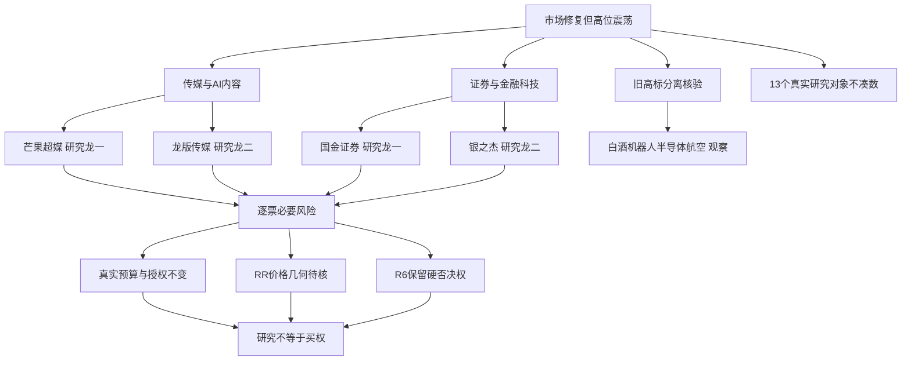

# 2026年11月3日 · 主线研判

> 🟡 盘前研究，市场数据基准为2026-11-02收盘；11月3日竞价与成交尚未发生。
> 数据源新鲜度：partial · 降级状态：true · 置信度：0.392。研究排名不是交易许可。

## 🎯 一句话结论

**主推传媒/AI内容与证券/金融科技；旧高标不代表全题材，前排仍须过必要风险与次日承接。**

## 🌊 先认市场，再认个股

| 市场在为什么付钱 | 已核证据 | 研究含义 |
|---|---|---|
| 广谱修复 | 4681涨、818跌，中位数+2.0168%；125涨停、8跌停 | 从旧主跌转为修复，不无限沿用旧市场零仓 |
| 内容应用与政策前排 | 传媒+8.49%、净入55.489004亿元；非银+3.91%、净入31.609464亿元 | 先比较合力与核心，不按行业标签静态攻守 |
| 接力并非普遍好赚 | 昨日涨停池开盘至收盘平均仅+0.1349%；全市场炸板率18.3007% | 高位震荡温度下选择首板隔日主模板，不拼五套打法 |
| 单日资金不是持续吸筹 | 传媒5日-2.939679亿元；非银5日-25.044260亿元 | 已核1日修复脉冲，今日可交易主线尚待竞价确认 |

本次只选“首板隔日”主模板。半路、打板只描述研究适配，不给买入价、止损价或订单；300/688与主板同权。炸板率未达35%，不触发候选减半；若同口径达到35%，须显式切换震荡/主跌并交D1按既有纪律减半。

## 🧭 五维研究比较

| 方向 | 热度 | 资金 | 涨停 | 叙事 | 共振 | 合计 | 态度 |
|---|---:|---:|---:|---:|---:|---:|---|
| 传媒/AI内容 | 20 | 19 | 20 | 13 | 17 | 89 | 观察（主推研究） |
| 证券/金融科技 | 16 | 17 | 16 | 19 | 13 | 81 | 观察（主推研究） |
| 白酒 | 14 | 8 | 12 | 未知 | 15 | 不补总分 | 观察（次线） |
| 机器人 | 18 | 6 | 15 | 未知 | 16 | 不补总分 | 观察（次线） |
| 半导体 | 未知 | 17 | 未知 | 10 | 未知 | 不补总分 | 观察（次线） |
| 航空成本改善 | 未知 | 6 | 未知 | 14 | 未知 | 不补总分 | 观察（次线） |

每维0—20、原五维不改权重；分数只是研究裁量，不是上涨概率或独立硬禁。次线未知维度保留null，不能用0占位再推出不合格。

## 🎬 主线1：传媒/AI内容

主线 = 传媒/AI内容，持续性 = 1日（已核修复脉冲），封板率 = 未知（同ID完整触板分母未核），明日预期 = 分歧。

- 稳定板块ID：`885418.TI`；round_id=null。当前阶段暂记formation，仅指本次脉冲，不把源days=1或运行日当首次启动轮次。
- 研究窗口：本报告生成后至今日09:30；竞价、首段成交或新公告出现即重评。前一轮是否延续未知，不追溯制造旧立场。

- **大资金意图**: 当日资金从风险资产广谱修复中选择内容/游戏应用：传媒单日55.49亿元，AI视频、短剧高涨幅和跨子行业首板扩散并列。五日净额仍负，不能写成持续建仓。
- **为什么走强**: 应用成本下降、内容效率与游戏销量新闻提供叙事，但价格扩散与事件先后单独核。R4的游戏销量消息昨日盘中已公开，晚间转载不是早盘上涨原因；也没有证明芒果或出版社获得该游戏分成。
- **逻辑够不够硬**: 价格/封板与资金合力硬，盈利传导未硬。芒果榜单合计净卖、捷成净买更强、龙版两口径资金冲突是实质反证，不能靠热榜或历史股性抹平。

| 层级 | 公司/代码 | 昨涨幅 | 连板 | 流通市值亿元 | 裁决依据 |
|---|---|---:|---:|---:|---|
| 龙头 | 芒果超媒 `300413.SZ` | +20.00% | 1 | 273.41 | 龙头：传媒最新成分内连板1板并列最高，20cm首板未开板，东财末榜第3，封单1.2952亿元；相较龙版早封与捷成净买更大，选择芒果作本轮人气/容量锚，不声称最早首封或全市场总龙。 |
| 龙二 | 龙版传媒 `605577.SH` | +9.98% | 1 | 57.78 | 龙二：本题材心智锚第2（84.4），首封09:44早于芒果且未开板；以早封+锚定优先于捷成单日净买，非按资金硬换票。资金口径存在冲突，保留研究不授权。 |
| 龙三 | 捷成股份 `300182.SZ` | +20.00% | 1 | 136.18 | 龙三：20cm首板、龙虎榜单日净买3.3079亿元具有真合力；但首封13:46且开板3次，身位/封板时序弱于早封核心。资金更强不自动挤占龙一龙二。 |
| 龙三 | 欢瑞世纪 `000892.SZ` | +9.98% | 1 | 31.35 | 龙三：心智锚第3（83.1）默认进入研究比较，首板首封11:25且开板4次；同为首板时封板稳定性与人气证据不及前二，20—50亿流通盘风险单列。 |
| 龙三 | 新华传媒 `600825.SH` | -6.66% | 0 | 130.30 | 龙三：心智锚第1（85.0）必须比较并保留研究；昨日-6.6617%，当日主力正值不能抹去旧高位与新首板赚钱效应分离。没有高位一票否决，更未用低位票替补其旧龙头身份。 |

本方向研究前二仍为“观察”，RR、必要公告/禁止清单及R6未审完。其余龙三原样保留研究，不能因前二被否而自动升位；本轮未取得足够四项数据，不捏造任何“已证实杂毛”判定。

## 🏦 主线2：证券/金融科技

主线 = 证券/金融科技，持续性 = 1日（已核修复脉冲），封板率 = 未知（同ID完整触板分母未核），明日预期 = 分歧。

- 稳定板块ID：`BK1203.DC`；round_id=null。当前阶段暂记formation，仅指本次脉冲，不把源days=1或运行日当首次启动轮次。
- 研究窗口：本报告生成后至今日09:30；竞价、首段成交或新公告出现即重评。前一轮是否延续未知，不追溯制造旧立场。

- **大资金意图**: 非银行业单日31.61亿元、证券28.38亿元说明传统金融已成为本轮进攻载体；母子行业和证券Ⅱ/Ⅲ不重复相加。
- **为什么走强**: 国金先封、太平洋助攻、银之杰及赢时胜20cm显示政策风险偏好向金融IT扩散。政策夜间新增报道不能倒灌解释早盘首封；先手兑现仍可能使今日高开低走。
- **逻辑够不够硬**: R4核到再贷款利率降至1%及ETF募集事实，但SFISF申请超1000亿元不等于今日全部买入，回购和两融优化仍有拟议/研究部分；必须等待实际实施及市场承接。

| 层级 | 公司/代码 | 昨涨幅 | 连板 | 流通市值亿元 | 裁决依据 |
|---|---|---:|---:|---:|---|
| 龙头 | 国金证券 `600109.SH` | +10.03% | 1 | 311.24 | 龙头：证券Ⅱ全日涨停国金与太平洋均1板、国金09:34最先封且未开板；政策作用于非银流动性，不能把额度当实流。比东方财富未板更具首板隔日的先手地位。 |
| 龙二 | 银之杰 `300085.SZ` | +20.02% | 1 | 159.20 | 龙二：金融科技弹性前排20cm首板，首封10:09早于赢时胜13:33，龙虎榜单日净买2.4537亿元；作为同一非银/金融科技母方向内综合龙二，不宣称是证券行业成分。 |
| 龙三 | 太平洋 `601099.SH` | +9.94% | 1 | 241.30 | 龙三：证券首板且未开板，09:50晚于国金；可作为板块扩散对照，但不与龙一并列占主位，亦不因龙一被R6否决而自动替补。 |
| 龙三 | 东方财富 `300059.SZ` | +6.31% | 0 | 2527.64 | 龙三：东财人气第2、同花顺19，+6.3068%及2527.64亿流通盘构成容量对照；未涨停，不凭当日/近段净流入替代国金的首板身位。 |
| 龙三 | 恒生电子 `600570.SH` | +10.02% | 1 | 393.74 | 龙三：金融IT首板10:06，市场认可真实；与银之杰相比弹性/热榜确认较弱，且问财与Tushare开板次数有1与2之差；不把金融IT业务逻辑等同今日前二。 |

本方向研究前二仍为“观察”，RR、必要公告/禁止清单及R6未审完。其余龙三原样保留研究，不能因前二被否而自动升位；本轮未取得足够四项数据，不捏造任何“已证实杂毛”判定。

## 🔬 每票可证伪研究链

以下“买入理由”只表示研究进入理由，不是当前买入指令；“止损条件”是研究逻辑失效条件，实际价格与交易动作由D1/执行层独立推导。所有13票的RR与止损距离均未知，不能进入执行池。

### 芒果超媒 · 龙头 · 观察

- **大资金意图**: 假设资金在传媒/AI内容内选择高辨识度载体；该票实际资金与席位仅按已列证据解释，未核意图不当事实。
- **为什么走强**: 龙头：传媒最新成分内连板1板并列最高，20cm首板未开板，东财末榜第3，封单1.2952亿元；相较龙版早封与捷成净买更大，选择芒果作本轮人气/容量锚，不声称最早首封或全市场总龙。
- **逻辑够不够硬**: 当日涨跌/板数与流通盘有实测，主线传导、地位比较与必要风险分开；RR、完整公告与禁止清单未齐，当前只观察，不能以历史锚或分数补过门禁。

板型：低位首板观察（仅当日板数，绝对位置未判）。龙头硬条件：1条已核；纪律§2完整条数未知。盈亏比：未知。禁止清单：空命中不是通过，公告、庄股/诱多、RR和R6仍待核。

- **买入理由**: ① 龙头：传媒最新成分内连板1板并列最高，20cm首板未开板，东财末榜第3，封单1.2952亿元；相较龙版早封与捷成净买更大，选择芒果作本轮人气/容量锚，不声称最早首封或全市场总龙。 ② 传媒/AI内容本轮有来源的板块传导/地位假设，使其进入研究而不是随意扩池。
- **风险点**: ① 本轮R7榜单单日净卖出0.5306亿元，与具名席位局部买入不能相抵或宣称合力全正。② 20cm后次日高开兑现；内容成本下降尚未验证利润。
- **止损条件**: 研究逻辑失效条件（非交易止损指令）：若竞价/首段成交显示该票相对板块明显分离走弱、同方向没有至少2只前排正反馈，或核到与产业/政策映射直接冲突的正式公告，交D1重评且不沿用本次前排结论。
- **可验证假设**: 今起24—72小时核芒果超媒的隔日相对昨收反馈、同方向至少2只助攻是否维持正反馈及可比资金方向。若个股反馈为负且助攻不足2只，首板隔日/局部接力假设未获确认；这只是检验量，不新增交易阈值。

### 龙版传媒 · 龙二 · 观察

- **大资金意图**: 假设资金在传媒/AI内容内选择高辨识度载体；该票实际资金与席位仅按已列证据解释，未核意图不当事实。
- **为什么走强**: 龙二：本题材心智锚第2（84.4），首封09:44早于芒果且未开板；以早封+锚定优先于捷成单日净买，非按资金硬换票。资金口径存在冲突，保留研究不授权。
- **逻辑够不够硬**: 当日涨跌/板数与流通盘有实测，主线传导、地位比较与必要风险分开；RR、完整公告与禁止清单未齐，当前只观察，不能以历史锚或分数补过门禁。

板型：低位首板观察（仅当日板数，绝对位置未判）。龙头硬条件：未知/不适用条已核；纪律§2完整条数未知。盈亏比：未知。禁止清单：空命中不是通过，公告、庄股/诱多、RR和R6仍待核。

- **买入理由**: ① 龙二：本题材心智锚第2（84.4），首封09:44早于芒果且未开板；以早封+锚定优先于捷成单日净买，非按资金硬换票。资金口径存在冲突，保留研究不授权。 ② 传媒/AI内容本轮有来源的板块传导/地位假设，使其进入研究而不是随意扩池。
- **风险点**: ① 同日官方问财主力-0.012715亿元、Tushare大单超大单+0.730428亿元，分类不同而方向冲突不抹平。② 历史妖性和心智锚非当日收益保证。
- **止损条件**: 研究逻辑失效条件（非交易止损指令）：若竞价/首段成交显示该票相对板块明显分离走弱、同方向没有至少2只前排正反馈，或核到与产业/政策映射直接冲突的正式公告，交D1重评且不沿用本次前排结论。
- **可验证假设**: 今起24—72小时核龙版传媒的隔日相对昨收反馈、同方向至少2只助攻是否维持正反馈及可比资金方向。若个股反馈为负且助攻不足2只，首板隔日/局部接力假设未获确认；这只是检验量，不新增交易阈值。

### 捷成股份 · 龙三 · 观察

- **大资金意图**: 假设资金在传媒/AI内容内选择高辨识度载体；该票实际资金与席位仅按已列证据解释，未核意图不当事实。
- **为什么走强**: 龙三：20cm首板、龙虎榜单日净买3.3079亿元具有真合力；但首封13:46且开板3次，身位/封板时序弱于早封核心。资金更强不自动挤占龙一龙二。
- **逻辑够不够硬**: 当日涨跌/板数与流通盘有实测，主线传导、地位比较与必要风险分开；RR、完整公告与禁止清单未齐，当前只观察，不能以历史锚或分数补过门禁。

板型：低位首板观察（仅当日板数，绝对位置未判）。龙头硬条件：未知/不适用条已核；纪律§2完整条数未知。盈亏比：未知。禁止清单：空命中不是通过，公告、庄股/诱多、RR和R6仍待核。

- **买入理由**: ① 龙三：20cm首板、龙虎榜单日净买3.3079亿元具有真合力；但首封13:46且开板3次，身位/封板时序弱于早封核心。资金更强不自动挤占龙一龙二。 ② 传媒/AI内容本轮有来源的板块传导/地位假设，使其进入研究而不是随意扩池。
- **风险点**: ① 日内首封/板数和次日接力不同；需要资金承接。② 政策/产业叙事到公司利润仍有距离，逐票风险核验未完成。
- **止损条件**: 研究逻辑失效条件（非交易止损指令）：若竞价/首段成交显示该票相对板块明显分离走弱、同方向没有至少2只前排正反馈，或核到与产业/政策映射直接冲突的正式公告，交D1重评且不沿用本次前排结论。
- **可验证假设**: 今起24—72小时核捷成股份的隔日相对昨收反馈、同方向至少2只助攻是否维持正反馈及可比资金方向。若个股反馈为负且助攻不足2只，首板隔日/局部接力假设未获确认；这只是检验量，不新增交易阈值。

### 欢瑞世纪 · 龙三 · 观察

- **大资金意图**: 假设资金在传媒/AI内容内选择高辨识度载体；该票实际资金与席位仅按已列证据解释，未核意图不当事实。
- **为什么走强**: 龙三：心智锚第3（83.1）默认进入研究比较，首板首封11:25且开板4次；同为首板时封板稳定性与人气证据不及前二，20—50亿流通盘风险单列。
- **逻辑够不够硬**: 当日涨跌/板数与流通盘有实测，主线传导、地位比较与必要风险分开；RR、完整公告与禁止清单未齐，当前只观察，不能以历史锚或分数补过门禁。

板型：低位首板观察（仅当日板数，绝对位置未判）。龙头硬条件：未知/不适用条已核；纪律§2完整条数未知。盈亏比：未知。禁止清单：空命中不是通过，公告、庄股/诱多、RR和R6仍待核。

- **买入理由**: ① 龙三：心智锚第3（83.1）默认进入研究比较，首板首封11:25且开板4次；同为首板时封板稳定性与人气证据不及前二，20—50亿流通盘风险单列。 ② 传媒/AI内容本轮有来源的板块传导/地位假设，使其进入研究而不是随意扩池。
- **风险点**: ① 日内首封/板数和次日接力不同；需要资金承接。② 政策/产业叙事到公司利润仍有距离，逐票风险核验未完成。
- **止损条件**: 研究逻辑失效条件（非交易止损指令）：若竞价/首段成交显示该票相对板块明显分离走弱、同方向没有至少2只前排正反馈，或核到与产业/政策映射直接冲突的正式公告，交D1重评且不沿用本次前排结论。
- **可验证假设**: 今起24—72小时核欢瑞世纪的隔日相对昨收反馈、同方向至少2只助攻是否维持正反馈及可比资金方向。若个股反馈为负且助攻不足2只，首板隔日/局部接力假设未获确认；这只是检验量，不新增交易阈值。

### 新华传媒 · 龙三 · 观察

- **大资金意图**: 假设资金在传媒/AI内容内选择高辨识度载体；该票实际资金与席位仅按已列证据解释，未核意图不当事实。
- **为什么走强**: 龙三：心智锚第1（85.0）必须比较并保留研究；昨日-6.6617%，当日主力正值不能抹去旧高位与新首板赚钱效应分离。没有高位一票否决，更未用低位票替补其旧龙头身份。
- **逻辑够不够硬**: 当日涨跌/板数与流通盘有实测，主线传导、地位比较与必要风险分开；RR、完整公告与禁止清单未齐，当前只观察，不能以历史锚或分数补过门禁。

板型：未涨停/旧锚分离对照。龙头硬条件：未知/不适用条已核；纪律§2完整条数未知。盈亏比：未知。禁止清单：空命中不是通过，公告、庄股/诱多、RR和R6仍待核。

- **买入理由**: ① 龙三：心智锚第1（85.0）必须比较并保留研究；昨日-6.6617%，当日主力正值不能抹去旧高位与新首板赚钱效应分离。没有高位一票否决，更未用低位票替补其旧龙头身份。 ② 传媒/AI内容本轮有来源的板块传导/地位假设，使其进入研究而不是随意扩池。
- **风险点**: ① 日内首封/板数和次日接力不同；需要资金承接。② 政策/产业叙事到公司利润仍有距离，逐票风险核验未完成。
- **止损条件**: 研究逻辑失效条件（非交易止损指令）：若竞价/首段成交显示该票相对板块明显分离走弱、同方向没有至少2只前排正反馈，或核到与产业/政策映射直接冲突的正式公告，交D1重评且不沿用本次前排结论。
- **可验证假设**: 今起24—72小时核新华传媒的隔日相对昨收反馈、同方向至少2只助攻是否维持正反馈及可比资金方向。若个股反馈为负且助攻不足2只，首板隔日/局部接力假设未获确认；这只是检验量，不新增交易阈值。

### 国金证券 · 龙头 · 观察

- **大资金意图**: 假设资金在证券/金融科技内选择高辨识度载体；该票实际资金与席位仅按已列证据解释，未核意图不当事实。
- **为什么走强**: 龙头：证券Ⅱ全日涨停国金与太平洋均1板、国金09:34最先封且未开板；政策作用于非银流动性，不能把额度当实流。比东方财富未板更具首板隔日的先手地位。
- **逻辑够不够硬**: 当日涨跌/板数与流通盘有实测，主线传导、地位比较与必要风险分开；RR、完整公告与禁止清单未齐，当前只观察，不能以历史锚或分数补过门禁。

板型：低位首板观察（仅当日板数，绝对位置未判）。龙头硬条件：1条已核；纪律§2完整条数未知。盈亏比：未知。禁止清单：空命中不是通过，公告、庄股/诱多、RR和R6仍待核。

- **买入理由**: ① 龙头：证券Ⅱ全日涨停国金与太平洋均1板、国金09:34最先封且未开板；政策作用于非银流动性，不能把额度当实流。比东方财富未板更具首板隔日的先手地位。 ② 证券/金融科技本轮有来源的板块传导/地位假设，使其进入研究而不是随意扩池。
- **风险点**: ① 日内首封/板数和次日接力不同；需要资金承接。② 政策/产业叙事到公司利润仍有距离，逐票风险核验未完成。
- **止损条件**: 研究逻辑失效条件（非交易止损指令）：若竞价/首段成交显示该票相对板块明显分离走弱、同方向没有至少2只前排正反馈，或核到与产业/政策映射直接冲突的正式公告，交D1重评且不沿用本次前排结论。
- **可验证假设**: 今起24—72小时核国金证券的隔日相对昨收反馈、同方向至少2只助攻是否维持正反馈及可比资金方向。若个股反馈为负且助攻不足2只，首板隔日/局部接力假设未获确认；这只是检验量，不新增交易阈值。

### 银之杰 · 龙二 · 观察

- **大资金意图**: 假设资金在证券/金融科技内选择高辨识度载体；该票实际资金与席位仅按已列证据解释，未核意图不当事实。
- **为什么走强**: 龙二：金融科技弹性前排20cm首板，首封10:09早于赢时胜13:33，龙虎榜单日净买2.4537亿元；作为同一非银/金融科技母方向内综合龙二，不宣称是证券行业成分。
- **逻辑够不够硬**: 当日涨跌/板数与流通盘有实测，主线传导、地位比较与必要风险分开；RR、完整公告与禁止清单未齐，当前只观察，不能以历史锚或分数补过门禁。

板型：低位首板观察（仅当日板数，绝对位置未判）。龙头硬条件：未知/不适用条已核；纪律§2完整条数未知。盈亏比：未知。禁止清单：空命中不是通过，公告、庄股/诱多、RR和R6仍待核。

- **买入理由**: ① 龙二：金融科技弹性前排20cm首板，首封10:09早于赢时胜13:33，龙虎榜单日净买2.4537亿元；作为同一非银/金融科技母方向内综合龙二，不宣称是证券行业成分。 ② 证券/金融科技本轮有来源的板块传导/地位假设，使其进入研究而不是随意扩池。
- **风险点**: ① 日内首封/板数和次日接力不同；需要资金承接。② 政策/产业叙事到公司利润仍有距离，逐票风险核验未完成。
- **止损条件**: 研究逻辑失效条件（非交易止损指令）：若竞价/首段成交显示该票相对板块明显分离走弱、同方向没有至少2只前排正反馈，或核到与产业/政策映射直接冲突的正式公告，交D1重评且不沿用本次前排结论。
- **可验证假设**: 今起24—72小时核银之杰的隔日相对昨收反馈、同方向至少2只助攻是否维持正反馈及可比资金方向。若个股反馈为负且助攻不足2只，首板隔日/局部接力假设未获确认；这只是检验量，不新增交易阈值。

### 太平洋 · 龙三 · 观察

- **大资金意图**: 假设资金在证券/金融科技内选择高辨识度载体；该票实际资金与席位仅按已列证据解释，未核意图不当事实。
- **为什么走强**: 龙三：证券首板且未开板，09:50晚于国金；可作为板块扩散对照，但不与龙一并列占主位，亦不因龙一被R6否决而自动替补。
- **逻辑够不够硬**: 当日涨跌/板数与流通盘有实测，主线传导、地位比较与必要风险分开；RR、完整公告与禁止清单未齐，当前只观察，不能以历史锚或分数补过门禁。

板型：低位首板观察（仅当日板数，绝对位置未判）。龙头硬条件：未知/不适用条已核；纪律§2完整条数未知。盈亏比：未知。禁止清单：空命中不是通过，公告、庄股/诱多、RR和R6仍待核。

- **买入理由**: ① 龙三：证券首板且未开板，09:50晚于国金；可作为板块扩散对照，但不与龙一并列占主位，亦不因龙一被R6否决而自动替补。 ② 证券/金融科技本轮有来源的板块传导/地位假设，使其进入研究而不是随意扩池。
- **风险点**: ① 日内首封/板数和次日接力不同；需要资金承接。② 政策/产业叙事到公司利润仍有距离，逐票风险核验未完成。
- **止损条件**: 研究逻辑失效条件（非交易止损指令）：若竞价/首段成交显示该票相对板块明显分离走弱、同方向没有至少2只前排正反馈，或核到与产业/政策映射直接冲突的正式公告，交D1重评且不沿用本次前排结论。
- **可验证假设**: 今起24—72小时核太平洋的隔日相对昨收反馈、同方向至少2只助攻是否维持正反馈及可比资金方向。若个股反馈为负且助攻不足2只，首板隔日/局部接力假设未获确认；这只是检验量，不新增交易阈值。

### 东方财富 · 龙三 · 观察

- **大资金意图**: 假设资金在证券/金融科技内选择高辨识度载体；该票实际资金与席位仅按已列证据解释，未核意图不当事实。
- **为什么走强**: 龙三：东财人气第2、同花顺19，+6.3068%及2527.64亿流通盘构成容量对照；未涨停，不凭当日/近段净流入替代国金的首板身位。
- **逻辑够不够硬**: 当日涨跌/板数与流通盘有实测，主线传导、地位比较与必要风险分开；RR、完整公告与禁止清单未齐，当前只观察，不能以历史锚或分数补过门禁。

板型：未涨停/旧锚分离对照。龙头硬条件：未知/不适用条已核；纪律§2完整条数未知。盈亏比：未知。禁止清单：空命中不是通过，公告、庄股/诱多、RR和R6仍待核。

- **买入理由**: ① 龙三：东财人气第2、同花顺19，+6.3068%及2527.64亿流通盘构成容量对照；未涨停，不凭当日/近段净流入替代国金的首板身位。 ② 证券/金融科技本轮有来源的板块传导/地位假设，使其进入研究而不是随意扩池。
- **风险点**: ① 日内首封/板数和次日接力不同；需要资金承接。② 政策/产业叙事到公司利润仍有距离，逐票风险核验未完成。
- **止损条件**: 研究逻辑失效条件（非交易止损指令）：若竞价/首段成交显示该票相对板块明显分离走弱、同方向没有至少2只前排正反馈，或核到与产业/政策映射直接冲突的正式公告，交D1重评且不沿用本次前排结论。
- **可验证假设**: 今起24—72小时核东方财富的隔日相对昨收反馈、同方向至少2只助攻是否维持正反馈及可比资金方向。若个股反馈为负且助攻不足2只，首板隔日/局部接力假设未获确认；这只是检验量，不新增交易阈值。

### 恒生电子 · 龙三 · 观察

- **大资金意图**: 假设资金在证券/金融科技内选择高辨识度载体；该票实际资金与席位仅按已列证据解释，未核意图不当事实。
- **为什么走强**: 龙三：金融IT首板10:06，市场认可真实；与银之杰相比弹性/热榜确认较弱，且问财与Tushare开板次数有1与2之差；不把金融IT业务逻辑等同今日前二。
- **逻辑够不够硬**: 当日涨跌/板数与流通盘有实测，主线传导、地位比较与必要风险分开；RR、完整公告与禁止清单未齐，当前只观察，不能以历史锚或分数补过门禁。

板型：低位首板观察（仅当日板数，绝对位置未判）。龙头硬条件：未知/不适用条已核；纪律§2完整条数未知。盈亏比：未知。禁止清单：空命中不是通过，公告、庄股/诱多、RR和R6仍待核。

- **买入理由**: ① 龙三：金融IT首板10:06，市场认可真实；与银之杰相比弹性/热榜确认较弱，且问财与Tushare开板次数有1与2之差；不把金融IT业务逻辑等同今日前二。 ② 证券/金融科技本轮有来源的板块传导/地位假设，使其进入研究而不是随意扩池。
- **风险点**: ① 日内首封/板数和次日接力不同；需要资金承接。② 政策/产业叙事到公司利润仍有距离，逐票风险核验未完成。
- **止损条件**: 研究逻辑失效条件（非交易止损指令）：若竞价/首段成交显示该票相对板块明显分离走弱、同方向没有至少2只前排正反馈，或核到与产业/政策映射直接冲突的正式公告，交D1重评且不沿用本次前排结论。
- **可验证假设**: 今起24—72小时核恒生电子的隔日相对昨收反馈、同方向至少2只助攻是否维持正反馈及可比资金方向。若个股反馈为负且助攻不足2只，首板隔日/局部接力假设未获确认；这只是检验量，不新增交易阈值。

### 皇台酒业 · 龙头 · 观察

- **大资金意图**: 假设资金在白酒内选择高辨识度载体；该票实际资金与席位仅按已列证据解释，未核意图不当事实。
- **为什么走强**: 龙头观察：白酒概念内皇台与泉阳泉均2板，皇台09:30先封且未开板；27.68亿流通盘谨慎，板块当日净额负，研究不构成交易确认。
- **逻辑够不够硬**: 当日涨跌/板数与流通盘有实测，主线传导、地位比较与必要风险分开；RR、完整公告与禁止清单未齐，当前只观察，不能以历史锚或分数补过门禁。

板型：2连板观察。龙头硬条件：1条已核；纪律§2完整条数未知。盈亏比：未知。禁止清单：空命中不是通过，公告、庄股/诱多、RR和R6仍待核。

- **买入理由**: ① 龙头观察：白酒概念内皇台与泉阳泉均2板，皇台09:30先封且未开板；27.68亿流通盘谨慎，板块当日净额负，研究不构成交易确认。 ② 白酒本轮有来源的板块传导/地位假设，使其进入研究而不是随意扩池。
- **风险点**: ① 日内首封/板数和次日接力不同；需要资金承接。② 政策/产业叙事到公司利润仍有距离，逐票风险核验未完成。
- **止损条件**: 研究逻辑失效条件（非交易止损指令）：若竞价/首段成交显示该票相对板块明显分离走弱、同方向没有至少2只前排正反馈，或核到与产业/政策映射直接冲突的正式公告，交D1重评且不沿用本次前排结论。
- **可验证假设**: 今起24—72小时核皇台酒业的隔日相对昨收反馈、同方向至少2只助攻是否维持正反馈及可比资金方向。若个股反馈为负且助攻不足2只，首板隔日/局部接力假设未获确认；这只是检验量，不新增交易阈值。

### 水井坊 · 龙二 · 观察

- **大资金意图**: 假设资金在白酒内选择高辨识度载体；该票实际资金与席位仅按已列证据解释，未核意图不当事实。
- **为什么走强**: 龙二观察：水井坊09:38首封未开板，优于金种子更晚且反复封；首板仍低于皇台高度，非取代龙一。
- **逻辑够不够硬**: 当日涨跌/板数与流通盘有实测，主线传导、地位比较与必要风险分开；RR、完整公告与禁止清单未齐，当前只观察，不能以历史锚或分数补过门禁。

板型：低位首板观察（仅当日板数，绝对位置未判）。龙头硬条件：未知/不适用条已核；纪律§2完整条数未知。盈亏比：未知。禁止清单：空命中不是通过，公告、庄股/诱多、RR和R6仍待核。

- **买入理由**: ① 龙二观察：水井坊09:38首封未开板，优于金种子更晚且反复封；首板仍低于皇台高度，非取代龙一。 ② 白酒本轮有来源的板块传导/地位假设，使其进入研究而不是随意扩池。
- **风险点**: ① 日内首封/板数和次日接力不同；需要资金承接。② 政策/产业叙事到公司利润仍有距离，逐票风险核验未完成。
- **止损条件**: 研究逻辑失效条件（非交易止损指令）：若竞价/首段成交显示该票相对板块明显分离走弱、同方向没有至少2只前排正反馈，或核到与产业/政策映射直接冲突的正式公告，交D1重评且不沿用本次前排结论。
- **可验证假设**: 今起24—72小时核水井坊的隔日相对昨收反馈、同方向至少2只助攻是否维持正反馈及可比资金方向。若个股反馈为负且助攻不足2只，首板隔日/局部接力假设未获确认；这只是检验量，不新增交易阈值。

### 泉阳泉 · 龙三 · 观察

- **大资金意图**: 假设资金在白酒内选择高辨识度载体；该票实际资金与席位仅按已列证据解释，未核意图不当事实。
- **为什么走强**: 龙三观察：同为白酒概念2板但泉阳泉09:38首封并4次开板，作为消费联动对照；行业实为饮料乳品，不伪造主营白酒。
- **逻辑够不够硬**: 当日涨跌/板数与流通盘有实测，主线传导、地位比较与必要风险分开；RR、完整公告与禁止清单未齐，当前只观察，不能以历史锚或分数补过门禁。

板型：2连板观察。龙头硬条件：未知/不适用条已核；纪律§2完整条数未知。盈亏比：未知。禁止清单：空命中不是通过，公告、庄股/诱多、RR和R6仍待核。

- **买入理由**: ① 龙三观察：同为白酒概念2板但泉阳泉09:38首封并4次开板，作为消费联动对照；行业实为饮料乳品，不伪造主营白酒。 ② 白酒本轮有来源的板块传导/地位假设，使其进入研究而不是随意扩池。
- **风险点**: ① 日内首封/板数和次日接力不同；需要资金承接。② 政策/产业叙事到公司利润仍有距离，逐票风险核验未完成。
- **止损条件**: 研究逻辑失效条件（非交易止损指令）：若竞价/首段成交显示该票相对板块明显分离走弱、同方向没有至少2只前排正反馈，或核到与产业/政策映射直接冲突的正式公告，交D1重评且不沿用本次前排结论。
- **可验证假设**: 今起24—72小时核泉阳泉的隔日相对昨收反馈、同方向至少2只助攻是否维持正反馈及可比资金方向。若个股反馈为负且助攻不足2只，首板隔日/局部接力假设未获确认；这只是检验量，不新增交易阈值。

## ⚖️ 为什么不选对照对象

| 对照 | 本次裁决及原因 |
|---|---|
| 传媒新载体：芒果 vs 龙版 vs 捷成 vs 海看 vs 文投 | 芒果龙一、龙版龙二；捷成研究龙三；海看/文投保留对照。芒果东财人气3、20cm未开板与容量；龙版早封+心智锚。捷成资金与席位更强但午后反复封不压过身位/首封/辨识度；海看11:01的20cm首封更早但流通28.27亿且心智/全市场人气不足以胜前二；文投09:30更早但9天5板旧反复结构、当日开盘到收盘/first_time字段组合异常且无更强人气认证，不能只看首封时刻升总龙。没有因300/688前缀降级。 |
| 传媒心智锚TOP3 | 三个全保留研究；新华不占前二。新华虽锚85且当日问财净入3.099亿，股价仍-6.66%且未封板；龙版、欢瑞同为首板而龙版早封未开、欢瑞4次开板。不是因高位一票否决，而是新旧载体合力/承接分离；完整禁止清单未知。 |
| 专题股性24行：桂发祥/一鸣食品/集泰股份等 | 不凭历史股性跨主题强造当日候选；未全量逐票行情/风险验证。81.4/79等为5年/月度股性截面，不是11/2板块合力和今日地位；非贬低消费，皇台/水井另按最新前排证据保留。其余4508全表未读不声明不合格。 |
| 成长池12家与R4动作捕捉映射 | 不列主线前二，保留基本面/产业链扩池身份。成长表明确全条件通过0、行情10/30，不是已证伪全部成长股；赛诺虽Q3硬数据，11/2仅+0.2295%且医疗器械当日净额负、未核龙头。凌云光可映游戏动捕，但未核当日核心地位/订单分成与必要风险，不能用产业点名压过已经涨停扩散的人气锚。思泉10/26解禁与估值高保留为历史反证，未宣布风险已消化。 |
| 红利池：炬华与金融进攻方向比较 | 红利专题不作今日主线替代。月报partial，155已核/153未核；TOP20有8只滚动现金压力，炬华11/2+2.1622%不是资金虹吸和梯队龙头。拒绝理由是本轮主线/地位与必要验证不足，不是行业静态“老登”；证券实际资金转攻故入主推。 |
| 一字预测5票全部先比较 | 目标日11/3匹配，五票均不靠预测进入主线龙一。阳光照明/东方海洋/桂林三金3板及封单已由本会话U表复核，却缺照明/海洋/中药板块合力与本轮核心传导；高争民爆首板为已交易复牌叙事，R4说明作价未定；劲旅20.8亿流通接近底线且只有单票一字预测。全部未完成逐票必要风险，不把35%或隔夜排单文案当实证/授权。 |
| 证券国金 vs 银之杰 vs 东方财富/太平洋/恒生 | 国金龙一、银之杰龙二；其他龙三。国金证券最早首封；银之杰为金融IT早封20cm且席位净买2.4537亿。太平洋证券第二早封是助攻而非同占母主线龙一；东方财富人气高但未板，恒生首板有实力仍不把三条同母金融分支都独立算主线。 |
| 互联网金融历史锚TOP3 vs 真实金融前排 | 已作默认研究比较，未给金融前二资格；粤传媒留在内容链对照。宝鼎+1.3134%、华脉+4.7578%不是本轮金融涨停前排；粤传媒虽涨停但首封13:44并属出版，泛互联网金融概念成员不证明非银主营受益。不能凭历史妖性或成分表把跨行业映射当当前证券龙头。 |

## 🪜 次线与覆盖边界

### 白酒 · 观察
- **大资金意图**: 皇台2板、水井首板支持局部延续；行业白酒Ⅱ净流出2.453512亿且R4无本轮白酒明确硬催化，不能因旧前排强就列第一主线
- **为什么走强**: 不否定消费，只是不将板块上涨直接解释为当日持续净买或经营反转
- **逻辑够不够硬**: 已核部分与未知维度分列；不是以单一相对强度或缺辅助源一票否决。实际启动轮次、封板率及必要个股风险未齐，维持观察，不强造当日核心。
- sector_id=`885525.TI`，round_id=null；有效窗口同本报告，事件锚为最新收盘截面而非首次公开时刻。

### 机器人 · 观察
- **大资金意图**: 26涨停及R3热度不能忽略；但源days16而非新主线，机器人行业当日-2.75187亿，沪工触板回落-1.42%显示旧高位分离
- **为什么走强**: 沈阳机床2板且8次开板，R4原文澄清无具身智能收入；这针对映射对象，不否定全机器人产业
- **逻辑够不够硬**: 已核部分与未知维度分列；不是以单一相对强度或缺辅助源一票否决。实际启动轮次、封板率及必要个股风险未齐，维持观察，不强造当日核心。
- sector_id=`885517.TI`，round_id=null；有效窗口同本报告，事件锚为最新收盘截面而非首次公开时刻。

### 半导体 · 观察
- **大资金意图**: 行业+2.77%单日+46.076503亿构成真实对照，不因海外跌一票否决
- **为什么走强**: 5日-154.020309亿、海外费半/纳指反面与本轮R3未覆盖共振；缺当前地位核验，暂不挤占已核传媒/金融方向
- **逻辑够不够硬**: 已核部分与未知维度分列；不是以单一相对强度或缺辅助源一票否决。实际启动轮次、封板率及必要个股风险未齐，维持观察，不强造当日核心。
- sector_id=`BK1036.DC`，round_id=null；有效窗口同本报告，事件锚为最新收盘截面而非首次公开时刻。

### 航空成本改善 · 观察
- **大资金意图**: R4 E005油价回落与美航司上涨是成本假设；同底层油价不重复算独立催化
- **为什么走强**: 国内行业单日仅+0.484868亿、5日-4.00672亿且无已核涨停/核心梯队，保留研究不制造新主线
- **逻辑够不够硬**: 已核部分与未知维度分列；不是以单一相对强度或缺辅助源一票否决。实际启动轮次、封板率及必要个股风险未齐，维持观察，不强造当日核心。
- sector_id=`BK1479.DC`，round_id=null；有效窗口同本报告，事件锚为最新收盘截面而非首次公开时刻。

## 🔗 上游交叉验证

| 主线 | R3 | R4 | R7 | 已查分母 | 含义 |
|---|---|---|---|---:|---|
| 传媒/AI内容 | L1+L2、AI视频热榜1 | 游戏/AI内容medium，仅叙事映射 | 传媒单日净入、五日仍负 | 3 | 支持研究，不证明每票利润和资金 |
| 证券/金融科技 | 互联网金融L1+L2 | 两项稳市政策high，状态分层 | 非银/证券单日净入、五日仍负 | 3 | 不能把额度或申购等同即时入市 |

两主题均有四阶段语义支持，因此consensus_themes列2条；四阶段不是四个独立底层源。尺度不具可比性，综合分保持null。R7未在历史运输包内不等于R7原JSON不可读；本次已实际读取指定路径。

## 📚 专题与历史裁决

- 本轮专题context身份、六来源source_id/path/hash/status/source_timing/limitations及必要原文均嵌入JSON；另保留R4内嵌日历来源。传递、定向取证和采纳分开记录，未声称全文阅读成长/红利MD或4508行股性表。
- 题材锚原JSON哈希匹配，定向核六题材TOP3；只把历史锚用于候选比较，未新增评分项。股性24行deferred；成长、红利和一字素材仅有限采用作比较/反证；复盘专题摘录为空，unknown。
- 唯一历史包run_id核对匹配，本次市场反馈1项及其4个子经验逐项裁决。仅采用传媒遗漏、白酒净额及沪工分离的待核假设，已与当前上游核对；旧scope/round/window未知。
- 原历史records为空、unreplayable；不认作冻结预测兑现、不当批准规则。观察池方向/修订/虚拟成交经验交原owner，R2不补造旧方向或成交。专题复盘空摘录与历史包E1投影不重复算独立来源。

## 数据源审计

| 源 | 日期 | 状态 | 记录与边界 |
|---|---|:--:|---|
| R1原JSON | 2026-11-03 | 🟡 | degraded；行情基准2026-11-02，研究上限不是预算 |
| R3原JSON | 2026-11-03 | 🟡 | partial；5主题及热榜/群聊内嵌，未宣称原图全文阅读 |
| R4原JSON | 2026-11-03 | 🟡 | partial；13事件，原文核验沿用本轮内嵌证据 |
| R7原JSON及本轮证据 | 2026-11-03 | 🟡 | partial；行业496原始行重叠不加总，5日龙虎榜按日去重 |
| Tushare涨停/炸板/天梯 | 2026-11-02 | 🟢 | 125涨停、28未封；最高6板；本会话实时调用 |
| Tushare板块统计/成分 | 2026-11-02 | 🟡 | 当日top20、5交易日及传媒月内；最新成分非历史分类重建 |
| Tushare资金/基础状态 | 2026-11-02 | 🟢 | 4只研究前二精确5日；4只基础上市状态及流通市值 |
| 同花顺官方OpenAPI | 2026-11-03 | 🟡 | 共8查询；空和误映保留，AI视频成分以Tushare交叉 |
| fetch manifest | 2026-11-03 | 🟡 | severity=2；不改写raw，不从质量分产生全局禁令 |
| 专题运输/定向锚 | 2026-11-03 | 🟡 | 6来源完整索引；有限前缀不是全文；锚定向哈希复核 |
| 唯一历史包 | 2026-11-03 | 🟡 | run匹配，1反馈投影；原轮次/窗口未知 |
| 每周因子面板 | 2026-11-03 | 🔴 | 目录缺失，factor_layer_degraded=true；原五维继续 |
| 长期主线active笔记 | 2026-11-03 | 🟡 | 未找到可用md，不编造长期继承 |
| 同板块封板率/今日竞价 | 2026-11-03 | 🔴 | 同ID完整触板分母及T0成交缺失，保留null |

## 🧨 不确定性 / 反证

传媒和非银的真实五日净额仍负，修复可能一日兑现；芒果席位净卖与人气强势并存，龙版两种资金分类方向冲突，是下游必须继续核的反证，而不是被研究分数覆盖的细节。海外科技风险不自动禁止国内全科技，官方稳市也不能抹平逐票财务合规风险。

真实账户预算与停买本阶段未知，不把旧市场性零仓当永久禁令，也不猜正额度。现行用户硬上限、T+1、人工确认及R6逐票硬否决全部保持；R2没有资格制造或撤销买权。研究13票不足D1观察池最低规模的扩展任务交D1，不为满足数量混入无地位票。

## 与其他 R/D/E 的关系

- 依赖：本轮R1_style.json、R3_sentiment.json、R4_news.json、R7_capital_flow.json。
- 被消费：R5逐票画像；R6只读本轮JSON内嵌证据作独立反证；D1首次成案裁定计划身份、必要几何与最终交易许可。
- R2不把D1成案前未知的计划身份写false；不因旧计划缺席生成计划外禁令。

## Sub-Agent 元数据

- skill: analyze_main_sectors_v1；filter_leader_v1已在同一模型会话应用。
- artifact: data/research/20261103/R2_main_sectors.json
- model: gpt-6.1-sol
- status: partial；研究已交付但必要风险、板块封板率与T0确认未完成。
- 置信度：0.70 × 0.7 × 0.8 = 0.392；非收益概率。
- 用量：usage_unknown；5000万token是观察目标，未计量不当0、不保证低于目标。
