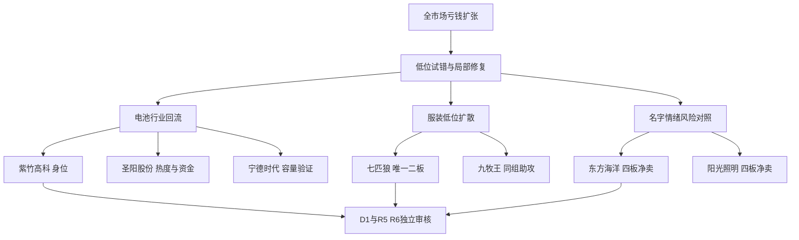

# 2026年11月4日 · 主线研判

> 🟡 数据源新鲜度：partial；降级：是；置信度：0.392。
> ⚠️ **数据源时间错位**：文件名为2026-11-04研究交付日，市场行情事实为2026-11-03。这是正常盘前T-1基线，不是今日走势或事后补造预测。
> 行情事实主要属于2026-11-03收盘，本报告用于2026-11-04盘前研究，不是今日已经发生的走势。本次实时生成，非冻结回放。
> 情绪=震荡/主跌。优先研究不等于可交易主线确认，研究候选不等于开仓许可。

## 一句话结论

**观察电池回流与服装低位扩散；七匹狼凭地位入研究，高位洋阳票只留风险对照。**

## 🧭 详细分析：先认市场，再比较个股

昨日全市场2108涨、3309跌，涨停48、跌停17、炸板34，炸板率41.46%；前一交易日还是4681涨、818跌。市场奖励已经从普涨回落到局部抱团与低位试错，不能拿前一天传媒大涨当作今天机会地图，也不能因为指数下跌，否定七匹狼等独立低位情绪机会。

电池有可见资金回流，但必须拆口径：东财电池行业净入25.3191亿元，连续3日为正；固态概念却净出3.4079亿元。服装家纺当天净入0.2119亿元、五日仍净出2.2634亿元，整体持续性比电池弱，但七匹狼是行业唯一二板，且五日净额在75只当前成分中第一；低位局部扩散有事实基础。这两条方向是研究主线，不是本日已获授权的交易主线。

本轮只使用92科比“三格”主模板：龙头、补涨、切换。沪深普通10cm情绪对象优先比较；宁德时代只承担电池容量验证，不冒充妖股。300/688没有前缀禁令，尚水智能被剔除的理由是流通市值不足20亿元，不是20cm。桂发祥虽然旧股性分最高，最新流通19.24亿元仍触及既有硬线。

正常研究容量上限15只，因炸板率达到35%条件，压至7只，已包括两只高标风险观察。最终买权仍由D1、执行侧和逐票必要审核决定；有效账户预算未知，保持未知，不从旧市场建议继承零预算，也不抬升正额度。

## 🔋 研究主线一：电池，不能偷换成固态全面主升

**主线=电池，持续性假设=1日，封板率=87.50%，次日预期=分歧。** 持续性是假设验证窗口，不是已核主线年龄。行业稳定ID为`881281.TI`，资金对照为东财电池行业；真实启动轮次与首次催化时间尚不充分，JSON中的round_id、event_at均保留未知。

| 核验项 | 已核事实 | 裁决 |
|---|---|---|
| 广度 | 当前成分108只，7封板、1炸板 | 有局部合力，不是全市场主升 |
| 资金 | 单日+25.3191亿元；五日+2.5647亿元 | 回流成立，强于电子/通信净流出 |
| 内部分工 | 紫竹二板；圣阳首板；宁德容量 | 不以资金冠军取代身位先锋 |
| 反证 | 固态概念净出3.4079亿元 | 不称固态全面吸筹 |
| 五维 | 热度17／资金14／涨停18／叙事10／共振12，总分71 | 仅研究比较，不是胜率和独立门槛 |

- **大资金意图**: 在电子与通信大幅净流出的背景下，部分成交向电池回流；宁德的五日18.0705亿元净额与圣阳首板构成容量、低位两端的事实。只能认资金分类结果，不能推断具体机构的未公开意图。
- **为什么走强**: 行业有7只封板、唯一二板和容量上涨；R3可见固态产业观点提供叙事，但没有本轮R4已核新政策原文支撑，不能把“产业催化”宣传升级为硬订单。
- **逻辑够不够硬**: 价格、成员与资金事实硬，主升年龄和部分公司必要风险仍未知。若容量转弱、低位封板不能扩散，或者固态与行业继续背离，则只保留修复观察，不升级买权。

### 紫竹高科 002058.SZ：身位龙一，尚不是已确认总龙

- **买入理由**: 仅列研究假设。电池行业唯一二板；当前108只成分交叉可核。封板后换手8.70%，不是无量一字；但四项龙头条件目前只核两项，不把数板直接当真龙。
- **风险点**: 流通30.29亿元属于20—50亿元警示区；五日资金只排行业第8；最新异动公告称经营环境无重大变化。公司带动性与产业逻辑尚未完整闭环。
- **止损条件**: 本文只给研究撤销条件：失去行业领先且同组接力扩散消失时撤销身位假设。持仓止损价格、RR与买点由D1独立生成，R2不编造。
- **可验证假设**: 未来1—3日核其是否仍领先同组低位票，是否有后续封板跟随；一旦被同组新核心取代，记录失效，不追溯改认定。态度：观察。

### 圣阳股份 002580.SZ：龙二研究，不能因资金强就抹去身位差

- **买入理由**: 仅列研究假设。首板封板早于紫竹；同花顺热榜61→8；五日资金排行业第2，昨日净入3.9625亿元。容量、低位首板与热度在同日相互印证。
- **风险点**: 前一天净卖0.7058亿元，不能把昨日净买当作连续吸筹；旧股性历史炸板率23.2%，只有研究参考意义；本日竞价与真实承接未知。
- **止损条件**: 若首板溢价失效且行业扩散转弱，撤销低位核心假设；不凭热榜持续在榜继续讲故事。实际持仓退出仍服从D1及T+1规则。
- **可验证假设**: 未来1—3日比较行业地位、封板跟随与资金方向，若价格、热度、净额发生背离，分别记录，不把其中单一字段当全部确认。态度：观察。

### 宁德时代 300750.SZ：候补容量验证，非10cm妖股候选

- **买入理由**: 仅列研究假设。昨日上涨3.8012%，五日净额18.0705亿元，为108只电池成分资金第1；可验证电池回流是否有容量支撑。
- **风险点**: 未涨停，不能冒充接力总龙；融资与ETF数据有滞后，不能代替本日买盘；容量强不代表小票均可接力。
- **止损条件**: 若容量强度与行业净流入同时消失，撤销容量确认假设。这里只撤销研究结论，不给个股价格止损。
- **可验证假设**: 未来1—3日比较容量强度与低位封板是否同步；不同步即记录两类资金分化。龙三层级不进执行递补，态度：观察。

## 🐺 研究主线二：服装家纺，七匹狼按地位入选，不按“狼吃羊”入选

**主线=服装家纺，持续性假设=1日，封板率=100.00%，次日预期=分歧。** 分母只包括当前75只成分内3次已封触板，没有已观测炸板，不表示全部75只都上涨或明日必封。稳定ID为`881136.TI`，轮次未知，不用11月4日或本次run_id代替行情起点。

| 比较项 | 七匹狼 | 九牧王 | 未入选对照：龙头股份 |
|---|---|---|---|
| 身位 | 唯一二板 | 首板 | 首板 |
| 首封顺序 | 最早 | 随后 | 更晚 |
| 五日主力净额 | +1.2748亿元，第1 | +0.9091亿元，第2 | 非前二 |
| 最新换手 | 5.28% | 10.14% | 7.30% |
| 历史股性 | 综合46.4，近期极佳 | 综合77.3，近期极佳 | 不以名字“龙头”认证龙头 |
| 裁决 | 龙一研究 | 龙二研究 | rank=杂毛，仅本轮角色剔除 |

- **大资金意图**: 此处只观察到低位服装票的集中成交与跟随封板，不是产业需求突然反转。行业单日正净额很小、五日仍负，因此更像局部试错而非机构行业主升已确认。
- **为什么走强**: 七匹狼二板、最早封板、五日净额第一，九牧王和龙头股份随后封板，形成了可核的时序与同组广度。这个证据足以开展研究，不必先要求它有官方“羊年概念”标签。
- **逻辑够不够硬**: 局部市场地位证据较硬，“狼吃羊”传播与监管后切换因果仍不硬。已读群聊没有七匹狼狼羊关系的独立正文，不能先编梗再拿涨停证明。叙事、共振两维及总分保留未知，不补0，也不因此清空研究。

### 七匹狼 002029.SZ：局部龙一，不能预设成妖

- **买入理由**: 仅列研究假设。唯一二板、行业五日资金第一；早于同组两只首板封住，换手5.28%，三项市场地位/容量条件可核。进入研究不依赖羊狼谐音成立。
- **风险点**: 旧工作簿20次涨停、最高连板2，不说明它必然突破历史高度；11月3日异动公告已读，无未披露重大事项不是新增经营利好。羊狼关联仍为用户待核线索，本日接力未知。
- **止损条件**: 若同组没有后续赚钱效应，或七匹狼失去身位与实际承接，撤销局部龙一假设；不改用低位杂毛临时替补。实际退出节点交D1。
- **可验证假设**: 未来1—3日核七匹狼能否维持同组领先、九牧王等是否有正向跟随；分别记录是否出现真实狼羊叙事传播，不能用股价代替传播证据。态度：观察。

### 九牧王 601566.SH：龙二研究，不因历史股性更好反夺龙一

- **买入理由**: 仅列研究假设。五日资金行业第2、昨日首板、换手10.14%；旧股性30次涨停、最高7板，可以作为七匹狼的历史承接对照，而不是自动胜率。
- **风险点**: 封板晚于七匹狼，身位仅首板；历史高分不保证今日接力。暂无本轮已核产业新催化，不能把服装联动写成经营反转。
- **止损条件**: 失去跟随赚钱效应且资金支持减弱，撤销助攻假设；龙一失败不自动赋予龙二或龙三接替权限。
- **可验证假设**: 未来1—3日核它是助攻、补涨还是与七匹狼分离；只有出现真实新地位才重评，不预先命名卡位成功。态度：观察。

## 🌗 名字情绪线：可以研究，不能把所有同音票焊成一个板块

当前2026年是马年，跨年研究的是2027年羊年预期，并不存在“因为今年不是羊年就自动排除”的日期错误。实际群聊可见“洋字辈机器人”“AI应用羊”“卖羊奶的都涨停”和“皇族”文字传播；其余推广甚至提猴年，必须各自保留原义。实际传播、用户线索、模型联想分开存证。

- **大资金意图**: 高标仍封板，但东方海洋、阳光照明均出现价格与主力净额背离，不能将封住等同于主力锁仓。
- **为什么走强**: 两票仍并列4板；这证明市场高度与人气，不证明海洋养殖、照明、机器人共享同一基本面。
- **逻辑够不够硬**: 名字传播有原文，统一成分、统一资金和监管后切换因果没有。无官方概念不是否决理由；真实资金背离和风险公告才是必要反证。

### 东方海洋 002086.SZ：只作高标风险观察

- **买入理由**: 仅列研究假设。非ST并列4板，换手14.58%；运输的一字预测确实指向11月4日，可以用来预警潜在不可成交风险，而不是已命中。
- **风险点**: 昨日净卖0.4265亿元、3次开板；最新官方公告明确前三季持续亏损、两大业务板块亏损，股价自10月21日起累计涨57.60%。海洋经济政策不能自动映射为公司利润兑现。
- **止损条件**: 若高标断板并失去跟随与承接，撤销情绪温度假设；不把再次低开叫低吸机会。本轮不授予执行资格。
- **可验证假设**: 未来1—3日核实际封板、换手与资金背离是否延续，未开盘前不写成一字预测兑现。态度：降级观察。

### 阳光照明 600261.SH：四板不抵消净卖，风险交R6独立裁决

- **买入理由**: 仅列研究假设。并列4板，热榜21→5，有真实25.52%换手；是阳字传播的高标比较对象，不因沪市身份排除。
- **风险点**: 昨日主力净卖5.9437亿元，5次开板；最新公告披露前三季净利润同比下降77.07%。价格封板、资金流出和经营压力必须同时保留。
- **止损条件**: 若承接失效或主力净卖持续，撤销高标穿越假设；R2不给反核或接飞刀指令，最终硬否决归R6。
- **可验证假设**: 未来1—3日核能否缩小价格/资金冲突；不能用高热度继续霸榜替代买盘。态度：降级观察。

## 🧪 为什么不选对照对象

| 对照组 | 已比较的事实 | 本轮裁决 |
|---|---|---|
| 历史锂电/固态锚 | 深中华A、杭电、诺德、科森、通鼎、三祥均与本日行情资金比较；宽概念不等于电池行业 | 不用旧锚替代当前身位；历史锚不删除 |
| 股性极佳 | 桂发祥流通19.24亿元；一鸣食品昨日未封板 | 前者触及20亿硬线，后者缺当前地位；不是历史高分无用 |
| 小盘成长 | 赛诺、大博、瑞立、日联、大豪均对照本次价格与资金；日联昨日跌9.55% | 财务观察不等于当期接力核心；内生性/现金缺口不升级 |
| 红利池 | 炬华、格力、云天化、中远海控逐项对照本次截面 | 不因红利静态全排；也不因旧息率排名赋予地位 |
| 传媒二板 | 当前短剧成员4封4炸，cpt统计5板与成员交叉有差异；前日31板已显著收缩 | 降级次线，不沿11月2日E1强势直接继承 |
| 大晟文化 | 2板、强封单，但官方公告前三季归母净资产为负，存在条件性风险警示 | 不进七票；不说已经ST，不代R6硬否决 |
| 皇台/高争 | 皇台昨日振幅0、换手1.93%；高争换手0.17% | 不把预测一字或封单大小当可成交龙头 |
| 保险 | 五日净额16.6237亿元且均为正，确有资金认可 | 保留容量观察，缺本轮低位10cm梯队，不冒充妖股 |
| 中船系/猪鸡农业 | 问财概念涨幅前20已覆盖，中船系+3.44%但无涨停 | 价格强势不忽略；未形成本轮接力梯队，不替换现有核心 |
| 云南锗业 | 具名2027订单，但出口许可和退款条件并存；消息后尚无成交反馈 | 事件次线观察，不把消息前净卖当消息后失败，也不先认证成龙 |

同源不重复计数：一字预判、Tushare封板、问财行情若都描述同一笔市场事实，不算三个独立支持。公司公告多平台转载也只算一份底层来源。

## 关键证据

- 行业成员与涨停交叉：电池108成员、7U/1Z；服装75成员、3U/0Z。来源：本轮Tushare在线成员、日线、涨停记录。
- 市场资金：电池行业单日+25.3191亿元，服装家纺+0.2119亿元；传媒行业-11.2606亿元，短剧概念-8.5195亿元。来源：本轮R7及R2在线概念资金，范围分列不相加。
- 七匹狼：二板、行业五日净额第1、换手5.28%；九牧王资金第2。来源：本轮五日资金和75只成分精确交叉。
- 必要反证：东方海洋、阳光照明、大晟文化等8份公告全文文字已内嵌研究JSON；没有把标题命中冒充全文审核，也没有把8份公告冒充全历史合规认证。
- 历史反馈包run_id一致，但历史研究轮次不可回放；11月2日E1投影只是待核经验。来源：本轮唯一运输历史包，不另读旧复盘正文。

## 数据源审计

| 源 | 日期 | 状态 | 范围与局限 |
|---|---|:--:|---|
| R1_style | 2026-11-04 | 🟡 | 已读取市场温度、广度和建议窗口；是市场意见，不是账户预算 |
| R3_sentiment | 2026-11-04 | 🟡 | 已读取主题、热榜及相关群聊原句；未把多个群的同稿重复加权 |
| R4_news | 2026-11-04 | 🟡 | 合同、澄清与风险结论；内嵌旧日历只有截取，不宣称全文重读 |
| R7_capital_flow | 2026-11-04 | 🟡 | 行业五日资金；ETF/融资与部分海外个股滞后不充当即时确认 |
| Tushare MCP / Pro live | 2026-11-04 | 🟢 | 日线及daily_basic各5570条；行业精确成员、概念、公告实际拉取 |
| Tushare龙虎榜修复 | 2026-11-04 | 🟢 | 首次范围参数失败后，逐19个交易日重拉；不伪造成功 |
| 同花顺问财 | 2026-11-04 | 🟢 | 复杂问句仅返2条后重试，取得涨幅前20；六只股票行情互证 |
| 公司法定公告 | 2026-11-04 | 🟢 | 8份巨潮原PDF提取全文文字，署名日与接口公告日并列保存 |
| 题材锚/个股股性 | 2026-11-02 | 🟡 | 两文件hash匹配；只语义比较明确题材锚和精确代码行，不称全表已研究 |
| 扩池/红利/一字预测 | 2026-11-03 | 🟡 | 用户运输截取与模型预测，保留旧时点、partial及省略范围 |
| 显式专题复盘反馈 | 2026-11-03 | 🟡 | 运输正文为空，采用与效果unknown |
| WeFlow / DataPro | 2026-11-04 | 🔴 | 上游披露WeFlow失败、DataPro业务订阅失败；不是本轮重新调用成功 |
| 因子快照 | 未知 | 🔴 | 本地快照目录缺失，跳过因子层，不造排名 |

## ⚠️ 不确定性 / 反证

五维分数用于描述证据，不能替代市场判断。服装叙事、共振未知，因此不填总分；名字情绪线缺统一资金口径也不补0。所有候选RR、结构性止损距离、14项禁止清单完整审核仍待下游，不给空列表冒充通过。

生命周期辅助已经以假设年龄做敏感性计算，但首次涨停潮和真实轮次尚未完整核实，所以实际stage、round_id保持未知。当前成员数与供应商统计也有差异：电池指数声明106、成员实际108；短剧统计5板、当前成员交叉4板。全部保留，不用一个结果覆盖另一个。

“监管之后会换名字炒”仅是竞争性假设。已读异动与风险提示公告没有证明有关股票停牌，也没有证明狼羊切换因果；不把旧游资文本当现行监管规则。七匹狼获研究地位不等于一定成为下一只妖股。

## 🔗 与其他R/D/E的关系

- 依赖：本轮R1_style、R3_sentiment、R4_news、R7_capital_flow及唯一历史运输包。
- R5：精确消费本轮7只研究代码；必要画像仍须完成，龙三和高标观察不自动递补执行。
- R6：只读本轮JSON内嵌证据，保留独立hard_reject权；本文不是硬否决来源。
- D1：所有in_today_plan保持未知，等待本版首次成案；现有有效硬预算、T+1、人工确认及保护全部不变。
- E1：不得将未来验证窗口、旧收益或事后新信息补成事前命中；历史反馈不是已批准新规则。

## Sub-Agent 元数据

- skill：analyze_main_sectors_v1；filter_leader_v1已在同阶段完成标注。
- artifact：data/research/20261104/R2_main_sectors.json。
- model：gpt-6.1-sol。
- 状态：partial；缺口诚实保留，非全市场禁研究，也非交易授权。
